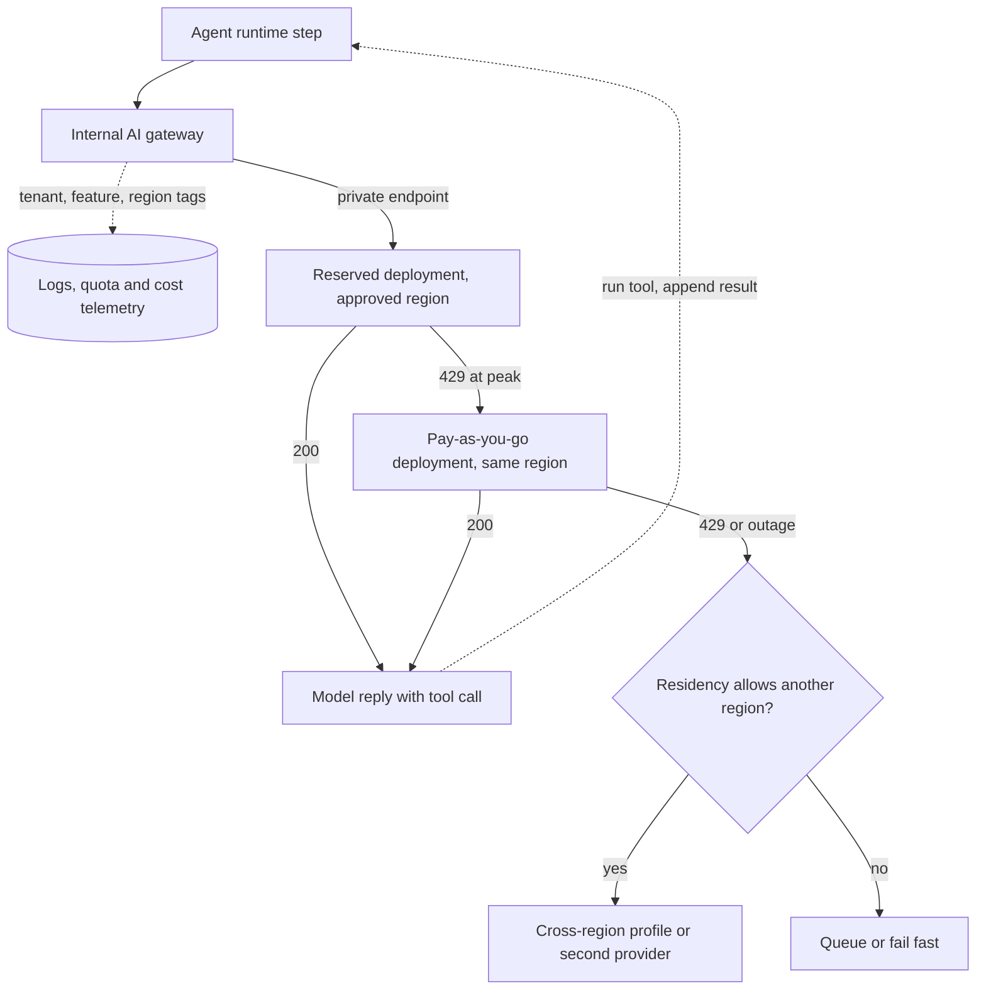

## TL;DR
In most enterprises your agent's model calls go through Bedrock, Azure OpenAI or Vertex AI: a managed
API inside the cloud's identity, network, logging and billing perimeter. You gain approval and
compliance; you pay with model lag, per-region quotas and lock-in.

## For agent builders
- **Why it matters for agents.** An agent run is many model calls carrying tool results full of customer
  data. Putting those calls inside the customer's cloud perimeter is often what gets an agent approved,
  and the platform's per-region quota and capacity mode decide whether a 10-step run finishes at peak.
- **Where it shows up in your stack.** Your agent framework's model client pointed at the Bedrock Converse
  API (which supports tool use), an Azure OpenAI *deployment*, or Vertex through the Gen AI SDK; plus the
  managed agent, retrieval and guardrail services each cloud sells next to the model.
- **What you control.** Which model version is pinned under your agent evals, which region and capacity
  mode each agent uses, whether calls go through your own gateway, and which managed agent pieces you
  adopt versus keep in your own code.
- **What you can skip.** Console click-paths and the full product catalog. Know the seven layers, the
  deployment-name trap, version pinning and the reserved-versus-shared arithmetic.

## Decision case
### Scenario
An insurer that runs on AWS is launching a claims agent that reads policy documents and claim photos
through tools. All prices and volumes are illustrative, not list prices.
- **Volume:** about 22,000 runs a month at ~55k tokens per run, so ~1.2B tokens a month, with short
  business-hour peaks about 3× the average. Replaying a month of traffic against the reservation's rate
  shows ~0.15B tokens a month arriving above it during those peaks.
- **Capacity figures from a load test:** a reservation costs $30,000 a month and serves ~1.5B tokens a
  month of this mix at full use; pay-as-you-go costs $40 per million tokens.
- **Constraints:** claim data must be processed in one named EU region; model spend at most $40,000 a
  month; launch in 8 weeks; a new vendor's security review takes longer than that; the same agent must
  ship next year to a partner that runs on Azure; the agent needs tool use with a pinned model version.

### Options
| Option | How it works | Residency | Monthly model cost | Peak behaviour | Lock-in and deadline |
|---|---|---|---|---|---|
| A. Vendor's direct API | Agent calls the model vendor's public endpoint | Depends on the vendor contract under review | 1.2B × $40/M = $48,000 | Vendor's shared limits | Newest models, but the review misses the launch |
| B. Bedrock pay-as-you-go, regional | Converse API through a VPC endpoint, cross-region profiles off | Met | $48,000 | Shared regional quota: 429s at peak | Low; meets the deadline if quota is requested now |
| C. Bedrock reserved base, pay-as-you-go spill, own loop behind a gateway | Reservation carries ~1.05B (70% use), ~0.15B of peak spills to on-demand in the same region | Met | $30,000 + 0.15B × $40/M = $36,000 | Base guaranteed, burst on shared quota | Gateway keeps the Azure port a config change |
| D. As C, but on the cloud's managed agent service | The platform runs the loop, memory and tool wiring | Met | As C plus the service's own charges | As C | Fastest first agent; loop does not move to Azure |

### Decision
Choose **C**, because:
- **It is the only option under the $40,000 budget that also meets residency and the deadline.** A and B
  both cost $48,000, and A's review outlasts the 8 weeks.
- **The reservation clears break-even:** u\* = 30,000 ÷ 60,000 = 50%, and the base load fills about 70%.
- **The spill keeps peaks served without leaving the region,** because the fallback is same-region
  pay-as-you-go, never a cross-region profile.
- **Owning the loop behind a gateway** is what makes next year's Azure deployment a mapping change; D
  would bind the loop, memory and tool wiring to one cloud.

**What would change it:**
- **Volume falling** so the reservation's use drops below 50% (under ~0.75B tokens a month): move to B.
- **The residency rule widening** to an EU geography: add a cross-region inference profile as fallback.
- **The product needing a model only the vendor offers:** restart A's review now, since it is the long
  pole.

### Trade-offs accepted
- **Model and feature lag** behind the vendor's API. Watch release notes for the pinned model and keep
  the agent eval set ready to replay on a new version.
- **A forecast error is paid for the commitment term.** Watch reservation utilization against u\* every
  week.
- **Peak spill can still hit 429s** on the shared regional quota. Watch spill rate and 429s per agent,
  and file quota increases weeks ahead.
- **Running a gateway** is our code to operate. Watch that every gateway request has a matching
  invocation-log entry.

### Review rubric
- **Residency is checked per layer:** region, deployment type, cross-region options and the fallback
  path.
- **Capacity mode is chosen with break-even arithmetic** that recomputes from the stated prices and
  load-tested capacity.
- **Volume is sized from agent steps** (tokens per run × runs), not from users.
- **Version pinning and an eval gate** are part of the design, with the retirement date tracked.
- **Lock-in is addressed explicitly,** naming which pieces (loop, memory, tools) stay portable.
- **Reversal triggers are measurable,** such as utilization below u\* or a changed residency rule.

## Why it exists
- **A vendor's public API triggers reviews unrelated to the model.** Who approved this vendor, where does
  the data go, which network path, how is it authenticated, where are the logs, who pays under which
  contract. Each is a review, and each review is slow.
- **The company already has those answers for its cloud.** IAM or Entra identities, private networking,
  audit logging, consolidated billing against a committed spend, and a signed compliance package. The cloud
  AI platforms let the model inherit them, so to a security reviewer it is "just another cloud service".
- **"Same model, use the vendor API" fails on the review calendar,** not on technology, and later on data
  terms (training opt-outs, retention, residency) that the cloud contracts fix in writing.
- **It also fails on capacity.** Committed cloud customers can buy provisioned throughput in their own
  region, which a public pay-as-you-go API does not offer in the same form.
- **"Self-host everything on our GPUs" fails** for most teams on model quality and operations cost, which
  is why the managed route is the default in large organisations.

## How it works
### What a call looks like on each platform
| Platform | A request is | Network | Logging |
|---|---|---|---|
| Bedrock | A SigV4-signed AWS API call | Can travel over a VPC endpoint | Opt-in model invocation logging to CloudWatch Logs or S3, billed on the AWS invoice |
| Azure OpenAI | A call to a deployment, a resource in a resource group with Entra RBAC | Private endpoint | Diagnostic settings |
| Vertex AI | A Google Cloud API call under a project's IAM | VPC Service Controls | Cloud Audit Logs |

### The common shape: seven layers
All three platforms present the same layers, and your design decisions live in each.

1. **Identity.** No API keys from the model vendor. Bedrock uses IAM principals and policies per model;
   Azure OpenAI uses Entra ID (keys exist but are the weaker option); Vertex uses Google Cloud IAM and
   service accounts. *Decide:* which workload identities may call which models.
2. **Network.** Private connectivity so traffic never crosses the public internet: VPC endpoints
   (PrivateLink) for Bedrock, Private Endpoints for Azure OpenAI, Private Service Connect and VPC Service
   Controls for Vertex. *Decide:* where the endpoint sits and which networks can reach it.
3. **Model catalog and endpoint.** See the next subsection. *Decide:* which models, which versions, pinned
   how.
4. **Capacity model.** Pay-as-you-go vs reserved, below. *Decide:* which workloads run on shared quota and
   which need reserved capacity.
5. **Region.** Models are available per region, and quotas are per region. *Decide:* which regions satisfy
   the data-residency rule, and whether cross-region routing is permitted.
6. **Governance and logging.** Invocation logging to the cloud's log services, content filters (Bedrock
   Guardrails, Azure's built-in content filtering, Vertex safety settings), and the data terms.
7. **Adjacent building blocks.** Managed retrieval (Bedrock Knowledge Bases, Vertex AI Search and RAG
   tooling, Azure AI Search), agent frameworks, evaluation and fine-tuning services. They are convenient
   and deepen lock-in; treat each as a separate build-versus-buy decision.

### Model catalogs
- **One idea on three clouds:** frontier and open-weight models served as a managed API inside your
  account's perimeter. The architecture work is placing the endpoint inside that perimeter and planning
  capacity per region.
- **Bedrock** offers models from several vendors (Amazon's own, Anthropic, Meta, Mistral and others)
  behind one API, with the Converse API as the model-agnostic interface.
- **Azure OpenAI** hosts OpenAI models; you create a named *deployment* of a model version with a capacity
  setting. The wider Azure AI Foundry catalog (since rebranded Microsoft Foundry; these product names
  change often) adds other vendors' models.
- **Vertex** serves Gemini natively and partner models (Anthropic, Meta, Mistral and others) through Model
  Garden.

### Capacity modes and regions
- **Two modes everywhere, with different names.** Pay-as-you-go shares a regional pool under quotas
  (requests and tokens per minute per model per region per account or subscription).
- **Reserved capacity buys guaranteed throughput:** Bedrock Provisioned Throughput in model units, Azure
  Provisioned Throughput Units (PTU), Vertex Provisioned Throughput. It exists *because* the shared pool
  cannot promise throughput at peak; you pay for dedicated model capacity in exchange for predictability.
- **Batch modes** exist for offline work at a discount.
- **Cross-region routing when one region is full:** Bedrock cross-region inference profiles, Azure "Global"
  and "Data Zone" deployment types that process within a wider geography, and a global endpoint option on
  Vertex for some models. These trade residency precision for availability.

### Data terms
- **No training on your data:** all three state that customer prompts and outputs are not used to train the
  base models.
- **Azure abuse monitoring** may retain prompts for a limited period unless an exemption is granted, which
  matters for regulated data and must be checked against current docs.

### Where the differences bite
- **Model lag.** New models and features usually reach the vendor's own API first and the cloud platforms
  days to months later, sometimes with missing features. If the roadmap depends on the newest model, that
  lag is a real cost.
- **Capacity semantics.** Azure's quota is a TPM allocation per model per region per subscription that you
  split across deployments; Bedrock's on-demand quotas are per model per region per account; Vertex has
  moved Gemini pay-as-you-go toward a dynamically shared quota rather than fixed per-project limits.
- **Same consequence everywhere:** plan capacity per model per region and request increases early, since
  increases are tickets, not API calls.
- **Version pinning and retirement.** Each platform retires model versions on its own schedule; Azure
  deployments can be set to auto-upgrade or pinned, Bedrock and Vertex pin by model id.
- **A pin is not forever.** When a pinned version reaches its retirement date you must migrate (or, on
  Azure, you may be upgraded), so the retirement calendar is part of the plan. Unplanned upgrades change
  behaviour under your evals, so pinning plus a scheduled re-evaluation is the safe pattern.

### SDK shape
| Platform | SDK | Notes |
|---|---|---|
| Bedrock | Its own SDK (boto3) | Two call styles: `InvokeModel`, whose request body is each vendor's native format, and the Converse API, one message format across models; vendor SDKs can also use Bedrock as a backend |
| Azure OpenAI | The OpenAI SDK with an Azure client | `model` means the deployment name. Azure has also added a versionless "v1" endpoint usable from the standard OpenAI client, so check which style the current docs recommend |
| Vertex | The Google Gen AI SDK, or vendor SDKs with a Vertex backend | Authenticates with Application Default Credentials and a project/location |

- **Hide the differences.** An internal gateway or an abstraction such as LiteLLM usually hides this so that
  application code is not rewritten when a model moves.

### Choosing the capacity mode
Reserved capacity is a fixed hourly or monthly price for a throughput ceiling; pay-as-you-go is a
per-token price with no ceiling guarantee. The comparison is the same arithmetic as owning GPUs:

```
on-demand cost  = tokens actually served × price per token
reserved cost   = units × price per unit-hour × hours (paid whether used or not)
break-even utilization u* = reserved cost ÷ (tokens the reservation could serve at full use × on-demand price)
```

- **Above u\*, reserved is cheaper per token;** below it, you are paying for a guarantee.
- **"Tokens the reservation could serve" is the hard number,** because each platform's unit (model unit,
  PTU) delivers a throughput that depends on the model and on the input/output mix: prompt-heavy and
  generation-heavy traffic consume a unit differently.
- **Load-test it.** Each platform publishes sizing guidance or a calculator, but the reliable figure comes
  from a load test of your own traffic mix against a small reservation.
- **A latency SLO at peak can justify reserved capacity below u\*,** since the alternative is 429s at the
  worst moment.
- **Commitment terms** (hourly, monthly, longer) mean a forecast error is paid for the length of the term.

### What changes when the caller is an agent
| Layer | One-shot chat call | Agent run |
|---|---|---|
| Identity | One app identity calls the model | The agent's identity calls the model *and* its tools; keep them separate so a prompt injection cannot borrow model permissions for cloud APIs |
| Capacity | One request per user turn | 5-50 calls per run, each re-sending a growing transcript, so TPM per run is many times a chat turn |
| Logging | Prompt and answer | Every step, including tool inputs and results, which often hold the most sensitive data in the run |
| Versions | A change shifts tone | A change shifts tool-choice and argument formats, which breaks the loop rather than the prose |
| Features | Text generation | Tool use, structured output and prompt caching, which may arrive on a cloud platform later than on the vendor's API |

- **Managed agent services are layer 7.** Each cloud sells an agent runtime and managed retrieval next to
  the model. They save glue code but own your loop, memory and tool wiring, so they deepen lock-in more
  than a model call does.

### The reference architecture
Agent runtime (your loop and tools) → internal AI gateway (auth, routing, quotas, logging, prompt and
response capture) → private endpoint → cloud AI platform in the approved region → optional cross-region
or second provider fallback. The gateway is where you keep the option to move between platforms, which
answers the second-layer lock-in these services create.

## Diagram
The path of one agent step: the gateway sends base load to reserved capacity, spills bursts to
pay-as-you-go, and leaves the region only if the residency rule allows it. Tool calls go back to the
agent runtime, which runs them and sends the next step.



## Examples
### The same one-turn request on all three platforms
Notice what differs: Bedrock has no key and signs with the IAM identity in the environment; Azure needs an
endpoint, an API version and the *deployment* name; Vertex authenticates with Application Default
Credentials and a project/location. Model identifiers are placeholders to look up in each catalog.

```python
import os, boto3
from openai import AzureOpenAI
from google import genai

QUESTION = "Summarise our refund policy in one sentence."

def via_bedrock(model_id: str) -> str:
    rt = boto3.client("bedrock-runtime", region_name=os.environ["AWS_REGION"])  # IAM creds, SigV4
    r = rt.converse(
        modelId=model_id,                                   # or a cross-region inference profile id
        messages=[{"role": "user", "content": [{"text": QUESTION}]}],
        inferenceConfig={"maxTokens": 200},
    )
    return r["output"]["message"]["content"][0]["text"]

def via_azure(deployment_name: str) -> str:
    client = AzureOpenAI(
        azure_endpoint=os.environ["AZURE_OPENAI_ENDPOINT"],   # https://<resource>.openai.azure.com
        api_key=os.environ["AZURE_OPENAI_API_KEY"],            # prefer Entra ID token auth in prod
        api_version=os.environ["AZURE_OPENAI_API_VERSION"],
    )
    r = client.chat.completions.create(
        model=deployment_name,                               # deployment, not the model family name
        messages=[{"role": "user", "content": QUESTION}], max_tokens=200,
    )
    return r.choices[0].message.content

def via_vertex(model_name: str) -> str:
    client = genai.Client(vertexai=True, project=os.environ["GCP_PROJECT"],
                          location=os.environ["GCP_LOCATION"])  # ADC supplies the identity
    r = client.models.generate_content(model=model_name, contents=QUESTION)
    return r.text
```

- **In production none of these calls live in application code.** They sit behind the gateway, which tags
  each request with tenant, feature and region so quota use and cost can be attributed and a fallback can
  be configured without touching the application.

### Worked scenario: reserved vs pay-as-you-go
Illustrative prices, not any platform's list price. A reservation costs $30,000 a month; your load test
shows it sustains about 1.5 billion tokens a month of your mix at full use. The same tokens on
pay-as-you-go cost $40 per million, so full use would cost $60,000 on demand.

| Average utilization | Reserved | On demand | Verdict |
|---|---|---|---|
| Break-even u\* | 30,000 ÷ 60,000 | = 50% | the line to beat |
| 70% | $30,000 | $42,000 | reserved wins |
| 30% | $30,000 | $18,000 | only a peak-latency SLO justifies it |

- **The usual design** reserves for the base and lets the burst above it spill to a pay-as-you-go
  deployment, which the gateway does by trying the reserved endpoint first and falling over on a 429.

### Gateway spill from reserved to pay-as-you-go
A minimal version of that spill on Azure, with two deployments of the same model in one resource. The
reserved call disables the SDK's automatic retries so a 429 spills at once instead of waiting.

```python
import openai

def complete_with_spill(client: openai.AzureOpenAI, reserved: str, paygo: str, messages, **kw):
    """Base load on the provisioned deployment; burst spills to pay-as-you-go on 429."""
    try:
        r = client.with_options(max_retries=0).chat.completions.create(
            model=reserved, messages=messages, **kw)
        return r, "reserved"
    except openai.RateLimitError:
        r = client.chat.completions.create(model=paygo, messages=messages, **kw)
        return r, "paygo"          # count these: a rising spill rate means the reservation is too small
```

### An agent tool loop on the Bedrock Converse API
The same loop shape works on every platform; here the tool schema travels in `toolConfig` and the
model asks for a tool by stopping with `tool_use`. The model id is a placeholder; `lookup_order` is a
stand-in for a real tool.

```python
import os, json, boto3

rt = boto3.client("bedrock-runtime", region_name=os.environ["AWS_REGION"])
TOOLS = {"tools": [{"toolSpec": {
    "name": "lookup_order", "description": "Fetch an order by id",
    "inputSchema": {"json": {"type": "object", "properties": {"order_id": {"type": "string"}},
                             "required": ["order_id"]}}}}]}

def lookup_order(order_id: str) -> dict:          # stand-in: call your own service here
    return {"order_id": order_id, "status": "shipped"}

def run_agent(model_id: str, question: str, max_steps: int = 8) -> str:
    messages = [{"role": "user", "content": [{"text": question}]}]
    for step in range(max_steps):                  # every step is one quota-counted model call
        r = rt.converse(modelId=model_id, messages=messages, toolConfig=TOOLS,
                        inferenceConfig={"maxTokens": 400})
        msg = r["output"]["message"]; messages.append(msg)
        if r["stopReason"] != "tool_use":
            return msg["content"][0]["text"]
        results = []
        for block in msg["content"]:
            if "toolUse" in block:
                tu = block["toolUse"]
                out = lookup_order(**tu["input"])      # this data is now in the next prompt and the logs
                results.append({"toolResult": {"toolUseId": tu["toolUseId"], "content": [{"json": out}]}})
        messages.append({"role": "user", "content": results})
    raise RuntimeError("step budget exhausted")
```

- **The perimeter question is the tool result.** `out` re-enters the prompt on the next step and lands in
  invocation logs, so residency, logging and abuse-monitoring terms apply to tool data, not just to the
  user's question.

### Worked scenario: what an agent run costs a reservation
Illustrative figures. A support agent averages 8 model calls per run; prompts grow from 3k to 10k tokens,
so a run charges about 52k input and 3k output tokens.

| Quantity | Value |
|---|---|
| Tokens per run | ~55k |
| Runs per peak hour | 1,200, so ~66M tokens per hour |
| Same traffic as one-shot chat (one ~4k-token call per question) | ~4.8M tokens per hour, about 14x less |
| Reservation sized from chat traffic | spills most agent steps to pay-as-you-go at peak |

- **Size from steps, not users.** Load-test the reservation with recorded agent transcripts, because the
  prompt-heavy mix of agent steps consumes a unit differently from short chat turns.

## Production patterns
- **One gateway for every agent step.** Point the agent framework's model client at the internal gateway,
  never at a platform SDK directly, and tag each call with agent name, run id and step number. Monitor
  tokens and spill rate per agent, so one chatty agent cannot hide inside the team total.
- **Gate version changes on agent evals.** Before moving a pinned model, replay the agent eval set and
  check tool-choice accuracy, argument validity and task success, not only answer quality. Monitor tool
  call parse failures per model version after every switch.
- **Separate model and tool identities.** Give the agent runtime one workload identity for model calls and
  narrowly scoped ones per tool, so a hijacked step cannot use model permissions on other cloud APIs.
  Monitor access-denied events per tool identity.
- **Reserve the base, spill the burst.** When load has a steady floor plus peaks, size provisioned
  capacity for the floor and route overflow to a pay-as-you-go deployment on 429, as in the snippet above.
  Monitor reservation utilization against u\* and the spill rate.
- **Private-only endpoints.** Disable public network access on the Azure OpenAI resource and use a Private
  Endpoint; reach Bedrock through a VPC interface endpoint with an endpoint policy; put Vertex inside a VPC
  Service Controls perimeter. Monitor denied calls in the audit logs.
- **Least-privilege model access.** Grant workload identities only the models they need, for example an IAM
  policy allowing `bedrock:InvokeModel` on specific model ARNs (the Converse API uses the same
  permission). Monitor access-denied errors after each new model rollout.
- **Pin versions with a retirement calendar.** Turn off auto-upgrade on Azure deployments and pin model ids
  on Bedrock and Vertex; track each pinned version's retirement date and re-run evals before switching.
  Monitor eval scores and output-parse failures per model version.
- **Invocation logging on from day one.** Enable Bedrock model invocation logging (it is opt-in), Azure
  diagnostic settings and Vertex audit logs, routed to the security team's workspace. Monitor that every
  gateway request has a matching platform log entry.
- **Quota headroom per model per region.** Keep a sheet or config of quota, current peak TPM and lead time
  for each model-region pair, and file increases weeks before launch. Monitor 429 and throttle rates.

## Trade-offs
- **Cloud perimeter vs model lag.** You inherit the cloud's identity, network, logging and compliance
  perimeter, but accept model and feature lag behind the vendor's own API; the balance flips when the
  product depends on the newest model capabilities.
- **Reserved capacity vs paying for idle.** PTU, provisioned throughput and model units buy predictable
  throughput for peak, but are paid whether used or not; worth it only when steady load fills most of it
  or an SLO makes shared-pool 429s unacceptable.
- **Consolidated billing vs multi-cloud freedom.** Billing against committed spend simplifies procurement
  and can discount the model bill, but ties model choice to one cloud's catalog and makes a multi-cloud
  model strategy harder.
- **Managed agent runtime vs owning the loop.** A cloud's agent service gets a first agent running fast,
  but its loop, memory and tool wiring are hard to move or test outside that cloud; owning the loop in
  your code behind a gateway flips the balance once you need custom control flow or a second cloud.
- **Managed adjacent services vs lock-in.** Knowledge bases, agents and guardrails accelerate delivery, but
  every one adopted deepens lock-in and narrows the exit path; the trade flips when the component is
  commodity and replaceable behind an interface.
- **Cross-region routing vs residency.** Cross-region and global options raise availability, but loosen
  the residency guarantee; where regulation names a region, they must be disabled.

## Pitfalls
- **Sizing capacity from user count instead of agent steps.** Symptom: a reservation that looked ample
  spills or throttles once the agent ships, because each run is many growing calls. Fix: size from
  recorded transcripts.
- **Assuming a tool-use feature exists on the cloud platform because it exists on the vendor API.**
  Symptom: an agent that works in a prototype against the vendor API fails or degrades on the approved
  cloud. Fix: check feature parity per platform before choosing the model.
- **Passing the model family name instead of the deployment name to Azure OpenAI.** Symptom: a 404
  "deployment not found" even though the model is clearly available in the region. Fix: keep the
  deployment mapping in the gateway's config (checking endpoint, region and API version too), so agent
  code never names Azure deployments directly.
- **Sizing capacity in one region and discovering the model is not offered there** or the quota is lower.
  Symptom: a launch delayed by a quota-increase ticket. Fix: check availability and quota first.
- **Leaving auto-upgrade or default model versions in place.** Symptom: a silent behaviour change that
  breaks evals or output parsing with no deploy on your side. Fix: pin and re-evaluate.
- **Enabling cross-region inference or global deployment types on a workload with a residency
  requirement.** Symptom: an audit finding months later rather than an error at request time.
- **Calling the platform from application code directly.** Symptom: a multi-week rewrite when a model moves
  clouds or a second provider is added for fallback. Fix: a gateway.
- **Assuming the cloud's data terms cover abuse-monitoring retention and human review.** Symptom: a
  compliance review rejects a workload handling regulated data until the exemption is arranged.

## When to use
- **Use a cloud AI platform when** the organisation already runs on that cloud, when identity, private
  networking and compliance scope are review gates, when spend commitments can absorb the model bill, or
  when you need reserved capacity in a chosen region.
- **Use it for agents when** the agent touches customer data that must stay inside an approved cloud
  perimeter, which is the common case for enterprise and forward-deployed agent work.
- **Prefer the vendor's direct API when** you need the newest models or features first and your data terms
  are satisfied by the vendor's contract.
- **Prefer self-hosting when** open-weight models meet the bar and volume makes it cheaper, or when the data
  cannot leave your own hardware.
- **Measure** quota headroom per model per region, 429 and throttle rates, and time-to-new-model when a
  release matters.
- **Interviews:** explain the identity, network, capacity and region layers and how a gateway keeps the
  exit open.

## Role lens
- **Engineer:** Wires the gateway to each platform's SDK, pins model versions, handles each
  platform's throttling and error shapes, and tags requests for cost and quota attribution.
- **Architect:** Chooses platform versus direct API versus self-host per workload, places endpoints
  inside the network and identity perimeter, and decides reserved versus shared capacity per region.
- **FDE:** Deploys the solution inside the customer's existing cloud account, works through their
  quota, region and private-endpoint constraints, and documents which data terms apply.

## Check yourself
**Q:** A bank on Azure wants a customer-facing assistant on a frontier model, with EU data residency,
a p95 latency target and a launch in six weeks. Walk through the architecture decisions and the
risks you would raise.
**A:** Use Azure OpenAI deployed in an EU region, reached through a Private Endpoint from the
application's VNet, with Entra ID identities and diagnostic logging to the bank's workspace. Check
model availability in that region first, then request quota early; for the latency target, size
provisioned throughput for peak and keep a pay-as-you-go deployment for overflow, or accept 429s
with queueing if the SLO allows. Use regional deployment types (regional Standard and regional
Provisioned) and avoid Global types; an EU Data Zone deployment keeps processing inside the EU and
may be acceptable, but only if legal confirms that the wider geography satisfies the residency rule. Pin the model version and schedule
re-evaluation before any upgrade. Confirm the abuse-monitoring retention terms and apply for the
exemption if required. Put all calls behind a gateway so a second region or provider can be added
as fallback. The biggest risks are quota lead time, model availability in the region, and
behaviour drift from version upgrades.

## Interview questions
### What do you gain and give up by calling a model through Bedrock, Azure OpenAI or Vertex instead of the vendor's own API?
- **Gain:** the model inherits identity (IAM, Entra), private networking, audit logging, consolidated
  billing and the signed compliance package, so security review treats it as another cloud service.
- **Gain:** provisioned throughput in your own region and written data terms on training and retention.
- **Give up:** days to months of model and feature lag, per-region quotas you must request, and a second
  layer of lock-in to the cloud's catalog and adjacent services.

### Walk me through deciding between provisioned throughput and pay-as-you-go.
- **Compute break-even:** u\* = reserved cost ÷ (tokens the reservation serves at full use × on-demand
  price); for a $30,000 reservation worth $60,000 on demand, u\* is 50%.
- **Get the capacity number by load test,** because a PTU or model unit delivers different throughput for
  prompt-heavy and generation-heavy mixes.
- **Then weigh the SLO and term:** a peak-latency SLO can justify reserving below u\*, and a long commitment
  makes forecast errors expensive.

### Outputs from a model you depend on changed without any deploy on your side. How do you stop that happening again?
- **Cause:** an auto-upgrade or default version moved under you, or a pinned version reached retirement.
- **Fix:** pin explicit versions (disable auto-upgrade on Azure, pin model ids on Bedrock and Vertex) and
  track each version's retirement date.
- **Process:** treat every version change as a release: run the eval set and output-parsing tests before
  switching traffic.

### How would you keep a credible exit from a cloud AI platform?
- **Put a gateway in front** so application code speaks one interface (your own, or an abstraction such as
  LiteLLM) and models can move between platforms by config.
- **Treat adjacent managed services** (knowledge bases, agents, guardrails) as separate build-versus-buy
  decisions, adopting them only where they are replaceable behind an interface.
- **Prove the exit:** keep a second provider or region wired as fallback and exercise it, so moving is a
  routing change rather than a rewrite.

### A customer wants your support agent deployed inside their Azure tenant. What changes in the agent, not just the endpoint?
- **The model client:** calls go to their Azure OpenAI deployment names through a gateway, so the agent
  code keeps one interface and the mapping lives in config.
- **Feature parity:** confirm that tool calling, structured output and caching behave the same on their
  model version, then replay the agent eval set there before go-live.
- **Data and identity:** tool results now carry their data into prompts and logs, so logging goes to their
  workspace and tools run under their scoped identities.

### Would you build on a cloud's managed agent service or run your own agent loop on the model API?
- **Managed service when** the agent is a standard retrieval-plus-tools assistant, the team is small, and
  staying on one cloud is acceptable.
- **Own loop when** you need custom control flow, your own evals and tracing per step, or the same agent on
  two clouds or a vendor API.
- **Either way,** keep tools and prompts in your own repo and the model behind a gateway, so the managed
  layer can be replaced.

## Quiz
### Q: What is the main reason enterprises route model calls through Bedrock, Azure OpenAI or Vertex AI rather than the model vendor's public API?
- [ ] The cloud platforms serve the models with lower latency
- [x] The model inherits the cloud account's identity, private networking, logging, billing and compliance perimeter
- [ ] The cloud platforms always offer newer model versions
- [ ] The cloud platforms do not enforce rate limits
> The technical model is the same; what changes is that security, procurement and compliance are
> already solved for the cloud provider. Model versions usually lag, and quotas still apply.

### Q: Why do all three platforms sell a reserved or provisioned capacity mode alongside pay-as-you-go?
- [ ] Reserved capacity uses a different, faster model build
- [ ] Pay-as-you-go cannot be used from a private endpoint
- [x] The shared regional pool is governed by quotas and cannot guarantee throughput at peak, so predictability has to be bought as dedicated capacity
- [ ] Reserved capacity is required for logging and audit features
> Shared pools give best-effort throughput under per-region quotas; a workload with a latency SLO at
> peak needs capacity that is reserved for it, which is what PTU, provisioned throughput and model
> units provide.

### Q: A workload with a strict single-country data-residency rule is deployed with a cross-region or global routing option enabled. What is the consequence?
- [ ] Requests fail immediately with a residency error
- [ ] Latency improves and nothing else changes
- [x] Requests may be processed in another region, violating the rule without any runtime error
- [ ] The quota is halved because two regions share it
> Cross-region and global modes are designed to route to wherever capacity exists; they do not know
> your legal constraints. The violation surfaces in an audit, not in an error, so it must be
> prevented by configuration.

## Use cases & projects
### Use cases
- **Enterprise agents on customer data.** A claims or support agent runs inside the customer's own cloud
  account so tool results never leave the approved identity, network and logging perimeter.
- **Forward-deployed agents.** The same agent is shipped to customers on different clouds, with a gateway
  mapping one model interface to Bedrock, Azure OpenAI or Vertex per deployment.
- **Capacity for agent launches.** Reserved capacity sized from agent-step traffic covers the base load
  of an internal agent, with pay-as-you-go absorbing bursts.
- **Regulated, region-pinned agents.** Residency rules decide which region, deployment type and fallback
  each agent may use.

### Mini project
**Port a tool-calling agent to a cloud platform behind a gateway (2-3 hours).**
- **Goal:** run one small agent on a cloud AI platform without changing the agent code when the backend
  changes.
- **Steps:** write a two-tool agent loop against a thin `complete(messages, tools)` interface; implement
  that interface once for a vendor API and once for Bedrock Converse (or Azure OpenAI); tag every call
  with run id and step; run the same five tasks on both backends and log steps, tokens and tool-call
  errors per run.
- **Done when:** both backends pass the five tasks with the agent code untouched, and you have a table of
  tokens per run and any feature differences you hit, with the model version pinned on each.
