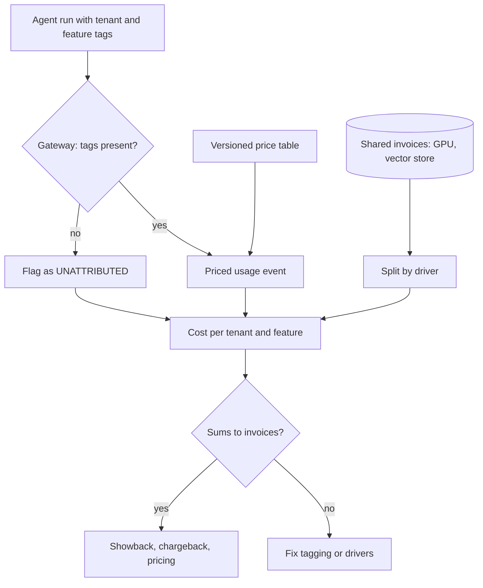

## TL;DR
Cost allocation assigns every dollar an agent platform spends to the tenant and feature that caused it:
tag each model and tool call, including ones deep inside agent runs, and split shared GPU fleets and stores
by an explicit driver, or tiers cannot be priced.

## For agent builders
- **Why it matters for agents.** An agent run spends money far from the request that started it: planner
  calls, tool calls that call models themselves, sub-agents, retries and background jobs. If tenant and
  feature tags do not follow every hop, most agent spend lands in an unattributed bucket.
- **Where it shows up in your stack.** The LLM gateway or client wrapper, trace context (OpenTelemetry
  span attributes or baggage, run metadata in LangSmith or Langfuse), job queue payloads, provider
  projects or keys, and the monthly reconciliation job against invoices.
- **What you control.** Which tags are mandatory, how the agent loop and its tools propagate them, the
  driver for shared GPU and vector-store cost, and whether idle capacity is spread or shown separately.
- **What you can skip.** Formal chargeback mechanics until internal teams pay from their own budgets.
  Showback with trustworthy, reconciled numbers is where agent platforms start.

## Why it exists
- **Invoices say how much, not who.** A hosted model invoice is one number per model per month; a
  self-hosted GPU fleet costs the same per hour whether one tenant or fifty used it.
- **Cost profiles differ wildly.** A tenant who uploads 500-page contracts and runs long agent sessions
  can cost a hundred times more than one asking short questions on the same plan. Without allocation it
  looks as profitable as everyone else until gross margin turns negative.
- **Even or per-seat splits hide the problem,** because they subsidize heavy users with light ones.
- **Direct-API-only allocation ignores shared infrastructure,** which for self-hosted or RAG-heavy systems
  can be most of the spend.
- **Retrofitting fails.** Attribution cannot be rebuilt later from logs when tenant and feature were never
  recorded at call time, and adding tags across many services is slow. Allocation answers, with numbers
  that reconcile to the invoice: what each tenant and feature costs, and where the margin is.

## How it works
### 1. Tag at the point of spend
- **One gateway or client library** for all model, embedding and reranker calls, requiring `tenant_id`,
  `feature` (or workflow) and a task or trace ID on every call; it rejects or flags calls missing them.
- **Record per call:** model, tokens by type (fresh input, cached input, output, reasoning), latency, and
  for self-hosted models the GPU-seconds or token-seconds consumed.
- **Propagate tags** through agents, tools and background jobs as trace attributes, *because* the call
  that spends money is often several hops away from the request that caused it.
- **Paid tools count too.** Search APIs, code sandboxes and other per-call tools the agent uses go through
  the same tagging, so a tenant's agent cost is not just its token bill.

### 2. Price direct costs per call
- **Compute cost at write time** from a versioned price table, so historical rows keep the price that
  applied then.
- **Apply the billing rules your provider actually uses** for cache, batch and long context.
- **Cross-check at the source:** where possible, use separate provider API keys or projects per
  environment or major feature so the invoice itself can be split.

### 3. Allocate shared costs with explicit drivers
Shared pools need a driver that approximates causation:

| Pool | Driver | Why |
|---|---|---|
| **GPU fleet** | GPU-seconds or token-seconds per request; tokens weighted by phase (prefill vs decode) | Concurrent batching makes exact attribution impossible |
| **GPU fleet, long-context traffic** | KV-cache occupancy (context tokens × seconds resident) | Memory, not compute, limits how many other requests fit |
| **Shared prompt-cache prefixes** | Blended rate for every call | Literal billing rewards whoever arrives second |
| **Commitments and discounts** | Effective (amortized) rate, not list price | An unused commitment is idle capacity under another name |
| **Vector store** | Stored vectors (storage-bound); query count (compute-bound) | Matches what drives each cost |
| **Embedding re-indexing** | The tenant whose data was re-embedded | They caused it |
| **Idle and headroom capacity** | Spread by usage, or a visible platform-overhead line | Policy choice, see below |

- **Long context crowds others out.** A 100k-token session that decodes slowly crowds out many short ones
  while using little arithmetic, so occupancy is often the fairer driver. Long-running agents with large
  transcripts are exactly this traffic.
- **Prompt-cache prefixes:** the first request pays the cache write and later ones get the cheap read.
  For a prefix shared across tenants (a common system prompt or tool schema set), pricing every call at
  the blended rate is usually fairer.
- **Idle capacity:** spreading makes tenant totals add up; keeping it separate shows the cost of
  over-provisioning instead of hiding it.
- **Write the driver choice down.** It is a policy decision, and changing it changes everyone's numbers.
- **Platform-caused waste goes to platform overhead.** Retries after a provider 5xx or a bad deploy are
  usually better charged there than to the tenant who happened to be calling.

### 4. Reconcile and track the unallocated share
- **Each month, allocations must sum to the invoices.**
- **Track the unattributed share** (untagged calls, shared jobs) as a KPI and drive it down, because a
  large unattributed bucket makes every per-tenant number suspect.

### 5. Use it: showback, chargeback, pricing
- **Showback** reports cost per tenant and feature to teams and account owners.
- **Chargeback** actually moves the cost onto internal teams' budgets.
- **External pricing is a separate decision** (usage-based tiers, overages) that this data informs.
- **Most products start with showback,** then use the data to set tier limits, overage pricing,
  per-tenant quotas, and to flag tenants whose cost exceeds their revenue.

## Diagram
Direct costs are priced per tagged call, including calls made inside agent runs; shared invoices are
split by a driver; both meet in one tenant-by-feature table that must reconcile to the invoices.



## Examples
### Propagating tags through an agent run
A `contextvars` variable carries tenant, feature and run ID into every model call, tool call and
concurrent sub-task of one run; asyncio tasks copy the context automatically, but a queued job only keeps
the tags you copy into its payload. Costs are illustrative.

```python
import asyncio, contextvars

TAGS = contextvars.ContextVar("cost_tags", default=None)   # tenant, feature, run id
LEDGER = []

def record(kind, cost_usd):
    tags = TAGS.get() or {"tenant_id": "UNATTRIBUTED", "feature": "UNATTRIBUTED"}
    LEDGER.append({**tags, "kind": kind, "cost_usd": cost_usd})

async def call_model(step, cost):          # stand-in for the gateway client
    record(f"model:{step}", cost)

async def web_search(q):                   # tool that itself calls a model to summarise
    record("tool:web_search", 0.005)
    await call_model("summarise_results", 0.02)

async def run_agent(tenant_id, feature, run_id):
    TAGS.set({"tenant_id": tenant_id, "feature": feature, "run_id": run_id})
    await call_model("plan", 0.03)
    await asyncio.gather(web_search("a"), web_search("b"))  # tasks copy the context
    await call_model("answer", 0.04)
    return {"job": "reembed", **TAGS.get()}                 # copy tags into job payloads

def run_job(payload):                      # queue worker: restore tags from the payload
    TAGS.set({k: payload[k] for k in ("tenant_id", "feature", "run_id")})
    record("model:reembed", 0.08)

job = asyncio.run(run_agent("acme", "research-agent", "r-17"))
record("model:background_job_without_tags", 0.08)          # a hop that lost the context
run_job(job)                                               # the same job, tags carried over
for row in LEDGER:
    print(row["tenant_id"], row["kind"], row["cost_usd"])
# acme model:plan 0.03 ... acme model:answer 0.04
# UNATTRIBUTED model:background_job_without_tags 0.08
# acme model:reembed 0.08
```

### Worked scenario: where an agent run's spend goes missing
One illustrative research-agent run costs $0.42. Before propagation, only the user-facing calls carried
tags.

| Hop | Cost | Tagged before fix | Tagged after fix |
|---|---|---|---|
| Planner and final-answer calls | $0.12 | yes | yes |
| Tool calls and the models tools call | $0.22 | no | yes, via trace context |
| Background re-embedding job | $0.08 | no | yes, tags in job payload |
| **Unattributed share** | | **~71%** | **0%** |

- **Before the fix,** the tenant looked as if it cost $0.12 per run, under a third of the truth.
- **The tool hop is the usual leak,** because tools are often written as plain functions that call the
  model client without the run's context.

### Monthly allocation in SQL
A month of usage: hosted API calls priced at the gateway, plus a shared GPU fleet and vector store
billed as lump sums (PostgreSQL; numeric columns).

```sql
WITH usage AS (
  SELECT COALESCE(tenant_id, 'UNATTRIBUTED') AS tenant_id,
         COALESCE(feature,   'UNATTRIBUTED') AS feature,
         COALESCE(SUM(api_cost_usd), 0)::numeric AS direct_usd,  -- priced per call at the gateway
         SUM(gpu_seconds)::numeric       AS gpu_s,       -- self-hosted calls
         SUM(retrieval_queries)::numeric AS rq
  FROM usage_events
  WHERE ts >= DATE '2026-09-01' AND ts < DATE '2026-10-01'
  GROUP BY 1, 2
),
pools AS (
  SELECT SUM(amount_usd) FILTER (WHERE pool = 'gpu_fleet')    AS gpu_usd,
         SUM(amount_usd) FILTER (WHERE pool = 'vector_store') AS vec_usd
  FROM shared_invoices WHERE month = DATE '2026-09-01'
),
alloc AS (
  SELECT u.tenant_id, u.feature, u.direct_usd,
         COALESCE(p.gpu_usd * u.gpu_s / NULLIF(SUM(u.gpu_s) OVER (), 0), 0) AS gpu_usd,
         COALESCE(p.vec_usd * u.rq / NULLIF(SUM(u.rq) OVER (), 0), 0)       AS vector_usd
  FROM usage u CROSS JOIN pools p
)
SELECT tenant_id, feature,
       ROUND(direct_usd, 2) AS direct, ROUND(gpu_usd, 2) AS gpu, ROUND(vector_usd, 2) AS vector,
       ROUND(direct_usd + gpu_usd + vector_usd, 2) AS total
FROM alloc
ORDER BY total DESC;
```

- **The `UNATTRIBUTED` row should be small;** if it is 15% of spend, fix tagging before trusting any
  tenant number.

### Worked scenario: the tenant that looked profitable
Illustrative month: $40,000 of direct API spend plus a $30,000 GPU fleet ($70,000 in all; vector store
left out for simplicity). Tenant A's contract-review agent used 45% of GPU-seconds, and A holds 5% of
seats.

| View | A's cost | A's contract | Margin |
|---|---|---|---|
| Per-seat split: 5% of $70,000 | $3,500 | $12,000 | +$8,500 |
| Driver-based: $6,200 direct + 45% × $30,000 = $13,500 GPU | about $19,700 | $12,000 | about −$7,700 |

- **The even-split view would have shown A as profitable.**
- **Next steps the data supports:** a tier limit or overage price for long documents, a per-tenant quota,
  or a dedicated pool priced into A's contract.

### Pricing each call at write time
A versioned price table means a provider price change never rewrites last quarter's tenant costs.

```python
from datetime import date

# $ per million tokens, illustrative. Rows are appended, never edited.
PRICES = [
    ("large", date(2026, 1, 1), {"in": 3.00, "cached": 0.30, "out": 15.00}),
    ("large", date(2026, 9, 15), {"in": 2.50, "cached": 0.25, "out": 12.50}),
]

def price_for(model, day):
    rows = [(start, p) for m, start, p in PRICES if m == model and start <= day]
    if not rows:
        raise LookupError(f"no price for {model} on {day}")
    return max(rows, key=lambda r: r[0])

def priced_event(call):
    for tag in ("tenant_id", "feature", "trace_id"):
        if not call.get(tag):
            raise ValueError(f"untagged model call: missing {tag}")   # or flag as UNATTRIBUTED
    start, p = price_for(call["model"], call["day"])
    cost = (call["fresh_in"] * p["in"] + call["cached_in"] * p["cached"]
            + call["out"] * p["out"]) / 1e6
    return {**call, "price_version": start.isoformat(), "api_cost_usd": round(cost, 6)}

call = dict(tenant_id="acme", feature="contract-review", trace_id="t-91", model="large",
            day=date(2026, 9, 10), fresh_in=12_000, cached_in=2_000, out=800)
print(priced_event(call)["api_cost_usd"])                                 # 0.0486, old price
print(priced_event({**call, "day": date(2026, 9, 20)})["api_cost_usd"])   # 0.0405, new price
```

## Production patterns
- **Mandatory tags at the gateway.** When several services call models, make the shared gateway or client
  reject (or loudly flag) any call without tenant, feature and trace ID. Monitor the unattributed share
  of spend daily and alert above a threshold such as a few percent.
- **Propagate context through async work.** Carry tenant and feature as trace context (for example
  OpenTelemetry baggage or span attributes) into agents, tool calls, queues and background jobs, and copy
  them into job payloads. Monitor unattributed spend by service to find the hop that drops them.
- **Tag the run, not just the call.** Agent teams attach run ID, tenant and feature as run metadata in
  their tracing tool, so cost per run can be grouped by tenant and the most expensive runs opened.
  Monitor cost per run percentiles per tenant.
- **Split at the source with provider projects or keys.** Use separate OpenAI projects or Anthropic
  workspaces, or separate keys, per environment or major feature, so the invoice cross-checks the
  gateway's numbers. Monitor the gap between gateway-computed and invoiced cost per key.
- **Monthly reconciliation job.** Sum allocations per pool and compare with each invoice before
  publishing showback. Monitor reconciliation error and the size of the platform-overhead line.
- **Cost-versus-revenue alerts per tenant.** Join allocated cost with contract revenue and flag tenants
  whose cost exceeds a set share of revenue. Monitor the count of negative-margin tenants and feed it to
  pricing, quotas and isolation decisions.

## Trade-offs
- **Fine-grained drivers vs effort.** GPU-seconds by phase and per-query vector cost are fairer, but cost
  engineering effort; coarse token-proportional splits suffice while shared costs are a small share of
  spend.
- **Spreading idle capacity vs visibility.** It makes totals reconcile, but hides over-provisioning; keep
  it separate when the platform team needs to see and own utilization.
- **Chargeback vs disputes.** It changes behavior because internal teams pay from their own budget, but
  disputes over drivers follow; showback is the better start until the numbers are trusted.
- **Per-tenant keys or dedicated pools vs pooling.** They make attribution exact, but lose pooling
  efficiency and add quota management; worth it for large enterprise tenants, not a long tail of small
  ones.
- **Strict rejection of untagged calls vs agent availability.** Rejecting untagged calls forces clean
  data, but a missed tag in a new tool then breaks agent runs; flag-and-alert is safer while tools are
  still being added.

## Pitfalls
- **Tagging only the user-facing call.** Symptom: a large unattributed bucket made of agent tool calls,
  background re-embeddings and retries that lost their tenant context. Fix: propagate tags as trace
  context.
- **Repricing history with today's price table.** Symptom: last quarter's per-tenant costs change after a
  provider price update. Fix: price at write time with a versioned table.
- **Allocating shared GPU cost by request count.** Symptom: long-document tenants look cheap while
  short-query tenants are overcharged, and cost per tenant does not track token volume. Fix: a
  token-based or occupancy driver.
- **Never reconciling with invoices.** Symptom: per-tenant totals drift from actual spend and finance
  stops trusting the dashboard. Fix: a monthly reconciliation step before publishing.

## When to use
- **Set up tagging before the first multi-tenant launch;** it is cheap at the start and painful to
  retrofit, especially once agents have many tools.
- **Formal shared-pool allocation pays** once shared infrastructure is a material part of spend or pricing
  decisions depend on per-tenant cost.
- **Measure** unattributed share, cost per tenant against revenue per tenant, cost per feature per active
  user, and cost per successful task by tenant.
- **Interviews:** explaining how to attribute shared GPU cost under batching, and why idle capacity is a
  policy choice, shows depth beyond "add a tenant label".

## Role lens
- **Engineer:** Enforces required tenant and feature tags in the gateway or client, propagates them
  through traces and jobs, and computes per-call cost from a versioned price table.
- **Architect:** Chooses allocation drivers, decides between shared and dedicated pools per tier, and
  makes per-tenant cost an input to pricing, quotas and isolation design.
- **FDE:** Gives a customer a defensible view of what their usage costs, and spots integration patterns
  such as oversized uploads that will push them past their contract.

## Check yourself
**Q:** Your platform shares one self-hosted model fleet across 40 tenants with continuous batching. How
do you allocate the fleet cost, and what do you do with idle capacity?
**A:** Exact per-request GPU time is not observable under batching, so I would use a driver that
approximates causation: tokens per request weighted by phase, since prefill and decode cost differently,
or measured token-seconds from the engine, recorded per call with tenant and feature tags. Fleet cost is
split proportionally to that driver. Idle and headroom capacity is a policy choice: spread it
proportionally so tenant totals reconcile to the invoice, or report it as platform overhead so
utilization stays visible. I would document the choice, reconcile monthly, and track the unattributed
share.

## Interview questions
### What is the difference between direct and shared AI costs, and how do you allocate each?
- **Direct costs** are per call (hosted tokens): tag every call with tenant and feature and price it at
  write time.
- **Shared costs** are pools (GPU fleet, vector store, commitments): split by a written driver that
  approximates causation, such as token-seconds or query count.
- **Both must reconcile** to the invoices each month, with the unattributed share tracked as a KPI.

### Twenty percent of spend shows up as UNATTRIBUTED. How do you find and fix it?
- **Break it down by service and call type:** usually agent tool calls, background re-embeddings and
  retries that lost tenant context.
- **Fix at the hop that drops it:** propagate tenant and feature as trace context and copy them into job
  payloads.
- **Then enforce:** make the gateway reject or flag untagged calls so the bucket cannot regrow.

### How do you make sure every call an agent makes, including inside its tools, is attributed to a tenant?
- **Set the tags once at run start** in a context that the model client and tool wrappers read, rather
  than passing them by hand to each function.
- **Route every model and paid tool call through one gateway** that reads that context and flags or
  rejects calls without it.
- **Copy tags into queued job payloads,** because context does not survive a queue, and monitor the
  unattributed share by service.

### When would you give a tenant dedicated keys or a dedicated pool instead of shared infrastructure?
- **Large enterprise tenants** whose contracts need exact attribution, isolation or a guaranteed quota.
- **Cost:** dedicated pools lose pooling efficiency and add quota management.
- **Not for the long tail:** small tenants are cheaper to serve from a shared pool with driver-based
  allocation.

### A long-context tenant uses few GPU FLOPs but you suspect it costs a lot. How do you allocate fairly?
- **Memory is the binding constraint:** a 100k-token session holds KV cache for its whole lifetime,
  crowding out many short requests.
- **Use KV-cache occupancy** (context tokens × seconds resident) as the driver for long-context traffic,
  instead of request count or raw compute.
- **Document the policy,** since switching drivers changes every tenant's numbers.

### Who should pay for retries caused by a provider outage or a bad deploy?
- **Usually platform overhead,** because the tenant did not cause the extra spend.
- **Charging the tenant** distorts their unit cost and erodes trust in showback.
- **Record a cause field on retries** so the allocation job can route them, and watch the overhead line
  to see the cost of incidents.

## Quiz
### Q: Why should tenant and feature tags be attached at the gateway on every model call rather than reconstructed later?
- [ ] Providers require tenant IDs in every API request
- [x] The call that spends money is often a tool or background step several hops away, and its tenant context is lost if not propagated at call time
- [ ] Tags reduce token usage by shortening prompts
- [ ] Logs cannot store more than one identifier per request
> Agents, retries and background jobs issue calls far from the originating request. If context is not
> propagated and recorded when the call is made, the spend ends up unattributed.

### Q: Allocating a shared GPU fleet by number of requests per tenant tends to do what?
- [ ] Allocate cost accurately, since every request uses the same GPU time
- [x] Undercharge tenants with long documents and overcharge tenants with many short requests
- [ ] Overcharge tenants who use prompt caching
- [ ] Make allocations fail to sum to the invoice
> GPU time scales with tokens processed, not request count. A request driver ignores size, so heavy
> long-context tenants are subsidized by light ones. Totals still reconcile; only fairness suffers.

### Q: What is the main argument for reporting idle GPU capacity as a separate platform line rather than spreading it?
- [ ] It makes per-tenant totals sum exactly to the invoice
- [ ] Tenants are not allowed to be billed for idle capacity
- [x] It keeps the cost of over-provisioning visible to the team that controls utilization
- [ ] It removes the need for an allocation driver
> Spreading idle cost hides it inside every tenant's number. A separate line makes utilization a
> visible, owned cost; the trade-off is that tenant totals then do not add up to the invoice by themselves.

## Use cases & projects
### Use cases
- **Multi-tenant agent platforms.** Per-tenant cost per run shows which customers' agents are profitable
  and which need quotas or overage pricing.
- **Finding the leaky hop.** The unattributed share by service points at the tool, sub-agent or job that
  drops tenant context.
- **Pricing an agent tier.** Driver-based allocation of shared GPU cost shows what long-context or
  long-running agent tenants really cost before a tier is priced.
- **Internal agent platforms.** Showback per team and feature lets product teams see what their agents
  cost before chargeback is introduced.

### Mini project
**Tenant cost report for a toy agent platform (2-3 hours).**
- **Goal:** attribute every dollar of a small multi-tenant agent's spend to a tenant and feature, with an
  unattributed share under 2%.
- **Steps:** build an agent with two tools (one of which calls a model), run it for three fake tenants;
  set tags in a context variable at run start and record each model and tool call to a SQLite or Postgres
  ledger; add a background job that receives tags in its payload; deliberately break one hop and watch the
  unattributed share rise; write the monthly allocation query with a shared "GPU" pool split by tokens.
- **Done when:** you have a per-tenant, per-feature table that sums to the total ledger spend, the
  unattributed share before and after the fix, and a note on which hop leaked.
