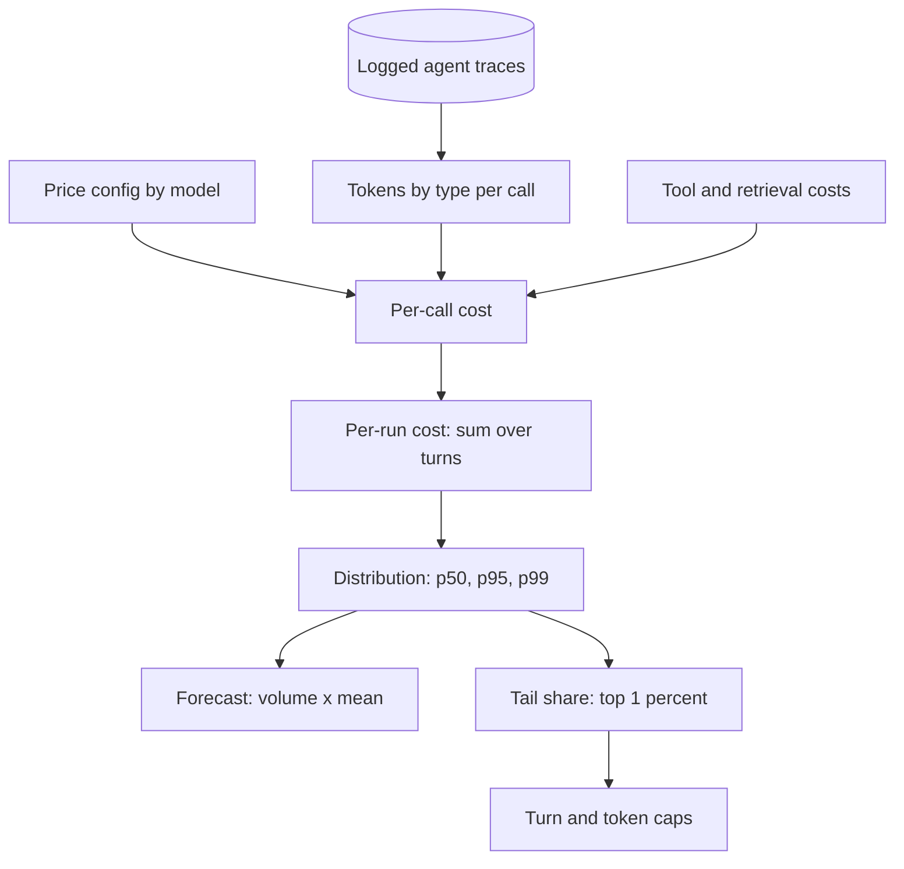

## TL;DR
A cost model turns an agent run's shape into dollars: fresh, cached and output tokens (including hidden
reasoning) times prices, plus tool calls. Output costs more because decode is sequential, cost grows
roughly quadratically with turns, and runaway runs can dominate.

## For agent builders
- **Why it matters for agents.** An agent run is a loop of model calls that re-send a growing transcript,
  plus tool, retrieval and guardrail calls. Its cost depends on turns per run and tokens added per turn,
  which you decide in design, so the model tells you before launch whether the agent is affordable.
- **Where it shows up in your stack.** Provider usage fields on every response, the provider's pricing
  page, token counters such as `tiktoken`, per-run cost in tracing tools (LangSmith, Langfuse or your own
  OpenTelemetry spans), and the step-limit and budget settings of your agent framework.
- **What you control.** Prefix size (system prompt plus tool schemas), how much of each tool result
  enters context, turns per run, output and reasoning caps, prompt caching, and which model each step uses.
- **What you can skip.** Provider-specific billing edge cases until you are near launch. The per-call
  formula, the T² growth term and the tail share cover most agent cost decisions.

## Why it exists
- **Spend is metered per token.** Cost is set by the shape of each request, not by servers running.
- **Similar-looking features differ a hundredfold.** A one-shot classification with a 300-token prompt
  versus a 20-turn agent that pastes tool results into its context each step.
- **"Requests per day × a typical price" misses three things:**
  1. **Input and output are priced differently,** and reasoning models emit billed tokens the user never
     sees.
  2. **Loops re-send everything each turn,** so a long session is not N times a short one but closer
     to N².
  3. **The distribution is heavy-tailed:** a small share of long documents, runaway agent loops or
     retries can dominate the invoice.
- **It works before launch,** when you can still change the design (cap turns, cache prefixes, route to a
  smaller model) instead of explaining an invoice.
- **It feeds everything else:** break-even analysis, pricing and unit economics all need a defensible
  cost per request, and for agents a defensible cost per run.

## How it works
### The per-call formula
```
cost = fresh_input_tokens × p_in
     + cached_input_tokens × p_cached
     + output_tokens × p_out            # includes reasoning/thinking tokens where billed
     + non-model costs (embeddings, rerank, vector search, tool APIs, guardrail models)
```
- **Per agent run,** sum this over every turn and every tool call in the run.
- **Other price terms exist:** some providers charge a premium to *write* a prompt-cache entry, discount
  asynchronous batch processing, or use different rates above a context-length threshold.
- **Read prices from configuration, never hard-code them,** because pricing is vendor- and
  model-specific and changes often.

### Why output costs more
| Phase | How it runs | GPU efficiency |
|---|---|---|
| Prefill (input) | Whole prompt in one parallel pass | Uses compute efficiently |
| Decode (output) | One token at a time; each step reads full weights and KV cache for little arithmetic | Far fewer tokens per second than input |

- **Providers price that:** output is commonly several times the input price.
- **Design consequence:** verbosity is expensive, and a reasoning model that "thinks" for thousands of
  tokens can cost more than a larger model that answers directly. In an agent, reasoning tokens are
  paid on every turn where reasoning is enabled.

### Tokens are not words, and not portable
- **Counts depend on the tokenizer.** The same text yields different counts on different model families.
- **Code, non-English text and JSON** tend to tokenize less efficiently than English prose. Tool schemas
  and JSON tool results are exactly this kind of text.
- **So** a per-word estimate built on one model is wrong on another; measure with the target model's
  tokenizer.

### Multi-turn growth
Turn t sends the system prompt, tool schemas and every earlier message. If each turn adds d tokens:

```
total input over T turns ≈ T·prefix + d·T²/2
```

- **The quadratic term dominates long sessions.** In an agent, d is the tool call plus its result, so a
  verbose tool raises the coefficient of the T² term.
- **Prompt (prefix) caching** bills repeated prefixes at a discount. It leaves the T² shape intact but
  multiplies its coefficient by the cached-to-fresh price ratio (0.1 in the example below).
- **Context compaction** shrinks the history itself, capping how large it can grow and turning the
  quadratic back into roughly linear growth once the cap is reached.
- **Caching needs the next turn within the cache lifetime.** Human think time between turns can exceed
  it, so measure the cached-token share rather than assuming it. Autonomous agent turns usually follow
  within seconds; slow tools or human approval steps can break that.

### Self-hosted token cost
```
cost per token = (GPU $/hour) / (tokens produced per hour at the utilization you actually achieve)
```
- **Utilization is decisive.** A fleet busy a third of the time pays three times as much per token as the
  same fleet kept full.

### Model the distribution
1. **Build from logged traces:** per feature, the distribution of input, cached and output tokens and of
   turns per session.
2. **Report** p50, p95 and p99 cost per request and the share of spend from the top 1% of requests.
3. **Forecast with the true mean:** forecast = Σ over features of volume × mean cost per request. It is
   usually well above the cost of the "typical" request people reason from.
4. **State the tail share,** because the mean alone hides the runaway sessions that budgets and step caps
   must bound.

## Diagram
From traces to a forecast: per-call costs roll up into per-run costs, whose distribution gives both
the forecast (mean) and the risk (tail) that caps must bound.



## Examples
### Per-call, agent-loop and self-hosted cost
Illustrative prices: $3 per million input tokens, $15 per million output, $0.30 per million cached input
(cache-write premiums ignored). Substitute your provider's current sheet.

```python
P_IN, P_OUT, P_CACHED = 3.00, 15.00, 0.30          # $ per million tokens (illustrative)

def call_cost(fresh_in, out, cached_in=0):
    return (fresh_in * P_IN + cached_in * P_CACHED + out * P_OUT) / 1e6

def agent_run(turns, prefix=4_000, delta=600, out=200, cache=False):
    """Each turn re-sends the history: prefix + all earlier tool results and outputs."""
    total, history = 0.0, prefix
    for t in range(turns):
        reused = history - delta - out if (cache and t > 0) else 0   # last turn's prompt
        total += call_cost(history - reused, out, reused)
        history += delta + out
    return total

print(f"single RAG call: ${call_cost(6_000, 400):.4f}")              # $0.0240
for turns in (4, 12, 24):
    print(turns, round(agent_run(turns), 3), round(agent_run(turns, cache=True), 3))
# 4 turns: $0.074 vs $0.036 cached | 12: $0.338 vs $0.101 | 24: $1.022 vs $0.228

gpu_hr, tok_per_s = 4.00, 1_500                     # illustrative $/GPU-hour, aggregate output tok/s
for util in (0.9, 0.3):
    print(util, round(gpu_hr / (tok_per_s * 3600 * util) * 1e6, 2), "$/M output tokens")
# 0.9 -> $0.82/M ; 0.3 -> $2.47/M
```

| Run | No cache | Prefix cache |
|---|---|---|
| 4 turns | $0.074 | $0.036 |
| 12 turns | $0.338 | $0.101 |
| 24 turns | $1.022 | $0.228 |

- **Quadratic:** 4 to 24 turns is 6× the turns but about 14× the cost without caching.
- **Caching:** cuts the 24-turn run by more than 4×.
- **Self-hosted:** utilization, not GPU list price, decides whether owning hardware is cheap.

### Worked scenario: pre-launch cost of a research agent
A research agent averages 8 turns (the `agent_run` shape above, with prefix caching) and per run makes 3
web-search tool calls, 2 retrieval queries and one guardrail check. Tool prices are illustrative
placeholders; use your vendors' rates.

| Line item per run | Cost |
|---|---|
| Model: 8 turns, cached prefix (`agent_run(8, cache=True)`) | $0.0662 |
| Web search tool: 3 calls × $0.005 | $0.0150 |
| Embeddings plus vector search: 2 queries | ~$0.0005 |
| Guardrail model on the final answer | ~$0.0020 |
| **Typical run** | **~$0.0837** (non-model ~21%) |
| Runaway run: 30 turns, same tools | ~$0.3213 |

- **Forecast with the mix:** if 5% of runs run away, the mean is 0.95 × $0.0837 + 0.05 × $0.3213 ≈
  $0.096, so 100k runs a month cost ~$9,560, and that 5% of runs is ~17% of spend.
- **Without caching** the same 30-turn run costs $1.494 in model tokens alone, which is why caps and
  caching are decided together.
- **Design response:** a turn cap near the p95 turn count and a per-run cost cap bound the tail before
  launch.

### Forecasting from a heavy-tailed distribution
Synthetic lognormal token counts stand in for logged traces; with your own logs, replace the loop with
real per-request token counts.

```python
import random

random.seed(1)
P_IN, P_OUT = 3.00, 15.00                          # $ per million tokens (illustrative)

costs = []
for _ in range(50_000):
    fresh_in = random.lognormvariate(8.3, 0.9)     # median ~4,000 tokens
    out = random.lognormvariate(5.7, 0.7)          # median ~300 tokens
    costs.append((fresh_in * P_IN + out * P_OUT) / 1e6)

costs.sort()
n = len(costs)
pct = lambda q: costs[int(q * (n - 1))]
mean = sum(costs) / n
top1 = sum(costs[int(0.99 * n):]) / sum(costs)

print(f"p50 ${pct(0.50):.4f}  p95 ${pct(0.95):.4f}  p99 ${pct(0.99):.4f}")   # ~0.018, 0.061, 0.106
print(f"top 1% of requests = {top1:.0%} of spend")                           # ~6%
print(f"forecast at 2M req/month: ${mean * 2_000_000:,.0f} "                 # ~$47.8k
      f"(median-based: ${pct(0.5) * 2_000_000:,.0f})")                       # ~$36.2k
```

- **The median underforecasts by about a quarter** even in this mild tail; real agent traffic with
  runaway sessions has a fatter tail and a larger gap.
- **p99 is almost 6× p50**, which is where per-session caps earn their keep.

## Production patterns
- **Price table as versioned config.** Keep per-model prices (input, cached input, cache write, output,
  batch) and per-tool prices in a config file with an effective date, and compute cost from it at query
  time. Monitor for calls to models or tools missing from the table.
- **Log provider usage fields, not estimates.** Record the token counts each response returns (for
  example Anthropic's `cache_read_input_tokens` and `cache_creation_input_tokens`, OpenAI's
  `reasoning_tokens` under completion token details) tagged with feature, agent run and step IDs.
  Monitor billed tokens against visible text length to catch hidden reasoning or schema bloat.
- **Count tokens with the target tokenizer before launch.** Use the provider's counter (for example
  `tiktoken` for OpenAI models or Anthropic's token-counting endpoint) on real sample documents, tool
  schemas and tool results, not a words-to-tokens ratio. Re-run it on every model switch.
- **Per-session budget guards.** Enforce maximum turns, maximum tokens and a cumulative-cost cap per
  agent session, stopping or escalating when hit. Monitor how often caps fire and the p99 cost per
  session.
- **Cost per run as a trace attribute.** Agent teams roll call costs up to the run in their tracing tool
  so the most expensive runs can be opened and read. Monitor the top-1% share of spend by run.
- **Monthly forecast review from traces.** Recompute volume × mean cost per feature and the top-1% share,
  and compare with the invoice. Monitor forecast error; a growing gap usually means a new tail.

## Trade-offs
- **Detailed per-feature model vs effort.** It catches expensive design choices, but costs time to build
  and maintain; for a prototype a spreadsheet of token counts per call is enough until traffic is real.
- **Prompt caching vs reuse.** It cuts repeated-prefix cost sharply, but only pays when prefixes are
  byte-identical and reused within the cache lifetime; it flips to a small loss where writes carry a
  premium and reuse is rare.
- **Reasoning models vs output tokens.** They raise output tokens per task, but can lower total cost when
  they replace several retries or a multi-step chain; measure cost per *successful* task, not per call.
- **Tight turn caps vs task success.** Caps bound the tail, but a cap below what hard tasks need turns
  cost into failures; set it from the turn distribution of successful runs.
- **Self-hosting vs fixed cost.** It lowers marginal token cost at high utilization, but turns cost fixed;
  it flips to more expensive than an API when traffic is low or spiky.

## Pitfalls
- **Estimating from a typical or hand-picked request instead of the logged distribution.** Symptom: an
  invoice several times the forecast, driven by a long tail of large documents or long agent sessions.
  Fix: forecast with the mean of the logged distribution and report the tail.
- **Forgetting hidden reasoning tokens or tool-schema tokens in the prompt.** Symptom: billed input or
  output counts far above what the visible text suggests. Fix: log provider usage fields.
- **Reusing a token-per-word ratio from one model family on another.** Symptom: the forecast drifts after
  a model switch even though traffic did not change. Fix: re-count with the new tokenizer.
- **Ignoring non-model costs** such as embeddings, reranking, guardrail models, paid tool APIs and trace
  storage. Symptom: total spend per request well above the LLM line item. Fix: include them in the
  formula.

## When to use
- **Use before** committing to any design that calls a model in a loop, ingests user-supplied documents,
  or will run at volume; rebuild it from real traces after launch.
- **Use it to** set max-turn and max-token limits, decide where prompt caching and smaller models pay off,
  and feed pricing and break-even decisions.
- **Measure** tokens by type (fresh, cached, output, reasoning) per feature and per request, turns per
  run, and watch the p95 and p99, not only the mean.
- **Interviews:** deriving the quadratic growth of agent cost and the utilization term in self-hosted cost
  shows real understanding.

## Role lens
- **Engineer:** Logs token counts by type for every call, tags them with feature and request IDs, and
  writes the cost function that dashboards and budget guards share.
- **Architect:** Uses the model to choose between designs, set turn and context limits, and decide
  where caching, smaller models or self-hosting change the economics.
- **FDE:** Builds a cost estimate from the customer's real document sizes and usage volumes, so the
  commercial proposal survives contact with production traffic.

## Check yourself
**Q:** A support agent averages 8 turns, but finance's forecast assumed cost = 8 × a single-call cost.
The invoice is 4× the forecast. Explain, and say what you would change.
**A:** Each turn re-sends the system prompt, tool schemas and full history, so input tokens grow with
the turn number and total input grows roughly with the square of turns; multiplying a single call by 8
undercounts badly. The tail also matters: a few 30-turn sessions dominate. I would rebuild the model from
traces with token distributions per turn, enable prompt caching for the stable prefix, compact or
summarize history past a threshold, cap turns and tokens per session, and route simple tickets to a
smaller model, then track p95 cost per resolved ticket rather than per call.

## Interview questions
### Walk me through estimating the cost of one request to an LLM feature.
- **Tokens by type:** fresh input, cached input and output including reasoning, each times its price.
- **Plus non-model calls:** embeddings, reranking, vector search, tool APIs and guardrail models.
- **From real data:** count with the target model's tokenizer on real samples, and read prices from
  config because they change.

### Why does a 24-turn agent cost far more than 6 times a 4-turn one?
- **Each turn re-sends the whole history,** so total input is about T·prefix + d·T²/2.
- **In the illustrative example** 6× the turns is about 14× the cost.
- **Levers:** prefix caching lowers the quadratic coefficient; compaction caps history growth so cost
  becomes roughly linear; turn caps bound the tail.

### You are asked to price a new agent feature before it exists. How do you build the estimate?
- **Prototype and trace:** run the agent on 20-50 realistic tasks and log tokens by type, turns and tool
  calls per run.
- **Build the per-run distribution:** model cost per turn, plus tool and retrieval costs, then the mean
  and the tail share, not a single typical run.
- **Turn it into decisions:** a turn cap and per-run cost cap from the distribution, caching for the
  stable prefix, and a forecast of volume × mean with the tail stated.

### When is a reasoning model cheaper than a non-reasoning one despite more output tokens?
- **When it replaces retries or chains:** one longer call that succeeds can beat several short calls that
  fail or need a multi-step pipeline.
- **When failure is expensive:** human review or escalation dwarfs token cost.
- **Measure cost per successful task,** and cap reasoning with a budget or effort setting.

### Your monthly forecast was $36k and the invoice was $48k with the forecast volume. What went wrong?
- **Likely a median-based forecast:** the mean of a heavy-tailed distribution sits well above the
  typical request.
- **Check the tail:** p99 cost and the top-1% share per feature, plus hidden reasoning and schema tokens.
- **Fix:** forecast as volume × mean from traces, state the tail share, and add per-session caps.

### How do you compare self-hosting with an API on cost per token?
- **Self-hosted cost per token** is GPU $/hour divided by tokens produced per hour at achieved
  utilization.
- **Utilization dominates:** in the illustrative example 90% gives $0.82 per million output tokens and
  30% gives $2.47.
- **Self-hosting wins** only with steady high utilization; low or spiky traffic favors the API because
  its cost stays variable.

## Quiz
### Q: Why do hosted providers typically price output tokens higher than input tokens?
- [ ] Output tokens are larger than input tokens in bytes
- [x] Output is generated sequentially in decode steps that use the GPU far less efficiently than the parallel prefill of input
- [ ] Output tokens must be checked by a safety model that input tokens skip
- [ ] Input tokens are cached for free on every request
> Prefill processes the prompt in one parallel, compute-efficient pass; decode yields one token per
> step and is memory-bandwidth bound, so each output token consumes more GPU time.

### Q: An agent's turns each add about the same number of tokens to history. How does total input cost scale with the number of turns, without caching or compaction?
- [ ] Linearly, since each turn adds the same number of tokens
- [x] Roughly quadratically, because each turn re-sends all earlier turns
- [ ] Logarithmically, because providers discount long prompts
- [ ] It stays constant after the first turn
> Turn t's prompt contains all t earlier increments, so total input is a sum of an arithmetic series,
> proportional to T². Each turn adding a constant amount is exactly what makes the total quadratic.

### Q: A self-hosted GPU costs the same per hour regardless of load. What most changes its cost per token?
- [ ] The model's parameter count only
- [ ] The provider's published per-token price
- [x] The utilization actually achieved, since cost per token is hourly cost divided by tokens produced per hour
- [ ] Whether the prompt uses JSON output
> Fixed hourly cost spread over fewer tokens raises the per-token price; a fleet at 30% utilization pays
> three times more per token than the same fleet at 90%.

## Use cases & projects
### Use cases
- **Go or no-go on a new agent feature.** A per-run cost estimate from prototype traces shows whether the
  agent fits the price the product can charge.
- **Setting turn and budget caps.** The turn and cost distributions of successful runs give caps that
  bound runaway loops without cutting off hard tasks.
- **Explaining an invoice gap.** Comparing a median-based forecast with the trace mean and tail share
  shows where the missing money went.
- **API versus self-hosted for an agent's model.** The utilization term decides whether owning GPUs
  beats per-token pricing at the agent's real traffic.

### Mini project
**Cost model for your own agent (1-2 hours).**
- **Goal:** forecast the monthly cost of a small tool-calling agent from its own traces.
- **Steps:** run an agent with two tools on 30 varied tasks; log tokens by type, turns and tool calls per
  run from the provider usage fields; compute cost per run from a versioned price config; report p50,
  p95, p99, the mean and the top-10% share; forecast 100k runs a month.
- **Done when:** you have the distribution table, a forecast using the mean, the median-based forecast for
  contrast, and a proposed turn cap and per-run cost cap justified by the numbers.
