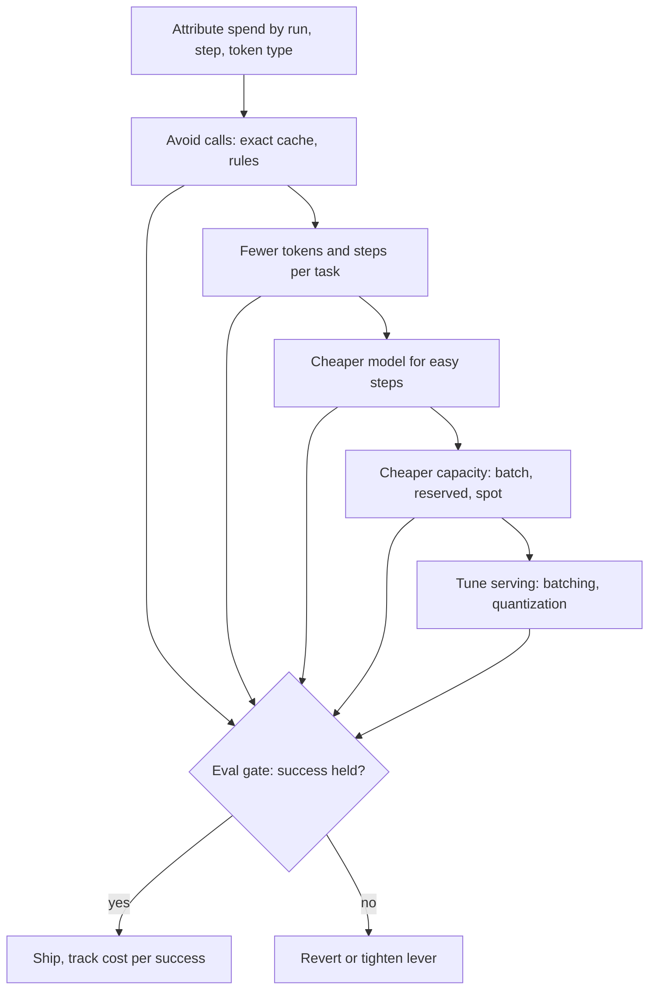

## TL;DR
Cost optimization cuts spend per successful agent task without breaking quality or latency. Work in
order: measure, avoid calls, send fewer tokens per step, take fewer steps, route easy work to cheaper
models, buy capacity cheaper, then tune serving, each change gated by an eval.

## For agent builders
- **Why it matters for agents.** An agent re-sends its growing transcript on every step, so cost per task
  grows faster than linearly with step count. One redundant tool call or one pasted 5,000-token tool result
  can cost more than the whole system prompt.
- **Where it shows up in your stack.** Provider usage fields (input, cached input, output, reasoning
  tokens), prompt caching, `max_tokens` and reasoning-effort settings, the model router in front of your
  agent, batch APIs for offline agent runs, and per-run cost in LangSmith, Langfuse or your own traces.
- **What you control.** Prompt layout (stable prefix first), how much of each tool result enters context,
  the step limit, which steps use a small model, output caps, and whether a run can wait for a batch lane.
- **What you can skip.** Kernel tuning and price negotiation until the fleet is large. The token and step
  levers are bigger and safer for almost every agent team.

## Why it exists
- **Every request has a marginal cost.** Often cents, scaling directly with usage and with design choices
  such as context size and model tier, unlike most software. An agent task is many requests.
- **Pilots hide it.** A feature cheap in a pilot can become the largest line on the cloud bill at
  production volume, and gross margin on an AI product can be negative if no one looks.
- **"Switch to the cheapest model" backfires.** It saves per call but often lowers task success, pushing
  work into retries, escalations and human review, so cost per *successful* task can rise. Agents amplify
  this: a weaker model takes more steps or loops before giving up.
- **"Tune kernels" or "negotiate a discount" pulls the smallest lever first.** A 20% price cut is dwarfed
  by not sending 60% of the tokens in the first place.
- **Blind optimization misses.** Without attribution by feature and request type, teams optimize the
  endpoint they happen to be looking at, not the one that dominates spend. The discipline applies effort
  where the money is, in order of yield per unit of risk, with quality held constant by measurement.

## How it works
### 0. Measure and attribute first
- **Tag every model call** with feature, tenant, model, request type and agent run id plus step number.
- **Record tokens by type:** fresh input, cached input, output, reasoning.
- **Rank spend by feature and inspect the distribution:** often a few features and a long tail of large
  requests dominate. For agents, the tail is usually runs that took far more steps than the median.
- **Pair cost with an outcome metric** (task success, acceptance rate) so every later change is judged on
  cost per successful task.

### 1. Do not call the model
The cheapest token is the one never sent.
- **Exact-match response caches** for repeated queries, keyed on normalized input plus the version of
  every input that affects the answer.
- **Deterministic code paths** for cases rules handle reliably, such as a lookup tool the agent would
  always call first.
- **Skip steps** that do not change the outcome: a planning call for a one-tool task, or a reflection step
  that rarely changes the answer.
- **Semantic caches** (reuse an answer for a *similar* question) save more but can return a wrong answer
  for a subtly different question, so they need a strict threshold and evaluation.

### 2. Send fewer tokens
Input usually dominates RAG and agent cost.
- **Retrieve fewer, better chunks:** reranking lets you cut top-k.
- **Trim** system prompts and tool schemas, compact long histories, and stop pasting entire tool outputs
  into context; return only the fields the agent needs.
- **Prompt caching for stable prefixes:** fixed instructions and schemas first, variable content last,
  *because* caching only matches identical prefixes. Keep the agent transcript append-only so each step
  reuses the previous step's cache.
- **Cap output** with concise formats and `max_tokens`, since output tokens are usually priced higher
  than input.
- **Reasoning ("thinking") tokens** are billed as output on most providers even when not shown, so a
  reasoning budget or effort setting is a cost control.
- **Agent loops** re-send the growing context every step, so cost per task grows faster than linearly
  with step count; cutting one redundant tool round-trip can save more than trimming the prompt.

### 3. Use a cheaper model where it is good enough
- **Route easy requests to a smaller model** and escalate hard or low-confidence ones (routing or
  cascading). In agents, routine steps (extracting fields, formatting a tool call) often suit a small
  model while planning stays on the large one.
- **Distill or fine-tune** a small model for a narrow, high-volume task.
- **Why it pays:** price per token differs by one to two orders of magnitude across tiers.
- **The risk:** routing errors cost quality, so measure success per route.

### 4. Buy capacity more cheaply
| Lever | Fits |
|---|---|
| Asynchronous batch APIs (many providers discount them) | Work that can wait: evals, backfills, overnight agent runs |
| Committed-use or reserved capacity | Steady baseline load |
| Spot or preemptible instances | Interruptible batch jobs |
| Self-hosting | Only where volume keeps GPUs highly utilized |

### 5. Tune serving
For self-hosted models, once the fleet is large:
- **Raise utilization** with continuous batching and right-sized concurrency.
- **Quantize** weights or the KV cache where evals allow.
- **Enable prefix caching**, right-size GPUs, and scale down idle replicas.

### Guardrails on the process
- **Levers compound multiplicatively.** Estimate each on the base left after the previous ones, not on
  the original bill: a 50% context cut and a 50% routing saving give 75%, not 100%.
- **Levers interact.** Routing traffic away from the large model shrinks the value of the large model's
  prompt cache.
- **Every change ships behind an eval** and, ideally, an A/B or shadow comparison. Acceptance criterion:
  cost per successful task at equal or better quality, within the latency budget.

## Diagram
The levers in order of yield per unit of risk; every arrow into production passes the same eval gate.



## Examples
### Worked scenario: a 10-step agent lever stack
All figures illustrative: a tool-calling agent with a 5,000-token prefix (system prompt plus tool
schemas), appending ~1,500 tokens per step (tool call plus result) and writing 300 output tokens per
step, on a large model at $3 per million input, $0.30 cached and $15 output.

```python
M = 1_000_000
P_IN, P_CACHED, P_OUT = 3.00, 0.30, 15.00          # $ per million tokens, illustrative

def task_cost(steps, prefix, per_step, out_per_step, cache):
    fresh = cached = 0
    for i in range(steps):
        ctx = prefix + per_step * i                  # transcript re-sent every step
        new = prefix if i == 0 else per_step         # only the newest tokens miss the cache
        fresh += new if cache else ctx
        cached += (ctx - new) if cache else 0
    return (fresh * P_IN + cached * P_CACHED + steps * out_per_step * P_OUT) / M

base = task_cost(10, 5_000, 1_500, 300, cache=False)
for name, c in [("baseline", base),
                ("prefix cache", task_cost(10, 5_000, 1_500, 300, cache=True)),
                ("trim tool results", task_cost(10, 5_000, 600, 300, cache=True)),
                ("cut to 7 steps", task_cost(7, 5_000, 600, 300, cache=True))]:
    print(f"{name:18s} ${c:.4f}/task  ${c * 100_000:>7,.0f} per 100k tasks  {1 - c / base:.0%} saved")
```

| Step | Change | Per task | Per 100k tasks | Saved vs baseline |
|---|---|---|---|---|
| Baseline | 117,500 input tokens re-sent over 10 steps, no caching | $0.3975 | $39,750 | 0% |
| 1. Prompt caching | append-only transcript, only the newest tokens billed fresh | $0.1302 | $13,020 | 67% |
| 2. Trim tool results | return only needed fields: 1,500 to 600 tokens per step | $0.0962 | $9,618 | 76% |
| 3. Remove redundant steps | eval shows 7 steps finish the same tasks | $0.0690 | $6,900 | 83% |

- **Caveats:** cache-write premiums and minimum cacheable lengths vary by provider and are ignored here.
- **Step 3 needs the eval most:** fewer steps is a behaviour change, so check task success, not only cost.

### Worked scenario: document-QA lever stack
All figures illustrative: 1M requests per month, 8,000 input tokens per request (1,500 fixed instructions
plus 6,500 retrieved context), 500 output tokens, on a large model at $3 per million input and $15 per
million output.

Cost per request is $0.024 + $0.0075 = $0.0315, or $31,500 a month. Each lever is confirmed by the eval
suite.

| Step | Change | Per request | Per month |
|---|---|---|---|
| Baseline | — | $0.0315 | $31,500 |
| 1. Exact-match cache | normalized question plus document version; measured 10% hit rate, billable requests fall to 900k | $0.0315 | $28,350 |
| 2. Prompt caching | 1,500-token fixed prefix read at $0.30 per million (a 90% discount); saves 1,500 × $2.70/M ≈ $0.004 | $0.02745 | $24,705 |
| 3. Rerank and cut context | 6,500 to 3,000 tokens, eval shows no drop; saves $0.0105 | $0.01695 | $15,255 |
| 4. Route 60% to a small model | $0.25/$1.25 per million, about $0.00175 per request, escalating 10% of those | $0.0088 blended | about $7,960 |

- **The prompt-caching discount and any cache-write premium vary by provider** and are ignored here.
- **Total reduction is roughly 75%**, and none of it came from GPU tuning or price negotiation.
- **Step 4 is the riskiest.** If escalation is triggered by low confidence that misses wrong answers,
  success drops and the saving is illusory, so success rate per route is the number to watch.

### The same stack as a calculator
Plug in your own traffic, token counts and prices; each line applies a lever to what the previous left.

```python
M = 1_000_000

def per_req(fresh_in, cached_in, out, p_in, p_cached, p_out):
    return (fresh_in * p_in + cached_in * p_cached + out * p_out) / M

LARGE = dict(p_in=3.00, p_cached=0.30, p_out=15.00)    # $ per million tokens, illustrative
SMALL = dict(p_in=0.25, p_cached=0.25, p_out=1.25)

reqs = 1_000_000
base = per_req(8_000, 0, 500, **LARGE)
billable = reqs * (1 - 0.10)                            # 1. exact-match cache, 10% hits
cached = per_req(6_500, 1_500, 500, **LARGE)            # 2. prompt-cache the 1,500 fixed tokens
trimmed = per_req(3_000, 1_500, 500, **LARGE)           # 3. rerank: context 6,500 -> 3,000
small = per_req(4_500, 0, 500, **SMALL)                 # 4. small model on trimmed prompt
blended = 0.4 * trimmed + 0.6 * (small + 0.10 * trimmed)

for name, monthly in [("baseline", base * reqs), ("cache", base * billable),
                      ("prefix", cached * billable), ("trim", trimmed * billable),
                      ("route", blended * billable)]:
    print(f"{name:9s} ${monthly:>8,.0f}/month")
print(f"reduction {1 - blended * billable / (base * reqs):.0%}")   # 75%
```

### A response-cache key that cannot leak across tenants
Keying on question text alone can serve one tenant an answer built from another's documents. The same key
discipline applies to caching tool results inside an agent.

```python
import hashlib, json

def cache_key(question, tenant_id, permission_scope, source_versions, prompt_version, model):
    normalized = " ".join(question.lower().split())
    payload = {
        "q": normalized,
        "tenant": tenant_id,
        "scope": sorted(permission_scope),          # what this user may see
        "sources": source_versions,                 # e.g. {"doc-42": "v7"}
        "prompt": prompt_version,
        "model": model,
    }
    return hashlib.sha256(json.dumps(payload, sort_keys=True).encode()).hexdigest()
```

## Production patterns
- **Attribution at the gateway.** Route every model call through one gateway or wrapper that records
  feature, tenant, model, agent run id, step and token counts by type from the provider's usage fields.
  Monitor spend per feature per day, cost per run percentiles, and alert on week-over-week jumps.
- **Cache-friendly prompt layout.** Put instructions and tool schemas first and variable content last;
  with Anthropic mark the stable prefix with `cache_control: {"type": "ephemeral"}`, while OpenAI caches
  long prefixes automatically. Monitor the cached-token share from usage fields (for example
  `cache_read_input_tokens` or `cached_tokens`) after every prompt change.
- **Tool-result budgets, step limits and cost circuit breakers.** Cap how many tokens each tool may return
  to the model (select fields or summarize before appending), set a maximum step count per run, and stop
  or escalate a run whose accumulated cost passes a threshold. Monitor tokens added per step by tool and
  the share of runs hitting either limit.
- **Batch lanes for deferrable work.** Send evals, backfills and nightly summaries through the provider's
  batch endpoint (OpenAI's Batch API, Anthropic's Message Batches API) instead of the interactive path.
  Monitor batch completion time against the job's deadline.
- **Cascades with a shadow period.** Before routing a share of traffic or agent steps to a smaller model,
  run it in shadow on live traffic and compare success per route against the large model. Monitor
  escalation rate and success per route after launch.
- **Output and reasoning caps per route.** Set `max_tokens` per feature and a reasoning budget or effort
  level where the provider supports one (for example Anthropic's `budget_tokens` for extended thinking,
  OpenAI's `reasoning_effort`). Monitor output and reasoning tokens per request and the truncation rate.

## Trade-offs
- **Routing to smaller models vs routing errors.** Cost falls sharply but a routing error rate appears;
  the trade flips when failures are expensive (refunds, compliance) and cost per successful task rises.
- **Context trimming vs recall.** It saves input tokens and latency, but can drop the one chunk or tool
  field the answer needed; it stops paying when retrieval recall is already marginal.
- **Fewer agent steps vs task success.** Removing verification or reflection steps saves tokens, but can
  let wrong answers through; it flips when a failed task costs more than the steps saved.
- **Batch APIs and spot vs delay.** Cheaper, but add delay or interruption; they suit offline work and
  are wrong for anything on an interactive path.
- **Semantic caching vs correctness.** It avoids calls for similar queries but risks serving a wrong
  cached answer; it fits stable FAQ-like traffic and fails where small wording changes alter meaning.

## Pitfalls
- **Optimizing without attribution.** Symptom: a successful saving on one endpoint while total spend keeps
  rising because another feature dominated all along. Fix: rank spend by feature first.
- **Measuring cost per call instead of per successful task.** Symptom: falling per-call cost alongside
  rising retries, escalations or human-review volume. Fix: divide by successes.
- **Breaking prompt caching** by putting timestamps, user names or request IDs at the start of the
  prompt. Symptom: cached-token share drops to near zero after a prompt change. Fix: variable content last.
- **Pasting whole tool outputs into the transcript.** Symptom: tokens per step dominated by one tool, and
  cost per run growing with every call to it. Fix: select fields or summarize before appending.
- **Keying a response or semantic cache only on the question text.** One tenant or user is served an
  answer built from another's documents, found as a data-exposure incident rather than a cost metric.
  Fix: include tenant, permission scope and source versions in the key.
- **Shipping a cheaper configuration without an eval gate.** Quality complaints or lower acceptance rates
  appear weeks later and are hard to trace to the change. Fix: eval plus shadow or A/B before rollout.

## When to use
- **Use when** a feature has real traffic and material spend, or earlier if the cost model shows negative
  unit economics at target volume.
- **Order:** begin with attribution, then work down the lever list, estimating savings from traces before
  building anything.
- **Measure** cost per successful task, cached-token share, tokens per request by type, steps per run,
  routing mix and quality per route.
- **Avoid** premature optimization in prototypes, where learning what users need is worth more than a
  cheaper token.
- **Interviews:** ordering the levers and insisting on an eval gate separates practitioners from people
  who only say "use a smaller model".

## Role lens
- **Engineer:** Implements caches, prompt-prefix ordering, context trimming and routing, and wires
  per-call cost and success metrics so each change can be evaluated.
- **Architect:** Sets the cost target per unit of work, decides which levers the platform provides
  centrally (gateway caching, routing, batch lanes), and owns the quality bar changes must meet.
- **FDE:** Finds customer-specific waste, such as oversized documents or redundant calls in their
  integration, and proves savings against the customer's own acceptance metrics.

## Check yourself
**Q:** Finance asks you to cut a RAG assistant's model spend by half within a month without hurting
quality. How do you approach it?
**A:** First attribute spend: tokens by type per feature and request class, and the cost distribution,
so I know whether input context, output length, a few heavy tenants or an agent loop dominates. Then
estimate each lever from traces: exact caching for repeats, prompt caching with a stable prefix,
reranking to cut retrieved context, output caps, and routing easy queries to a smaller model. I would
ship them in order of savings per unit of risk, each behind the eval suite and a shadow or A/B check,
tracking cost per successful answer, not per call. Price negotiation and GPU tuning come last.

## Interview questions
### Why is "switch to the cheapest model" often not a cost saving?
- **Per-call cost falls, success may fall too:** failures turn into retries, escalations and human
  review.
- **The right denominator is successful tasks:** if success drops enough, cost per successful task rises
  even though each call is cheaper.
- **So** route only the easy share, escalate the rest, and measure success per route.

### Your agent's cost per task doubled after adding two tool steps. Why, and what do you do?
- **Context grows every step:** each step re-sends the accumulated history and tool outputs, so cost
  grows faster than linearly with step count.
- **Diagnose from traces:** tokens per step, which tool outputs are pasted in full, and whether any step
  is redundant.
- **Fix:** summarize or truncate tool outputs, cache the stable prefix, and remove round-trips that do not
  change the outcome.

### A few agent runs cost 50 times the median. How do you find and stop them?
- **Find them:** rank runs by cost from traces and look at step count, repeated identical tool calls and
  the size of tool results; loops and retry storms dominate the tail.
- **Stop them:** a step limit, a per-run cost circuit breaker that ends or escalates the run, and loop
  detection on repeated tool calls with the same arguments.
- **Then fix the cause:** clearer tool errors so the agent stops retrying, or a better stop condition.

### Two levers each promise a 50% saving. What is the combined saving, and why?
- **75%, not 100%:** the second lever applies to the half left after the first.
- **They may interact further:** routing traffic away from the large model shrinks that model's
  prompt-cache value.
- **So** estimate each lever on the remaining base, from traces, before building.

### When would you not use a semantic cache?
- **When small wording changes alter meaning:** "cancel my order" versus "cancel my order's insurance".
- **When answers depend on user or tenant data:** a shared cache risks serving one tenant's answer to
  another unless the key includes tenant and permission scope.
- **Prefer exact-match caching** with versioned keys, and add semantic caching only for stable FAQ-like
  traffic with a strict threshold and an eval.

### A prompt change shipped and spend rose 30% with identical traffic. Where do you look first?
- **Cached-token share:** variable content moved to the front of the prompt breaks prefix caching, so
  instructions are billed at full input price again.
- **Output and reasoning tokens:** a new instruction may have lengthened answers or raised reasoning
  effort.
- **Then** compare tokens by type per request before and after the deploy.

## Quiz
### Q: Which metric best guards against a cost optimization that secretly degrades the product?
- [ ] Cost per API call
- [ ] Total monthly token count
- [x] Cost per successful task, measured alongside a quality eval
- [ ] Average output length per response
> Per-call cost falls when a cheaper model fails more often, but retries, escalations and human review
> then push cost per success up. Tying cost to successful outcomes exposes that trade.

### Q: A prompt change moved the current date and user name to the top of the system prompt. What cost effect is most likely?
- [ ] Output tokens increase because the model writes longer answers
- [x] Prompt-cache hits collapse, because the prefix now differs across users and days
- [ ] Nothing, since the total prompt length is unchanged
- [ ] Batch API discounts no longer apply
> Prompt caching matches identical prefixes. Putting variable content first makes the prefix differ
> per user and per day, so the instructions after it are billed at the full input price again; total
> length being unchanged is irrelevant.

### Q: In what order should levers generally be tried for an API-based RAG feature?
- [ ] Negotiate price, tune GPU kernels, then trim prompts
- [ ] Switch everything to the smallest model, then fix quality later
- [x] Attribute spend, avoid calls, cut tokens, route to cheaper models, then buy capacity more cheaply
- [ ] Add semantic caching first because it removes the most calls
> Attribution shows where the money is; avoiding calls and tokens is low-risk and often large; routing
> has higher quality risk; cheaper capacity (batch lanes, commitments) only applies to deferrable or
> steady load, so it comes after removing work. Semantic caching is not first because it carries a
> wrong-answer risk and its hit rate is unknown until measured.

## Use cases & projects
### Use cases
- **Cutting a coding or research agent's cost per run.** Prompt caching, tool-result budgets and step
  limits usually remove most of the spend before any model change.
- **Making a support agent's unit economics positive.** Routing routine steps to a small model, with
  success measured per route, turns a negative-margin pilot into a viable product.
- **Moving offline agent work to batch lanes.** Nightly report agents, evals and backfills run through
  discounted batch APIs instead of the interactive path.
- **Catching cost regressions after prompt changes.** Cached-token share and tokens per step, tracked per
  deploy, expose a broken prefix within a day.

### Mini project
**Halve an agent's cost per successful task (2-3 hours).**
- **Goal:** take a small tool-calling agent and cut its cost per successful task by at least half with no
  drop in success.
- **Steps:** build or reuse an agent with two or three tools and a 20-task eval set; log tokens by type,
  steps and success per run; apply levers one at a time (stable prefix for prompt caching, trimmed tool
  results, a step limit, a small model for one routine step) and re-run the eval after each.
- **Done when:** you have a table with cost per task, success rate and cost per successful task after each
  lever, and a note on which lever you reverted because the eval regressed.
