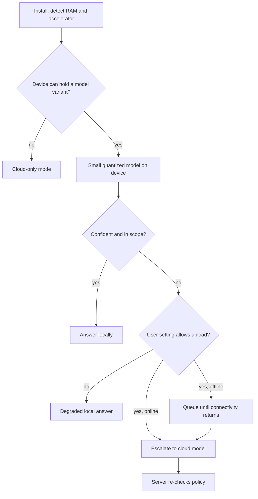

## TL;DR
Edge AI runs the model on the device that has the data: phone, laptop, browser, vehicle, controller. It
buys latency, offline use, privacy and zero cloud cost, at the price of hard memory, bandwidth and power
budgets: small compressed models, device runtimes, cloud fallback.

## Why it exists
- **A cloud call has four costs.** A network round trip, a need for connectivity, uploading the user's
  data, and per-token billing. For many workloads none of that matters; for some it is disqualifying.
- **The disqualifying cases.** A keyboard suggestion or voice assistant that waits 400 ms for a server
  feels broken; a field technician in a basement has no signal; a factory camera stream cannot be shipped
  to a datacenter every frame; health-app users will not accept data leaving the phone; and a product with
  a hundred million installs cannot pay per-token prices for every interaction.
- **"Ship the cloud model" fails on arithmetic.** A 70B model in fp16 is roughly 140 GB of weights; a phone
  gives an app a few gigabytes at most. Even a laptop with 16 GB of unified memory comfortably holds only a
  4-bit model of about 7–8B parameters (a 13–14B model is a squeeze) once the OS, other apps and the KV
  cache are counted.
- **Bandwidth and heat bind too.** Decode is bound by memory bandwidth, a small fraction of a datacenter
  GPU's on a phone, so a model streaming 100 tokens per second in the cloud would crawl on device even if
  it fit. Sustained inference throttles the chip and drains the battery.
- **"Quantize everything to 4-bit and hope" fails on quality.** Compression without evaluation produces
  models that pass a demo and fail in the field. Edge is a budgeting and engineering discipline, not a flag
  on the cloud model.

## How it works
### Which edge
| | On-device | On-site edge servers |
|---|---|---|
| Where | The user's phone, laptop, browser or an embedded controller | A small box or rack at a store, plant, hospital or cell site (a Jetson-class module, a workstation GPU, a telco edge node) |
| Ownership | You do not own the hardware; it is shared with other apps | You own it |
| Fleet | Heterogeneous | Fewer devices, known hardware, a few users each |
| Planned like | This lesson, where the constraints are hardest | A tiny on-prem cluster |

Both give the same latency and connectivity benefits.

### Start from the device budget
Three numbers bound the design:

| Budget | Rule | Illustration |
|---|---|---|
| **Memory** | Weights plus KV cache plus activations must fit in what the platform grants an app, with margin for the app itself. Weight bytes ≈ parameters × bits per weight ÷ 8 | A 3B model at 4-bit is about 1.5 GB and an 8B model about 4 GB, before the cache |
| **Bandwidth** | Each decode step reads all the weights once, so tokens per second ≤ memory bandwidth ÷ model bytes | Illustrative order of magnitude: tens of GB/s and a 2 GB model cannot exceed a few tens of tokens per second, whatever the compute |
| **Power and thermal** | Sustained throughput is lower than burst because the chip throttles | Plan on sustained figures from warm devices; battery cost per interaction is a product metric on phones and laptops |

### Prefill on a device
- **The datacenter split still applies, with a twist.** Decode is bandwidth-bound, but prefill is
  compute-bound, and on a phone compute is scarce too.
- **So TTFT grows with prompt length:** TTFT ≈ prompt tokens ÷ prefill tokens per second.
- **Example:** a 2,000-token prompt (system prompt plus a retrieved document) on a device that prefills a
  few hundred tokens a second waits several seconds before the first word appears.
- **Hence the habits:** keep prompts short, reuse a cached system-prompt prefix across turns, and use the
  NPU or GPU for prefill where the runtime supports it.
- **Plan both numbers:** TTFT from prompt length, streaming speed from bandwidth.

### Make the model fit
- **Choose a small model first.** Down to about 4 bits per weight, a larger quantized model often beats a
  smaller one at the same byte budget, so 4-bit is a common sweet spot.
- **Below roughly 3 bits quality usually falls off sharply,** so a large model that only fits at 2-bit is
  typically beaten by a small language model (hundreds of millions to a few billion parameters) at 4-bit,
  especially one trained or distilled for the task. The crossover is model- and task-dependent; measure it.
- **Quantize,** typically to 4-bit or 8-bit weights, with activations kept at higher precision.
  Post-training methods (GPTQ, AWQ and the k-quant families used by llama.cpp) cut memory and raise
  bandwidth-bound speed roughly in proportion to the bit reduction.
- **Measure the quality cost per model and task:** it is small for many models at 8-bit and 4-bit but can
  be severe for the smallest models.
- **Distil** a large model's behaviour into a small one for the specific task, which is how most production
  on-device models are made task-competent.
- **Prune and adapt.** Structured pruning removes capacity the task does not need; LoRA adapters let one
  base model serve several device features with small per-feature deltas.

### Match the runtime to the silicon
Device accelerators are heterogeneous: CPU vector units, mobile GPUs, NPUs on phones and laptops, Apple's
unified-memory GPU and Neural Engine, NVIDIA Jetson-class embedded GPUs. Runtimes map one model to many:

| Runtime | Targets |
|---|---|
| llama.cpp with its GGUF format | CPU and GPU back ends across desktop and mobile |
| ONNX Runtime | Execution providers per accelerator, including mobile |
| Core ML | Apple |
| LiteRT (formerly TensorFlow Lite) and ExecuTorch | Mobile and embedded, from the TensorFlow and PyTorch ecosystems |
| TensorRT | NVIDIA embedded and desktop GPUs |
| WebGPU-based runtimes | In-browser inference |

- **Decide per device class,** because the fastest path on each is different.
- **Test on real devices,** not a developer laptop.

### Hybrid by default
- **A small on-device model handles what it can;** requests needing more capability, context or knowledge
  escalate to the cloud.
- **The escalation rule is explicit** (confidence threshold, task type, user setting) and is itself a
  privacy decision, since escalation uploads data.
- **On-device first with cloud fallback** is the shape most consumer platforms have converged on, and it
  preserves the latency and offline benefits for the common case.

### Lifecycle on a fleet you do not control
- **Model files are distributed like app assets:** downloaded on Wi-Fi, versioned, delta-updated, with
  integrity checks.
- **Many versions live at once,** so telemetry (opt-in, aggregated) must carry the model version, and the
  server-side fallback must accept requests from old clients.
- **Capability detection at install time** decides which model variant, if any, a device gets; low-end
  devices get cloud-only mode.
- **Rollouts are staged by device class** because a model that fits one phone can crash another.

### Security on device
- **Anything on the device belongs to the user,** including the weights, the prompts and any guardrail
  logic.
- **Treat model weights as extractable** and keep anything proprietary in the cloud model.
- **Never rely on on-device prompts or filters** for decisions that matter to the server; re-check on the
  server side when the request escalates.

## Diagram
The common consumer shape: decide at install whether a device gets a local model, answer locally when
confident, and treat every escalation as an upload that policy must allow.



## Examples
### Running a quantized GGUF model with a budget check
llama.cpp through its Python binding, with the memory check first. The model file name is a placeholder;
parameters and quantization are illustrative.

```python
import os, time
from llama_cpp import Llama

def fits(model_path: str, n_ctx: int, kv_bytes_per_token: int, budget_bytes: int) -> bool:
    """Weights on disk approximate weights in memory for GGUF; add the KV cache for n_ctx."""
    weights = os.path.getsize(model_path)
    need = weights + n_ctx * kv_bytes_per_token
    print(f"weights {weights/1e9:.2f} GB + cache {n_ctx*kv_bytes_per_token/1e9:.2f} GB vs budget {budget_bytes/1e9:.1f} GB")
    return need <= budget_bytes

MODEL = "small-chat-3b.Q4_K_M.gguf"          # ~3B params at 4-bit: roughly 1.5-2 GB on disk
N_CTX = 2048
# kv_bytes_per_token = 2 * n_layers * n_kv_heads * head_dim * bytes; read these from the model card
assert fits(MODEL, N_CTX, kv_bytes_per_token=2 * 28 * 8 * 128 * 2, budget_bytes=4 * 1024**3)

llm = Llama(model_path=MODEL, n_ctx=N_CTX, n_threads=os.cpu_count() or 4,
            n_gpu_layers=-1, verbose=False)   # offload all layers to Metal/CUDA/Vulkan if present

t = time.time()                      # timing below includes prompt processing, not just decode
out = llm.create_chat_completion(
    messages=[{"role": "system", "content": "Reply in one sentence."},
              {"role": "user", "content": "Summarise why the pump alarm fired."}],
    max_tokens=64,
)
text = out["choices"][0]["message"]["content"]
n_out = out["usage"]["completion_tokens"]
print(text); print(f"{n_out/(time.time()-t):.1f} tok/s on this device")
# Measure sustained tok/s after several minutes on a warm device, not this first burst.
```

- **The `fits` check is the on-device capacity question:** weights plus cache against the budget the
  platform grants.
- **The printed tokens-per-second figure** decides whether streaming feels responsive, and it will drop as
  the device heats up.

### Device budget calculator: why long prompts feel slow
Pure Python, no model needed. The device figures (50 GB/s bandwidth, 300 tokens per second of prefill) are
illustrative; replace them with measurements from your target hardware.

```python
def edge_budget(params_b, bits, n_ctx, kv_bytes_per_token, bandwidth_gb_s, prefill_tok_s, prompt_tokens):
    """Rough on-device numbers: weights, cache, decode ceiling and time to first token."""
    weights_gb = params_b * bits / 8               # billions of params x bits / 8 = GB
    cache_gb = n_ctx * kv_bytes_per_token / 1e9
    max_decode_tok_s = bandwidth_gb_s / weights_gb  # each decode step reads all weights once
    ttft_s = prompt_tokens / prefill_tok_s          # prefill is compute-bound, and compute is scarce
    return dict(weights_gb=round(weights_gb, 2), cache_gb=round(cache_gb, 2),
                max_decode_tok_s=round(max_decode_tok_s), ttft_s=round(ttft_s, 1))

kv = 2 * 28 * 8 * 128 * 2       # bytes per token for the model shape used in the llama.cpp example
# Illustrative device: 50 GB/s memory bandwidth, prefills 300 tokens per second.
print(edge_budget(3, 4, 2048, kv, bandwidth_gb_s=50, prefill_tok_s=300, prompt_tokens=2000))
# {'weights_gb': 1.5, 'cache_gb': 0.23, 'max_decode_tok_s': 33, 'ttft_s': 6.7}
print(edge_budget(3, 4, 2048, kv, bandwidth_gb_s=50, prefill_tok_s=300, prompt_tokens=500))
# {'weights_gb': 1.5, 'cache_gb': 0.23, 'max_decode_tok_s': 33, 'ttft_s': 1.7}
```

| Change | Effect |
|---|---|
| Prompt cut from 2,000 to 500 tokens (reuse the cached system-prompt prefix) | TTFT falls from 6.7 s to 1.7 s; streaming speed unchanged |
| Same model at 8-bit instead of 4-bit | weights double to 3 GB, decode ceiling halves to about 17 tok/s |
| 8B model at 4-bit | about 4 GB of weights: over a 3 GB app budget before the cache |

## Production patterns
- **Capability detection at install.** Read available RAM and accelerator at install or first launch and
  pick a model variant, or cloud-only mode for low-end devices. Monitor the share of devices per variant
  and out-of-memory crash rate by device class.
- **Model files as verified, versioned assets.** Download on Wi-Fi, verify a checksum before loading, and
  stage rollouts by device class. Monitor the distribution of model versions in the fleet and crash rate per
  version.
- **Quantization eval gate.** Evaluate each candidate quantization (for example GGUF `Q8_0` and `Q4_K_M`)
  on the task set against the cloud model, and ship the smallest one that passes. Monitor field quality
  reports and escalation rate per variant.
- **Thermal soak tests on real devices.** Run a fixed workload for several minutes on the target device
  matrix and record sustained tokens per second, peak memory and battery drain. Monitor the same figures
  from opt-in field telemetry.
- **Stable system prompt for prefix reuse.** Keep the system prompt fixed and first so the runtime can reuse
  its cached prefix across turns instead of re-running prefill. Monitor TTFT by prompt length.
- **Server-side re-check on escalation.** Every escalated request passes the same policy checks as a pure
  cloud request, whatever the device claims. Monitor server-side rejections of escalated requests.

## Trade-offs
- **No network vs capped quality.** On-device inference removes network latency, cloud cost and data
  upload, but caps model quality at what fits the device's memory and bandwidth; the trade flips when the
  task needs frontier capability or broad knowledge.
- **4-bit vs 8-bit.** Quantization to 4-bit roughly halves memory and raises speed versus 8-bit, but the
  quality loss grows as models get smaller; measure on the task before shipping.
- **Escalation vs privacy and dependency.** A hybrid escalation path recovers quality for hard cases, but
  every escalation is a network dependency and a privacy event, so the rule must be visible to the user and
  the product.
- **Per-device runtimes vs test matrix.** They extract the most from each accelerator, but multiply the
  build, test and update matrix; a single portable runtime is slower and simpler.
- **Near-zero marginal compute vs slow operations.** Running on the user's hardware makes marginal compute
  cost near zero, but makes rollouts, debugging and telemetry slower and partial than on a server you
  control; for a small or internal user base the cloud bill it saves may not repay that engineering.

## Pitfalls
- **Measuring only tokens per second and ignoring prompt length.** Symptom: a feature that streams quickly
  once started but sits blank for seconds whenever a long document is in context.
- **Benchmarking on a developer laptop.** Symptom: a model that is fast in the demo and crawls or crashes on
  the median user's device.
- **Measuring burst throughput.** Symptom: responsiveness collapses after a minute of use as the device
  throttles thermally.
- **Forgetting the KV cache in the memory budget.** Symptom: out-of-memory kills on long conversations even
  though the weights "fit".
- **Shipping a quantized model without task evals.** Symptom: a quality regression reported from the field
  that the cloud model never showed.
- **Relying on on-device guardrails or prompts for policy.** Symptom: users bypass them by editing the app
  or its model files.
- **No model-version field in telemetry and requests.** Symptom: a bug that reproduces on some devices and
  cannot be attributed to the variant they run.

## When to use
- **Use when** latency must be below a network round trip, the device is often offline, the data must not
  leave it, or per-interaction cloud cost at your install base is untenable, *and* a small or distilled
  model can meet the quality bar on the task.
- **Avoid when** the task needs frontier reasoning or large context, or the device matrix is too fragmented
  to test.
- **Measure** sustained tokens per second on target devices, memory high-water marks with the KV cache,
  task-eval scores per quantization level, escalation rate to the cloud, and crash rates by device class.
- **Interviews:** expect to size a model to a device from parameter count and bit width and to explain why
  decode speed follows memory bandwidth.

## Role lens
- **Engineer:** Quantizes and evaluates candidate models, integrates the runtime for each target
  platform, implements the memory check and the escalation path, and builds the device test matrix.
- **Architect:** Sets the on-device versus cloud split per feature, the privacy rule for escalation,
  the model distribution and versioning scheme, and which capabilities stay server-side for security.
- **FDE:** Fits a customer's workload to their actual devices (plant controllers, handhelds,
  kiosks), proves sustained performance on site, and designs the offline and degraded modes they need.

## Check yourself
**Q:** A logistics company wants a package-scanning assistant on handheld devices with 6 GB of RAM,
of which the app may use about 3 GB, working in warehouses with poor connectivity. Walk through
how you would choose and validate the model.
**A:** Budget first: 3 GB must hold weights, the KV cache for the longest expected interaction and
the app. A 3B-class model at 4-bit is about 1.5–2 GB of weights (k-quant formats spend a little
more than 4 bits per weight), and a 2k-token cache for a model of that shape is a few hundred MB,
leaving room for the app; an 8B model at 4-bit (about 4 GB) does not fit. Then quality: distil or fine-tune the
small model on the scanning tasks and evaluate it against the cloud model on a task set, at the
exact quantization that will ship. Then speed: measure sustained tokens per second on the real
handheld after thermal steady state, since decode is bound by its memory bandwidth, and check the
high-water memory mark on long sessions. Design offline-first with queued escalation to the cloud
when connectivity returns for cases below a confidence threshold. Stage the rollout by device
class, carry the model version in telemetry, and keep any policy enforcement on the server.

## Interview questions
### What is the difference between on-device and on-site edge deployment, and why does it change the plan?
- **On-device** runs on hardware you do not own (phones, laptops, browsers, controllers), shared with other
  apps across a heterogeneous fleet, so memory budgets, testing and rollout are the hard parts.
- **On-site edge servers** are boxes you own at a store, plant or cell site, with known hardware and few
  users each.
- **So** on-site edge is planned like a tiny on-prem cluster, while on-device needs capability detection,
  per-device runtimes and staged rollouts.

### A laptop has 16 GB of unified memory. What is the largest model you would plan to run, and how fast will it be?
- **Memory:** weights ≈ parameters × bits ÷ 8, so a 4-bit 7–8B model takes about 4 GB and fits comfortably
  with the OS, apps and KV cache; a 13–14B model is a squeeze.
- **Speed:** decode tokens per second ≤ memory bandwidth ÷ model bytes, so measure the device's bandwidth
  and divide.
- **Then measure sustained figures** on a warm machine, because thermal throttling lowers them.

### Users say an on-device summary feature "freezes" with long documents but streams fine afterwards. What is happening?
- **TTFT, not decode:** prefill is compute-bound, so TTFT ≈ prompt tokens ÷ prefill tokens per second, and
  a 2,000-token prompt at a few hundred tokens a second takes several seconds.
- **Fixes:** shorter prompts, a stable system prompt whose cached prefix is reused, and prefill on the NPU
  or GPU where the runtime supports it.
- **Measure** TTFT by prompt length on real devices, separately from streaming speed.

### How do you ship a new on-device model version to millions of heterogeneous devices?
- **Treat it like an app asset:** Wi-Fi download, versioning, delta updates and integrity checks before
  loading.
- **Stage by device class,** because a model that fits one phone can crash another, and keep cloud-only
  mode for devices that cannot hold it.
- **Carry the model version** in telemetry and requests, and keep the server fallback compatible with old
  clients.

### When would you keep a feature in the cloud instead of moving it on device?
- **Quality:** the task needs frontier reasoning, broad knowledge or large context that no small model can
  match.
- **Operations:** the device matrix is too fragmented to test, or the user base is small enough that the
  saved cloud bill does not repay the engineering.
- **Security:** the logic or weights are proprietary, since anything on the device is extractable.

## Quiz
### Q: What primarily bounds decode tokens per second for an LLM on a phone?
- [ ] The number of CPU cores available to the app
- [x] Memory bandwidth divided by the bytes of weights read per step
- [ ] The size of the KV cache in the longest conversation
- [ ] Network latency to the model's update server
> Each generated token requires reading all the weights once; a phone's memory bandwidth is a
> small fraction of a datacenter GPU's, so the model's byte size divided into that bandwidth gives
> the ceiling. Quantization helps precisely because it shrinks the bytes read.

### Q: Why is a purpose-built small model at 4-bit usually better on device than a large model squeezed to 2–3 bits to fit the same memory?
- [ ] Small models do not need a KV cache
- [ ] Large models cannot be quantized below 8-bit
- [x] Quality degrades sharply below about 4 bits per weight, so the extra parameters do not make up for it, while a small model distilled for the task keeps its quality at the same byte budget
- [ ] Small models run on the CPU, which is always faster than the NPU
> At a fixed memory budget the question is where quality per byte is highest. Around 4 bits a larger
> model often wins, but pushing it to 2–3 bits degrades it sharply, whereas a distilled small model
> at 4-bit keeps task performance. The crossover still has to be measured per task.

### Q: Which safeguard belongs on the server even when the model runs entirely on device?
- [ ] The tokenizer, so that vocabulary stays consistent
- [ ] The model's quantization tables
- [x] Policy enforcement for decisions that matter, since on-device prompts, filters and weights can be modified by the user
- [ ] The KV cache, to save device memory
> Everything on the device is under the user's control and can be extracted or altered. Guardrails
> that protect the business or other users must be re-checked server-side when requests escalate
> or produce consequential actions.
