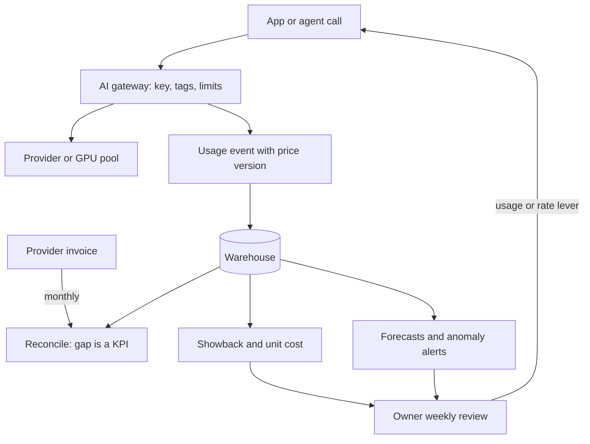

## TL;DR
FinOps makes variable cloud and AI spend visible, attributed and owned by the teams that cause it. For LLM
systems: meter every call at the gateway, allocate by tenant and feature, track cost per successful task,
and run a continuous inform–optimize–operate loop.

## Why it exists
- **Cloud broke purchase-order budgeting.** Traditional budgets assume finance approves spend in advance;
  in the cloud a line in a config file decides spend, and the invoice arrives a month later.
- **LLM APIs break it harder.** Spend is per token, so a prompt edit, a retrieval change that doubles
  context, a retrying agent loop or a traffic spike can move the bill by a multiple with no procurement
  event and no code reviewer thinking about money.
- **The invoice says nothing useful.** It is a single line, "API usage", with no product, customer, feature
  or team. Finance cannot allocate it, engineering gets no feedback, and the two sides meet only when the
  number is already alarming.
- **The naive responses each fail.** Approval gates for every model or key slow delivery and get bypassed
  with personal keys, worsening attribution. A one-time "cost project" saves a slice, then the bill climbs
  back because nothing structural changed. Hard spend caps protect the budget by taking the feature down
  for customers at month end.
- **What works is what worked for latency and reliability:** timely, attributed data in front of the
  people making decisions, clear ownership, and a loop that runs every week rather than once a year. Cost
  becomes an engineering signal like latency rather than a quarterly surprise.

## How it works
### The loop: inform, optimize, operate
The FinOps Foundation frames the practice as a cycle:

| Phase | Meaning |
|---|---|
| *Inform* | see and allocate spend accurately and quickly |
| *Optimize* | act on it, through both usage and rate levers |
| *Operate* | make the first two continuous: budgets, forecasts, reviews, owners and policy |

It is a loop *because* costs drift: models are updated, prices change, features ship weekly and traffic
mix moves. A snapshot goes stale in a month.

### Inform: meter at the point of call
1. **Choose one chokepoint.** Provider invoices lack your context, so attribution happens in your own
   code, at the single point every call passes through: an AI gateway or an SDK wrapper.
2. **Record one event per call:** model; input, output and cached token counts; latency; tenant; feature;
   environment; prompt version; and a request id that joins to your traces.
3. **Price at record time from a versioned price table,** and store the price used, *because* prices change
   and a cost history that silently re-prices itself is useless for trend analysis.
4. **Take token counts from the provider's response usage fields,** not your own tokenizer estimate,
   *because* tokenizers differ between models and estimates drift.
5. **Send events to the warehouse** where every other business metric lives.
6. **Reconcile monthly against the invoice.** The gap is a data-quality KPI; a growing one means a call
   path is bypassing the gateway or a price in the table is stale.
7. **Normalize billing data** once GPU, API and SaaS spend must be read together; that is what the FinOps
   Foundation's FOCUS specification is for.

### Keys, tags, showback and chargeback
- **The root cause of unattributable spend is one shared API key per company.** The gateway is the
  structural fix.
- **Per-team or per-feature keys plus mandatory tags** make unallocated spend visible as a bucket to drive
  toward zero.
- **Start with *showback*:** show each team its own spend.
- **Move to *chargeback*** (actually debiting internal budgets) only once allocation is trusted; chargeback
  on shaky numbers produces arguments about the numbers instead of decisions about the spend.

### Shared costs: allocate by a driver, not evenly
Not every dollar has a natural tag: a self-hosted GPU pool serves many features; an embedding index, an
eval suite and the platform team serve everyone; a one-year reservation is paid upfront.

| Shared cost | Allocation driver |
|---|---|
| Self-hosted GPU pool | GPU-seconds or tokens served per feature; decode tokens weigh more than prefill tokens, because decode generates them one at a time |
| Reservations | amortized monthly over the term, not booked in the month they were paid |
| Platform team and tooling | a stated proxy such as share of requests |

- **Splitting evenly is the tempting shortcut and it is wrong,** *because* it subsidizes the heavy users
  with the light ones, hiding exactly the unprofitable tenant the exercise was meant to find.
- **Write the rule down.** Disputes about allocation are disputes about the rule, and a written rule ends
  them.

### Unit economics: telling growth from waste
- **Total spend is the wrong headline.** Ask whether cost per unit of value moved: cost per successful task,
  per active user, per document processed, gross margin per tenant.
- **Growth vs regression:** a bill that doubled while cost per task stayed flat is growth; a bill that
  doubled on flat volume is a regression.
- **Only the unit view distinguishes them,** and only the unit view lets product price the feature.

### Optimize: usage levers and rate levers are different jobs
| | Usage optimization | Rate optimization |
|---|---|---|
| Goal | consume fewer units | pay less per unit |
| Levers | prompt trimming, prompt and response caching, routing cheap models first, output caps, step and token budgets on agents, retiring idle GPU replicas | committed-use and provisioned throughput discounts, reserved GPUs, negotiated enterprise pricing, moving offline work to discounted batch endpoints (same tokens, lower price) |
| Owner | engineering | procurement |

Keep them separate, because they belong to different people, move on different timescales, and mixing
them hides which one is actually working.

### Operate: budgets, anomalies, forecasts, owners
- **Budget per feature and team, alerting on *forecast*** (month-to-date burn rate projected to month end),
  not just on the threshold, because by the time a threshold fires the money is spent.
- **Forecast from the *recent* daily rate too** (say, the trailing three days), because a step change on
  day eight is diluted by seven normal days in the month-to-date average and shows in full in the recent
  rate.
- **Detect anomalies daily, per dimension.** A feature whose tokens per task tripled overnight is a bug, not
  a trend.
- **Name an owner** who reviews each cost centre weekly.
- **Put guardrails in the gateway:** per-key spend limits, model allowlists, default output caps.
- **Estimate cost in design review:** expected tokens per task times expected volume, so cost is discussed
  before the code exists.
- **Mature gradually.** The FinOps Foundation describes it as crawl, walk, run: a daily report first, then
  budgets and showback, then forecasts, anomaly detection and chargeback.

### What is specific to AI spend
- **Tokens are driven by prompt design,** so cost is a code-review concern.
- **Agents multiply spend:** a ten-step loop is ten calls, and context grows with every step.
- **Evaluation is real spend:** a large eval suite run against a judge model on every pull request can
  rival production traffic.
- **Cached tokens are priced differently,** so cache hit rate is a cost KPI.
- **For self-hosted models the waste metric is GPU idle time,** which belongs on the same dashboard as token
  spend.

## Diagram
Every call passes one gateway that tags and prices it; the warehouse feeds reconciliation, unit-cost
views and alerts, and owners close the loop with usage or rate changes.



## Examples
### Gateway-side recorder with a burn-rate review
A minimal gateway-side recorder and a daily review that forecasts on burn rate. Prices are placeholders;
in a real system they are loaded from the provider's current price list and versioned.

```python
import time, uuid
from collections import defaultdict

PRICES = {  # USD per 1M tokens, illustrative; "in" = uncached input tokens
    "large-model": {"in": 3.00, "out": 15.00, "cached_in": 0.30},
    "small-model": {"in": 0.15, "out": 0.60,  "cached_in": 0.015},
}
EVENTS = []

def record_call(model, usage, *, tenant, feature, env, prompt_version):
    p = PRICES[model]
    cost = (usage["in"] * p["in"] + usage["out"] * p["out"] + usage["cached_in"] * p["cached_in"]) / 1e6
    event = {"ts": time.time(), "id": str(uuid.uuid4()), "model": model, **usage, "cost_usd": cost,
             "tenant": tenant, "feature": feature, "env": env, "prompt_version": prompt_version,
             "price_version": "2026-10"}   # store the price used so history stays reproducible
    EVENTS.append(event)
    return event

def daily_review(events, budgets_usd, day_of_month, days_in_month=30):
    spend = defaultdict(float)
    for e in events:
        spend[e["feature"]] += e["cost_usd"]
    for feature, budget in budgets_usd.items():
        mtd = spend[feature]
        forecast = mtd / day_of_month * days_in_month        # burn-rate forecast, not a threshold
        flag = "OVER-FORECAST" if forecast > budget else "ok"
        print(f"{feature:<10} mtd=${mtd:8.2f}  forecast=${forecast:8.2f}  budget=${budget:6.0f}  {flag}")

# Illustrative traffic after a retrieval change doubled the context sent by 'search'
for _ in range(250_000):
    record_call("small-model", {"in": 2400, "out": 150, "cached_in": 800},
                tenant="acme", feature="search", env="prod", prompt_version="v12")
for _ in range(50_000):
    record_call("large-model", {"in": 1200, "out": 300, "cached_in": 0},
                tenant="acme", feature="summarize", env="prod", prompt_version="v3")
daily_review(EVENTS, {"search": 300, "summarize": 1500}, day_of_month=10)
# search     mtd=$  115.50  forecast=$  346.50  budget=$   300  OVER-FORECAST
# summarize  mtd=$  405.00  forecast=$ 1215.00  budget=$  1500  ok
```

- **The first line is the point.** On day ten search has spent only $115 of its $300 budget, so a
  threshold alert would stay silent for two more weeks; the burn-rate forecast flags it today.
- **Tags make the diagnosis one query.** Every event carries `prompt_version` and token counts, so tokens
  per call by prompt version shows that `v12` doubled input tokens. The fix is a prompt rollback, not a
  budget increase.
- **The simulation flatters the month-to-date forecast.** It runs all ten days at the new rate. If `v12`
  shipped on day eight, the average would mix in seven cheaper days and understate the overrun; a
  trailing-days forecast shows it in full (next example).
- **Where the money is:** each search call costs about $0.00046, and 372 of its 462 micro-dollars are input
  tokens, so context size, not output length, is the lever for that feature.

### Worked scenario: month-to-date vs trailing-days forecast
Illustrative: search costs $10 a day until `v12` ships on day eight, then $25 a day. The budget is $500.

```python
def forecasts(daily, days_in_month=30, trailing=3):
    day = len(daily)
    mtd = sum(daily)
    avg_forecast = mtd / day * days_in_month                     # month-to-date average
    recent = sum(daily[-trailing:]) / trailing                    # trailing-days rate
    recent_forecast = mtd + recent * (days_in_month - day)
    return mtd, avg_forecast, recent_forecast

daily = [10.0] * 7 + [25.0] * 3          # day 10, step change on day 8
mtd, avg_f, recent_f = forecasts(daily)
print(f"mtd=${mtd:.0f}  avg forecast=${avg_f:.0f}  trailing-3 forecast=${recent_f:.0f}")
# mtd=$145  avg forecast=$435  trailing-3 forecast=$645
```

| Forecast on day 10 | Value | Against $500 budget |
|---|---|---|
| Month-to-date average × 30 | $435 | ok, alert stays silent |
| Spent so far + trailing-3 rate × 20 remaining days | $645 | over, alert fires today |

Run both and alert on either: the average resists noise, the trailing window catches step changes.

## Production patterns
- **Gateway as the only egress, tags mandatory.** When: from the first shared key. How: route every
  provider call through one gateway or SDK wrapper, issue per-team or per-feature keys, and reject or
  quarantine calls missing tenant and feature tags. Monitor the unallocated share of spend weekly.
- **Monthly invoice reconciliation.** When: every billing cycle. How: sum metered `cost_usd` per provider
  and compare with the invoice line. Monitor the gap as a KPI; a rising gap means a bypass path or a stale
  price version.
- **Two-window forecast alerts.** When: any feature with a budget. How: compute both the month-to-date
  burn-rate forecast and a trailing-three-days forecast per feature, as in the example above, and alert if
  either exceeds budget. Monitor forecast error at month end.
- **Tokens-per-task anomaly detection.** When: daily, per feature and prompt version. How: compare each
  day's tokens per task with a trailing baseline for the same feature and flag large ratios. Monitor time
  from anomaly to detection.
- **Hard caps for non-production, soft limits for production.** When: dev, eval and load-test keys. How:
  per-key spend limits in the gateway for non-production keys; forecast alerts plus rate limiting for
  customer-facing keys. Monitor non-production spend as its own line with an owner.
- **Cost estimate as a design-review field.** When: every new feature. How: expected tokens per task times
  expected volume times the current price table, reviewed again after launch against metered numbers.

## Trade-offs
- **Gateway chokepoint: complete attribution and enforcement vs one more hop.** It adds latency and a
  single point of failure; the trade flips when teams need provider features the gateway cannot pass
  through.
- **Chargeback: real accountability vs needing allocation that teams trust.** Until allocation is nearly
  complete, showback produces better decisions with fewer arguments.
- **Hard per-key caps: stop runaway bills vs outages.** They can take a customer-facing feature down
  mid-month. Soft forecast alerts plus rate limiting suit production paths; hard caps suit development and
  evaluation keys.
- **Commitments (reserved GPUs, provisioned throughput): lower unit price vs locked volume.** They pay off
  only when the baseline is predictable for the whole term.
- **Fine-grained tags vs call-site discipline.** Tenant, feature and prompt-version tags answer "which
  customer is unprofitable" but demand discipline on every call site; coarse tags are cheap and answer
  almost nothing.

## Pitfalls
- **One shared API key for the whole company.** Symptom: finance asks who spent the money and nobody can
  answer beyond "the AI team". Fix: per-team keys and mandatory tags at the gateway.
- **Alerting only on a monthly threshold.** Symptom: an alert fires on the 28th, after the budget is gone
  and before anyone can react. Fix: forecast alerts.
- **Reporting total spend instead of unit cost.** Symptom: a growth month triggers a panic cost cut that
  damages the product. Fix: lead every review with cost per successful task.
- **Hard-coding prices and never updating them.** Symptom: an internal dashboard disagrees with the invoice
  by a wide margin and loses everyone's trust. Fix: a versioned price table and monthly reconciliation.
- **Ignoring non-production spend.** Symptom: production explains half the bill while evals, load tests
  and developer experiments own the rest with no owner. Fix: separate keys, a budget and an owner per
  environment.
- **Splitting a shared GPU pool or platform cost evenly.** Symptom: a margin report where every tenant
  looks equally profitable and the heavy tenant's growth never shows up as a cost. Fix: allocate by a
  written driver such as GPU-seconds.
- **Agents without step and token budgets.** Symptom: a single stuck loop becomes the largest line item of
  the day. Fix: a max-steps and max-tokens limit per run, enforced in code.

## When to use
- **Start** the day there is a bill worth caring about: for most teams the first month the API invoice
  exceeds a few hundred dollars, or the first GPU reservation.
- **Minimum viable version:** one structured event per call with tags, a versioned price table and a daily
  report by feature. Budgets, forecasts, anomaly detection and showback follow as spend grows; chargeback
  comes last.
- **Measure the practice itself:** percentage of spend allocated, cost per successful task by feature,
  cache hit rate, GPU utilization, forecast error and time from anomaly to detection.
- **Day to day:** a cost column in the trace viewer, a cost estimate in design reviews and a weekly
  ten-minute review.
- **Interviews:** explain the loop, why attribution must happen at the gateway, the usage-versus-rate
  distinction, and why unit cost rather than total spend is the headline.

## Role lens
- **Engineer:** Instruments every call with tags and token counts, keeps the price table versioned, adds
  step and token budgets to agents, and treats a tokens-per-task regression like a latency regression.
- **Architect:** Owns the gateway as the enforcement point, the allocation model, the budget structure and
  the policy that no feature ships without a cost estimate and an owner.
- **FDE:** Sets up per-tenant metering and showback inside the customer's environment, and turns the first
  surprising invoice into a cost-per-task conversation about margin rather than a cancellation.

## Check yourself
**Q:** The monthly LLM bill jumped from $20,000 to $45,000 and leadership wants a 30% cut by Friday. What
do you do first, and why might cutting be the wrong move?
**A:** Attribute before acting. Break the $25,000 delta down by feature, tenant, model and prompt version,
and compute tokens per task and cost per successful task before and after the jump. Three outcomes are
possible. If volume grew and unit cost is flat, the increase is growth, and the right response is to show
margin per task and leave the feature alone. If tokens per task jumped in one feature, it is a regression,
typically a retrieval change, a prompt edit or an agent loop retrying, and fixing it recovers most of the
delta without touching anything else. If the model or price mix changed, the levers are routing traffic
back to cheaper models (usage) and committed-use pricing or a tier change (rate). Then install the guardrails that were missing: per-feature budgets
with burn-rate forecasts, daily anomaly alerts on tokens per task, per-key limits and a cost estimate in
design review, so the next jump is caught in a day rather than on the invoice.

## Interview questions
### What is the difference between showback and chargeback, and when do you move from one to the other?
- **Showback** shows each team its own attributed spend; **chargeback** actually debits internal budgets.
- **Move only once allocation is trusted,** meaning the unallocated bucket is small and shared-cost rules
  are written down. Chargeback on shaky numbers produces arguments about the numbers instead of decisions
  about the spend.

### Thirty teams call three LLM providers with a handful of shared keys. How would you make spend attributable?
- **One chokepoint:** route every call through an AI gateway or SDK wrapper, with per-team or per-feature
  keys and mandatory tenant, feature, environment and prompt-version tags.
- **Price at record time:** compute cost from a versioned price table using the provider's usage fields,
  and store the price version with each event.
- **Land it with business data:** events go to the warehouse; reconcile monthly against each invoice and
  normalize sources into one schema (FOCUS) once GPU and SaaS spend join in.

### When would you not use hard spend caps?
- **On customer-facing production paths,** because a cap that trips mid-month takes the feature down for
  customers, which usually costs more than the overspend.
- **Use forecast alerts plus rate limiting there instead,** with an owner who can act the same day.
- **Keep hard caps for development, eval and load-test keys,** where an outage costs little and runaway
  experiments are common.

### Metered spend for the month is $38,000 but the invoice says $45,000. What does the gap tell you?
- **About 16% of spend is unexplained,** which makes every per-feature number suspect until it is closed.
- **Likely causes:** a call path that bypasses the gateway (a script with a personal key, an eval job), a
  stale price in the table, or token counts estimated locally instead of read from usage fields.
- **Track the gap as a KPI** and drive it toward zero before introducing chargeback.

### How would you split a $30,000-a-month self-hosted GPU pool across three features?
- **By the driver that causes the cost:** GPU-seconds or tokens served per feature, weighting decode tokens
  above prefill tokens.
- **Not evenly:** a feature using most of the GPU-seconds should carry most of the cost; an even split
  subsidizes it and hides an unprofitable tenant or feature.
- **Amortize any reservation monthly** over its term, and write the rule down so disputes end.

## Quiz
### Q: Why must token and cost attribution happen in your own gateway rather than from the provider's invoice?
- [ ] Because provider invoices arrive too late to be useful
- [x] Because the invoice carries none of your context: tenant, feature, environment or prompt version
- [ ] Because providers round costs to the nearest dollar
- [ ] Because gateways compute costs faster than providers do
> The provider sees API keys and tokens, not your product structure. Only the code that makes the call
> knows which customer and feature it serves, so the tags have to be attached there and the cost computed
> alongside them.

### Q: Which of these is a usage-optimization lever rather than a rate-optimization lever?
- [ ] Signing a committed-use discount with the provider
- [ ] Negotiating enterprise pricing for the large model
- [x] Trimming the prompt and capping output length so each task consumes fewer tokens
- [ ] Reserving GPU instances for a one-year term
> Rate levers change the price paid per unit and belong to procurement. Trimming and capping reduce the
> number of billable units consumed, which is an engineering change to usage; keeping the two apart shows
> which lever is working.

### Q: Total spend doubled this month while cost per successful task stayed flat. What is the FinOps reading?
- [ ] Waste doubled and spend should be cut immediately
- [x] Usage doubled; check margin per task and whether the growth is wanted, rather than cutting
- [ ] Provider prices doubled without notice
- [ ] Cost attribution is broken and the numbers cannot be trusted
> Flat unit cost with doubled total means twice as many successful tasks were delivered at the same
> efficiency. That is growth, and the decision belongs to product and pricing, not to a cost cut that would
> reduce the value delivered.
