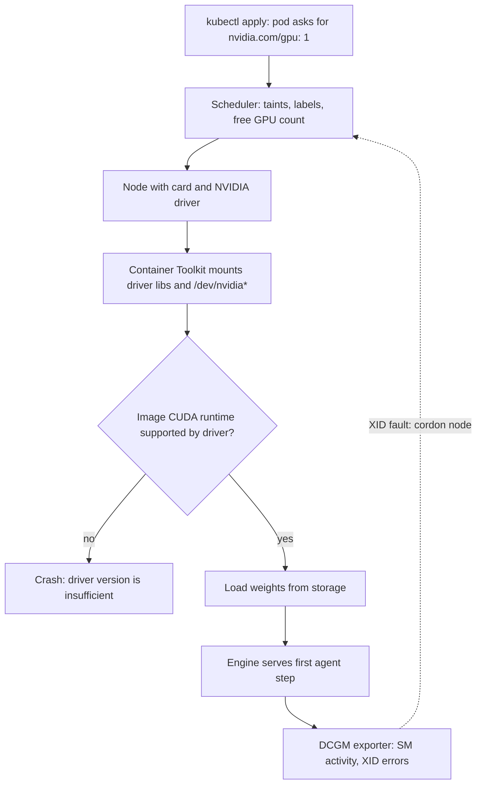

## TL;DR
When you self-host the model, embedder or reranker behind your agents, you run a stack, not a card:
accelerator, host, driver and CUDA, container runtime, scheduler and procurement. Most "the agent is
slow" tickets turn out to be host, driver or scheduling problems.

## For agent builders
- **Why it matters for agents.** An agent run makes many model calls in sequence, so one bad GPU node is
  hit far more often per run than per single chat. A faulty or cold replica turns into failed tool loops,
  retries and timeouts that look like agent bugs.
- **Where it shows up in your stack.** Only when you self-host: a vLLM or SGLang deployment for the
  agent's model, a GPU embedder for RAG, a reranker. Hosted APIs (OpenAI, Anthropic) hide every layer
  here behind rate limits and latency.
- **What you control.** The pod spec (GPU request, node selector, toleration), where weights load from,
  the driver/image pairing, and the health loop that removes bad cards before agent sessions land on them.
- **What you can skip.** SM microarchitecture and NCCL tuning. Know the seven layers, their failure
  signatures, and that ready-time is a storage number.

## Decision case
### Scenario
A legal-tech startup sells a contract-review agent to EU law firms. Each run makes about 20 model calls
to a self-hosted 70B model (140 GB fp16 checkpoint, tensor-parallel across 4 H100 80 GB cards), plus
retrieval calls to an L4 embedder and reranker. The question is how many layers of the GPU stack to own.
- **Load:** 4 model replicas (2 eight-GPU SXM nodes) overnight, 8 replicas (4 nodes) in office hours.
  The morning ramp takes about 10 minutes.
- **Residency:** contracts may not leave one EU region and may not go to a hosted model API.
- **Ready-time:** a new replica must serve within 5 minutes of scale-up, or the morning queue times out
  agent sessions at step one.
- **Reliability:** at least 99% of 20-step runs must finish without an infra-caused failure.
- **Team and deadline:** two platform engineers with Kubernetes but no GPU-ops experience; production in
  8 weeks. Costs below are relative and illustrative, not vendor quotes.

### Options
| Option | How it works | Residency | Ready-time (140 GB) | Health loop | Team fit, 8 weeks |
|---|---|---|---|---|---|
| A. Managed GPU node pools + GPU Operator | Cloud owns hardware and node images; you own pod spec, weight staging, cordon-on-XID | Pin the cluster to the EU region | Pre-staged NVMe: about 0.8 min at 3,000 MB/s | Yours: DCGM XID alerts, auto-cordon | Good: Kubernetes skills transfer |
| B. Serverless GPU platform | Platform owns everything below your container; per-second billing | Only if the platform can pin an EU region | Depends on the platform's weight cache; a 100 MB/s pull is 23.3 min | The platform's, not visible to you | Fastest to start, but 4-GPU replicas may be unsupported |
| C. Leased bare metal, own driver stack | You install drivers, toolkit, device plugin, metrics | Full control | Your NVMe, same as A | Yours, plus hardware tickets | Poor: quota and lease lead time of weeks, no GPU-ops skills |

### Decision
Choose **A**.
- **Residency:** a regional managed cluster meets it without trusting a platform's placement promises.
- **Ready-time:** loading 140 GB inside a 3-minute window (leaving 2 minutes for scheduling and warm-up)
  needs about 780 MB/s sustained. Only pre-staged local NVMe clears that; A lets you choose that storage.
- **Reliability:** the target allows a per-call infra failure rate of about 1 − 0.99^(1/20) ≈ 0.05%, one
  call in 2,000. One bad replica out of 8 touches 1 − (7/8)^20 ≈ 93% of runs. That demands a health loop
  you control (cordon-on-XID) plus a one-shot retry on another replica.
- **Why not B:** residency and 4-GPU tensor parallelism are uncertain, and you cannot cordon a bad card
  you cannot see.
- **Why not C:** the team cannot build and run a driver stack and hardware process in 8 weeks.

**What would change it:** a model small enough for one card (an 8B model at 16 GB loads in 160 s even at
100 MB/s) plus an EU-pinned platform makes B the right burst layer. Steady 24/7 load near full
utilisation and a dedicated GPU-ops hire make C worth its cost per GPU hour.

### Trade-offs accepted
- **The provider's driver cadence.** Watch driver version per node from feature-discovery labels; block
  base-image bumps until every pool runs the new driver.
- **Fixed eight-card blocks.** Two 4-GPU replicas fill a node exactly, but any 3-GPU or 5-GPU change
  strands cards. Watch GPU hours used versus purchased.
- **Burst nodes join before the ramp.** Creating a node, installing its driver stack and staging 140 GB
  onto its NVMe does not fit in 5 minutes, so add the two office-hours nodes on a schedule ahead of the
  ramp; the 5-minute budget covers a replica starting on a node already in the pool. Hold quota or
  reservations for them and alert on "insufficient capacity".
- **Owning the health loop.** Alert on `DCGM_FI_DEV_XID_ERRORS`, track cordoned nodes, and tag every agent
  trace span with the node that served it.

### Review rubric
- States residency, ready-time, reliability and team constraints with numbers before comparing options.
- Converts ready-time into a required read throughput (size divided by time) and picks storage from it.
- Converts a per-run success target into a per-call failure budget and checks one-bad-replica exposure.
- Names who owns each layer (driver, runtime, scheduling, health) in every option, not just price.
- Gives concrete conditions (model size, utilisation, team) under which the choice flips.

## Why it exists
- **GPUs break CPU-server assumptions.** CPU nodes are interchangeable: any node runs any container, the
  OS hides the hardware, the scheduler places work anywhere. A GPU is a separate computer on PCIe with
  its own memory, instruction set and driver, and the host kernel does not virtualise it like CPU time
  and RAM.
- **Four things must line up.** An inference container only works if the node's driver, the CUDA toolkit
  in the image, the device plugin that advertised the card and the scheduler's placement all agree.
- **The naive approach collapses at the second node.** "Install the driver, `pip install torch`, run it"
  works on one laptop. Then driver versions drift, images pull CUDA builds the driver cannot run, pods
  land on nodes without a card, and two pods silently share one card and OOM each other.
- **Nobody can see utilisation.** Without exported GPU metrics, nobody can say whether the fleet is 30%
  or 90% busy.
- **Every idle hour is expensive.** One high-end accelerator costs more per hour than a rack of web
  servers, so every misplaced pod is a capacity bug. GPU infrastructure is the set of layers that turn a
  card into a reliable, schedulable, observable, billable resource.

## How it works
Walk the stack bottom-up. Each layer answers one question; sizing, bandwidth, card selection,
serverless and autoscaling each have their own lesson. For an agent platform, read the table as "what can
break an agent run that calls this model twenty times".

| # | Layer | Question it answers | Typical failure |
|---|---|---|---|
| 1 | Accelerator | What does the compute look like? | Model does not fit; decode slow |
| 2 | Node | What feeds the card? | Slow weight loads, CPU-bound serving |
| 3 | Driver and CUDA | Will the code run at all? | "driver version is insufficient" |
| 4 | Container runtime | How does a container see the device? | `nvidia-smi` fails in the pod |
| 5 | Scheduling | Which workload gets which card? | Pods on wrong node, shared-card OOM |
| 6 | Procurement | Who pays, and how? | "insufficient capacity", quota wait |
| 7 | Observability | Is it actually busy? | "100% utilised" while idle; XID faults |

### 1. The accelerator: what does the compute look like?
- **Shape.** Thousands of simple cores grouped into streaming multiprocessors (SMs), each with tensor
  cores for matrix maths, fed by on-package memory (HBM on A100/H100, GDDR6 on L4).
- **Two numbers dominate.** Memory capacity decides whether the model fits (see *GPU sizing*); memory
  bandwidth bounds how fast decode runs (see *GPU utilization & memory bandwidth*).
- **Form factor.** SXM modules sit on a baseboard with NVLink/NVSwitch between GPUs and run at higher
  power. PCIe cards slot into ordinary servers, draw less power, and talk to each other only over PCIe
  unless bridged. Which card to buy is *A100 / H100 / L4 selection*.

### 2. The node: what feeds the card?
A GPU node is a host with one to eight accelerators plus the CPU, RAM, storage and network that keep
them busy. Each can be the bottleneck:
- **CPU and host RAM.** Tokenisation, request handling, data loading and the engine's scheduler run on the
  CPU. Host RAM stages weights on the way to the device, so a 64 GB host struggles to load a 140 GB
  checkpoint.
- **Storage.** Weights are read from disk at start-up: 140 GB over a 100 MB/s network volume takes about
  23 minutes; local NVMe at a few GB/s takes under a minute. Cold-start time is mostly a storage decision.
- **Intra-node interconnect.** Tensor parallelism exchanges activations between GPUs every layer. NVLink
  gives hundreds of GB/s per GPU (NVIDIA quotes 900 GB/s for H100 SXM); PCIe Gen4 x16 gives roughly
  32 GB/s per direction. Sharding across PCIe-only cards works but leaves bandwidth on the table.
- **Network.** Multi-node training needs RDMA (InfiniBand or RoCE) so gradient all-reduce does not stall in
  the host networking stack. Serving needs it only when one replica spans machines (a model too large for
  one eight-GPU node, or disaggregated prefill and decode shipping KV caches between nodes).
- **Otherwise Ethernet is enough,** *because* only prompts and tokens cross the network when each request
  stays inside one node.

### 3. Driver and CUDA: will the code run at all?
- **One driver per node.** The kernel-mode NVIDIA driver is the only piece that touches hardware.
- **Everything else ships in the image.** CUDA runtime, cuBLAS, cuDNN, NCCL and the PyTorch build must be
  versions the node's driver supports.
- **Backward, not forward, compatible.** Drivers run older CUDA runtimes, not newer ones. "CUDA driver
  version is insufficient for CUDA runtime version" means the image is newer than the node.
- **Two escape hatches, neither a plan.** CUDA minor-version compatibility lets, say, a 12.x runtime run on
  an older 12.x driver with some features (PTX JIT) missing. The `cuda-compat` forward-compatibility
  package works only on data-centre GPUs.
- **Rule.** Pin both, and upgrade drivers fleet-wide *before* bumping base images.

### 4. Container runtime: how does a container see the device?
1. Containers do not include the driver.
2. When a container requests GPUs, the NVIDIA Container Toolkit's runtime hook mounts the device files
   (`/dev/nvidia*`) and the driver's user-space libraries in at start.
3. That is why a GPU image is portable across driver versions, and why `nvidia-smi` works inside a
   container that never installed it.

### 5. Scheduling: which workload gets which card?
- **Integer extended resource.** A device plugin advertises GPUs as `nvidia.com/gpu` in integer units.
  Extended resources cannot be overcommitted and requests must equal limits.
- **Why no overcommit.** The kubelet treats an extended resource as an opaque count it cannot enforce.
  There is no cgroup-style controller that guarantees a container a fraction of a GPU or caps its device
  memory, as CFS quotas and memory cgroups do for CPU and RAM.
- **Time-slicing still happens.** The GPU does time-slice between processes by default; what is missing
  is enforced shares and isolation.
- **GPU Operator.** Packages driver, toolkit, device plugin, feature discovery (node labels such as the
  card model) and the DCGM metrics exporter as one install.
- **Placement.** Taints keep ordinary pods off expensive nodes; labels let a pod target the right tier.

Sharing one card between small workloads:

| Mechanism | How it shares | Memory isolation | Fault isolation |
|---|---|---|---|
| MIG | Hardware-partitions an A100 or H100 into up to seven instances with separate memory | Hardware-enforced | Yes |
| Time-slicing | Plugin advertises N virtual GPUs sharing one memory pool | None | No |
| MPS | Processes run kernels concurrently on one card | Opt-in per-client cap on Volta and later | No: one shared fault domain |

Only MIG gives hardware-enforced memory and fault isolation, so only MIG reliably protects one tenant
from another's OOM.

### 6. Procurement: who pays, and how?
- **Same card, many contracts.** On-demand instances, reserved or committed-use discounts,
  spot/preemptible capacity, bare-metal leases, GPU-specialist clouds, or serverless per-second billing.
- **Quotas gate all of them.** A fresh cloud account often cannot launch a single H100 without a request.
- **Lead time is capacity planning.** Days for quota, weeks for reservations. The economics live in *cost
  modeling*, *TCO* and *serverless GPUs*.

### 7. Observability: is it actually busy?
- **DCGM exporter.** Publishes per-GPU utilisation, memory use, temperature, power, ECC and XID error
  counts to Prometheus. Without it the fleet is a black box.
- **"100% utilised" is often a lie.** It frequently means one kernel at a time on an otherwise idle chip,
  which the utilization lesson unpacks.
- **GPUs fail in ways the OS does not hide.** Uncorrectable ECC errors, retired memory rows, a card that
  drops off the PCIe bus. The driver logs these as XID events in the kernel log; DCGM exports them.
- **Why it matters for scheduling.** Kubernetes still sees the device plugin's advertised count, *because*
  nothing else tells it the card is bad. Unless a health check cordons the node, the scheduler keeps
  placing pods on a card that will crash them.
- **Automated cordon-on-XID** (or the GPU Operator's health checks) is part of the stack, not an optional
  extra.

### What changes when the callers are agents
- **Calls per run multiply exposure.** A chat turn makes one model call; an agent run makes one per step.
  A replica that fails 1 call in N is met by most multi-step runs, so per-replica health matters more.
- **Several GPU services per step.** A RAG agent step may hit an embedder, a reranker and the LLM. Each is
  its own deployment with its own layers, and the slowest or least healthy one sets step latency.
- **Long runs outlive pods.** A run that lasts minutes spans scale-downs, node drains and driver rollouts,
  so the agent loop needs per-call retries and resumable state, not just a healthy cluster.

## Diagram
Follow one GPU pod serving an agent's model from `kubectl apply` to its first agent step; each box is a
layer that can fail on its own, and the dotted edge is the health loop that keeps bad cards away from
agent sessions.



## Examples
### Deployment that fails fast on a bad node
The embedder behind a RAG agent's retrieval tool asks for one GPU on a node labelled with a card model
and tolerates the GPU taint.
- The init container runs `nvidia-smi`, which only succeeds if the toolkit mounted the driver libraries.
- Official `nvidia/cuda` images set `NVIDIA_REQUIRE_CUDA`, so the toolkit refuses to start the container
  on a driver too old for that CUDA version.
- Use the same CUDA version as the server image, and a bad node fails the pod before the server tries to
  load 16 GB of weights.

```yaml
apiVersion: apps/v1
kind: Deployment
metadata:
  name: embedder
spec:
  replicas: 1
  selector: { matchLabels: { app: embedder } }
  template:
    metadata: { labels: { app: embedder } }
    spec:
      nodeSelector:
        nvidia.com/gpu.product: NVIDIA-L4        # label written by GPU feature discovery
      tolerations:
      - key: nvidia.com/gpu
        operator: Exists
        effect: NoSchedule
      initContainers:
      - name: gpu-check
        image: nvidia/cuda:12.4.1-base-ubuntu22.04   # same CUDA version as the server image
        command: ["nvidia-smi"]                   # fails the pod if the device is not visible
        resources: { limits: { nvidia.com/gpu: 1 } }
      containers:
      - name: server
        image: ghcr.io/example/embedder:1.4       # ships its own CUDA runtime, never the driver
        resources:
          limits: { nvidia.com/gpu: 1 }           # integer; requests are forced equal to limits
          requests: { cpu: "4", memory: 16Gi }    # CPU for tokenisation, RAM to stage weights
        volumeMounts:
        - { name: weights, mountPath: /models, readOnly: true }
      volumes:
      - name: weights
        persistentVolumeClaim: { claimName: model-weights }   # NVMe-backed, not object storage
```

### Cold-start calculator: storage decides ready-time
Weight loading time is size divided by read throughput. Plug in your checkpoint and volume.

```python
def load_minutes(weights_gb: float, read_mb_per_s: float) -> float:
    return weights_gb * 1000 / read_mb_per_s / 60

checkpoint_gb = 140                       # e.g. a 70B model in fp16
for volume, mb_s in [("network volume", 100), ("local NVMe (illustrative)", 3000)]:
    print(f"{volume:28s} {load_minutes(checkpoint_gb, mb_s):5.1f} min")
# network volume                23.3 min
# local NVMe (illustrative)      0.8 min
```

### Worked scenario: one bad node in an agent fleet
Ten replicas serve the agent's model behind a round-robin load balancer. One node has a GPU throwing XID
errors, so about 1 in 10 calls fails. Treat calls as independent draws (round-robin is close to that when
many sessions interleave).

| Caller | Calls per unit of work | Chance a unit touches the bad replica |
|---|---|---|
| Single-shot chat | 1 | 10% |
| 5-step agent run | 5 | 1 − 0.9^5 ≈ 41% |
| 20-step agent run | 20 | 1 − 0.9^20 ≈ 88% |

- **Without a per-call retry** that lands on another replica, most long runs fail somewhere mid-loop,
  after spending tokens and tool side effects on earlier steps.
- **A retry is safe here** because a model call has no side effects; retrying a tool call that writes
  needs an idempotency key, which is a separate design problem.
- **With cordon-on-XID**, the bad node leaves the pool and the exposure drops to zero; the retry only has
  to cover the minutes before the health check fires.

### Worked triage: "the GPU is slow" ticket, layer by layer
| Symptom seen | Layer | Check | Fix |
|---|---|---|---|
| CrashLoopBackOff only on some nodes | Driver/CUDA | Logs say "driver version is insufficient" | Upgrade driver fleet-wide, or pin to upgraded nodes |
| Running-but-not-Ready for tens of minutes | Node storage | Weight read throughput | Local NVMe or pre-staged weights |
| CUDA OOM in one deployment when another is busy | Scheduling | Two models time-sliced on one card | MIG, or separate cards |
| "95% busy" but low tokens/s | Observability | SM activity, not GPU-Util | Batch more, fix the bottleneck |
| "unknown error" or illegal-memory-access on one node | Hardware | XID entries in that node's kernel log | Cordon and drain the node |
| Queue grows 20 minutes after scale-up | Procurement | Cloud says "insufficient capacity" | Reservations, quota headroom, fallback region |

## Production patterns
- **Fail-fast GPU init container.** Use on every GPU workload behind an agent (LLM, embedder,
  reranker). Run `nvidia-smi` from an `nvidia/cuda` base image with the same CUDA version as the server,
  as in the example above. Monitor init-container failure counts per node: a cluster of failures marks a
  mis-provisioned node pool.
- **Driver first, image second.** Use whenever you bump a base image. Roll the new driver across every GPU
  node pool, verify, then release the image with the newer CUDA runtime. Monitor driver version per node
  (feature discovery labels or the node image version) and block the rollout while versions are mixed.
- **Cordon on XID, retry in the agent loop.** Use on any fleet larger than a few nodes, because multi-step
  runs meet a bad replica far more often than single chats. Alert on the DCGM exporter's XID error metric
  (`DCGM_FI_DEV_XID_ERRORS`) and cordon and drain the node automatically, or enable the GPU Operator's
  health checks; make the agent retry a failed model call once on another replica. Monitor cordoned
  nodes and agent-run failure rate per replica.
- **Taint GPU nodes, select by label.** Use on any shared cluster. Taint GPU nodes with `NoSchedule` on
  the `nvidia.com/gpu` key, add the matching toleration only to GPU workloads, and select the card tier
  with the `nvidia.com/gpu.product` label. Monitor for CPU-only pods on GPU nodes.
- **Weights on fast local storage.** Use when pod ready-time matters for autoscaling, as it does when
  agent traffic arrives in bursts. Mount an NVMe-backed volume or pre-stage weights on the node instead of
  pulling from object storage at start. Monitor pod ready-time from scheduling to readiness, and agent
  step queue time during scale-up.
- **Measure SM activity, not GPU-Util.** Dashboard DCGM's SM activity profiling field
  (`DCGM_FI_PROF_SM_ACTIVE`; enable it in the exporter's metric list if it is not on) next to tokens per
  second. Monitor GPU hours used versus purchased.

## Trade-offs
- **SXM/NVLink vs PCIe.** SXM nodes make multi-GPU sharding fast but come in fixed eight-card blocks. PCIe
  cards are cheaper and available singly, which wins until a model must be split across cards.
- **Managed driver stack vs control.** A GPU Operator or managed node pool makes the driver stack someone
  else's problem but ties you to their driver cadence. Bare metal gives control and costs an ops team.
- **Card sharing vs per-tenant performance.** MIG, time-slicing or MPS raises utilisation for small models
  but caps per-tenant performance and complicates scheduling. It stops paying off once one model
  saturates the card.
- **Spot vs reliability.** Spot and preemptible capacity is far cheaper but can vanish mid-job. Fine for
  checkpointed training and batch inference, wrong for latency-SLO serving unless on-demand fallback
  exists.
- **Self-hosting vs a hosted API for the agent's model.** Owning the stack buys data control, fixed
  per-GPU cost and engine knobs such as prefix caching; it costs every failure mode in this lesson. A
  hosted API wins until token volume or data rules make the GPU bill and ops team worth it.

## Pitfalls
- **Image CUDA runtime newer than the node driver.** Symptom: CrashLoopBackOff on exactly the nodes that
  have not had the driver upgrade, with "driver version is insufficient" in the logs. Fix: driver first,
  image second.
- **Loading weights from object storage or a slow network disk on every start.** Symptom: pods stuck in
  Running-but-not-Ready for tens of minutes while the readiness probe fails. Fix: NVMe-backed volumes.
- **Time-slicing two models onto one card without checking combined memory.** Symptom: CUDA OOM errors in
  one deployment that correlate with traffic to another. Fix: sum both footprints, or use MIG.
- **Judging fleet health by `nvidia-smi` GPU-Util.** Symptom: "95% busy" dashboards while tokens per second
  sit at a fraction of what the card can deliver. Fix: track DCGM SM activity.
- **Leaving a node with a faulty GPU in the pool.** Symptom: CUDA "unknown error" or illegal-memory-access
  on one node while identical pods elsewhere run, with XID entries in that node's kernel log. Fix:
  cordon-on-XID.
- **Treating quota and node lead time as instant.** Symptom: the autoscaler requests a node, the cloud
  answers "insufficient capacity", and the request queue grows for twenty minutes. Fix: plan quota and
  reservations ahead.
- **Debugging infra failures as agent logic bugs.** Symptom: agent runs fail at random steps with
  timeouts or malformed outputs, and prompt changes do not help. Fix: tag every model call in traces with
  the replica or node that served it; failures clustering on one node point to the GPU, not the prompt.

## When to use
You do not choose whether to have GPU infrastructure; you choose how many layers to own.
- **Skip it entirely when:** your agents call a hosted model API and need no self-hosted embedder or
  reranker; then rate limits and provider latency are your "infrastructure".
- **Buy the stack when:** the team is small and the workload is standard inference. Managed node pools
  with the GPU Operator, or a serverless GPU platform, come with driver stack, device plugin and metrics
  pre-wired.
- **Own more layers when:** you need a specific NVLink topology, custom kernels or drivers, bare-metal
  pricing, or on-prem placement.
- **Measure three things:** pod ready-time (storage and image size), GPU hours used versus purchased
  (procurement), and DCGM SM activity (whether "busy" is real).
- **Day to day:** a CrashLoopBackOff you must attribute to the right layer.
- **Interviews:** "walk me through what happens between `kubectl apply` and the first token"; naming each
  layer and its failure mode is the expected answer.

## Role lens
- **Engineer:** Writes the pod spec, pins CUDA and driver versions, mounts weights from fast storage,
  and reads DCGM metrics to tell a real bottleneck from an idle card.
- **Architect:** Decides which layers to own versus buy, the node shapes (SXM vs PCIe, sharing policy),
  and the procurement mix of reserved, on-demand and spot capacity.
- **FDE:** Audits a customer's cluster layer by layer — driver, toolkit, device plugin, taints, metrics
  — before promising that a model will run there on day one.

## Check yourself
**Q:** After a base-image bump, new inference pods crash on half the cluster with "CUDA driver version
is insufficient" and run fine on the other half. What happened, and how would you structure the fleet
so it cannot recur?
**A:** The image now carries a CUDA runtime newer than the kernel driver on the older half of the
nodes; drivers support older runtimes, not newer ones, so only un-upgraded nodes fail. Immediate fix:
roll the image back or pin the pods to upgraded nodes with a label. Structural fix: manage drivers with
the GPU Operator or node-pool images so every node runs one known version, label nodes with the driver
version, roll driver upgrades fleet-wide before base-image upgrades, and add an init container that
runs `nvidia-smi` so a mismatch fails fast and visibly instead of after a long weight load. Capacity
also matters: if half the fleet is unusable, the autoscaler should be told, not left to discover it.

## Interview questions
### Walk me through what happens between kubectl apply and the first token on a GPU pod.
- **Scheduling:** the device plugin advertises `nvidia.com/gpu` as an integer resource; the scheduler
  picks a node with a free card that the pod's tolerations and label selectors allow.
- **Runtime:** the NVIDIA Container Toolkit mounts the node's driver libraries and `/dev/nvidia*` into the
  container, so the image's CUDA runtime must be one that driver supports.
- **Start-up:** the server reads weights from storage into host RAM and then GPU memory, so storage
  throughput sets ready-time; only then does it serve the first token.

### Why does Kubernetes hand out whole GPUs, and how would you share one card between small models?
- **No enforcement primitive:** there is no cgroup-style controller for a GPU share or device memory cap,
  so the kubelet treats GPUs as an opaque count with requests equal to limits.
- **Sharing options:** MIG for hardware-isolated slices on A100 or H100; time-slicing or MPS for higher
  packing without memory or fault isolation.
- **Rule of thumb:** use MIG when tenants must not OOM each other; time-slice only workloads whose summed
  memory footprint you have checked.

### A dashboard shows the fleet at 95% GPU utilisation but throughput is poor. How do you debug it?
- **Question the metric:** `nvidia-smi` GPU-Util only says a kernel was running in the sample window, not
  how much of the chip it used.
- **Look at SM activity:** DCGM's SM activity profiling field next to tokens per second shows real
  occupancy; a low value means the card is mostly idle.
- **Then find the feeder:** small batches, CPU-bound tokenisation or request handling, or slow data
  loading are the usual causes, fixed by batching more or adding host CPU.

### When would you run inference on PCIe cards instead of SXM nodes with NVLink?
- **PCIe wins** when each model fits on one card: cards are cheaper, available singly and fit ordinary
  servers, and only prompts and tokens cross the network.
- **SXM wins** once a model must be tensor-parallel across cards, because NVLink gives hundreds of GB/s
  per GPU versus roughly 32 GB/s per direction for PCIe Gen4 x16.
- **The cost of SXM** is fixed eight-card blocks and higher power, so small models waste much of the node.

### Your self-hosted agent model's 140 GB checkpoint takes 23 minutes to become Ready. What do you change?
- **Diagnose:** 140 GB at 100 MB/s is about 23 minutes, so the network volume is the bottleneck, not the GPU.
- **Fix:** move weights to local NVMe or pre-stage them on the node; at a few GB/s the load drops under a
  minute.
- **Why it matters:** autoscaling is only useful if new replicas are ready before the queue grows, so
  ready-time is a capacity number, not a convenience; agent sessions waiting on step one time out first.

### Agent runs fail at random steps, but each model call works when replayed. How do you find the cause?
- **Correlate by replica:** tag each model call in the agent trace with the pod and node that served it;
  infra faults cluster on one node, prompt bugs do not.
- **Check that node's layers:** XID entries in its kernel log, DCGM error counters, a driver version that
  differs from the rest of the pool.
- **Fix both sides:** cordon the node, and add a one-shot retry on another replica so a single bad card
  cannot fail a 20-step run.

## Quiz
### Q: Why can `nvidia.com/gpu` not be overcommitted on Kubernetes the way CPU can?
- [ ] GPUs are too expensive for the scheduler to risk contention
- [x] There is no cgroup-style mechanism to enforce a fractional share or memory cap on a GPU, so whole devices are handed out
- [ ] The NVIDIA driver forbids more than one process per card
- [ ] Extended resources are only counted at node level, not pod level
> CPU is overcommittable because CFS quotas and cgroups can enforce each container's share. A GPU has no
> such host-side enforcement, so Kubernetes exposes it as an opaque integer extended resource with
> requests equal to limits. Multiple processes per card are possible (MPS, time-slicing) but without
> enforced shares or hard memory isolation; the driver does not forbid them.

### Q: Which sharing mechanism protects one tenant from another tenant's out-of-memory error on the same card?
- [ ] Time-slicing configured in the device plugin
- [ ] CUDA MPS
- [x] MIG hardware partitions
- [ ] Setting memory requests equal to limits on both pods
> MIG partitions an A100 or H100 into instances with their own memory and compute slices. Time-slicing
> shares one memory pool with no limits; MPS shares the pool and the fault domain (its per-client memory
> cap is opt-in), so one process can starve or crash another. Pod memory limits govern host RAM only.

### Q: A GPU container image contains the CUDA runtime but no driver. Where does the driver come from at run time?
- [ ] It is downloaded from the registry as a hidden image layer
- [ ] PyTorch bundles a user-space driver in its wheel
- [x] The NVIDIA Container Toolkit mounts the host node's driver libraries and device files into the container
- [ ] Kubernetes injects it through the device plugin's gRPC socket
> The kernel driver lives on the node and must match the kernel; the toolkit's runtime hook bind-mounts
> its user-space libraries and `/dev/nvidia*` into any container that requests GPUs. The device plugin
> only tells the scheduler which devices exist and which ones a container was allocated.

## Use cases & projects
### Use cases
- **Self-hosting the agent's model.** A vLLM or SGLang deployment on a GPU node pool, where driver, image
  and device-plugin pairing decide whether the agent's model starts at all.
- **GPU tool backends for RAG.** Embedders and rerankers that every retrieval step calls, often packed
  onto shared or MIG-partitioned cards because they are small.
- **Debugging "the agent is slow" tickets.** Tracing slow or failing agent steps to one bad node, a
  throttled card or a slow weight load rather than to the prompt or the tools.
- **Regulated or on-prem agent deployments.** Customers who cannot send data to a hosted API need the
  full stack (hardware, drivers, scheduler, procurement) planned before the agent ships.

### Mini project
**Health-gate a self-hosted agent model (2-3 hours).**
- **Goal:** make sure agent sessions never land on a GPU replica that is unhealthy or still loading.
- **Steps:** run a small open model with vLLM in a container on one GPU (cloud VM or a local card);
  record time from container start to first successful completion, split into image pull, weight load and
  engine warm-up; add a readiness check that sends a real one-token completion instead of only checking
  the port; write a tiny agent loop that calls the model five times per run and log per-step latency.
- **Done when:** you have a start-up timing table by stage, a readiness check that fails while weights
  load and passes after, and agent runs that only start once the replica reports ready.
