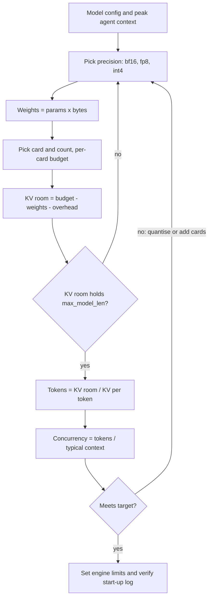

## TL;DR
Serving an agent's model needs weights + KV cache + activations + overhead, and agent contexts are long,
so the cache decides how many agents run at once. Fine-tuning on agent traces adds about 16 bytes per
parameter with mixed-precision Adam.

## For agent builders
- **Why it matters for agents.** An agent's context grows every step (system prompt, tool schemas, tool
  results), so a card that holds a hundred 4k chats may hold only a dozen 32k-token agent sessions. VRAM
  math turns "how many concurrent agents" into a number.
- **Where it shows up in your stack.** vLLM or SGLang flags for the self-hosted agent model
  (`--max-model-len`, `--max-num-seqs`, `gpu_memory_utilization`), the KV capacity line in the engine's
  start-up log, and the card choice for LoRA or QLoRA runs on agent traces.
- **What you control.** Precision, context cap per agent, concurrency limit, prefix stability (shared
  system prompt and tool schemas), and adapter versus full fine-tune.
- **What you can skip.** Exact activation formulas and ZeRO internals. Keep the weights, KV-per-token and
  16-bytes-per-parameter rules.

## Why it exists
- **A GPU cannot page to disk.** When the device runs out of memory the engine does not slow down
  gracefully; it throws a CUDA out-of-memory error and the process dies, often minutes into start-up
  after loading most of a checkpoint.
- **The quiet failure is over-buying.** A team provisions eight 80 GB cards for a model whose weights
  occupy 16 GB, then wonders why the bill is high and throughput is low. Both failures come from treating
  VRAM as a vibe instead of a sum.
- **"Parameters in billions ≈ GB" is wrong both ways.** In fp16 every parameter is two bytes, so a
  70-billion-parameter model needs 140 GB for weights alone, nearly twice the naive estimate.
- **Weights are only the fixed part.** Every in-flight request grows a KV cache proportional to its
  context length, prefill needs transient activation memory, and the CUDA context and engine allocations
  take space before the first request arrives.
- **Fine-tuning flips it again.** Gradients and optimizer state make a full fine-tune of that 70B model
  need hundreds of gigabytes more than serving it. VRAM math writes each term down, with the model's real
  shapes, before buying or promising anything.

## How it works
### The inference budget
```
VRAM        ≈ weights + KV cache + activations/workspace + runtime overhead
weights      = n_params × bytes_per_param
KV per token = 2 × n_layers × n_kv_heads × head_dim × bytes_per_element
KV cache     = KV per token × tokens in flight (summed over all concurrent sequences)
```

| Precision | Bytes per parameter |
|---|---|
| fp32 | 4 |
| fp16 / bf16 | 2 |
| int8 / fp8 | 1 |
| int4 | roughly 0.5 plus a few percent for scales and zero-points (call it 0.55) |

- **The factor 2** in the KV term is one key and one value vector.
- **`n_kv_heads`, not `n_heads`,** is why grouped-query attention matters: Llama-3 models use 8 KV heads
  against 32 or 64 query heads, which cuts the cache 4–8× relative to full multi-head attention.
- **Runtime overhead** is everything that is neither weights nor cache: the CUDA context, cuBLAS/cuDNN
  workspaces, captured CUDA graphs and the engine's own buffers. Illustrative order of magnitude: around a
  gigabyte per process, present before any request.
- **Activations** during prefill scale with (tokens in the batch × hidden size) per layer and are
  transient. Engines bound them by capping how many prompt tokens one forward pass may contain (chunked
  prefill), so the practical rule is to leave headroom rather than compute them exactly.

### How the engine spends the budget
1. vLLM's `gpu_memory_utilization` (default 0.9) is the fraction of the card the engine may use,
   *because* other processes and driver allocations need the rest.
2. At start-up it profiles weights plus peak activations once.
3. Everything remaining goes to KV-cache blocks.
4. That space divided by KV-per-token is the total number of tokens the server can hold across all
   concurrent requests: the real capacity number.

### Two models, worked
| Model | Params | Layers | KV heads | head_dim | bf16 weights | KV per token |
|---|---|---|---|---|---|---|
| Llama-3-8B | about 8.0B | 32 | 8 | 128 | 16 GB | 2 × 32 × 8 × 128 × 2 = 131,072 bytes = 128 KB |
| Llama-3-70B | about 70.6B | 80 | 8 | 128 | 141 GB | 2 × 80 × 8 × 128 × 2 = 327,680 bytes = 320 KB |

Fits, taking a 0.9 utilisation budget and ~1 GB overhead per card:

| Setup | Arithmetic | KV room | Capacity |
|---|---|---|---|
| 8B bf16 on a 24 GB L4 | 21.6 − 16 − 1 | ≈ 4.6 GB | ≈ 35k tokens ≈ eight or nine 4k-token conversations |
| 8B bf16 on an 80 GB H100 | 72 − 16 − 1 | = 55 GB | ≈ 420k tokens ≈ a hundred 4k conversations; bandwidth, not capacity, now limits |
| 70B bf16 on two 80 GB H100s | 144 − 141.2 − 2 | ≈ 0.8 GB | ≈ 2.4k tokens *total*: it "fits" but can barely serve one request |
| 70B fp8 on the same two cards | 144 − 71 − 2 | = 71 GB | ≈ 220k tokens, a comfortable server |
| 70B int4 (~39 GB) on one 80 GB card | 72 − 39 − 1 | = 32 GB | ≈ 100k tokens, with a quality cost that must be evaluated, not assumed |

- **The 70B bf16 row** is the case the formula catches and intuition misses.
- **Long context is the other surprise.** One 128k-token prompt on the 8B model is 128k × 128 KB = 16 GiB
  (about 17 GB) of cache, as much as the weights, and a single such request can evict everything else.

### Sizing for agent sessions, not chats
- **Size on the context at the last step.** An agent's tokens in flight are its whole transcript, which
  peaks near the end of the run. Divide KV room by that peak, not by the opening prompt length.
- **Shared prefixes count once.** With prefix caching, engines such as vLLM can share the KV blocks of a
  byte-identical prefix (system prompt plus tool schemas) across concurrent requests, so a long shared
  prefix costs memory roughly once rather than per agent.
- **Compaction is a capacity lever.** Summarising old tool results caps the per-agent peak, which raises
  how many agents fit as directly as a bigger card.

### The training budget
Full fine-tuning with mixed precision and Adam keeps, per parameter (the accounting the ZeRO paper uses):

| Term | Bytes per parameter |
|---|---|
| bf16 weights | 2 |
| bf16 gradient | 2 |
| fp32 master weight | 4 |
| Adam first and second moments | 4 + 4 |
| **Total** | **16** |

- **8B full fine-tune ≈ 128 GB before activations,** so it does not fit one 80 GB card and must be sharded
  (ZeRO/FSDP) across several.
- **Activations** add batch × sequence × hidden per layer; attention without a fused kernel adds a
  sequence-squared term.
- **Gradient checkpointing** trades roughly a third more compute for storing only layer boundaries.
- **LoRA** changes the equation *because* the base weights are frozen: they cost 2 bytes per parameter
  with no gradient or optimizer state. Only the adapter (typically well under 1% of parameters) carries
  the 16-byte burden, so the 8B model fine-tunes in roughly 16 GB plus activations.
- **QLoRA** stores the frozen base in 4-bit, about 4.5 GB for 8B, which is what makes 24 GB cards viable.
- **Eight-bit optimizers** (for example bitsandbytes' 8-bit Adam) store each Adam moment in one byte with
  block-wise scales, cutting the optimizer term from 8 bytes per parameter to about 2.

### Multi-GPU arithmetic
- **Tensor parallelism** divides both weights and KV cache by the TP degree, while each card keeps its own
  overhead. The head count must divide evenly (8 KV heads means TP up to 8 without replication).
- **Pipeline parallelism** divides layers instead. It is used when cards lack NVLink or the model spans
  nodes; each stage holds the KV cache only for its own layers.
- **Either way,** "fits on N cards" means the per-card sum, not the total, is under budget.

### Mixture-of-experts: size by total, not active, parameters
- **Memory follows total parameters.** An MoE model routes each token through a few experts, so compute per
  token follows the active count, but memory follows the total, *because* every expert must be resident
  for whichever token picks it.
- **Mixtral-8x7B:** about 46.7B total and 12.9B active parameters. In bf16 it needs ~93 GB for weights,
  like a dense 47B model, even though each token does the arithmetic of a 13B one.
- **Its KV cache follows the attention shape** (32 layers, 8 KV heads, head_dim 128): 128 KB per token,
  the same as Llama-3-8B.
- **Bandwidth sits between the two.** At batch 1 a decode step reads only the active experts; at serving
  batch sizes different tokens hit different experts and the step reads close to all of them.
- **Rule:** size the card by total parameters; estimate latency with the batch you will run.

### Order of decisions
1. **Precision first,** because it halves or quarters the dominant term.
2. **Card and count** (capacity).
3. **`max_model_len`** (the worst-case single request).
4. **Concurrency:** what remains ÷ KV per token ÷ typical context.

Reverse the order and you will size the card to a concurrency figure that the precision choice later
invalidates.

## Diagram
Read it top to bottom for the model behind your agents: each decision feeds the next, and a failed fit
loops back to precision or card count rather than to wishful concurrent-agent targets.



## Examples
### Planner that reproduces the worked numbers
A twenty-line planner. It uses decimal gigabytes (1e9) to match how vendors quote card memory; engines
report GiB, so expect a 7% difference in their logs.

```python
GB = 1e9

def kv_per_token(n_layers, n_kv_heads, head_dim, bytes_el=2):
    return 2 * n_layers * n_kv_heads * head_dim * bytes_el        # one K and one V per layer

def plan(name, params_b, n_layers, n_kv_heads, head_dim, vram_gb, n_gpus=1,
         bytes_w=2, util=0.9, overhead_gb=1.0, ctx=4096):
    weights = params_b * GB * bytes_w
    budget = vram_gb * GB * util * n_gpus                       # engine's usable share
    kv_room = budget - weights - overhead_gb * GB * n_gpus
    tok = kv_per_token(n_layers, n_kv_heads, head_dim)
    tokens = max(kv_room, 0) / tok
    print(f"{name:26s} weights={weights/GB:6.1f}GB KV/tok={tok/1024:.0f}KB "
          f"KV room={kv_room/GB:5.1f}GB ~{tokens:,.0f} tok ≈ {tokens/ctx:.0f} seqs@{ctx}")

plan("8B bf16 / L4 24GB",       8.0, 32, 8, 128, 24)             # ~35k tok, ~9 seqs
plan("8B bf16 / H100 80GB",     8.0, 32, 8, 128, 80)             # ~420k tok, ~100 seqs
plan("70B bf16 / 2xH100",      70.6, 80, 8, 128, 80, n_gpus=2)   # ~2.4k tok: unusable
plan("70B fp8 / 2xH100",       70.6, 80, 8, 128, 80, n_gpus=2, bytes_w=1)     # ~220k tok
plan("70B int4 / 1xH100",      70.6, 80, 8, 128, 80, bytes_w=0.55)            # ~100k tok
```

### Worked scenario: how many coding agents fit on one H100?
Llama-3-8B in bf16 on an 80 GB H100 leaves ≈ 55 GB of KV room, ≈ 420k tokens at 128 KB per token. Each
agent run starts with a 6k-token prefix (system prompt plus tool schemas) and peaks at 32k tokens.

| Plan | Tokens held per agent | Concurrent agents (≈ 420k ÷ per-agent) |
|---|---|---|
| Sized as 4k chats (the mistake) | 4k | ≈ 100, never reached in practice |
| Agents at peak, no prefix sharing | 32k | ≈ 12 |
| Prefix caching shares the 6k prefix once | 26k unique + 6k shared | ≈ 15 |
| Plus compaction capping each run at 16k | 10k unique + 6k shared | ≈ 41 |

- **The first row is how teams get preemption storms:** concurrency set from chat math, then agents grow
  past the KV room mid-run and the engine evicts or re-prefills them.
- **The last two rows** cost no hardware; they come from keeping the prefix byte-identical and
  summarising old tool results.

### Fine-tuning budget for the 8B model, four ways
Same model, four training set-ups for tuning it on agent traces (tool calls and results), using the
per-parameter accounting above. All figures exclude activations, which you add on top and control with
batch size, sequence length and checkpointing; long multi-step traces make that term large.

| Set-up | Bytes per parameter (state) | State for 8B | Fits one 80 GB card? |
|---|---|---|---|
| Full fine-tune, mixed-precision Adam | 2 + 2 + 4 + 8 = 16 | ~128 GB | No: shard with ZeRO/FSDP |
| Full fine-tune, 8-bit Adam | 2 + 2 + 4 + 2 = 10 | ~80 GB | No: no room left for activations |
| LoRA, bf16 base | 2 (base frozen) + adapter | ~16 GB + adapter | Yes, with room for activations |
| QLoRA, 4-bit base | ~0.55 (base frozen) + adapter | ~4.5 GB + adapter | Yes; also viable on a 24 GB card |

### Measuring the real peak during a training step
Estimates miss allocator fragmentation and lazily allocated optimizer state, so measure one step.

```python
import torch

def peak_step_gb(model, batch, optimizer):
    torch.cuda.reset_peak_memory_stats()
    loss = model(**batch).loss
    loss.backward()
    optimizer.step()               # Adam allocates its moments here, on the first step
    optimizer.zero_grad(set_to_none=True)
    torch.cuda.synchronize()
    return torch.cuda.max_memory_allocated() / 1e9

# Run it twice: the first call includes optimizer-state allocation, the second shows steady state.
# Compare with the table above; a large gap is activations or fragmentation.
```

## Production patterns
- **Size concurrency on peak agent context.** Use for any self-hosted agent model. Take the p95 of
  tokens at the final step from agent traces, divide the KV room by it, and set `--max-num-seqs` there,
  with `--max-model-len` at the hard context cap the agent's compaction enforces. Monitor preemptions and
  agent step latency as runs lengthen.
- **Read the capacity line from the engine log.** Use on every deployment change. vLLM logs the KV-cache
  size it allocated (in tokens or blocks) at start-up; compare it with the planner's estimate. Monitor
  the gap: a large shortfall means an overhead term (CUDA graphs, a co-located process) you missed.
- **Cap the worst case explicitly.** Use whenever traffic mixes short chats, long documents and long agent runs. Set
  `--max-model-len` to the longest request you will accept and `--max-num-seqs` to the concurrency the
  KV room supports. Monitor KV-cache usage and preemption counts in the engine's metrics.
- **Quantise before adding cards.** Use when weights leave too little KV room, as in the 70B bf16 on two
  cards case. Try fp8 weights (vLLM `--quantization fp8`) and an fp8 KV cache (`--kv-cache-dtype fp8`),
  then rerun your eval set. Monitor task quality alongside the gain in resident tokens.
- **Leave headroom on shared cards.** Use when anything else runs on the GPU (a sidecar, a second model,
  a profiler). Lower `gpu_memory_utilization` below the 0.9 default rather than raising it. Monitor
  device memory used per process and OOM restarts.
- **Measure one training step before a long run.** Use before any fine-tune longer than an hour, including LoRA runs on agent traces. Run a
  single forward, backward and optimizer step at the real batch and sequence length and record
  `torch.cuda.max_memory_allocated()`. Monitor that peak against card memory, keeping headroom.

## Trade-offs
- **Lower weight precision vs quality and speed.** It frees memory for cache and raises concurrency, but
  int4 costs measurable quality on some tasks and dequantisation kernels can slow decode. It pays when
  memory, not quality, is the binding constraint.
- **Higher `gpu_memory_utilization` vs slack.** More KV blocks, but less slack for activation spikes and
  co-located processes; push it only on a card nothing else touches.
- **More tensor-parallel cards vs communication.** It multiplies KV capacity and bandwidth, yet adds
  per-layer communication and per-card overhead. It stops helping once the model already fits with KV
  headroom.
- **LoRA and QLoRA vs update capacity.** They make fine-tuning fit small cards at the cost of a smaller
  parameter update and, for QLoRA, slower steps from dequantisation. Full fine-tuning is only worth its
  multi-card cost when the adapter measurably underperforms.
- **Longer agent context vs concurrency.** Letting agents keep every tool result raises task success on
  long tasks but divides the number of resident agents by the extra tokens. It flips once compaction or
  retrieval over old steps holds quality on your agent eval.

## Pitfalls
- **Counting weights and forgetting overhead and activations.** Symptom: an OOM at start-up or on the
  first long prompt even though "the model fits". Fix: add the overhead and headroom terms.
- **Sizing concurrency on the average context instead of `max_model_len`.** Symptom: sudden request
  preemption or queueing whenever a few long documents arrive together. Fix: size the worst case first.
- **Assuming a fine-tune needs the same memory as serving.** Symptom: an OOM in the first optimizer step
  after the forward pass succeeded, *because* Adam state is allocated lazily. Fix: use the 16-byte rule.
- **Dividing total memory across cards instead of checking per-card budgets with TP.** Symptom: one rank
  OOMing while the others wait on NCCL. Fix: check the per-card sum.
- **Sizing an MoE model by its active parameter count.** Symptom: an OOM at weight load on a card the
  "13B-class" label said was ample. Fix: size by total parameters.
- **Treating int4 as "half of fp16".** Symptom: a card that fits the weights but throughput below the
  fp16 figure, *because* dequantisation dominates at the batch sizes used. Fix: benchmark at real batch.
- **Sizing agents on their first-step prompt.** Symptom: load tests with fresh sessions pass, then
  production runs slow down and get preempted around step 10 as transcripts grow. Fix: load-test with
  replayed full-length agent traces and size on peak context.

## When to use
- **Run the arithmetic when:** a model, card, precision, context limit or concurrency target changes,
  and before any procurement conversation; for agents, also when you add tools or change compaction,
  because both move peak context.
- **Skip it when:** the agent's model is a hosted API; then your budget is tokens and rate limits, not VRAM.
- **Inputs are public:** parameter count and layer/head shapes from the model config, memory from the
  card datasheet.
- **Reach for it when someone asks:** "how many users can this card serve", "why did we OOM at 2 a.m." or
  "can we fine-tune this on what we have".
- **Measure:** the engine's reported KV-block count against your estimate; a large gap means an overhead
  term you missed.
- **Interviews:** deriving bytes-per-token from the config and turning it into a concurrency figure, then
  adjusting for precision and TP, is the expected depth for both engineering and architecture roles.

## Role lens
- **Engineer:** Computes weights and KV per token from the model config before setting
  `max_model_len`, `gpu_memory_utilization` and batch limits, and validates against the engine's
  start-up log.
- **Architect:** Owns the fit table — which models run on which card tier at which precision — and
  uses it to size clusters and to decide when quantisation or TP is mandatory.
- **FDE:** Translates a customer's "we have four A100s" into which models and context lengths are
  realistic, and shows the arithmetic when a 70B request will not fit as asked.

## Check yourself
**Q:** You have one 80 GB card and a customer wants Llama-3-70B serving twenty concurrent 8k-token
chats. Walk through whether it fits and what you would change.
**A:** bf16 weights are 141 GB, so no. fp8 weights are 71 GB; with a 72 GB budget at 0.9 utilisation
and ~1 GB overhead that leaves nothing for cache, so still no. int4 is about 39 GB, leaving ~32 GB
for KV at 320 KB per token, roughly 100k tokens; twenty chats at 8k need 160k, so about twelve fit.
Options: quantise the KV cache to 8-bit, doubling capacity to ~200k tokens, which meets the target if
quality evaluation passes; cap concurrency at twelve and queue; or add a second card and run fp8 with
TP=2 for ~220k tokens and better throughput. A strong answer also notes that twenty concurrent 8k
contexts will be bandwidth-bound on one card, so latency targets need checking too.

## Interview questions
### Why is "a 70B model needs about 70 GB" the wrong way to size a GPU?
- **Bytes, not parameters:** bf16 stores two bytes per parameter, so 70B needs about 140 GB for weights
  alone; only int8 or fp8 gets near the naive figure.
- **Weights are the fixed part:** KV cache grows with every in-flight token, plus activations and roughly
  a gigabyte of runtime overhead per process.
- **So the right answer is a sum** with the model's real shapes, checked per card.

### Derive the KV cache per token for Llama-3-8B and turn it into a concurrency figure on a 24 GB L4.
- **Per token:** 2 × 32 layers × 8 KV heads × 128 head_dim × 2 bytes = 131,072 bytes, 128 KB.
- **Room:** 0.9 × 24 = 21.6 GB, minus 16 GB of bf16 weights and ~1 GB overhead, leaves ≈ 4.6 GB.
- **Capacity:** 4.6 GB ÷ 128 KB ≈ 35k tokens, so about eight or nine 4k-token conversations; int4
  weights would roughly triple that.

### A 70B bf16 model loads on two 80 GB cards but the server crawls. What is going on and what do you do?
- **Diagnose:** 144 GB usable minus 141.2 GB weights and 2 GB overhead leaves ≈ 0.8 GB, about 2.4k
  tokens of KV cache in total, so requests queue or get preempted.
- **Fix options:** fp8 weights leave ≈ 71 GB for ≈ 220k tokens; or move to four cards with TP=4.
- **Verify** with the engine's start-up capacity line, not with "it loaded".

### You want to fine-tune an 8B model on agent traces. When would you choose LoRA or QLoRA over a full fine-tune?
- **Choose adapters** when memory is the constraint: an 8B full fine-tune needs ~128 GB of state, LoRA
  about 16 GB plus activations, QLoRA about 4.5 GB, which fits a 24 GB card.
- **Pay for full fine-tuning** only when an adapter measurably underperforms on your eval, because it needs
  ZeRO/FSDP sharding across several cards.
- **QLoRA's cost** is slower steps from dequantisation, on top of a smaller parameter update.

### How do you size memory for a mixture-of-experts model like Mixtral-8x7B?
- **Memory by total parameters:** about 46.7B total means ~93 GB of bf16 weights, because every expert
  must be resident.
- **Compute by active parameters:** 12.9B active per token, so arithmetic looks like a 13B model.
- **Bandwidth depends on batch:** batch 1 reads only active experts, serving batches read close to all of
  them, so benchmark latency at the batch you will run.

### How many concurrent agent sessions can an 8B bf16 model serve on one H100, and how would you raise it?
- **Capacity:** about 55 GB of KV room at 128 KB per token is ≈ 420k tokens; agents peaking at 32k
  tokens give about 12 sessions, not the ≈ 100 a 4k-chat estimate suggests.
- **Raise it without hardware:** keep the system prompt and tool schemas byte-identical so prefix
  caching shares them, and compact old tool results to cap the peak.
- **Then hardware levers:** an fp8 KV cache after an eval, or more replicas; verify with the engine's
  capacity line and preemption metrics.

## Quiz
### Q: Why does a full fine-tune need roughly eight times the memory of serving the same model in bf16?
- [ ] Training must keep a copy of every activation for the whole dataset
- [x] Gradients, fp32 master weights and two Adam moments add about 14 bytes per parameter on top of the 2-byte weights
- [ ] Backpropagation requires the weights in fp64 for numerical stability
- [ ] The KV cache must be stored for every training sequence simultaneously
> Mixed-precision Adam keeps bf16 weights and gradients plus fp32 master weights and two fp32 moments,
> 16 bytes per parameter versus 2 for inference, before activations. Training does not use a KV cache
> and master weights are fp32, not fp64.

### Q: Llama-3-70B in bf16 (141 GB) is loaded on two 80 GB cards with tensor parallelism. What is the practical problem?
- [ ] The head count is not divisible by two, so TP fails
- [ ] NCCL cannot shard models larger than one card's memory
- [x] After weights and overhead only about a gigabyte remains for KV cache, so the server can hold only a few thousand tokens
- [ ] bf16 is not supported across tensor-parallel ranks
> The usable budget is about 144 GB at 0.9 utilisation; weights take 141 GB and overhead about 2 GB,
> leaving under a gigabyte, roughly 2.4k tokens of cache at 320 KB per token. The model technically loads but cannot serve
> real traffic, which is why fp8 or four cards are the usual choices.

### Q: Which single change most increases the number of concurrent 4k-token requests an 8B bf16 model can hold on a 24 GB card?
- [ ] Raising the number of CPU threads for tokenisation
- [ ] Switching from grouped-query to multi-head attention
- [x] Quantising the weights to int4, freeing roughly 11 GB for KV cache
- [ ] Increasing `max_model_len` to 32k
> With ~4.5 GB of cache room, int4 weights (~4.4 GB instead of 16 GB) more than triple the space for
> KV blocks. Multi-head attention would multiply KV per token by four and reduce concurrency; a larger
> `max_model_len` changes the worst case per request, not the total capacity.

## Use cases & projects
### Use cases
- **Concurrency planning for an agent platform.** Turning "how many agent sessions per GPU" into a number
  from weights, KV bytes per token and the typical transcript length at the last step.
- **Choosing a context cap per agent type.** A coding agent with long transcripts and a short FAQ agent
  need different `max_model_len` and concurrency limits, often on different deployments.
- **Picking the card for fine-tuning on agent traces.** The 16-bytes-per-parameter rule for full
  fine-tunes versus LoRA or QLoRA decides whether one card is enough.
- **Deciding quantisation before buying GPUs.** int4 or fp8 weights free memory for KV cache, which for
  agents usually buys more concurrent sessions than a bigger card would.

### Mini project
**Build a VRAM calculator for agent sessions (1-2 hours).**
- **Goal:** predict how many concurrent agent sessions a given model and card can hold, then check it
  against a real engine.
- **Steps:** write a Python function that takes parameter count, precision, layers, KV heads, head dim,
  card memory and a per-session token profile (prefix plus tokens per step times steps); compute weights,
  KV per token and sessions that fit with headroom; compare the result with the KV capacity line vLLM
  prints at start-up for the same model and settings, if you have a GPU.
- **Done when:** the calculator prints sessions-per-card for at least three agent profiles, and you can
  explain any gap between its estimate and the engine's reported capacity.
