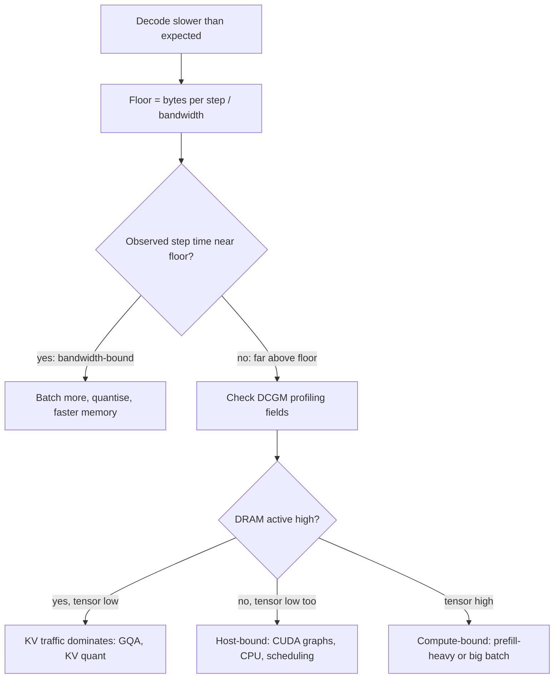

## TL;DR
`nvidia-smi` GPU-Util says a kernel ran, not that the chip was busy. Decode does about one FLOP per
weight byte per sequence against roofline ridges of ~150-300, so small batches are bandwidth-bound:
batch more or move fewer bytes.

## Why it exists
- **The spec sheet and the dashboard disagree.** Teams buy GPUs for their FLOPs, then an H100 serving a
  chat model produces tokens at a rate that would embarrass its spec sheet, while the dashboard shows
  98% utilisation.
- **For decode the GPU is a memory device.** Every decode step must stream every weight byte from HBM
  into the compute units to produce one token per sequence. With one sequence in flight each byte is used
  for a single multiply-add, and the tensor cores sit idle most of the cycle, waiting on memory.
- **Both naive fixes waste money.** "Utilisation is high, so we need more GPUs" replicates idle hardware.
  "Buy the card with the most TFLOPs" buys the wrong axis.
- **The roofline asks the right question.** How many operations does this workload do per byte it moves
  (its arithmetic intensity), and is that above or below the point where the card switches from
  bandwidth-limited to compute-limited?
- **One ratio explains a lot.** Why batching multiplies throughput almost for free, why quantisation
  speeds decode even when the math is not faster, why prefill and decode differ, and which utilisation
  metric to trust. Without it capacity planning is guesswork dressed up as a dashboard.

## How it works
### The roofline
A kernel's attainable throughput is the lower of two ceilings:
```
attainable FLOP/s = min( peak FLOP/s , arithmetic intensity × memory bandwidth )
arithmetic intensity = FLOPs performed / bytes moved from memory   (FLOP per byte)
ridge point          = peak FLOP/s / bandwidth                      (FLOP per byte)
```
- **Below the ridge** the kernel is memory-bound and runs at `intensity × bandwidth`.
- **Above it** the kernel is compute-bound and runs near peak.

Ridge points from NVIDIA's datasheet figures (dense bf16 tensor throughput and memory bandwidth):

| Card | Peak bf16 | Bandwidth | Ridge (FLOP/byte) |
|---|---|---|---|
| A100 80 GB SXM | 312 TFLOP/s | 2.0 TB/s | ≈ 156 |
| H100 SXM | 989 TFLOP/s | 3.35 TB/s | ≈ 295 |
| L4 | 121 TFLOP/s | 0.3 TB/s | ≈ 400 (bandwidth small relative to compute) |

The number to remember is "hundreds": a workload must do hundreds of operations per byte before the
tensor cores are the bottleneck.

### Decode intensity: why batch size is the lever
1. **Per step, each weight is multiplied by one activation and accumulated:** two FLOPs per parameter per
   sequence.
2. **In bf16 each parameter is two bytes,** read once per step regardless of how many sequences share it.
3. **So a batch of *B* sequences** does about `2 × B` FLOPs per 2 bytes in the dense layers, an
   intensity of roughly *B* FLOP/byte.
4. **At *B* = 1** that is 1 FLOP/byte against a ridge of ~300: the H100 uses well under 1% of its
   arithmetic, limited entirely by how fast HBM can stream 16 GB of 8B-model weights.
5. **Doubling the batch doubles tokens per second** at almost no per-token latency cost, until *B*
   approaches the ridge or, usually sooner, the sequences' KV-cache reads rival the weight reads. This is
   the whole case for continuous batching.

The lower bound on a decode step is `bytes read ÷ bandwidth`. For an 8B bf16 model:

| Card | Arithmetic | Step floor | Single-stream ceiling |
|---|---|---|---|
| H100 | 16 GB ÷ 3.35 TB/s | ≈ 4.8 ms | at most ~200 tokens/s |
| L4 at 300 GB/s | 16 GB ÷ 0.3 TB/s | ~53 ms | at most ~19 tokens/s |

Real engines land below these bounds, but the ratio between cards holds, which is why decode speed
tracks bandwidth rather than TFLOPs.

### Attention does not batch the same way
- **Weights are shared across sequences; KV caches are not.** Each sequence's attention reads its own
  cache, so attention's bytes grow with *B* × context and its intensity stays low at any batch.
- **The cache can dominate.** A hundred 4k-token sequences on the 8B model read ~54 GB of cache per step
  (100 × 4096 × 128 KB) on top of 16 GB of weights.
- **Byte-cutting levers:** grouped-query attention, KV quantisation and FlashAttention's tiling (which
  avoids writing the full attention matrix to HBM) all exist to reduce those bytes.

### Prefill is the other regime
- **Each weight byte serves every prompt token** in the pass, so intensity is roughly the number of
  tokens in the pass.
- **A 2,000-token prompt** is far above the ridge and compute-bound.
- **Consequence:** time-to-first-token scales with prompt length and TFLOPs, while time-per-output-token
  scales with bandwidth, which is why engines schedule prefill and decode differently.

### What the utilisation metrics measure
| Metric | What it measures | Reading it |
|---|---|---|
| `nvidia-smi` **GPU-Util** (DCGM `DCGM_FI_DEV_GPU_UTIL`) | Fraction of the sample period in which *any* kernel was executing | One tiny kernel per millisecond reads as 100% |
| DCGM **SM activity** (`DCGM_FI_PROF_SM_ACTIVE`) | Fraction of time at least one warp was resident on an SM | Better than GPU-Util |
| **SM occupancy** (`DCGM_FI_PROF_SM_OCCUPANCY`) | How full the SMs were | |
| **Tensor pipe active** (`DCGM_FI_PROF_PIPE_TENSOR_ACTIVE`) | Whether the matrix units did work | Low in decode-bound serving |
| **DRAM active** (`DCGM_FI_PROF_DRAM_ACTIVE`) | Memory bandwidth in use | High in decode-bound serving |

- **The signature:** a decode-bound server shows high DRAM activity and low tensor activity; a
  prefill-heavy one shows the reverse.
- **Model FLOPs utilisation (MFU):** observed tokens/s × FLOPs per token ÷ peak FLOP/s. The honest single
  number for training and prefill. For decode it is naturally low, *because* the roofline caps a
  memory-bound step far below peak FLOPs, so a low decode MFU is not by itself a problem.
- **Model bandwidth utilisation (MBU):** bytes a step must read (weights plus every sequence's KV cache)
  × steps per second ÷ peak bandwidth. The decode counterpart of MFU: how close the server is to its real
  ceiling.
- **Reading MBU:** high MBU with poor tokens/s means you need fewer bytes or bigger batches; low MBU means
  something other than the GPU is in the way.

### Other things that masquerade as GPU limits
- **Kernel-launch overhead** when batches are tiny; CUDA graphs fix it.
- **Python-side scheduling and tokenisation** that leave the device starving.
- **Host-to-device copies** over PCIe.
- **The tell:** low DRAM *and* low tensor activity together. The GPU is waiting on the host, and no card
  upgrade will help.

## Diagram
The triage path for "decode is slow": compute the bandwidth floor first, then let the DCGM signals say
whether to batch, cut bytes, or look at the host.



## Examples
### Roofline estimator for decode
Takes datasheet bandwidth and peak compute and the bytes a step must read (weights plus the KV cache of
every sequence in the batch). Reports the bandwidth-bound step time, the tokens/s ceiling and whether
the step is memory- or compute-bound. Outputs for an 8B bf16 model reproduce the figures above; they are
upper bounds, not measurements.

```python
CARDS = {  # datasheet-level figures, rounded: (memory bandwidth B/s, dense bf16 FLOP/s)
    "L4":       (300e9,  121e12),
    "A100-80":  (2.0e12, 312e12),
    "H100-SXM": (3.35e12, 989e12),
}

def decode_step(card, params=8.0e9, bytes_per_param=2, batch=1, ctx=4096, kv_per_token=131072):
    bw, peak = CARDS[card]
    weight_bytes = params * bytes_per_param
    kv_bytes = batch * ctx * kv_per_token              # every sequence reads its own cache
    bytes_read = weight_bytes + kv_bytes
    flops = 2 * params * batch                          # dense layers only; attention omitted
    intensity = flops / bytes_read
    t_mem, t_compute = bytes_read / bw, flops / peak
    t = max(t_mem, t_compute)                           # roofline: the slower ceiling wins
    ridge = peak / bw
    print(f"{card:9s} B={batch:4d} ctx={ctx:5d} read={bytes_read/1e9:6.1f} GB "
          f"intensity={intensity:6.1f} ridge={ridge:4.0f}  step={t*1e3:6.1f} ms "
          f"tok/s={batch/t:8.0f} bound={'memory' if t_mem >= t_compute else 'compute'}")

decode_step("H100-SXM", batch=1)                  # ~4.8 ms, ~200 tok/s, intensity ~1
decode_step("L4", batch=1)                        # ~53 ms, ~19 tok/s
decode_step("H100-SXM", batch=64)                 # weights amortised; KV now a large share
decode_step("H100-SXM", batch=100, ctx=4096)      # ~54 GB of KV per step dominates
decode_step("H100-SXM", batch=8, bytes_per_param=0.55)  # int4: fewer bytes, faster step
```

### Worked scenario: batch scaling with short vs long contexts
Output of the estimator above for the 8B bf16 model on an H100 SXM (upper bounds). Every row is still
memory-bound, so throughput is set by bytes read per step.

| Batch | Context | Bytes read per step | Step floor | Aggregate ceiling |
|---|---|---|---|---|
| 1 | 4096 | 16.5 GB | 4.9 ms | ~203 tok/s |
| 8 | 4096 | 20.3 GB | 6.1 ms | ~1,321 tok/s |
| 32 | 4096 | 33.2 GB | 9.9 ms | ~3,231 tok/s |
| 64 | 4096 | 50.4 GB | 15.0 ms | ~4,257 tok/s |
| 64 | 512 | 20.3 GB | 6.1 ms | ~10,564 tok/s |

- **Batching pays most when contexts are short:** at 512 tokens, 64 sequences add only ~4 GB of KV reads,
  so the ceiling rises about 50x over batch 1.
- **At 4k contexts the cache eats the gain:** batch 64 reads three times the weight bytes, so per-sequence
  latency rises and the ceiling grows only about 20x.

## Production patterns
- **Dashboard profiling fields, not GPU-Util.** Use on every serving fleet. Enable `DCGM_FI_PROF_DRAM_ACTIVE`,
  `DCGM_FI_PROF_PIPE_TENSOR_ACTIVE` and `DCGM_FI_PROF_SM_ACTIVE` in the DCGM exporter's metric list and
  chart them next to tokens/s per card. Monitor the DRAM-vs-tensor signature to classify each service.
- **Autoscale on queue depth or tokens/s.** Use instead of any utilisation-based scaling rule. Scale on
  the engine's waiting-requests gauge (vLLM exposes `vllm:num_requests_waiting`) or on tokens/s per card
  against a tested ceiling. Monitor per-card throughput after scale-out: flat means you replicated idle hardware.
- **Raise the batch limit before buying cards.** Use when MBU is low and KV room allows. Increase the
  engine's concurrent-sequence cap (vLLM `--max-num-seqs`) in steps under a load test at target
  concurrency. Monitor time-per-output-token p95 and preemptions; stop when latency SLOs bend.
- **Keep CUDA graphs on.** Use for latency-sensitive decode with small batches. vLLM captures CUDA graphs
  by default; avoid `--enforce-eager` outside debugging, because it brings kernel-launch overhead back.
  Monitor step time at batch 1 against the bandwidth floor.
- **Track MBU in a benchmark per release.** Use whenever the engine, model or card changes. Run a fixed
  load test, compute bytes per step × steps per second ÷ peak bandwidth, and record it. Monitor regressions:
  a drop in MBU with unchanged hardware points at host-side or engine changes.

## Trade-offs
- **Larger batches vs per-sequence latency.** Tokens/s rises nearly linearly while memory-bound, but each
  sequence's latency grows once the step becomes compute-bound or KV traffic dominates. The flip is near
  the ridge point or when cache bytes exceed weight bytes.
- **Weight quantisation vs dequantisation cost.** It cuts bytes per step and speeds decode, yet
  dequantisation kernels can erase the gain at large batches where compute, not bandwidth, is the limit.
- **Speculative decoding vs wasted compute.** It converts spare compute into more tokens per weight read,
  which pays when decode is bandwidth-bound and acceptance rates are high, and costs throughput otherwise.
- **Faster memory vs price.** A faster-memory card (H100 over A100) buys decode speed roughly in
  proportion to bandwidth, not price; for prefill-heavy or training workloads the FLOPs gap matters more.

## Pitfalls
- **Reading `nvidia-smi` GPU-Util as "busy".** Symptom: a fleet at 95% utilisation that delivers a small
  fraction of the tokens/s the bandwidth bound predicts. Fix: chart DCGM profiling fields and MBU.
- **Scaling out on utilisation instead of on queue depth or tokens/s.** Symptom: more cards, same per-card
  throughput, and a bill that doubled. Fix: scale on queue depth.
- **Benchmarking at batch 1 and extrapolating.** Symptom: a capacity plan off by an order of magnitude,
  *because* batching was never measured. Fix: benchmark at target concurrency.
- **Ignoring attention's share of memory traffic.** Symptom: throughput collapsing as contexts get long,
  even though weights never changed. Fix: count KV bytes per step.
- **Blaming the GPU for host-side stalls.** Symptom: low DRAM *and* low tensor activity together, with a
  single Python process pegged at 100% CPU. Fix: profile the host before touching hardware.

## When to use
- **Reach for the roofline when:** throughput is below expectation, when choosing between cards, or when
  someone proposes "more GPUs" as the fix.
- **Method:** compute the bytes a decode step must read, divide by bandwidth, and compare with observed
  time-per-output-token.
- **Close to the floor:** you are bandwidth-bound and need batching, quantisation or faster memory. Far
  worse: look at the host, kernel launches or scheduling.
- **Monitor:** DCGM SM activity, tensor activity and DRAM activity rather than GPU-Util, and track
  tokens/s per card as the business metric.
- **Interviews:** "why is decode memory-bound and what does batching do to it" is a standard question; the
  strong answer derives the intensity of ~B FLOP/byte and names the ridge point.

## Role lens
- **Engineer:** Tunes batch limits, enables CUDA graphs and quantisation, and uses DCGM profiling
  metrics to prove whether a slow server is bandwidth-, compute- or host-bound.
- **Architect:** Chooses cards by bandwidth for decode-heavy services and by FLOPs for training or
  prefill-heavy ones, and sets capacity targets in tokens/s per card rather than utilisation.
- **FDE:** Shows a customer why their "fully utilised" cluster is idle in practice, and sizes the
  batching change that recovers throughput before recommending new hardware.

## Check yourself
**Q:** A customer's H100 serves an 8B bf16 model at 40 tokens/s per request with four concurrent
requests, and `nvidia-smi` shows 97% utilisation. They want to buy three more H100s. What do you tell
them?
**A:** The bandwidth bound for one decode step is about 16 GB ÷ 3.35 TB/s ≈ 5 ms, so a single stream
could approach 200 tokens/s and a batch of four should deliver far more than 160 aggregate. At 40
tokens/s per stream the step takes ~25 ms, five times the bound: ~16 GB read every 25 ms is about
0.65 TB/s, an MBU near 20% of 3.35 TB/s. GPU-Util at 97% only means some
kernel was always running. Check DCGM: low DRAM activity and low tensor activity point to host-side
stalls, kernel-launch overhead or a misconfigured engine, which more cards will not fix. Raise
concurrency and batch size, enable CUDA graphs, and confirm the engine is using fused attention.
Buy hardware only after per-card tokens/s approaches the bandwidth bound at the target batch.

## Interview questions
### Explain the roofline model and where LLM decode sits on it.
- **Definition:** attainable FLOP/s is the minimum of peak compute and arithmetic intensity times memory
  bandwidth; the ridge point is peak divided by bandwidth, in the hundreds of FLOP/byte on A100 and H100.
- **Decode:** two FLOPs per two-byte bf16 weight per sequence gives an intensity of roughly the batch size,
  so at small batches it is far below the ridge and memory-bound.
- **Prefill:** intensity is roughly the prompt length, so it sits above the ridge and is compute-bound.

### Why would an L4 decode an 8B model much more slowly than an H100 even though both "fit" it?
- **Floor per step:** bytes read divided by bandwidth; 16 GB at 300 GB/s is ~53 ms on an L4 versus about
  4.8 ms at 3.35 TB/s on an H100.
- **So single-stream ceilings** are roughly 19 versus 200 tokens/s, an 11x gap that tracks bandwidth.
- **Capacity is not speed:** fitting in memory says nothing about tokens per second, so compare cards on
  bandwidth for decode-heavy services.

### When does increasing batch size stop helping decode throughput?
- **While memory-bound and weight-dominated,** each extra sequence reuses the same weight read, so tokens/s
  grows almost linearly.
- **It flattens** when per-sequence KV reads rival the weight bytes (long contexts) or when intensity nears
  the ridge and the step becomes compute-bound.
- **Then the levers change:** GQA, KV quantisation or shorter contexts cut bytes; past that point, more
  cards or a faster card are the answer.

### How would you compute MBU for a running server, and what does a low value tell you?
- **Formula:** bytes per step (weights plus every in-flight sequence's KV cache) times steps per second,
  divided by peak bandwidth.
- **Low MBU** means the GPU is not the bottleneck: look for host-side scheduling, tokenisation, kernel-launch
  overhead or small batches.
- **High MBU with poor tokens/s** means the card is near its ceiling, so reduce bytes per token or batch more.

### Your autoscaler adds GPUs whenever GPU-Util exceeds 80%. What is wrong with that policy?
- **GPU-Util is a time fraction:** it reads near 100% whenever any kernel runs, even one tiny kernel on an
  otherwise idle chip.
- **So it scales on noise:** the fleet grows while per-card tokens/s stays flat and the bill climbs.
- **Better signals:** queue depth or waiting requests, and tokens/s per card against a tested ceiling, with
  DCGM profiling fields to explain why a card is slow.

## Quiz
### Q: Why does doubling the batch size roughly double decode throughput on a bandwidth-bound GPU?
- [ ] The GPU clocks up under heavier load
- [x] Weights are read from memory once per step and shared by every sequence in the batch, so the dominant cost is amortised
- [ ] Larger batches compress the KV cache
- [ ] Tensor cores only activate above a minimum batch size
> A decode step must stream all weights from HBM regardless of batch size; with more sequences each
> byte does more useful work, raising arithmetic intensity. KV traffic still grows per sequence, so the
> gain is not unlimited.

### Q: Which DCGM signal most directly reveals that a serving GPU is memory-bandwidth-bound?
- [ ] High GPU-Util with low power draw
- [ ] High SM occupancy
- [x] High DRAM activity together with low tensor-pipe activity
- [ ] Low PCIe transmit throughput
> Bandwidth-bound decode keeps the memory system busy while the matrix units wait, so DRAM activity is
> high and tensor activity low. GPU-Util cannot distinguish that state from a fully compute-bound one.

### Q: Prefill of a 3,000-token prompt and decoding of its reply run on the same GPU. Which statement is correct?
- [ ] Both phases are memory-bound because they read the same weights
- [x] Prefill is compute-bound because every weight serves thousands of tokens per pass, while decode is memory-bound at one token per sequence per step
- [ ] Decode is compute-bound because it runs more steps
- [ ] Prefill is memory-bound because it must write the whole KV cache
> Arithmetic intensity in prefill is roughly the number of tokens in the pass, far above the ridge
> point; in decode it is roughly the batch size, usually far below it. Writing the KV cache is small
> relative to the matrix multiplications over thousands of tokens.
