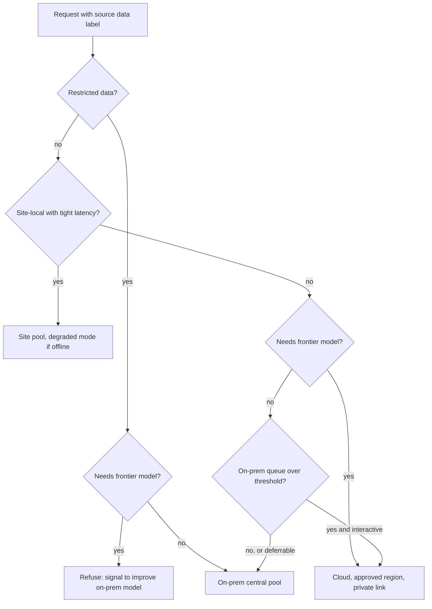

## TL;DR
Hybrid AI infrastructure runs some inference on hardware you control and the rest on hosted APIs, a
gateway routing each request by data class, latency and model need. Some data cannot leave and steady
volume is cheaper owned; on-prem alone loses frontier models.

## Why it exists
- **Regulation and contracts push on-prem.** Health, financial, defence and public-sector data often may
  not be processed outside a named facility, jurisdiction or the customer's own account, and "the provider
  promises not to train on it" does not satisfy that rule.
- **Physics and connectivity push on-prem.** A factory, ship, hospital or retail site may need inference
  near the machines generating the data, or have links that are slow, metered or intermittent.
- **Economics can push on-prem.** A workload running flat-out all day on open-weight models can cost less
  on amortised owned GPUs than on per-token prices, once utilization is high enough.
- **Two forces push back.** The strongest models are available only as hosted APIs, and most products want
  them for some tasks. Owned GPUs are a fixed quantity bought on a procurement cycle measured in months, so
  a spike cannot be met by "buying more" this week; and you own the operations (drivers, firmware, CUDA
  stacks, failures, spares, power, cooling, patching).
- **Both naive answers fail.** "Everything on-prem" leaves teams on last year's open-weight model, unable
  to serve a launch spike, paying a platform team for work the cloud would do. "Everything in the cloud"
  fails the first compliance review and the first site with a bad link. Hybrid makes it a routing policy,
  enforced by a gateway, with the application unaware.

## How it works
### What "on-prem" covers
The term spans a spectrum, and the control, cost and operational burden differ at each point, so pin
"on-prem" down in a requirement before designing anything.

| Option | Who owns hardware and control |
|---|---|
| Your own datacenter | You, fully |
| Colocation space with your hardware | You own hardware; the colo provides space and power |
| Private cloud | You, through a cloud-like layer |
| A customer's cloud account or VPC | Cloud hardware, customer control |
| Cloud-provider on-premises extensions | The provider's managed stack in your facility (AWS Outposts, Azure's on-premises stack and Google Distributed Cloud are examples of this category) |
| Fully air-gapped sites | You, with no external connectivity at all |

- **Scope of this lesson:** the architecture that spans both sides. The deployment module covers the
  customer-VPC and air-gapped cases in depth from the forward-deployed perspective.

### The routing policy
Every request carries attributes the gateway can read: data classification of its inputs, latency
budget, model capability required, tenant and site. The policy maps those to a target:

| Request | Target | Rule |
|---|---|---|
| **Restricted data** | On-prem pool only | Never bursts, no fallback to cloud |
| **Internal data, frontier capability needed** | Cloud platform in the approved region | Through private connectivity |
| **Public or synthetic data, bulk volume** | On-prem when capacity is free (already paid for) | Cloud burst when the on-prem queue exceeds a wait threshold |
| **Site-local, low latency or offline** | The site's own small pool | Degraded mode when central systems are unreachable |

- **Enforce at the gateway** *because* enforcing it in each application means every application is a
  compliance risk.
- **Classification comes from the data source** (document labels, database column tags, tenant contract),
  not from inspecting the prompt at request time. Inspection is a detector with a miss rate, and the rule
  must hold at the boundary regardless.

### A uniform API surface
- **Application code should not know which side served it.** On-prem engines (vLLM, TGI and others) expose
  OpenAI-compatible endpoints; hosted platforms are reached through their SDKs.
- **The gateway presents one interface** and holds the policy, the credentials for each side, the quotas
  and the telemetry. That makes moving a workload between sides a configuration change.
- **The exception is behaviour.** An open-weight model on-prem and a frontier model in the cloud answer
  differently, so prompts and evals are per route, and a workload that may be served by either side must
  pass its eval on both.

### Bursting and backflow
- **Cloud burst is an overflow queue.** When the on-prem queue wait exceeds a threshold, eligible requests
  (eligibility is the classification again) go to the cloud.
- **On-prem first, cloud overflow** is the right default for workloads allowed on both sides, because the
  owned cost is already sunk while every cloud token is a marginal cost.
- **Backflow is the reverse.** Deferrable eligible work (batch jobs, re-indexing, evaluation runs) is pulled
  back onto owned GPUs whenever they would otherwise idle, for example overnight, so the fixed pool stays
  busy instead of the cloud bill growing.

### Sizing the owned side
A fixed pool is only cheaper when busy, so on-prem capacity should not be sized for the peak of all
traffic. The sizing has two parts:

1. **Restricted work has nowhere else to go,** so its *peak* (plus a spare for a node failure) must fit
   on-prem.
2. **Burst-eligible work fills the gaps** the restricted load leaves (nights, weekends, the spare's idle
   hours), and its peaks go to the cloud.
3. **Extra GPUs beyond the restricted requirement** are justified only by eligible load present nearly all
   the time, *because* only load that is always there keeps an extra GPU above break-even utilization;
   eligible load that comes and goes is cheaper rented.

### Operating the owned side
- **Hardware lifecycle:** procurement lead time, spares, replacement cadence, typically a three-to-five-year
  amortisation for the TCO model.
- **Serving-stack lifecycle:** engine upgrades, CVE patching, driver and CUDA compatibility.
- **Monitoring** unified with the cloud side.
- **Model lifecycle:** which open-weight models, which quantization, evaluated against which cloud baseline.
- **Private connectivity between sides** (VPN, dedicated links or private endpoints).
- **Secrets held only where used,** so a compromised on-prem node does not hold cloud credentials and vice
  versa.

### Economics in one line
```
owned cost per token = (amortised hardware + power + space + people) ÷ tokens actually served
```
- **It falls with utilization;** hosted cost per token is roughly flat.
- **The crossover utilization is the break-even,** covered in its own lesson. The hybrid pattern's job is to
  keep the owned side above it by giving it all the eligible work.

## Diagram
The order of checks is the policy: classification first, so no later rule about latency, capability or
burst can move restricted data off owned hardware.



## Examples
### A gateway routing policy
Enforces classification, routes for capability and bursts only eligible traffic. Thresholds and model
names are placeholders.

```python
from __future__ import annotations
from dataclasses import dataclass
from enum import Enum

class DataClass(Enum):
    RESTRICTED = "restricted"   # may never leave the owned environment
    INTERNAL = "internal"       # cloud allowed in the approved region, via private link
    PUBLIC = "public"

@dataclass
class Request:
    data_class: DataClass
    needs_frontier: bool        # task requires a capability only the hosted model has
    latency_budget_ms: int
    site: str | None = None     # set for site-local traffic

ONPREM_QUEUE_WAIT_MS = {"central": 0, "plant-7": 0}   # refreshed from engine metrics
BURST_THRESHOLD_MS = 800

def route(r: Request) -> str:
    if r.data_class is DataClass.RESTRICTED:
        if r.needs_frontier:
            raise PermissionError("restricted data cannot use the hosted frontier model")
        return "onprem:central"                          # no burst, no fallback, by policy
    if r.site and r.latency_budget_ms < 300:
        return f"onprem:{r.site}"                        # site-local pool, degraded mode if central is down
    if r.needs_frontier:
        return "cloud:eu-region"                         # private endpoint, approved region
    if ONPREM_QUEUE_WAIT_MS["central"] > BURST_THRESHOLD_MS and r.latency_budget_ms < 5_000:
        return "cloud:eu-region"                         # interactive eligible burst only;
                                                         # deferrable work waits for owned GPUs
    return "onprem:central"                              # owned capacity is sunk cost: keep it busy

print(route(Request(DataClass.RESTRICTED, False, 2000)))        # onprem:central
print(route(Request(DataClass.INTERNAL, True, 2000)))           # cloud:eu-region
ONPREM_QUEUE_WAIT_MS["central"] = 1500
print(route(Request(DataClass.PUBLIC, False, 2000)))            # cloud:eu-region (burst)
```

- **It refuses rather than degrades** when restricted data needs a capability only the cloud has. That
  refusal is the signal to procure a better on-prem model, not a bug to route around.
- **The order of the checks is the policy:** classification first, so no later rule (latency, capability,
  burst) can move restricted data.

### Worked scenario: sizing the owned pool
Illustrative numbers, in replicas of one model.

| Load | Daytime | Overnight |
|---|---|---|
| Restricted traffic | peaks at 3 replicas on weekday afternoons | falls to 1 |
| Eligible interactive traffic | runs at 2 replicas, peaks at 6 | low |
| Overnight batch | none | could use 4 replicas for 8 hours |

1. **Own 3 + 1 spare = 4** for the restricted peak.
2. **During the day,** the spare and any restricted slack take eligible interactive work, and the rest of
   its peak bursts to the cloud.
3. **Overnight,** restricted needs 1 and the batch takes the other 3, so the pool stays busy around the
   clock.
4. **Buying 2 more replicas** for the daytime eligible base makes sense only if those 2 also stay busy
   overnight and at weekends. If not, they sit idle for over half the week and the cloud is cheaper for
   that load.

## Production patterns
- **Default-deny classification from source labels.** The data service attaches the record's label
  (document label, column tag, tenant contract) to the request, and the gateway rejects any request
  without one. Monitor rejections for missing labels and the share of traffic per class.
- **OpenAI-compatible engines on the owned side.** Run vLLM's OpenAI-compatible server (`vllm serve
  <model>`) on-prem so the gateway uses the same client with a different base URL for each side. Monitor
  per-route latency and error rates on one dashboard.
- **Burst on queue wait, by class.** The gateway reads the on-prem engine's waiting-request metric and
  sends only eligible interactive requests to the cloud above a wait threshold. Monitor burst volume and
  its cost per day.
- **Backflow scheduling.** Run batch, re-indexing and eval jobs as low-priority work (for example a
  Kubernetes `CronJob` overnight) on owned GPUs. Monitor owned-pool utilization by hour of day and week.
- **Per-route evals in CI.** Run the same eval suite against the on-prem and cloud routes before any prompt
  or model change ships. Monitor the score gap between routes, which predicts burst-time regressions.
- **Credentials only where used.** Cloud credentials live with the cloud-facing gateway component, never on
  on-prem serving nodes. Monitor with secret scanning and access audits on both sides.

## Trade-offs
- **Owned cost vs fixed quantity.** Owned GPUs lower cost per token at high utilization, but are a fixed
  quantity with months of lead time; the trade flips against ownership when load is spiky or still growing
  fast.
- **Residency vs model quality.** On-prem satisfies residency and air-gap rules, but confines those
  workloads to open-weight models that typically trail the frontier; when the task needs frontier quality,
  the choice is a better on-prem model or a policy change, not a routing trick.
- **Bursting vs data paths.** Bursting absorbs peaks without over-buying hardware, but every burst path is a
  data path that must be gated by classification, and prompts must be evaluated on both models.
- **Uniform interface vs hidden behaviour.** One gateway interface makes migration a configuration change,
  but hides behavioural differences between routes, which is why evals and prompts stay per route.
- **Provider on-prem extensions vs lock-in.** They reduce the operations burden of owned hardware, but keep
  the provider's pricing and lock-in inside your building.

## Pitfalls
- **Sizing on-prem for the peak of all traffic,** including work that could burst. Symptom: a GPU fleet
  averaging well under a quarter utilization while the finance model assumed near-full.
- **Classification by prompt inspection instead of by source.** Symptom: a restricted document found in
  cloud logs because a detector missed it.
- **One prompt tuned on the cloud model and reused on-prem.** Symptom: a quality regression that only
  appears during bursts or on-prem fallback.
- **No spare hardware or replacement plan.** Symptom: weeks of reduced capacity after a single GPU or node
  failure.
- **Cloud credentials stored on on-prem nodes for "convenience".** Symptom: a security review finding that
  an on-prem compromise exposes the cloud account.
- **Treating a customer VPC deployment as "on-prem" in the TCO model.** Symptom: a cost estimate that omits
  the customer's cloud bill and the provider's egress and support terms.

## When to use
- **Use hybrid when** a named class of data or sites cannot use hosted APIs *and* other workloads need
  frontier models or elastic capacity. The hard parts are the routing policy, a uniform API surface, and
  keeping fixed capacity busy.
- **Stay fully hosted when** no residency or connectivity constraint exists and volume is below the
  break-even.
- **Go fully on-prem only when** policy forbids every hosted path and open-weight models meet the quality
  bar.
- **Measure** owned-pool utilization, burst volume and its cost, per-route quality on shared evals, and the
  number of policy refusals, which tells you where the on-prem model is falling short.
- **Day to day** this shows up as the gateway's policy table and the quarterly review of what each side
  costs.
- **Interviews:** defend why classification is enforced at the gateway and why on-prem is sized for the
  restricted peak plus only the always-present base of eligible work rather than for total peak.

## Role lens
- **Engineer:** Builds the gateway policy and burst logic, runs OpenAI-compatible engines on the
  owned side, and maintains per-route prompts and evals so either side passes the same test suite.
- **Architect:** Defines the data classes and their permitted targets, sizes the owned pool to the
  restricted peak plus the always-present eligible base, owns the TCO and break-even model, and signs off on the connectivity and secrets design.
- **FDE:** Deploys the on-prem or customer-VPC side inside the customer's environment, maps their
  data classifications to routes, and sets up burst eligibility and monitoring that the customer's
  security team accepts.

## Check yourself
**Q:** A hospital group wants an assistant over patient records (must stay on-site), a general
staff assistant, and overnight batch summarisation of public research papers. They own eight
GPUs. Design the hybrid layout and say what you would measure to know it is working.
**A:** Patient-record traffic is restricted: it runs on the owned pool with an open-weight model,
no burst, no fallback, enforced by the gateway from the record system's classification, and the
model is evaluated on clinical tasks before launch. The staff assistant needs frontier quality and
touches internal but not restricted data, so it goes to a cloud platform in an approved region
over a private endpoint. The research batch is public data: it runs on the owned pool overnight
when the restricted workload is quiet, bursting to the cloud batch API if it cannot finish by
morning. Size the owned pool for the restricted workload's peak (it cannot burst) with one GPU
or node of spare, and let the overnight batch fill the idle hours, not for the combined peak of all
three workloads.
Measure owned-pool utilization (target high, since cost per token depends on it), queue wait and
burst volume, per-route eval scores, and policy refusals, which show where the on-prem model is
insufficient.

## Interview questions
### A requirement says "must be on-prem". What do you ask before designing anything?
- **Which point on the spectrum:** own datacenter, colo, private cloud, the customer's cloud account or VPC,
  a cloud provider's on-premises extension, or an air-gapped site.
- **Why it matters:** control, cost and operational burden differ at each point, and a customer VPC still
  carries the customer's cloud bill and the provider's egress terms.
- **Which data it applies to:** usually a named data class, which decides what may still use hosted APIs.

### Why enforce data classification at the gateway instead of in each application?
- **One enforcement point:** if each application enforces the rule, every application is a compliance risk
  and one mistake leaks restricted data.
- **Deterministic labels:** the gateway reads labels from the data source, not a prompt detector with a
  miss rate.
- **Order of checks:** classification runs first, so no latency, capability or burst rule can move
  restricted data.

### Quality complaints arrive only during traffic peaks. What is your first hypothesis?
- **Bursting changed the model:** at peak, eligible requests overflow from the open-weight on-prem model to
  the cloud model (or the reverse during fallback), and a prompt tuned on one route regresses on the other.
- **Confirm:** split quality metrics by route and correlate with burst volume.
- **Fix:** keep prompts and evals per route and require a workload that may run on both sides to pass its
  eval on both.

### Restricted traffic peaks at 3 replicas, eligible interactive at 6, and an overnight batch needs 4. How many replicas do you own?
- **Own 4:** 3 for the restricted peak, which cannot burst, plus 1 spare for a node failure.
- **Fill the gaps:** daytime slack takes eligible interactive work and its peak bursts to the cloud;
  overnight, restricted needs 1 and the batch takes the other 3.
- **Buy more only for always-present load:** 2 more replicas pay off only if they stay busy nights and
  weekends too.

### When would you not build a hybrid setup?
- **No residency or connectivity constraint and volume below break-even:** stay fully hosted, because owned
  GPUs only pay when busy.
- **Every hosted path forbidden and open-weight models good enough:** go fully on-prem rather than run two
  stacks.
- **Load spiky or growing fast:** months of procurement lead time make owned capacity a poor fit.

## Quiz
### Q: Why should data classification for routing be derived from the data source rather than from inspecting the prompt?
- [ ] Prompt inspection is too slow for interactive latency budgets
- [x] A detector has a miss rate, while source-level labels make the restriction hold at the boundary regardless of prompt content
- [ ] Prompts are encrypted before they reach the gateway
- [ ] Source labels are required by the serving engine to allocate KV cache
> Compliance rules are absolute; a classifier that misses one restricted document has already
> violated them. Labels attached to the record system, tenant or document travel with the request
> and are enforced deterministically.

### Q: Which sizing rule keeps owned GPUs economical in a hybrid design?
- [ ] Size on-prem for peak so the cloud is never needed
- [x] Fit the restricted workload's peak, add capacity only for eligible load present nearly all the time, and send eligible peaks to the cloud
- [ ] Size on-prem for the restricted workload's average load and send everything else to the cloud
- [ ] Size on-prem to match the cloud quota in the approved region
> Owned cost per token falls with utilization, so the pool must be busy, but restricted work cannot
> burst, so its peak sets a floor. Filling the remaining capacity with the base of eligible work
> keeps the pool full, while elastic cloud capacity absorbs eligible peaks that would otherwise sit
> idle on owned hardware; sizing restricted work at its average would drop requests at its peak.

### Q: A restricted-data workload needs a capability only the hosted frontier model has. What should the gateway do?
- [ ] Route to the cloud once with logging so the exception is auditable
- [ ] Strip identifying fields from the prompt and route to the cloud
- [x] Refuse the request and surface it as a signal to improve the on-prem model or change policy
- [ ] Route to the cloud only during off-peak hours when scrutiny is lower
> The restriction is on the data, not on the time or on identifiers that a detector might miss. The
> correct response is a policy refusal, which becomes evidence for procuring a stronger on-prem model
> or formally revisiting the rule.
