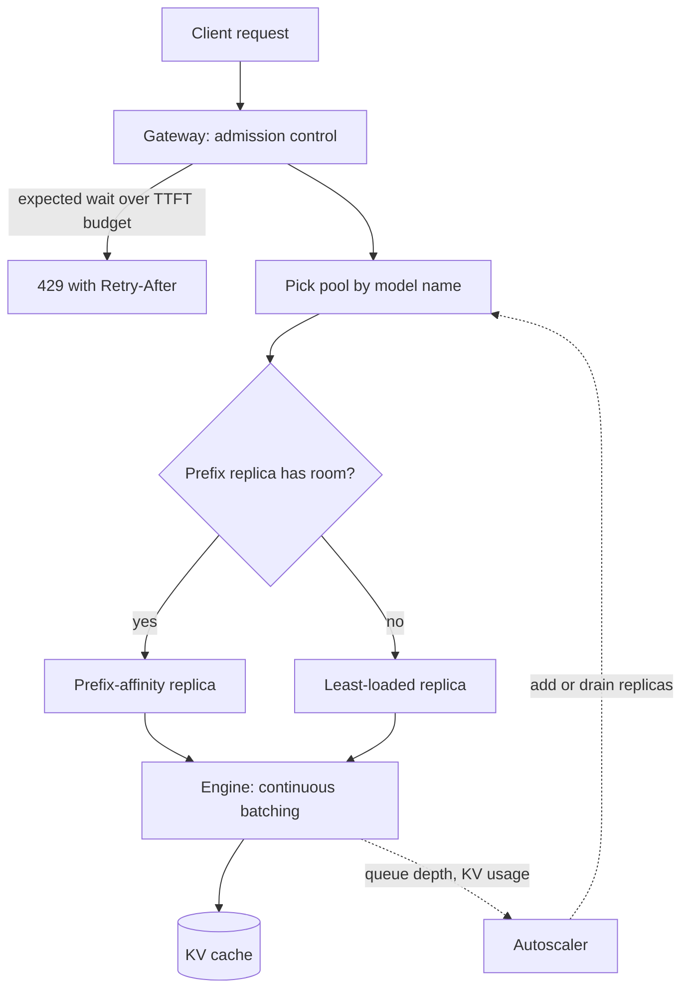

## TL;DR
An inference cluster is a fleet of model-server replicas (vLLM, TGI, TensorRT-LLM, Triton) behind a
router, on GPU nodes, scaled on LLM-specific signals. One GPU box caps out on memory and bandwidth,
and long-lived, variable-length, stateful requests break round-robin and CPU autoscaling.

## Why it exists
- **One replica has a hard ceiling.** Weights plus KV cache must fit in VRAM, decode is bound by memory
  bandwidth, and the number of concurrent sequences that fit sets both throughput and tail latency. Past
  that, the only moves are a bigger GPU (there is a largest one) or more replicas, which means a cluster.
- **Requests are not interchangeable.** The naive fix is "same load balancer as the API tier, autoscale
  on CPU". But one request may be a 200-token chat turn and the next a 60,000-token document summary;
  round-robin sends the long one to a saturated replica and everyone's tail latency there collapses.
- **CPU, even GPU utilization, is the wrong signal.** The useful capacity signal is how full the KV cache
  is and how deep the engine's waiting queue is, since a GPU at 40% SM utilization can still be unable
  to admit another sequence.
- **The cache makes replicas stateful.** A request whose prefix is cached on replica A costs a full
  prefill on replica B, so routing affects cost, not just balance.
- **Some models exceed one GPU.** A 70B model in fp16 is ~140 GB of weights, so it must be split across
  several GPUs acting as one replica: a topology decision, not a scaling knob. A cluster answers all of
  these on purpose.

## How it works
### The layers
A cluster is organised as nodes → replicas → engines, with a router in front and a scheduler behind.
Each layer answers a different question.

1. **Replica.** One running instance of a serving engine with one copy of the model. If the model does
   not fit on one GPU, the replica spans several GPUs on the same node using tensor parallelism: each
   layer's matrices are sliced across GPUs and the shards exchange activations every layer.
2. **Model pool.** All replicas of one model and one configuration (quantization, max context,
   adapters). Scaling happens per pool, because a 7B chat model and a 70B reasoning model have
   completely different capacity curves and traffic.
3. **Router / gateway.** Receives requests, picks a pool by model name, picks a replica inside the pool,
   streams tokens back. This is where LLM-aware routing lives.
4. **Scheduler inside the engine.** Continuous batching admits new sequences into the running batch each
   step as others finish; it is the reason throughput grows with concurrency until the KV cache is full.
5. **Orchestrator.** Kubernetes (often with KubeRay or a serving layer such as KServe) places replicas on
   nodes with the right GPU type and count, restarts failures, and runs the autoscaler.

### Where tensor parallelism stops
- **TP stays inside a node** because it needs an all-reduce per layer per token, which is only affordable
  over NVLink-class bandwidth. Crossing the network would make every decode step wait on the slowest link.
- **Rack-scale systems** whose NVLink domain spans several trays move that boundary from "node" to
  "NVLink domain", but the rule is the same.
- **Pipeline parallelism across nodes** is used only when a model cannot fit in one node or NVLink domain.

### Routing that knows what a request costs
A good router does not round-robin. The usual signals, in rough order of value:

| Signal | What it does | Why |
|---|---|---|
| Queue depth and in-flight sequences per replica ("least-loaded") | Avoids replicas at their concurrency cap | A long request on a full replica queues everyone behind it |
| Prefix-cache affinity | Hashes shared system prompts or conversations to the replica holding that prefix | Turns a full prefill into a cache hit |
| Session stickiness | Keeps a multi-turn chat on one replica | A special case of prefix affinity |
| Priority classes | Admits interactive traffic ahead of batch jobs sharing the pool | Batch can wait, users cannot |

- **Replicas expose the load signals as metrics.** vLLM publishes running/waiting request counts and
  KV-cache usage.
- **Simple affinity** is consistent (or rendezvous) hashing on a fixed-length prompt prefix, so adding a
  replica remaps only a small share of keys.
- **Advanced affinity** tracks which prefixes each replica actually holds, for example a radix tree of
  cached prefixes.
- **Always spill over** to least-loaded when the preferred replica is saturated, *because* affinity is
  worth little if it adds queueing delay.

### Disaggregated prefill and decode
- **The phases differ.** Prefill is compute-bound (big matrix multiplies over the whole prompt); decode is
  bandwidth-bound (one token per step, reading the weights and the whole cache).
- **Sharing a replica hurts decode.** A 40k-token prefill stalls every decode stream on that GPU for
  hundreds of milliseconds to several seconds depending on model size, which shows up as TPOT jitter.
- **First mitigation: chunked prefill.** It splits a long prompt into pieces interleaved with decode
  steps, inside one replica.
- **At scale: split the phases.** Prefill replicas compute the KV cache and ship it over a fast
  interconnect to decode replicas, each class sized and scaled separately. The cost is the KV transfer
  and more moving parts, so it pays only at scale with long prompts.

### Scaling on the right signal
- **Read engine metrics:** waiting-queue length, KV-cache utilization, TTFT, or tokens/second against the
  replica's measured capacity.
- **CPU is meaningless and GPU utilization misleading,** since a replica with its KV cache full of
  idle-but-live sessions is "available" by utilization and "full" by admission.
- **Scale-up is slow.** Pulling tens of GB of weights and warming the engine can take minutes, so the
  cluster needs headroom and predictive or scheduled scaling rather than purely reactive rules.
- **Scale-down must drain** in-flight streams before killing a pod.

### Node topology and placement
- **Pin replicas to the right node pool.** Replicas request whole GPUs (or MIG slices for small models),
  because a 70B replica scheduled onto an L4 node simply fails.
- **Spread vs pack.** Spreading a pool's replicas across nodes and zones limits blast radius from a node
  failure; packing them raises the chance that one node loss removes a whole pool. Both are deliberate.

### Admission control, failure and rollout
- **Something must say no, and it should be the gateway.** When every replica is at its concurrency cap,
  engines queue internally without bound by default. Overload looks like slowly rising TTFT until clients
  time out and retry, which adds load.
- **Bound the wait.** Reject with 429 and a `Retry-After` once the expected queue time exceeds the TTFT
  budget, or shed low-priority traffic first, *because* a request that will miss its deadline is cheaper
  to refuse than to serve late.
- **Rollouts are a capacity event.** A rolling update of a pool with no spare removes one replica per
  step, and the new replica arrives with a cold prefix cache, so the pool is smaller and slower until it
  warms. That is why the N+1 spare doubles as rollout surge capacity.
- **Model version changes go blue/green.** New weights and behaviour ship as a separate pool with traffic
  shifted by weight, so rollback is a routing change rather than a redeploy that pulls tens of GB again.

## Diagram
Follow one request: the gateway decides whether to admit it, the router prefers the replica holding its
prefix but spills over when that replica is full, and engine metrics drive the autoscaler.



## Examples
### Sizing a pool and routing inside it
The capacity numbers are illustrative placeholders you would replace with your own load-test results.

```python
import math, hashlib
from dataclasses import dataclass, field

@dataclass
class Replica:
    name: str
    max_seqs: int            # concurrency at which p95 TPOT still meets the budget (load-tested)
    running: int = 0
    hot_prefixes: set = field(default_factory=set)

def replicas_needed(peak_out_tok_s, out_tok_s_per_replica, headroom=1.3, n_plus=1):
    """Pool size from peak decode demand, with headroom for burst and N+1 for a node loss."""
    return math.ceil(peak_out_tok_s * headroom / out_tok_s_per_replica) + n_plus

# Peak 6,000 output tok/s; a 2xH100 TP=2 replica sustains ~1,500 tok/s within budget (illustrative).
print("replicas:", replicas_needed(6_000, 1_500))      # -> ceil(5.2)+1 = 7

pool = [Replica(f"r{i}", max_seqs=48) for i in range(7)]

def route(prompt: str, prefix_chars: int = 2048) -> Replica:
    # Affinity only works if the shared prefix (system prompt) is at least prefix_chars long.
    key = hashlib.sha1(prompt[:prefix_chars].encode()).hexdigest()
    preferred = pool[int(key, 16) % len(pool)]  # modulo for brevity; use consistent hashing in prod
    if preferred.running < preferred.max_seqs:
        preferred.hot_prefixes.add(key); preferred.running += 1
        return preferred
    # Affinity is not worth queueing for: spill to the least-loaded replica with room.
    cands = [r for r in pool if r.running < r.max_seqs]
    if not cands:
        raise RuntimeError("pool saturated: shed or queue at the gateway")
    best = min(cands, key=lambda r: r.running); best.running += 1
    return best

def finished(r: Replica):             # call when the stream ends, or slots leak and the pool "fills"
    r.running -= 1
```

- **Assumption 1, made explicit:** a replica's capacity is the concurrency at which it still meets the
  latency budget, not its raw maximum.
- **Assumption 2:** one extra replica covers a node loss without breaching the budget. If one node hosts
  several replicas, N+1 must be counted in nodes, not replicas.
- **Routing:** the router prefers the replica that already holds the prompt prefix, but only while it has
  admission room.
- **The modulo hash is a shortcut.** When the pool resizes, almost every key moves and cache affinity
  resets, which is why real routers use consistent or rendezvous hashing.

### Worked scenario: N+1 counted in nodes, not replicas
Same demand as above (illustrative numbers), placed on 8-GPU nodes where each TP=2 replica uses 2 GPUs,
so one node hosts 4 replicas.

| Step | Calculation | Result |
|---|---|---|
| Demand with headroom | 6,000 tok/s × 1.3 | 7,800 tok/s |
| Replicas for demand | 7,800 ÷ 1,500 = 5.2, rounded up | 6 replicas |
| Naive N+1 in replicas | 6 + 1 | 7 replicas = 14 GPUs on 2 nodes |
| What one node loss removes | 4 replicas on that node | only 3 left, 4,500 tok/s: budget breached |
| N+1 in nodes | ceil(6 ÷ 4) = 2 nodes, plus 1 spare node | 3 nodes, 12 replicas, 24 GPUs |

- **The lesson:** the spare must be the unit that fails. Spreading 7 replicas across more, smaller nodes
  is the other way to shrink what one failure takes out.

## Production patterns
- **Scale on queue depth, not CPU.** For any pool with variable traffic, drive a KEDA `ScaledObject` with
  a Prometheus trigger on the engine's waiting-request metric (vLLM exports `vllm:num_requests_waiting`),
  threshold taken from the replica's load test, minimum replicas at N+1. Monitor queue depth, TTFT p95
  and how long a new pod takes to become ready.
- **Gate readiness on the engine, not the container.** Point the Kubernetes readiness probe at the
  engine's health endpoint and give a startup probe enough time for weight loading and warm-up, so new
  replicas take traffic only when serving. Monitor errors and timeouts in the minutes after scale-up.
- **Drain before termination.** Remove the pod from the router first, then let in-flight streams finish:
  a `preStop` hook plus `terminationGracePeriodSeconds` longer than your longest expected stream. Monitor
  truncated streams and client retries on each scale-down.
- **Prefix affinity with spillover.** Hash a fixed-length prompt prefix with consistent or rendezvous
  hashing and fall back to least-loaded when the preferred replica is at its cap. Monitor prefix-cache
  hit rate and per-replica load skew.
- **Admission at the gateway.** Return 429 with `Retry-After` once estimated queue time exceeds the TTFT
  budget, shedding batch priority first. Monitor 429 rate per priority class and client retry volume.
- **Blue/green pools for model versions.** Deploy the new weights as a second pool and shift traffic by
  weight at the gateway; rollback is a routing change. Monitor error rate, latency and eval scores per
  pool during the shift.

## Trade-offs
- **Many small replicas vs a few large TP replicas.** TP=1 replicas give fine-grained scaling and
  isolation. Large TP replicas give higher per-replica throughput and are mandatory once weights exceed
  one GPU, but a single failure removes a bigger slice of capacity.
- **Prefix affinity vs load concentration.** Affinity cuts prefill cost for shared prompts, but it
  concentrates load; when one tenant's prefix is hot, you must spill to other replicas or that replica
  becomes the bottleneck.
- **Disaggregation vs operating cost.** Splitting prefill from decode stabilises TPOT and lets each phase
  scale on its own signal, at the price of KV-cache transfer and a second pool to operate; below a few
  replicas it is not worth it.
- **Headroom vs paid idle GPU time.** Idle capacity buys tail-latency protection and absorbs slow
  scale-up, but every point of headroom is paid GPU time. The right level depends on how spiky traffic is
  and how long a cold replica takes to become ready.
- **Zone spreading vs cost.** Spreading replicas across zones improves availability but costs cross-zone
  traffic and sometimes loses access to the cheapest GPU capacity pool, which flips the decision for
  batch workloads.

## Pitfalls
- **Autoscaling on CPU or GPU utilization.** Symptom: replicas report "healthy" and under 50% utilization
  while TTFT climbs into seconds because the KV cache or waiting queue is full. Fix: scale on queue depth
  and KV usage.
- **Round-robin routing across replicas.** Symptom: p99 latency far above p50 with no correlation to
  overall load, caused by long requests piling onto already-busy replicas. Fix: least-loaded routing.
- **Killing pods on scale-down without draining.** Symptom: a burst of truncated streams and client
  retries every time the autoscaler steps down. Fix: drain in-flight streams first.
- **Treating a tensor-parallel replica as N independent GPUs** in the capacity model. Symptom: a plan that
  promises N× the throughput a TP group actually delivers. Fix: load-test the replica shape.
- **Wrong node pool for the replica.** Scheduling onto a node with the wrong GPU type or too little host
  RAM for weight loading. Symptom: CrashLoopBackOff with OOM during model load rather than at serving time.
  Fix: a node selector or affinity plus taints per GPU type, and node pools sized for host-side loading.
- **No readiness gate that waits for the engine's warm-up.** Symptom: a wave of errors and timeouts right
  after every scale-up or rollout because traffic hits a replica still loading weights. Fix: a readiness
  probe on the engine's health endpoint and a startup probe long enough for loading and warm-up.

## When to use
- **Use when** one replica cannot meet peak demand within the latency budget, when you need to survive a
  node loss without an outage, or when you serve more than one model.
- **Avoid when** traffic is below that: one well-tuned replica (or a hosted API) is simpler and cheaper.
- **Decide** the replica shape per model (TP degree, quantization, max context), the routing policy
  (least-loaded first, prefix affinity second), the scaling signal (queue depth and KV utilization, never
  CPU), and the headroom.
- **Measure** a replica's capacity curve under load before writing any autoscaling rule, and keep TTFT,
  TPOT, queue depth and KV usage on one dashboard.
- **Interviews:** expect to be asked why you would not use the normal load balancer and autoscaler, and to
  reason from KV-cache memory and prefill/decode asymmetry to the answer.

## Role lens
- **Engineer:** Configures the engine (TP degree, max sequences, max context), exposes its metrics,
  writes the router's selection logic and the autoscaler's queries, and load-tests each replica shape.
- **Architect:** Decides pool boundaries per model, TP versus more replicas, whether to disaggregate
  prefill and decode, zone spreading, and the headroom policy that balances cost against tail latency.
- **FDE:** Sizes a customer's cluster from their traffic shape and GPU inventory, explains why their
  existing Kubernetes autoscaler misbehaves with LLM pods, and sets up the right metrics and drain
  behaviour.

## Check yourself
**Q:** A team runs eight identical vLLM replicas behind an ordinary round-robin load balancer with
CPU-based autoscaling. Under load, p50 latency is fine but p99 TTFT is 20× p50 and the autoscaler
never fires. Diagnose the cause and describe the fix, including what you would measure.
**A:** Round-robin ignores that LLM requests vary 100× in length and occupy a replica for seconds to
minutes, so long requests pile onto replicas that are already at their concurrency cap; those
replicas queue new arrivals, which is the p99 tail. CPU never rises because decode is GPU-bandwidth
bound and the pods are waiting on the GPU, so a CPU rule sees an idle fleet. The fix is to route on
engine state (least in-flight sequences, with prefix affinity when a prefix is hot) and to scale on
engine metrics: waiting-queue length and KV-cache utilization, with a TTFT SLO as the alarm. Before
changing rules, load-test one replica to find the concurrency at which p95 TPOT still meets budget
and treat that as its capacity; size the pool from peak tokens/second with headroom and one spare
replica, and add a readiness gate so new replicas take traffic only after warm-up.

## Interview questions
### What are a replica, a model pool and a node in an inference cluster, and why separate them?
- **Replica:** one engine instance with one copy of the model, possibly spanning several GPUs with tensor
  parallelism. It is the unit of capacity you load-test.
- **Model pool:** all replicas of one model and configuration. It is the unit you scale and route to,
  because different models have different capacity curves.
- **Node:** the machine the replicas run on. It is the unit that fails, so N+1 spares and zone spreading
  are planned in nodes.

### When would you run a model as a few large tensor-parallel replicas instead of many TP=1 replicas?
- **When weights do not fit on one GPU,** TP is mandatory: a 70B fp16 model needs ~140 GB.
- **When per-replica throughput or latency matters more** than fine-grained scaling, larger TP groups can
  help, but they are not N independent GPUs and a failure removes more capacity.
- **Keep TP inside a node or NVLink domain,** because it needs an all-reduce every layer for every token;
  use pipeline parallelism only when one node is not enough.

### Users report TPOT jitter whenever someone submits a very long document. What is happening and what do you do?
- **Diagnosis:** a long prefill (for example 40k tokens) is compute-bound and stalls every decode stream
  sharing that GPU for hundreds of milliseconds or more.
- **First fix:** enable chunked prefill so the prompt is processed in pieces interleaved with decode steps.
- **At scale:** route long-document traffic to its own pool, or disaggregate prefill and decode replicas,
  accepting the KV-transfer cost and an extra pool to run.

### Peak demand is 6,000 output tokens per second. How do you size the pool?
- **Measure first:** load-test one replica shape to find the throughput at which p95 TPOT still meets the
  budget, say ~1,500 tok/s for a TP=2 replica (illustrative).
- **Add headroom:** 6,000 × 1.3 ÷ 1,500 = 5.2, so 6 replicas for demand.
- **Add the spare in failure units:** +1 replica if each node hosts one, or a whole spare node if a node
  hosts several replicas.

### How do you ship a new model version on a GPU pool without a capacity dip or a slow rollback?
- **Do not rolling-update a pool with no spare:** each step removes a replica and the new one has a cold
  prefix cache, so the pool is smaller and slower until it warms.
- **Go blue/green:** stand up the new version as a separate pool, gate readiness on warm-up, and shift
  traffic by weight at the gateway.
- **Rollback is a routing change,** so you never wait to pull tens of GB of weights again under pressure.

## Quiz
### Q: Why is tensor parallelism normally kept inside a single node rather than spread across nodes?
- [ ] Kubernetes cannot schedule a pod across two nodes
- [x] It needs an all-reduce every layer for every token, which is only fast enough over intra-node interconnects
- [ ] Cross-node tensor parallelism would duplicate the model weights on every node
- [ ] The KV cache must be contiguous in memory, which a network cannot provide
> Tensor parallelism slices each layer and exchanges partial results per layer per step; over a
> network that round-trip would dominate every decode step (rack-scale NVLink domains extend the
> boundary but do not change the reasoning). Pipeline parallelism is the cross-node
> option because it exchanges activations only at stage boundaries.

### Q: Which signal is the best basis for autoscaling an LLM model pool?
- [ ] Average CPU utilization of the serving pods
- [ ] GPU SM utilization reported by the driver
- [x] Engine queue depth and KV-cache utilization measured against the replica's load-tested capacity
- [ ] Number of HTTP connections open on the load balancer
> Admission is limited by KV-cache memory and the engine's scheduler, not by CPU; GPU utilization can
> be low while the cache is full of live sessions. Queue depth and cache usage reflect whether the
> replica can admit more work.

### Q: Prefix-affinity routing improves cost; under what condition should the router ignore it?
- [ ] When the prompt is shorter than the model's context window
- [ ] When the replica holding the prefix is in a different availability zone
- [x] When the preferred replica is at its concurrency cap, so spilling to a less-loaded replica avoids queueing delay
- [ ] When the request uses streaming, since streamed responses cannot reuse a cache
> A cache hit saves prefill compute, but sending a request to a saturated replica trades that saving
> for queueing time and tail-latency damage. Affinity should be a preference with a spillover rule,
> not a hard constraint.
