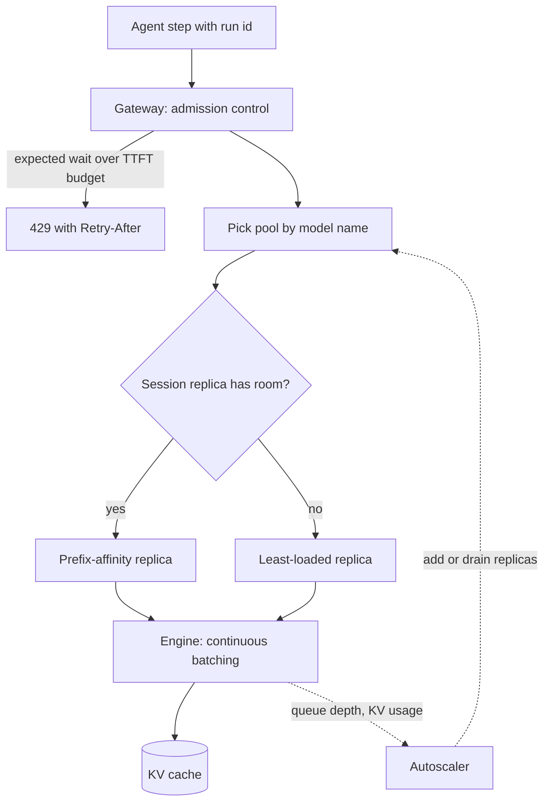

## TL;DR
When you self-host the models behind your agents, an inference cluster is the fleet of model-server
replicas behind a router that serves every agent step. Agent traffic (long, growing, multi-step,
bursty) is exactly what breaks round-robin and CPU autoscaling.

## For agent builders
- **Why it matters for agents.** An agent run is not one request but 5-50 model calls that re-send a
  growing transcript. Whether step 12 lands on the replica that already caches steps 1-11 decides your
  prefill bill, and queue depth on the pool decides how long each step waits before thinking starts.
- **Where it shows up in your stack.** vLLM, TGI, TensorRT-LLM or Triton replicas on Kubernetes (often
  with KubeRay or KServe), a gateway in front that your agent framework's model client calls, and KEDA
  or similar autoscaling on engine metrics.
- **What you control.** Sending a stable session or run id so the router can keep an agent on one
  replica, a byte-stable prompt prefix, honouring 429 and `Retry-After` in the agent loop, and a priority
  class per agent type (interactive versus background).
- **What you can skip.** If your agents call a hosted API, the provider runs this cluster for you; read
  this for the vocabulary (queue depth, prefix affinity, cold replicas) that explains their latency.

## Why it exists
- **One replica has a hard ceiling.** Weights plus KV cache must fit in VRAM, decode is bound by memory
  bandwidth, and the number of concurrent sequences that fit sets both throughput and tail latency. Past
  that, the only moves are a bigger GPU (there is a largest one) or more replicas, which means a cluster.
- **Agent requests are not interchangeable.** The naive fix is "same load balancer as the API tier,
  autoscale on CPU". But one call may be a 200-token planner step and the next a 60,000-token tool result
  to summarise; round-robin sends the long one to a saturated replica and everyone's tail latency there
  collapses.
- **CPU, even GPU utilization, is the wrong signal.** The useful capacity signal is how full the KV cache
  is and how deep the engine's waiting queue is, since a GPU at 40% SM utilization can still be unable
  to admit another sequence.
- **The cache makes replicas stateful, and agents lean on it hardest.** A step whose transcript prefix is
  cached on replica A costs a full prefill on replica B, so routing an agent's steps affects cost, not
  just balance.
- **Some models exceed one GPU.** A 70B model in fp16 is ~140 GB of weights, so it must be split across
  several GPUs acting as one replica: a topology decision, not a scaling knob. A cluster answers all of
  these on purpose.

## How it works
### The layers
A cluster is organised as nodes → replicas → engines, with a router in front and a scheduler behind.
Each layer answers a different question, and your agent's model client only ever sees the router.

1. **Replica.** One running instance of a serving engine with one copy of the model. If the model does
   not fit on one GPU, the replica spans several GPUs on the same node using tensor parallelism: each
   layer's matrices are sliced across GPUs and the shards exchange activations every layer.
2. **Model pool.** All replicas of one model and one configuration (quantization, max context,
   adapters). Scaling happens per pool, because a 7B tool-router model and a 70B reasoning model your
   planner uses have completely different capacity curves and traffic.
3. **Router / gateway.** Receives requests, picks a pool by model name, picks a replica inside the pool,
   streams tokens back. This is where LLM-aware routing, including keeping an agent session together,
   lives.
4. **Scheduler inside the engine.** Continuous batching admits new sequences into the running batch each
   step as others finish; it is the reason throughput grows with concurrency until the KV cache is full.
5. **Orchestrator.** Kubernetes (often with KubeRay or a serving layer such as KServe) places replicas on
   nodes with the right GPU type and count, restarts failures, and runs the autoscaler.

### Where tensor parallelism stops
- **TP stays inside a node** because it needs an all-reduce per layer per token, which is only affordable
  over NVLink-class bandwidth. Crossing the network would make every decode step wait on the slowest link.
- **Rack-scale systems** whose NVLink domain spans several trays move that boundary from "node" to
  "NVLink domain", but the rule is the same.
- **Pipeline parallelism across nodes** is used only when a model cannot fit in one node or NVLink domain.

### Routing that knows what an agent step costs
A good router does not round-robin. The usual signals, in rough order of value:

| Signal | What it does | Why it matters for agents |
|---|---|---|
| Queue depth and in-flight sequences per replica ("least-loaded") | Avoids replicas at their concurrency cap | A long tool-result step on a full replica queues every agent behind it |
| Prefix-cache affinity | Hashes shared system prompts or conversations to the replica holding that prefix | Turns a full prefill of the transcript into a cache hit |
| Session stickiness | Keeps a multi-turn chat or agent run on one replica | A special case of prefix affinity; the biggest win for multi-step agents |
| Priority classes | Admits interactive traffic ahead of batch jobs sharing the pool | A user-facing agent cannot wait; a nightly eval or batch agent can |

- **Replicas expose the load signals as metrics.** vLLM publishes running/waiting request counts and
  KV-cache usage.
- **Simple affinity** is consistent (or rendezvous) hashing on a fixed-length prompt prefix, so adding a
  replica remaps only a small share of keys. For agents, hashing a run id keeps all steps together even
  though the shared system prompt is identical across runs.
- **Advanced affinity** tracks which prefixes each replica actually holds, for example a radix tree of
  cached prefixes.
- **Always spill over** to least-loaded when the preferred replica is saturated, *because* affinity is
  worth little if it adds queueing delay.

### Disaggregated prefill and decode
- **The phases differ.** Prefill is compute-bound (big matrix multiplies over the whole prompt); decode is
  bandwidth-bound (one token per step, reading the weights and the whole cache).
- **Sharing a replica hurts decode.** A 40k-token prefill (a large retrieved document or tool output)
  stalls every decode stream on that GPU for hundreds of milliseconds to several seconds depending on
  model size, which shows up as TPOT jitter in every other agent's streamed answer.
- **First mitigation: chunked prefill.** It splits a long prompt into pieces interleaved with decode
  steps, inside one replica.
- **At scale: split the phases.** Prefill replicas compute the KV cache and ship it over a fast
  interconnect to decode replicas, each class sized and scaled separately. The cost is the KV transfer
  and more moving parts, so it pays only at scale with long prompts, which agent transcripts often are.

### Scaling on the right signal
- **Read engine metrics:** waiting-queue length, KV-cache utilization, TTFT, or tokens/second against the
  replica's measured capacity.
- **CPU is meaningless and GPU utilization misleading,** since a replica with its KV cache full of
  idle-but-live agent sessions (waiting on a slow tool) is "available" by utilization and "full" by
  admission.
- **Scale-up is slow.** Pulling tens of GB of weights and warming the engine can take minutes, so the
  cluster needs headroom and predictive or scheduled scaling rather than purely reactive rules. An agent
  burst (a fan-out of parallel sub-agents) arrives in seconds, long before a new replica is ready.
- **Scale-down must drain** in-flight streams before killing a pod.

### Node topology and placement
- **Pin replicas to the right node pool.** Replicas request whole GPUs (or MIG slices for small models),
  because a 70B replica scheduled onto an L4 node simply fails.
- **Spread vs pack.** Spreading a pool's replicas across nodes and zones limits blast radius from a node
  failure; packing them raises the chance that one node loss removes a whole pool. Both are deliberate.

### Admission control, failure and rollout
- **Something must say no, and it should be the gateway.** When every replica is at its concurrency cap,
  engines queue internally without bound by default. Overload looks like slowly rising TTFT until clients
  time out and retry, which adds load. Agent loops make this worse: each timed-out step is retried, and
  each retry re-sends the whole transcript.
- **Bound the wait.** Reject with 429 and a `Retry-After` once the expected queue time exceeds the TTFT
  budget, or shed low-priority traffic first, *because* a request that will miss its deadline is cheaper
  to refuse than to serve late.
- **Rollouts are a capacity event.** A rolling update of a pool with no spare removes one replica per
  step, and the new replica arrives with a cold prefix cache, so the pool is smaller and slower until it
  warms. That is why the N+1 spare doubles as rollout surge capacity.
- **Model version changes go blue/green.** New weights and behaviour ship as a separate pool with traffic
  shifted by weight, so rollback is a routing change rather than a redeploy that pulls tens of GB again.
  For agents this also keeps one run on one model version, so a run never switches behaviour mid-task.

## Diagram
Follow one agent step: the gateway decides whether to admit it, the router prefers the replica holding
this run's transcript but spills over when that replica is full, and engine metrics drive the autoscaler.



## Examples
### Sizing a pool and routing agent steps inside it
The capacity numbers are illustrative placeholders you would replace with your own load-test results.
The routing key is the agent run id when there is one, so every step of a run stays together.

```python
import math, hashlib
from dataclasses import dataclass, field

@dataclass
class Replica:
    name: str
    max_seqs: int            # concurrency at which p95 TPOT still meets the budget (load-tested)
    running: int = 0
    hot_prefixes: set = field(default_factory=set)

def replicas_needed(peak_out_tok_s, out_tok_s_per_replica, headroom=1.3, n_plus=1):
    """Pool size from peak decode demand, with headroom for burst and N+1 for a node loss."""
    return math.ceil(peak_out_tok_s * headroom / out_tok_s_per_replica) + n_plus

# Peak 6,000 output tok/s; a 2xH100 TP=2 replica sustains ~1,500 tok/s within budget (illustrative).
print("replicas:", replicas_needed(6_000, 1_500))      # -> ceil(5.2)+1 = 7

pool = [Replica(f"r{i}", max_seqs=48) for i in range(7)]

def route(prompt: str, run_id: str | None = None, prefix_chars: int = 2048) -> Replica:
    # Agents: key on the run id so all steps share a replica. Otherwise hash the shared prefix,
    # which only works if that prefix (system prompt) is at least prefix_chars long.
    key = hashlib.sha1((run_id or prompt[:prefix_chars]).encode()).hexdigest()
    preferred = pool[int(key, 16) % len(pool)]  # modulo for brevity; use consistent hashing in prod
    if preferred.running < preferred.max_seqs:
        preferred.hot_prefixes.add(key); preferred.running += 1
        return preferred
    # Affinity is not worth queueing for: spill to the least-loaded replica with room.
    cands = [r for r in pool if r.running < r.max_seqs]
    if not cands:
        raise RuntimeError("pool saturated: shed or queue at the gateway")
    best = min(cands, key=lambda r: r.running); best.running += 1
    return best

def finished(r: Replica):             # call when the stream ends, or slots leak and the pool "fills"
    r.running -= 1
```

- **Assumption 1, made explicit:** a replica's capacity is the concurrency at which it still meets the
  latency budget, not its raw maximum.
- **Assumption 2:** one extra replica covers a node loss without breaching the budget. If one node hosts
  several replicas, N+1 must be counted in nodes, not replicas.
- **Routing:** the router prefers the replica that already holds the run's transcript, but only while it
  has admission room.
- **The modulo hash is a shortcut.** When the pool resizes, almost every key moves and cache affinity
  resets, which is why real routers use consistent or rendezvous hashing.

### Worked scenario: session affinity for a support agent
An 8-step support agent shares a 6k-token system prompt plus tool schemas across all runs (cached on
every replica after warm-up) and adds ~1k session-specific tokens per step. Illustrative arithmetic, 7
replicas.

| Routing | Session tokens prefilled at step k | Prefill per run (session part) |
|---|---|---|
| Round-robin (same replica only ~1 in 7 steps) | about k × 1k, the whole session history | 1k + 2k + … + 8k ≈ 36k |
| Run-id affinity with spillover | ~1k new tokens | 8 × 1k = 8k |
| Saving | | ~4.5× less prefill, and lower TTFT on every step after the first |

- **At 200 concurrent runs** that is roughly 7.2M versus 1.6M prefill tokens per wave of runs, compute
  the pool no longer spends on re-reading transcripts.

### Worked scenario: N+1 counted in nodes, not replicas
Same demand as the first example (illustrative numbers), placed on 8-GPU nodes where each TP=2 replica
uses 2 GPUs, so one node hosts 4 replicas.

| Step | Calculation | Result |
|---|---|---|
| Demand with headroom | 6,000 tok/s × 1.3 | 7,800 tok/s |
| Replicas for demand | 7,800 ÷ 1,500 = 5.2, rounded up | 6 replicas |
| Naive N+1 in replicas | 6 + 1 | 7 replicas = 14 GPUs on 2 nodes |
| What one node loss removes | 4 replicas on that node | only 3 left, 4,500 tok/s: budget breached |
| N+1 in nodes | ceil(6 ÷ 4) = 2 nodes, plus 1 spare node | 3 nodes, 12 replicas, 24 GPUs |

- **The lesson:** the spare must be the unit that fails. Spreading 7 replicas across more, smaller nodes
  is the other way to shrink what one failure takes out.

## Production patterns
- **Route agent runs by run id.** Have the agent's model client send a stable session or run id (a
  header your gateway defines) and hash it with consistent or rendezvous hashing, falling back to
  least-loaded when the preferred replica is at its cap. Monitor prefix-cache hit rate per agent type and
  per-replica load skew.
- **Scale on queue depth, not CPU.** For any pool with variable traffic, drive a KEDA `ScaledObject` with
  a Prometheus trigger on the engine's waiting-request metric (vLLM exports `vllm:num_requests_waiting`),
  threshold taken from the replica's load test, minimum replicas at N+1. Monitor queue depth, TTFT p95
  and how long a new pod takes to become ready.
- **Separate interactive and background agents.** Give user-facing agents a higher priority class (or a
  separate pool) than batch agents and eval runs, so a nightly eval sweep cannot starve live sessions.
  Monitor TTFT p95 per priority class.
- **Admission at the gateway, backoff in the agent.** Return 429 with `Retry-After` once estimated queue
  time exceeds the TTFT budget, shedding batch priority first; make the agent loop honour it with jittered
  backoff and a per-run retry budget. Monitor 429 rate per priority class and client retry volume.
- **Gate readiness on the engine and drain before termination.** Point the readiness probe at the
  engine's health endpoint with a startup probe long enough for weight loading; on scale-down remove the
  pod from the router, then use a `preStop` hook plus `terminationGracePeriodSeconds` longer than your
  longest expected stream. Monitor truncated streams after each scale event.
- **Blue/green pools for model versions.** Deploy the new weights as a second pool and shift traffic by
  weight at the gateway, pinning in-flight agent runs to the version they started on; rollback is a
  routing change. Monitor error rate, latency and agent eval scores per pool during the shift.

## Trade-offs
- **Many small replicas vs a few large TP replicas.** TP=1 replicas give fine-grained scaling and
  isolation. Large TP replicas give higher per-replica throughput and are mandatory once weights exceed
  one GPU, but a single failure removes a bigger slice of capacity, and every agent session on it.
- **Session affinity vs load concentration.** Affinity cuts prefill cost for shared prompts and agent
  transcripts, but it concentrates load; when one tenant's prefix is hot or one agent fans out, you must
  spill to other replicas or that replica becomes the bottleneck.
- **Disaggregation vs operating cost.** Splitting prefill from decode stabilises TPOT and lets each phase
  scale on its own signal, at the price of KV-cache transfer and a second pool to operate; below a few
  replicas it is not worth it.
- **Headroom vs paid idle GPU time.** Idle capacity buys tail-latency protection and absorbs slow
  scale-up and agent fan-out bursts, but every point of headroom is paid GPU time. The right level
  depends on how spiky traffic is and how long a cold replica takes to become ready.
- **Zone spreading vs cost.** Spreading replicas across zones improves availability but costs cross-zone
  traffic and sometimes loses access to the cheapest GPU capacity pool, which flips the decision for
  batch workloads such as offline agent evals.

## Pitfalls
- **Autoscaling on CPU or GPU utilization.** Symptom: replicas report "healthy" and under 50% utilization
  while TTFT climbs into seconds because the KV cache or waiting queue is full. Fix: scale on queue depth
  and KV usage.
- **Round-robin routing across replicas.** Symptom: p99 latency far above p50 with no correlation to
  overall load, caused by long requests piling onto already-busy replicas, plus agent steps that re-prefill
  the whole transcript. Fix: least-loaded routing with run-id affinity.
- **Agent retries that ignore backpressure.** Symptom: one overload spike turns into a retry storm, each
  retry re-sending a long transcript. Fix: honour `Retry-After`, back off with jitter, cap retries per run.
- **Killing pods on scale-down without draining.** Symptom: a burst of truncated streams and client
  retries every time the autoscaler steps down. Fix: drain in-flight streams first.
- **Treating a tensor-parallel replica as N independent GPUs** in the capacity model. Symptom: a plan that
  promises N× the throughput a TP group actually delivers. Fix: load-test the replica shape.
- **Wrong node pool for the replica.** Scheduling onto a node with the wrong GPU type or too little host
  RAM for weight loading. Symptom: CrashLoopBackOff with OOM during model load rather than at serving time.
  Fix: a node selector or affinity plus taints per GPU type, and node pools sized for host-side loading.
- **No readiness gate that waits for the engine's warm-up.** Symptom: a wave of errors and timeouts right
  after every scale-up or rollout because traffic hits a replica still loading weights. Fix: a readiness
  probe on the engine's health endpoint and a startup probe long enough for loading and warm-up.

## When to use
- **Use when** you self-host the models behind your agents and one replica cannot meet peak demand within
  the latency budget, when you need to survive a node loss without an outage, or when you serve more than
  one model (say a small router model and a large planner).
- **Avoid when** traffic is below that: one well-tuned replica (or a hosted API) is simpler and cheaper.
- **Decide** the replica shape per model (TP degree, quantization, max context), the routing policy
  (least-loaded first, prefix or run-id affinity second), the scaling signal (queue depth and KV
  utilization, never CPU), and the headroom.
- **Measure** a replica's capacity curve under realistic agent traces before writing any autoscaling rule,
  and keep TTFT, TPOT, queue depth and KV usage on one dashboard.
- **Interviews:** expect to be asked why you would not use the normal load balancer and autoscaler, and to
  reason from KV-cache memory and prefill/decode asymmetry to the answer.

## Role lens
- **Engineer:** Configures the engine (TP degree, max sequences, max context), exposes its metrics,
  writes the router's selection logic and the autoscaler's queries, and load-tests each replica shape.
- **Architect:** Decides pool boundaries per model, TP versus more replicas, whether to disaggregate
  prefill and decode, zone spreading, and the headroom policy that balances cost against tail latency.
- **FDE:** Sizes a customer's cluster from their traffic shape and GPU inventory, explains why their
  existing Kubernetes autoscaler misbehaves with LLM pods, and sets up the right metrics and drain
  behaviour.

## Check yourself
**Q:** A team runs eight identical vLLM replicas behind an ordinary round-robin load balancer with
CPU-based autoscaling. Under load, p50 latency is fine but p99 TTFT is 20× p50 and the autoscaler
never fires. Diagnose the cause and describe the fix, including what you would measure.
**A:** Round-robin ignores that LLM requests vary 100× in length and occupy a replica for seconds to
minutes, so long requests pile onto replicas that are already at their concurrency cap; those
replicas queue new arrivals, which is the p99 tail. CPU never rises because decode is GPU-bandwidth
bound and the pods are waiting on the GPU, so a CPU rule sees an idle fleet. The fix is to route on
engine state (least in-flight sequences, with prefix affinity when a prefix is hot) and to scale on
engine metrics: waiting-queue length and KV-cache utilization, with a TTFT SLO as the alarm. Before
changing rules, load-test one replica to find the concurrency at which p95 TPOT still meets budget
and treat that as its capacity; size the pool from peak tokens/second with headroom and one spare
replica, and add a readiness gate so new replicas take traffic only after warm-up.

## Interview questions
### What are a replica, a model pool and a node in an inference cluster, and why separate them?
- **Replica:** one engine instance with one copy of the model, possibly spanning several GPUs with tensor
  parallelism. It is the unit of capacity you load-test.
- **Model pool:** all replicas of one model and configuration. It is the unit you scale and route to,
  because different models have different capacity curves.
- **Node:** the machine the replicas run on. It is the unit that fails, so N+1 spares and zone spreading
  are planned in nodes.

### Your self-hosted agent gets slower with every step and the GPU bill is higher than the token count suggests. What do you look at?
- **Routing first:** if steps of one run land on different replicas, every step re-prefills the whole
  transcript; check prefix-cache hit rate and whether the client sends a stable run id the router uses.
- **Prompt stability:** timestamps or reordered tool schemas at the top break prefix reuse even on the
  right replica.
- **Fix:** run-id affinity with consistent hashing and spillover, an append-only transcript, then
  re-measure cached versus uncached prefill tokens per step.

### When would you run a model as a few large tensor-parallel replicas instead of many TP=1 replicas?
- **When weights do not fit on one GPU,** TP is mandatory: a 70B fp16 model needs ~140 GB.
- **When per-replica throughput or latency matters more** than fine-grained scaling, larger TP groups can
  help, but they are not N independent GPUs and a failure removes more capacity.
- **Keep TP inside a node or NVLink domain,** because it needs an all-reduce every layer for every token;
  use pipeline parallelism only when one node is not enough.

### Users report TPOT jitter whenever an agent pulls a very long document into context. What is happening and what do you do?
- **Diagnosis:** a long prefill (for example 40k tokens) is compute-bound and stalls every decode stream
  sharing that GPU for hundreds of milliseconds or more.
- **First fix:** enable chunked prefill so the prompt is processed in pieces interleaved with decode steps.
- **At scale:** route long-document traffic to its own pool, or disaggregate prefill and decode replicas,
  accepting the KV-transfer cost and an extra pool to run. On the agent side, retrieve and trim instead
  of pasting whole documents.

### Peak demand is 6,000 output tokens per second. How do you size the pool?
- **Measure first:** load-test one replica shape on recorded agent traces to find the throughput at which
  p95 TPOT still meets the budget, say ~1,500 tok/s for a TP=2 replica (illustrative).
- **Add headroom:** 6,000 × 1.3 ÷ 1,500 = 5.2, so 6 replicas for demand.
- **Add the spare in failure units:** +1 replica if each node hosts one, or a whole spare node if a node
  hosts several replicas.

### How do you ship a new model version under live agents without a capacity dip or a slow rollback?
- **Do not rolling-update a pool with no spare:** each step removes a replica and the new one has a cold
  prefix cache, so the pool is smaller and slower until it warms.
- **Go blue/green:** stand up the new version as a separate pool, gate readiness on warm-up, shift new
  agent runs by weight at the gateway, and keep in-flight runs on the version they started with.
- **Rollback is a routing change,** so you never wait to pull tens of GB of weights again under pressure.

## Quiz
### Q: Why is tensor parallelism normally kept inside a single node rather than spread across nodes?
- [ ] Kubernetes cannot schedule a pod across two nodes
- [x] It needs an all-reduce every layer for every token, which is only fast enough over intra-node interconnects
- [ ] Cross-node tensor parallelism would duplicate the model weights on every node
- [ ] The KV cache must be contiguous in memory, which a network cannot provide
> Tensor parallelism slices each layer and exchanges partial results per layer per step; over a
> network that round-trip would dominate every decode step (rack-scale NVLink domains extend the
> boundary but do not change the reasoning). Pipeline parallelism is the cross-node
> option because it exchanges activations only at stage boundaries.

### Q: Which signal is the best basis for autoscaling an LLM model pool?
- [ ] Average CPU utilization of the serving pods
- [ ] GPU SM utilization reported by the driver
- [x] Engine queue depth and KV-cache utilization measured against the replica's load-tested capacity
- [ ] Number of HTTP connections open on the load balancer
> Admission is limited by KV-cache memory and the engine's scheduler, not by CPU; GPU utilization can
> be low while the cache is full of live sessions. Queue depth and cache usage reflect whether the
> replica can admit more work.

### Q: Prefix-affinity routing improves cost; under what condition should the router ignore it?
- [ ] When the prompt is shorter than the model's context window
- [ ] When the replica holding the prefix is in a different availability zone
- [x] When the preferred replica is at its concurrency cap, so spilling to a less-loaded replica avoids queueing delay
- [ ] When the request uses streaming, since streamed responses cannot reuse a cache
> A cache hit saves prefill compute, but sending a request to a saturated replica trades that saving
> for queueing time and tail-latency damage. Affinity should be a preference with a spillover rule,
> not a hard constraint.

## Use cases & projects
### Use cases
- **Self-hosted coding or research agents.** Long, append-only transcripts make prefix-affinity routing
  the difference between re-prefilling 30k tokens per step and prefilling only the newest tool result.
- **Agent platforms with interactive and background work.** Priority classes and separate pools keep
  nightly eval sweeps and batch agents from inflating TTFT for users waiting on a chat agent.
- **Regulated deployments that cannot use a hosted API.** The team owns the cluster, so sizing, N+1
  spare capacity and rollout strategy become part of the agent's reliability story.
- **Model upgrades under live traffic.** Blue/green pools let in-flight agent runs finish on the model
  version they started with while new runs shift by weight.

### Mini project
**Route a toy agent through two replicas (2-3 hours).**
- **Goal:** show how session affinity changes prefill work and step latency for a multi-step agent.
- **Steps:** run two small model-server replicas locally (or two processes of any OpenAI-compatible
  server with prefix caching on); write a tiny router that sends each request either round-robin or by a
  hash of the run id; drive a 10-step agent loop with a fixed system prompt and fake tool results through
  both modes; log per-step latency and, where the server exposes it, cached prompt tokens.
- **Done when:** you have a per-step table for both routing modes, a short note on which mode keeps
  cached tokens high and why, and a spillover rule that sends a run elsewhere when its replica is full.
