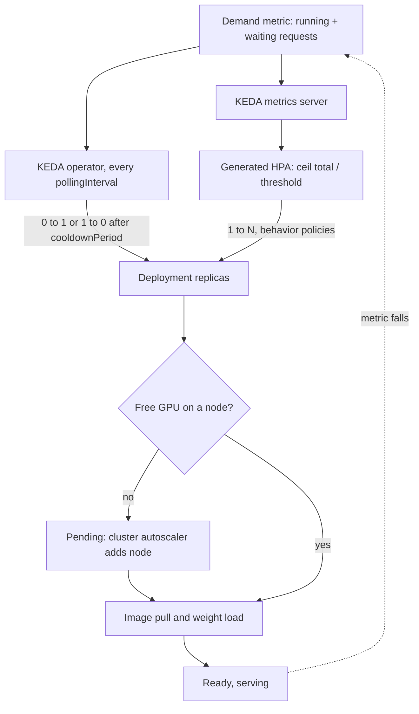

## TL;DR
KEDA scales Kubernetes workloads on real demand signals (queue depth, in-flight requests, Prometheus
queries) and down to zero, which LLM servers need because CPU and GPU utilisation mislead. It moves pod
counts only: nodes and GPU cold starts still take minutes.

## Why it exists
- **The HPA assumes CPU rises with load.** The built-in Horizontal Pod Autoscaler was designed for
  stateless web services. An LLM server breaks that twice.
- **CPU barely moves.** The work happens on the GPU, and the Python process mostly waits on CUDA kernels,
  so a CPU-based HPA never scales.
- **GPU utilisation saturates immediately.** The `DCGM_FI_DEV_GPU_UTIL`-style "percent of time a kernel
  was running" reads near 100% once one request is decoding, *because* a single sequence keeps kernels
  busy while using a sliver of the card's arithmetic. A GPU-utilisation HPA scales at the first request
  and then cannot tell 4 requests from 40.
- **Demand is the right signal, but plumbing it is work.** Requests waiting in the engine's queue,
  requests in flight per replica, or broker messages for batch workers track pain. The HPA can consume
  such "external" metrics only if something serves them through the Kubernetes external metrics API, and
  it cannot scale below one replica in a stock cluster (scale-to-zero is behind an alpha feature gate).
- **KEDA packages the fix.** Teams used to bolt on a Prometheus adapter, write custom controllers for
  zero and duplicate credentials per queue. KEDA ships dozens of "scalers" (queues, databases, cloud
  services, Prometheus), an external-metrics server and its own 0↔1 activation. For GPUs, where an idle
  replica can cost dollars per hour, both halves matter: the right signal and releasing the card.

## How it works
### Components
KEDA runs as an operator plus a metrics API server in the cluster. You declare intent with custom
resources:

| Resource | Targets | Use it for |
|---|---|---|
| **ScaledObject** | Anything with a `/scale` subresource (usually a Deployment or StatefulSet) | Long-running servers |
| **ScaledJob** | Creates Kubernetes Jobs in proportion to pending work; each Job runs to completion | Batch inference, where a pod should not be killed mid-item |
| **TriggerAuthentication / ClusterTriggerAuthentication** | References to secrets or workload identity for the scalers | Keeping the queue password out of every manifest |

### Two control loops, split at one replica
KEDA does not replace the HPA; it drives it. The split is the most important thing to understand.

**1. Activation (0↔1), owned by KEDA:**
1. Every `pollingInterval` seconds (default 30) the operator asks each trigger whether it is active,
   meaning above `activationThreshold`.
2. If any is active and the target is at zero, KEDA sets replicas to `minReplicaCount` or 1.
3. When all triggers have been inactive for `cooldownPeriod` seconds (default 300), it scales back to zero.
4. `cooldownPeriod` governs *only* this last step.

**2. Scaling (1↔N), owned by an HPA that KEDA creates:**
1. KEDA registers each trigger as an external metric and generates an HPA pointing at it.
2. For an `AverageValue` target (the default for most scalers), `desired = ceil(total_metric / threshold)`,
   clamped to `[minReplicaCount, maxReplicaCount]`, with a default tolerance of about 10% to avoid flapping.
3. **Scale-down** is damped by the HPA `behavior` stabilisation window (default 300 s).
4. **Scale-up** has no stabilisation window by default but is rate-limited by the default policy to the
   larger of +4 pods or +100% every 15 seconds.
5. Tune both through `advanced.horizontalPodAutoscalerConfig.behavior`.

**Several triggers:** the HPA computes a replica count per metric and takes the maximum, so you can combine
"queue depth" with a `cron` trigger that pre-warms capacity before the morning peak.

### Why queue depth beats latency as a trigger
- **Latency is what the SLO says,** which makes scaling on p95 tempting.
- **But latency lags and saturates.** It barely moves until the server is nearly full, then explodes (the
  queueing knee). Adding replicas changes it only after new pods serve, which for a GPU pod can be several
  minutes, so a controller acting on it over-reacts and oscillates.
- **In-flight plus waiting requests lead, roughly linearly.** By Little's law, concurrency = arrival rate ×
  time in system, so it rises the moment traffic does. Dividing it by a measured per-replica capacity
  gives a replica count directly.

### When request count misleads
- **It treats a 200-token chat and a 30k-token RAG prompt as equal load.**
- **KV-cache usage measures the real resource but is a poor *primary* trigger,** *because* it saturates:
  it sits near 100% whenever the server is full, whether one more request is waiting or a thousand, so
  `ceil(metric / threshold)` cannot size the fleet from it.
- **Fix 1:** keep waiting requests as the proportional trigger and add KV usage as a second trigger (the
  HPA takes the maximum).
- **Fix 2:** scale on a token-weighted signal such as prompt plus generation tokens in flight, when your
  gateway exports one.
- **Either way,** re-measure per-replica capacity whenever the prompt-length distribution changes.

### What KEDA does not do
- **It changes a number in a Deployment.** If the new pod requests `nvidia.com/gpu: 1` and no node has a
  free GPU, the pod sits Pending until the cluster autoscaler or Karpenter adds a node, subject to cloud
  quota and stock.
- **Then the image is pulled and the weights loaded.** KEDA cannot shorten any of that; it only decides
  earlier.
- **Plain HTTP scale-to-zero needs a request holder** while the first pod starts. The separate KEDA HTTP
  add-on provides an interceptor proxy for that, and serverless GPU platforms exist because doing it well
  is hard.

## Diagram
The two loops and what sits after them: KEDA only flips 0↔1 and feeds the HPA, which sets replica counts;
GPU nodes, image pulls and weight loads still decide when capacity is actually serving.



## Examples
### ScaledObject for a vLLM chat deployment
A vLLM Deployment serving an 8B model. A load test showed one replica holds its TTFT target up to about 16
concurrent sequences (illustrative: measure your own). The trigger sums running and waiting requests across
replicas and targets 12 per replica, keeping headroom for the minutes a new pod takes to arrive.

```yaml
apiVersion: keda.sh/v1alpha1
kind: ScaledObject
metadata:
  name: chat-llm
spec:
  scaleTargetRef:
    name: vllm-chat                 # the Deployment
  minReplicaCount: 1                # 0 only if a cold start fits the SLO
  maxReplicaCount: 8                # match the GPU quota you actually have
  pollingInterval: 15
  cooldownPeriod: 900               # only for the final 1 -> 0 step
  advanced:
    horizontalPodAutoscalerConfig:
      behavior:
        scaleUp:   {stabilizationWindowSeconds: 0}
        scaleDown:
          stabilizationWindowSeconds: 600
          policies: [{type: Pods, value: 1, periodSeconds: 120}]
  fallback:                         # if Prometheus is unreachable, hold 4 replicas
    failureThreshold: 3
    replicas: 4
  triggers:
    - type: prometheus
      metadata:
        serverAddress: http://prometheus.monitoring:9090
        query: >
          sum(vllm:num_requests_running{model_name="chat-8b"})
          + sum(vllm:num_requests_waiting{model_name="chat-8b"})
        threshold: "12"
        activationThreshold: "0"
```

Walkthrough of a day:

| Time | Load | What happens |
|---|---|---|
| 09:00 | 70 concurrent requests | HPA computes ceil(70 / 12) = 6 replicas and gets there within one or two 15-second policy periods (no stabilisation window; the default scale-up policy allows +4 pods or +100% per period, and the `scaleUp` block above keeps those default policies) |
| 09:00 | only two GPU nodes free | four pods go Pending until new nodes join, which is why a cron trigger setting 4 replicas at 08:45 is often cheaper than SLO misses |
| 18:00 | load falls to 10 | HPA removes at most one pod every two minutes after a ten-minute window, so a brief lull does not throw away warm replicas that cost minutes to rebuild |

The vLLM metric names follow its Prometheus exporter and can change between versions; check `/metrics`.

### Replica calculator: the HPA rule KEDA relies on
A pure-Python model of the 1↔N loop, handy for choosing a threshold before touching the cluster. It applies
`ceil(total / threshold)`, the ~10% tolerance and the default scale-up rate limit.

```python
import math

def desired(total, threshold, current, lo=1, hi=8, tolerance=0.1):
    want = math.ceil(total / threshold)
    if current and abs(total / (threshold * current) - 1) <= tolerance:
        want = current                                   # inside tolerance: no change
    return max(lo, min(hi, want))

def scale_up_limit(current):
    return max(current + 4, current * 2)                 # default: +4 pods or +100% per 15 s

replicas, t = 1, 0
for demand in [70, 70, 70]:                              # 09:00 ramp from one warm replica
    target = desired(demand, 12, replicas)
    replicas = min(target, scale_up_limit(replicas)) if target > replicas else replicas
    print(f"t={t:3d}s demand={demand} target={target} replicas={replicas}")
    t += 15
# t=  0s demand=70 target=6 replicas=5
# t= 15s demand=70 target=6 replicas=6
# t= 30s demand=70 target=6 replicas=6

print(desired(66, 12, 6), desired(80, 12, 6))           # 6 (within 10%), 7 (scale up)
```

## Production patterns
- **Activate from a signal that exists at zero.** Use whenever `minReplicaCount` is 0. Point the activation
  trigger at a gateway queue, broker depth or the HTTP add-on's interceptor, not at the engine's own
  `/metrics`, because those series vanish with the pods. Monitor time from first request to first token
  after an idle period.
- **Cron pre-warm before known peaks.** Use when traffic has a daily shape and GPU nodes take minutes to
  join. Add a second trigger of type `cron` with a timezone, start and end schedule and a desired replica
  count (for example 4 replicas from 08:45 on weekdays); the HPA takes the maximum. Monitor TTFT during
  the morning ramp.
- **Cap at real quota and alert on Pending.** Use on every GPU ScaledObject. Set `maxReplicaCount` to the
  GPUs you can actually get and alert when GPU pods stay Pending (kube-state-metrics pod phase) for more
  than a few minutes. Monitor replica count against Pending pods so a capacity problem is not reported as
  a scaling success.
- **Drain before scale-down.** Use for any streaming endpoint. Set `terminationGracePeriodSeconds` longer
  than your longest generation and add a preStop hook that stops new requests and waits for in-flight ones.
  Monitor truncated or reset streams during scale-down.
- **Fallback replicas when the metrics source fails.** Use whenever the trigger depends on Prometheus. Set
  the `fallback` block (`failureThreshold`, `replicas`) to a safe mid-day count, as in the example. Monitor
  KEDA scaler errors so the fallback is not silently permanent.
- **ScaledJob for queue-drained batch work.** Use for nightly or bursty batch inference. Create one Job per
  batch of messages from a queue scaler so work is never killed mid-item, with the Job's GPU request in its
  template. Monitor queue age and Job failures.

## Trade-offs
- **Queue depth vs threshold drift.** It tracks demand linearly and early, but needs a measured per-replica
  capacity; when prompt lengths shift (longer RAG contexts), the same request count means more load and
  the threshold drifts.
- **Scale-to-zero vs first-request wait.** It saves the full idle cost of a GPU, but the first request after
  idle waits for node provisioning, image pull and weight loading. It flips to worthwhile only when idle
  hours dominate and callers tolerate minutes.
- **Slow scale-down vs idle cost.** It keeps warm replicas through short lulls at the price of paying for
  idle GPUs; with per-second billing and fast-loading small models, a shorter window becomes the better bet.
- **One KEDA layer vs owning the rest.** It is simpler than adopting Ray Serve or a serverless platform,
  but you own cold-start mitigation, request buffering and node provisioning yourself.

## Pitfalls
- **Scaling a scaled-to-zero vLLM Deployment on vLLM's own metrics.** With zero pods the series vanish, the
  query returns nothing, and the service never wakes. Fix: activate from a signal that exists without pods
  (gateway queue, broker depth).
- **Writing a per-pod average query while the trigger uses `AverageValue`.** The HPA divides an
  already-averaged number again; symptom: a deployment stuck near one replica under heavy load. Fix: sum.
- **Setting `maxReplicaCount` above real GPU quota.** Symptom: pods Pending for hours while dashboards claim
  the autoscaler "scaled up", hiding a capacity problem behind a scaling one. Fix: cap at quota.
- **Expecting `cooldownPeriod` to slow scale-down from 6 to 2 replicas.** It only applies to the last
  replica; symptom: replicas dropping after five minutes despite a long cooldown. Fix: HPA `behavior`.
- **Letting the HPA remove a pod mid-generation** without a long `terminationGracePeriodSeconds` and a drain
  hook. Symptom: truncated streamed responses every time load falls. Fix: graceful drain.

## When to use
- **Use when:** a Kubernetes workload's demand is visible in some external signal and CPU is not it — LLM
  servers, embedding workers draining a queue, nightly batch inference as ScaledJobs, or anything that
  should sit at zero outside working hours.
- **Avoid when:** you want it to fix cold starts (it cannot), for sub-second bursty HTTP traffic that needs
  request buffering (look at serverless GPUs), or when you already run Ray Serve, whose own autoscaler
  fills the same role.
- **Measure:** per-replica capacity under realistic prompt lengths before choosing a threshold, then the
  replica count against queue depth, Pending pods, and TTFT during ramps.
- **Interviews:** the signal is explaining why GPU utilisation is the wrong metric and where the 0↔1 and
  1↔N loops split.

## Role lens
- **Engineer:** Writes the ScaledObject, chooses the Prometheus query and threshold from a load test,
  and adds graceful drain so scale-down never cuts off a streaming response.
- **Architect:** Decides which services may scale to zero, the scaling signal per workload class, and how
  pod autoscaling couples to node provisioning, GPU quota and warm-pool policy.
- **FDE:** Installs KEDA inside a customer's existing cluster, maps their queue or gateway metrics to
  triggers, and explains why the first morning request is slow unless a cron pre-warm is added.

## Check yourself
**Q:** A team autoscales its vLLM pods with an HPA on GPU utilisation targeting 70%. The deployment
sits at its maximum replica count even overnight, when traffic is a fraction of the daytime peak, and
the GPU bill is huge.
Explain what is happening and design a better setup.
**A:** GPU "utilisation" reports the fraction of time any kernel is running, so it reads near 100% as
soon as one or two requests are decoding on each replica and says nothing about how many more could fit. The
HPA sees every replica above target, scales up, and never finds a reason to scale down; the signal
carries no proportional information, so capacity is set by the cap rather than by demand. Better: a
KEDA ScaledObject on running plus waiting requests summed across
replicas, threshold set from a load test at below-knee concurrency, fast scale-up, slow damped
scale-down, `maxReplicaCount` equal to GPU quota, a cron trigger to pre-warm before peaks, and a node
autoscaler with GPU node pools. If scale-to-zero is wanted, activate from a gateway or queue metric.

## Interview questions
### What does KEDA add on top of the Kubernetes HPA, and why does an LLM service need it?
- **External signals without plumbing:** ready-made scalers for queues, Prometheus and cloud services, plus
  its own external-metrics server, so the HPA can scale on demand rather than CPU.
- **Scale-to-zero:** KEDA owns the 0↔1 activation that a stock HPA cannot do.
- **Why LLMs:** CPU barely moves and GPU utilisation saturates at one request, so neither tells the
  autoscaler how much demand there is.

### Explain how a ScaledObject decides to go from 1 to 6 replicas, and from 6 back to 0.
- **1 to 6:** the generated HPA computes ceil(total metric / threshold), for example ceil(70 / 12) = 6,
  limited by the scale-up policy of +4 pods or +100% per 15 seconds.
- **6 to 1:** the HPA again, damped by its scale-down stabilisation window and policies, not by
  `cooldownPeriod`.
- **1 to 0:** KEDA itself, once every trigger has been below `activationThreshold` for `cooldownPeriod`.

### Traffic spiked, KEDA scaled to 8 replicas, but TTFT still breached the SLO for 15 minutes. Debug it.
- **Check Pending pods:** if no GPU node was free, pods waited for the cluster autoscaler, cloud quota and
  stock; KEDA only decided earlier.
- **Check ready-time:** image pull and weight loading from slow storage can add minutes per pod.
- **Fixes:** a cron pre-warm before known peaks, a lower threshold for more headroom, faster weight storage,
  and `maxReplicaCount` matched to quota with alerts on Pending.

### When would you not use KEDA for a GPU inference service?
- **Sub-second bursty HTTP traffic** that needs request buffering while scaling from zero; a serverless GPU
  platform handles that better.
- **You already run Ray Serve,** whose own autoscaler fills the same role.
- **You hope it fixes cold starts:** it cannot shorten node provisioning, image pulls or weight loads.

### How would you pick the threshold for a request-count trigger, and when would you revisit it?
- **Load-test one replica** at realistic prompt and output lengths and find the concurrency where TTFT
  still meets target (about 16 in the example).
- **Set the threshold below that knee** (12 in the example) to leave headroom for the minutes a new pod
  takes to arrive.
- **Revisit** when the prompt-length distribution shifts, for example longer RAG contexts, or add a
  KV-usage or token-weighted trigger alongside it.

## Quiz
### Q: In a KEDA ScaledObject, which mechanism controls scaling from 5 replicas down to 3?
- [ ] The `cooldownPeriod` field
- [x] The HPA that KEDA generates, damped by its scale-down behavior and stabilisation window
- [ ] The `pollingInterval` field alone
- [ ] The cluster autoscaler removing GPU nodes
> KEDA itself handles only activation between zero and one replica, and `cooldownPeriod` applies to that
> final step. Between one and N, the generated HPA decides, using its behavior policies and window.

### Q: Why is in-flight plus waiting request count a better trigger for an LLM server than p95 latency?
- [ ] Latency metrics cannot be exported to Prometheus
- [ ] KEDA does not support latency-based triggers
- [x] Concurrency rises linearly and immediately with demand, while latency lags and spikes near saturation, causing oscillation
- [ ] Request counts are unaffected by prompt length
> By Little's law concurrency tracks arrival rate times service time, so it is a leading signal. Latency
> stays flat until the queueing knee, then jumps, and reacts only after slow GPU pods arrive.

### Q: A ScaledObject scales a vLLM Deployment to zero using a Prometheus query over vLLM's own metrics. What happens when traffic returns?
- [ ] KEDA buffers the requests and replays them once a pod is ready
- [x] The service may never wake, because with zero pods the metric series do not exist to cross the activation threshold
- [ ] The HPA scales from zero to one on its own
- [ ] The cluster autoscaler detects pending requests and starts a pod
> A trigger must be observable while nothing is running. Activate from a gateway, queue or broker metric,
> or use the HTTP add-on; the stock HPA does not scale from zero, and nothing buffers requests by default.
