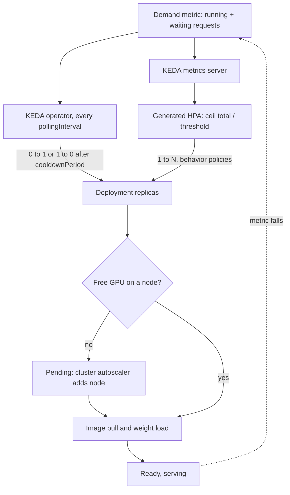

## TL;DR
KEDA scales agent workers and the model servers behind them on real demand (task-queue depth, in-flight
requests, Prometheus queries) and down to zero, because CPU and GPU utilisation mislead. It moves pod
counts only: nodes and GPU cold starts still take minutes.

## For agent builders
- **Why it matters for agents.** A self-hosted agent platform has two layers to scale: agent workers
  that pull tasks from a queue, and the LLM servers those workers call. Scaling the first multiplies load
  on the second, and both need demand signals rather than CPU.
- **Where it shows up in your stack.** A ScaledJob or ScaledObject on the agent task queue (Redis,
  RabbitMQ, SQS), and a ScaledObject on vLLM's running plus waiting requests for the model deployment.
- **What you control.** The trigger and threshold per layer, `maxReplicaCount` at real GPU quota,
  scale-down damping and graceful drain, so neither a run nor a stream is cut off.
- **What you can skip.** KEDA's internals and the scaler catalogue. Know the 0↔1 versus 1↔N split.

## Decision case
### Scenario
A market-research firm runs background research agents for analysts. Tasks land on a Redis list; CPU
workers run each agent loop against a self-hosted vLLM model on single-GPU replicas.
- **Status quo:** an HPA on GPU utilisation at 70% keeps the model tier at its cap of 10 replicas 24
  hours a day: 240 GPU-hours a day.
- **Measured with replayed agent traces:** one replica holds its latency target at 8 in-flight
  requests, not the 12 a chat load test gave. Runs spend 60% of their time waiting on the model.
- **Traffic:** about 300 tasks queue between 09:00 and 09:15 on workdays; light afternoons; almost nothing
  from 20:00 to 08:00.
- **Platform facts:** a new GPU node plus weight load takes about 6 minutes; GPU quota is 10.
- **Constraints:** no run may be killed mid-loop (runs write to analysts' workspaces); no run may time
  out because the model tier is saturated; the first morning runs must start within 10 minutes.

### Options
| Option | Signals | Overnight GPUs | 09:00 burst of 300 tasks | Mid-run safety |
|---|---|---|---|---|
| A. Keep the GPU-util HPA | GPU utilisation | 10 | 10 replicas already up | Fine, but 240 GPU-h a day |
| B. KEDA on both tiers, uncapped | Worker Deployment on list length; model on vLLM's own metrics, min 0 | 0, and it may never wake: the metric vanishes at zero | 300 runs × 0.6 = 180 requests want 23 replicas against a quota of 10, so runs time out | HPA scale-down kills workers mid-run |
| C. ScaledJob capped from the model tier, model on running + waiting | Redis scaler per run, `accurate` strategy; model trigger threshold 8, cron pre-warm of all 10 replicas 08:45 to 09:30 on workdays, activation from the gateway queue | 0 | At most 10 × 8 ÷ 0.6 ≈ 133 concurrent runs; the rest wait in Redis, not mid-loop | Jobs run to completion |

### Decision
Choose **C**.
- **No mid-loop timeouts:** capping Jobs at 133 keeps model demand at about 133 × 0.6 ≈ 80 in-flight
  requests, which ceil(80 ÷ 8) = 10 replicas can hold within quota. Excess work queues where waiting is
  free.
- **No killed runs:** a Job per run is never scaled down by an HPA.
- **Morning start:** the cron trigger brings all 10 replicas up 15 minutes before the burst, because
  the run cap assumes the full tier. With only 4 warm (capacity for about 4 × 8 ÷ 0.6 ≈ 53 runs), 133
  Jobs would queue on the model for the 6-minute node path.
- **Waking from zero:** activation reads the gateway queue, which exists with no model pods.
- **Cost:** an illustrative replay of the day profile gives about 65 GPU-hours a day against 240, a cut
  of roughly 73%.

**What would change it:**
- **Interactive agents with a step SLO:** keep `minReplicaCount: 1` overnight and accept the idle card.
- **Many short runs (seconds each):** Job start-up dominates, so use a worker Deployment with a drain hook
  and long `terminationGracePeriodSeconds` instead.
- **Faster tools:** runs waiting 80% on the model lower the cap to 10 × 8 ÷ 0.8 = 100 runs; recompute.

### Trade-offs accepted
- **A threshold tied to today's transcripts.** If agents grow longer contexts, 8 per replica is too
  many; add vLLM KV usage as a second trigger and re-measure each quarter.
- **Queue wait instead of failure.** Analysts may wait in Redis during the burst; alert on queue age.
- **A cold night.** Overnight tasks wait about 6 minutes for a node; acceptable for background work.
- **Paying for the pre-warm.** Ten GPUs run from 08:45 even on a quiet morning; compare queue depth at
  09:00 with the cron count monthly and trim it if bursts shrink.
- **Pending pods hide capacity problems.** Alert when GPU pods stay Pending beyond 10 minutes.

### Review rubric
- Rejects GPU utilisation and explains why it carries no proportional information.
- Measures per-replica capacity with agent traces and derives the run cap from quota × capacity ÷ model
  share.
- Picks an activation signal that exists when the model tier is at zero.
- Protects runs from scale-down (ScaledJob or drain) and justifies the choice from run length.
- Accounts for node and weight-load time with a pre-warm or headroom, and states what would flip it.

## Why it exists
- **The HPA assumes CPU rises with load.** The built-in Horizontal Pod Autoscaler was designed for
  stateless web services. An LLM server breaks that twice.
- **CPU barely moves.** The work happens on the GPU, and the Python process mostly waits on CUDA kernels,
  so a CPU-based HPA never scales.
- **GPU utilisation saturates immediately.** The `DCGM_FI_DEV_GPU_UTIL`-style "percent of time a kernel
  was running" reads near 100% once one request is decoding, *because* a single sequence keeps kernels
  busy while using a sliver of the card's arithmetic. A GPU-utilisation HPA scales at the first request
  and then cannot tell 4 requests from 40.
- **Demand is the right signal, but plumbing it is work.** Requests waiting in the engine's queue,
  requests in flight per replica, or broker messages for batch workers track pain. The HPA can consume
  such "external" metrics only if something serves them through the Kubernetes external metrics API, and
  it cannot scale below one replica in a stock cluster (scale-to-zero is behind an alpha feature gate).
- **KEDA packages the fix.** Teams used to bolt on a Prometheus adapter, write custom controllers for
  zero and duplicate credentials per queue. KEDA ships dozens of "scalers" (queues, databases, cloud
  services, Prometheus), an external-metrics server and its own 0↔1 activation. For GPUs, where an idle
  replica can cost dollars per hour, both halves matter: the right signal and releasing the card.

## How it works
### Components
KEDA runs as an operator plus a metrics API server in the cluster. You declare intent with custom
resources:

| Resource | Targets | Use it for |
|---|---|---|
| **ScaledObject** | Anything with a `/scale` subresource (usually a Deployment or StatefulSet) | Long-running servers |
| **ScaledJob** | Creates Kubernetes Jobs in proportion to pending work; each Job runs to completion | Batch inference, where a pod should not be killed mid-item |
| **TriggerAuthentication / ClusterTriggerAuthentication** | References to secrets or workload identity for the scalers | Keeping the queue password out of every manifest |

### Two control loops, split at one replica
KEDA does not replace the HPA; it drives it. The split is the most important thing to understand.

**1. Activation (0↔1), owned by KEDA:**
1. Every `pollingInterval` seconds (default 30) the operator asks each trigger whether it is active,
   meaning above `activationThreshold`.
2. If any is active and the target is at zero, KEDA sets replicas to `minReplicaCount` or 1.
3. When all triggers have been inactive for `cooldownPeriod` seconds (default 300), it scales back to zero.
4. `cooldownPeriod` governs *only* this last step.

**2. Scaling (1↔N), owned by an HPA that KEDA creates:**
1. KEDA registers each trigger as an external metric and generates an HPA pointing at it.
2. For an `AverageValue` target (the default for most scalers), `desired = ceil(total_metric / threshold)`,
   clamped to `[minReplicaCount, maxReplicaCount]`, with a default tolerance of about 10% to avoid flapping.
3. **Scale-down** is damped by the HPA `behavior` stabilisation window (default 300 s).
4. **Scale-up** has no stabilisation window by default but is rate-limited by the default policy to the
   larger of +4 pods or +100% every 15 seconds.
5. Tune both through `advanced.horizontalPodAutoscalerConfig.behavior`.

**Several triggers:** the HPA computes a replica count per metric and takes the maximum, so you can combine
"queue depth" with a `cron` trigger that pre-warms capacity before the morning peak.

### Why queue depth beats latency as a trigger
- **Latency is what the SLO says,** which makes scaling on p95 tempting.
- **But latency lags and saturates.** It barely moves until the server is nearly full, then explodes (the
  queueing knee). Adding replicas changes it only after new pods serve, which for a GPU pod can be several
  minutes, so a controller acting on it over-reacts and oscillates.
- **In-flight plus waiting requests lead, roughly linearly.** By Little's law, concurrency = arrival rate ×
  time in system, so it rises the moment traffic does. Dividing it by a measured per-replica capacity
  gives a replica count directly.

### When request count misleads
- **It treats a 200-token chat and a 30k-token RAG prompt as equal load.**
- **KV-cache usage measures the real resource but is a poor *primary* trigger,** *because* it saturates:
  it sits near 100% whenever the server is full, whether one more request is waiting or a thousand, so
  `ceil(metric / threshold)` cannot size the fleet from it.
- **Fix 1:** keep waiting requests as the proportional trigger and add KV usage as a second trigger (the
  HPA takes the maximum).
- **Fix 2:** scale on a token-weighted signal such as prompt plus generation tokens in flight, when your
  gateway exports one.
- **Either way,** re-measure per-replica capacity whenever the prompt-length distribution changes.

### What KEDA does not do
- **It changes a number in a Deployment.** If the new pod requests `nvidia.com/gpu: 1` and no node has a
  free GPU, the pod sits Pending until the cluster autoscaler or Karpenter adds a node, subject to cloud
  quota and stock.
- **Then the image is pulled and the weights loaded.** KEDA cannot shorten any of that; it only decides
  earlier.
- **Plain HTTP scale-to-zero needs a request holder** while the first pod starts. The separate KEDA HTTP
  add-on provides an interceptor proxy for that, and serverless GPU platforms exist because doing it well
  is hard.

### Two layers in an agent platform
1. **Agent workers** pull tasks (one agent run each) from a queue and run the loop: call the model, run
   tools, repeat. They are usually CPU pods; scale them on queue length with a queue scaler.
2. **Model servers** answer the workers' calls on GPUs; scale them on running plus waiting requests, as
   above.
- **The coupling:** each active run has roughly one model request in flight while it is not executing a
  tool, so model-server demand ≈ active runs × fraction of time spent waiting on the model.
- **Why runs suit ScaledJob:** a run lasts minutes and holds state; a Job per task runs to completion
  instead of being killed by an HPA scale-down mid-run.
- **Request count misleads more for agents,** because one run's requests grow in context every step, so
  pair it with KV usage or a token-weighted signal.

## Diagram
The two loops and what sits after them: KEDA only flips 0↔1 and feeds the HPA, which sets replica counts;
GPU nodes, image pulls and weight loads still decide when capacity is actually serving.



## Examples
### ScaledObject for a vLLM chat deployment
A vLLM Deployment serving an 8B model. A load test showed one replica holds its TTFT target up to about 16
concurrent sequences (illustrative: measure your own). The trigger sums running and waiting requests across
replicas and targets 12 per replica, keeping headroom for the minutes a new pod takes to arrive.

```yaml
apiVersion: keda.sh/v1alpha1
kind: ScaledObject
metadata:
  name: chat-llm
spec:
  scaleTargetRef:
    name: vllm-chat                 # the Deployment
  minReplicaCount: 1                # 0 only if a cold start fits the SLO
  maxReplicaCount: 8                # match the GPU quota you actually have
  pollingInterval: 15
  cooldownPeriod: 900               # only for the final 1 -> 0 step
  advanced:
    horizontalPodAutoscalerConfig:
      behavior:
        scaleUp:   {stabilizationWindowSeconds: 0}
        scaleDown:
          stabilizationWindowSeconds: 600
          policies: [{type: Pods, value: 1, periodSeconds: 120}]
  fallback:                         # if Prometheus is unreachable, hold 4 replicas
    failureThreshold: 3
    replicas: 4
  triggers:
    - type: prometheus
      metadata:
        serverAddress: http://prometheus.monitoring:9090
        query: >
          sum(vllm:num_requests_running{model_name="chat-8b"})
          + sum(vllm:num_requests_waiting{model_name="chat-8b"})
        threshold: "12"
        activationThreshold: "0"
```

Walkthrough of a day:

| Time | Load | What happens |
|---|---|---|
| 09:00 | 70 concurrent requests | HPA computes ceil(70 / 12) = 6 replicas and gets there within one or two 15-second policy periods (no stabilisation window; the default scale-up policy allows +4 pods or +100% per period, and the `scaleUp` block above keeps those default policies) |
| 09:00 | only two GPU nodes free | four pods go Pending until new nodes join, which is why a cron trigger setting 4 replicas at 08:45 is often cheaper than SLO misses |
| 18:00 | load falls to 10 | HPA removes at most one pod every two minutes after a ten-minute window, so a brief lull does not throw away warm replicas that cost minutes to rebuild |

The vLLM metric names follow its Prometheus exporter and can change between versions; check `/metrics`.

### Agent workers as a ScaledJob, and what they do to the model tier
Background agent runs are queued as Redis list entries; KEDA starts one Job per pending task, up to a cap
sized to what the model tier can absorb. Check the Redis scaler's field names against the KEDA version you
run.
- **Why `accurate`:** each Job pops its task, so the list length counts only tasks nobody has started.
  The default strategy subtracts running Jobs from that count again and starts too few Jobs; `accurate`
  is KEDA's strategy for queues whose length excludes in-progress work.

```yaml
apiVersion: keda.sh/v1alpha1
kind: ScaledJob
metadata:
  name: research-agent
spec:
  jobTargetRef:
    template:
      spec:
        restartPolicy: Never
        containers:
          - name: agent
            image: ghcr.io/example/research-agent:2.3   # CPU pod: runs the loop, calls the model server
  pollingInterval: 15
  maxReplicaCount: 120              # caps concurrent runs, and so load on the GPU tier
  scalingStrategy:
    strategy: accurate              # list length excludes runs already popped by a Job
  triggers:
    - type: redis
      metadata:
        address: redis.agents:6379
        listName: agent-tasks
        listLength: "1"             # one Job per queued run
```

How the agent layer drives the model layer (illustrative fractions; take yours from traces):

| Quantity | Value |
|---|---|
| Concurrent agent runs (Jobs) | 120 |
| Share of a run spent waiting on the model (rest is tools) | 60% |
| Model requests in flight | 120 × 0.6 ≈ 72 |
| Model ScaledObject threshold (from the example above) | 12 per replica |
| GPU replicas the HPA asks for | ceil(72 / 12) = 6 |

- **Capping runs caps GPUs:** the Job cap of 120 is how you keep the model tier inside quota; raise it
  only together with `maxReplicaCount` on the model ScaledObject.
- **Faster tools raise GPU demand,** because runs spend a larger share of time waiting on the model.
- **The run cap follows from the model tier:** at `maxReplicaCount: 8` and 12 requests per replica the
  tier absorbs 96 in-flight requests, so 96 ÷ 0.6 = 160 concurrent runs is the ceiling; above it, runs
  queue on the model instead of in Redis, where they time out mid-loop.
- **The threshold of 12 came from chat-length prompts;** agent requests carry long transcripts, so
  re-measure per-replica capacity with replayed agent traces before trusting it.

### Replica calculator: the HPA rule KEDA relies on
A pure-Python model of the 1↔N loop, handy for choosing a threshold before touching the cluster. It applies
`ceil(total / threshold)`, the ~10% tolerance and the default scale-up rate limit.

```python
import math

def desired(total, threshold, current, lo=1, hi=8, tolerance=0.1):
    want = math.ceil(total / threshold)
    if current and abs(total / (threshold * current) - 1) <= tolerance:
        want = current                                   # inside tolerance: no change
    return max(lo, min(hi, want))

def scale_up_limit(current):
    return max(current + 4, current * 2)                 # default: +4 pods or +100% per 15 s

replicas, t = 1, 0
for demand in [70, 70, 70]:                              # 09:00 ramp from one warm replica
    target = desired(demand, 12, replicas)
    replicas = min(target, scale_up_limit(replicas)) if target > replicas else replicas
    print(f"t={t:3d}s demand={demand} target={target} replicas={replicas}")
    t += 15
# t=  0s demand=70 target=6 replicas=5
# t= 15s demand=70 target=6 replicas=6
# t= 30s demand=70 target=6 replicas=6

print(desired(66, 12, 6), desired(80, 12, 6))           # 6 (within 10%), 7 (scale up)
```

## Production patterns
- **Activate from a signal that exists at zero.** Use whenever `minReplicaCount` is 0. Point the activation
  trigger at a gateway queue, broker depth or the HTTP add-on's interceptor, not at the engine's own
  `/metrics`, because those series vanish with the pods. Monitor time from first request to first token
  after an idle period.
- **Cron pre-warm before known peaks.** Use when traffic has a daily shape and GPU nodes take minutes to
  join. Add a second trigger of type `cron` with a timezone, start and end schedule and a desired replica
  count (for example 4 replicas from 08:45 on weekdays); the HPA takes the maximum. Monitor TTFT during
  the morning ramp.
- **Cap at real quota and alert on Pending.** Use on every GPU ScaledObject. Set `maxReplicaCount` to the
  GPUs you can actually get and alert when GPU pods stay Pending (kube-state-metrics pod phase) for more
  than a few minutes. Monitor replica count against Pending pods so a capacity problem is not reported as
  a scaling success.
- **Drain before scale-down.** Use for any streaming endpoint. Set `terminationGracePeriodSeconds` longer
  than your longest generation and add a preStop hook that stops new requests and waits for in-flight ones.
  Monitor truncated or reset streams during scale-down.
- **Fallback replicas when the metrics source fails.** Use whenever the trigger depends on Prometheus. Set
  the `fallback` block (`failureThreshold`, `replicas`) to a safe mid-day count, as in the example. Monitor
  KEDA scaler errors so the fallback is not silently permanent.
- **ScaledJob for queue-drained batch work and agent runs.** Use for nightly batch inference and
  background agent runs. Create one Job per batch of messages (or per run) from a queue scaler so work
  is never killed mid-item, with any GPU request in the Job template; set `scalingStrategy` to
  `accurate` when workers pop items, and cap `maxReplicaCount` at what the model tier serves. Monitor
  queue age, Job failures and model-tier waiting requests.

## Trade-offs
- **Queue depth vs threshold drift.** It tracks demand linearly and early, but needs a measured per-replica
  capacity; when prompt lengths shift (longer RAG contexts), the same request count means more load and
  the threshold drifts.
- **Scale-to-zero vs first-request wait.** It saves the full idle cost of a GPU, but the first request after
  idle waits for node provisioning, image pull and weight loading. It flips to worthwhile only when idle
  hours dominate and callers tolerate minutes.
- **Slow scale-down vs idle cost.** It keeps warm replicas through short lulls at the price of paying for
  idle GPUs; with per-second billing and fast-loading small models, a shorter window becomes the better bet.
- **One KEDA layer vs owning the rest.** It is simpler than adopting Ray Serve or a serverless platform,
  but you own cold-start mitigation, request buffering and node provisioning yourself.

## Pitfalls
- **Scaling a scaled-to-zero vLLM Deployment on vLLM's own metrics.** With zero pods the series vanish, the
  query returns nothing, and the service never wakes. Fix: activate from a signal that exists without pods
  (gateway queue, broker depth).
- **Writing a per-pod average query while the trigger uses `AverageValue`.** The HPA divides an
  already-averaged number again; symptom: a deployment stuck near one replica under heavy load. Fix: sum.
- **Setting `maxReplicaCount` above real GPU quota.** Symptom: pods Pending for hours while dashboards claim
  the autoscaler "scaled up", hiding a capacity problem behind a scaling one. Fix: cap at quota.
- **Expecting `cooldownPeriod` to slow scale-down from 6 to 2 replicas.** It only applies to the last
  replica; symptom: replicas dropping after five minutes despite a long cooldown. Fix: HPA `behavior`.
- **Letting the HPA remove a pod mid-generation** without a long `terminationGracePeriodSeconds` and a drain
  hook. Symptom: truncated streamed responses every time load falls. Fix: graceful drain.

## When to use
- **Use when:** a Kubernetes workload's demand is visible in some external signal and CPU is not it — LLM
  servers, embedding workers draining a queue, nightly batch inference as ScaledJobs, or anything that
  should sit at zero outside working hours.
- **Avoid when:** you want it to fix cold starts (it cannot), for sub-second bursty HTTP traffic that needs
  request buffering (look at serverless GPUs), or when you already run Ray Serve, whose own autoscaler
  fills the same role.
- **Measure:** per-replica capacity under realistic prompt lengths before choosing a threshold, then the
  replica count against queue depth, Pending pods, and TTFT during ramps.
- **Interviews:** the signal is explaining why GPU utilisation is the wrong metric and where the 0↔1 and
  1↔N loops split.

## Role lens
- **Engineer:** Writes the ScaledObject, chooses the Prometheus query and threshold from a load test,
  and adds graceful drain so scale-down never cuts off a streaming response.
- **Architect:** Decides which services may scale to zero, the scaling signal per workload class, and how
  pod autoscaling couples to node provisioning, GPU quota and warm-pool policy.
- **FDE:** Installs KEDA inside a customer's existing cluster, maps their queue or gateway metrics to
  triggers, and explains why the first morning request is slow unless a cron pre-warm is added.

## Check yourself
**Q:** A team autoscales its vLLM pods with an HPA on GPU utilisation targeting 70%. The deployment
sits at its maximum replica count even overnight, when traffic is a fraction of the daytime peak, and
the GPU bill is huge.
Explain what is happening and design a better setup.
**A:** GPU "utilisation" reports the fraction of time any kernel is running, so it reads near 100% as
soon as one or two requests are decoding on each replica and says nothing about how many more could fit. The
HPA sees every replica above target, scales up, and never finds a reason to scale down; the signal
carries no proportional information, so capacity is set by the cap rather than by demand. Better: a
KEDA ScaledObject on running plus waiting requests summed across
replicas, threshold set from a load test at below-knee concurrency, fast scale-up, slow damped
scale-down, `maxReplicaCount` equal to GPU quota, a cron trigger to pre-warm before peaks, and a node
autoscaler with GPU node pools. If scale-to-zero is wanted, activate from a gateway or queue metric.

## Interview questions
### What does KEDA add on top of the Kubernetes HPA, and why does an LLM service need it?
- **External signals without plumbing:** ready-made scalers for queues, Prometheus and cloud services, plus
  its own external-metrics server, so the HPA can scale on demand rather than CPU.
- **Scale-to-zero:** KEDA owns the 0↔1 activation that a stock HPA cannot do.
- **Why LLMs:** CPU barely moves and GPU utilisation saturates at one request, so neither tells the
  autoscaler how much demand there is.

### Explain how a ScaledObject decides to go from 1 to 6 replicas, and from 6 back to 0.
- **1 to 6:** the generated HPA computes ceil(total metric / threshold), for example ceil(70 / 12) = 6,
  limited by the scale-up policy of +4 pods or +100% per 15 seconds.
- **6 to 1:** the HPA again, damped by its scale-down stabilisation window and policies, not by
  `cooldownPeriod`.
- **1 to 0:** KEDA itself, once every trigger has been below `activationThreshold` for `cooldownPeriod`.

### Traffic spiked, KEDA scaled to 8 replicas, but TTFT still breached the SLO for 15 minutes. Debug it.
- **Check Pending pods:** if no GPU node was free, pods waited for the cluster autoscaler, cloud quota and
  stock; KEDA only decided earlier.
- **Check ready-time:** image pull and weight loading from slow storage can add minutes per pod.
- **Fixes:** a cron pre-warm before known peaks, a lower threshold for more headroom, faster weight storage,
  and `maxReplicaCount` matched to quota with alerts on Pending.

### Agent workers scale on queue depth; during a spike the model tier saturates and runs time out. Fix it.
- **Diagnose the coupling:** worker replicas multiply model requests (runs × share of time waiting on the
  model), so an uncapped worker pool can outgrow `maxReplicaCount` on the GPU tier within one poll.
- **Cap runs from model capacity:** 8 replicas × 12 requests ÷ 0.6 ≈ 160 concurrent runs; set the worker
  `maxReplicaCount` there so excess work waits in the queue, not mid-loop on the model.
- **Then watch both layers:** queue age for the agent tier, waiting requests and Pending GPU pods for the
  model tier, and per-run timeouts in traces.

### Why run each agent run as a KEDA ScaledJob instead of a ScaledObject-scaled worker Deployment?
- **Scale-down safety:** the HPA deletes pods without knowing a run is mid-loop, while a Job runs to
  completion, so a minutes-long run with tool side effects is never cut off.
- **Queue semantics:** if workers pop tasks, the list length excludes running work, so set the
  `accurate` scaling strategy or KEDA starts too few Jobs.
- **When not:** for many short runs, pod start-up per run dominates; a Deployment with a long
  `terminationGracePeriodSeconds` and a drain hook is cheaper.

### How would you pick the threshold for a request-count trigger, and when would you revisit it?
- **Load-test one replica** at realistic prompt and output lengths and find the concurrency where TTFT
  still meets target (about 16 in the example).
- **Set the threshold below that knee** (12 in the example) to leave headroom for the minutes a new pod
  takes to arrive.
- **Revisit** when the prompt-length distribution shifts, for example longer RAG contexts, or add a
  KV-usage or token-weighted trigger alongside it.

## Quiz
### Q: In a KEDA ScaledObject, which mechanism controls scaling from 5 replicas down to 3?
- [ ] The `cooldownPeriod` field
- [x] The HPA that KEDA generates, damped by its scale-down behavior and stabilisation window
- [ ] The `pollingInterval` field alone
- [ ] The cluster autoscaler removing GPU nodes
> KEDA itself handles only activation between zero and one replica, and `cooldownPeriod` applies to that
> final step. Between one and N, the generated HPA decides, using its behavior policies and window.

### Q: Why is in-flight plus waiting request count a better trigger for an LLM server than p95 latency?
- [ ] Latency metrics cannot be exported to Prometheus
- [ ] KEDA does not support latency-based triggers
- [x] Concurrency rises linearly and immediately with demand, while latency lags and spikes near saturation, causing oscillation
- [ ] Request counts are unaffected by prompt length
> By Little's law concurrency tracks arrival rate times service time, so it is a leading signal. Latency
> stays flat until the queueing knee, then jumps, and reacts only after slow GPU pods arrive.

### Q: A ScaledObject scales a vLLM Deployment to zero using a Prometheus query over vLLM's own metrics. What happens when traffic returns?
- [ ] KEDA buffers the requests and replays them once a pod is ready
- [x] The service may never wake, because with zero pods the metric series do not exist to cross the activation threshold
- [ ] The HPA scales from zero to one on its own
- [ ] The cluster autoscaler detects pending requests and starts a pod
> A trigger must be observable while nothing is running. Activate from a gateway, queue or broker metric,
> or use the HTTP add-on; the stock HPA does not scale from zero, and nothing buffers requests by default.

## Use cases & projects
### Use cases
- **Agent worker pools on a task queue.** Workers that pull agent tasks from Redis, RabbitMQ or SQS scale
  on queue depth, including to zero overnight.
- **Self-hosted agent model servers.** A vLLM Deployment scales on running plus waiting requests, so new
  replicas arrive before agent steps start queueing.
- **Coordinating the two layers.** Capping agent workers so their combined load cannot exceed what the
  model replicas, at `maxReplicaCount`, can serve.
- **Long-running agent runs and streams.** Scale-down damping and graceful drain keep a pod alive until
  its run or stream finishes instead of cutting it off.

### Mini project
**Queue-driven agent workers with KEDA (2-3 hours).**
- **Goal:** scale a pool of agent workers from zero on queue depth and show what happens to the model
  layer behind them.
- **Steps:** run a local cluster (kind or minikube) with KEDA and Redis; write a worker that moves an
  agent task to a processing list (Redis `LMOVE`), runs a short loop against a mock model service that
  sleeps per call, and deletes the task only when done; add a ScaledObject or ScaledJob on the Redis list
  length with a sensible maximum; push 200 tasks and watch replicas; then lower the mock model's capacity
  and observe the queue.
- **Done when:** you have a timeline of queue depth, worker replicas and completed tasks, showing scale
  from zero and back, no task lost during scale-down, and a note on where the mock model became the
  bottleneck.
