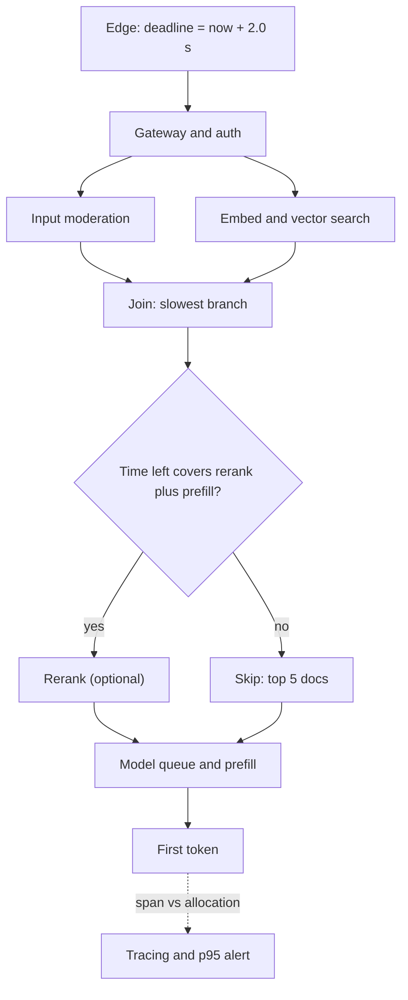

## TL;DR
A latency budget splits one user-facing target, such as "first token within 2 s at p95", across every
hop plus a reserve. Without it each team spends the whole budget alone; with it you get timeouts,
deadline propagation and rules for what to skip.

## Why it exists
- **An AI request is a pipeline, not a call.** A RAG answer may pass an edge proxy, auth, input
  moderation, a query rewrite with a small model, embedding, vector search, a reranker, prompt assembly,
  a model queue, prefill, decode, an output guardrail and a logging hop.
- **Each step was "fast enough" alone.** Added together, and at the tail rather than the median, they blow
  through any product target.
- **One end-to-end timeout gives nobody a number.** A 400 ms reranker gets added without anyone noticing
  it consumed a fifth of the budget.
- **One outer timeout fires too late.** The request has already burned GPU time, and every downstream step
  kept working after the user gave up.
- **Percentiles do not add.** Ten parallel calls each 1% likely to be slow make the request slow about 10%
  of the time (1 − 0.99¹⁰ ≈ 9.6%); 100 fan-out calls make it about 63%. So budgets are set on
  percentiles and verified end to end, never assembled from component medians.

## How it works
### 1. Start from the experience, not the system
| Product | Metric the user feels |
|---|---|
| Streamed chat | Time-to-first-token (TTFT) plus a readable token rate |
| Voice agent | Time to first audio |
| JSON API | Total completion time |
| Background agent | Possibly minutes per task |

- **Fix the percentile (p95 or p99) and the load** at which it must hold. A target with no percentile or
  no load is not a budget.
- **Streamed output needs two numbers.** A TTFT budget for the wait before anything appears, and a
  time-per-output-token (inter-token latency) budget for the stream, because a fast first token followed
  by a stuttering stream still feels broken.
- **They use different levers:** prompt length and queueing for TTFT; batch size and model size for
  per-token time.

### 2. Decompose the critical path
- **Mark sequential versus parallel steps.** Only the critical path consumes budget; parallel branches
  cost the slowest branch, not the sum.
- **The biggest wins hide here.** Running moderation in parallel with retrieval instead of before it
  removes its cost from the critical path entirely, at the price of occasionally doing retrieval work for
  a request you then block.

### 3. Allocate, with a reserve
1. **Give each step a number** from measured p95 (or p99) under realistic load.
2. **Hold back a reserve of 10–20%** (an illustrative rule of thumb) for network jitter, retries and
   growth.
3. **Split the model step** into queue wait, prefill (grows with prompt length) and decode (time per
   output token × tokens).
- **Prompt length is a latency decision as well as a cost one:** adding 20 retrieved chunks lengthens
  prefill and TTFT.
- **Queue wait is the most load-sensitive line**, because it grows as ρ/(1−ρ) with utilization (see
  queueing theory). An allocation measured at 50% load is valid only up to the utilization you tested,
  so state that utilization alongside the budget.

### 4. Enforce with deadlines, not just timeouts
- **A deadline is an absolute time** by which the response must be produced, created at the edge and
  propagated with the request. gRPC deadlines do this natively; over HTTP, pass a header with the
  remaining time.
- **Each step's timeout** is the smaller of its own allocation and what is left minus what later steps
  need.
- **Why:** a step that started late should get less time, not the same time, and a downstream service
  should stop working once the caller has given up.

### 5. Degrade instead of failing
- **Classify steps as required or optional.** When the remaining budget is short, skip optional ones
  (query rewrite, reranking, a second retrieval hop) rather than squeezing them into a timeout they will
  miss.
- **Retry only when the remaining budget exceeds the attempt's p95.** Otherwise the retry has a large
  chance of timing out and adds load exactly when the system is struggling.
- **Hedged requests** (send a second copy after the p95 delay, take the first response) cut tails for
  idempotent reads at a modest extra cost.

### 6. Verify end to end
- **Distributed tracing:** each span reports its duration against its allocation.
- **Alert on the end-to-end percentile**, not on component averages.
- **Review budgets like any interface contract**, because they drift as features land.

## Diagram
The edge sets one deadline; each stage checks the time left before running, and optional stages are
skipped rather than squeezed.



## Examples
### Worked allocation: RAG assistant, p95 TTFT ≤ 2.0 s at peak load
Illustrative allocation from measured p95s:

| Step | Allocation | Notes |
|---|---|---|
| Edge and TLS | 100 ms | |
| Gateway and auth | 30 ms | |
| Input moderation | 120 ms | can move parallel to retrieval |
| Query rewrite | 300 ms | optional |
| Embedding | 50 ms | |
| Vector search | 80 ms | |
| Rerank | 200 ms | optional |
| Prompt assembly | 20 ms | |
| Model queue plus prefill | 800 ms | grows with load and prompt length |
| Reserve | 300 ms | jitter, retries, growth |
| **Sum** | **2.0 s** | |

- **Parallelize moderation** with retrieval and 120 ms is freed.
- **Decode is separate.** With 400 output tokens at 25 ms per token the full answer takes another 10 s:
  acceptable streamed, not if an output guardrail must see the whole answer before display.

### Deadline-aware stages in asyncio
```python
import asyncio, time

class Deadline:
    def __init__(self, seconds): self.end = time.monotonic() + seconds
    def remaining(self): return self.end - time.monotonic()

async def stage(fn, budget, dl, keep=0.0, optional=False, fallback=None):
    avail = dl.remaining() - keep           # leave room for the stages after this one
    if optional and avail < budget:
        return fallback                     # skip an optional step rather than squeeze it
    try:
        return await asyncio.wait_for(fn(), max(0.0, min(budget, avail)))
    except asyncio.TimeoutError:
        if optional:
            return fallback
        raise

PREFILL_P95 = 0.8                           # measured queue + prefill at peak

async def first_token(query, remaining_s, rewrite, retrieve, rerank, generate):
    dl = Deadline(remaining_s)              # from the propagated deadline header, not a fresh 2.0 s
    q = await stage(lambda: rewrite(query), 0.30, dl, keep=0.15 + PREFILL_P95,
                    optional=True, fallback=query)
    docs = await stage(lambda: retrieve(q), 0.15, dl, keep=PREFILL_P95)
    docs = await stage(lambda: rerank(q, docs), 0.20, dl, keep=PREFILL_P95,
                       optional=True, fallback=docs[:5])
    return await stage(lambda: generate(q, docs), dl.remaining(), dl)
```

- **`remaining_s` comes from the deadline set at the edge**, so upstream delay is already subtracted.
- **Normal request:** about 1.87 s is left (2.0 s minus 130 ms of edge and gateway) and the rewrite runs.
- **Slow gateway:** if the queue ate an extra 700 ms, only 1.17 s is left. The rewrite needs its 0.30 s
  plus the 0.95 s kept for retrieval and generation, so it is skipped automatically, and generation's
  0.8 s share stays protected.
- **The bug this prevents:** creating `Deadline(2.0)` inside this function would silently ignore upstream
  delay, which is exactly what deadline propagation exists to stop.

### Percentiles do not add: a quick simulation
Pure Python; three sequential steps with skewed (lognormal) latencies.

```python
import random

random.seed(7)
def p(xs, q):
    xs = sorted(xs)
    return xs[int(q * (len(xs) - 1))]

N = 100_000
stt = [random.lognormvariate(-1.4, 0.4) for _ in range(N)]
ret = [random.lognormvariate(-1.7, 0.5) for _ in range(N)]
llm = [random.lognormvariate(-0.8, 0.4) for _ in range(N)]
total = [a + b + c for a, b, c in zip(stt, ret, llm)]

print(f"sum of step p95s: {sum(p(x, 0.95) for x in (stt, ret, llm)):.2f} s")   # ~1.76 s
print(f"p95 of the sum:   {p(total, 0.95):.2f} s")                               # ~1.43 s
for n in (1, 10, 50, 100):          # fan-out: chance at least one call hits its 1% tail
    print(n, f"{1 - 0.99 ** n:.0%}")                                             # 1%, 10%, 39%, 63%
```

- **Sequential, independent steps:** the sum of p95s overstates the end-to-end p95, so it is a safe but
  pessimistic budget.
- **Fan-out:** waiting on the slowest branch makes tails far more common than any one branch's tail.
- **Either way, measure the end-to-end percentile** rather than deriving it from components.

## Production patterns
- **Propagate deadlines on every hop.** When a request crosses services, set the deadline once at the
  edge and pass it on: gRPC carries it natively; over HTTP use a header holding remaining milliseconds,
  and have each service subtract its elapsed time. Monitor requests arriving with negative or near-zero
  remaining budget.
- **Cancel abandoned work.** When the client disconnects or the deadline passes, cancel downstream calls
  and stop decoding; in Starlette or FastAPI check `await request.is_disconnected()` while streaming.
  Monitor tokens generated for requests whose client already left.
- **Run independent stages concurrently.** Start moderation and retrieval together with
  `asyncio.gather` and block on the moderation verdict before generation. Monitor how often retrieval
  work is wasted on blocked requests.
- **Budget spans in tracing.** Tag each span with its allocation as an attribute, and alert on the
  end-to-end p95 and p99 rather than on component averages. Monitor the share of requests taking the
  degraded path.
- **Hedge only idempotent reads, with a cap.** Send a second copy after the p95 delay for retrieval or
  cache reads, and limit hedges to a small fraction of traffic. Monitor extra load from hedging and turn
  it off under saturation.
- **Re-budget on every pipeline change.** Treat the budget table as a reviewed artifact, so adding a
  reranker, a guardrail or more retrieved chunks requires updating the numbers. Monitor TTFT p95 after
  each "quality" change.

## Trade-offs
- **Tight per-step allocations vs churn.** They make regressions visible early, but over-precise budgets
  become a burden when the pipeline changes weekly and owners spend time renegotiating numbers.
- **Skipping optional steps vs quality.** It protects latency at the cost of answer quality: right for
  chat, wrong for workflows where a wrong answer costs more than a slow one.
- **Hedged requests vs load.** They cut tail latency but add load, roughly the fraction of requests that
  exceed the hedge delay. They backfire on saturated systems or non-idempotent calls.
- **Streaming vs guardrails.** Streaming hides decode time behind reading time, but forces output
  guardrails to work on partial text or hold tokens back, which reintroduces latency.

## Pitfalls
- **Adding component p95s or medians and calling it the end-to-end p95.** Symptom: every service is green
  while users report slowness. Fix: measure the end-to-end percentile with tracing.
- **Retrying inside a budget that cannot afford another attempt.** Symptom: retry counts rising together
  with timeouts, and more GPU work per successful request. Fix: retry only when time left exceeds the
  attempt's p95.
- **Budgeting the model step from a single-request benchmark.** Under load, queue wait and prefill grow,
  seen as TTFT p95 degrading at peak hours while prompt sizes are unchanged. Fix: measure at peak load.
- **Enforcing the deadline only at the edge.** The user sees a timeout while the model keeps decoding,
  visible as GPU or token spend on requests whose clients already left. Fix: propagate and cancel.
- **Letting retrieval chunk counts creep up without re-budgeting prefill.** Symptom: TTFT rising after a
  "quality" change that never touched serving. Fix: re-budget prefill with each change.

## When to use
- **Use when** a user-facing AI path has more than two hops, and before adding a new step such as a
  reranker, guardrail or tool call.
- **Measure** p95 and p99 per span under peak load, the end-to-end percentile, and the share of requests
  that took a degraded path.
- **Avoid formal budgets** for offline batch jobs, where throughput and cost per task matter more than
  per-request latency.
- **Interviews:** decompose the target into steps, point out that percentiles do not add, and propose
  deadline propagation with optional-step degradation; that is the expected answer to "make this feel
  fast".

## Role lens
- **Engineer:** Implements deadline propagation, per-stage timeouts and degradation paths, and adds
  tracing spans so each step's latency is compared against its allocation.
- **Architect:** Owns the end-to-end target and its split, decides what runs in parallel, which steps
  are optional, and when a slow component must be redesigned rather than tuned.
- **FDE:** Accounts for the customer's network, proxies and on-prem retrieval systems, which often
  consume budget the vendor's demo never had to pay.

## Check yourself
**Q:** Your voice agent must start speaking within 1 s at p95. Measured p95s: speech-to-text 300 ms,
retrieval 250 ms, LLM TTFT 600 ms, text-to-speech first audio 200 ms. What do you change?
**A:** The sequential sum of p95s is 1.35 s, and the true p95 of the sum is usually somewhat lower than that
sum for independent steps, but still clearly over budget. Options: stream speech-to-text and start retrieval on partial
transcripts or run it in parallel with endpointing; cut prompt length or use a smaller or
prefix-cached model to reduce TTFT; stream LLM tokens into TTS sentence by sentence so first audio
depends on the first clause, not the full answer; and speak a short acknowledgement while retrieval
completes. Then verify the end-to-end p95 with tracing under load, keeping a reserve for network
jitter.

## Interview questions
### What is a latency budget, and why can't you build one by adding component medians?
- **Definition:** one user-facing target at a stated percentile and load, divided among every step on the
  critical path plus a reserve.
- **Medians hide the tail:** users feel p95 and p99, and tails compound across a chain or fan-out.
- **So** allocate from measured p95s under load and verify the end-to-end percentile with tracing.

### Design a budget for a RAG chat feature that must show the first token within 2 s at p95.
- **Choose the metric:** TTFT at p95 at peak load, plus a separate per-token budget for the stream.
- **Shape the path:** run moderation parallel to retrieval, mark rewrite and rerank optional, and keep
  about 10–20% as reserve.
- **Protect the model step:** allocate queue plus prefill (for example 800 ms) and cap retrieved chunks so
  prefill stays inside it.
- **Enforce:** an edge deadline propagated to every hop, with optional stages skipped when time is short.

### TTFT p95 degrades every day at peak, but prompt sizes have not changed. Where do you look?
- **Queue wait first:** it grows as ρ/(1−ρ), so a budget measured at 50% load breaks at peak utilization.
- **Split the span:** compare queue wait with prefill time; if queue wait dominates, add capacity or
  shed load rather than optimizing the prompt.
- **Check retries and hedges:** they raise load exactly at peak.

### When would you not use hedged requests?
- **Non-idempotent calls:** a duplicated tool call or write can cause side effects twice.
- **Saturated systems:** hedging adds roughly the fraction of requests that exceed the hedge delay, which
  deepens the queue that caused the tail.
- **Expensive model calls:** a second GPU-heavy request doubles cost for that tail; prefer hedging cheap
  reads such as retrieval or caches.

### The user closes the tab mid-answer. What should happen, and how do you verify it?
- **Cancel everything downstream:** stop decoding and abort pending tool or retrieval calls, because the
  deadline is gone and the work is wasted.
- **Implement:** detect disconnect in the streaming handler, cancel the task, and propagate cancellation
  to the model client.
- **Verify:** track tokens or GPU time spent on requests whose client already left; it should fall
  toward zero.

## Quiz
### Q: A request fans out to 50 parallel services, each with a 1% chance of exceeding its p99. Roughly how often does the request wait on at least one slow call?
- [ ] About 1%, since each service meets its p99
- [ ] About 50%, one percent per service added linearly
- [x] About 40%, because 1 − 0.99⁵⁰ ≈ 0.39
- [ ] Never, because parallel calls hide each other's latency
> The request waits for its slowest branch. The chance that all 50 are fast is 0.99⁵⁰ ≈ 0.61, so
> about 39% of requests hit at least one tail. Linear addition overestimates; ignoring fan-out
> underestimates.

### Q: Why propagate an absolute deadline instead of giving every stage a fixed timeout?
- [ ] Fixed timeouts are not supported by most HTTP clients
- [x] A stage that starts late gets only the time actually left, and downstream services stop working once the caller has given up
- [ ] Deadlines make each stage run faster by raising its priority
- [ ] Deadlines remove the need to measure per-stage latency
> Fixed timeouts let each stage spend its full allocation even after earlier stages overran, so the
> total exceeds the target and abandoned work keeps consuming capacity.

### Q: The remaining budget is 300 ms and the model call's p95 is 700 ms. What should the pipeline do?
- [ ] Retry the previous slow stage once to recover time
- [ ] Call the model anyway with a 300 ms timeout
- [x] Take the degraded path: skip or shortcut steps, fall back, or fail fast with a clear response
- [ ] Extend the deadline because the model step is required
> A 300 ms timeout on a 700 ms p95 call fails a large share of the time while still consuming GPU time. Degrading
> or failing fast keeps the SLO honest and avoids wasted work.
