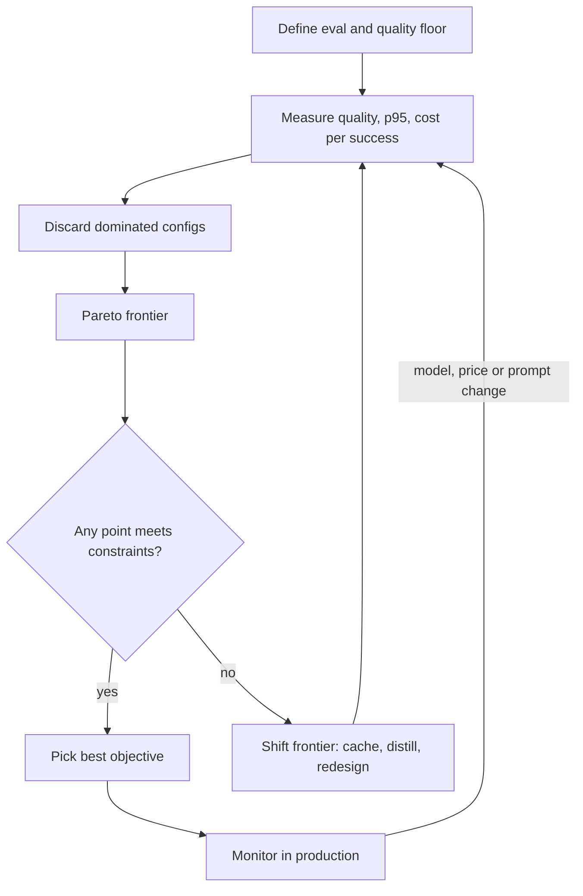

## TL;DR
Every LLM feature trades answer quality, user wait and per-request cost; levers that improve one axis
almost always degrade another, so you cannot maximize all three. Measure all three per task, discard
dominated configurations, and choose from the Pareto frontier under hard constraints.

## Why it exists
- **The usual history.** A prototype ships on the largest model with a long, example-stuffed prompt. Then
  three things happen at once: the bill grows linearly with traffic, a p95 of several seconds makes the
  interface feel broken, and the first eval shows the "best" model is no better on this task than one an
  order of magnitude cheaper, because the task saturates.
- **"Use the best model for everything" fails on cost and latency.** Quality is task-relative and
  plateaus, while cost and latency are paid on every single request.
- **"Use the cheapest model" fails on quality.** A wrong answer has a cost too: a retry, a human
  escalation, a lost customer. The right denominator is cost per *successful* task, and on that measure the
  cheap model can be the expensive one.
- **"Tune one axis at a time" is the most common failure.** A team trims the prompt to cut cost, quality
  quietly drops, and nobody notices until a customer does, because quality was never a number on a
  dashboard.
- **The axes are coupled by mechanism, not by accident.** More reasoning tokens buy better answers on hard
  problems and more decode time and spend; more retrieved context buys grounding and more prefill; a bigger
  model buys capability and more memory bandwidth per token.
- **So you need a method, not a hunch.** It holds all three in view, makes the exchange rate explicit, and
  is re-run whenever a model, price or prompt changes. That is what separates features that scale from
  features that get switched off when the invoice arrives.

## How it works
### Make all three measurable
Nothing below works without numbers for each axis on the *same* set of requests.
- **Quality is a task-specific eval.** A golden set with a pass criterion: exact match for
  classification, a rubric or LLM judge for open text, human grading for the ambiguous slice. Define it
  first, *because* every cost or latency cut is a bet that quality survives, and bets need a scoreboard.
- **Latency is what the user feels.** Time-to-first-token for streamed chat, end-to-end time for a
  classifier or a tool call, and always a percentile (p95 or p99), not a mean. Means hide the tail, and the
  tail is what users remember.
- **Cost is cost per successful task.** Include retries, fallbacks, judge or verifier calls, cache misses
  and the downstream cost of failures. Per-request cost is what the provider bills; per successful task is
  what the business pays.

### Where latency and cost actually come from
Decompose each axis before pulling levers, *because* the decomposition tells you which lever can move it:

```
cost_per_call ≈ n_in_uncached·p_in + n_in_cached·p_cached + n_out·p_out
TTFT          ≈ network + queueing + prefill(n_in)
end_to_end    ≈ TTFT + n_out · TPOT          (TPOT = time per output token)
```

- **Input tokens are cheap in time.** Prefill processes the whole prompt in parallel.
- **Output tokens are expensive in time and money.** Decode emits them one at a time, so `n_out · TPOT`
  usually dominates end-to-end latency, and output tokens are typically priced several times higher than
  input tokens.
- **Illustrative numbers.** With a TPOT of 20 ms, a 300-token answer spends about 6 s in decode alone,
  whatever the prompt length. Cutting the answer to 100 tokens saves about 4 s; halving a 2,000-token prompt
  saves only a fraction of a second of prefill.
- **So output caps and terse formats are often the strongest latency lever**, and prompt trimming mainly
  buys cost and TTFT.
- **Agents and chains multiply all of it** by the number of sequential calls.

### Cost per success, and when quality *is* cost
- **With a verifier and retries:** if each attempt succeeds with probability *q*, expected attempts are
  `1/q`, so `cost_per_success = (c_call + c_verify) / q`.
- **Caveat:** that assumes independent attempts. In practice the same hard input tends to fail again, so
  retries recover less than `1/q` predicts.
- **With human escalation:** `cost_per_task = c_call + (1 − q) · c_human`.

| Model (illustrative) | Call cost | Pass rate | Escalation at $2 | Cost per task |
|---|---|---|---|---|
| Small | $0.001 | 86% | 0.14 × 2 | 0.001 + 0.14 × 2 ≈ $0.28 |
| Large | $0.018 | 94% | 0.06 × 2 | 0.018 + 0.06 × 2 ≈ $0.14 |

- **When failure is expensive,** the quality axis collapses into the cost axis and the "expensive" model
  is the cheap one.
- **When failure is cheap** (a user rephrases), the axes stay separate and the frontier below matters.

### Know which axis each lever moves
| Lever | Quality | Latency | Cost | Note |
|---|---|---|---|---|
| Bigger model tier | up | up | up | coarsest lever; quality gain saturates per task |
| Shorter prompt / less context | risk | down (prefill) | down | every token is paid on every call |
| Capped or terser output | neutral if instructed | down (decode) | down | decode is sequential, so output length often dominates total time |
| Reasoning / thinking budget | up on hard tasks | up a lot | up a lot | wasted on easy tasks; gate by difficulty |
| Prompt caching (shared prefix) | none | down (TTFT) | down (input) | removes work instead of trading it |
| Response / semantic cache | none on hits | near zero on hits | near zero on hits | only for repeat queries; staleness risk |
| Routing / cascade | ≈ large model | up for escalated requests | down on average | depends on escalation rate |
| Batch / async endpoints | none | up (minutes to hours) | down sharply | for non-interactive work only |
| Fine-tune / distill small model | up for small model | down | down | front-loaded effort; shifts the frontier |
| Quantization, speculative decoding | small risk | down | down | serving-side; measure per model |
| Streaming | none | perceived down | none | changes perception, not the number |

- **Most levers move you *along* the frontier:** you give up some of one axis for another.
- **A few *shift* the frontier:** caching, distillation, fine-tuning and task redesign, because they
  remove work or make a cheaper model genuinely better at this task.
- **When no frontier point satisfies the constraints,** only the second group can help; more tuning of
  the first group cannot.

### Build the frontier
1. **Run every candidate configuration** against the same eval set and a replay of real traffic.
2. **Record the triple** (quality, p95 latency, cost per successful task) for each.
3. **Discard dominated configurations.** A is *dominated* if some B is at least as good on all three and
   strictly better on one. What remains is the Pareto frontier.
4. **Respect measurement noise.** A pass rate on *n* items has a standard error of about `√(q(1−q)/n)`; at
   q = 0.92 and n = 200 that is roughly 2 points, so 0.92 and 0.93 are a statistical tie.
5. **Treat configurations inside the noise band as equal on quality.** Compare them on the same items with
   a paired test, or grow the eval, and let latency and cost decide. A p95 from a few hundred requests is
   itself noisy.

The output turns a three-way argument into a short list with a visible exchange rate: "moving from B to C
buys two points of quality for $0.003 per task and 450 ms of p95". People can argue about whether that
trade is worth it; they can no longer argue about facts.

### Choose under constraints
- **Two axes are constraints, one is the objective.** Either *maximize quality subject to p95 ≤ L and
  cost ≤ C*, or *minimize cost subject to quality ≥ Q and p95 ≤ L*.
- **The second form is the common one,** because the quality floor is nearly always a product requirement
  rather than a tunable.
- **Pick the feasible frontier point with the best objective.** If the feasible set is empty, stop tuning
  and reach for a frontier-shifting lever.

### Do it per task, not per application
- **One application holds many frontiers.** Intent classification saturates on a small model;
  multi-document synthesis does not.
- **Split traffic by task and optimize each separately.** It is usually the single largest win, which is
  why routing comes before most other work.

### Keep measuring
- **Everything drifts.** Quality drifts when the provider updates a model or the input mix changes; prices
  fall; traffic mix shifts; a prompt edit makes the model chattier.
- **Re-run the frontier** on a cadence and on every change to prompt, model or retrieval.
- **Alert on cost per task and p95 in production,** not just on total spend.

## Diagram
Read it as a loop: measure the triple, prune to the frontier, filter by constraints, and either ship a
point or reach for a lever that shifts the frontier.



## Examples
### Frontier step for a triage task
A small, runnable version of the frontier step. The measurements are illustrative numbers for a
support-ticket triage task, not benchmarks; the structure is what matters.

```python
from dataclasses import dataclass

@dataclass
class Config:
    name: str
    quality: float        # pass rate on the task's golden set, 0..1
    p95_ms: int           # end-to-end p95 on a traffic replay
    cost_per_task: float  # USD per successful task, retries and judge calls included

configs = [
    Config("large, long prompt",     0.94, 3800, 0.0180),
    Config("large, trimmed prompt",  0.93, 2900, 0.0110),
    Config("small, trimmed prompt",  0.86,  900, 0.0012),
    Config("small, fine-tuned",      0.92,  950, 0.0014),
    Config("small -> large cascade", 0.93, 1400, 0.0038),
    Config("medium, trimmed prompt", 0.90, 1700, 0.0045),
]

def dominated(c, others):  # B dominates A: no worse on all three, strictly better on one
    return any(o.quality >= c.quality and o.p95_ms <= c.p95_ms
               and o.cost_per_task <= c.cost_per_task
               and (o.quality > c.quality or o.p95_ms < c.p95_ms
                    or o.cost_per_task < c.cost_per_task) for o in others)

frontier = [c for c in configs if not dominated(c, configs)]
feasible = [c for c in frontier if c.quality >= 0.90 and c.p95_ms <= 2000]
best = min(feasible, key=lambda c: c.cost_per_task)
for c in frontier:
    print(f"{c.name:<24} q={c.quality:.2f}  p95={c.p95_ms:>5} ms  ${c.cost_per_task:.4f}/task")
print("choose:", best.name)
# large, long prompt       q=0.94  p95= 3800 ms  $0.0180/task
# small, trimmed prompt    q=0.86  p95=  900 ms  $0.0012/task
# small, fine-tuned        q=0.92  p95=  950 ms  $0.0014/task
# small -> large cascade   q=0.93  p95= 1400 ms  $0.0038/task
# choose: small, fine-tuned
```

- **Two configurations vanish immediately.** The trimmed large model is dominated by the cascade (same
  quality, faster, cheaper); the medium model is dominated by the fine-tuned small one.
- **Constraints decide the rest.** Under quality ≥ 0.90 and p95 ≤ 2 s only the fine-tuned small model and
  the cascade survive, and the fine-tuned model wins on cost.
- **What the table hides (1): the one-off fine-tuning cost.** It must be amortized over expected volume
  before the choice is final.
- **What the table hides (2): the cascade's tail.** Its p95 is driven by the escalated minority, so its
  p50 is close to the small model's.
- **The quality gap is noise.** 0.92 vs 0.93 is inside the noise of a few-hundred-item eval, which is
  exactly why cost, not quality, should break the tie here.

### Worked scenario: does the cascade pay?
Cascade cost per task is `s + e·l` (small cost *s*, large cost *l*, escalation rate *e*), so it beats the
large model alone only while `e < 1 − s/l`. Illustrative prices:

```python
def cascade_cost(s, l, e):
    return s + e * l                 # every request pays s; escalated ones also pay l

def break_even_escalation(s, l):
    return 1 - s / l                 # cascade wins while e is below this

for s, l in [(0.001, 0.010), (0.005, 0.010)]:   # 10x and 2x price gaps
    print(f"gap {l/s:.0f}x  break-even e < {break_even_escalation(s, l):.0%}")
    for e in (0.1, 0.3, 0.6):
        c = cascade_cost(s, l, e)
        print(f"   e={e:.0%}  cascade ${c:.4f}  vs large ${l:.4f}  -> {'cascade' if c < l else 'large'}")
# output, condensed to one line per gap:
# gap 10x  break-even e < 90%   (e=10%: $0.0020, e=30%: $0.0040, e=60%: $0.0070 -> cascade)
# gap 2x   break-even e < 50%   (e=10%: $0.0060, e=30%: $0.0080 -> cascade; e=60%: $0.0110 -> large)
```

| Price gap | Break-even escalation | At 30% escalation | At 60% escalation |
|---|---|---|---|
| 10× | 90% | cascade, $0.0040 vs $0.0100 | cascade, $0.0070 vs $0.0100 |
| 2× | 50% | cascade, $0.0080 vs $0.0100 | large wins, $0.0110 vs $0.0100 |

The narrower the price gap, the less escalation the gate can afford, and every escalated request also
pays both models' latency.

## Production patterns
- **Cap output per route.** When: any interactive route, because decode time is `n_out · TPOT`. How: set
  the API's maximum output tokens (`max_tokens` on Anthropic's Messages API) per route and instruct a
  terse format. Monitor output-token p95 and the share of responses stopped for length.
- **Stable prefix plus prompt caching.** When: many calls share a long system prompt or tool list. How: put
  stable content first and variable content last; on Anthropic mark the prefix with `cache_control`, while
  OpenAI caches long shared prefixes automatically. Monitor cached input tokens per call and TTFT.
- **Small-first cascade with a gate.** When: traffic mixes easy and hard inputs. How: answer with the small
  model, escalate on a verifier failure or low confidence. Monitor escalation rate against `1 − s/l` and
  the p95 of escalated requests separately.
- **Batch path for offline work.** When: nobody waits on the result (backfills, nightly enrichment). How:
  send it through the provider's batch endpoint, which trades a completion window of hours for a lower
  price. Monitor batch completion time against the downstream deadline.
- **Three lines per feature.** When: always, once a feature has real traffic. How: tag every call with a
  feature id and plot quality on a sampled eval, p95, and cost per successful task. Alert on bands, not on
  the monthly total.
- **Eval gate on every change.** When: any prompt, model or retrieval change. How: re-run the golden set in
  CI with a paired comparison on the same items, and block the merge if quality falls under the floor or
  p95 and cost per task leave their band.

## Trade-offs
- **Cascade: lower average cost vs higher tail latency.** It also adds a confidence gate to maintain. With
  small-model cost *s*, large-model cost *l* and escalation rate *e*, it beats the large model alone only
  while `s + e·l < l`, i.e. while `e < 1 − s/l`. At a 10× price gap that is 90%; at 2× it is only 50%.
- **Trimmed context: cheaper and faster TTFT vs quality risk.** Removing context and few-shot examples
  lowers cost and TTFT on every call, but each removed token is a bet it was not needed. The trade flips
  the moment the eval shows quality under the floor.
- **Reasoning budget: quality on hard inputs vs waste on easy ones.** It is favourable only when gated by
  task difficulty rather than applied uniformly.
- **Fine-tuning or distillation: a shifted frontier vs front-loaded effort.** The engineering must be
  repeated when the task or base model changes. It pays only when monthly savings exceed the amortized
  effort, which is a volume threshold.
- **Response caching: near-zero cost and latency on hits vs staleness.** It is worthless on long-tail
  inputs and harmful when answers must reflect fresh data; the trade flips with hit rate and staleness
  tolerance.
- **Batch endpoints: much lower cost vs minutes-to-hours latency.** Good for offline work; the trade flips
  the instant a user is waiting on the result.

## Pitfalls
- **Optimizing cost with no quality metric in place.** Symptom: a falling bill followed weeks later by
  rising escalation and complaint rates that nobody connects to the change. Fix: define the eval and floor
  first.
- **Reporting mean latency.** Symptom: a green dashboard while users report hangs, because the p95 nobody
  plotted is three times the mean. Fix: plot p95 and p99.
- **Comparing cost per request instead of per successful task.** Symptom: a "cheaper" model whose retries,
  judge calls and human review make the total higher. Fix: divide total spend, including verifier and
  escalation cost, by tasks that passed.
- **Evaluating on a handful of hand-picked prompts.** Symptom: a configuration that shines in the demo and
  degrades on the real traffic distribution. Fix: add a traffic replay.
- **Reading a one- or two-point eval difference as a real win.** Symptom: the "winning" configuration swaps
  places with the runner-up every time the eval is re-run or re-sampled. Fix: paired test or a bigger eval.
- **Leaving output length unconstrained.** Symptom: cost and decode latency creep up after a prompt or
  model change made the model chattier. Fix: a per-route output cap and an alert on output-token p95.
- **Treating the frontier as static.** Symptom: a once-optimal setup became dominated after a provider
  price cut or model update that nobody re-tested. Fix: re-run the frontier on a cadence and on every
  model, price or prompt change.

## When to use
- **Use when** a feature first approaches production scale, whenever a new model or price list appears,
  and whenever quality, p95 or cost per task moves outside its band in monitoring.
- **Skip the full exercise** for throwaway prototypes and low-volume internal tools, where the cost of
  measuring exceeds the cost of being wrong. Still write down the quality floor so it exists when volume
  arrives.
- **Day to day:** a dashboard with three lines per feature (quality on a sampled eval, p95, cost per
  successful task) and a habit of re-running the eval on every prompt, model or retrieval change.
- **Interviews:** name all three axes unprompted, insist on cost per successful task, separate
  frontier-moving levers from frontier-shifting ones, and derive the cascade break-even condition from the
  escalation rate.

## Role lens
- **Engineer:** Owns the eval harness, the traffic replay and the per-config measurement; implements
  routing, caching and output caps; keeps max_tokens, prompt versions and model ids under version control.
- **Architect:** Sets the quality floor and latency budget per feature, decides which levers are allowed
  (cascade, distillation, batch paths) and signs off the frontier point the product will run on.
- **FDE:** Rebuilds the frontier inside the customer's constraints, where the eval set is their data, the
  latency budget is their workflow and the cost ceiling is their contract margin, then defends the choice.

## Check yourself
**Q:** A feature runs on a large model at p95 of 4 s, $0.02 per task and 94% on its eval. Product wants
p95 under 2 s and cost under $0.005 per task while keeping quality at 90% or better. Which levers do you
try, in what order, and how do you know when you are done?
**A:** Start with the levers that change the least: trim the prompt, cap and tighten the output, add
prompt caching for the shared prefix, and re-measure all three numbers on the full eval and a traffic
replay. If that does not clear both constraints, route: a small model first with a confidence or verifier
gate, escalating to the large model, and compute expected cost as small cost plus escalation rate times
large cost, while checking that the escalated requests do not blow the p95. If escalation stays high, the
frontier itself must move: distill the large model's outputs into a fine-tuned small model and amortize
that effort against monthly savings at the expected volume. Done means a configuration on the frontier
satisfies all three constraints on the eval and the replay, with production monitoring of p95 and cost per
successful task so a regression is caught in days rather than at the next invoice.

## Interview questions
### What is the Pareto frontier in quality, latency and cost, and why not just pick the best model?
- **Definition:** the set of configurations that no other configuration beats on all three axes at once;
  everything else is dominated and can be discarded without argument.
- **Why not the best model:** quality is task-relative and saturates, while cost and latency are paid on
  every request. The best-scoring model is often tied, within eval noise, with one far cheaper and faster.

### A chat feature has a 6 s p95. How do you find which lever to pull?
- **Decompose first:** end-to-end is TTFT plus `n_out · TPOT`, and TTFT is network, queueing and prefill.
  Log TTFT, output tokens and TPOT per request.
- **If decode dominates** (for example 300 output tokens at 20 ms each is about 6 s), cap output and ask
  for a terser format; trimming the prompt would barely help.
- **If TTFT dominates,** look at queueing and prompt length, and add prompt caching for the shared prefix.

### When would a small-first cascade be a bad idea?
- **When escalation is high:** it wins on cost only while `e < 1 − s/l`; at a 2× price gap that is just
  50%, and above it every escalated request pays for both models.
- **When the tail matters:** escalated requests pay both latencies, so p95 rises even when average cost
  falls.
- **When the gate is unreliable:** a confidence signal that misses wrong answers silently lowers quality,
  so the gate needs its own eval.

### Two configurations score 0.92 and 0.93 on a 200-item eval. The 0.93 one costs three times more. Which do you ship?
- **They are tied on quality:** the standard error is about `√(q(1−q)/n)`, roughly 2 points at q = 0.92 and
  n = 200.
- **So cost and latency decide,** and the cheaper one ships unless a paired test on the same items, or a
  larger eval, shows a real gap.
- **State the exchange rate** to the product owner, so the decision is about whether a possible point is
  worth 3× the spend.

### How do you account for a fine-tuned small model whose per-task cost looks tiny?
- **Add the one-off cost:** data preparation, training runs, evals and the engineering time, amortized over
  expected volume in the payback period.
- **Add the recurring cost:** it must be redone when the task or base model changes, so plan for repeats.
- **Then compare cost per successful task,** including any human escalation, against the current point on
  the frontier at realistic monthly volume.

## Quiz
### Q: Which lever shifts the quality–latency–cost frontier rather than moving along it?
- [ ] Switching to a larger model tier
- [x] Distilling the large model's behaviour into a fine-tuned small model
- [ ] Raising max_tokens so answers are more complete
- [ ] Adding more few-shot examples to the prompt
> Model tier, output length and prompt length trade one axis for another and stay on the existing
> frontier. Distillation makes a cheap, fast model genuinely better at this task, so it improves quality
> without paying in latency or cost: the frontier itself moves.

### Q: Why is cost per successful task the right cost measure rather than cost per request?
- [ ] Because providers bill per task rather than per token
- [x] Because it includes retries, fallbacks, judge calls and the cost of failed outputs, which per-request cost hides
- [ ] Because it is easier to compute from the invoice
- [ ] Because latency is also measured per task
> A cheap model that fails more often incurs retries, verifier calls and human handling; per-request cost
> makes it look like a win while the business pays more. Per successful task counts what the outcome
> actually cost.

### Q: A small model costs $0.001 per task and a large one $0.010. Below what escalation rate does a small-first cascade beat sending everything to the large model?
- [ ] 10%
- [ ] 50%
- [x] 90%
- [ ] It always beats it, at any escalation rate
> Cascade cost is 0.001 + e × 0.010, which is below 0.010 only while e < 0.9. Above that, nearly every
> request pays for both models and the cascade is strictly worse on cost and on tail latency.
