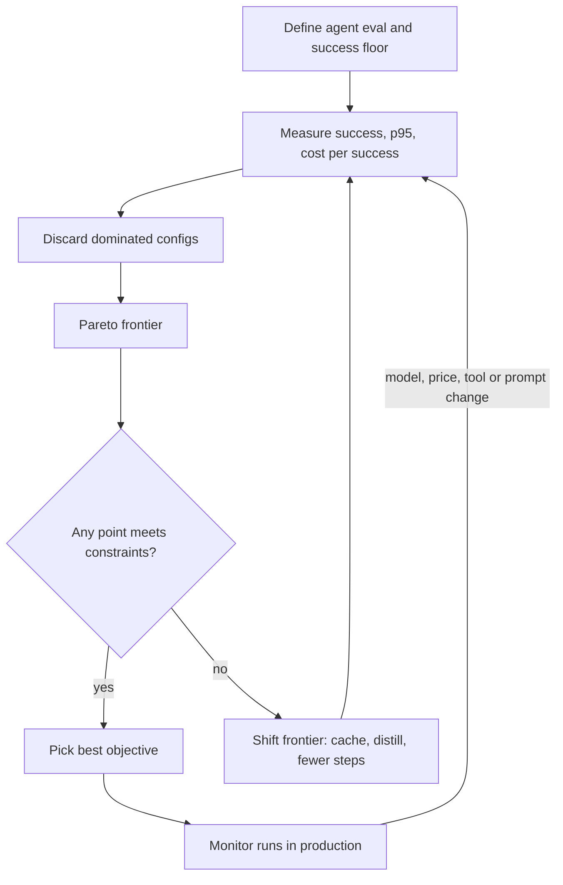

## TL;DR
Every agent run trades task success, wall-clock time and spend, each multiplied by its step count; levers
that improve one axis usually degrade another. Measure all three per run, discard dominated
configurations, and choose from the Pareto frontier under hard constraints.

## For agent builders
- **Why it matters for agents.** An agent multiplies every per-call number by its steps. A 300-token reply
  at 20 ms per token is 6 s once, and about 48 s across 8 steps. Success is judged per run, so a cheap
  model that loops, retries or fails the task is often the expensive one.
- **Where it shows up in your stack.** The model chosen per node or step (in LangGraph, the OpenAI Agents
  SDK or your own loop), `max_tokens` per call, prompt caching for the system prompt and tool schemas,
  reasoning or thinking budgets, max-step limits, and tracing tools such as LangSmith or Langfuse that show
  tokens, latency and cost per run.
- **What you control.** Which model runs which step (tool selection, planning, final answer), output caps
  per step, a stable cacheable prefix, the step budget, and the eval that defines a successful run.
- **What you can skip.** Serving-side levers (quantization, speculative decoding) unless you self-host; on
  a hosted API they are the provider's job, and you only see their effect in the latency and price.

## Decision case
### Scenario
A B2B software company runs the 8-step support agent from the first example (4,000-token prefix, ~600
tool tokens per step) on a large hosted model. All prices, timings and pass rates are illustrative, using
the same placeholder price table as that example (small model at a tenth of the large one's prices).
- **Volume:** 120,000 runs a month today, forecast 200,000 within two quarters.
- **Quality floor:** run success of at least 88% on a 300-task eval, each task run twice (600 runs).
- **Latency:** p95 model time per run of at most 20 s, because users wait on the agent in a chat panel.
- **Budget:** $8,000 a month of model spend.
- **Team and deadline:** two engineers, six weeks; no fine-tuning this quarter.

### Options
| Option | How it works | Success | p95 model time | Cost per run | Per month at 120k | Cost per success |
|---|---|---|---|---|---|---|
| A. Today | large model, 300 output tokens per step, no caching | 0.91 | 51.2 s | $0.2076 | $24,912 | $0.2281 |
| B. Large, capped and cached | 80-token terse steps, prompt caching on the prefix | 0.90 | 16.0 s | $0.0486 | $5,832 | $0.0540 |
| C. Run-level cascade | whole run on the small model; a verifier sends the 20% that fail to a full B run | 0.89 | about 32 s | $0.0146 | $1,748 | $0.0164 |
| D. Per-step routing | large model plans and answers (steps 1 and 8), small model runs the six tool steps | 0.88 | 16.0 s | $0.0339 | $4,068 | $0.0385 |

- **C's cost** is `s + e·l` = 0.00486 + 0.20 × 0.0486; its p95 is an escalated run, two runs back to back.
- **D saves less than expected** because each model keeps its own prompt cache: every switch re-reads the
  transcript at the uncached rate.

### Decision
Ship **B** now and run D in shadow mode to decide before volume grows.
- **A fails twice:** three times the budget and 2.5 times the latency limit.
- **C fails the latency constraint:** 20% of runs escalate, so the p95 is an escalated run at about 32 s,
  even though it is the cheapest by far.
- **D sits on the floor:** at q = 0.90 and n = 600 the standard error is about 1.2 points, so 0.88 is
  indistinguishable from failing it.
- **B meets every constraint:** 0.90 ties A within noise (paired test on the same 600 runs), 16 s is under
  20 s, and $5,832 is under $8,000.

**What would change it:**
- **Volume:** B fits the budget only up to about 164,000 runs a month ($8,000 / $0.0486); at 200,000 it
  costs $9,720, while D costs $6,780. Prove D on a 1,200-run paired eval before that.
- **An asynchronous product mode:** if the latency limit is relaxed, C's cost per success wins outright.
- **Fine-tuning budget next quarter:** a distilled small model shifts the frontier, so re-run the table.

### Trade-offs accepted
- **About one point of success versus A,** inside the noise; a weekly paired eval on sampled traffic
  alerts if the gap grows beyond two standard errors.
- **Dependence on the cache:** cost assumes every step after the first hits the prefix cache; alert when
  cached input tokens per step drop, which signals a prompt or tool-schema edit.
- **Terse steps may truncate:** monitor the share of calls stopped for length per step type.
- **Shrinking budget headroom:** track monthly runs against the 164,000 ceiling and forecast it.

### Review rubric
- States the success floor, latency limit and budget as numbers before comparing options.
- Reports cost per successful run, not per call, and recomputes each option from per-step tokens.
- Treats differences within the eval's standard error as ties and names the paired test used.
- Checks the tail: computes p95 for any cascade from the escalation rate, not the average.
- Rejects options that miss a hard constraint even when they win on cost.
- Names the volume or constraint change that flips the choice, with the threshold computed.

## Why it exists
- **The usual history.** A prototype agent ships on the largest model with a long, example-stuffed prompt.
  Then three things happen at once: the bill grows linearly with traffic, a p95 of several seconds per
  step makes the agent feel broken, and the first eval shows the "best" model is no better on this task
  than one an order of magnitude cheaper, because the task saturates.
- **"Use the best model for everything" fails on cost and latency.** Quality is task-relative and
  plateaus, while cost and latency are paid on every single request, and an agent makes many per run.
- **"Use the cheapest model" fails on quality.** A wrong answer has a cost too: a retry, a human
  escalation, a lost customer. The right denominator is cost per *successful* task, and on that measure the
  cheap model can be the expensive one; for agents, extra steps and loops make the gap wider.
- **"Tune one axis at a time" is the most common failure.** A team trims the prompt to cut cost, quality
  quietly drops, and nobody notices until a customer does, because quality was never a number on a
  dashboard.
- **The axes are coupled by mechanism, not by accident.** More reasoning tokens buy better answers on hard
  problems and more decode time and spend; more retrieved context buys grounding and more prefill; a bigger
  model buys capability and more memory bandwidth per token.
- **So you need a method, not a hunch.** It holds all three in view, makes the exchange rate explicit, and
  is re-run whenever a model, price or prompt changes. That is what separates agents that scale from
  agents that get switched off when the invoice arrives.

## How it works
### Make all three measurable
Nothing below works without numbers for each axis on the *same* set of requests or agent tasks.
- **Quality is a task-specific eval.** A golden set with a pass criterion: exact match for
  classification, a rubric or LLM judge for open text, human grading for the ambiguous slice. For an agent
  the unit is the run: did it reach the right end state? Define it first, *because* every cost or latency
  cut is a bet that quality survives, and bets need a scoreboard.
- **Latency is what the user feels.** Time-to-first-token for streamed chat, end-to-end time for a
  classifier, a tool call or a whole agent run, and always a percentile (p95 or p99), not a mean. Means hide
  the tail, and the tail is what users remember.
- **Cost is cost per successful task.** Include retries, fallbacks, judge or verifier calls, cache misses,
  extra agent steps and the downstream cost of failures. Per-request cost is what the provider bills; per
  successful task is what the business pays.

### Where latency and cost actually come from
Decompose each axis before pulling levers, *because* the decomposition tells you which lever can move it:

```
cost_per_call ≈ n_in_uncached·p_in + n_in_cached·p_cached + n_out·p_out
TTFT          ≈ network + queueing + prefill(n_in)
end_to_end    ≈ TTFT + n_out · TPOT          (TPOT = time per output token)
```

- **Input tokens are cheap in time.** Prefill processes the whole prompt in parallel.
- **Output tokens are expensive in time and money.** Decode emits them one at a time, so `n_out · TPOT`
  usually dominates end-to-end latency, and output tokens are typically priced several times higher than
  input tokens.
- **Illustrative numbers.** With a TPOT of 20 ms, a 300-token answer spends about 6 s in decode alone,
  whatever the prompt length. Cutting the answer to 100 tokens saves about 4 s; halving a 2,000-token prompt
  saves only a fraction of a second of prefill.
- **So output caps and terse formats are often the strongest latency lever**, and prompt trimming mainly
  buys cost and TTFT.

### Agent runs multiply every term
```
run_cost    ≈ Σ over steps of cost_per_call(step)        context grows every step
run_latency ≈ Σ over sequential steps of (TTFT + n_out · TPOT) + tool time
```

- **Context grows, so input cost grows per step.** Each step re-sends the system prompt, tool schemas and
  the transcript so far; without prompt caching, a run's total input cost rises roughly quadratically
  with its step count.
- **Output length is paid once per step.** A tool call is usually a short JSON object; letting the model
  narrate its reasoning in every step multiplies decode time by the step count.
- **Steps are sequential.** Parallel tool calls in one step overlap tool time, but model calls in a chain
  still add up, so step count is itself a latency lever.

### Cost per success, and when quality *is* cost
- **With a verifier and retries:** if each attempt succeeds with probability *q*, expected attempts are
  `1/q`, so `cost_per_success = (c_call + c_verify) / q`. For an agent, `c_call` is the whole run.
- **Caveat:** that assumes independent attempts. In practice the same hard input tends to fail again, so
  retries recover less than `1/q` predicts.
- **With human escalation:** `cost_per_task = c_call + (1 − q) · c_human`.

| Model (illustrative) | Call cost | Pass rate | Escalation at $2 | Cost per task |
|---|---|---|---|---|
| Small | $0.001 | 86% | 0.14 × 2 | 0.001 + 0.14 × 2 ≈ $0.28 |
| Large | $0.018 | 94% | 0.06 × 2 | 0.018 + 0.06 × 2 ≈ $0.14 |

- **When failure is expensive,** the quality axis collapses into the cost axis and the "expensive" model
  is the cheap one.
- **When failure is cheap** (a user rephrases), the axes stay separate and the frontier below matters.

### Know which axis each lever moves
| Lever | Quality | Latency | Cost | Note |
|---|---|---|---|---|
| Bigger model tier | up | up | up | coarsest lever; quality gain saturates per task |
| Shorter prompt / less context | risk | down (prefill) | down | every token is paid on every call and every agent step |
| Capped or terser output | neutral if instructed | down (decode) | down | decode is sequential, so output length often dominates total time |
| Reasoning / thinking budget | up on hard tasks | up a lot | up a lot | wasted on easy tasks or steps; gate by difficulty |
| Prompt caching (shared prefix) | none | down (TTFT) | down (input) | removes work instead of trading it; large for agents |
| Response / semantic cache | none on hits | near zero on hits | near zero on hits | only for repeat queries; staleness risk |
| Routing / cascade | ≈ large model | up for escalated requests | down on average | depends on escalation rate; can be per agent step |
| Step budget (max iterations) | risk if too low | down | down | caps loops; failing runs end sooner |
| Batch / async endpoints | none | up (minutes to hours) | down sharply | for non-interactive work only |
| Fine-tune / distill small model | up for small model | down | down | front-loaded effort; shifts the frontier |
| Quantization, speculative decoding | small risk | down | down | serving-side; measure per model |
| Streaming | none | perceived down | none | changes perception, not the number |

- **Most levers move you *along* the frontier:** you give up some of one axis for another.
- **A few *shift* the frontier:** caching, distillation, fine-tuning and task redesign (fewer agent steps,
  a deterministic tool instead of a model call), because they remove work or make a cheaper model
  genuinely better at this task.
- **When no frontier point satisfies the constraints,** only the second group can help; more tuning of
  the first group cannot.

### Build the frontier
1. **Run every candidate configuration** against the same eval set and a replay of real traffic.
2. **Record the triple** (quality, p95 latency, cost per successful task) for each.
3. **Discard dominated configurations.** A is *dominated* if some B is at least as good on all three and
   strictly better on one. What remains is the Pareto frontier.
4. **Respect measurement noise.** A pass rate on *n* items has a standard error of about `√(q(1−q)/n)`; at
   q = 0.92 and n = 200 that is roughly 2 points, so 0.92 and 0.93 are a statistical tie. Agent runs are
   also non-deterministic, so run each task more than once.
5. **Treat configurations inside the noise band as equal on quality.** Compare them on the same items with
   a paired test, or grow the eval, and let latency and cost decide. A p95 from a few hundred requests is
   itself noisy.

The output turns a three-way argument into a short list with a visible exchange rate: "moving from B to C
buys two points of quality for $0.003 per task and 450 ms of p95". People can argue about whether that
trade is worth it; they can no longer argue about facts.

### Choose under constraints
- **Two axes are constraints, one is the objective.** Either *maximize quality subject to p95 ≤ L and
  cost ≤ C*, or *minimize cost subject to quality ≥ Q and p95 ≤ L*.
- **The second form is the common one,** because the quality floor is nearly always a product requirement
  rather than a tunable.
- **Pick the feasible frontier point with the best objective.** If the feasible set is empty, stop tuning
  and reach for a frontier-shifting lever.

### Do it per task, and per agent step
- **One application holds many frontiers.** Intent classification saturates on a small model;
  multi-document synthesis does not.
- **One agent holds many too.** Picking a tool or extracting arguments often saturates on a small model,
  while planning and the final answer may need a large one.
- **Split traffic by task or step and optimize each separately.** It is usually the single largest win,
  which is why routing comes before most other work.

### Keep measuring
- **Everything drifts.** Quality drifts when the provider updates a model or the input mix changes; prices
  fall; traffic mix shifts; a prompt edit makes the model chattier or the agent take more steps.
- **Re-run the frontier** on a cadence and on every change to prompt, model, tools or retrieval.
- **Alert on cost per task and p95 in production,** not just on total spend.

## Diagram
Read it as a loop: measure the triple per agent run, prune to the frontier, filter by constraints, and
either ship a point or reach for a lever that shifts the frontier.



## Examples
### Worked scenario: what one agent run costs, and where the time goes
An 8-step support agent: 4,000-token prefix (system prompt plus tool schemas), ~600 tokens of tool result
per step, transcript append-only. Prices and timings are illustrative placeholders, not a provider's.

```python
P_IN, P_CACHED, P_OUT = 3.00, 0.30, 15.00   # USD per 1M tokens, illustrative
TTFT_S, TPOT_S = 0.4, 0.020                 # held constant per step for simplicity

def agent_run(steps, prefix, tool_tokens, n_out, cache):
    cost = secs = 0.0
    ctx = prefix                              # system prompt + tool schemas
    for i in range(steps):
        uncached = (prefix if i == 0 else tool_tokens + n_out) if cache else ctx
        cost += ((uncached * P_IN + (ctx - uncached) * P_CACHED) + n_out * P_OUT) / 1e6
        secs += TTFT_S + n_out * TPOT_S       # model time only; tool time comes on top
        ctx += n_out + tool_tokens            # transcript is append-only
    return cost, secs

configs = {                                   # (n_out per step, prompt caching, run success rate)
    "verbose steps, no cache": (300, False, 0.88),
    "capped steps, no cache":  (80,  False, 0.88),
    "capped steps, cached":    (80,  True,  0.88),
}
for name, (n_out, cache, q) in configs.items():
    c, s = agent_run(steps=8, prefix=4000, tool_tokens=600, n_out=n_out, cache=cache)
    print(f"{name:<24} ${c:.4f}/run  ${c / q:.4f}/success  {s:4.1f} s model time")
# verbose steps, no cache  $0.2076/run  $0.2359/success  51.2 s model time
# capped steps, no cache   $0.1627/run  $0.1849/success  16.0 s model time
# capped steps, cached     $0.0486/run  $0.0552/success  16.0 s model time
```

| Change | Run cost | Model time | Why |
|---|---|---|---|
| Baseline: 300 output tokens per step | $0.2076 | 51.2 s | 8 × 300 tokens × 20 ms of decode |
| Cap steps to 80 tokens (terse tool calls) | $0.1627 | 16.0 s | decode shrinks; growing context still dominates cost |
| Add prompt caching on the prefix | $0.0486 | 16.0 s | re-sent transcript is billed at the cached rate |

- **Output caps fix latency, caching fixes cost.** Each lever moved a different axis, exactly as the
  decomposition predicts. In a real system caching would also cut TTFT, which this sketch holds constant.
- **The sketch flatters caching slightly.** Some providers bill cache writes above the base input price
  (Anthropic charges a premium on the write, then a fraction on reads), and caches expire after minutes
  of idle time, so check cached-token counts in the usage fields rather than assuming every step hits.
- **Divide by the run success rate.** `c / q` assumes independent retries; check the success rate did not
  fall after capping output, or the cheaper run is a false win.

### Frontier step for the agent's triage step
A small, runnable version of the frontier step for the first step of a support agent, which triages the
ticket. The measurements are illustrative numbers, not benchmarks; the structure is what matters.

```python
from dataclasses import dataclass

@dataclass
class Config:
    name: str
    quality: float        # pass rate on the task's golden set, 0..1
    p95_ms: int           # end-to-end p95 on a traffic replay
    cost_per_task: float  # USD per successful task, retries and judge calls included

configs = [
    Config("large, long prompt",     0.94, 3800, 0.0180),
    Config("large, trimmed prompt",  0.93, 2900, 0.0110),
    Config("small, trimmed prompt",  0.86,  900, 0.0012),
    Config("small, fine-tuned",      0.92,  950, 0.0014),
    Config("small -> large cascade", 0.93, 1400, 0.0038),
    Config("medium, trimmed prompt", 0.90, 1700, 0.0045),
]

def dominated(c, others):  # B dominates A: no worse on all three, strictly better on one
    return any(o.quality >= c.quality and o.p95_ms <= c.p95_ms
               and o.cost_per_task <= c.cost_per_task
               and (o.quality > c.quality or o.p95_ms < c.p95_ms
                    or o.cost_per_task < c.cost_per_task) for o in others)

frontier = [c for c in configs if not dominated(c, configs)]
feasible = [c for c in frontier if c.quality >= 0.90 and c.p95_ms <= 2000]
best = min(feasible, key=lambda c: c.cost_per_task)
for c in frontier:
    print(f"{c.name:<24} q={c.quality:.2f}  p95={c.p95_ms:>5} ms  ${c.cost_per_task:.4f}/task")
print("choose:", best.name)
# large, long prompt       q=0.94  p95= 3800 ms  $0.0180/task
# small, trimmed prompt    q=0.86  p95=  900 ms  $0.0012/task
# small, fine-tuned        q=0.92  p95=  950 ms  $0.0014/task
# small -> large cascade   q=0.93  p95= 1400 ms  $0.0038/task
# choose: small, fine-tuned
```

- **Two configurations vanish immediately.** The trimmed large model is dominated by the cascade (same
  quality, faster, cheaper); the medium model is dominated by the fine-tuned small one.
- **Constraints decide the rest.** Under quality ≥ 0.90 and p95 ≤ 2 s only the fine-tuned small model and
  the cascade survive, and the fine-tuned model wins on cost.
- **What the table hides (1): the one-off fine-tuning cost.** It must be amortized over expected volume
  before the choice is final.
- **What the table hides (2): the cascade's tail.** Its p95 is driven by the escalated minority, so its
  p50 is close to the small model's.
- **The quality gap is noise.** 0.92 vs 0.93 is inside the noise of a few-hundred-item eval, which is
  exactly why cost, not quality, should break the tie here.

### Worked scenario: does the cascade pay?
Cascade cost per task is `s + e·l` (small cost *s*, large cost *l*, escalation rate *e*), so it beats the
large model alone only while `e < 1 − s/l`. The same holds for one agent step routed small-first.
Illustrative prices:

```python
def cascade_cost(s, l, e):
    return s + e * l                 # every request pays s; escalated ones also pay l

def break_even_escalation(s, l):
    return 1 - s / l                 # cascade wins while e is below this

for s, l in [(0.001, 0.010), (0.005, 0.010)]:   # 10x and 2x price gaps
    print(f"gap {l/s:.0f}x  break-even e < {break_even_escalation(s, l):.0%}")
    for e in (0.1, 0.3, 0.6):
        c = cascade_cost(s, l, e)
        print(f"   e={e:.0%}  cascade ${c:.4f}  vs large ${l:.4f}  -> {'cascade' if c < l else 'large'}")
# output, condensed to one line per gap:
# gap 10x  break-even e < 90%   (e=10%: $0.0020, e=30%: $0.0040, e=60%: $0.0070 -> cascade)
# gap 2x   break-even e < 50%   (e=10%: $0.0060, e=30%: $0.0080 -> cascade; e=60%: $0.0110 -> large)
```

| Price gap | Break-even escalation | At 30% escalation | At 60% escalation |
|---|---|---|---|
| 10× | 90% | cascade, $0.0040 vs $0.0100 | cascade, $0.0070 vs $0.0100 |
| 2× | 50% | cascade, $0.0080 vs $0.0100 | large wins, $0.0110 vs $0.0100 |

The narrower the price gap, the less escalation the gate can afford, and every escalated request also
pays both models' latency, once per escalated agent step.

## Production patterns
- **Cap output per agent step.** When: any interactive agent, because decode time is `n_out · TPOT` per
  step. How: set the API's maximum output tokens (`max_tokens` on Anthropic's Messages API) per call type
  and ask for terse tool calls. Monitor output-token p95 per step and the share of calls stopped for length.
- **Stable prefix plus prompt caching.** When: every step re-sends a long system prompt and tool list. How:
  put stable content first and variable content last; on Anthropic mark the prefix with `cache_control`,
  while OpenAI caches long shared prefixes automatically. Monitor cached input tokens per step and TTFT.
- **Small-first routing per step with a gate.** When: the agent mixes easy steps (tool choice, argument
  extraction) and hard ones (planning, final answer). How: run easy steps on the small model, escalate on a
  verifier failure or low confidence. Monitor escalation rate against `1 − s/l`, and escalated p95 apart.
- **Step and token budgets per run.** When: every agent loop. How: a max-steps limit and a per-run token
  budget enforced in code (LangGraph's `recursion_limit` in the run config, `max_turns` on the OpenAI Agents SDK runner). Monitor
  steps per run p95 and the share of runs ending on the budget.
- **Batch path for offline agent work.** When: nobody waits on the result (backfills, nightly enrichment,
  eval sweeps). How: send it through the provider's batch endpoint, which trades a completion window of
  hours for a lower price. Monitor batch completion time against the downstream deadline.
- **Three lines per agent, gated on every change.** How: tag every call with agent, step and run ids and
  plot run success on a sampled eval, run p95, and cost per successful run. Re-run the golden set in CI on
  any prompt, model, tool or retrieval change with a paired comparison; block merges that leave a band.

## Trade-offs
- **Cascade: lower average cost vs higher tail latency.** It also adds a confidence gate to maintain. With
  small-model cost *s*, large-model cost *l* and escalation rate *e*, it beats the large model alone only
  while `s + e·l < l`, i.e. while `e < 1 − s/l`. At a 10× price gap that is 90%; at 2× it is only 50%.
- **Trimmed context: cheaper and faster TTFT vs quality risk.** Removing context, few-shot examples or old
  agent turns lowers cost and TTFT on every call, but each removed token is a bet it was not needed. The
  trade flips the moment the eval shows quality under the floor.
- **Reasoning budget: quality on hard inputs vs waste on easy ones.** It is favourable only when gated by
  task or step difficulty rather than applied uniformly to every agent step.
- **Tight step budget: bounded cost vs unfinished runs.** A low max-steps limit stops loops cheaply, but
  cuts off legitimate long tasks; the trade flips when runs ending on the budget start failing the eval.
- **Fine-tuning or distillation: a shifted frontier vs front-loaded effort.** The engineering must be
  repeated when the task or base model changes. It pays only when monthly savings exceed the amortized
  effort, which is a volume threshold.
- **Response caching: near-zero cost and latency on hits vs staleness.** It is worthless on long-tail
  inputs and harmful when answers must reflect fresh data; the trade flips with hit rate and staleness
  tolerance.
- **Batch endpoints: much lower cost vs minutes-to-hours latency.** Good for offline work; the trade flips
  the instant a user is waiting on the result.

## Pitfalls
- **Optimizing cost with no quality metric in place.** Symptom: a falling bill followed weeks later by
  rising escalation and complaint rates that nobody connects to the change. Fix: define the eval and floor
  first.
- **Reporting mean latency.** Symptom: a green dashboard while users report hangs, because the p95 nobody
  plotted is three times the mean. Fix: plot p95 and p99, per step and per run.
- **Comparing cost per request instead of per successful task.** Symptom: a "cheaper" model whose retries,
  extra agent steps, judge calls and human review make the total higher. Fix: divide total spend, including
  verifier and escalation cost, by tasks that passed.
- **Evaluating on a handful of hand-picked prompts.** Symptom: a configuration that shines in the demo and
  degrades on the real traffic distribution. Fix: add a traffic replay.
- **Reading a one- or two-point eval difference as a real win.** Symptom: the "winning" configuration swaps
  places with the runner-up every time the eval is re-run or re-sampled. Fix: paired test or a bigger eval.
- **Leaving output length unconstrained.** Symptom: cost and decode latency creep up after a prompt or
  model change made the model chattier, multiplied by every step. Fix: a per-step output cap and an alert
  on output-token p95.
- **Treating the frontier as static.** Symptom: a once-optimal setup became dominated after a provider
  price cut or model update that nobody re-tested. Fix: re-run the frontier on a cadence and on every
  model, price or prompt change.

## When to use
- **Use when** an agent first approaches production scale, whenever a new model or price list appears,
  and whenever run success, p95 or cost per task moves outside its band in monitoring.
- **Skip the full exercise** for throwaway prototypes and low-volume internal tools, where the cost of
  measuring exceeds the cost of being wrong. Still write down the quality floor so it exists when volume
  arrives.
- **Day to day:** a dashboard with three lines per agent (success on a sampled eval, p95, cost per
  successful task) and a habit of re-running the eval on every prompt, model, tool or retrieval change.
- **Interviews:** name all three axes unprompted, insist on cost per successful task, separate
  frontier-moving levers from frontier-shifting ones, and derive the cascade break-even condition from the
  escalation rate.

## Role lens
- **Engineer:** Owns the eval harness, the traffic replay and the per-config measurement; implements
  routing, caching and output caps; keeps max_tokens, prompt versions and model ids under version control.
- **Architect:** Sets the quality floor and latency budget per feature, decides which levers are allowed
  (cascade, distillation, batch paths) and signs off the frontier point the product will run on.
- **FDE:** Rebuilds the frontier inside the customer's constraints, where the eval set is their data, the
  latency budget is their workflow and the cost ceiling is their contract margin, then defends the choice.

## Check yourself
**Q:** A feature runs on a large model at p95 of 4 s, $0.02 per task and 94% on its eval. Product wants
p95 under 2 s and cost under $0.005 per task while keeping quality at 90% or better. Which levers do you
try, in what order, and how do you know when you are done?
**A:** Start with the levers that change the least: trim the prompt, cap and tighten the output, add
prompt caching for the shared prefix, and re-measure all three numbers on the full eval and a traffic
replay. If that does not clear both constraints, route: a small model first with a confidence or verifier
gate, escalating to the large model, and compute expected cost as small cost plus escalation rate times
large cost, while checking that the escalated requests do not blow the p95. If escalation stays high, the
frontier itself must move: distill the large model's outputs into a fine-tuned small model and amortize
that effort against monthly savings at the expected volume. Done means a configuration on the frontier
satisfies all three constraints on the eval and the replay, with production monitoring of p95 and cost per
successful task so a regression is caught in days rather than at the next invoice.

## Interview questions
### What is the Pareto frontier in quality, latency and cost, and why not just pick the best model?
- **Definition:** the set of configurations that no other configuration beats on all three axes at once;
  everything else is dominated and can be discarded without argument.
- **Why not the best model:** quality is task-relative and saturates, while cost and latency are paid on
  every request. The best-scoring model is often tied, within eval noise, with one far cheaper and faster.

### An agent run takes 50 s and users abandon it. How do you find which lever to pull?
- **Decompose per step first:** each step is TTFT plus `n_out · TPOT`, and TTFT is network, queueing and
  prefill. Log TTFT, output tokens, TPOT and tool time per step from the traces.
- **If decode dominates** (for example 300 output tokens at 20 ms each is about 6 s per step), cap output
  and ask for terse tool calls; trimming the prompt would barely help.
- **If TTFT or step count dominates,** add prompt caching for the prefix, run independent tool calls in
  parallel, and remove steps a deterministic tool could do.

### When would a small-first cascade be a bad idea?
- **When escalation is high:** it wins on cost only while `e < 1 − s/l`; at a 2× price gap that is just
  50%, and above it every escalated request pays for both models.
- **When the tail matters:** escalated requests pay both latencies, so p95 rises even when average cost
  falls, and in an agent that penalty repeats on every escalated step.
- **When the gate is unreliable:** a confidence signal that misses wrong answers silently lowers quality,
  so the gate needs its own eval.

### Two configurations score 0.92 and 0.93 on a 200-item eval. The 0.93 one costs three times more. Which do you ship?
- **They are tied on quality:** the standard error is about `√(q(1−q)/n)`, roughly 2 points at q = 0.92 and
  n = 200.
- **So cost and latency decide,** and the cheaper one ships unless a paired test on the same items, or a
  larger eval, shows a real gap.
- **State the exchange rate** to the product owner, so the decision is about whether a possible point is
  worth 3× the spend.

### You swapped your agent to a cheaper model and the cost per successful task went up. How?
- **More steps per run:** a weaker model picks wrong tools, re-reads results and loops, and every extra
  step re-sends a growing context.
- **Lower run success:** failed runs still cost money, and retries or human escalation land in the
  numerator while fewer successes sit in the denominator.
- **Check in the traces:** steps per run, tokens per run and success rate before and after; per-call price
  fell while per-run cost rose.

### How do you account for a fine-tuned small model whose per-task cost looks tiny?
- **Add the one-off cost:** data preparation (for agents, curating good trajectories), training runs, evals
  and the engineering time, amortized over expected volume in the payback period.
- **Add the recurring cost:** it must be redone when the task, the tool set or the base model changes, so
  plan for repeats.
- **Then compare cost per successful task,** including any human escalation, against the current point on
  the frontier at realistic monthly volume.

## Quiz
### Q: Which lever shifts the quality–latency–cost frontier rather than moving along it?
- [ ] Switching to a larger model tier
- [x] Distilling the large model's behaviour into a fine-tuned small model
- [ ] Raising max_tokens so answers are more complete
- [ ] Adding more few-shot examples to the prompt
> Model tier, output length and prompt length trade one axis for another and stay on the existing
> frontier. Distillation makes a cheap, fast model genuinely better at this task, so it improves quality
> without paying in latency or cost: the frontier itself moves.

### Q: Why is cost per successful task the right cost measure rather than cost per request?
- [ ] Because providers bill per task rather than per token
- [x] Because it includes retries, fallbacks, judge calls and the cost of failed outputs, which per-request cost hides
- [ ] Because it is easier to compute from the invoice
- [ ] Because latency is also measured per task
> A cheap model that fails more often incurs retries, verifier calls and human handling; per-request cost
> makes it look like a win while the business pays more. Per successful task counts what the outcome
> actually cost.

### Q: A small model costs $0.001 per task and a large one $0.010. Below what escalation rate does a small-first cascade beat sending everything to the large model?
- [ ] 10%
- [ ] 50%
- [x] 90%
- [ ] It always beats it, at any escalation rate
> Cascade cost is 0.001 + e × 0.010, which is below 0.010 only while e < 0.9. Above that, nearly every
> request pays for both models and the cascade is strictly worse on cost and on tail latency.

## Use cases & projects
### Use cases
- **Choosing a model per agent step.** Teams run the cheap model on routing, tool selection and
  extraction steps and reserve the large model for planning or the final answer, picking each from the
  step's own frontier.
- **Fixing a slow agent.** When users abandon runs, the per-step latency breakdown in traces shows whether
  steps, output tokens or prefill dominate, so the team pulls the lever that actually moves wall-clock time.
- **Cutting an agent's bill without losing success rate.** Prompt caching, output caps and step budgets
  are evaluated on cost per successful run, not cost per call, before they ship.
- **Re-evaluating after a model or price change.** A new model release or price cut triggers a re-run of
  the frontier, because yesterday's dominated configuration may now be the best one.

### Mini project
**Build the frontier for a small tool-calling agent (2-3 hours).**
- **Goal:** pick a shippable configuration for a 3-tool agent from measured quality, latency and cost per
  run, not from intuition.
- **Steps:** write 30-50 eval tasks with a pass/fail check; run the agent under 4-6 configurations picked
  from two model tiers, an output cap on or off, and a small-first cascade on or off; log success, wall
  time, steps and tokens per run from the usage fields; compute cost per successful task; plot quality
  against cost and mark dominated points.
- **Done when:** you have a table and a scatter plot with the Pareto frontier marked, a chosen
  configuration that meets a stated latency limit, and two sentences on what you would re-check after the
  next price change.
