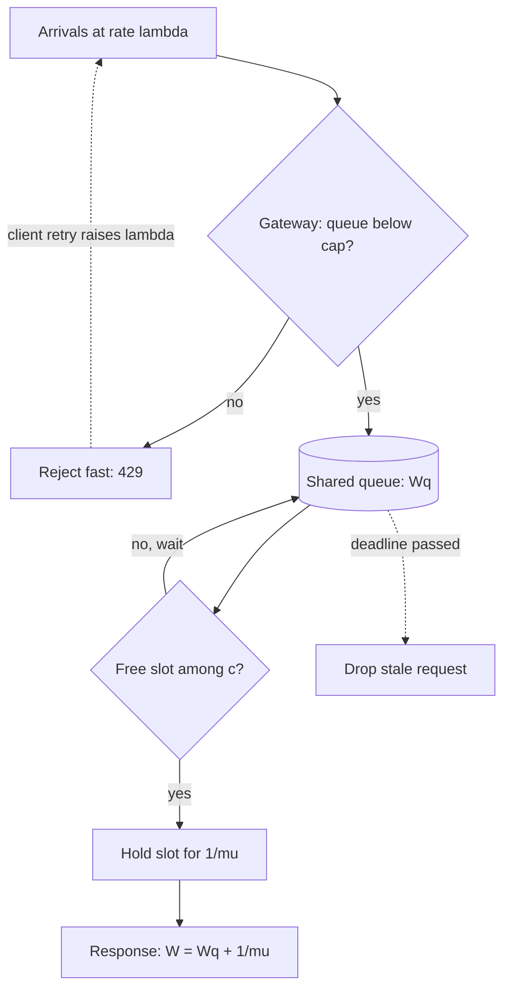

## TL;DR
Random arrivals plus variable service times mean waiting, and waiting grows non-linearly near 100%
utilization: in a 16-slot fleet, 75% to 95% busy multiplies mean queue wait about twentyfold. Little's
law, M/M/c and Kingman predict that knee early.

## Why it exists
- **The naive model is division.** A replica handles 4 requests per second, peak traffic is 40, so buy
  10 replicas. That assumes evenly spaced arrivals and every request taking exactly the average time.
  Neither is true.
- **Arrivals are bursty and LLM service times vary wildly.** Users arrive in uncoordinated bursts, and
  output length varies: one request generates 20 tokens, the next 2,000. When three long requests land
  together everything behind them waits, and the server cannot "bank" idle time from a minute ago.
- **Latency bends long before the cliff.** It is not flat until capacity; it curves upward well before
  100% utilization. Teams that size to the mean see fine dashboards at 60% load and mysterious p99
  explosions at 85%, with no code change.
- **It quantifies the curve.** How much waiting a utilization buys, how variability makes it worse, and
  how pooling, admission control and headroom make it better.
- **It bridges two teams' numbers.** Throughput measured by serving and latency promised by product.
  Without it, "how much headroom do we need" gets nothing better than a guess.

## How it works
### Vocabulary
| Symbol | Meaning |
|---|---|
| **λ (lambda)** | Arrival rate, requests per second |
| **μ (mu)** | Service rate of one server, so mean service time is 1/μ |
| **c** | Number of servers; for an LLM think *concurrency slots*, not machines (see below) |
| **ρ = λ / (c·μ)** | Utilization, fraction of time servers are busy; must stay below 1 or the queue grows without bound |
| **W, Wq, L** | Mean time in system, mean time waiting in queue, mean number of requests in system |

### Little's law: L = λ·W
- **What it says.** Average requests in flight equals arrival rate times average time each spends
  inside. It holds for almost any stable system, regardless of arrival or service distribution.
- **Why it holds.** Every request that enters eventually leaves, so long-run averages must balance.
- **Forwards.** At 50 req/s and 6 s mean latency you have 300 requests in flight on average, so you need
  at least 300 concurrent slots across the fleet before any headroom.
- **Backwards.** If a gateway caps in-flight requests at L and latency is W, the best throughput you can
  see is L/W.

### Why waiting explodes: the 1/(1−ρ) term
- **M/M/1** (one server, random Poisson arrivals, exponential service): W = 1/(μ − λ) and
  Wq = ρ/(μ − λ).
- **Rewritten:** Wq = (service time) × ρ/(1 − ρ).

| ρ | Queue wait in service times |
|---|---|
| 0.5 | one |
| 0.9 | nine |
| 0.99 | ninety-nine |

- **Headroom is not waste.** Because of the denominator, the last 10% of utilization costs more latency
  than the first 80%.

### Variability: Kingman's approximation
Real systems are not exponential. For a single server with general distributions (G/G/1):

```
Wq ≈ ( ρ / (1 − ρ) ) × ( (Ca² + Cs²) / 2 ) × mean_service_time
```

- **Ca and Cs** are coefficients of variation (std dev / mean) of inter-arrival times and service times.
- **Three levers:** utilization; *arrival* variability (bursts, retry storms, batch jobs released on the
  hour); *service* variability (output-length spread, tool calls, cache hits vs misses).
- **LLM traffic is high-variance.** Cs is often around or above 1 (an exponential has exactly 1), and
  agentic traffic with tool calls and long-tail outputs can push it higher. When Cs > 1, queues are worse
  than a textbook M/M/1 at the same utilization.
- **Measure Cs from your own traffic** rather than assuming it.
- **Lower Cs to help everyone.** Capping `max_tokens` or splitting long jobs onto a separate queue reduces
  latency for all other requests.

### Many servers: M/M/c and pooling
With c servers sharing one queue, the Erlang C formula gives the probability an arriving request must
wait, and the mean wait. Two results matter:
1. **Larger pools tolerate higher utilization at the same wait**, because a burst is more likely to find
   some server free. This is statistical multiplexing.
2. **One shared queue beats several separate ones of the same total capacity**, because separate queues
   can leave one pool idle while another is backed up. Every dedicated per-tenant or per-model pool pays
   this tax.

### Mapping it onto LLM serving
- **A replica is many servers.** With continuous batching it serves many sequences at once, and each
  sequence slows slightly as the batch grows.
- **Workable approximation:** treat each replica as roughly `max_concurrent_sequences` servers whose
  service time is the measured latency *at that concurrency*.
- **The queue is wherever requests wait for a slot:** the engine's waiting list, the gateway, or a
  provider's rate limiter.
- **Measure under load.** Take service time and its variance from real traffic, not a single-request
  benchmark, because per-request speed depends on load.

### Tails, not means
SLOs are written on p95 or p99, and the tail of queue wait grows faster than the mean. In M/M/c a
request waits at all with probability P(wait) (Erlang C); if it waits, the extra delay is exponential
with rate (c·μ − λ):

```
P(Wq > t) = P(wait) × exp(−(c·μ − λ)·t)      →   t_p = ln(P(wait) / (1 − p)) / (c·μ − λ)
```

- **(c·μ − λ) is spare service capacity.** As it shrinks toward zero, every percentile stretches in
  proportion.
- **In the 16-slot example below** p99 queue wait is about 3 s at 75% utilization and about 22 s at 95%,
  while the mean goes from 0.2 s to 3.9 s. Planning on the mean hides most of the damage an SLO will see.

### Open versus closed load, and queue order
- **Open system:** arrivals keep coming regardless of how slow you are. True of public traffic, and what
  the formulas above assume.
- **Closed system:** a fixed population waits for each response before sending the next (a load test with
  N virtual users, or an agent calling the model, then a tool, then the model again).
- **Closed systems self-throttle**, because slow responses delay the next request. So a closed-loop load
  test reports gentler latency than real open traffic at the same throughput.
- **FIFO hurts short requests.** One 2,000-token job can delay many 20-token ones.
- **Priority classes or shortest-expected-job-first** cut mean wait for interactive traffic, at the price
  of possible starvation for long jobs unless they are aged up or given reserved capacity.

## Diagram
Requests arrive, pass admission, wait for a free slot, then hold it for one service time. Retries feed
back into arrivals, which is why they make saturation worse.



## Examples
### Erlang C for a 16-slot fleet
A fleet exposes 16 concurrency slots in total; a request holds a slot for 4 s on average. Erlang C shows
how waiting behaves as arrival rate rises, and what pooling buys. Exponential service is an idealization;
LLM traffic with Cs > 1 will wait longer than this at every row.

```python
from math import factorial

def mmc(lam, mu, c):
    """M/M/c: returns (utilization, P(wait), mean queue wait Wq, mean time in system W)."""
    a = lam / mu                      # offered load, in busy servers
    rho = a / c
    if rho >= 1:
        return rho, 1.0, float("inf"), float("inf")
    top = a**c / factorial(c) / (1 - rho)
    p_wait = top / (sum(a**k / factorial(k) for k in range(c)) + top)   # Erlang C
    wq = p_wait / (c * mu - lam)
    return rho, p_wait, wq, wq + 1 / mu

mu = 1 / 4.0                          # 4 s mean service per slot
for lam in (2.0, 3.0, 3.5, 3.8, 3.95):
    rho, pw, wq, w = mmc(lam, mu, c=16)
    print(f"lam={lam}/s rho={rho:.2f} P(wait)={pw:.2f} Wq={wq:.2f}s L={lam*w:.1f}")
# lam=2.0/s rho=0.50 P(wait)=0.01 Wq=0.00s L=8.0
# lam=3.0/s rho=0.75 P(wait)=0.20 Wq=0.20s L=12.6
# lam=3.5/s rho=0.88 P(wait)=0.51 Wq=1.02s L=17.6
# lam=3.8/s rho=0.95 P(wait)=0.78 Wq=3.90s L=30.0
# lam=3.95/s rho=0.99 P(wait)=0.94 Wq=18.84s L=90.2

print(mmc(3.5, mu, 16)[2], mmc(1.75, mu, 8)[2])   # pooled 16 slots: ~1.0 s; split 2x8: ~2.5 s each
```

- **Non-linear.** Raising load from 3.0 to 3.8 req/s (27% more traffic) raises mean queue wait from
  0.2 s to 3.9 s, about 20×.
- **Pooling.** Splitting the same 16 slots into two dedicated pools of 8 at the same total traffic more
  than doubles the wait.
- **Little's law** holds throughout: L = λ·W in every row.

### Sizing slots for a p99 queue-wait target
This uses the tail formula above with the numerically stable Erlang B recursion, so it works for
hundreds of slots where `factorial` would overflow. Same M/M/c idealization.

```python
from math import log

def erlang_c(lam, mu, c):
    a = lam / mu
    if a >= c:
        return 1.0
    b = 1.0
    for k in range(1, c + 1):          # Erlang B recursion, stable for large c
        b = a * b / (k + a * b)
    return b / (1 - (a / c) * (1 - b))

def wait_pct(lam, mu, c, p=0.99):
    if lam / mu >= c:
        return float("inf")
    pw = erlang_c(lam, mu, c)
    return 0.0 if pw <= 1 - p else log(pw / (1 - p)) / (c * mu - lam)

def slots_for(lam, mu, target_s, p=0.99):
    c = int(lam / mu) + 1              # smallest stable pool
    while wait_pct(lam, mu, c, p) > target_s:
        c += 1
    return c

print(round(wait_pct(3.8, 1 / 4, 16), 1))   # 21.8 s p99 wait at rho 0.95
print(slots_for(3.8, 1 / 4, 1.0))           # 23 slots for p99 wait <= 1 s
print(slots_for(50, 1 / 6, 1.0))            # 319 slots: Little's law floor is 300
```

| Fleet | Little's law floor | Slots for p99 wait ≤ 1 s | Utilization at that size |
|---|---|---|---|
| 3.8 req/s, 4 s service | 15.2 | 23 | ~0.66 |
| 50 req/s, 6 s service | 300 | 319 | ~0.94 |

- **Pooling in numbers.** The small fleet needs about 50% headroom over the floor; the large one needs
  about 6%, because bursts average out across more slots.

### Worked tail table for the 16-slot fleet
| Arrival rate | ρ | P(wait) | Mean Wq | p99 Wq |
|---|---|---|---|---|
| 3.0 req/s | 0.75 | 0.20 | 0.20 s | ~3.0 s |
| 3.5 req/s | 0.88 | 0.51 | 1.02 s | ~7.9 s |
| 3.8 req/s | 0.95 | 0.78 | 3.90 s | ~21.8 s |

The p99 grows faster than the mean, so an SLO on p99 binds long before the mean looks alarming.

## Production patterns
- **Cap concurrency and reject fast.** When load can exceed capacity, cap in-flight sequences per replica
  (for example vLLM's `--max-num-seqs`) and bound the gateway queue; beyond it return 429 or 503 with a
  `Retry-After` header. Monitor queue depth, queue wait p99 and rejection rate.
- **Set utilization targets from the SLO, not from cost.** Compute slots with Little's law, then add
  headroom from an M/M/c tail estimate like the one above. Autoscale on slot occupancy or queue wait
  rather than CPU, and alert when occupancy stays above the planned ρ.
- **Separate queues for long and batch work.** Route requests with large expected output or offline
  batch jobs to their own pool or a lower-priority class, so interactive traffic sees lower Cs. Monitor
  each class's queue wait and the batch pool's idle time.
- **Retry with exponential backoff, jitter and a budget.** Clients should never retry immediately on
  timeout; cap retries as a fraction of total traffic. Monitor the ratio of attempted requests to
  successful completions; a rising gap signals a retry storm.
- **Deadline-aware queues.** Attach a deadline to each request and drop it from the queue once the client
  has given up, so the fleet does not do work nobody is waiting for. Monitor drops and client
  cancellations.
- **Open-loop load tests.** Drive a fixed arrival rate (for example k6's `constant-arrival-rate`
  executor) and replay real output-length distributions, then sweep the rate up to find the knee.

## Trade-offs
- **High utilization vs latency.** It lowers cost per request, but queueing delay grows as ρ/(1−ρ). The
  trade flips toward headroom as soon as a latency SLO, not throughput, is the binding requirement.
- **Dedicated pools vs pooling.** Per-tenant or per-model pools give isolation and predictable
  noisy-neighbour behaviour but lose pooling efficiency. They win only when isolation or compliance is
  worth the extra capacity.
- **Larger batches vs per-request time.** Throughput per GPU rises but each request's service time
  lengthens, so the right concurrency cap depends on whether the SLO is on time-to-first-token or total
  completion time.
- **Separate long-job queue vs idle capacity.** It cuts service variability for interactive traffic, at
  the cost of a second pool that can sit idle. It pays off when output-length spread is large.

## Pitfalls
- **Sizing capacity to mean traffic.** Symptom: p99 latency fine off-peak that spikes sharply during
  ordinary daily peaks with no deploy. Fix: size on peak arrival rate and the tail, with headroom.
- **Benchmarking service time one request at a time.** Under real concurrency each request is slower, so
  the model underestimates ρ and the fleet saturates earlier than predicted. Fix: measure at target
  concurrency.
- **Immediate client retries on timeout.** Retries raise λ exactly when the system is saturated, visible
  as request rate climbing while successful completions stay flat. Fix: backoff, jitter, retry budgets.
- **Closed-loop load tests.** A fixed pool of virtual users waiting for each reply hides the knee, so the
  test passes at a rate where open production traffic shows a p99 cliff. Fix: open-loop arrival rates.
- **Treating an unbounded queue as safety.** Requests wait past their useful deadline, so the system does
  work nobody is waiting for, seen as high latency together with high client-side cancellation. Fix:
  bound the queue and enforce deadlines.

## When to use
- **Use when** someone proposes a utilization target, a replica count, a concurrency cap or a per-tenant
  pool.
- **Order of tools:** Little's law first, because it needs no distribution assumptions; then M/M/c or
  Kingman to sanity-check headroom; then a load test replaying real request-length distributions.
- **Measure** arrival rate, slot occupancy, queue depth and queue wait separately from service time,
  since only the split tells you whether to add capacity or reduce variability.
- **Interviews:** explaining why 90% utilization is dangerous, and deriving in-flight concurrency from
  rate times latency, signals real production experience.

## Role lens
- **Engineer:** Sets engine concurrency caps and gateway queue limits, and instruments queue wait
  separately from model latency so saturation is visible before users report it.
- **Architect:** Chooses utilization targets, pooling versus per-tenant isolation, and admission
  control, using the utilization-latency curve to justify headroom in the capacity budget.
- **FDE:** Explains to a customer why their batch job at 9 a.m. slows the interactive assistant, and
  proposes spreading arrivals or a separate queue rather than buying more GPUs.

## Check yourself
**Q:** Your assistant runs at 60% average utilization with acceptable p99. Marketing plans a launch
that should add 40% traffic. Leadership asks whether latency will rise about 40%. What do you say?
**A:** No: queueing delay is non-linear. 60% × 1.4 is 84% utilization, and the ρ/(1−ρ) factor goes from
1.5 to about 5.25, so queue wait could rise three to four times even before accounting for bursts, and
LLM service-time variance makes it worse (Kingman). Service time itself may also lengthen if batches
grow. I would compute required in-flight slots with Little's law at the new rate, add capacity to keep
utilization near the current level, put a concurrency cap and fast rejection at the gateway, and
validate with a load test replaying real output-length distributions before launch.

## Interview questions
### What is Little's law, and why is it the first formula you reach for in capacity planning?
- **Definition:** average in-flight requests L equals arrival rate λ times mean time in system W.
- **Why first:** it holds for any stable system regardless of arrival or service distribution, so it
  needs no modelling assumptions.
- **Use:** at 50 req/s and 6 s latency you need at least 300 concurrent slots before headroom; run it
  backwards to get the throughput ceiling L/W from a gateway cap.

### p99 latency spikes every weekday at 9 a.m., but there was no deploy. How do you debug it?
- **Split the latency:** compare queue wait with service time. If queue wait jumps while service time is
  flat, the fleet is saturating, not the model slowing.
- **Check arrivals:** look for a scheduled batch job, a retry storm, or a burst that raises Ca at that
  hour; check whether request rate climbs while completions stay flat.
- **Fix in order:** spread or separately queue the batch arrivals, add backoff to retries, then add
  capacity sized from the tail, not the mean.

### When would you not pool all tenants into one shared queue?
- **When isolation is worth the capacity tax:** compliance, a contractual SLO, or a tenant whose bursts
  would otherwise hurt everyone.
- **When service-time spread is large:** a separate long-job queue lowers Cs for interactive traffic even
  though it can sit idle.
- **Otherwise pool**, because one shared queue never leaves a slot idle while requests wait elsewhere,
  and larger pools run safely at higher utilization.

### Why is a load test with a fixed number of virtual users misleading?
- **It is a closed system:** each user waits for a response before sending again, so slow responses lower
  the arrival rate.
- **Production is open:** users keep arriving regardless of latency, so queues grow without that brake.
- **Result:** the test passes at a rate where real traffic hits a p99 cliff; use a constant-arrival-rate
  generator instead.

### Why do LLM queues behave worse than the M/M/c numbers suggest, and what reduces it?
- **Service variability:** output length ranges from 20 to 2,000 tokens, and tool calls add spread, so Cs
  is often at or above 1; Kingman shows wait scales with (Ca² + Cs²)/2.
- **Arrival variability:** bursts and retries raise Ca.
- **Levers:** cap `max_tokens`, route long jobs to their own queue, smooth batch arrivals, and use
  priority classes for interactive traffic.

## Quiz
### Q: A service handles 20 req/s with a mean latency of 3 s. How many requests are in flight on average?
- [ ] About 7, because 20 divided by 3 is roughly 7
- [x] 60, by Little's law L = λ·W
- [ ] It cannot be known without the service-time distribution
- [ ] 20, because that is the arrival rate per second
> Little's law holds for any stable system regardless of distributions: L = 20 × 3 = 60. The
> distribution matters for waiting time and tails, not for this average.

### Q: Two teams each run a dedicated pool of 8 identical slots at 85% utilization. What happens if they merge into one pool of 16?
- [ ] Waiting time is unchanged because total capacity and load are unchanged
- [ ] Waiting time doubles because each request now competes with twice as many others
- [x] Mean waiting time drops, because a burst in one team's traffic can use slots the other is not using
- [ ] Utilization falls to about 42% because the slots are now shared
> Pooling is statistical multiplexing: one shared queue never leaves a slot idle while requests wait
> elsewhere. Utilization stays 85%, but the probability and length of waits fall.

### Q: Kingman's approximation separates utilization from variability. Which change shrinks the variability term (Ca² + Cs²)/2 rather than utilization?
- [ ] Raising the batch size so each replica processes more tokens per step
- [x] Capping output length or routing long jobs elsewhere to reduce service-time variability
- [ ] Adding retries with no backoff so failed requests finish sooner
- [ ] Moving to faster GPUs so the mean service time drops
> Reducing service-time spread lowers Cs, so waiting falls even at the same utilization. Bigger
> batches and faster GPUs act on capacity and mean service time, i.e. on ρ, not on the variability
> term; immediate retries raise arrival burstiness (Ca) and make waiting worse.
