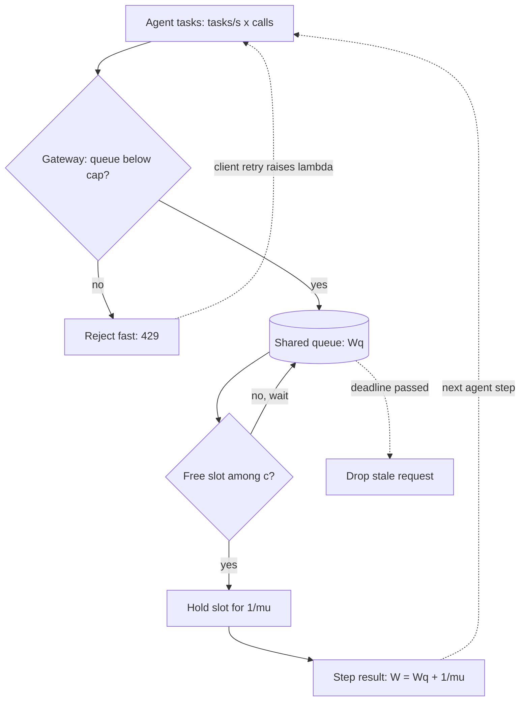

## TL;DR
Each agent task fans out into model calls that can each queue. Waiting grows non-linearly near full
utilization (75% to 95% busy raises mean wait about 20× in a 16-slot fleet), and an 8-step agent pays
it eight times.

## For agent builders
- **Why it matters for agents.** One user task becomes 5-20 LLM calls plus tool calls, so the arrival
  rate your model fleet or provider sees is tasks per second times calls per task. Queue wait is paid
  on every step, so a small per-call wait becomes a large per-task delay.
- **Where it shows up in your stack.** Provider rate limits (requests and tokens per minute), the engine
  concurrency cap (vLLM `--max-num-seqs`) on self-hosted models, your gateway queue, and per-step spans in
  traces (LangSmith, Langfuse or OpenTelemetry) where queue wait and model time appear side by side.
- **What you control.** Concurrency caps per agent run and per tenant, retry policy inside the agent
  loop, `max_tokens` per step, and whether long batch agents share a queue with interactive ones.
- **What you can skip.** Deriving Erlang C. Know Little's law, the ρ/(1−ρ) knee, and that variability
  makes it worse; use the code below for the numbers.

## Decision case
### Scenario
A B2B support platform self-hosts one model for an interactive triage agent. The capacity review must
fix the replica count and pool layout for the next quarter. Figures are illustrative, not vendor numbers.
- **Load:** 0.6 tasks/s at peak, 8 model calls per task, 10% of steps retried, so λ = 0.6 × 8 × 1.1 =
  5.28 calls/s. Each call holds a slot for 3 s measured at target concurrency, so the Little's law floor
  is 5.28 × 3 = 15.84 busy slots.
- **Replica shape:** `--max-num-seqs 4`, so capacity comes in blocks of 4 slots.
- **SLO:** p99 queue wait per call ≤ 1 s, because the 8-step task budget leaves no room for tail waits.
- **Budget:** at most 8 replicas (32 slots) this quarter. Traffic is forecast to grow 30%.
- **Ask:** two enterprise tenants, each about half the traffic, request dedicated pools for isolation.

### Options
| Option | How it works | p99 Wq now | At +30% traffic | Budget |
|---|---|---|---|---|
| A. Floor plus 25% | 15.84 × 1.25 ≈ 20 slots, 5 replicas, one FIFO queue | ~2.3 s at ρ 0.79: fails | Worse | 5 of 8 |
| B. Dedicated pool per tenant | 2.64 calls/s each; 3 replicas (12 slots) each gives ~1.9 s, so each needs 4 (16 slots) | ~0 s with 8 replicas | Each needs 17 slots, so 2 × 5 = 10 replicas | 8 now, 10 later: over |
| C. One pool sized from the tail | M/M/c gives 23 slots, rounded up to 6 replicas (24 slots), ρ 0.66, gateway cap with fast 429 | ~0.5 s | 7 replicas (28 slots), ~0.86 s | 6 now, 7 later |

### Decision
Choose **C**: one shared pool of 6 replicas, a bounded gateway queue, and per-tenant concurrency caps.
- **SLO:** 24 shared slots meet the 1 s p99 at ρ 0.66. A fails because sizing on the mean ignores the
  tail: at ρ 0.79 the p99 wait is more than twice the target.
- **Budget:** C leaves 2 replicas of the 8 in reserve and absorbs the +30% forecast with one more. B
  uses the whole budget today and needs 10 replicas after growth.
- **Pooling:** B with the same 6 replicas (two pools of 12) misses the SLO at ~1.9 s, because a burst in
  one pool cannot use idle slots in the other. That is the dedicated-pool tax in one number.
- **Isolation without pools:** per-tenant in-flight caps at the gateway stop one tenant from filling the
  queue, which addresses the noisy-neighbour concern behind the ask.

**What would change it:** a contractual or compliance requirement for physical isolation makes B
correct, with its price (2 extra replicas now, 3 after growth) put in the contract. A large spread of
service times (a long-output batch agent on the same model) adds a separate batch pool to C.

### Trade-offs accepted
- **Soft isolation only.** A tenant can still raise the shared wait up to its cap. Watch p99 queue wait
  per tenant and rejection rate per tenant.
- **Utilization of 0.66.** About a third of slot time is idle at peak. Track slot occupancy; revisit the
  count when peak occupancy stays below 0.55 for a month.
- **Retry sensitivity.** A 30% step-retry storm raises λ to 6.24 calls/s (ρ 0.78) and p99 to ~1.6 s.
  Keep one retry layer with a budget and alert on attempted calls versus completed steps.
- **Model assumptions.** M/M/c assumes exponential service; LLM traffic with Cs above 1 waits longer.
  Confirm the 6-replica count with an open-loop replay of real agent traces before the quarter starts.

### Review rubric
- Converts task traffic into call traffic (tasks × calls per task × retry factor) before any sizing.
- States the Little's law floor and explains why headroom above it comes from a tail estimate, not a
  flat percentage.
- Computes p99 queue wait (or cites a load test) for each option against the stated SLO and budget.
- Prices the pooling loss of dedicated pools in replicas, now and after forecast growth.
- Names the monitored signals (queue wait p99, occupancy, retries, per-tenant rejections) that would
  trigger revisiting the decision.

## Why it exists
- **The naive model is division.** A replica handles 4 requests per second, peak traffic is 40, so buy
  10 replicas. That assumes evenly spaced arrivals and every request taking exactly the average time.
  Neither is true, and agents make both worse.
- **Arrivals are bursty and LLM service times vary wildly.** Users arrive in uncoordinated bursts, an agent
  fires several calls in quick succession, and output length varies: one request generates 20 tokens, the
  next 2,000. When three long requests land together everything behind them waits, and the server cannot
  "bank" idle time from a minute ago.
- **Latency bends long before the cliff.** It curves upward well before 100% utilization. Teams that size
  to the mean see fine dashboards at 60% load and mysterious p99 explosions at 85%, with no code change.
- **It quantifies the curve.** How much waiting a utilization buys, how variability makes it worse, and
  how pooling, admission control and headroom make it better.
- **It bridges two teams' numbers.** Throughput measured by serving and task latency promised by product.
  Without it, "how much headroom do our agents need" gets nothing better than a guess.

## How it works
### Vocabulary
| Symbol | Meaning |
|---|---|
| **λ (lambda)** | Arrival rate, requests per second; for agents, tasks/s × model calls per task |
| **μ (mu)** | Service rate of one server, so mean service time is 1/μ |
| **c** | Number of servers; for an LLM think *concurrency slots*, not machines (see below) |
| **ρ = λ / (c·μ)** | Utilization, fraction of time servers are busy; must stay below 1 or the queue grows without bound |
| **W, Wq, L** | Mean time in system, mean time waiting in queue, mean number of requests in system |

### Little's law: L = λ·W
- **What it says.** Average requests in flight equals arrival rate times average time each spends
  inside. It holds for almost any stable system, regardless of arrival or service distribution.
- **Why it holds.** Every request that enters eventually leaves, so long-run averages must balance.
- **Forwards.** At 50 req/s and 6 s mean latency you have 300 requests in flight on average, so you need
  at least 300 concurrent slots across the fleet before any headroom.
- **Backwards.** If a gateway caps in-flight requests at L and latency is W, the best throughput you can
  see is L/W.
- **Twice for agents.** Apply it to tasks (tasks/s × task duration = concurrent agent runs, which sizes
  memory and worker pools) and again to model calls (calls/s × call latency = model slots).

### Why waiting explodes: the 1/(1−ρ) term
- **M/M/1** (one server, random Poisson arrivals, exponential service): W = 1/(μ − λ) and
  Wq = ρ/(μ − λ).
- **Rewritten:** Wq = (service time) × ρ/(1 − ρ).

| ρ | Queue wait in service times |
|---|---|
| 0.5 | one |
| 0.9 | nine |
| 0.99 | ninety-nine |

- **Headroom is not waste.** Because of the denominator, the last 10% of utilization costs more latency
  than the first 80%.

### Variability: Kingman's approximation
Real systems are not exponential. For a single server with general distributions (G/G/1):

```
Wq ≈ ( ρ / (1 − ρ) ) × ( (Ca² + Cs²) / 2 ) × mean_service_time
```

- **Ca and Cs** are coefficients of variation (std dev / mean) of inter-arrival times and service times.
- **Three levers:** utilization; *arrival* variability (bursts, retry storms, batch jobs released on the
  hour, agents firing calls back to back); *service* variability (output-length spread, tool calls, cache
  hits vs misses).
- **LLM traffic is high-variance.** Cs is often around or above 1 (an exponential has exactly 1), and
  agentic traffic with tool calls and long-tail outputs can push it higher. When Cs > 1, queues are worse
  than a textbook M/M/1 at the same utilization.
- **Measure Cs from your own traffic** rather than assuming it.
- **Lower Cs to help everyone.** Capping `max_tokens` or splitting long jobs onto a separate queue reduces
  latency for all other requests.

### Many servers: M/M/c and pooling
With c servers sharing one queue, the Erlang C formula gives the probability an arriving request must
wait, and the mean wait. Two results matter:
1. **Larger pools tolerate higher utilization at the same wait**, because a burst is more likely to find
   some server free. This is statistical multiplexing.
2. **One shared queue beats several separate ones of the same total capacity**, because separate queues
   can leave one pool idle while another is backed up. Every dedicated per-tenant, per-agent or per-model
   pool pays this tax.

### Mapping it onto LLM serving
- **A replica is many servers.** With continuous batching it serves many sequences at once, and each
  sequence slows slightly as the batch grows.
- **Workable approximation:** treat each replica as roughly `max_concurrent_sequences` servers whose
  service time is the measured latency *at that concurrency*.
- **The queue is wherever requests wait for a slot:** the engine's waiting list, the gateway, or a
  provider's rate limiter (a 429 from a provider is its admission control talking).
- **Measure under load.** Take service time and its variance from real traffic, not a single-request
  benchmark, because per-request speed depends on load.

### Tails, not means
SLOs are written on p95 or p99, and the tail of queue wait grows faster than the mean. In M/M/c a
request waits at all with probability P(wait) (Erlang C); if it waits, the extra delay is exponential
with rate (c·μ − λ):

```
P(Wq > t) = P(wait) × exp(−(c·μ − λ)·t)      →   t_p = ln(P(wait) / (1 − p)) / (c·μ − λ)
```

- **(c·μ − λ) is spare service capacity.** As it shrinks toward zero, every percentile stretches in
  proportion.
- **In the 16-slot example below** p99 queue wait is about 3 s at 75% utilization and about 22 s at 95%,
  while the mean goes from 0.2 s to 3.9 s. Planning on the mean hides most of the damage an SLO will see.
- **Agent tasks compound it.** An 8-step task adds eight queue waits; means add exactly, and the chance
  that at least one step hits a tail wait rises with every step.

### Open versus closed load, and queue order
- **Open system:** arrivals keep coming regardless of how slow you are. True of public traffic and of new
  agent tasks, and what the formulas above assume.
- **Closed system:** a fixed population waits for each response before sending the next (a load test with
  N virtual users, or one agent calling the model, then a tool, then the model again).
- **Closed systems self-throttle**, because slow responses delay the next request. So a closed-loop load
  test reports gentler latency than real open traffic at the same throughput.
- **FIFO hurts short requests.** One 2,000-token job can delay many 20-token ones, such as an agent's
  quick routing or tool-selection call.
- **Priority classes or shortest-expected-job-first** cut mean wait for interactive traffic, at the price
  of possible starvation for long jobs unless they are aged up or given reserved capacity.

## Diagram
Agent steps arrive, pass admission, wait for a free slot, then hold it for one service time. Retries and
the agent's next step both feed back into arrivals, which is why saturation compounds.



## Examples
### Erlang C for a 16-slot fleet
A fleet exposes 16 concurrency slots in total; a request holds a slot for 4 s on average. Erlang C shows
how waiting behaves as arrival rate rises, and what pooling buys. Exponential service is an idealization;
LLM traffic with Cs > 1 will wait longer than this at every row.

```python
from math import factorial

def mmc(lam, mu, c):
    """M/M/c: returns (utilization, P(wait), mean queue wait Wq, mean time in system W)."""
    a = lam / mu                      # offered load, in busy servers
    rho = a / c
    if rho >= 1:
        return rho, 1.0, float("inf"), float("inf")
    top = a**c / factorial(c) / (1 - rho)
    p_wait = top / (sum(a**k / factorial(k) for k in range(c)) + top)   # Erlang C
    wq = p_wait / (c * mu - lam)
    return rho, p_wait, wq, wq + 1 / mu

mu = 1 / 4.0                          # 4 s mean service per slot
for lam in (2.0, 3.0, 3.5, 3.8, 3.95):
    rho, pw, wq, w = mmc(lam, mu, c=16)
    print(f"lam={lam}/s rho={rho:.2f} P(wait)={pw:.2f} Wq={wq:.2f}s L={lam*w:.1f}")
# lam=2.0/s rho=0.50 P(wait)=0.01 Wq=0.00s L=8.0
# lam=3.0/s rho=0.75 P(wait)=0.20 Wq=0.20s L=12.6
# lam=3.5/s rho=0.88 P(wait)=0.51 Wq=1.02s L=17.6
# lam=3.8/s rho=0.95 P(wait)=0.78 Wq=3.90s L=30.0
# lam=3.95/s rho=0.99 P(wait)=0.94 Wq=18.84s L=90.2

print(mmc(3.5, mu, 16)[2], mmc(1.75, mu, 8)[2])   # pooled 16 slots: ~1.0 s; split 2x8: ~2.5 s each
```

- **Non-linear.** Raising load from 3.0 to 3.8 req/s (27% more traffic) raises mean queue wait from
  0.2 s to 3.9 s, about 20×.
- **Pooling.** Splitting the same 16 slots into two dedicated pools of 8 at the same total traffic more
  than doubles the wait.
- **Little's law** holds throughout: L = λ·W in every row.

### Worked scenario: queue wait compounds across agent steps
Same 16-slot fleet, but every request is one step of an 8-step agent task. Mean task-level queue wait is
8 × the per-call mean (means add; tails do not, so the p99 task is worse than this column suggests).

| Arrival rate (calls) | ρ | Mean Wq per call | Added queue wait per 8-step task |
|---|---|---|---|
| 3.0 req/s | 0.75 | 0.20 s | ~1.6 s |
| 3.5 req/s | 0.88 | 1.02 s | ~8.1 s |
| 3.8 req/s | 0.95 | 3.90 s | ~31.2 s |

- **The user feels the right column.** A per-call dashboard reading "Wq under 4 s" hides half a minute of
  pure waiting per task at 95% utilization.
- **Retries inside the loop raise λ.** A 10% step-retry rate turns 3.5 calls/s into 3.85, already past the
  0.95 row.

### Sizing slots for an agent workload
This uses the tail formula above with the numerically stable Erlang B recursion, so it works for
hundreds of slots where `factorial` would overflow. Same M/M/c idealization. `agent_slots` converts task
traffic into model-call traffic first.

```python
from math import log

def erlang_c(lam, mu, c):
    a = lam / mu
    if a >= c:
        return 1.0
    b = 1.0
    for k in range(1, c + 1):          # Erlang B recursion, stable for large c
        b = a * b / (k + a * b)
    return b / (1 - (a / c) * (1 - b))

def wait_pct(lam, mu, c, p=0.99):
    if lam / mu >= c:
        return float("inf")
    pw = erlang_c(lam, mu, c)
    return 0.0 if pw <= 1 - p else log(pw / (1 - p)) / (c * mu - lam)

def slots_for(lam, mu, target_s, p=0.99):
    c = int(lam / mu) + 1              # smallest stable pool
    while wait_pct(lam, mu, c, p) > target_s:
        c += 1
    return c

def agent_slots(tasks_per_s, calls_per_task, retry_rate, call_s, target_s=1.0):
    lam = tasks_per_s * calls_per_task * (1 + retry_rate)   # model calls per second
    return slots_for(lam, 1 / call_s, target_s)

print(round(wait_pct(3.8, 1 / 4, 16), 1))   # 21.8 s p99 wait at rho 0.95
print(slots_for(3.8, 1 / 4, 1.0))           # 23 slots for p99 wait <= 1 s
print(slots_for(50, 1 / 6, 1.0))            # 319 slots: Little's law floor is 300
print(agent_slots(0.5, 8, 0.0, 4))          # 24 slots: 0.5 tasks/s x 8 calls = 4 calls/s
print(agent_slots(0.5, 8, 0.1, 4))          # 26 slots once 10% of steps retry
```

| Fleet | Little's law floor | Slots for p99 wait ≤ 1 s | Utilization at that size |
|---|---|---|---|
| 3.8 req/s, 4 s service | 15.2 | 23 | ~0.66 |
| 50 req/s, 6 s service | 300 | 319 | ~0.94 |

- **Pooling in numbers.** The small fleet needs about 50% headroom over the floor; the large one needs
  about 6%, because bursts average out across more slots.

### Worked tail table for the 16-slot fleet
| Arrival rate | ρ | P(wait) | Mean Wq | p99 Wq |
|---|---|---|---|---|
| 3.0 req/s | 0.75 | 0.20 | 0.20 s | ~3.0 s |
| 3.5 req/s | 0.88 | 0.51 | 1.02 s | ~7.9 s |
| 3.8 req/s | 0.95 | 0.78 | 3.90 s | ~21.8 s |

The p99 grows faster than the mean, so an SLO on p99 binds long before the mean looks alarming.

## Production patterns
- **Cap concurrency and reject fast.** When load can exceed capacity, cap in-flight sequences per replica
  (for example vLLM's `--max-num-seqs`) and bound the gateway queue; beyond it return 429 or 503 with a
  `Retry-After` header. Monitor queue depth, queue wait p99 and rejection rate.
- **Size from task traffic and the SLO, not from cost.** Multiply task rate by measured calls per task
  (from traces) and by the retry rate, then run Little's law and add headroom from an M/M/c tail estimate
  against the step's queue-wait budget. Autoscale on slot occupancy or
  queue wait rather than CPU, and alert when occupancy stays above the planned ρ or calls per task drift.
- **Separate queues for long and batch agents.** Route offline or long-horizon agent runs to their own
  pool or a lower-priority class, so interactive agents see lower Cs. Monitor each class's queue wait and
  the batch pool's idle time.
- **One retry policy per stack, with a budget.** Retries with exponential backoff and jitter should live in
  one layer (SDK, gateway or agent loop), never all three, because nested retries multiply λ during an
  outage. Cap retries as a fraction of traffic and monitor attempted calls versus completed steps.
- **Deadline-aware queues.** Attach the task's remaining deadline to each model call and drop it from the
  queue once the user or orchestrator has given up, so the fleet does not do work nobody is waiting for.
  Monitor drops and client cancellations.
- **Open-loop load tests with real traces.** Drive a fixed task arrival rate (for example k6's
  `constant-arrival-rate` executor) and replay recorded agent runs with their real step counts and output
  lengths, then sweep the rate up to find the knee.

## Trade-offs
- **High utilization vs latency.** It lowers cost per request, but queueing delay grows as ρ/(1−ρ), and an
  agent pays it per step. The trade flips toward headroom as soon as a task latency SLO, not throughput, is
  the binding requirement.
- **Dedicated pools vs pooling.** Per-tenant or per-agent pools give isolation and predictable
  noisy-neighbour behaviour but lose pooling efficiency. They win only when isolation or compliance is
  worth the extra capacity.
- **Larger batches vs per-request time.** Throughput per GPU rises but each request's service time
  lengthens, so the right concurrency cap depends on whether the SLO is on time-to-first-token or total
  completion time.
- **Separate long-job queue vs idle capacity.** It cuts service variability for interactive traffic, at
  the cost of a second pool that can sit idle. It pays off when output-length spread is large.
- **Parallel tool or sub-agent calls vs burstiness.** Fanning out steps in parallel shortens one task but
  raises Ca for everyone else; it pays when the fleet has headroom and hurts near the knee.

## Pitfalls
- **Sizing capacity to mean traffic.** Symptom: p99 latency fine off-peak that spikes sharply during
  ordinary daily peaks with no deploy. Fix: size on peak arrival rate and the tail, with headroom.
- **Counting tasks instead of calls.** Symptom: capacity plan says 40% utilization, provider returns 429s.
  The agent makes 8-12 calls per task, so real λ is an order of magnitude higher. Fix: size from traced
  calls per task.
- **Benchmarking service time one request at a time.** Under real concurrency each request is slower, so
  the model underestimates ρ and the fleet saturates earlier than predicted. Fix: measure at target
  concurrency.
- **Immediate client retries on timeout.** Retries raise λ exactly when the system is saturated, visible
  as request rate climbing while successful completions stay flat. Fix: backoff, jitter, retry budgets.
- **Closed-loop load tests.** A fixed pool of virtual users waiting for each reply hides the knee, so the
  test passes at a rate where open production traffic shows a p99 cliff. Fix: open-loop arrival rates.
- **Treating an unbounded queue as safety.** Requests wait past their useful deadline, so the system does
  work nobody is waiting for, seen as high latency together with high client-side cancellation. Fix:
  bound the queue and enforce deadlines.

## When to use
- **Use when** someone proposes a utilization target, a replica count, a concurrency cap, a per-tenant
  pool, or a new agent feature that adds steps per task.
- **Order of tools:** Little's law first, because it needs no distribution assumptions; then M/M/c or
  Kingman to sanity-check headroom; then a load test replaying real agent traces.
- **Measure** task arrival rate, calls per task, slot occupancy, queue depth and queue wait separately
  from service time, since only the split tells you whether to add capacity or reduce variability.
- **Interviews:** explaining why 90% utilization is dangerous, and deriving in-flight concurrency from
  rate times latency, signals real production experience.

## Role lens
- **Engineer:** Sets engine concurrency caps and gateway queue limits, and instruments queue wait
  separately from model latency so saturation is visible before users report it.
- **Architect:** Chooses utilization targets, pooling versus per-tenant isolation, and admission
  control, using the utilization-latency curve to justify headroom in the capacity budget.
- **FDE:** Explains to a customer why their batch job at 9 a.m. slows the interactive assistant, and
  proposes spreading arrivals or a separate queue rather than buying more GPUs.

## Check yourself
**Q:** Your assistant runs at 60% average utilization with acceptable p99. Marketing plans a launch
that should add 40% traffic. Leadership asks whether latency will rise about 40%. What do you say?
**A:** No: queueing delay is non-linear. 60% × 1.4 is 84% utilization, and the ρ/(1−ρ) factor goes from
1.5 to about 5.25, so queue wait could rise three to four times even before accounting for bursts, and
LLM service-time variance makes it worse (Kingman). Service time itself may also lengthen if batches
grow. I would compute required in-flight slots with Little's law at the new rate, add capacity to keep
utilization near the current level, put a concurrency cap and fast rejection at the gateway, and
validate with a load test replaying real output-length distributions before launch.

## Interview questions
### What is Little's law, and why is it the first formula you reach for in capacity planning?
- **Definition:** average in-flight requests L equals arrival rate λ times mean time in system W.
- **Why first:** it holds for any stable system regardless of arrival or service distribution, so it
  needs no modelling assumptions.
- **Use:** at 50 req/s and 6 s latency you need at least 300 concurrent slots before headroom; run it
  backwards to get the throughput ceiling L/W from a gateway cap.

### Your agent handles 0.5 tasks/s and each task makes 8 model calls of about 4 s. How many slots do you provision?
- **Convert to calls first:** 0.5 × 8 = 4 calls/s; Little's law gives 4 × 4 = 16 slots busy on average.
- **Add tail headroom:** an M/M/c estimate for p99 queue wait under 1 s gives about 24 slots, roughly 0.67
  utilization; a 10% step-retry rate pushes it to about 26.
- **Then validate** with an open-loop replay of real agent traces, since Cs for tool-heavy steps is
  usually above the exponential assumption.

### p99 latency spikes every weekday at 9 a.m., but there was no deploy. How do you debug it?
- **Split the latency:** compare queue wait with service time. If queue wait jumps while service time is
  flat, the fleet is saturating, not the model slowing.
- **Check arrivals:** look for a scheduled batch job, a retry storm, or a burst that raises Ca at that
  hour; check whether request rate climbs while completions stay flat.
- **Fix in order:** spread or separately queue the batch arrivals, add backoff to retries, then add
  capacity sized from the tail, not the mean.

### Per-call latency dashboards look healthy, but users say the agent got slow. What is going on?
- **Queue wait compounds per step:** a 1 s mean wait is invisible per call but adds 8 s to an 8-step task,
  and one tail wait anywhere in the chain stretches the whole task.
- **Steps per task may have grown:** a prompt or tool change that adds two steps raises λ by 25% and
  pushes the fleet up the knee.
- **Fix:** trace task-level latency broken into queue, model and tool time, and alert on calls per task.

### When would you not pool all tenants into one shared queue?
- **When isolation is worth the capacity tax:** compliance, a contractual SLO, or a tenant whose bursts
  would otherwise hurt everyone.
- **When service-time spread is large:** a separate long-job queue lowers Cs for interactive traffic even
  though it can sit idle.
- **Otherwise pool**, because one shared queue never leaves a slot idle while requests wait elsewhere,
  and larger pools run safely at higher utilization.

### Why is a load test with a fixed number of virtual users misleading, and why do LLM queues behave worse than M/M/c?
- **It is a closed system:** each user waits for a response before sending again, so slow responses lower
  the arrival rate; production is open, so the test passes where real traffic hits a p99 cliff. Use a
  constant-arrival-rate generator instead.
- **Service variability:** output length ranges from 20 to 2,000 tokens, and tool calls add spread, so Cs
  is often at or above 1; Kingman shows wait scales with (Ca² + Cs²)/2.
- **Levers:** cap `max_tokens`, route long jobs to their own queue, smooth batch arrivals, and use
  priority classes for interactive traffic.

## Quiz
### Q: A service handles 20 req/s with a mean latency of 3 s. How many requests are in flight on average?
- [ ] About 7, because 20 divided by 3 is roughly 7
- [x] 60, by Little's law L = λ·W
- [ ] It cannot be known without the service-time distribution
- [ ] 20, because that is the arrival rate per second
> Little's law holds for any stable system regardless of distributions: L = 20 × 3 = 60. The
> distribution matters for waiting time and tails, not for this average.

### Q: Two teams each run a dedicated pool of 8 identical slots at 85% utilization. What happens if they merge into one pool of 16?
- [ ] Waiting time is unchanged because total capacity and load are unchanged
- [ ] Waiting time doubles because each request now competes with twice as many others
- [x] Mean waiting time drops, because a burst in one team's traffic can use slots the other is not using
- [ ] Utilization falls to about 42% because the slots are now shared
> Pooling is statistical multiplexing: one shared queue never leaves a slot idle while requests wait
> elsewhere. Utilization stays 85%, but the probability and length of waits fall.

### Q: Kingman's approximation separates utilization from variability. Which change shrinks the variability term (Ca² + Cs²)/2 rather than utilization?
- [ ] Raising the batch size so each replica processes more tokens per step
- [x] Capping output length or routing long jobs elsewhere to reduce service-time variability
- [ ] Adding retries with no backoff so failed requests finish sooner
- [ ] Moving to faster GPUs so the mean service time drops
> Reducing service-time spread lowers Cs, so waiting falls even at the same utilization. Bigger
> batches and faster GPUs act on capacity and mean service time, i.e. on ρ, not on the variability
> term; immediate retries raise arrival burstiness (Ca) and make waiting worse.

## Use cases & projects
### Use cases
- **Sizing a self-hosted model fleet for agents.** Convert tasks per second into model calls per second,
  then use Little's law and an M/M/c estimate to pick slots that keep p99 queue wait inside the step budget.
- **Explaining p99 spikes at "only" 85% busy.** Queueing curves show why agent task latency explodes near
  the knee even though no code changed.
- **Separating interactive and batch agents.** Long offline agent runs get their own queue or priority
  class so they cannot add wait to every step of a user-facing agent.
- **Setting retry and concurrency policy in the agent loop.** Retries raise arrival burstiness, so caps and
  backoff come straight from the variability term.

### Mini project
**Simulate queue wait in an agent fleet (1-2 hours).**
- **Goal:** see how per-call queue wait compounds over an 8-step agent as utilization rises.
- **Steps:** write a small discrete-event simulation of c model slots with Poisson task arrivals, where each
  task makes 8 sequential calls with variable service times; sweep utilization from 50% to 95%; then cap
  output length (lower service-time spread) and rerun.
- **Done when:** you have a table of p50 and p99 task latency per utilization level, before and after the
  cap, and can point to the knee and explain it with ρ/(1−ρ) and Kingman's variability term.
