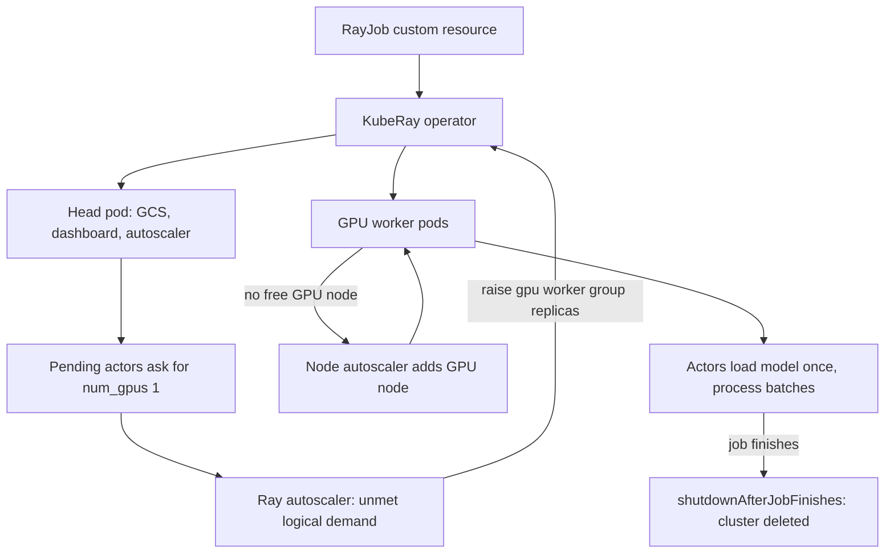

## TL;DR
Ray turns Python functions and classes into distributed tasks and stateful actors, scheduled by declared
resources such as GPUs, for mixed CPU/GPU AI pipelines that Spark and job queues handle poorly. KubeRay
runs Ray clusters, jobs and Serve apps as Kubernetes custom resources.

## Why it exists
- **AI workloads rarely fit one box or one shape.** Batch inference over ten million documents needs CPU
  workers to read and tokenise, GPU workers that each load a model once and keep it resident, and
  back-pressure so GPUs are neither starved nor flooded. Hyperparameter search launches hundreds of short
  trials; multi-node serving needs GPUs placed together and started as a unit; RL interleaves simulators,
  learners and inference.
- **Job queues have no notion of a resident model.** Celery or SQS workers cannot express "this worker holds
  a 16 GB model and should keep it"; each task either reloads weights or you build actor management yourself.
- **Spark fights the GPU pattern.** It was built for CPU data-parallel stages with a barrier between them;
  feeding GPUs a continuous stream and keeping a model warm per executor fights its execution model.
- **Raw Kubernetes and multiprocessing stop short.** Kubernetes gives pods, not a way for one Python program
  to fan out ten thousand fine-grained calls and pass large arrays without serialising through a database.
  Multiprocessing stops at one machine.
- **Ray plus KubeRay closes the gap.** Ray offers tasks, actors and objects with a resource-aware scheduler,
  plus libraries for data, training, tuning and serving. KubeRay creates head and worker pods, wires up
  autoscaling and upgrades serving clusters without downtime via CRDs, so Kubernetes stays the control plane
  while ML code stays Python.

## How it works
### Core primitives
| Primitive | What it is | Why it matters |
|---|---|---|
| **Task** | A `@ray.remote` function. Calling `f.remote(x)` returns immediately with an `ObjectRef` (a future); the scheduler places it on any node with the requested resources | Stateless, so it can be retried elsewhere on failure |
| **Actor** | A `@ray.remote` class. Instantiating it starts a dedicated worker process that keeps state between method calls | Exactly how a model stays loaded on a GPU across thousands of batches |
| **Object** | Task results in a per-node shared-memory object store | Passing an `ObjectRef` moves bytes node-to-node only when needed; same-node readers share memory without copies |

Results that do not fit the object store spill to disk, which is slow but avoids crashes.

### Scheduling by declared resources
- **Declare, then place.** Each task or actor states `num_cpus`, `num_gpus`, memory or custom resources,
  and the scheduler only places it where those are free.
- **Reservations are *logical*.** `num_gpus=1` sets `CUDA_VISIBLE_DEVICES` for the worker but does not stop
  it using memory it was not granted; `num_gpus=0.5` lets two actors share a card with no memory isolation.
- **Placement groups** reserve bundles atomically (gang scheduling). Strategies:
  - `STRICT_PACK`: all bundles on one node, for tensor parallelism over NVLink (`PACK` is only a
    best-effort preference for that);
  - `SPREAD`: fault isolation.
- **Engines like vLLM** use Ray for multi-node tensor and pipeline parallelism for exactly this.

### Cluster anatomy
- **Head node:** runs the Global Control Service (GCS, cluster metadata; the original paper called it the
  Global Control Store), the dashboard, the job-submission API and the autoscaler.
- **Worker nodes:** each runs a raylet (local scheduler and object store).
- **The head is a single point of failure:** lose it and, by default, the cluster's state goes with it.
- **The autoscaler scales on *pending logical demand*, not utilisation.** If tasks are queued asking for GPUs
  that no node has free, it adds workers; idle workers are removed after a timeout.

### Failure semantics
Ray's recovery model follows from the primitives:

| What fails | What Ray does | What you must do |
|---|---|---|
| Task | Retried (by default a few times) on any node with resources, *because* it is stateless | Make batches idempotent |
| Lost object | Rebuilt by re-running the tasks that produced it (lineage reconstruction) | Works for task outputs, not for objects created with `ray.put` |
| Actor | Can be restarted (`max_restarts`), but its in-memory state is gone | A model actor reloads its weights; checkpoint per-actor progress in your code |
| Owner worker | Every object has an owner, the worker that created the reference; if it dies, its objects are lost even if copies survive elsewhere | Avoid long-lived refs owned by short-lived workers |
| Head node | Not automatically survivable | Treat it as the one component that needs explicit fault tolerance |

Design batch pipelines so a retried batch is idempotent and long runs checkpoint their output.

### Libraries
- **Ray Data** streams datasets through CPU and GPU stages with back-pressure, the usual tool for offline
  batch inference and embedding.
- **Ray Train** and **Ray Tune** wrap distributed training and hyperparameter search.
- **Ray Serve** runs deployments as replica actors with request-based autoscaling (a target of ongoing
  requests per replica), model composition and multiplexing.

### KubeRay
KubeRay adds three CRDs:

| CRD | What it does |
|---|---|
| **RayCluster** | Declares a head group and worker groups (each with pod template, `minReplicas`, `maxReplicas`). With in-tree autoscaling enabled, an autoscaler sidecar in the head pod edits worker-group replica counts; a node autoscaler (cluster autoscaler or Karpenter) supplies GPU nodes |
| **RayJob** | Creates a cluster, submits an entrypoint and can tear the cluster down when it finishes, so a nightly batch run pays for GPUs only while it runs |
| **RayService** | Runs a Serve application. Cluster-spec upgrades bring up a new cluster, wait until it is healthy, then switch traffic; changes to only the Serve config are applied in place on the running cluster |

- **Why an operator and not a Deployment:** scale-down. Ray must choose *which* worker to remove (an idle one
  holding no actors or primary object copies).
- **So the autoscaler names specific pods** for KubeRay to delete, instead of decrementing a replica count and
  letting Kubernetes pick one at random.

```yaml
apiVersion: ray.io/v1
kind: RayJob
metadata: {name: nightly-embed}
spec:
  entrypoint: python embed.py
  shutdownAfterJobFinishes: true
  rayClusterSpec:
    enableInTreeAutoscaling: true
    headGroupSpec: {rayStartParams: {}, template: {...}}         # CPU-only head
    workerGroupSpecs:
      - groupName: gpu
        minReplicas: 0
        maxReplicas: 8
        rayStartParams: {}
        template: {...}                                          # requests nvidia.com/gpu: 1
```

## Diagram
How a RayJob turns pending GPU demand into running actors: Ray's autoscaler reacts to unplaceable
resource requests, KubeRay creates the named pods, and the node autoscaler supplies the GPU machines.



## Examples
### Batch embedding of 10 million documents with Ray Data
CPU stages read and clean; four GPU actors each load the model once and receive batches as they are
ready. Under the RayJob above, the autoscaler sees demand for four GPUs, raises the worker group to four,
and the job deletes the cluster when done.

```python
import ray

class Embedder:
    def __init__(self):
        # Runs once per actor: the weights stay resident on that actor's GPU.
        from sentence_transformers import SentenceTransformer
        self.model = SentenceTransformer("all-MiniLM-L6-v2", device="cuda")

    def __call__(self, batch: dict) -> dict:
        texts = [str(t)[:2000] for t in batch["text"]]
        batch["embedding"] = self.model.encode(texts, batch_size=128)  # (n, 384) array
        return batch

ray.init()  # inside a RayJob this connects to the cluster it created

ds = ray.data.read_parquet("s3://corpus/docs/")                    # streamed, CPU tasks
ds = ds.filter(lambda row: row["text"] is not None)                # CPU tasks
ds = ds.map_batches(Embedder, batch_size=512, num_gpus=1, concurrency=4)  # 4 GPU actors
ds.write_parquet("s3://corpus/embeddings/")                         # triggers execution

# Ray Data executes lazily and streams: reading, filtering and embedding overlap, and
# back-pressure stops readers from filling the object store when GPUs fall behind.
```

- **Rough cost reasoning (illustrative):** if one GPU actor sustains about 1,000 documents per second, four
  actors finish 10 million in roughly 40 minutes plus cluster start-up.
- **`shutdownAfterJobFinishes`** means you pay for about that long, not for an always-on pool.
- **Version note:** the argument names (`concurrency`, `num_gpus`) follow recent Ray Data releases and have
  shifted between versions; check yours.

### Worked sizing: actor count versus wall-clock and GPU-hours
Same illustrative 1,000 documents per second per GPU actor, 10 million documents. Start-up (pods, image
pull, model load) is a fixed cost per run, shown here as an assumed 5 minutes.

| GPU actors | Embedding time | Wall-clock with start-up | GPU-hours billed |
|---|---|---|---|
| 1 | 10,000 s ≈ 167 min | ≈ 172 min | ≈ 2.9 |
| 4 | 2,500 s ≈ 42 min | ≈ 47 min | ≈ 3.1 |
| 8 | 1,250 s ≈ 21 min | ≈ 26 min | ≈ 3.4 |

- **More actors buy wall-clock, not savings:** GPU-hours stay roughly flat because the work is the same;
  start-up overhead grows with actor count.
- **Check the CPU side first:** eight GPU actors only help if reads and filtering keep up; otherwise the
  dashboard shows idle actors and you pay for waiting GPUs.

### Ray Serve deployment with request-based autoscaling
A Serve application whose replicas are GPU actors and whose replica count follows ongoing requests, the
Ray-native counterpart to a KEDA queue-depth trigger. Parameter names follow recent Ray 2.x releases.

```python
from ray import serve

@serve.deployment(
    ray_actor_options={"num_gpus": 1},          # one card per replica actor
    autoscaling_config={
        "min_replicas": 1,
        "max_replicas": 4,                       # match the GPU worker group's maxReplicas
        "target_ongoing_requests": 8,            # in-flight requests per replica before scaling
    },
)
class Reranker:
    def __init__(self):
        from sentence_transformers import CrossEncoder
        self.model = CrossEncoder("cross-encoder/ms-marco-MiniLM-L-6-v2", device="cuda")

    async def __call__(self, request):
        body = await request.json()
        pairs = [(body["query"], d) for d in body["docs"]]
        return {"scores": self.model.predict(pairs).tolist()}

app = Reranker.bind()       # deploy with `serve run module:app`, or from a RayService spec
```

## Production patterns
- **Pin one Ray and Python version everywhere.** Use on every cluster. Build head, worker and client images
  from the same Ray release and Python minor version, and pin the image tag in the RayCluster or RayJob
  spec. Monitor job-submission failures after any image change, since mismatches surface as cryptic
  deserialisation errors.
- **Ephemeral RayJob clusters for batch.** Use for nightly or ad-hoc batch inference. Set
  `shutdownAfterJobFinishes: true`, GPU worker groups with `minReplicas: 0`, and an upper bound matching quota.
  Monitor GPU-hours per run against the sizing table, and cluster start-up time as a fixed overhead.
- **GCS fault tolerance for RayService.** Use for any production Serve application. Enable KubeRay's GCS fault
  tolerance backed by an external Redis so a head-pod restart does not take every Serve replica with it.
  Monitor head-pod restarts and Serve availability during them.
- **Keep the dashboard and job API internal.** Use always. Expose the dashboard and job-submission service as
  cluster-internal only, behind a network policy, and reach it through port-forwarding or an authenticated
  proxy. Monitor for unknown job submissions.
- **Declare GPUs to match what code uses.** Use for every actor and task. Set `num_gpus` from what the code
  actually loads, and use fractional values only for models whose summed memory fits the card. Monitor
  actor busy time and GPU memory per process in the dashboard.
- **Separate worker groups per GPU tier.** Use when jobs need different cards. Define one worker group per
  card type with a node selector, plus custom resources so actors target the right group. Monitor pending
  demand per group to see which tier is the bottleneck.

## Trade-offs
- **One Python program vs a second scheduler.** It can express a whole CPU-to-GPU pipeline with stateful
  model workers, but you take on a second scheduler inside Kubernetes; for a single stateless model server, a
  Deployment plus KEDA is simpler.
- **Ray Serve's features vs coupling.** It gives request-aware autoscaling, composition and multi-node
  replicas in one framework, but ties serving to Ray's versioning and head node; a dedicated engine behind a
  gateway wins when one model per pod suffices.
- **Fractional GPUs vs isolation.** They pack small models densely and raise utilisation, but sharing is
  unenforced; it flips to harmful when one actor's memory grows and OOMs its neighbour.
- **Ephemeral RayJob clusters vs start-up cost.** They cost nothing while idle, but every run pays start-up
  and image pull; for frequent short jobs a long-lived RayCluster with autoscaling to zero workers is cheaper.

## Pitfalls
- **Mismatched Ray or Python versions** between the client, head image and worker images. Symptom: cryptic
  connection or deserialisation errors at job submission rather than a clear version message. Fix: pin one
  version everywhere.
- **Exposing the dashboard or job-submission port beyond the cluster.** These endpoints have historically
  had no authentication by default and accept arbitrary code (check what your Ray version offers). Symptom:
  unknown jobs (often crypto-mining) on your GPUs. Fix: internal-only access.
- **Declaring `num_gpus` that do not match what the code uses.** The autoscaler provisions by declarations,
  so the symptom is idle GPU nodes held by actors or, conversely, two processes OOMing one card. Fix:
  declare what the code loads.
- **Running GCS on the head without fault tolerance for a RayService.** Symptom: a head-pod restart taking
  every Serve replica with it. Fix: KubeRay supports external-Redis GCS fault tolerance for this.
- **Returning huge objects from tasks and holding the refs.** Symptom: object-store spilling to disk and a
  pipeline that slows by orders of magnitude without erroring. Fix: write large outputs to storage, stream.

## When to use
- **Use Ray when:** the workload is Python, distributed and heterogeneous — batch inference or embedding over
  large datasets with GPU actors, hyperparameter sweeps, RL, multi-node model serving, or pipelines that mix
  CPU and GPU stages with state.
- **Use KubeRay when:** that runs on Kubernetes and you want the cluster lifecycle declared in Git.
- **Avoid when:** it is a single stateless model endpoint (an inference engine Deployment with KEDA is less
  to operate) or SQL-shaped ETL (Spark or a warehouse).
- **Measure:** GPU-actor busy time and object-store pressure in the dashboard.
- **Interviews:** explain tasks versus actors, logical-resource scheduling, and why the autoscaler reacts to
  pending demand.

## Role lens
- **Engineer:** Writes Ray Data pipelines and Serve deployments, sizes `num_gpus`, batch size and actor
  count, and reads the dashboard to find whether the CPU or GPU stage is the bottleneck.
- **Architect:** Decides whether Ray becomes a platform layer on Kubernetes or stays a per-job tool, and
  owns head-node fault tolerance, version pinning, network exposure and GPU quota per worker group.
- **FDE:** Deploys KubeRay into a customer's cluster, adapts worker-group templates to their GPU node
  pools and security policy, and locks the dashboard behind internal networking before handover.

## Check yourself
**Q:** A team runs nightly embedding of 20 million chunks with a Celery queue: each task loads the model,
embeds 100 chunks and exits. GPUs show low utilisation and the job takes all night. How would you
restructure it with Ray on KubeRay, and why would it be faster and cheaper?
**A:** The waste is reloading weights per task and idle GPUs between tasks, with CPU-side work (reads,
tokenisation) serialised in front of the GPU. With Ray Data, model loading moves into an actor
constructor, so each GPU loads once; `map_batches` with a fixed actor pool streams large batches,
overlapping S3 reads and filtering on CPU tasks with GPU encoding under back-pressure. A RayJob with an
autoscaling GPU worker group sized from measured per-actor throughput, minimum zero and
`shutdownAfterJobFinishes`, means GPUs exist only during the run. Validate by checking actor busy time,
object-store spilling, and per-GPU throughput before scaling out.

## Interview questions
### Explain tasks, actors and objects in Ray, and which you would use for GPU inference.
- **Tasks** are stateless remote functions returning `ObjectRef` futures, retried elsewhere on failure.
- **Actors** are long-lived worker processes that keep state across calls, so a model loads once and stays
  resident on its GPU; that makes them the right primitive for inference workers.
- **Objects** live in a per-node shared-memory store and move between nodes only when a consumer needs them.

### Why does the Ray autoscaler react to pending demand rather than GPU utilisation, and what goes wrong because of it?
- **Ray schedules logical resources:** a task or actor declares `num_gpus` and waits until a node can satisfy
  it, so unmet declarations are the demand signal.
- **The failure mode:** declarations that do not match the code. Over-declaring holds idle GPU nodes;
  under-declaring with fractional GPUs lets two processes OOM one card.
- **So** sizing `num_gpus` correctly is a capacity decision, not a formality.

### A RayService head pod restarted and every Serve replica went down. What happened and how do you prevent it?
- **Cause:** the head runs the GCS, which holds cluster metadata; without fault tolerance its loss takes the
  cluster state, and the Serve application, with it.
- **Prevention:** enable KubeRay's GCS fault tolerance with an external Redis so workers and replicas
  survive a head restart.
- **Also** keep the head CPU-only and resource-guarded so GPU work cannot starve or evict it.

### When would you choose a plain Deployment with KEDA over Ray Serve on KubeRay?
- **One stateless model per pod:** an inference engine Deployment scaled on queue depth is less to operate,
  with no second scheduler or head node.
- **Choose Ray Serve** when you need model composition, multiplexing, multi-node replicas with placement
  groups, or one Python codebase spanning batch and online.
- **Cost of Ray:** coupling to its versioning and head-node fault tolerance, which a platform team must own.

### How would you size a RayJob to embed 10 million documents overnight, and what would you monitor?
- **Measure one actor's throughput,** for example an illustrative 1,000 documents per second, then pick actor
  count from the deadline: four actors take about 42 minutes, eight about 21.
- **GPU-hours stay roughly flat** as actors increase, so the choice trades wall-clock for start-up overhead
  and quota.
- **Monitor** actor busy time (CPU stages keeping up), object-store spilling, and per-GPU throughput before
  scaling out further.

## Quiz
### Q: What distinguishes a Ray actor from a Ray task?
- [ ] Actors run on GPUs while tasks run only on CPUs
- [x] An actor is a long-lived worker process that keeps state across method calls, while a task is a stateless function call
- [ ] Tasks are scheduled by Kubernetes while actors are scheduled by Ray
- [ ] Actors cannot return ObjectRefs
> Both can request any resources. The difference is state and lifetime: an actor holds, for example, a
> loaded model between calls, which is why GPU inference workers are actors rather than tasks.

### Q: On what signal does the Ray autoscaler (as used by KubeRay) add worker nodes?
- [ ] Average GPU utilisation across the cluster
- [ ] CPU usage of the head pod
- [x] Pending tasks and actors whose declared resource requests cannot be placed on existing nodes
- [ ] The number of HTTP requests reaching the dashboard
> Ray schedules logical resources, so the autoscaler reacts to unmet declared demand. Real utilisation is
> not consulted, which is why wrong `num_gpus` declarations directly cause over- or under-provisioning.

### Q: A team gives two model actors `num_gpus=0.5` each on one 24 GB GPU. What does Ray guarantee?
- [ ] Each actor is limited to 12 GB of GPU memory
- [ ] The GPU is time-sliced so each actor gets exactly half the compute
- [x] Only that both are scheduled onto the same GPU; memory and compute are not isolated
- [ ] Ray will refuse the placement because GPUs cannot be shared
> Fractional GPUs are bookkeeping for placement. The processes share the card freely, so if one grows its
> memory use, the other can hit out-of-memory errors; isolation needs MIG or framework-level memory caps.
