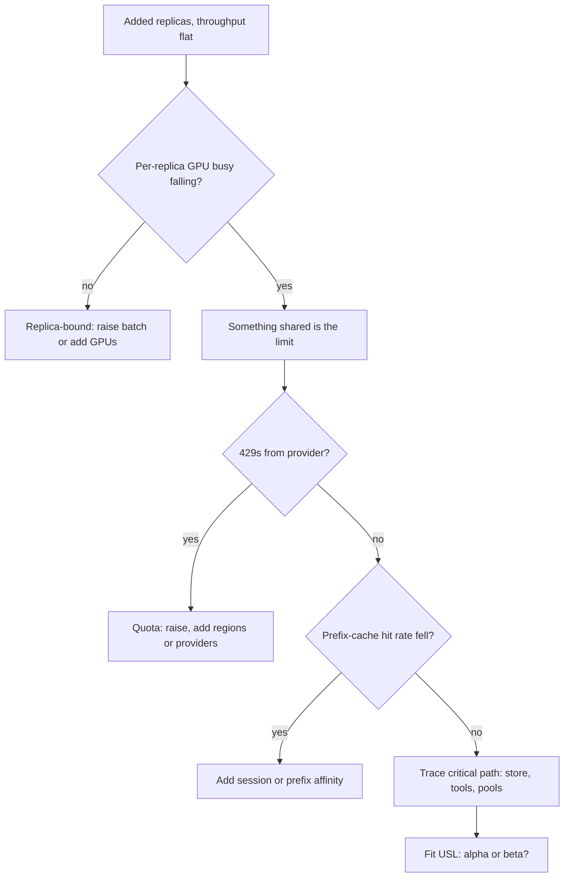

## TL;DR
Scalability is how agent throughput grows as you add resources, and it is never linear. Each agent task
multiplies model, tool and store calls, so the walls are provider quotas, GPU memory, cache affinity and
shared stores, not the stateless agent workers.

## For agent builders
- **Why it matters for agents.** One task becomes many model calls, tool calls, retrieval queries and state
  writes. Doubling agent workers doubles load on every shared thing they touch, so the first shared
  component to saturate (a quota, a vector index, a checkpoint database) caps the whole fleet.
- **Where it shows up in your stack.** Provider tokens-per-minute and requests-per-minute limits, vLLM
  replicas and their KV cache, the vector store behind RAG, the database your framework uses to checkpoint
  agent state, third-party tool APIs with their own rate limits, and the autoscaler in front of all of it.
- **What you control.** Calls and tokens per task, per-tenant concurrency caps, which signal you autoscale
  on, session or prefix affinity routing, connection pool sizes, and how often the agent writes state.
- **What you can skip.** Deriving the USL. Know that a serial fraction caps speedup, that coordination can
  make throughput fall, and how to fit α and β from four or five load-test points.

## Decision case
### Scenario
The support agent from the "which wall first" example (6 model calls of ~8,000 tokens per task, so 48,000
tokens per task) runs on a hosted model API. A partner launch in 8 weeks must carry 1.5 tasks/s at peak,
up from 0.5 today. Limits are illustrative, not quotes.
- **Current ceiling:** a 2M TPM quota in one region is 33,333 tokens/s, so 33,333 ÷ 48,000 ≈ 0.69
  tasks/s. The other walls (search tool 10, checkpoint DB 66.67, vector store 150 tasks/s) are far away.
- **Quota:** the account team cannot promise a raise before launch. A second region in the same
  residency zone gets its own 2M TPM.
- **Quality:** task success must not drop on the agent's eval set.
- **Team:** two engineers; no time to port prompts and evals to a second provider and re-validate them.
- **Headroom:** peak load must stay at or below 75% of whatever the binding ceiling is, leaving room for
  retries and bursts.

### Options
| Option | How it works | Ceiling | Peak use at 1.5 tasks/s | Risk to the deadline |
|---|---|---|---|---|
| A. More workers plus a quota request | Scale the stateless tier, wait for a raise to 6M TPM | 0.69 tasks/s until approved; 100,000 ÷ 48,000 ≈ 2.08 after | 216% before, 72% after | Approval is outside the team's control |
| B. Two regions, same prompts | Hash each run id to one region | 66,667 ÷ 48,000 ≈ 1.39 tasks/s | 108%: fails | Low, but not enough |
| C. Trim tool results so each call is ~5,000 tokens, plus two regions | 30,000 tokens per task across two 2M TPM pools | 66,667 ÷ 30,000 ≈ 2.22 tasks/s | 68% | Medium: needs an eval pass |
| D. Second provider for overflow | Route overflow runs to another vendor's model | Adds a separate quota | Depends on its quota | High: new prompts, evals, residency review |

### Decision
Choose **C**, and file the quota request anyway as upside.
- **Ceiling:** C is the only option that clears 1.5 tasks/s under the 75% headroom rule without waiting on
  anyone. B alone falls short, and A depends on an approval nobody can schedule.
- **Workers are not the lever.** Every option keeps the same stateless worker tier; adding workers past
  0.69 tasks/s today only adds 429s and retries.
- **Tokens per task is the cheapest lever.** Cutting 48,000 to 30,000 tokens raises every token-bound
  ceiling by 1.6×, in both regions, and lowers cost per task too.
- **Quality gate:** the trimmed tool results ship only if task success on the eval set holds.
- **Why not D:** it is the right long-term hedge but cannot be validated in 8 weeks with two engineers.

**What would change it:** an approved 6M TPM quota before launch makes A plus trimming the simpler setup,
one region at 1.5 ÷ (100,000 ÷ 30,000) = 45% use. A failed trimming eval forces B plus an urgent quota
escalation, with launch traffic capped at about 1.0 task/s (75% of 1.39 is 1.04).

### Trade-offs accepted
- **Two regions to operate.** Deploys, keys and dashboards double. Track 429 rate and quota headroom per
  region, from the rate-limit response headers.
- **Less context per step.** Trimmed tool results can drop a field the agent needed. Watch extra tool
  calls per task and the eval score after every tool schema change.
- **The next wall moves closer.** At 1.5 tasks/s the search tool runs at 15% of its limit and the
  checkpoint DB at about 2%; re-run the ceilings table whenever calls per task changes.
- **Retries still count.** A 10% retry rate lifts quota use from 68% to about 74%, close to the limit;
  keep one retry layer with a budget.

### Review rubric
- Converts the launch target into load on every shared limit (tokens, requests, searches, writes) per task.
- Identifies the binding wall and shows the next one with its margin.
- Compares options on the same headroom rule, with ceilings recomputed, not asserted.
- Prefers reducing load per task before adding capacity, and gates it on a named quality eval.
- Separates levers the team controls from ones that depend on a vendor, and plans for the latter failing.

## Why it exists
- **"Twice the machines, twice the throughput" rarely holds.** It holds for perfectly independent work
  and almost nothing else. Agent workers look independent, but they share quotas, stores and tools.
- **Every system has a serial part.** A single primary database, a global rate limit, a lock around a
  shared index, a coordinator every request touches. Amdahl showed speedup is capped at one over the
  serial fraction, no matter how many workers you add.
- **Coordination makes it worse.** Distributed systems pay a cost that grows with the square of the worker
  count, because workers exchange state (cache invalidation, consensus, connection fan-in). That produces
  *retrograde* scaling: throughput peaks, then falls.
- **AI adds its own non-linear limits.** Replicas come in large indivisible steps (one or several whole
  GPUs for weights plus a useful KV cache), take minutes to start because weights must load, hit
  tokens-per-minute quotas no client hardware raises, and keep KV and prefix caches local, so even
  spreading destroys hit rate.
- **Agents multiply every limit.** An agent that makes 6 model calls per task hits a quota 6× sooner than
  a single-call feature with the same user traffic.
- **Without a model, walls appear at launch**, after adding hardware that did not help.

## How it works
### Vertical vs horizontal
| | Scaling up | Scaling out |
|---|---|---|
| **What** | Bigger GPU, more memory, tensor parallelism across GPUs in one node | More replicas behind a load balancer |
| **Buys** | What one replica can do; often the only option for a model that does not fit smaller hardware | Total throughput and fault tolerance |
| **Limit** | A ceiling, and usually a price per unit that rises with size | Only partitionable work, and only until a shared component saturates |
| **LLM serving** | Tensor or pipeline parallelism of one model instance | Data-parallel replicas |
| **Agent workers** | Rarely useful: workers mostly wait on I/O | Cheap and easy, until a shared store, tool or quota saturates |

### Amdahl's law
```
speedup(N) = 1 / ((1 − p) + p/N)        p = parallel fraction, ceiling 1/(1 − p)
```
- **Example:** if 5% of each request's time is spent holding one shared lock or primary, no fleet size
  gets past 20×, and 64 workers already give only about 15×.
- **Agent version:** a per-step checkpoint write to one primary database, or a global lock around a
  shared memory store, is that serial fraction.

### The Universal Scalability Law (USL)
Gunther's USL adds coherency:

```
C(N) = N / (1 + α(N − 1) + β·N(N − 1))
```

- **α is contention** (queueing on a shared resource); **β is coherency** (pairwise coordination).
- **With β = 0** this is exactly Amdahl rewritten (α = 1 − p), and capacity flattens toward 1/α.
- **With β > 0** capacity peaks at N* = √((1 − α)/β) and declines after.
- **Its value is diagnostic.** Fit α and β from a few load-test points; they tell you whether to remove a
  serialization point (α) or reduce cross-node chatter (β), and roughly where adding nodes stops paying.

### Where agent systems stop scaling
- **Batch is the first axis, inside one replica.** With continuous batching, throughput rises steeply with
  concurrent sequences, because each weight read is shared by the whole batch, while per-token latency
  rises more slowly. Operate at the largest batch that meets the per-token target; adding replicas
  before then buys unused GPUs.
- **GPU memory per replica.** Concurrency per replica is bounded by KV-cache memory, so throughput per
  replica plateaus; you scale by adding replicas, not by pushing more requests into one. Long agent
  transcripts make each sequence's cache larger, so fewer agents fit per replica.
- **Provider quotas.** Tokens-per-minute and requests-per-minute limits per key, per model and per region
  form a hard ceiling; past it you need quota increases, more regions, or multiple providers. Agents
  reach it at calls-per-task times the traffic of a single-call app.
- **State and affinity.** Prefix caches and conversation state live on a replica. Pure round-robin loses
  the cache hit rate; affinity routing (by session or prefix hash) keeps it but makes load uneven. An
  agent run that hops replicas every step re-prefills its whole transcript each time.
- **Shared stores.** Vector indexes, metadata databases, agent checkpoint and memory stores, and the
  logging pipeline that records every prompt are classic α sources once the model tier scales.
- **Tool backends.** Search APIs, sandboxes for code execution and internal services each have their own
  limits; the agent fleet scales only as far as its least scalable tool.
- **Elasticity lag.** GPU nodes and model loads take minutes, so autoscaling on CPU utilization reacts too
  late. Scale on leading signals (queue depth, in-flight requests, KV-cache utilization) and keep warm
  capacity for the time a new replica needs to become ready.

### Designing for it
1. **Keep the request tier stateless** and push state into stores designed to scale. Agent workers should
   be able to resume a run from a checkpoint on any worker.
2. **Partition by tenant or key** where work is independent.
3. **Make the serial parts small and fast.** Batch state writes, cache hot metadata, avoid global locks.
4. **Add backpressure** so overload produces fast rejection instead of collapse.
5. **Test scaling explicitly** rather than assuming it, with realistic multi-step agent traffic.

## Diagram
A diagnostic path for "we added agent workers or model replicas and throughput barely moved": falling
per-replica utilization points away from the GPU tier toward something shared.



## Examples
### Which wall does an agent fleet hit first?
A support agent's task makes 6 model calls at ~8,000 input tokens each, 2 vector searches and 1 call to a
search tool API, and writes one checkpoint per model step (6 per task). All limits below are
illustrative; plug in your own.

```python
calls_per_task, tokens_per_call = 6, 8_000
limits_per_s = {                                     # capacity of each shared thing, per second
    "provider quota (2M TPM)": 2_000_000 / 60,       # tokens/s
    "vector store (300 qps)": 300,                   # searches/s
    "checkpoint DB (400 writes/s)": 400,             # writes/s
    "search tool API (10 rps)": 10,                  # calls/s
}
load_per_task = {                                    # what one task consumes of each
    "provider quota (2M TPM)": calls_per_task * tokens_per_call,
    "vector store (300 qps)": 2,
    "checkpoint DB (400 writes/s)": calls_per_task,
    "search tool API (10 rps)": 1,
}
ceilings = {k: limits_per_s[k] / load_per_task[k] for k in limits_per_s}
for k, v in sorted(ceilings.items(), key=lambda kv: kv[1]):
    print(f"{k:32s} caps the fleet at {v:6.2f} tasks/s")
# provider quota (2M TPM)          caps the fleet at   0.69 tasks/s
# search tool API (10 rps)         caps the fleet at  10.00 tasks/s
# checkpoint DB (400 writes/s)     caps the fleet at  66.67 tasks/s
# vector store (300 qps)           caps the fleet at 150.00 tasks/s
```

- **Reading it:** the quota caps the fleet at about 42 tasks per minute, no matter how many agent workers
  run. Adding workers past that only adds 429s and retries.
- **Levers, in order:** cut tokens per call (shorter tool results, prompt caching), cut calls per task,
  raise the quota or spread across regions and providers, then revisit the next wall (the search tool).

### Fitting the USL from load-test points
A retrieval service is load-tested with N workers sharing one vector index and metadata database. The
measurements are illustrative; the fitting method is standard USL linearization. The same fit works for
an agent fleet sharing a memory store.

```python
from math import sqrt

N = [1, 2, 4, 8, 16, 24]                 # workers
X = [40, 78, 148, 262, 410, 485]         # measured req/s

# USL: X(N) = X1*N / (1 + a(N-1) + b*N(N-1)).  Linearise: X1*N/X(N) - 1 = a(N-1) + b*N(N-1)
rows = [(n - 1, n * (n - 1), X[0] * n / x - 1) for n, x in zip(N, X)]
s11 = sum(u * u for u, v, y in rows); s12 = sum(u * v for u, v, y in rows)
s22 = sum(v * v for u, v, y in rows)
t1 = sum(u * y for u, v, y in rows); t2 = sum(v * y for u, v, y in rows)
det = s11 * s22 - s12 * s12              # 2x2 least squares, no intercept
a = (t1 * s22 - t2 * s12) / det
b = (s11 * t2 - s12 * t1) / det

usl = lambda n: X[0] * n / (1 + a * (n - 1) + b * n * (n - 1))
print(f"contention a={a:.3f} coherency b={b:.5f} peak near N={sqrt((1 - a) / b):.0f}")
for n in (16, 32, 48, 64, 96):
    print(f"N={n:3d} predicted {usl(n):4.0f} req/s efficiency {usl(n) / (X[0] * n):.0%}")
# contention a=0.026 coherency b=0.00069 peak near N=38
# N= 32 predicted 514 req/s ...  N= 64 predicted 473 req/s ...  N= 96 predicted 394 req/s
```

- **Peak:** throughput tops out near 38 workers at roughly 520 req/s, with per-worker efficiency already
  down to about a third.
- **Retrograde:** doubling from 32 to 64 workers would *lower* throughput.
- **Fix:** attack β (for example, shard the index so workers stop coordinating on one store) or α (cache
  hot metadata), not buy replicas.

### Worked numbers: what a 5% serial fraction costs
Amdahl with p = 0.95, computed from the formula above. A synchronous checkpoint write to one primary on
every agent step is a typical source of that 5%.

| Workers N | Speedup | Efficiency (speedup / N) |
|---|---|---|
| 8 | ~5.9× | ~74% |
| 16 | ~9.1× | ~57% |
| 32 | ~12.5× | ~39% |
| 64 | ~15.4× | ~24% |
| unbounded | 20× | → 0 |

Going from 32 to 64 workers doubles cost for about 23% more throughput, so shrinking the serial part
usually beats adding workers.

### Autoscaling on queue depth instead of CPU
A KEDA `ScaledObject` that scales a vLLM deployment serving agents on waiting requests scraped by
Prometheus, keeping warm replicas for the minutes a model takes to load. The threshold is illustrative.

```yaml
apiVersion: keda.sh/v1alpha1
kind: ScaledObject
metadata:
  name: llm-server
spec:
  scaleTargetRef:
    name: llm-server            # the Deployment running the model
  minReplicaCount: 2            # warm capacity covers model-load time
  maxReplicaCount: 12
  cooldownPeriod: 600           # scale down slowly; scale-up is the expensive direction
  triggers:
    - type: prometheus
      metadata:
        serverAddress: http://prometheus.monitoring:9090
        query: sum(vllm:num_requests_waiting{deployment="llm-server"})
        threshold: "8"          # target waiting requests per replica
```

## Production patterns
- **Budget calls and tokens per task as a scaling input.** Agent teams track model calls and tokens per
  completed task alongside traffic, because a prompt change that adds one step moves every quota and GPU
  ceiling. Alert when calls per task drifts upward week over week.
- **Scale on leading signals with warm floor capacity.** For GPU replicas, autoscale on queue depth or
  in-flight requests (as in the KEDA example) and set a minimum replica count that covers cold-start
  minutes. Monitor time from scale-out decision to ready replica, and timeouts during spikes.
- **Affinity routing for cache-heavy agent traffic.** Hash on session or agent-run id or prompt-prefix hash
  so every step of a run lands on the same replica, for example nginx's
  `hash $http_x_session_id consistent;` upstream directive. Monitor prefix-cache hit rate and per-replica
  load skew; cap or spill over hot keys.
- **Multi-size load tests with a USL fit.** Before a launch, replay recorded agent traces at four or five
  fleet sizes, fit α and β, and record the predicted peak. Monitor per-replica throughput as you scale; a
  falling line means a shared bottleneck.
- **Track provider quota headroom.** Read rate-limit response headers (OpenAI returns
  `x-ratelimit-remaining-tokens`; Anthropic returns `anthropic-ratelimit-tokens-remaining`) and spread
  load across keys, regions or providers before the ceiling. Monitor 429 rate per key and region.
- **Pool connections to shared stores and cap tool concurrency.** Put a pooler such as PgBouncer in front of
  the Postgres that holds agent checkpoints so replica count times pool size cannot exceed the connection
  limit, and give each rate-limited tool its own concurrency cap. Monitor pool wait time and tool 429s.
- **Backpressure at the gateway.** Cap in-flight agent runs per tenant and per replica and reject fast with
  429 when the queue is full, so overload degrades instead of collapsing. Monitor rejection rate against
  capacity.

## Trade-offs
- **Scale-out vs coordination.** It buys fault tolerance and near-linear throughput for independent work,
  but adds coordination; it flips to a loss once coherency cost dominates, visible as a USL peak.
- **Affinity routing vs hot replicas.** It preserves prefix and session caches, cutting cost and TTFT on
  every agent step, but creates hot replicas; it stops paying when traffic is dominated by a few large
  tenants or very long agent runs.
- **Warm GPU capacity vs idle spend.** It hides cold-start minutes during spikes, but you pay for idle
  hardware; worth it when spikes are frequent and the latency SLO is strict.
- **Sharding a shared store vs complexity.** It removes a contention point, but cross-shard queries and
  rebalancing add complexity; premature while the store is far from saturation.
- **Checkpoint every step vs throughput.** Per-step state writes make agent runs resumable on any worker,
  but add load on one store per step; batching or checkpointing only at tool boundaries flips the balance
  when that store becomes the α term.

## Pitfalls
- **Load-testing one replica and multiplying by N.** Symptom: a launch where adding replicas leaves
  throughput flat because a shared store or quota was the real limit. Fix: test at several fleet sizes.
- **Load-testing with single calls instead of agent runs.** Symptom: the fleet passes the test, then hits
  quota at a fraction of the expected traffic because real tasks make 6-10 calls. Fix: replay recorded
  multi-step traces.
- **Autoscaling GPU replicas on CPU or GPU utilization.** Symptom: replicas arriving after the spike has
  already caused timeouts, because model loading takes minutes. Fix: queue depth plus warm capacity.
- **Round-robin across replicas with prefix caching.** Symptom: cache hit rate falling as replicas are
  added, and TTFT and cost per request rising with scale. Fix: session or prefix affinity.
- **Ignoring provider and tool quotas in the scaling plan.** Symptom: 429 errors at a traffic level far
  below what the application tier could handle, often amplified by agent retries. Fix: quota headroom in
  the capacity plan and bounded retries with backoff.

## When to use
- **Use before** any agent launch, migration or "just add replicas" proposal.
- **Measure:** run load tests at several sizes (at least four or five points), fit a USL curve, and find
  which shared resource sets α and β. Track per-replica throughput, cache hit rate, queue depth, calls per
  task and quota headroom as you scale.
- **Avoid** elaborate scale-out architecture for workloads that fit comfortably on one replica with
  headroom; simplicity is cheaper.
- **Interviews:** naming the specific shared bottleneck and the signal you would autoscale on beats
  generic "make it stateless and horizontal".

## Role lens
- **Engineer:** Writes stateless services, adds affinity routing and backpressure, and runs multi-size
  load tests so scaling claims come from measurements rather than assumptions.
- **Architect:** Decides partitioning keys, scale-up versus scale-out for models, multi-region and
  multi-provider strategy, and where shared state lives so it does not cap growth.
- **FDE:** Finds the customer-side ceilings, such as an on-prem search cluster or a single API key's
  quota, that will limit rollout long before the vendor's platform does.

## Check yourself
**Q:** Going from 8 to 16 inference replicas raised throughput by only 15%, and GPU utilization per
replica fell. What do you investigate, and in what order?
**A:** Falling per-replica utilization means replicas are waiting on something shared, so the GPU tier is
not the bottleneck. I would trace one request's critical path under load and look for the component
whose latency rose: a vector store or metadata DB (contention), a gateway or rate limiter, a provider
quota producing 429s, or connection pools sized for 8 replicas. I would also check load balancing:
round-robin can collapse prefix-cache hit rates, increasing prefill work. Then fit α and β from load
tests at several sizes to confirm whether the limit is a serial point or coordination cost before
redesigning.

## Interview questions
### What is the difference between Amdahl's law and the Universal Scalability Law?
- **Amdahl** models only a serial fraction: speedup plateaus at 1/(1 − p), so 5% serial work caps you at
  20×.
- **USL** adds a coherency term β for pairwise coordination, which makes throughput peak at
  N* = √((1 − α)/β) and then decline.
- **Why it matters:** a plateau says remove a serial point; a decline says reduce cross-node chatter, and
  stop adding nodes.

### Your agent fleet hits 429s at a third of the traffic the workers can handle. How do you raise the ceiling?
- **Compute the real load:** tasks per second times model calls per task times tokens per call; that, not
  user traffic, is what the quota sees.
- **Cut load per task first:** shorter tool results, prompt caching for the stable prefix, fewer steps, or
  a smaller model for routine steps.
- **Then raise or spread the ceiling:** quota increases, more regions or a second provider, and bounded
  retries with backoff so 429s do not multiply.

### How would you autoscale a self-hosted LLM deployment, and on what signal?
- **Not CPU or raw GPU utilization:** they lag the real constraint, and a new replica takes minutes to
  load weights.
- **Leading signals:** queue depth, in-flight requests or KV-cache utilization per replica.
- **Plus warm floor capacity** sized to cover model-load time, and a slow scale-down so spikes do not
  thrash.

### When would you choose scale-up over scale-out for a model?
- **When the model does not fit smaller hardware:** tensor or pipeline parallelism inside one node is the
  only way to serve it at all.
- **When per-request latency matters:** a bigger single instance can lower per-token time, whereas more
  replicas only add throughput.
- **Cost:** price per unit usually rises with size and there is a ceiling, so scale out once one replica
  meets the latency target.

### A load test fits α = 0.026 and β = 0.00069. What do you tell the team planning to go from 32 to 64 workers?
- **Peak is near 38 workers**, from √((1 − α)/β), at roughly 520 req/s.
- **64 workers predict about 473 req/s**, lower than 32, so the plan buys hardware to lose throughput.
- **Instead** shard the shared index to cut β or cache hot metadata to cut α, then re-test.

### Why can adding replicas raise cost per agent task in a prefix-cached system?
- **Caches are local to a replica:** round-robin spreads the steps of one agent run, and requests sharing
  a prefix, so each cache sees fewer repeats.
- **Lower hit rate means more prefill**, which raises TTFT and GPU work on every step of every run.
- **Fix:** route by session, run or prefix hash and watch per-replica skew so affinity does not create hot
  spots.

## Quiz
### Q: In the Universal Scalability Law, what does a positive coherency coefficient β imply?
- [ ] Throughput grows linearly but with a lower slope
- [x] Throughput peaks at some N and then declines as more workers are added
- [ ] Throughput plateaus at 1/β and stays flat
- [ ] The system is limited by its serial fraction only
> β models pairwise coordination cost growing roughly with N², so beyond N* = √((1 − α)/β)
> each added worker costs more than it contributes. Contention alone (α) gives a plateau, not a decline.

### Q: Why is CPU utilization a poor autoscaling signal for GPU inference replicas?
- [ ] CPU metrics are not exposed inside containers
- [ ] GPU replicas never use the CPU
- [x] It does not track the real constraint, and new replicas take minutes to load, so scaling must react to leading signals like queue depth
- [ ] Autoscalers can only read GPU metrics
> Inference load shows up in queue depth, in-flight requests and KV-cache utilization. Because model
> loading is slow, a lagging signal adds capacity after users have already timed out.

### Q: A team adds replicas and sees prefix-cache hit rate fall. What is the most likely cause?
- [ ] Larger fleets use smaller cache sizes per replica by default
- [x] Requests sharing a prefix are spread across replicas, so each replica's local cache sees fewer repeats
- [ ] Prefix caching only works with a single replica
- [ ] More replicas increase prompt lengths
> Prefix caches are local to a replica. Without prefix- or session-aware routing, traffic spreads
> thinly, so each cache sees fewer repeats; affinity routing restores the hit rate.

## Use cases & projects
### Use cases
- **Planning an agent launch.** Convert expected tasks per second into model calls, tokens, searches and
  state writes, and find which shared limit caps the fleet before users do.
- **Debugging "more workers, same throughput".** The diagnostic path and a USL fit separate a quota wall
  from a contended store or lost cache affinity.
- **Self-hosting the agent's model.** Autoscaling on queue depth with warm replicas keeps multi-step runs
  from timing out during spikes.
- **Multi-tenant agent platforms.** Per-tenant concurrency caps and backpressure stop one large tenant's
  batch agents from consuming the shared quota.

### Mini project
**Find your agent fleet's first wall (1-3 hours).**
- **Goal:** predict and then observe the throughput ceiling of a small agent fleet.
- **Steps:** build a toy agent whose model call and two tools are local stubs with explicit rate limits
  (a token bucket for the "provider quota", a small connection pool for the "checkpoint store"); run it
  with 1, 2, 4, 8 and 16 concurrent workers; record completed tasks per second; fit α and β with the USL
  code above.
- **Done when:** you have a throughput-versus-workers table, the fitted α and β, the limit you predicted
  from the "which wall first" calculation, and a note on whether the observed plateau matched it.
