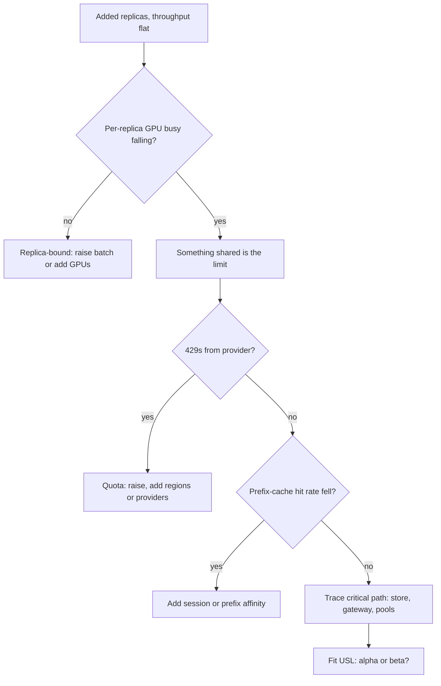

## TL;DR
Scalability is how throughput grows as you add resources, and it is almost never linear: contention
serializes work and coherency costs grow with workers. In AI systems the walls are GPU memory, provider
quotas, cache affinity and shared stores, not the stateless app tier.

## Why it exists
- **"Twice the machines, twice the throughput" rarely holds.** It holds for perfectly independent work
  and almost nothing else.
- **Every system has a serial part.** A single primary database, a global rate limit, a lock around a
  shared index, a coordinator every request touches. Amdahl showed speedup is capped at one over the
  serial fraction, no matter how many workers you add.
- **Coordination makes it worse.** Distributed systems pay a cost that grows with the square of the worker
  count, because workers exchange state (cache invalidation, consensus, connection fan-in). That produces
  *retrograde* scaling: throughput peaks, then falls.
- **AI adds its own non-linear limits.** Replicas come in large indivisible steps (one or several whole
  GPUs for weights plus a useful KV cache), take minutes to start because weights must load, hit
  tokens-per-minute quotas no client hardware raises, and keep KV and prefix caches local, so even
  spreading destroys hit rate.
- **Without a model, walls appear at launch**, after adding hardware that did not help.

## How it works
### Vertical vs horizontal
| | Scaling up | Scaling out |
|---|---|---|
| **What** | Bigger GPU, more memory, tensor parallelism across GPUs in one node | More replicas behind a load balancer |
| **Buys** | What one replica can do; often the only option for a model that does not fit smaller hardware | Total throughput and fault tolerance |
| **Limit** | A ceiling, and usually a price per unit that rises with size | Only partitionable work, and only until a shared component saturates |
| **LLM serving** | Tensor or pipeline parallelism of one model instance | Data-parallel replicas |

### Amdahl's law
```
speedup(N) = 1 / ((1 − p) + p/N)        p = parallel fraction, ceiling 1/(1 − p)
```
- **Example:** if 5% of each request's time is spent holding one shared lock or primary, no fleet size
  gets past 20×, and 64 workers already give only about 15×.

### The Universal Scalability Law (USL)
Gunther's USL adds coherency:

```
C(N) = N / (1 + α(N − 1) + β·N(N − 1))
```

- **α is contention** (queueing on a shared resource); **β is coherency** (pairwise coordination).
- **With β = 0** this is exactly Amdahl rewritten (α = 1 − p), and capacity flattens toward 1/α.
- **With β > 0** capacity peaks at N* = √((1 − α)/β) and declines after.
- **Its value is diagnostic.** Fit α and β from a few load-test points; they tell you whether to remove a
  serialization point (α) or reduce cross-node chatter (β), and roughly where adding nodes stops paying.

### Where AI systems stop scaling
- **Batch is the first axis, inside one replica.** With continuous batching, throughput rises steeply with
  concurrent sequences, because each weight read is shared by the whole batch, while per-token latency
  rises more slowly. Operate at the largest batch that meets the per-token target; adding replicas
  before then buys unused GPUs.
- **GPU memory per replica.** Concurrency per replica is bounded by KV-cache memory, so throughput per
  replica plateaus; you scale by adding replicas, not by pushing more requests into one.
- **Provider quotas.** Tokens-per-minute and requests-per-minute limits per key, per model and per region
  form a hard ceiling; past it you need quota increases, more regions, or multiple providers.
- **State and affinity.** Prefix caches and conversation state live on a replica. Pure round-robin loses
  the cache hit rate; affinity routing (by session or prefix hash) keeps it but makes load uneven.
- **Shared stores.** Vector indexes, metadata databases, and the logging pipeline that records every
  prompt are classic α sources once the model tier scales.
- **Elasticity lag.** GPU nodes and model loads take minutes, so autoscaling on CPU utilization reacts too
  late. Scale on leading signals (queue depth, in-flight requests, KV-cache utilization) and keep warm
  capacity for the time a new replica needs to become ready.

### Designing for it
1. **Keep the request tier stateless** and push state into stores designed to scale.
2. **Partition by tenant or key** where work is independent.
3. **Make the serial parts small and fast.**
4. **Add backpressure** so overload produces fast rejection instead of collapse.
5. **Test scaling explicitly** rather than assuming it.

## Diagram
A diagnostic path for "we added replicas and throughput barely moved": falling per-replica utilization
points away from the GPU tier toward something shared.



## Examples
### Fitting the USL from load-test points
A retrieval service is load-tested with N workers sharing one vector index and metadata database. The
measurements are illustrative; the fitting method is standard USL linearization.

```python
from math import sqrt

N = [1, 2, 4, 8, 16, 24]                 # workers
X = [40, 78, 148, 262, 410, 485]         # measured req/s

# USL: X(N) = X1*N / (1 + a(N-1) + b*N(N-1)).  Linearise: X1*N/X(N) - 1 = a(N-1) + b*N(N-1)
rows = [(n - 1, n * (n - 1), X[0] * n / x - 1) for n, x in zip(N, X)]
s11 = sum(u * u for u, v, y in rows); s12 = sum(u * v for u, v, y in rows)
s22 = sum(v * v for u, v, y in rows)
t1 = sum(u * y for u, v, y in rows); t2 = sum(v * y for u, v, y in rows)
det = s11 * s22 - s12 * s12              # 2x2 least squares, no intercept
a = (t1 * s22 - t2 * s12) / det
b = (s11 * t2 - s12 * t1) / det

usl = lambda n: X[0] * n / (1 + a * (n - 1) + b * n * (n - 1))
print(f"contention a={a:.3f} coherency b={b:.5f} peak near N={sqrt((1 - a) / b):.0f}")
for n in (16, 32, 48, 64, 96):
    print(f"N={n:3d} predicted {usl(n):4.0f} req/s efficiency {usl(n) / (X[0] * n):.0%}")
# contention a=0.026 coherency b=0.00069 peak near N=38
# N= 32 predicted 514 req/s ...  N= 64 predicted 473 req/s ...  N= 96 predicted 394 req/s
```

- **Peak:** throughput tops out near 38 workers at roughly 520 req/s, with per-worker efficiency already
  down to about a third.
- **Retrograde:** doubling from 32 to 64 workers would *lower* throughput.
- **Fix:** attack β (for example, shard the index so workers stop coordinating on one store) or α (cache
  hot metadata), not buy replicas.

### Worked numbers: what a 5% serial fraction costs
Amdahl with p = 0.95, computed from the formula above:

| Workers N | Speedup | Efficiency (speedup / N) |
|---|---|---|
| 8 | ~5.9× | ~74% |
| 16 | ~9.1× | ~57% |
| 32 | ~12.5× | ~39% |
| 64 | ~15.4× | ~24% |
| unbounded | 20× | → 0 |

Going from 32 to 64 workers doubles cost for about 23% more throughput, so shrinking the serial part
usually beats adding workers.

### Autoscaling on queue depth instead of CPU
A KEDA `ScaledObject` that scales a vLLM deployment on waiting requests scraped by Prometheus, keeping
warm replicas for the minutes a model takes to load. The threshold is illustrative.

```yaml
apiVersion: keda.sh/v1alpha1
kind: ScaledObject
metadata:
  name: llm-server
spec:
  scaleTargetRef:
    name: llm-server            # the Deployment running the model
  minReplicaCount: 2            # warm capacity covers model-load time
  maxReplicaCount: 12
  cooldownPeriod: 600           # scale down slowly; scale-up is the expensive direction
  triggers:
    - type: prometheus
      metadata:
        serverAddress: http://prometheus.monitoring:9090
        query: sum(vllm:num_requests_waiting{deployment="llm-server"})
        threshold: "8"          # target waiting requests per replica
```

## Production patterns
- **Scale on leading signals with warm floor capacity.** For GPU replicas, autoscale on queue depth or
  in-flight requests (as in the KEDA example) and set a minimum replica count that covers cold-start
  minutes. Monitor time from scale-out decision to ready replica, and timeouts during spikes.
- **Affinity routing for cache-heavy traffic.** Hash on session id or prompt-prefix hash so repeats land on
  the same replica, for example nginx's `hash $http_x_session_id consistent;` upstream directive. Monitor
  prefix-cache hit rate and per-replica load skew; cap or spill over hot keys.
- **Multi-size load tests with a USL fit.** Before a launch, test at four or five fleet sizes, fit α and
  β, and record the predicted peak. Monitor per-replica throughput as you scale; a falling line means a
  shared bottleneck.
- **Track provider quota headroom.** Read rate-limit response headers (OpenAI returns
  `x-ratelimit-remaining-tokens`; Anthropic returns `anthropic-ratelimit-tokens-remaining`) and spread
  load across keys, regions or providers before the ceiling. Monitor 429 rate per key and region.
- **Pool connections to shared stores.** Put a pooler such as PgBouncer in front of Postgres so replica
  count times pool size cannot exceed the database's connection limit. Monitor pool wait time and active
  connections as replicas scale.
- **Backpressure at the gateway.** Cap in-flight requests per replica and reject fast with 429 when the
  queue is full, so overload degrades instead of collapsing. Monitor rejection rate against capacity.

## Trade-offs
- **Scale-out vs coordination.** It buys fault tolerance and near-linear throughput for independent work,
  but adds coordination; it flips to a loss once coherency cost dominates, visible as a USL peak.
- **Affinity routing vs hot replicas.** It preserves prefix and session caches, cutting cost and TTFT,
  but creates hot replicas; it stops paying when traffic is dominated by a few large tenants or sessions.
- **Warm GPU capacity vs idle spend.** It hides cold-start minutes during spikes, but you pay for idle
  hardware; worth it when spikes are frequent and the latency SLO is strict.
- **Sharding a shared store vs complexity.** It removes a contention point, but cross-shard queries and
  rebalancing add complexity; premature while the store is far from saturation.

## Pitfalls
- **Load-testing one replica and multiplying by N.** Symptom: a launch where adding replicas leaves
  throughput flat because a shared store or quota was the real limit. Fix: test at several fleet sizes.
- **Autoscaling GPU replicas on CPU or GPU utilization.** Symptom: replicas arriving after the spike has
  already caused timeouts, because model loading takes minutes. Fix: queue depth plus warm capacity.
- **Round-robin across replicas with prefix caching.** Symptom: cache hit rate falling as replicas are
  added, and TTFT and cost per request rising with scale. Fix: session or prefix affinity.
- **Ignoring provider quotas in the scaling plan.** Symptom: 429 errors at a traffic level far below what
  the application tier could handle. Fix: quota headroom in the capacity plan.

## When to use
- **Use before** any launch, migration or "just add replicas" proposal.
- **Measure:** run load tests at several sizes (at least four or five points), fit a USL curve, and find
  which shared resource sets α and β. Track per-replica throughput, cache hit rate, queue depth and
  quota headroom as you scale.
- **Avoid** elaborate scale-out architecture for workloads that fit comfortably on one replica with
  headroom; simplicity is cheaper.
- **Interviews:** naming the specific shared bottleneck and the signal you would autoscale on beats
  generic "make it stateless and horizontal".

## Role lens
- **Engineer:** Writes stateless services, adds affinity routing and backpressure, and runs multi-size
  load tests so scaling claims come from measurements rather than assumptions.
- **Architect:** Decides partitioning keys, scale-up versus scale-out for models, multi-region and
  multi-provider strategy, and where shared state lives so it does not cap growth.
- **FDE:** Finds the customer-side ceilings, such as an on-prem search cluster or a single API key's
  quota, that will limit rollout long before the vendor's platform does.

## Check yourself
**Q:** Going from 8 to 16 inference replicas raised throughput by only 15%, and GPU utilization per
replica fell. What do you investigate, and in what order?
**A:** Falling per-replica utilization means replicas are waiting on something shared, so the GPU tier is
not the bottleneck. I would trace one request's critical path under load and look for the component
whose latency rose: a vector store or metadata DB (contention), a gateway or rate limiter, a provider
quota producing 429s, or connection pools sized for 8 replicas. I would also check load balancing:
round-robin can collapse prefix-cache hit rates, increasing prefill work. Then fit α and β from load
tests at several sizes to confirm whether the limit is a serial point or coordination cost before
redesigning.

## Interview questions
### What is the difference between Amdahl's law and the Universal Scalability Law?
- **Amdahl** models only a serial fraction: speedup plateaus at 1/(1 − p), so 5% serial work caps you at
  20×.
- **USL** adds a coherency term β for pairwise coordination, which makes throughput peak at
  N* = √((1 − α)/β) and then decline.
- **Why it matters:** a plateau says remove a serial point; a decline says reduce cross-node chatter, and
  stop adding nodes.

### How would you autoscale a self-hosted LLM deployment, and on what signal?
- **Not CPU or raw GPU utilization:** they lag the real constraint, and a new replica takes minutes to
  load weights.
- **Leading signals:** queue depth, in-flight requests or KV-cache utilization per replica.
- **Plus warm floor capacity** sized to cover model-load time, and a slow scale-down so spikes do not
  thrash.

### When would you choose scale-up over scale-out for a model?
- **When the model does not fit smaller hardware:** tensor or pipeline parallelism inside one node is the
  only way to serve it at all.
- **When per-request latency matters:** a bigger single instance can lower per-token time, whereas more
  replicas only add throughput.
- **Cost:** price per unit usually rises with size and there is a ceiling, so scale out once one replica
  meets the latency target.

### A load test fits α = 0.026 and β = 0.00069. What do you tell the team planning to go from 32 to 64 workers?
- **Peak is near 38 workers**, from √((1 − α)/β), at roughly 520 req/s.
- **64 workers predict about 473 req/s**, lower than 32, so the plan buys hardware to lose throughput.
- **Instead** shard the shared index to cut β or cache hot metadata to cut α, then re-test.

### Why can adding replicas raise cost per request in a prefix-cached system?
- **Caches are local to a replica:** round-robin spreads requests sharing a prefix, so each cache sees
  fewer repeats.
- **Lower hit rate means more prefill**, which raises TTFT and GPU work per request.
- **Fix:** route by session or prefix hash and watch per-replica skew so affinity does not create hot
  spots.

## Quiz
### Q: In the Universal Scalability Law, what does a positive coherency coefficient β imply?
- [ ] Throughput grows linearly but with a lower slope
- [x] Throughput peaks at some N and then declines as more workers are added
- [ ] Throughput plateaus at 1/β and stays flat
- [ ] The system is limited by its serial fraction only
> β models pairwise coordination cost growing roughly with N², so beyond N* = √((1 − α)/β)
> each added worker costs more than it contributes. Contention alone (α) gives a plateau, not a decline.

### Q: Why is CPU utilization a poor autoscaling signal for GPU inference replicas?
- [ ] CPU metrics are not exposed inside containers
- [ ] GPU replicas never use the CPU
- [x] It does not track the real constraint, and new replicas take minutes to load, so scaling must react to leading signals like queue depth
- [ ] Autoscalers can only read GPU metrics
> Inference load shows up in queue depth, in-flight requests and KV-cache utilization. Because model
> loading is slow, a lagging signal adds capacity after users have already timed out.

### Q: A team adds replicas and sees prefix-cache hit rate fall. What is the most likely cause?
- [ ] Larger fleets use smaller cache sizes per replica by default
- [x] Requests sharing a prefix are spread across replicas, so each replica's local cache sees fewer repeats
- [ ] Prefix caching only works with a single replica
- [ ] More replicas increase prompt lengths
> Prefix caches are local to a replica. Without prefix- or session-aware routing, traffic spreads
> thinly, so each cache sees fewer repeats; affinity routing restores the hit rate.
