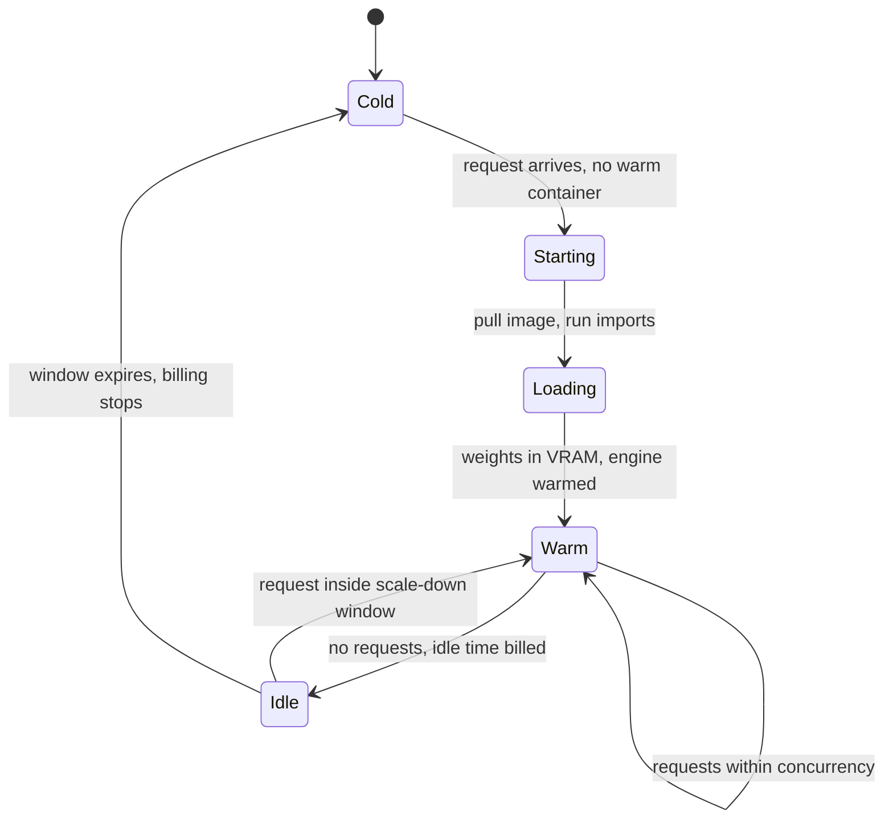

## TL;DR
Serverless GPUs bill per second and scale to zero, so bursty agent workloads (nightly agents, eval
suites, low-traffic tools) pay only for busy seconds. The cost: cold starts of tens of seconds to minutes
and a rate above on-demand.

## For agent builders
- **Why it matters for agents.** Much agent GPU work is bursty: an eval suite that runs on every prompt
  change, a nightly research agent, an internal agent used in office hours. Paying per second fits that
  shape, but a cold start can land mid-run when a slow tool call outlasts the idle window.
- **Where it shows up in your stack.** Platforms such as Modal, RunPod Serverless or Cloud Run with GPUs
  hosting a self-hosted agent model, embedder or judge; per-token model APIs are the layer above.
- **What you control.** Scale-down window versus tool-call gaps, per-container concurrency, weights on a
  cached volume, and a hybrid base for interactive agents.
- **What you can skip.** How the provider pools its fleet. Measure cold start by stage and run the
  break-even arithmetic.

## Why it exists
- **A dedicated GPU costs the same idle or busy.** It costs the same per hour whether it serves ten
  thousand requests or none.
- **Most early traffic is bursty, diurnal or small.** A document-processing pipeline that runs two hours
  each night, an internal assistant used during working hours in one time zone, a feature with a hundred
  requests a day. Paying for 730 hours a month to use 20 is the single largest waste line in many AI
  budgets, and it is invisible because the card shows up as "in use".
- **"Autoscale the Kubernetes deployment to zero" is too slow.** A GPU node takes minutes to provision,
  pull a multi-gigabyte image and load weights; by the time the pod is Ready the user has gone, and the
  cluster autoscaler may not even have the quota to add a node.
- **"Keep one replica warm" is a dedicated GPU with extra steps.**
- **What the platforms buy you.** They make scale-from-zero fast enough to be usable — pre-provisioned
  fleets, cached images, weight caches on fast storage, process snapshots — and bill in seconds, which
  makes bursty use cheap. They do not remove the cold start; they shrink it and hide the node layer.

## How it works
### The request path
1. **A request arrives at the platform's router.**
2. **Warm path:** if a warm container for your function exists and has spare concurrency, it runs there
   immediately.
3. **Cold path:** the platform takes a GPU from its pooled fleet, starts your container, runs your
   initialisation, and only then serves the request. It keeps nodes and often images pre-warmed *because*
   node provisioning is the slowest step and amortises across tenants.
4. **Scale-down:** after the container has been idle for a configurable scale-down window, it is stopped
   and billing ends.
5. **Scale-out** is the same path repeated: when in-flight requests exceed per-container concurrency,
   another container is started.

### Anatomy of a cold start
Each stage has its own mitigation, and the total is the sum:

| # | Stage | Typical cost | Mitigation |
|---|---|---|---|
| 1 | Scheduling and container start | Seconds on a pooled fleet; minutes if a node must be created | Platform's warm pool |
| 2 | Image pull | Tens of seconds for a multi-gigabyte CUDA image | Lazy-loading image formats; keep weights *out* of the image |
| 3 | Process start and imports | Several seconds for PyTorch, CUDA init and engine setup | Memory snapshots after imports (some platforms); GPU-state snapshots are newer and provider-specific |
| 4 | Weight load (storage → host RAM → VRAM) | 16 GB bf16 from local NVMe cache: seconds; from a remote bucket: minutes | Volumes or model caches on fast storage |
| 5 | Engine warm-up | CUDA graph capture, kernel compilation, `torch.compile`: tens of seconds for some engines | Accept it, disable it for serverless, or snapshot after it |

- **A network bucket on every start is the classic mistake;** platforms offer fast-storage volumes
  precisely to move stage 4 from minutes to seconds.
- **Illustrative order of magnitude:** a tuned small-model function cold-starts in 10–30 seconds; an
  untuned 70B deployment can take ten minutes.
- **Measure yours;** it is the key input to every decision below.

### The knobs
- **Scale-down window (idle timeout).** Longer keeps containers warm through traffic gaps at the cost of
  paying for idle seconds; shorter saves money and causes more cold starts.
- **Minimum warm containers.** Removes cold starts for the base load, billed continuously at the
  serverless rate, which is usually above on-demand; this is where "serverless" quietly becomes
  "expensive dedicated".
- **Concurrency per container.** Letting one container handle several requests at once lets the engine
  batch them, raising throughput per GPU-second; set it from the batching lesson, not to 1.
- **GPU type.** Most platforms let you pick L4/A10-class through H100; the selection lesson's arithmetic
  applies unchanged, except that per-second billing makes low utilisation free.

### Billing shape
- **Per second of container lifetime,** not per request, often for CPU and memory as well.
- **The GPU rate is usually above like-for-like on-demand hourly pricing** (compare the same card from the
  same class of provider): the premium funds the idle pool and the fast storage.
- **Cold-start seconds are usually billed.**
- **So is the idle tail of every scale-down window:** each container that scales to zero was first paid
  for while it sat idle for the full window.
- **Egress, storage volumes and request overhead** may be separate lines.

### What it is not
- **Serverless GPUs are *your container on their pooled GPUs*.**
- **Per-token model APIs are a different layer:** no container, no GPU choice, billed per token; they are
  the right answer for standard open models at modest scale.
- **Not every "serverless" product has GPUs.** AWS Lambda does not, and SageMaker's serverless inference
  option has been CPU-only. Google Cloud Run and Azure Container Apps have added GPU options, with
  constraints that change, so check current support before designing around any of them.

### How agent traffic meets the lifecycle
- **Gaps come from tools, not users.** Between two model calls an agent may run code, browse or wait on
  a slow API. If that gap exceeds the scale-down window, the next step pays a full cold start mid-run.
- **A new container starts with an empty prefix cache,** so the first step on it re-prefills the whole
  transcript even when the cold start itself is short.
- **Eval and batch agents are the natural fit:** a suite of agent tasks is a burst of thousands of calls
  followed by hours of nothing, exactly the shape per-second billing rewards.

## Diagram
The lifecycle an agent's model calls see on a scale-to-zero platform: the warm path is cheap and fast,
the cold path pays every start-up stage, and the idle window is billed before each scale-down. A tool gap
longer than the window sends the next step down the cold path.



## Examples
### Worked scenario: an 8B model on an L4-class GPU
Illustrative prices, ballpark only: dedicated on-demand $0.80 per hour ($584 for a 730-hour month);
serverless $1.60 per hour-equivalent, billed per second, a 2× premium. Measured cold start after tuning:
45 seconds. Scale-down window: 5 minutes.

**Workload A, internal document tool:** 1,000 requests per day at ~3 GPU-seconds each.

| Line | Arithmetic | Monthly |
|---|---|---|
| Busy seconds | 3,000 busy seconds a day ≈ 25 hours a month | $40 |
| Cold starts | about 40 a day (working-hour clusters with gaps): 40 × 45 s = 30 minutes a day ≈ 15 hours | $24 |
| Idle tail | 40 scale-downs, each after a billed 5-minute window: 200 minutes a day ≈ 100 hours | $160 |
| **Serverless total** | | **roughly $225** vs $584 dedicated, about 2.6× cheaper |

- **The idle tail is the line people forget,** and the biggest one here, so the scale-down window is a
  cost knob: at 2 minutes it falls to ~$64 (if the number of cold starts does not rise much), at
  10 minutes it doubles to ~$320.
- **Latency is fine:** a 45-second cold start is tolerable for a tool that already takes seconds.

**Workload B, steady product traffic at 40% busy:**
- 292 busy hours × $1.60 = $467; cold starts are negligible because containers stay warm. Serverless still
  wins by 20%.
- **Break-even** is where the rates cross: 0.80 ÷ 1.60 = 50% utilisation, minus whatever cold starts and
  idle windows add.
- At 60% busy, serverless costs $700 against $584 and dedicated wins.

**Workload B with a latency SLO** (p95 response under 2 seconds):
- **Cold starts break it.** Any cold-start rate above 5% puts 45-second responses at the p95, and even 1%
  puts them at the p99, which most teams also track.
- **A warm container is too expensive.** Keeping one always warm costs 730 × $1.60 = $1,168, double the
  dedicated card.
- **The right design** is a dedicated card (or Kubernetes replica) for the base load and serverless only
  for bursts above it, where the cold start affects a small tail of requests during ramps. The arithmetic,
  not the branding, picks the layout.

### Worked scenario: an agent eval suite on serverless versus a dedicated card
A team self-hosts an 8B agent model and runs a 500-task agent eval on every prompt or tool change, about
twice a day. Each task averages 20 model calls at ~3 GPU-seconds each, at the same illustrative rates.

| Line | Arithmetic | Monthly |
|---|---|---|
| GPU-seconds per suite | 500 × 20 × 3 = 30,000 s ≈ 8.3 hours | |
| Busy hours | 2 suites a day × 30 days × 8.3 h ≈ 500 hours | about $800 at $1.60/h |
| With 8 concurrent inputs batched per container | GPU time shrinks by several times when the engine batches the suite's calls | well under $800 |
| Dedicated L4 kept for evals | 730 hours at $0.80 | $584, but every suite queues on one card instead of fanning out |

- **The unbatched line loses to dedicated**, because 500 busy hours is above the 50% break-even; the
  batched line wins and also finishes each suite faster by fanning out across containers.
- **Cold starts barely matter here:** one per container per suite, with no user waiting on step one.
- **Interactive agents are the opposite case:** use the hybrid base-plus-burst layout below.

### Monthly cost calculator with the idle tail included
Reproduces workload A and shows the scale-down window as a cost knob. Rates are the illustrative figures
above.

```python
DAYS = 30

def serverless_month(busy_s_day, cold_starts_day, cold_s=45, window_min=5, rate_h=1.60):
    hours = {
        "busy": busy_s_day * DAYS / 3600,
        "cold": cold_starts_day * cold_s * DAYS / 3600,               # start-up seconds are billed
        "idle": cold_starts_day * window_min * 60 * DAYS / 3600,      # each scale-down waits a full window
    }
    return {k: round(v * rate_h) for k, v in hours.items()} | {"total": round(sum(hours.values()) * rate_h)}

dedicated = 730 * 0.80                                                 # $584 a month
for window in (2, 5, 10):
    print(f"window={window:2d} min", serverless_month(3000, 40, window_min=window), f"dedicated=${dedicated:.0f}")
# window= 2 min {'busy': 40, 'cold': 24, 'idle': 64, 'total': 128} dedicated=$584
# window= 5 min {'busy': 40, 'cold': 24, 'idle': 160, 'total': 224} dedicated=$584
# window=10 min {'busy': 40, 'cold': 24, 'idle': 320, 'total': 384} dedicated=$584

breakeven = 0.80 / 1.60                                                # busy fraction where rates cross
print(f"break-even utilisation (no cold starts): {breakeven:.0%}")     # 50%
```

### Production snippet: load once, cached weights, batched concurrency (Modal)
The structure that keeps cold starts short on any platform: weights on a volume, load in a start-up hook,
several requests per container. Shown with Modal's Python SDK (1.x parameter names); check the current
docs, since these names have changed between versions.

```python
import modal

app = modal.App("doc-tool")
weights = modal.Volume.from_name("model-weights", create_if_missing=True)
image = modal.Image.debian_slim().pip_install("vllm")       # weights stay out of the image

@app.cls(gpu="L4", volumes={"/models": weights},
         scaledown_window=300,      # 5-minute idle window: the cost knob from the calculator
         min_containers=0)          # scale to zero; raise only if the SLO demands it
@modal.concurrent(max_inputs=8)     # let the engine batch, never 1
class Model:
    @modal.enter()
    def load(self):                 # runs once per container, not per request
        from vllm import LLM
        self.llm = LLM(model="/models/llama-3-8b-instruct")

    @modal.method()
    def generate(self, prompt: str) -> str:
        return self.llm.generate([prompt])[0].outputs[0].text
```

## Production patterns
- **Weights on a cached volume, never in the image or a bucket.** Use on every serverless GPU function.
  Mount the platform's volume or model cache and load from it in a start-up hook. Monitor cold-start time
  by stage; weight load should be seconds, not minutes.
- **Tune the scale-down window from the idle-tail line and tool gaps.** Use when the bill has more idle
  than busy hours. Compute cold starts per day times the window, as in the calculator, and shorten the
  window until cold starts begin to rise, but keep it above the p95 gap between an agent's model calls.
  Monitor billed idle seconds, cold-start count and cold starts per agent run.
- **Batch inside each container.** Use whenever the engine supports concurrent requests. Set per-container
  concurrency to what the batching lesson and KV room allow (for example eight concurrent inputs), not 1.
  Monitor GPU-seconds per request and per-container queue time.
- **Hybrid base plus burst.** Use when there is a latency SLO and a steady floor of traffic, as with
  interactive agents. Serve the base
  load on a dedicated card or Kubernetes replica and route only overflow to serverless. Monitor the
  fraction of requests that hit a cold start and p95/p99 with cold starts included.
- **Snapshot after imports.** Use where the platform offers memory snapshots and imports dominate start-up.
  Enable the snapshot after imports and weight loading to CPU, then move to the GPU at restore. Monitor
  cold-start p50 before and after.
- **Capacity fallback for bursts.** Use for any customer-facing endpoint, and for agent loops, which
  should retry a capacity error on the fallback rather than fail the run. Configure a second GPU type or
  region, or a per-token API, for capacity errors. Monitor capacity or quota errors per GPU type and region.

## Trade-offs
- **Per-second billing vs rate premium.** It makes low and bursty utilisation cheap, but the premium makes
  steady high utilisation dearer than on-demand; the flip is near the ratio of the two prices.
- **Scale-to-zero vs cold starts.** It removes idle cost but introduces cold starts; right when the SLO
  tolerates them or traffic gaps are rare, wrong for tight tail-latency targets.
- **Warm minimums vs cost.** Warm minimums and long idle windows buy latency with money, and past a point
  you are paying dedicated prices for a platform you do not control.
- **Pooled third-party hardware vs data control.** It removes node operations but puts your weights and
  prompts in the provider's regions and tenancy model; for regulated data the compliance review, not the
  price, often decides.
- **Managed pooling vs control.** It hides nodes, drivers and images, at the cost of vendor-specific SDKs,
  less control over GPU topology and limits on multi-GPU or multi-node models.
- **Scale-to-zero vs warm prefix caches for agents.** Containers that come and go save idle cost, but each
  new one loses the cached prefix of every in-flight agent, so the next step re-prefills. It flips toward
  dedicated replicas once agents run long transcripts at steady volume.

## Pitfalls
- **Loading weights from a remote bucket on every start.** Symptom: cold starts of minutes that no
  scale-down tuning fixes, visible as a bimodal latency histogram. Fix: a cached volume.
- **Baking weights into the container image.** Symptom: image pulls that take longer than the model load
  and rebuilds for every checkpoint change. Fix: keep weights on a volume.
- **Setting per-container concurrency to one.** Symptom: many containers each running a batch of one, so
  GPU-seconds per request are several times higher than on a batched dedicated server. Fix: allow batching.
- **Forgetting that cold-start seconds are billed.** Symptom: a bill where start-up time rivals serving
  time, which happens whenever the scale-down window is short relative to request gaps. Fix: model it.
- **Assuming serverless capacity is unlimited.** Symptom: requests queueing or failing with capacity or
  quota errors during a burst, *because* the provider's pool for that GPU type in that region, or your
  account's container limit, is exhausted exactly when everyone's traffic peaks. Fix: a fallback.
- **Promising a tight p95 on a scale-to-zero deployment.** Symptom: an SLO breach on the first request
  after every lull. Fix: hybrid base plus burst.
- **An idle window shorter than the agent's tool gaps.** Symptom: agent runs with a 45-second stall
  in the middle, right after a slow tool call, while the first step was fast. Fix: set the window above
  the p95 tool gap, or keep that agent's model on a warm base.

## When to use
- **Use when:** utilisation would be low or bursty (internal tools, nightly batch and eval-suite agents,
  prototypes, long-tail models that are rarely hit), latency can absorb a cold start or the warm pool makes it rare, and you
  want no node operations.
- **Prefer dedicated capacity or Kubernetes when:** sustained utilisation exceeds the price ratio, tail
  latency is contractual, or the model spans multiple GPUs.
- **Measure:** cold start by stage, busy seconds per day, and p95 with cold starts included; those three
  numbers decide.
- **Day to day:** the "why did the first request take a minute" ticket.
- **Interviews:** the expected answer walks the cold-start anatomy and the break-even calculation.

## Role lens
- **Engineer:** Structures the function so imports and weight loading happen once at container start,
  keeps weights on a cached volume, tunes concurrency and idle windows, and measures cold-start stages.
- **Architect:** Decides which workloads live on serverless, which on dedicated capacity, and where
  the hybrid boundary sits, using measured utilisation and the SLO rather than vendor claims.
- **FDE:** Prototypes a customer pilot on serverless to avoid procurement delays, then presents the
  utilisation data that justifies moving to dedicated hardware when traffic becomes steady.

## Check yourself
**Q:** A customer's serverless LLM endpoint shows p50 latency of 1.2 s and p95 of 48 s. They ask
whether to raise the minimum warm containers to five. What do you investigate and recommend?
**A:** A 48-second p95 against a 1.2-second p50 is a cold-start signature: at least 5% of requests
start a container. First measure the cold start by stage (image pull, imports, weight load, warm-up)
and fix the cheap ones: weights on a cached volume instead of a bucket, snapshotting after imports,
disabling or pre-capturing warm-up. Then look at traffic: if gaps are frequent, a longer scale-down
window may cut cold starts more cheaply than warm containers. If base load is steady, one warm
container removes most cold starts; five warm containers is dedicated pricing for five cards and
probably exceeds an on-demand deployment. Recommend tuning first, then one warm container, and move
the base load to dedicated capacity if the utilisation arithmetic says so.

## Interview questions
### What is a serverless GPU, and how is it different from a per-token model API?
- **Serverless GPU:** your container on the provider's pooled GPUs, billed per second of container
  lifetime, scaling to zero after an idle window.
- **Per-token API:** no container and no GPU choice, billed per token; best for standard open models at
  modest scale.
- **Why choose serverless GPUs:** custom models, custom engines or weights you control, with bursty traffic
  that would leave a dedicated card idle.

### Walk me through the stages of a cold start and which one you would fix first.
- **Stages:** scheduling and container start, image pull, process start and imports, weight load, engine
  warm-up; the total is the sum.
- **Fix weight load first** when weights come from a remote bucket: moving 16 GB to a cached volume turns
  minutes into seconds.
- **Then** keep weights out of the image, snapshot after imports where offered, and decide whether engine
  warm-up such as CUDA graph capture is worth its tens of seconds.

### Your agent's runs stall for about 45 seconds mid-run on a serverless GPU. What is happening and what do you change?
- **Diagnosis:** a slow tool call outlasted the scale-down window, so the next model call met a cold
  start, and the new container also lost the transcript's cached prefix.
- **Confirm** from traces: stalls follow tool gaps longer than the window, and container start events line
  up with them.
- **Fix:** set the window above the p95 tool gap, put interactive agents on a warm dedicated base with
  serverless for bursts, and keep eval or batch agents on scale-to-zero.

### At what point would you move a workload off serverless onto dedicated GPUs?
- **Utilisation:** when busy fraction exceeds the dedicated rate divided by the serverless rate, 50% with a
  2× premium, and lower once cold starts and idle tails are billed.
- **Latency:** when a contractual p95 or p99 cannot absorb cold starts, keep a dedicated base and burst to
  serverless.
- **Shape:** when the model spans multiple GPUs or nodes, which most platforms limit.

### Your agent eval suite's serverless bill doubled but the number of tasks did not change. What do you look at?
- **Idle tail:** cold starts per day times the scale-down window; a longer window or more frequent gaps can
  make idle seconds the largest line, as in the worked $160 idle versus $40 busy.
- **Cold-start seconds** are billed too, so a regression in image size or weight loading raises cost.
- **Warm minimums and concurrency:** a raised minimum or concurrency set to 1 multiplies GPU-seconds per
  request.

### Why is "just keep one container warm" often the wrong fix for a latency SLO?
- **It is billed continuously** at the serverless rate: 730 × $1.60 = $1,168 a month in the example, double
  a dedicated card at $584.
- **Better:** a dedicated replica for the base load and serverless for bursts, so cold starts only touch a
  small tail during ramps.
- **First,** tune the cold start itself, since a 10–30 second start may already meet a relaxed SLO.

## Quiz
### Q: Why do serverless GPU platforms charge a per-second rate above on-demand hourly pricing?
- [ ] Per-second billing is more expensive to meter
- [x] The premium pays for the idle pooled fleet, cached images and fast storage that make scale-from-zero fast enough to use
- [ ] GPUs run at higher clocks in serverless mode
- [ ] Serverless containers get larger VRAM allocations
> The platform must keep provisioned GPUs and warm infrastructure waiting for tenants' bursts; that
> idle capacity is shared and amortised through the rate premium. Customers accept it because they
> pay only for busy seconds.

### Q: Which change most reduces cold-start time for a function whose 16 GB weights currently download from object storage on every start?
- [ ] Increasing per-container concurrency
- [ ] Choosing an H100 instead of an L4
- [x] Keeping the weights on a platform volume or local cache so they load from fast storage
- [ ] Shortening the scale-down window
> Weight loading from remote storage is usually the dominant cold-start stage; moving it to cached
> NVMe-class storage cuts minutes to seconds. A faster GPU does not speed a network download, and a
> shorter idle window causes more cold starts, not faster ones.

### Q: At what utilisation does serverless stop being cheaper than a dedicated card, ignoring cold starts?
- [ ] Always above 10%, because of the premium
- [ ] Never; per-second billing is always cheaper
- [x] Roughly where busy fraction equals the dedicated hourly rate divided by the serverless hourly-equivalent rate
- [ ] At 100%, when both bill the same hours
> With a 2× premium the crossover is 50% busy; cold starts and idle windows are billed too, so the
> real crossover is lower. Above it the dedicated card's constant price covers more tokens.

## Use cases & projects
### Use cases
- **Eval suites on every prompt change.** A burst of agent episodes against a self-hosted model or judge,
  then nothing until the next change, fits per-second billing and scale to zero.
- **Scheduled and nightly agents.** Research or report agents that run a few times a day pay only for
  their busy seconds instead of an always-on card.
- **Low-traffic GPU tools.** An embedder, OCR model or reranker that an agent calls occasionally, where a
  dedicated card would sit idle most of the hour.
- **Hybrid bases for interactive agents.** A small always-warm pool for user-facing sessions, with
  serverless overflow for spikes, so cold starts never land mid-conversation.

### Mini project
**Cold starts inside an agent loop (2-3 hours).**
- **Goal:** measure when a serverless GPU endpoint goes cold during an agent run and fix it.
- **Steps:** deploy a small model or embedder on a serverless GPU platform you can access; build an agent
  loop that calls it, with a fake tool that sleeps for a configurable gap between calls; record per-call
  latency while raising the gap past the platform's idle window; then move weights to a cached volume or
  baked image and repeat; finally compute the break-even busy fraction against a dedicated card.
- **Done when:** a table shows per-call latency by tool-call gap, before and after the weight-loading
  change, plus your break-even calculation for your expected agent traffic.
