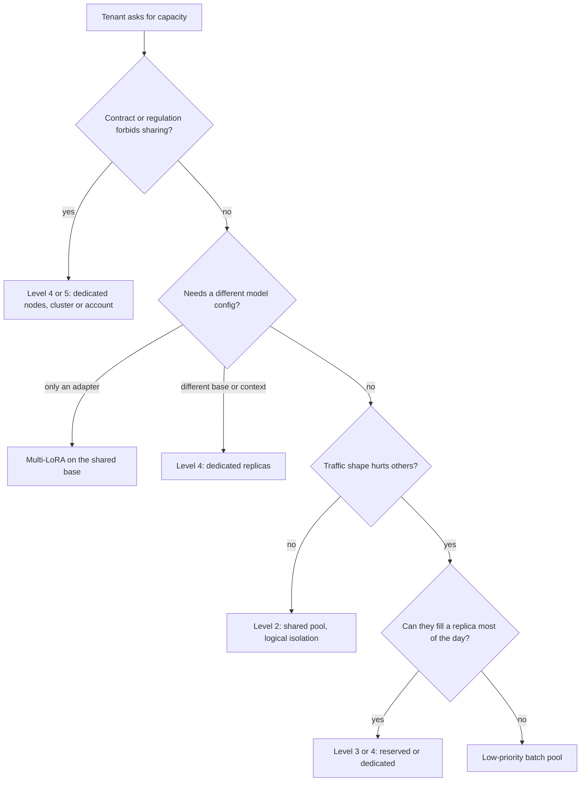

## TL;DR
When many agents or customers share self-hosted models, shared serving runs them all through one pool;
isolated serving gives a tenant its own replicas, nodes, cluster or account. Sharing wins on cost,
isolation on noisy neighbours, compliance and custom configs; most platforms use both.

## For agent builders
- **Why it matters for agents.** Agents are the classic noisy neighbour: a research agent fanning out 30
  sub-agents, or an eval sweep running 500 tasks, can hold most of a shared pool's sequences and push up
  TTFT for every interactive agent on it.
- **Where it shows up in your stack.** Per-tenant and per-agent rate limits at your LLM gateway, priority
  tags, a separate batch pool for evals and offline agents, multi-LoRA serving (vLLM `--enable-lora`) for
  per-customer tool-calling fine-tunes, and tenant-salted prefix caching.
- **What you control.** The tenant and agent ids your agent runtime attaches to every model call, the
  in-flight cap per tenant (counted across a run's whole fan-out), and which agent workloads are tagged
  batch.
- **What you can skip.** On a hosted API this is the provider's problem; you meet the same idea as
  provisioned throughput versus pay-as-you-go, and per-project limits.

## Decision case
### Scenario
An internal agent platform serves one self-hosted 70B model to the whole company. A replica holds 48
concurrent sequences within the latency budget. All figures are illustrative, from a month of
per-tenant metrics.
- **Product teams:** 8 teams run interactive agents; each peaks at 30 concurrent sequences, but peaks
  are spread, so the measured combined peak is 120, not 240. At night the combined load is about 20.
- **Legal team:** its agent reads privileged documents and peaks at 30 sequences; the compliance rule is
  "no shared GPU or node with other business units".
- **Eval team:** a nightly sweep at client concurrency 100 sequences, 01:00 to 04:00.
- **Constraints:** interactive TTFT p95 under 1.5 s; the sweep must finish inside its 3-hour window;
  at most 8 replicas of budget; every pool keeps an N+1 spare except batch.

### Options
| Option | How it works | Replicas | Legal rule | Interactive latency | Eval window |
|---|---|---|---|---|---|
| A. Isolate everyone | Each team 1 replica + 1 spare (8 × 2 = 16), legal 2, eval ceil(100 / 48) = 3 | 21 | Met | Isolated | Met |
| B. One shared pool, no exceptions | Daytime peak 120 + 30 = 150, so ceil(150 / 48) = 4, plus a spare | 5 | Broken | Fair only with caps; legal shares the batch | Met: 100 + 20 = 120 of 240 slots at night |
| C. Shared pool with logical isolation, legal dedicated | 8 teams and evals share ceil(120 / 48) = 3 + 1 = 4 replicas behind per-tenant in-flight caps and a tenant-salted prefix cache, evals tagged batch; legal gets 1 + 1 spare replicas on its own node pool | 6 | Met | Caps and fair-share admission at the gateway | Met: 100 + 20 = 120 of 192 slots at night |
| D. As C plus a dedicated batch pool | Evals move to their own 3 replicas | 9 | Met | Best | Met |

### Decision
Choose **C**, because:
- **It is the only option that meets the legal rule inside the 8-replica budget.** A costs 21, D costs
  9, and B breaks the compliance rule.
- **Sharing pays where peaks are spread:** 8 teams need 4 replicas together instead of 16 apart, the
  peak-of-sum saving.
- **The eval sweep fits the night trough:** 120 of 192 slots, so a separate batch pool would buy little
  while costing 3 replicas.
- **Legal is an exception with a documented reason,** at level 4 (a dedicated node pool) rather than a level-5 separate cluster,
  because the rule names GPUs and nodes, not the control plane.

**What would change it:**
- **Evals moving into daytime:** their 100 sequences would collide with the 120 interactive peak, so
  D's batch pool earns its cost.
- **The legal rule relaxing to "no shared prefix cache":** legal joins the shared pool with a
  tenant-salted cache.
- **Team peaks becoming correlated:** a combined peak of 240 needs ceil(240 / 48) = 5 + 1 = 6 shared
  replicas, plus legal's 2, exactly the budget with no slack.

### Trade-offs accepted
- **Legal's replicas sit mostly idle:** a peak of 30 on 96 slots is about 31%. Watch their utilization in
  the quarterly exception review.
- **Admitted eval steps still share the batch** with night-time interactive traffic. Watch interactive
  p95 TTFT between 01:00 and 04:00.
- **Tenant-salted caching loses cross-team hits** on the shared agent scaffold prompt. Watch prefix-cache
  hit rate per tenant.
- **The gateway now carries fairness logic.** Watch 429s and in-flight sequences per tenant, counted
  across each run's fan-out.

### Review rubric
- **Shared capacity is sized from the measured combined peak,** not from the sum of peaks, and the
  write-up shows both numbers.
- **Every exception names the requirement that forces it** and the precise level of what is not shared.
- **Caps count in-flight sequences,** including parallel tool calls, not agent runs.
- **Batch traffic has a placement argument** (night trough, low priority or its own pool) with slot
  arithmetic.
- **Spares are stated per pool** and the replica total recomputes to the budget.
- **Reversal triggers are measurable:** correlated peaks, a changed rule, or evals moving into daytime.

## Why it exists
- **A GPU is efficient only when busy.** Continuous batching reaches its throughput at tens of concurrent
  sequences; at two or three the GPU spends most of each decode step reading weights for almost no
  output, so cost per token can be an order of magnitude higher than at full batch.
- **Pooling fills the batch.** A tenant peaking at five concurrent requests cannot fill a replica alone.
  Because many tenants' peaks fall at different times, the pool needs capacity for the peak of the sum,
  which is much less than the sum of the peaks.
- **The pull is strong.** For a platform serving dozens of internal agent teams, dedicated replicas per
  team can multiply the GPU bill several times for the same total tokens.
- **"Share everything" fails fast.** One tenant's batch job of 50k-token documents (or an agent that
  pastes whole files into context) fills the KV cache and everyone's TTFT jumps. Nobody can say whose
  fault it is or stop it, because the engine's scheduler is first-come-first-served by default (some
  engines offer a request-priority policy) and knows nothing about tenants or fair shares.
- **And again on guarantees.** A regulated tenant asks whether their prompts ever shared a GPU with another
  company's; another needs a different model, context limit, fine-tuned adapter or region. Sharing without
  isolation quietly removes fairness, blast-radius control and contractual guarantees. So decide which
  properties each tenant needs, and the cheapest isolation level that provides them.

## How it works
### The isolation spectrum
From cheapest to most isolated, each level buys a specific guarantee:

| Level | What it is | Buys | Costs |
|---|---|---|---|
| 1. Shared pool, no tenant awareness | One pool, no limits | Maximum utilization | No guarantees: one team's own traffic or a prototype only |
| 2. Shared pool with logical isolation | Gateway limits, priorities, fair-share admission, per-tenant metrics | Fairness and attribution, batching economics kept | Cannot govern what happens after admission |
| 3. Reserved capacity in a shared cluster | Guaranteed minimum, burst into the shared remainder | A floor of capacity | Some reserved idle time |
| 4. Dedicated replicas or node pool | Separate engine processes, possibly separate GPUs | Latency isolation, own model, context or quantization | Idle capacity whenever the tenant is quiet |
| 5. Dedicated cluster, VPC or cloud account | Separate control plane, network and identity | Strongest compliance story | Highest operating cost: every platform component duplicated |

- **Level 2 detail.** Per-tenant rate limits and token budgets at the gateway, priority classes, fair-share
  admission so one tenant cannot hold more than a share of in-flight sequences, plus per-tenant metrics and
  chargeback. It exists *because* the engine scheduler is FCFS or at best priority-ordered, never
  tenant-fair; fairness must be enforced before requests reach it.
- **Level 3 detail.** The tenant gets their own replicas or a reserved share of the pool. This is the
  self-hosted analogue of what hosted providers sell as provisioned throughput next to a pay-as-you-go pool.
- **Level 4 detail.** A tenant's KV cache and queue are physically theirs.
- **Level 5 detail.** Data residency, no shared control plane, independent blast radius.

### The multiplexing arithmetic
The saving from sharing has a precise form. With tenant loads Lᵢ(t) in concurrent sequences and a replica
holding C sequences within the latency budget:

```
isolated replicas = Σᵢ ( ceil(max_t Lᵢ(t) / C) + spareᵢ )
shared replicas   = ceil( max_t Σᵢ Lᵢ(t) / C ) + spare
```

1. **Rounding.** Every isolated tenant pays for at least one whole replica (and its own spare) even if it
   peaks at a tenth of one.
2. **Multiplexing.** The peak of the sum is lower than the sum of the peaks whenever tenants peak at
   different times. For many independent tenants the aggregate's relative fluctuation shrinks roughly as
   1/√N, so a large pool needs proportionally less headroom.
3. **The second effect is the one that flips.** When peaks are correlated (one time zone, the same
   month-end process, the same upstream event, every team's nightly eval at 02:00), the peak of the sum
   approaches the sum of the peaks and sharing saves little beyond rounding and spares.
4. **So the input is a per-tenant load time series,** not a per-tenant average. For agents, count
   in-flight sequences, because one agent run can hold several at once when it calls tools in parallel.

### What is actually shared at each level
- **Sharing a replica** means sharing GPU memory: tenants' KV caches sit in the same pool of blocks and the
  batch holds their sequences side by side. Within a correct engine one sequence cannot read another's
  cache, so this is not a data-leak path in itself.
- **The real risks** are side-channel timing, engine bugs and, more practically, prefix caching.
- **The prefix-cache side channel.** If a cached prefix keyed only by its text can be hit by another
  tenant's identical text, the cached KV is never returned to the caller. But the faster TTFT of a hit is
  a timing side channel that can reveal someone else recently sent that prefix.
- **So cross-tenant cache sharing is an explicit decision.** The usual answer is to salt the cache key with
  the tenant id (some engines accept a per-request cache salt). For agents the trade is concrete: a
  shared agent framework's system prompt and tool schemas are a big common prefix, and salting makes each
  tenant warm its own copy.
- **Sharing a node but not a replica** removes cache co-residency and leaves shared host RAM, network and
  the node's failure domain.
- **Sharing a cluster** leaves a shared control plane and shared operators.
- **The compliance question is always "what exactly is shared",** and the answer should be precise,
  because "dedicated" is sold at every level.

### Multi-LoRA: sharing the base, isolating the behaviour
- **Expensive choice:** a dedicated replica per fine-tune, for example one per customer's tool-calling
  adapter.
- **Cheaper design:** one shared base model, with each tenant's LoRA adapter loaded into the same engine.
  Adapters are small and swapped per request; base weights are shared.
- **What it gives:** behavioural isolation (each tenant's agent outputs come from their adapter) with
  shared economics.
- **The limit:** all tenants must agree on the base model, context limit and quantization.

### Logical isolation mechanics
- **At the gateway:** per-tenant token-bucket limits in requests and tokens per minute, a concurrency cap
  (in-flight sequences per tenant), and a priority tag.
- **At the pool:** weighted fair queueing across tenants before admission, so a tenant with a batch backlog
  cannot starve interactive users, and the option to route a tenant's batch traffic to a separate
  low-priority pool.
- **In observability:** every request carries a tenant id (and, for agents, agent and run ids) into
  metrics and traces so cost and tail latency can be attributed. Without attribution you cannot even
  argue about whether a tenant deserves dedicated capacity.

### How the decision is made
Score each tenant on four questions:

1. Does their traffic shape threaten others (long contexts, bursty batch jobs, agent fan-out)?
2. Do they need guarantees others would violate (latency SLO, data separation, region)?
3. Do they need a different model configuration?
4. Would their dedicated capacity sit idle most of the day?

- **Reading the score.** A "yes" to any of the first three is a reason for separation; a "no" to the last
  means separation will be expensive.
- **Contract or regulation wins regardless of cost,** and the cost goes on the contract.
- **A traffic-shape problem** is first attacked with logical isolation or a separate low-priority pool, and
  becomes dedicated capacity only when the tenant can fill it.
- **Everyone else** lives in the shared pool behind logical isolation. The platform ends up with a shared
  pool plus a short list of exceptions, each with a documented reason.

## Diagram
Walk a tenant or agent workload down the decision path: hard requirements first, then configuration,
then traffic shape; everyone who reaches the bottom stays in the shared pool.



## Examples
### Peak of the sum vs sum of the peaks, in code
A runnable model of the multiplexing formula. Loads are illustrative hourly concurrency per agent team.

```python
import math

def isolated_replicas(loads, cap, spare=1):
    """loads: {tenant: [concurrent sequences per hour]}; cap: sequences per replica within budget."""
    return sum(math.ceil(max(series) / cap) + spare for series in loads.values())

def shared_replicas(loads, cap, spare=1):
    combined = [sum(hour) for hour in zip(*loads.values())]   # peak of the sum, not sum of peaks
    return math.ceil(max(combined) / cap) + spare

hours, cap = range(24), 48
# Ten teams, each peaking at 20 sequences and idling at 4 (illustrative).
spread = {f"team{i}": [20 if h in (2 * i, 2 * i + 1) else 4 for h in hours] for i in range(10)}
same = {f"team{i}": [20 if h in (14, 15) else 4 for h in hours] for i in range(10)}

for name, loads in (("peaks spread over the day", spread), ("all peak at 14:00", same)):
    iso = isolated_replicas(loads, cap, spare=0)          # before any per-team spare
    iso_n1 = isolated_replicas(loads, cap, spare=1)       # each team gets its own N+1
    sh = shared_replicas(loads, cap, spare=1)
    print(f"{name}: shared={sh}, isolated={iso} ({iso_n1} with spares), "
          f"shared costs {sh / iso:.0%} of isolated")
# peaks spread over the day: shared=3, isolated=10 (20 with spares), shared costs 30% of isolated
# all peak at 14:00: shared=6, isolated=10 (20 with spares), shared costs 60% of isolated
```

- **Spread peaks:** the combined peak is 20 + 9 × 4 = 56 sequences, so two replicas plus a spare.
- **Correlated peaks:** the combined peak is 200, so the saving falls back to rounding and shared spares.

### Worked scenario: an eval sweep as the noisy neighbour
A shared pool of 3 replicas × 48 = 144 sequence slots serves interactive support agents. A team launches
an eval sweep of 500 agent tasks at client concurrency 100. Illustrative numbers.

| Setup | Slots held by the sweep | Left for interactive agents | Effect |
|---|---|---|---|
| No tenant caps | ~100 of 144 | ~44 | interactive TTFT climbs as their steps queue behind eval steps |
| Per-tenant cap of 24 in-flight sequences | 24 | 120 | sweep takes ~4× longer (100 ÷ 24); interactive TTFT near baseline, though admitted eval steps still share the batch |
| Sweep tagged batch, routed to its own pool | 0 | 144 | sweep speed set by the batch pool's size |

- **Fan-out counts:** an agent issuing 3 parallel tool-result summaries holds 3 sequences, so caps must
  count sequences, not runs.

### Worked comparison: ten product teams on one 70B model
Numbers are illustrative and come from the kind of measurements you would make yourself. Each team peaks
at 20 concurrent sequences, but peaks are spread over the day; the measured combined peak is 80
concurrent sequences, not 200. A replica holds 48 concurrent sequences within the latency budget.

| Design | Replicas | Utilization | Cost vs isolated |
|---|---|---|---|
| Isolated per team | 10, one per team, since no team's traffic can be combined with another's | each averages perhaps 6 of 48 slots busy: near 12%, before any per-team N+1 spare | 100% |
| Shared with logical isolation | ceil(80 / 48) = 2, plus one for N+1 and headroom = 3 | the same 60 average busy slots on 144 slots instead of 480: about 42% (roughly 3.3x higher) | 3/10 = 30% |
| Hybrid | 3 shared + 1 dedicated batch replica = 4 | fairness preserved | 40% |
| All ten teams peak in the same hour | combined peak close to 200: ceil(200 / 48) = 5, plus a spare | sharing saves 40% instead of 70% | 60% |

- **The hybrid case.** One team runs nightly document batches with 60k-token prompts that would fill the
  KV cache during the batch window. Give that team a dedicated replica for batch (or route their batch
  traffic to a low-priority pool) and keep their interactive traffic in the shared pool.
- **The regulated case.** If one team handles regulated data and its compliance rule says "no shared GPU",
  none of this satisfies it: that team needs level 4 or 5, at least two replicas of its own for N+1, and a
  cost line attached.
- **What matters:** peak-of-sum versus sum-of-peaks, and whether a tenant's shape breaks the shared pool.
  Whenever the second is true, the first stops mattering for that tenant.
- **Correlated peaks:** the saving is almost all from rounding and shared spares rather than multiplexing.

## Production patterns
- **Per-tenant token buckets at the gateway.** For any shared pool, enforce requests-per-minute,
  tokens-per-minute and an in-flight concurrency cap per tenant id (for example counters in Redis keyed by
  tenant), returning 429 when exceeded, and have agent loops back off on it. Monitor 429s and in-flight
  sequences per tenant and per agent.
- **Fair-share queue in front of the engine.** Keep one queue per tenant at the gateway and dequeue by
  weight, because the engine itself is FCFS. Monitor per-tenant p95 TTFT against the pool-wide p95.
- **Batch pool for evals and offline agents.** Route requests tagged as batch (eval sweeps, nightly
  research agents, backfills) to their own pool sized for throughput, so batch windows never touch
  interactive replicas. Monitor batch backlog and interactive TTFT during the batch window.
- **Tenant-salted prefix cache.** Where the engine supports a per-request cache salt, pass the tenant id so
  cache hits never cross tenants; share only deliberately public prefixes such as a common agent system
  prompt. Monitor prefix-cache hit rate per tenant to see what the salt costs.
- **Multi-LoRA on one base.** In vLLM, start the server with `--enable-lora`, register per-customer agent
  adapters with `--lora-modules name=path` and bound residency with `--max-loras`; requests pick an
  adapter by model name. Monitor TTFT per adapter and how often adapters are swapped in.
- **Exception register with quarterly review.** Every reserved or dedicated tenant has an owner, a reason
  and a cost line. Monitor each exception's utilization and demote tenants that no longer fill their
  capacity.

## Trade-offs
- **Utilization vs latency isolation.** Sharing raises utilization and lowers cost per token, but removes
  latency isolation; the balance flips when one tenant's traffic shape (long prompts, batch bursts, agent
  fan-out) dominates the pool.
- **Logical isolation vs hard SLOs.** Gateway isolation preserves batching economics and gives fairness,
  but cannot prevent cache contention once requests are admitted, so it does not satisfy hard latency SLOs.
- **Dedicated replicas vs idle capacity.** They give predictable latency and freedom to change model
  configuration, but capacity sits idle outside the tenant's peak; worthwhile when the tenant's own traffic
  can fill a replica most of the day.
- **Multi-LoRA vs configuration freedom.** Many customised agent models ride one base at shared cost, but
  every tenant is constrained to the same base model, context and quantization, which breaks when one
  needs a different model.
- **Tenant-salted cache vs shared agent prefixes.** Salting closes the timing side channel but loses
  cross-tenant hits on a common agent scaffold prompt; it flips toward sharing only for prefixes you have
  declared public.
- **Dedicated clusters vs operating burden.** They give the strongest compliance story, yet duplicate every
  platform component and operator burden; justified by contract or regulation, rarely by performance.

## Pitfalls
- **Promising "dedicated" without stating the level.** Symptom: a security review discovers the tenant's
  "dedicated" model shares a node, control plane or prefix cache with others. Fix: name what is not shared.
- **A shared pool without per-tenant concurrency caps.** Symptom: platform-wide TTFT spikes that line up
  with one tenant's cron schedule or eval sweep. Fix: caps and fair-share admission.
- **Counting agent runs instead of sequences.** Symptom: a tenant under its "10 runs" cap still floods the
  pool because each run fans out parallel calls. Fix: cap in-flight sequences.
- **Keying a shared prefix cache on prompt text alone** without deciding whether cross-tenant hits are
  acceptable. Symptom: an auditor asks why tenant B's request was faster because tenant A had sent the same
  prompt. Fix: salt with the tenant id.
- **No tenant id in metrics.** Symptom: a cost-allocation argument nobody can settle and an isolation
  decision made on anecdotes instead of load shape.
- **Giving every tenant who asks their own replica.** Symptom: a fleet averaging single-digit utilization
  and a GPU bill that scales with the number of customers rather than with tokens.
- **Treating isolation as permanent.** Symptom: a tenant that outgrew or shrank below the threshold is still
  paying (or still being subsidised) a year later. Fix: review exceptions.

## When to use
- **Start shared with logical isolation:** gateway limits, fair-share admission, per-tenant metrics. That is
  the default for internal agent platforms and for SaaS tiers without hard SLOs.
- **Move to reserved or dedicated capacity** when a tenant's traffic shape measurably damages others, when
  a contract specifies latency or data-separation guarantees you cannot meet in the pool, or when they need
  a different model configuration.
- **Move to a dedicated cluster or account** only for regulatory or contractual reasons, and attach the cost
  to the contract.
- **Measure** per-tenant p95 TTFT, in-flight sequences and tokens, and pool utilization; revisit each
  exception quarterly.
- **Interviews:** explain why continuous batching makes sharing cheap and why that same batching makes noisy
  neighbours hard to contain after admission.

## Role lens
- **Engineer:** Implements tenant-tagged rate limits, concurrency caps and fair-share queueing at
  the gateway, and ensures tenant ids flow into engine metrics and traces for attribution.
- **Architect:** Owns the isolation policy: which guarantees each tier of tenant gets, at which level
  of the spectrum, and the cost line that goes with every dedicated exception.
- **FDE:** Translates a customer's "we need our own model" into the precise isolation level they
  need, prices it, and configures reserved or dedicated capacity inside their environment.

## Check yourself
**Q:** A SaaS company serves forty customers from one shared vLLM pool. One enterprise customer
demands "dedicated infrastructure" after a week of slow responses. How do you decide what to give
them, and what would you check first?
**A:** First check whether the slowness is caused by them or by someone else: per-tenant p95 TTFT
and in-flight sequences over the week, correlated with pool-wide KV utilization. If another tenant's
batch jobs caused it, the fix is logical isolation for everyone (concurrency caps, fair-share
admission, a low-priority batch pool), which solves the enterprise customer's problem without
dedicated hardware. If their own traffic shape is the cause, or their contract names a latency SLO,
give them reserved capacity: a dedicated replica for their guaranteed minimum with burst into the
pool. Only if the demand is about data separation or residency do you move to a dedicated node
pool, cluster or account, and then the precise level of what is not shared goes into the contract
along with its cost. Dedicated capacity is reviewed against their utilization every quarter.

## Interview questions
### Explain peak-of-sum versus sum-of-peaks, and when the saving from sharing disappears.
- **Definition:** isolated capacity is sized for each tenant's own peak; shared capacity is sized for the
  peak of the combined load, which is lower when tenants peak at different times.
- **Why it grows with N:** for many independent tenants the aggregate's relative fluctuation shrinks
  roughly as 1/√N, so a big pool needs proportionally less headroom.
- **When it disappears:** correlated peaks (one time zone, month-end, one upstream event); then sharing
  saves only rounding and spares.

### Your interactive agents slow down every night when another team runs its eval suite on the same pool. What do you change?
- **Confirm it:** per-tenant in-flight sequences and interactive p95 TTFT over the eval window; the sweep
  holding most slots is the signature.
- **Contain it:** a per-tenant in-flight sequence cap at the gateway (counting parallel tool calls), and
  tag eval traffic as batch so it routes to a low-priority pool.
- **Make the eval client polite:** bounded concurrency and backoff on 429, so the sweep takes longer
  rather than taking the pool.

### A security reviewer asks whether tenants can learn anything from each other through your shared pool. What do you answer?
- **No direct read path:** in a correct engine one sequence cannot read another's KV cache, even in the
  same batch.
- **Real risks:** engine bugs, side-channel timing and, most practically, a shared prefix cache whose
  faster TTFT reveals that someone recently sent the same prefix.
- **Mitigation and precision:** salt the cache key with the tenant id, and state exactly what is shared
  (replica, node, cluster) rather than saying "dedicated".

### Ten customers want their own fine-tuned tool-calling version of the same 8B agent model. Dedicated replicas or multi-LoRA?
- **Multi-LoRA by default:** one shared base with per-customer adapters swapped per request keeps
  batching economics while each customer's agent gets its own behaviour.
- **Dedicated replicas when** a customer needs a different base model, context limit or quantization, or
  has a contractual reason not to share.
- **Cost of dedicated:** ten replicas sized for ten separate peaks, mostly idle outside each customer's
  peak.

### What would you measure before agreeing to give a tenant dedicated capacity?
- **Their load shape:** a per-tenant time series of in-flight sequences and tokens, not an average, to see
  whether they could fill a replica most of the day.
- **Their effect on others:** pool-wide KV utilization and other tenants' p95 TTFT during their peaks.
- **Their requirement type:** a contract or regulation wins regardless of cost; a traffic-shape problem is
  first tried with caps, fair-share admission or a batch pool.

### Ten teams each peak at 20 concurrent sequences and a replica holds 48. How many replicas shared vs isolated?
- **Isolated:** 10 replicas (one each), near 12% utilization, before giving each team a spare.
- **Shared with spread peaks:** the measured combined peak of 80 gives ceil(80 / 48) = 2, plus one spare =
  3 replicas, about 30% of the isolated bill.
- **Shared with correlated peaks:** a combined peak near 200 needs 5 plus a spare, so sharing saves 40%
  instead of 70%.

## Quiz
### Q: Why does a shared model pool usually cost far less per token than dedicated replicas per tenant?
- [ ] Shared pools can use cheaper GPUs because the model is loaded once
- [x] Continuous batching only reaches full efficiency at high concurrency, and tenants' peaks rarely coincide, so capacity is sized for the peak of the sum
- [ ] Dedicated replicas must each keep a separate copy of the training data
- [ ] Shared pools skip the prefill phase for every tenant after the first
> A GPU at low concurrency spends most of each decode step reading weights for little output.
> Pooling fills the batch and sizes capacity for combined peak rather than the sum of individual
> peaks, which is where the saving comes from.

### Q: Per-tenant rate limits and concurrency caps at the gateway are in place, yet one tenant's long-context jobs still slow others. Why?
- [ ] Rate limits only count requests, never tokens
- [ ] The gateway cannot see which tenant a request belongs to
- [x] Once admitted, sequences share the replica's KV cache and batch, so long contexts consume memory and bandwidth that gateway limits do not govern
- [ ] Long-context requests bypass the gateway and reach the engine directly
> Logical isolation controls admission, not what happens inside the batch; long sequences take many
> KV blocks and lengthen every step. Latency isolation needs separate replicas or routing long jobs
> to a separate pool.

### Q: Which situation most justifies a fully dedicated cluster or cloud account rather than dedicated replicas?
- [ ] The tenant's p95 latency target is tighter than the pool's
- [ ] The tenant wants a different context length limit
- [x] The tenant's contract requires data residency or no shared control plane
- [ ] The tenant's traffic is the largest in the pool
> Latency and configuration needs are met by dedicated replicas inside a shared cluster. A separate
> cluster or account is justified by what must not be shared at all: region, control plane,
> operators and network.

## Use cases & projects
### Use cases
- **Multi-tenant agent SaaS.** One shared pool serves most customers' agents cheaply, while per-tenant
  in-flight caps stop one customer's fan-out from starving the rest.
- **Separating evals and batch agents from interactive ones.** Eval sweeps and offline agents run on a
  batch pool or a low-priority class, so nightly runs do not move daytime TTFT.
- **Per-customer fine-tuned tool-calling models.** Multi-LoRA serving shares one base model while each
  customer gets its own adapter and behaviour.
- **Enterprise contracts with residency or no-shared-control-plane terms.** These justify a dedicated
  cluster or account, while latency-only demands are met with dedicated replicas.

### Mini project
**Prove a noisy-neighbour fix for agents (2-3 hours).**
- **Goal:** show that a per-tenant in-flight cap protects an interactive agent from another tenant's
  fan-out on a shared endpoint.
- **Setup:** one local model server with limited concurrency (a small model on vLLM, or Ollama with a
  low `OLLAMA_NUM_PARALLEL`), because a hosted endpoint's pool is too big to show contention.
- **Steps:** put a small gateway in front of it that tags each call with a tenant id; run tenant A as an interactive agent issuing one call at a time and tenant B as a
  batch job firing 30 parallel sub-agent calls; measure tenant A's TTFT with no cap, then with a cap on
  tenant B's in-flight calls counted across its whole fan-out.
- **Done when:** you have a before/after table of tenant A's p50 and p95 TTFT, tenant B's total runtime
  in both cases, and a one-paragraph recommendation on when B should move to a separate pool instead.
