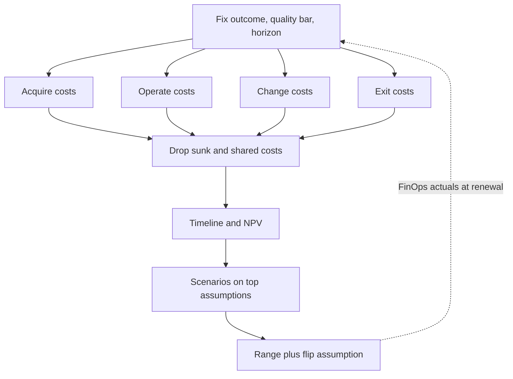

## TL;DR
Total cost of ownership is every cost an option incurs over a fixed horizon: acquiring, running, changing
and leaving it. For AI systems people, eval upkeep, forced migrations and exit usually outweigh the
invoice, so compare equal outcomes and report a range.

## Why it exists
- **Decisions get framed by the most visible price:** dollars per million tokens, per GPU hour, per seat.
  Each is real, and each describes only one slice of what the option will cost.
- **Each headline price hides lines.** A per-token price omits the engineer who keeps prompts working when
  the provider retires the model. A GPU hourly rate omits the serving stack, the on-call rotation and the
  three-year hardware refresh. A per-seat SaaS price omits integration, the security review, the annual
  price escalator and what it costs to get your data back out.
- **The failure mode is predictable.** Option A wins on headline price; then the unwritten costs arrive as
  "unplanned" work: a migration sprint when a model is deprecated, a re-embedding job when the embedding
  model changes, a quarter of platform work to make a self-hosted cluster reliable. Six months in, the
  cheaper option is the expensive one, and nobody can say whether the decision was wrong or just unlucky,
  because nothing was written down.
- **"Add 20% for overhead" fails** because hidden costs are not proportional to the visible one.
  Engineering cost is roughly fixed regardless of volume, licence cost scales with seats, token cost
  scales with usage, and migration cost arrives in lumps on someone else's schedule.
- **What TCO buys:** all of those on one timeline, so the comparison is honest and the assumptions can be
  checked later.

## How it works
### 1. Fix the outcome and the horizon
- **Same outcome:** the same task, at the same quality bar on your evals, at the same latency and
  availability target.
- **Unequal quality gets priced:** if the cheaper option scores lower, add the cost of closing the gap
  (fine-tuning, a reranker, human review) or express both in cost per successful task.
- **Horizon is usually three years,** because one-off build costs amortize over it and it matches the
  longest common committed-use term (hardware itself is often depreciated over three to five years).
- **Hosted-API exception:** a horizon longer than the model generation you build on is fiction, so keep it
  short and model the migration as a cost inside it.

### 2. Enumerate costs in four buckets
| Bucket | What goes in |
|---|---|
| **Acquire** (one-off) | build effort; integration with identity, data and logging systems; procurement and security review; building the eval set; initial data preparation and indexing; hardware purchase |
| **Operate** (recurring) | tokens or GPU hours, licences, vector database and storage, observability, network egress, support contracts, and the fractional people who run it, carry the pager and answer user tickets |
| **Operate, on-prem extras** | power and cooling (facility power is roughly IT power times the site's PUE, power usage effectiveness), space, spares and hardware refresh |
| **Change** (recurring but lumpy) | forced model migrations and the re-evaluation they need, prompt re-tuning, re-embedding a corpus when the embedding model changes (the old vectors are unusable with the new model), serving-stack upgrades, price changes at renewal |
| **Exit** (contingent) | data export, re-integration with a replacement, contract minimums or unused commitments, parallel running during cut-over |

Exit is included because it bounds how locked in you are.

### 3. Cost people honestly
- **People are usually the biggest line,** and the one most often left out because it does not appear on a
  cloud bill.
- **Use a loaded cost per engineer-year** (salary plus benefits, overhead, tooling) and estimate fractions
  of FTE per activity.
- **Include opportunity cost** when the same engineers would otherwise ship product: an option that
  consumes a platform team is not free because the team is already on payroll.

### 4. Count only what the decision changes
- **TCO for a decision is *incremental*:** include a cost only if it differs between the options from today
  onward.
- **Sunk costs belong in neither column.** GPUs bought last year or a prototype already built are gone
  whichever option you pick, *because* the money is spent; "we already paid for the cluster" argues for
  using it only through its resale or opportunity value.
- **Shared costs that exist either way cancel out** (the identity system, the data warehouse), so leave
  them out of both, which keeps the model small.
- **What remains** is the money and people the choice actually commits.

### 5. Put it on a timeline and discount it
- **Lay costs out by period.** Capital purchases are depreciated over their useful life for accounting, but
  for a decision compare cash flows.
- **Discount future cash** at a rate your finance team provides: `NPV = Σ_t cost_t / (1 + r)^t`.
- **Why discounting matters:** options differ in timing. A build is front-loaded, a growing subscription is
  back-loaded, and undiscounted totals overstate the back-loaded one.

### 6. Model uncertainty as scenarios
1. **Run a base case** rather than trusting one number; volume, adoption, provider price moves and model
   deprecation dates are all uncertain.
2. **Vary the two or three assumptions that move the answer most** (adoption, price, team size).
3. **Attach expected costs to risk events** as probability times impact.
4. **Report a range** and a statement of which assumption flips the decision.

### How it relates to its neighbours
| Neighbour | Relationship to TCO |
|---|---|
| Break-even analysis | one slice of TCO along the volume axis |
| Cost modeling | supplies the per-request operate costs |
| Unit economics | divides TCO by successful outcomes |
| FinOps | checks the TCO model against actual spend once the option is live |

## Diagram
Follow the steps top to bottom; the loop at the end is FinOps actuals correcting the assumptions at
renewal.



## Examples
### Build on an API or buy SaaS?
Build a contract-review assistant on a hosted LLM API, or buy a vendor SaaS product priced per seat?
Every figure below is illustrative, in thousands of dollars.

```python
FTE, RATE = 200, 0.10               # loaded engineer-year; discount rate from finance

def build_on_api(users):
    upfront = 1.0 * FTE + 30        # 2 engineers x 6 months, plus building the eval set
    run = [u * 0.12                 # tokens at $120 per active user-year
           + 0.75 * FTE             # maintenance, on-call, prompt upkeep
           + 24                     # vector DB, observability, gateway
           + 40                     # one forced model migration and re-eval per year
           for u in users]
    return [upfront] + run

def buy_saas(users, seat=0.36, escalator=0.07):
    upfront = 60                    # integration, SSO, security review
    run = [u * seat * (1 + escalator) ** y + 0.25 * FTE for y, u in enumerate(users)]
    return [upfront] + run          # licence with annual escalator, plus admin time

def tco(flows, rate=0.0):
    return sum(c / (1 + rate) ** t for t, c in enumerate(flows))

for label, users in (("growth", [500, 1000, 1500]), ("flat", [500, 500, 500])):
    b, s = build_on_api(users), buy_saas(users)
    print(f"{label}: build {tco(b):.0f} (NPV {tco(b, RATE):.0f})  buy {tco(s):.0f} (NPV {tco(s, RATE):.0f})")
# growth: build 1232 (NPV 1051)  buy 1393 (NPV 1131)
# flat: build 1052 (NPV 911)  buy 789 (NPV 662)
```

Three readings:
- **Tokens are a minority of build cost.** Even in year three they are $180k of $394k, and over the three
  years the 0.75 FTE of upkeep ($450k) outweighs tokens ($360k). A 20% token discount would save about
  $72k; trimming upkeep by a quarter of an FTE would save $150k.
- **The decision flips on adoption.** Per-seat pricing scales with users while the build is mostly fixed,
  so build wins if usage triples and buy wins clearly if it stays flat. Adoption is the assumption to test
  before committing.
- **Discounting halves build's advantage in the growth case** ($161k undiscounted, $80k NPV), because the
  subscription's large payments come late.
- **A strong write-up goes further:** add exit cost to the buy side and the option value of reusing the
  built pipeline for a second feature, then say which one the recommendation depends on.

### Worked scenario: find the assumption that flips it
Append this to the code above to sweep the two assumptions most likely to be wrong: year-three adoption
and the vendor's seat price.

```python
for y3 in range(500, 2001, 250):                       # year-3 active users, linear ramp from 500
    users = [500, (500 + y3) / 2, y3]
    gap = tco(buy_saas(users), RATE) - tco(build_on_api(users), RATE)
    print(f"year-3 users {y3:>5}: buy minus build NPV = {gap:+6.0f}k -> {'build' if gap > 0 else 'buy'}")
for seat in (0.30, 0.36, 0.45):                         # seat price, thousands per user-year
    users = [500, 1000, 1500]
    gap = tco(buy_saas(users, seat=seat), RATE) - tco(build_on_api(users), RATE)
    print(f"seat ${seat*1000:.0f}/yr: buy minus build NPV = {gap:+6.0f}k")
```

| Year-3 users | Buy minus build (NPV, $k) | Cheaper |
|---|---|---|
| 500 (flat) | −249 | buy |
| 1,000 | −85 | buy |
| 1,250 | −3 | buy, a tie |
| 1,500 | +80 | build |
| 2,000 | +244 | build |

- **The flip sits near 1,250 year-three users,** so the recommendation is really a bet on adoption; a
  pilot that measures it is worth more than refining any other input.
- **Seat price matters too:** at $300 a seat-year buy wins by $78k in the growth case; at $450 build wins
  by $316k. Negotiating price before deciding can change the answer.

## Production patterns
- **TCO as a decision record.** When: any commitment longer than a few months. How: a short document with
  the outcome, horizon, the four buckets, each assumption with its owner, and the flip assumption named.
  Monitor: re-open it at renewal or when a provider changes price or retires a model.
- **Track change cost as a measured line.** When: from the first model migration. How: log engineer-days
  for each model swap, re-evaluation and re-embedding job, and use the real average in the next TCO.
  Monitor migration frequency and days per migration.
- **Run an exit drill before signing.** When: buying SaaS or committing to a provider. How: test a full
  export of documents, embeddings, logs and configuration, and price the re-integration effort and any
  contract minimums. Monitor that the export still works at each renewal.
- **Commit to the low scenario, not the forecast.** When: signing committed-use or reserved capacity. How:
  size the commitment to the bottom of the adoption range and buy the rest on demand. Monitor commitment
  utilization monthly.
- **Show risk events in their own column.** When: presenting to stakeholders. How: list each event (a
  deprecation, a price rise at renewal, a forced exit) as probability times impact, separate from firm
  costs, so a reader can disagree with a probability without discarding the model.
- **Reconcile with FinOps actuals.** When: quarterly after launch. How: compare the operate and change
  lines with metered spend and logged effort, and update the assumptions that drifted most.

## Trade-offs
- **Full model vs one-page estimate.** A full TCO model exposes hidden costs but takes days to build; for a
  small, reversible decision a one-page estimate is enough, and the full model pays off only when
  commitments exceed a quarter or so.
- **Longer horizon: amortizes build cost vs outlives the model.** Longer horizons favour building, but in
  AI they stretch past the life of the current model generation, so assumptions beyond about two years
  become guesses.
- **Discounting: fairer timing comparison vs a finance-chosen rate.** It compares front-loaded and
  back-loaded options fairly, yet a high rate can make deferring cost look better than it is.
- **Risk-weighted exit and migration costs: visible lock-in vs judgement calls.** Probabilities are
  judgement, so present them separately from firm costs instead of folding them in silently.
- **Committed-use and reserved pricing: lower unit cost vs fixed obligation.** It pays only if utilization
  materializes, and flips to a loss when adoption undershoots.

## Pitfalls
- **Comparing the invoice line only,** such as tokens versus GPU hours. Symptom: a "cheaper" option whose
  first quarter is consumed by unplanned platform and migration work.
- **Leaving out people because they are "already on payroll".** Symptom: roadmap features slip while the
  team keeps the self-hosted or custom-built stack alive.
- **Comparing options at unequal quality.** Symptom: a cheap option that needs a human review queue, or a
  fine-tuning project, that nobody costed.
- **Ignoring change costs** such as model deprecations and embedding-model upgrades. Symptom: an urgent
  re-embedding job or migration sprint arrives on the provider's schedule rather than yours.
- **Presenting one number with false precision.** Symptom: when one assumption, usually adoption, turns out
  wrong, stakeholders lose trust in the whole analysis instead of updating the input that moved.
- **Counting sunk costs as a reason to keep something.** Symptom: a business case for keeping an underused
  cluster that only works if its purchase price is counted as a saving.
- **Never revisiting the model after launch.** Symptom: without FinOps actuals to compare against, the next
  TCO repeats the same blind spots.

## When to use
- **Use when** a decision commits money or people for more than a few months: build versus buy, hosted API
  versus self-hosting, choosing a vector database or serving platform, signing a committed-use contract, or
  moving workloads on-prem.
- **Avoid when** the experiment is cheap and reversible; run the pilot and measure instead.
- **Measure** loaded people cost, cost per successful task, migration frequency and adoption, because those
  dominate.
- **Revisit** at renewal or when a provider changes price or retires a model.
- **Interviews:** the signal is naming the non-invoice lines unprompted and saying which assumption flips
  the recommendation.

## Role lens
- **Engineer:** Supplies the honest numbers: tokens per task, FTE fractions for upkeep, and how long the
  last model migration and re-evaluation actually took.
- **Architect:** Owns the comparison frame: equal outcome, horizon, cost buckets, scenarios, and designing
  for low exit cost so the TCO's lock-in line stays small.
- **FDE:** Builds the customer's TCO for adopting the product, including their integration, security review
  and change-management effort, which often decides the deal more than licence price.

## Check yourself
**Q:** A team proposes self-hosting an open-weight model because GPU cost per token is a third of the API
price. What would you ask before agreeing, in terms of total cost of ownership?
**A:** First, where "a third" came from. If it is the GPU hourly price divided by benchmark throughput, it
assumes the GPU is busy every second; bursty interactive traffic provisioned for peak with headroom often
runs near a third utilization, which alone turns a third of the price into roughly the same price, before
anything else is added. Then whether the comparison is at equal quality on our evals, and if not what
closing the gap costs. Then the operate costs beyond GPUs: fractional platform and on-call engineers at
loaded cost, serving-stack upgrades and observability. Then
change costs: how often we will swap models and what each re-evaluation costs. Then exit and commitment
risk: reserved capacity we may not fill. I would want this over a two-to-three-year horizon with
scenarios for volume and API price cuts, and the assumption that flips the answer named explicitly.

## Interview questions
### What does TCO include beyond the invoice, and why does "add 20% for overhead" not work?
- **Four buckets:** acquire (build, integration, security review, eval set), operate (tokens or GPUs plus
  the people who run it), change (forced migrations, re-embedding, upgrades) and exit (export,
  re-integration, unused commitments).
- **A flat uplift fails** because these lines scale differently: people are roughly fixed, licences scale
  with seats, tokens with usage, and migrations arrive in lumps on the provider's schedule.

### A manager says self-hosting is nearly free because "we already own the GPUs". How do you respond?
- **The purchase is sunk:** it is spent whichever option is chosen, so it belongs in neither column.
- **What still counts is incremental:** power, space, spares, the people to run and upgrade the serving
  stack, and the quality gap against the hosted option.
- **The GPUs' real value is their opportunity value,** what they could earn by being resold or used for
  another workload, and that is the number to put in the comparison.

### When is a full TCO model not worth building?
- **For cheap, reversible decisions:** a pilot that can be switched off in weeks costs less to run than to
  model, so run it and measure.
- **When one constraint decides it anyway,** such as data that cannot leave a region; still write a short
  estimate so the premium being paid is known.
- **Rule of thumb from practice:** the full model pays off once commitments exceed a quarter or so.

### Why discount, and what is a $100k cost in year three worth today at 10%?
- **Options differ in timing:** builds are front-loaded and subscriptions back-loaded, so undiscounted
  totals overstate the back-loaded option.
- **The arithmetic:** `NPV = Σ_t cost_t / (1 + r)^t`, so $100k / 1.1³ ≈ $100k / 1.331 ≈ $75k.
- **The rate is a finance input,** and a high rate makes deferring cost look better than it is, so show
  results at more than one rate if the decision is close.

### How do you choose the horizon for a product built on a hosted model API?
- **Default is three years,** because build costs amortize and it matches common commitment terms.
- **But do not run past the model generation you build on;** keep the horizon short and model at least one
  forced migration and re-evaluation as a cost inside it.
- **Then treat migration frequency as a scenario input,** measured from how long the last swap actually
  took.

## Quiz
### Q: Why should two options be compared at equal quality on your evals before comparing TCO?
- [ ] Because vendors are required to disclose quality differences in their pricing
- [x] Because a quality gap creates real costs, such as fine-tuning or human review, that otherwise go uncounted
- [ ] Because lower-quality models always use more tokens per request
- [ ] Because TCO is only defined for options with identical architectures
> The cheaper option often needs extra work to reach the same outcome. Comparing at unequal quality hides
> that work; equalize quality or compare cost per successful task instead.

### Q: In a build-on-API option, token spend is a small share of three-year TCO. What does that imply?
- [ ] Negotiating a lower token price is the most effective way to cut TCO
- [ ] The option is under-utilized and should be moved to self-hosting
- [x] People and change costs dominate, so reducing upkeep effort moves the total more than token price does
- [ ] Discounting should be removed because it distorts small cost lines
> Effort on a line should follow its share of the total. When upkeep FTE is the biggest line, automation
> and stable interfaces save more than a token discount; self-hosting would usually add people cost.

### Q: Discounting future costs at 10% narrows the gap between a front-loaded build and a growing subscription. Why?
- [ ] Discounting inflates upfront costs to reflect risk
- [x] The subscription's largest payments come in later years, which discounting weights less than early ones
- [ ] Discounting applies only to licence fees, not engineering costs
- [ ] Discounting removes the annual price escalator from the subscription
> Each future cost is divided by (1 + r)^t, so late cash counts for less. The subscription grows with
> adoption and escalators, so its back-loaded payments shrink most; the upfront build cost is untouched.
