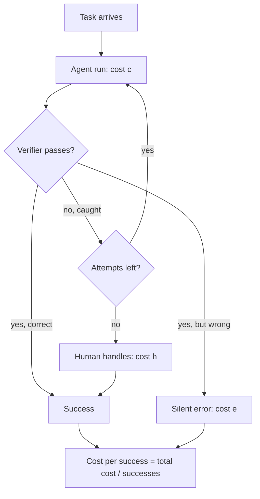

## TL;DR
Cost per successful task divides everything an agent spends on a unit of work (failed runs, retries,
verification, human fallback, damage from missed errors) by tasks meeting an agreed acceptance bar.
Compare it with task value to know whether the agent makes money.

## For agent builders
- **Why it matters for agents.** Agents fail expensively: a run can loop for 40 steps and still fail, and
  a confident wrong answer can pass every check. Cost per call or per run hides both, so it is the wrong
  number for choosing models, step limits, retry policies or human-in-the-loop designs.
- **Where it shows up in your stack.** A task or run ID on every span in your traces, the verifier or
  LLM-as-judge step after the agent, the escalation path to a human queue, and the eval suite that
  defines acceptance per task category.
- **What you control.** The acceptance definition, the verifier and its detection rate, the retry budget
  k, the step cap, which model each step uses, and when the agent hands off to a human.
- **What you can skip.** Full product accounting with amortized fixed costs when choosing between agent
  designs; marginal cost per successful task is enough for that comparison.

## Decision case
### Scenario
A logistics company's ticket-triage agent runs the small-model design from the first example below: $0.02
per attempt, 60% success, a $0.005 verifier catching 80% of failures, up to 3 attempts. Human handling is
$4.00 a ticket and a silent misroute costs $20. All figures are illustrative.
- **Volume and cost:** 50,000 tickets a month at $2.442 fully loaded, about $122,100 a month.
- **Latency:** triage within 20 s at p95. One agent attempt takes 7 s; the cheap verifier 1 s, a
  stronger judge 2 s.
- **Compliance:** silent misroutes must stay at or below 1% of tickets.
- **Budget:** model plus verifier spend at most $6,500 a month.
- **Candidate verifier:** a judge on a larger model at $0.03 per check, which caught 95% of failures on
  a 400-ticket labelled sample.

### Options
Computed with `per_task` from the first example; large model is $0.08 per attempt at 90% success.

| Option | Fully loaded per task | Silent misroutes | Worst-case latency | AI spend per month |
|---|---|---|---|---|
| Current: small, k=3, cheap verifier | $2.442 | 11.4%: fails | 3 × 8 = 24 s: fails | $1,780 |
| A. Large, k=1, cheap verifier | $0.805 | 2.0%: fails | 8 s | $4,250 |
| B. Large, k=2, cheap verifier | $0.549 | 2.2%: fails | 16 s | $4,590 |
| C. Small, k=3, strong judge | $0.905 | 3.1%: fails | 3 × 9 = 27 s: fails | $3,810 |
| D. Large, k=2, strong judge | $0.266 | 0.55% | 2 × 9 = 18 s | $6,025 |

### Decision
Choose **D**: the large model, the stronger judge and at most 2 attempts.
- **Unit cost:** $0.266 fully loaded per ticket, about $13,300 a month against $122,100 today, and a
  margin of about $3.73 a ticket against the $4.00 human baseline.
- **Compliance:** D is the only option under the 1% silent-misroute bar. Detection, not model accuracy,
  moves that number: B and D share a model, and B's silent rate is four times D's.
- **Latency and budget:** two attempts of 9 s fit inside 20 s; three do not. AI spend of $6,025 fits the
  $6,500 cap, with little room.
- **Why not C:** a better judge on the small model still lets 3.1% through, because the small model fails
  four times as often, and its 3 attempts break the latency target.

**What would change it:** if the second attempt rarely succeeds (correlated failures), D at k=1 costs
$0.59 with the same 0.5% silent rate, still the best compliant choice. If the judge's true detection on
live traffic falls well below 95%, the silent rate rises and the 1% bar must be re-checked.

### Trade-offs accepted
- **The highest AI spend of any option.** Spend per success rises to about $0.12, triple the current
  $0.04. Report fully loaded cost next to AI spend so the rise is not read as a regression.
- **Budget headroom of about 7%.** Volume growth above roughly 8% eats it; alert on monthly AI spend at
  90% of the cap.
- **Detection measured on 400 tickets.** Re-estimate d monthly from sampled human review of
  judge-passed tickets.
- **Independence assumption.** Track second-attempt success; if it is far below 90%, drop to k=1.

### Review rubric
- Defines success and the cost of each failure path (escalation, silent error) before comparing options.
- Computes fully loaded cost per task for every option, not AI spend per success alone.
- Checks each option against every hard constraint (compliance, latency, budget) and says which it fails.
- Separates the effect of detection from the effect of model accuracy.
- States the assumptions (independence, detection rate) and the measurement that would overturn the choice.

## Why it exists
- **Dashboards show cost per call because providers bill per token.** That answers the wrong question.
- **The business buys outcomes, not calls:** resolved tickets, extracted invoices, merged pull requests,
  qualified leads.
- **Between a call and an outcome sit hidden costs:** retries, tool errors, verification passes,
  escalations to a human and, worst, wrong outputs nobody caught that cost a refund, a compliance
  incident or a customer.
- **Cost per call rewards the wrong design.** A smaller model halves per-call cost and can triple cost
  per resolved task once escalations are counted. Agents widen the gap: a run that loops for 40 steps
  and then fails consumed real money and produced nothing.
- **Undefined success drifts.** Without explicit acceptance criteria, "success" becomes whatever flatters
  the metric, such as "the model returned something". One fixed ratio of cost to outcome lets model
  choices, retry policies and human-in-the-loop designs be compared on what the business cares about.

## How it works
### 1. Define success first
- **In terms the customer would accept:** ticket resolved and not reopened within a set window;
  extraction matching the source on all required fields; code change passing tests and merged.
- **Decide how it is measured:** automated checks, sampled human review, or a downstream signal. A metric
  without a fixed definition drifts toward whatever is easy to count. "The agent returned a final
  answer" is not success.
- **Use closed cohorts.** Downstream signals arrive late (a ticket counts as resolved only once the reopen
  window has passed), so compute on cohorts whose window has closed, or this week's number looks better
  than it is.

### 2. Count all the cost
For a period or a cohort of tasks, sum:
- **Model tokens for every attempt,** including failed and abandoned ones, and reasoning tokens. For an
  agent that means every step of every run, including runs that hit the step cap.
- **Non-model calls:** retrieval, tools, guardrails, verifier or judge models.
- **Human time** for review, escalation and correction, at a loaded hourly rate.
- **Expected cost of undetected errors:** rate of silent failure × cost per incident.
- **Amortized fixed costs,** if the comparison is about the whole product rather than a design change.

### 3. Divide by successes
```
cost_per_successful_task = total_cost / tasks_meeting_acceptance
```
- **Expected-value shortcut:** if each attempt costs c and succeeds with probability p, and every failure
  is reliably detected and retried, expected AI cost per success is c/p.
- **So a model at 4× the price with 1.5× the success rate is not 4× worse.**
- **Two terms usually dominate in real systems:** the share of failures handed to humans, and the share
  of failures *not detected* at all.

### 4. Compare with value
- **Value per task:** human handling cost avoided, revenue per conversion, or time saved.
- **Margin per task** = value − fully loaded cost.
- **Break-even success rate** is the p at which margin reaches zero: how good the system must be before
  automation pays.
- **With a human fallback,** the baseline is the all-human cost h. With one attempt at cost c, a detector
  catching a fraction d of failures, and a cost e per silent error, automation is cheaper when:

```
c + (1 − p)·(d·h + (1 − d)·e)  <  h     →     p  >  1 − (h − c) / (d·h + (1 − d)·e)
```

- **With perfect detection (d = 1)** this reduces to p > c/h, which is why cheap models clear the bar
  easily when failures are always caught. As e grows and d falls, the required p climbs fast.

### Caveats that change the answer
- **Attempts are not independent.** A model that fails on a hard input often fails again on retry, so the
  c/p retry math is optimistic.
- **Detection is neither free nor perfect.** A verifier adds cost and misses some failures.
- **The task mix shifts over time,** so recompute per task category, not one global number.

## Diagram
One agent task's paths: only caught failures can be retried; missed failures skip straight to the error
cost, which is why detection rate matters so much.



## Examples
### Fully loaded cost per task for two models
A ticket-triage agent where a human handles anything the agent cannot (all figures illustrative): human
cost $4.00 per ticket, a verifier costing $0.005 catches 80% of agent failures, and a failure that slips
through costs $20 in rework and goodwill.

```python
def per_task(c, p, k=1, verify=0.005, detect=0.8, human=4.00, error=20.00):
    """Expected fully loaded cost of one task: up to k attempts; a caught failure is retried
    (then sent to a human after k); a missed failure costs `error`. Independence is optimistic."""
    cost, reach, solved, ai = 0.0, 1.0, 0.0, 0.0
    for _ in range(k):
        ai += reach * (c + verify)
        cost += reach * (1 - p) * (1 - detect) * error   # silent failure reaches the customer
        solved += reach * p
        reach *= (1 - p) * detect                         # caught failure: try again
    cost += ai + reach * human
    return cost, solved, ai / solved

for name, c, p in (("small", 0.02, 0.60), ("large", 0.08, 0.90)):
    for k in (1, 3):
        cost, solved, ai_per_win = per_task(c, p, k=k)
        print(f"{name} k={k}: ${cost:.3f}/task automated {solved:.1%} AI spend/success ${ai_per_win:.3f}")
# small k=1: $2.905/task automated 60.0% AI spend/success $0.042
# small k=3: $2.442/task automated 85.3% AI spend/success $0.042
# large k=1: $0.805/task automated 90.0% AI spend/success $0.094
# large k=3: $0.529/task automated 97.8% AI spend/success $0.094
```

- **AI spend per success flatters the small model** by more than 2×. Fully loaded, it costs about 3.6×
  more per task (k=1), because its silent failures and escalations dominate.
- **Retries help only with *detected* failures,** and every extra attempt is another chance to slip past
  the verifier. For the small model, k=1 to k=3 cuts human escalation from $1.28 to about $0.13 per task
  but *raises* the silent-error term from $1.60 to about $2.28, which now dominates its bill.
- **So improving detection is often worth more than adding retries,** or even than improving the model.
- **Cost per task ≈ cost per success here,** because a human finishes every caught failure; silent
  failures are the exception, charged through the error term.
- **Break-even:** against the all-human $4.00, the formula gives p > 1 − 3.975 / 7.2 ≈ 0.45 for the small
  model. At 60% it beats doing everything by hand, but by a thin margin a small rise in silent-error cost
  would erase.

### Computing it from agent traces
Group every attempt by task ID, charge failed runs, escalations and silent errors, then divide by
accepted tasks. The rows are illustrative; in production they come from your trace export.

```python
from collections import defaultdict

# One row per agent attempt, exported from traces (illustrative values).
attempts = [
    {"task": "T1", "cost": 0.31, "verifier_pass": True,  "accepted": True},
    {"task": "T2", "cost": 0.95, "verifier_pass": False, "accepted": False},  # looped, caught
    {"task": "T2", "cost": 0.40, "verifier_pass": True,  "accepted": True},   # retry worked
    {"task": "T3", "cost": 2.10, "verifier_pass": False, "accepted": False},  # hit step cap
    {"task": "T4", "cost": 0.28, "verifier_pass": True,  "accepted": False},  # silent error
]
HUMAN, ERROR = 4.00, 20.00                     # $ per escalation, $ per silent error

tasks = defaultdict(list)
for a in attempts:
    tasks[a["task"]].append(a)

total = successes = 0.0
for rows in tasks.values():
    total += sum(r["cost"] for r in rows)      # every attempt counts, failed ones too
    last = rows[-1]
    if last["accepted"]:
        successes += 1
    elif last["verifier_pass"]:
        total += ERROR                         # passed the verifier but was wrong
    else:
        total += HUMAN; successes += 1         # escalated, a human finished it

print(f"AI spend ${sum(a['cost'] for a in attempts):.2f}, fully loaded ${total:.2f}")
print(f"cost per successful task ${total / successes:.2f} over {successes:.0f} successes")
# AI spend $4.04, fully loaded $28.04
# cost per successful task $9.35 over 3 successes
```

- **The step-capped run (T3) cost more tokens than any success** and still needed a human.
- **The silent error (T4) is the largest single line**, though its tokens were the cheapest.

### Worked scenario: choosing a step cap for a coding agent
Illustrative numbers: a human engineer finishes any failed task at $25; every failure is caught by the
test suite.

| Step cap | Success rate | Mean AI cost per run | AI spend per success | Fully loaded per task |
|---|---|---|---|---|
| 40 steps | 78% | $0.90 | $1.15 | 0.90 + 0.22 × 25 = $6.40 |
| 15 steps | 74% | $0.45 | $0.61 | 0.45 + 0.26 × 25 = $6.95 |

- **The tighter cap halves AI spend per success** and still loses, because 4 more points of failures cost
  $1.00 of engineer time per task against $0.45 of tokens saved, a net loss of $0.55 per task.
- **The cap is a success-rate decision first** and a token decision second whenever human fallback is
  expensive.

### How detection moves the break-even bar
The same formula as a function, for the small model (c = $0.02 + $0.005 verifier).

```python
def break_even_p(c, h, d, e):
    """Minimum success rate for one AI attempt plus fallback to beat the all-human cost h."""
    return 1 - (h - c) / (d * h + (1 - d) * e)

for d in (1.0, 0.8, 0.6):
    print(d, f"{break_even_p(0.025, 4.00, d, 20.00):.2f}")
# 1.0 0.01   (reduces to c/h)
# 0.8 0.45
# 0.6 0.62
```

| Detection rate d | Required success rate p |
|---|---|
| 1.0 | ~0.01 (c/h) |
| 0.8 | ~0.45 |
| 0.6 | ~0.62 |

Losing 20 points of detection raises the bar by about 17 points of model accuracy.

### Worked cohort: from invoice lines to one number
An illustrative month of 10,000 tickets whose 7-day reopen window has closed.

| Line | Amount |
|---|---|
| Model tokens, all attempts including failed and abandoned | $420 |
| Retrieval, tools and verifier calls | $90 |
| Human escalations: 1,200 tickets × $4.00 | $4,800 |
| Silent errors: 150 reopened tickets × $20 | $3,000 |
| **Total** | **$8,310** |
| Successful tasks (resolved, not reopened) | 9,850 |
| **Cost per successful task** | **~$0.84** |

- **The model line is 5% of the total;** escalations and silent errors are 94%.
- **Against the $4.00 human baseline** the margin is about $3.16 per success, a number a per-call
  dashboard could never show.

## Production patterns
- **One task ID across every attempt.** Generate an ID when the task starts and attach it to every model
  call, tool call, verifier result and escalation (for example as a trace attribute). Monitor the share
  of spend not attributable to any task; it should be near zero.
- **Cohort metrics after the window closes.** Compute cost per successful task weekly on cohorts whose
  reopen or acceptance window has passed, per task category and per tenant. Monitor it next to success
  rate and escalation rate.
- **Calibrate detection with sampled review.** Have humans review a random sample of verifier-passed
  outputs to estimate the silent-failure rate (1 − d). Monitor that rate per category; it feeds the
  error term directly.
- **Retry budget tied to detection.** Allow retries only after a verifier rejects an output, cap them at a
  small k, then route to a human. Monitor success on the second attempt; if it is far below the first,
  failures are correlated and retries are wasted.
- **Step caps chosen from fully loaded cost.** Agent teams sweep the step limit on the eval set and pick
  the cap with the lowest fully loaded cost per task, not the lowest token spend. Monitor the share of
  runs that hit the cap per category.
- **Break-even check before rollout.** For each new model or prompt, compute required p from c, h, d and e
  and compare with the eval success rate per category. Ship only where the margin is comfortably
  positive.

## Trade-offs
- **Stricter success definition vs headline number.** It makes the metric trustworthy but lowers the
  number and costs review effort; a looser one flips into self-deception once customers start reopening
  tasks.
- **Verifier cost vs silent-failure cost.** A verifier costs money on every task but pays back whenever a
  silent failure costs much more than verification; for low-stakes tasks it can be pure overhead.
- **More retries vs tokens and latency.** Retries raise automation rate, but each costs tokens and
  latency and helps only when failures are detected and not strongly correlated across attempts.
- **Tighter step caps vs success.** They bound runaway token spend, but each task they cut off becomes an
  escalation; the trade flips when human fallback is cheap relative to long runs.
- **Fully loaded vs marginal cost.** Including amortized fixed costs gives the true product margin but
  blurs comparisons between designs; use marginal cost to choose designs and fully loaded cost to price.

## Pitfalls
- **Reporting cost per call as unit cost.** Symptom: a "cheaper" model rollout followed by more
  escalations and a higher total support bill. Fix: divide fully loaded cost by successes.
- **Counting only successful runs' tokens.** Symptom: unit cost that ignores agent runs that looped and
  failed, so finance totals never reconcile with the metric. Fix: attribute every attempt to its task.
- **Defining success as "completed without error".** Symptom: the metric looks excellent while customer
  reopen rates or downstream correction volume quietly climb. Fix: customer-accepted criteria.
- **Treating the retry math as independent.** Symptom: real success after retries stays well below the
  predicted rate because the same hard inputs keep failing. Fix: measure second-attempt success.

## When to use
- **Use when** comparing models, prompts, retry policies, step caps or human-in-the-loop designs, and when
  pricing an AI feature or arguing for its ROI.
- **Measure** per task category and per tenant rather than globally; track weekly next to success rate
  and escalation rate, and validate the success definition with sampled human review.
- **Avoid** during early prototyping, before there is a stable task definition.
- **Interviews:** asking "per successful what?" when someone quotes a cost number is the mark of someone
  who has run an AI product.

## Role lens
- **Engineer:** Instruments each task end to end with an ID so every attempt, tool call, verifier
  result and escalation is attributed to one outcome.
- **Architect:** Chooses model tier, retry budget, verifier and human-fallback design by comparing
  fully loaded cost per successful task against task value.
- **FDE:** Agrees the success definition and the value per task with the customer, so the ROI case uses
  their numbers and survives their finance review.

## Check yourself
**Q:** Model X costs $0.01 per attempt with 70% success; model Y costs $0.05 with 92%. Failures go to a
human at $3. Which is cheaper per task, and what assumption would you challenge?
**A:** With one attempt and perfect detection, X costs 0.01 + 0.30 × 3 = $0.91 per task and Y costs
0.05 + 0.08 × 3 = $0.29, so Y is about three times cheaper despite the 5× price. The human fallback
dominates. I would challenge perfect detection: if some failures are not caught, the cost of each silent
error must be added, and that term usually favors the more accurate model further. I would also check
whether retrying X helps or whether its failures correlate on hard inputs, and compute the numbers per
ticket category.

## Interview questions
### What is cost per successful task, and why not just report cost per call?
- **Definition:** fully loaded cost (all attempts, tools, verifiers, human time, expected silent-error
  cost) divided by tasks meeting an agreed acceptance bar.
- **Why:** the business buys outcomes; a cheaper call that fails more moves cost into retries,
  escalations and errors.
- **Comparable to value:** only this number can be set against value per task to get a margin.

### Your team adds two retries and the automation rate rises, but total cost per task barely moves. Why?
- **Retries act only on caught failures,** so they shift cost from human escalation to automation.
- **Each attempt is another chance for a silent miss,** so the silent-error term grows; in the
  illustrative example it rises from $1.60 to about $2.28 per task.
- **Fix detection first:** a better verifier lowers both escalation and silent-error terms.

### How would you choose the step limit for a production agent?
- **Sweep it on the eval set:** run the agent at several caps and record success rate, mean cost per run
  and escalations per category.
- **Pick on fully loaded cost per task:** a tighter cap saves tokens but every task it cuts off becomes a
  human escalation, which often costs far more.
- **Then monitor** the share of runs hitting the cap in production; a rising share means the task mix or a
  tool changed.

### When would you not add a verifier step?
- **When silent failures are cheap:** for low-stakes tasks the verifier is pure overhead on every task.
- **When it misses the failures that matter:** a verifier with low detection on the costly error class
  adds spend without cutting e.
- **Decide with the break-even formula,** comparing verifier cost per task with the expected silent-error
  cost it removes.

### How do you set the minimum accuracy a model needs before you automate a workflow?
- **Compute break-even p** from attempt cost c, human cost h, detection rate d and silent-error cost e:
  p > 1 − (h − c) / (d·h + (1 − d)·e).
- **Detection dominates:** in the illustrative example the bar moves from about 0.45 at d = 0.8 to about
  0.62 at d = 0.6.
- **Require a margin** above break-even per task category, measured on a closed cohort.

### This week's cost per successful ticket looks 30% better than last month's. What do you check?
- **Cohort maturity:** tickets still inside the reopen window count as successes until they reopen.
- **Definition drift:** whether "success" quietly loosened, or the task mix shifted to easier categories.
- **Attribution gaps:** failed or abandoned runs missing a task ID drop out of the cost numerator.

## Quiz
### Q: Why is cost per API call a misleading unit cost for an AI feature?
- [ ] API calls are billed monthly rather than per call
- [x] It ignores failed attempts, retries, human fallback and undetected errors, which can dominate the cost of a good outcome
- [ ] Token prices change too frequently to measure per call
- [ ] It double-counts cached input tokens
> The business pays for outcomes. A cheaper call that fails more often moves cost into retries,
> escalations and error handling, so cost per successful task can rise while cost per call falls.

### Q: Each attempt costs c, succeeds with probability p, and failures are always detected and retried. What is the expected AI cost per success?
- [ ] c × p
- [x] c / p
- [ ] c / (1 − p)
- [ ] c + p
> The number of attempts until success is geometric with mean 1/p, so expected cost per success is
> c/p. c/(1 − p) inverts the wrong probability: it is the expected cost until the first *failure*, a
> common mix-up.

### Q: A verifier catches 80% of failures. Adding more retries mainly reduces which cost term?
- [ ] The cost of silent failures that reach the customer
- [x] The share of tasks escalated to a human after caught failures
- [ ] The per-attempt token cost
- [ ] The verifier's own cost per attempt
> Retries only act on failures the verifier detects, so they shift work from human escalation to
> automation. Missed failures never trigger a retry, and each extra attempt is another chance of a
> silent miss, so the silent-error term does not fall and can even grow; it needs better detection.

## Use cases & projects
### Use cases
- **Choosing the model for a support or triage agent.** Fully loaded cost per resolved ticket shows when
  the pricier, more accurate model is the cheaper one.
- **Deciding whether to add a verifier or judge step.** The break-even formula weighs verifier cost on
  every task against the silent errors it catches.
- **Setting retry budgets and step caps.** Both are chosen on cost per successful task, because each
  shifts cost between tokens, escalations and silent errors.
- **Making the ROI case to a customer.** Their human handling cost and success definition turn agent
  metrics into a margin per task finance can check.

### Mini project
**Cost per successful task dashboard for an agent (2-3 hours).**
- **Goal:** compute fully loaded cost per successful task for a small agent under two designs and pick the
  better one.
- **Steps:** run an agent over a 30-task eval set with a task ID on every attempt; add a simple verifier
  (tests or a rubric check); export attempts with cost, verifier result and ground-truth acceptance; charge
  an assumed human cost for escalations and an error cost for silent failures; repeat with a different
  model or step cap.
- **Done when:** you have a table per design with AI spend per success, detection rate, escalation rate
  and fully loaded cost per successful task, and a one-paragraph recommendation that names the dominant
  cost term.
