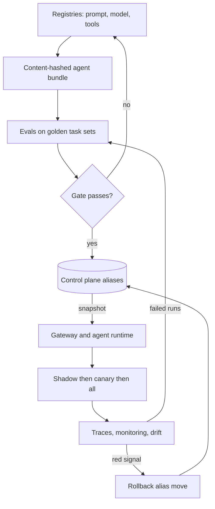

## Overview
This module covers what it takes to change an agent safely and repeatedly once it is in production and
more than one team depends on it. The unit of release is not a container image but a bundle.

That bundle holds code, prompt version, model version or provider snapshot, decoding parameters,
retrieval index and guardrail policy. For an agent it also holds system prompts, tool descriptions and
tool schemas. Any one part can change behaviour without touching the others.

The lessons build the platform in four groups:

- **System of record:** experiment tracking for runs and lineage, a model registry and a prompt registry that both split immutable versions from mutable aliases.
- **Evidence:** a shared evaluation framework, a tiered golden-dataset portfolio, and reproducible runs with manifests and a measured noise floor.
- **Controlled exposure:** CI/CD, release gates, shadow and canary rollouts and rollback turn that evidence into pointer moves.
- **Keeping the bundle honest:** monitoring, drift detection, an observability stack and a lifecycle and deprecation policy, while the world, the provider and the corpus move underneath it.

The last two lessons step back to platform shape: a control plane that publishes config snapshots to a
fast, independent data plane, and the line between what a central platform team owns and what product
teams own.

Which lessons matter most for agents:

- **Core (you use them directly on every agent):** observability-stack, evaluation-frameworks, golden-dataset-strategy and model-monitoring. Traces, task sets, scorers and live proxies are how you know what an agent did.
- **Useful (you meet them once an agent ships or a second team appears):** the other twelve lessons, from registries and reproducible evals to gates, canaries, rollback, drift, deprecation and platform shape.
- **Background:** none; even centralized-vs-federated-ai-platform decides what your agent inherits.

Afterwards you can:

- Design a release pipeline where promotion and rollback are audited pointer moves backed by statistical evidence.
- Explain why a prompt edit is a production change.
- Lay out the platform for an organisation with many AI teams.

It matters most for AI Engineers and Architects who run shared AI infrastructure, and for FDEs who must
show a customer how changes reach their tenant.

## Why it matters
- **Engineer:** You will wire an agent's prompts and models into registries, write the eval-based CI ladder with content-addressed caching, implement a paired non-inferiority gate, emit traces that carry the resolved bundle version, and make rollback a single alias move you have rehearsed.
- **Architect:** You decide what the agent's release unit is, where the control plane ends and the data plane begins, which signals gate a promotion, how provider sunsets and embedder upgrades are migrated, and which platform pieces are mandatory and central versus federated to product teams.
- **FDE:** Customers will ask how a prompt or model change reaches the agent on their tenant, what evidence backs it, how fast you can undo it and how you will notice quality slipping; you need to show the gate report, the canary plan, the rollback drill and per-tenant monitoring on their traffic.

## Mental model
Picture one immutable, content-hashed agent bundle moving along a conveyor of environments. A pointer
(an alias such as `champion` or `canary`) marks where it is live.

| Zone | What happens | Lessons |
|---|---|---|
| Left of production | Produce evidence: tracked runs, a versioned golden portfolio, reproducible eval runs with manifests, and a gate comparing candidate to champion with a confidence interval and per-slice floors. | experiment-tracking, model-registry, prompt-registry, evaluation-frameworks, golden-dataset-strategy, reproducible-evaluations, ci-cd-for-prompts-and-models, evaluation-gates-for-production-releases |
| Crossing into production | Never a rebuild, only a pointer move: first a shadow copy of traffic, then a sticky canary slice, then everyone. | canary-shadow-deployments, rollback |
| Right of production | Watch the bundle against the world: monitoring slices quality proxies by bundle version, drift asks whether inputs, answers or a pinned component moved, and the lifecycle policy schedules the day a version must leave. | observability-stack, model-monitoring, drift, model-lifecycle-and-deprecation-policy |
| Around it all | The control plane owns the pointers and the evidence; the data plane only reads a snapshot and serves it. | ai-control-plane-vs-data-plane, centralized-vs-federated-ai-platform |

Any red signal moves the pointer back to the last validated bundle.

## Suggested order
1. observability-stack — agent core and needs no prerequisites: the trace, metric and payload pipeline that post-release signals and eval loops depend on.
2. evaluation-frameworks — agent core: the shared datasets, targets, scorers, runner and results store that make eval scores comparable.
3. golden-dataset-strategy — agent core: turns the dataset interface into a tiered, owned, refreshed portfolio sized to the regressions it must detect.
4. model-monitoring — agent core: layers operational, proxy and late quality signals over the observability stack, sliced by bundle version and tenant.
5. experiment-tracking — the run data model and lineage that every registry entry and eval score points back to.
6. model-registry — introduces the immutable-version versus mutable-alias split on the artifact that is hardest to version.
7. prompt-registry — applies the same split to prompt text and its model settings, completing the bundle's components.
8. reproducible-evaluations — pins every drifting part of an eval in a manifest and measures the noise floor gates will rely on.
9. ci-cd-for-prompts-and-models — assembles registries and evals into a pipeline that promotes one tested bundle through a risk-sized ladder.
10. evaluation-gates-for-production-releases — formalises the promotion decision as floors, a paired non-inferiority test and three outcomes.
11. canary-shadow-deployments — extends evidence to live traffic with bounded exposure once offline gates pass.
12. rollback — makes the reverse pointer move fast and safe, including the components that destroy their own undo path.
13. drift — separates what moved, how it moved and whether it mattered, and feeds confirmed shifts back into the golden set.
14. model-lifecycle-and-deprecation-policy — plans the exit of versions and provider snapshots as dated, evaluated migrations.
15. ai-control-plane-vs-data-plane — reframes registries, aliases and policies as a control plane publishing snapshots to a serving path.
16. centralized-vs-federated-ai-platform — decides which of all these pieces one platform team owns and which product teams own.

## Capstone
### Brief
**Use case:** a support team runs a small retrieval-augmented, tool-calling support agent that answers
questions about a fictional company's returns and billing policy. They need to change its prompt or
model weekly without breaking refunds. This major project (several days) builds the release platform
that makes those changes safe.

The pieces you build:

- **Gateway:** a minimal gateway resolves a `champion` and a `canary` alias from a local control-plane store into a bundle. The bundle holds a prompt version from a prompt registry, a model version (a provider snapshot or a small local model) from a model registry, decoding parameters and an index version.
- **Fail static:** the gateway caches the resolved snapshot and keeps serving it if the control plane is stopped.
- **Tracked evals:** every eval run is tracked with a manifest that pins dataset, bundle, judge and rubric versions. Runs use a tiered golden portfolio with smoke, full, slice and regression tiers.
- **CI and gate:** CI runs the smoke tier on every prompt change and the full tier on release candidates. A gate then applies safety and schema floors, per-slice floors and a paired non-inferiority test against the champion.
- **Rollout:** passing candidates go to a shadow run on replayed traffic, then a sticky 10% canary with guard metrics and automatic rollback.
- **Monitoring:** traces carry the resolved bundle hash. A monitoring view shows proxies and sampled judge scores by version, with a drift check on intent and language mix.
- **Lifecycle:** finally, deprecate the old model version through the lifecycle states with an inventory of which bundles still pin it.

### Deliverables
- A runnable repository with the gateway, control-plane store, prompt and model registries, tracked eval runner and golden portfolio, started with one command.
- A CI configuration that runs the eval ladder with cached results and writes a gate report showing per-slice deltas, the confidence interval and the pass, block or needs-review verdict.
- A deployment script that performs shadow, canary ramp and rollback as audited alias moves, plus a recorded rollback drill with its measured time.
- A monitoring dashboard or notebook that slices latency, cost, schema failures, refusals and judge scores by bundle version and tenant, with a drift report comparing two traffic windows.
- A two-page platform write-up covering the control/data-plane split, the deprecation plan for the retired model, and which components would be central versus team-owned.

### Rubric
- A deliberately degraded prompt that raises the aggregate score but breaks the refunds slice is blocked by the gate, and the report names the slice and the confidence interval that caused the block.
- Re-running any recorded eval from its manifest reproduces the verdict, and a comparison across mismatched dataset or judge versions is refused rather than reported.
- Every production trace resolves to one bundle hash, and moving the alias back restores the previous bundle on all replicas within the measured rollback time, without a redeploy.
- Stopping the control-plane store leaves the gateway serving the last snapshot with zero failed requests, and alias changes during the canary are visible in an audit log.
- Monitoring shows the canary arm separately from the champion, a seeded language shift in replayed traffic appears in the drift report, and the failing examples become new regression items.
- CI rejects a new bundle that pins the deprecated model version, and the inventory lists every bundle and consumer still depending on it before the freeze date.
