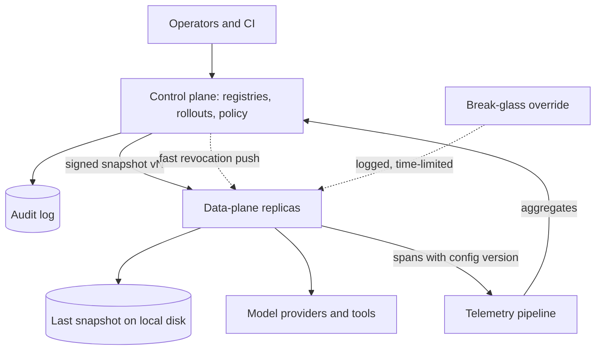

## TL;DR
The data plane is the fast path your agent runs on (gateway, model and tool calls); the control plane
is the audited system of record (bundles, rollouts, tool policies, keys). The data plane serves
versioned snapshots, keeping the last if the control plane fails.

## For agent builders
- **Why it matters for agents.** An agent makes many model and tool calls per task, so any per-call lookup
  to a config service multiplies its latency and failure rate by the step count. Agent policy (allowed
  tools, step budgets, approval rules) belongs in a snapshot the runtime checks locally.
- **Where it shows up in your stack.** The AI gateway and agent runtime (data plane), the model and prompt
  registries, rollout settings and tool permission policies (control plane), and the config version on
  every trace.
- **What you control.** Which agent settings live in the snapshot, how the runtime enforces tool
  allow-lists and step caps per tenant, how fast revocations of a tool or key reach the runtime, and
  which version a long run uses.
- **What you can skip.** xDS and mesh internals; the pattern (snapshot, atomic swap, fail static) is what
  you apply.

## Why it exists
- **The two halves have opposite requirements.**

| | Request path | Management side |
|---|---|---|
| Volume | thousands of calls a second | a few changes an hour |
| Latency | every millisecond added before the model starts lands in time-to-first-token | nobody cares if a change takes two seconds |
| Must be | fast, up through partial failures | consistent, audited, permissioned |
| Examples | route, call model, retrieve, guard | promote a bundle, change a canary percentage, add a tenant's model allow-list, rotate a key |

- **Per-request lookups put the config store on the hot path.** If the request path reads alias, policy and
  budget from the management database on every call, its latency joins every request's p99 and its
  availability becomes the platform's; one config-store maintenance window is a total outage.
- **Baking config into the service makes every change a redeploy.** Each alias move or rollout change
  becomes a deploy, rollback takes as long as a build, and nobody can tell which configuration was live at
  14:07 yesterday.
- **The split is old and proven.**
  - Routers separate the forwarding path from the routing protocols that compute its tables.
  - Kubernetes separates the API server, store and controllers from the kubelets running pods; workloads
    keep running while the API server is down, you just cannot change anything.
  - Service meshes stream configuration from a control plane to sidecar proxies, which keep their last
    configuration if the control plane disappears.
- **AI platforms inherit it *because* an AI gateway is a proxy with policy**, and registries and rollout
  state are exactly the configuration such a proxy needs. The reliable part stays simple and reads local
  state; the auditable part stays small and changes slowly.

## How it works
### What lives where
| Control plane (system of record) | Data plane (request path) |
|---|---|
| model registry and aliases | authenticate the caller against cached credentials |
| prompt registry and bundle definitions | resolve tenant and use case |
| rollout state: stable bundle, candidate, percentage, shadow on or off | pick the bundle according to rollout state |
| per-tenant and per-use-case policy: allowed models, data-classification routing such as "confidential tenants only to in-region models", budgets, rate limits | render the prompt and enforce policy locally |
| credential management | route to the model with fallbacks |
| evaluation gates and release approvals | retrieve and execute tools |
| deprecation calendar | run guardrail checks and cache |
| cost accounting and the audit log of every change | emit telemetry |
| low-QPS, strongly consistent, permissioned, boring | stateless with respect to config, horizontally scaled, no synchronous control-plane call per request |

- **In policy terms:** the control plane is the decision point and the data plane the enforcement point.
- **Decisions are precomputed into configuration** *because* a per-request decision call would put the
  control plane back on the hot path.

### Configuration as versioned snapshots
1. **Publish.** The control plane emits its state as an immutable, monotonically numbered snapshot with
   everything the data plane needs: aliases, bundles, rollouts, policies.
2. **Fetch.** Replicas pull on a short interval or receive a push.
3. **Verify** the snapshot's signature.
4. **Swap atomically.**

- **Whole snapshots, not per-key updates,** *because* a bundle and its model pin must change together; a
  replica that applied the new prompt but not the new model for three seconds serves a combination nobody
  evaluated.
- **Monotonic versions** *because* two replicas fetching from two control-plane nodes must never regress.
- **Every span carries the snapshot version**, which makes "what was live at 14:07" a query and makes
  rollout and rollback attributable.

### Fail static
- **Unreachable control plane → keep serving the last snapshot.** Replicas also persist it locally, so a
  cold start during an outage still comes up.
- **The cost: nothing can change, including rollback.** So design a break-glass path: an operator-supplied
  local override snapshot that replicas accept with a logged, time-limited exception.
- **Same trade as the meshes:** availability of serving over freshness of configuration.

**Fail static is not unconditional.**
- **Most config is safe stale for hours:** aliases, rollout percentages, prompts.
- **Some entries are security decisions whose staleness is itself a breach:** a revoked API key, an
  offboarded tenant, a newly blocked model or region.
- **Give the snapshot a staleness budget,** alert when a replica's config age exceeds it, and decide per
  entry type what happens past it: keep serving (most of the snapshot) or deny (revocations).
- **Revocations also travel on a separate, faster push channel,** so they do not wait for the next full
  snapshot.

### Telemetry flows up
- **The data plane emits spans, usage and cost** tagged with tenant, bundle, model and snapshot version.
- **The control plane consumes aggregates:** budgets are enforced against them, canary analysis reads the
  candidate-versus-stable comparison, and a failed canary makes the control plane publish a snapshot with
  the rollout reverted.
- **The loop is asynchronous by design.** Per-request decisions use local counters; precise global quotas
  use a shared fast store that is part of the data plane, not the control plane.

### Agents on the data plane
An agent runtime is data plane: it executes the loop and every tool call. The control plane decides what
it may do:

| Control plane publishes | Agent runtime enforces locally, per step |
|---|---|
| tool allow-list per tenant and use case | reject a tool call outside the list before executing it |
| step and token budgets per run | stop the loop at the cap |
| approval rules for consequential tools | pause for a human when a rule matches |
| bundle and rollout for the agent | pin the snapshot version at run start |

- **Pin the snapshot per run, not per step,** *because* a run that switches bundle or tool policy halfway
  through is an agent nobody evaluated; revocations are the exception and apply immediately.
- **Per-step policy checks must be local,** *because* a 20-step run with three tool calls per step would
  otherwise make dozens of control-plane calls per task.

### Where the gateway fits
- **The AI gateway is data plane;** its admin API, configuration database and UI are control plane.
- **Many gateway products ship both in one process**, fine for one team.
- **At platform scale,** the gateway runs as stateless replicas consuming snapshots, and the admin side is
  a separate service with its own availability target, access control and audit.

## Diagram
Configuration flows down as signed, versioned snapshots; telemetry stamped with that version flows back
up; only revocations and break-glass overrides take a shortcut.



## Examples
### Fail-static data-plane handler
A minimal data-plane handler:
- **Starts from the snapshot persisted on local disk** and refreshes it in the background.
- **Keeps serving the old snapshot** when the control plane is unreachable.
- **Picks the bundle with a sticky canary bucket** and enforces tenant policy locally.
- **Stamps the snapshot version** on telemetry.

Signature verification is left out for brevity. `call_model` and `emit_span` are the application's
existing functions.

```python
import hashlib, json, os, threading, time, urllib.request

LOCAL = "/var/lib/gateway/last_snapshot.json"
CONF = json.load(open(LOCAL))      # last-known-good from disk, so a cold start survives an outage

def refresh(url="http://control-plane/config/current", every=30):
    """Pull the control plane's snapshot; keep serving the old one if it is unreachable."""
    global CONF
    while True:
        try:
            with urllib.request.urlopen(url, timeout=2) as r:
                snap = json.load(r)
            if snap["version"] > CONF["version"]:        # monotonic: a stale node never wins
                CONF = snap                               # whole-snapshot atomic swap
                with open(LOCAL + ".tmp", "w") as f:      # write-then-rename: a crash mid-write
                    json.dump(snap, f)                    # must not corrupt last-known-good
                os.replace(LOCAL + ".tmp", LOCAL)
        except Exception as e:
            print(f"control plane unreachable ({e}); still serving config v{CONF['version']}")
        time.sleep(every)

threading.Thread(target=refresh, daemon=True).start()

def bucket(key):                                           # stable across replicas, unlike hash()
    return int(hashlib.sha256(key.encode()).hexdigest(), 16) % 100

def resolve(c, use_case, tenant):
    r = c["rollouts"].get(use_case)      # {"stable": "support@41", "candidate": "support@42", "percent": 5}
    if r and bucket(f"{r['candidate']}:{tenant}") < r["percent"]:  # salted by candidate: each
        return r["candidate"]               # rollout picks different tenants; percent counts tenants
    return r["stable"] if r else c["aliases"][use_case]

def handle(tenant, use_case, messages):
    """Data-plane path: every decision is a local lookup; no control-plane call per request."""
    c = CONF                                               # read the pointer once per request
    bundle = resolve(c, use_case, tenant)
    model, prompt = c["bundles"][bundle]["model"], c["bundles"][bundle]["prompt"]
    allowed = c["policy"].get(tenant, {}).get("allowed_models")
    if allowed is not None and model not in allowed:
        return {"error": "model not allowed for tenant", "config_version": c["version"]}
    resp = call_model(model, prompt, messages)
    emit_span(tenant=tenant, bundle=bundle, model=model, config_version=c["version"], usage=resp.usage)
    return resp
# A canary is snapshot v+1 with percent=5; promotion sets stable=support@42, percent=0; rollback sets
# stable=support@41. None of them redeploys this process.
```

### Staleness budget per entry type
Pure Python: decide what a replica does with each part of a stale snapshot. Budgets are illustrative
policy values.

```python
BUDGET_S = {"aliases": 6 * 3600, "rollouts": 6 * 3600, "prompts": 6 * 3600,
            "revocations": 120, "tenant_offboarding": 120}

def stale_action(entry_type: str, config_age_s: float) -> str:
    if config_age_s <= BUDGET_S[entry_type]:
        return "serve"
    if entry_type in ("revocations", "tenant_offboarding"):
        return "deny"                       # unknown revocation state: fail closed
    return "serve+alert"                    # availability over freshness

for age in (60, 900, 8 * 3600):
    print(age, {k: stale_action(k, age) for k in ("aliases", "revocations")})
# 60 {'aliases': 'serve', 'revocations': 'serve'}
# 900 {'aliases': 'serve', 'revocations': 'deny'}
# 28800 {'aliases': 'serve+alert', 'revocations': 'deny'}
```

"Deny" here means: refuse requests whose authorisation depends on the stale entry (for example any key
not re-confirmed by the fast revocation channel), not the whole service.

### Agent tool policy enforced from the snapshot
Pure Python: the runtime pins a snapshot at run start, checks each tool call against it locally, and
still honours revocations that arrive mid-run. Names are illustrative.

```python
REVOKED_TOOLS: set[tuple[str, str]] = set()     # filled by the fast revocation channel

def start_run(conf: dict, tenant: str, use_case: str) -> dict:
    pol = conf["agent_policy"][use_case].get(tenant, conf["agent_policy"][use_case]["default"])
    return {"config_version": conf["version"], "tenant": tenant, "tools": set(pol["tools"]),
            "approval": set(pol["needs_approval"]), "max_steps": pol["max_steps"], "steps": 0}

def check_tool(run: dict, tool: str) -> str:
    if (run["tenant"], tool) in REVOKED_TOOLS:
        return "deny: revoked"                   # revocations apply mid-run
    if tool not in run["tools"]:
        return "deny: not allowed"
    if tool in run["approval"]:
        return "pause: human approval"
    return "allow"

conf = {"version": 418, "agent_policy": {"support": {
    "default": {"tools": ["search", "get_order"], "needs_approval": [], "max_steps": 10},
    "acme": {"tools": ["search", "get_order", "refund"], "needs_approval": ["refund"], "max_steps": 15}}}}
run = start_run(conf, "acme", "support")
print([check_tool(run, t) for t in ("search", "refund", "delete_account")])
REVOKED_TOOLS.add(("acme", "refund"))
print(check_tool(run, "refund"), "| run pinned to config", run["config_version"])
# ['allow', 'pause: human approval', 'deny: not allowed']
# deny: revoked | run pinned to config 418
```

### Worked outage: two hours without a control plane
Illustrative midday outage of the control-plane database on a well-built platform.

| Capability | During the outage | Why |
|---|---|---|
| Serving requests | works | replicas hold the last snapshot in memory and on disk |
| New replicas starting | works | they load the persisted snapshot |
| Telemetry | works | the collector is a data-plane concern |
| Budgets | approximate | degrade to local counters |
| Promotions, canary changes, new tenants, key rotation | stopped | they are control-plane writes |
| Rollback via the normal path | stopped | needs a new snapshot |
| Emergency rollback | works via break-glass | logged, time-limited local override |
| "Which config was live at 14:07?" | answerable afterwards | spans carry the snapshot version |

## Production patterns
- **Streaming config with last-known-good, as in Envoy xDS.** Envoy proxies receive listeners, routes and
  clusters from a management server over the xDS APIs and keep serving their current config if the
  management server goes away. Model an AI gateway's config feed the same way. Monitor the config version
  each replica reports and the time from publish to the last replica.
- **Local evaluation of rules, as feature-flag SDKs do.** Server-side flag SDKs (LaunchDarkly, Unleash and
  similar) download the ruleset and evaluate flags in process, so a flag check never makes a network call.
  Apply this to rollout and policy lookups. Monitor SDK or snapshot staleness per replica.
- **Atomic file swap for mounted config.** Kubernetes updates a mounted ConfigMap volume by swapping a
  symlink, so readers see the old or new set of files, never a mix; `subPath` mounts do not receive
  updates. Pair with an in-process version check before swapping. Monitor the lag between the ConfigMap
  change and the version the process reports.
- **Config-age metric with a staleness alert.** Export each replica's snapshot age in seconds as a gauge
  and alert when it exceeds the budget; a fleet-wide rise means the control plane or its distribution is
  down. Monitor the maximum and the spread across replicas.
- **Separate revocation channel.** Push key revocations and tenant offboarding over a low-latency pub/sub
  channel and fail closed when its heartbeat is missing for longer than the revocation budget. Monitor the
  time from revocation to the last replica denying the key.
- **Audited break-glass override.** A signed local override file with an expiry, accepted only from an
  allow-listed operator identity and logged centrally once connectivity returns. Monitor active overrides
  and their remaining lifetime.
- **Agent policy in the snapshot.** Publish tool allow-lists, step budgets and approval rules per tenant as
  part of the config snapshot, pin it at run start and enforce it in the runtime before each tool call.
  Monitor denied tool calls per tenant and runs stopped at the step cap.

## Trade-offs
- **Snapshots vs propagation delay.** No per-request dependency on the control plane, but changes land
  within the refresh interval; a kill switch that must act in seconds needs a push channel or a shorter
  interval for a small emergency subset.
- **Local enforcement vs exact quotas.** Fast, but per-replica counters make budgets and rate limits
  approximate; precise global quotas need a shared data-plane counter, a dependency you must size and
  protect.
- **Separate services vs operational surface.** The planes scale and fail independently at the cost of two
  deployables and two on-call surfaces; for one team and one application, a gateway with an embedded admin
  store is the right size until the second team arrives.
- **Fail static vs frozen rollbacks.** Serving survives control-plane outages but rollbacks freeze too; a
  break-glass override restores agility and must itself be audited, or it becomes the way around every
  policy.
- **Immutable snapshots vs volume.** Full attribution and reproducibility, but a busy platform publishes
  thousands of them, so retention and compaction become real operational tasks.

## Pitfalls
- **Calling the registry or policy database on every request.** Symptom: request p99 tracks the config
  database's latency, and a config-store maintenance window becomes a serving outage. Fix: local snapshots.
- **Hot-reloading configuration key by key.** Symptom: a burst of errors or odd answers for a few seconds
  after each change, when a new prompt ran against the old model or tool set. Fix: atomic whole-snapshot
  swaps.
- **Bucketing the canary per request.** Symptom: a user flips between bundle versions mid-conversation, and
  support tickets nobody can reproduce. Fix: bucket per tenant or user.
- **Bucketing per tenant but reading the percentage as traffic share.** Symptom: a "5%" canary carrying a
  third of all requests because one very large tenant hashed into it. Fix: weight by traffic or exclude
  whale tenants from early steps.
- **Using Python's built-in `hash()` for buckets.** Symptom: "sticky" assignments that differ per replica,
  because string hashing is randomised per process. Fix: a stable hash such as SHA-256.
- **Omitting the snapshot version from telemetry.** Symptom: canary analysis cannot tell which traffic ran
  under which percentage, and a rollback's effect cannot be dated. Fix: stamp it on every span.
- **No break-glass path.** Symptom: a bad bundle live during a control-plane outage, everyone able to see
  it and nobody able to change the alias. Fix: an audited local override.
- **Treating key revocation as ordinary snapshot config.** Symptom: a revoked key keeps working on some
  replicas for as long as they cannot fetch a fresh snapshot. Fix: fast channel and fail closed.
- **Calling a policy service before every agent tool call.** Symptom: agent tasks slow down in proportion
  to their step count and fail whenever the policy service blips. Fix: tool policy in the local snapshot,
  with only revocations pushed.

## When to use
- **Make the split explicit** once configuration changes more often than code deploys, or more than one
  application shares the gateway, registries and policies.
- **Below that,** a single gateway process with its own small database is fine, provided it already reads
  config into memory rather than per request.
- **Measure two numbers:** control-plane calls per request (target zero) and time from an alias move to the
  last replica serving it.
- **Day to day:** "promote", "canary to 5%" and "roll back" are control-plane operations that take seconds
  and leave an audit entry; the data plane is redeployed only for code changes.
- **Interviews:** expect "what still works when the control plane is down" and "how does a rollback happen
  without a deploy".

## Role lens
- **Engineer:** Implements snapshot refresh, atomic swap, sticky bucketing and local policy checks in
  the gateway or application, and stamps the config version on every span.
- **Architect:** Draws the boundary: which decisions are precomputed into snapshots, the refresh and
  push strategy, the fail-static and break-glass rules, and the availability target of each plane.
- **FDE:** Deploys data-plane replicas inside the customer's network or region while the control plane
  stays central, and explains why their rollback is an alias move rather than a redeploy.

## Check yourself
**Q:** The control plane's database is unavailable for two hours in the middle of the day. In a
well-designed AI platform, what keeps working, what stops, and what does the answer tell you about
the design?
**A:** Serving keeps working: every data-plane replica holds the last snapshot in memory and on local
disk, so requests resolve bundles, enforce policy and route to models as before, and new replicas can
still start from the persisted copy. Telemetry keeps flowing to the collector, since that is a
data-plane concern. What stops is change: no promotions, no canary adjustments, no new tenants, no key
rotations, and, importantly, no rollback through the normal path. Budget enforcement degrades to
local counters. If any of the serving path stopped, the design had a synchronous dependency on the
control plane that should not exist. If rollback was impossible for two hours, the design lacked a
break-glass override. If nobody could later say which snapshot was live during the window, spans
were not stamped with the version. The outage is a test of exactly those three properties.

## Interview questions
### Define control plane and data plane for an AI platform and say why you separate them.
- **Data plane:** the per-request path (auth, bundle resolution, prompt rendering, model routing,
  retrieval, tools, guardrails, caching, telemetry) that must be fast and stay up.
- **Control plane:** the system of record (registries, aliases, rollouts, policies, keys, budgets, audit)
  that must be consistent and permissioned.
- **Why separate:** opposite requirements; per-request config lookups put the control plane's latency and
  availability on every request, while baked-in config makes every change a redeploy.

### Every agent prompt change causes a few seconds of bizarre answers and failed tool calls. What is the likely design flaw?
- **Key-by-key hot reload:** replicas applied the new prompt before the matching model or tool schema, so
  they briefly served an unevaluated combination.
- **Fix:** publish whole, versioned snapshots and swap them atomically per replica.
- **Verify** by checking that every span's config version maps to one consistent bundle.

### Should a replica keep serving if its config is six hours old?
- **For most config, yes:** aliases, prompts and rollout percentages are safe stale; availability outranks
  freshness.
- **For security entries, no:** revocations and tenant offboarding past their budget should fail closed for
  the affected requests.
- **Either way, alert** on config age above the staleness budget, because it means distribution is broken.

### How fast does a rollback propagate, and how do you make it faster?
- **Bound:** roughly the refresh interval plus fetch and swap time; with a 30-second pull, about half a
  minute to the last replica.
- **Faster:** push notifications that trigger an immediate fetch, or a shorter interval for a small
  emergency subset of config.
- **Measure:** time from publish to the last replica reporting the new version.

### When is a single gateway with an embedded admin database the right design?
- **One team, one application,** where config changes are rare and both planes can share an on-call.
- **Condition:** it already loads config into memory rather than querying per request.
- **Split** when a second team shares the gateway or config changes outpace code deploys.

### Where do an agent's tool permissions live, and how are they enforced on each step?
- **Defined in the control plane:** allow-lists, approval rules and step budgets per tenant and use case,
  changed through an audited path.
- **Enforced in the runtime:** checked locally against the snapshot pinned at run start, before every tool
  call, so a long run makes no control-plane calls.
- **Revocations bypass the pin:** a revoked tool or key arrives on the fast channel and denies the next
  call, even mid-run.

## Quiz
### Q: Which of these belongs in the control plane rather than the data plane?
- [ ] Rendering the prompt template for a request
- [ ] Running the guardrail classifier on a completion
- [x] Changing the canary percentage for a use case's candidate bundle
- [ ] Choosing the fallback model after a provider timeout
> Rollout state is configuration the control plane publishes; the data plane reads it. Rendering,
> guardrail inference and fallback selection all happen per request on the serving path.

### Q: Why does the data plane consume whole versioned snapshots instead of hot-reloading individual keys?
- [ ] Snapshots are smaller on the wire than key-by-key updates
- [x] Related settings such as a bundle's prompt and model pin must change together, and a version number makes behaviour attributable
- [ ] Control-plane databases cannot stream individual changes
- [ ] Hot reloading is unsupported by gateway products
> Applying keys independently creates combinations nobody evaluated for a few seconds after each
> change. An atomic snapshot with a monotonic version avoids that and gives every span a config id.

### Q: What should happen when the data plane cannot reach the control plane?
- [ ] Reject requests, since policy cannot be verified
- [ ] Fall back to a default model with no policy
- [x] Keep serving the last known snapshot and log that configuration is stale
- [ ] Redeploy the data plane with configuration baked in
> Fail static is the design goal: availability of serving outranks freshness of configuration. The
> trade is that changes, including rollbacks, wait for the control plane or a break-glass override.

## Use cases & projects
### Use cases
- **Per-tenant tool permissions.** One customer's agent may issue refunds with approval, another's may only
  read orders; both are snapshot entries, not code branches.
- **Canarying a new agent bundle.** Rollout percentage is control-plane state; the runtime pins the bundle
  per run and stamps the version on traces.
- **Emergency tool kill switch.** A misbehaving tool is revoked on the fast channel and denied mid-run on
  every replica.
- **Agents deployed in a customer's region.** Runtime replicas run near the data while the control plane
  stays central.

### Mini project
**Snapshot-driven agent runtime (2-3 hours).**
- **Goal:** run a tool-calling agent whose tool policy and bundle come from a versioned snapshot and keep
  working when the control plane is down.
- **Steps:** serve a JSON snapshot (version, bundle, per-tenant tool allow-list, step cap) from a tiny HTTP
  server; have the agent runtime pull it every 10 seconds, swap atomically and persist it; pin the version
  per run; add a revocation endpoint the runtime polls every second; stop the config server mid-test.
- **Done when:** runs keep completing on the last snapshot with the server down, a revoked tool is denied
  within two seconds even mid-run, and every trace carries the config version it ran under.
