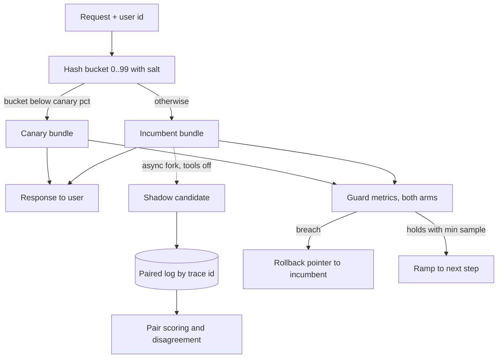

## TL;DR
Shadow runs a candidate agent bundle (model, prompt, tools) on copied live traffic with side effects off;
canary serves it to a small sticky slice of sessions and ramps while guard metrics hold. Together they
turn "ship the new agent and hope" into measured exposure.

## For agent builders
- **Why it matters for agents.** Every agent change (new model, edited system prompt, a tightened tool
  schema, a new retrieval index) shifts behaviour on every task at once. Shadow and canary are how you
  learn what the new agent does on real tasks before all users depend on it.
- **Where it shows up in your stack.** The AI gateway or router in front of your agent, feature-flag
  percentage rollouts keyed on session id, and trace tags carrying the bundle id so evals and dashboards
  can split by version.
- **What you control.** What goes in the bundle, which tools are stubbed in shadow, the hash key and
  salt, the ramp steps, and the guard metrics: task completion, steps per task, tool-call error rate,
  cost per task, escalation rate.
- **What you can skip.** Service-mesh internals and statistics beyond the `n ≈ 16 · σ² / δ²` rule of
  thumb; that is enough to plan a ramp.

## Decision case
### Scenario
A support agent (search, read-order and refund tools) must move from bundle-v12 to bundle-v13, which
swaps in a different model family. Offline evals show v13 slightly ahead. All figures are illustrative.
- **Traffic:** 20,000 sessions a day; v12 costs about $0.031 per task.
- **Constraints:**
  - the vendor retires v12's model snapshot in 28 days;
  - extra evaluation spend (shadow inference) at most $1,000;
  - before a quality verdict, at most 5% of daily sessions (1,000) may see v13;
  - refunds are real money, so the refund tool can never run in a mirrored arm;
  - two engineers; the gateway already hashes users, but dry-run tool adapters take about 3 days to build.
- **Sample sizes (n ≈ 16 · σ² / δ²):** schema failures 0.5% → 5% need 212 per arm; a 0.1-point judge
  shift needs 1,024; a refund rate doubling from 3% to 6% needs 16 × 0.045 × 0.955 / 0.03² ≈ 764.

### Options
| Option | How it works | Extra spend | Exposure before a quality verdict | Calendar (one fix-and-retry) | Refund risk |
|---|---|---|---|---|---|
| **A. Big-bang after the eval gate** | flip 100% once offline evals pass | $0 | 20,000 sessions a day: fails | 1 day | every refund decided by an unobserved model |
| **B. Canary only** | 1% (2 d), 5% (2 d), 25% (1 d), 50% (1 d), 100% | $0 | 200 a day at 1%, 1,000 at 5%: fits | 6 d, 13 d with a retry | real refunds from the first session |
| **C. Shadow 20% with dry-run tools, then B** | 3 d build, 3 d shadow plus a 2% A-vs-A slice, then the canary ramp | 12,000 × $0.031 = $372 + $37 = $409 | 0 during shadow, then as B | 12 d, 22 d with a retry (1 d fix, 3 d shadow, 6 d canary) | first tool choices checked with no money moving |
| **D. Shadow 100% for 3 days, then B** | as C, every session mirrored | 60,000 × $0.031 = $1,860: fails | as C | as C | as C, with more rare intents covered |

### Decision
Choose **C**, because it is the only option that meets every constraint and catches loop regressions
with nobody exposed.
- **Exposure:** A puts all 20,000 daily sessions on an unmeasured model. C exposes nobody until shadow is
  clean, then at most 1,000 a day until the 5% step has 2,000 sessions, enough for the 1,024 judge and
  764 refund samples.
- **Budget:** $409 fits under $1,000; D's $1,860 does not.
- **Deadline:** 22 days with one retry fits 28. B is faster but buys nothing the deadline needs.
- **Refunds:** the refund tool is stubbed in shadow and the intended calls are logged, so C compares refund
  decisions before any money moves. B learns that from real refunds.
- **The longer-loop failure** (steps per task 4.1 → 6.3) shows up in shadow pairs, so it costs a fix
  instead of a rollback.

**What would change it:**
- **Retirement in under about 12 days:** go to B with the steps held only to their minimum samples.
- **A patch release of the same model family** with clean offline evals: B alone is enough.
- **Shadow budget above $1,860:** D covers rare intents and tenants faster.

### Trade-offs accepted
- **Three days of engineering on dry-run adapters.** They pay back on every later migration; track
  argument-validation failures per tool so they stay faithful to the real tools.
- **Shadow cannot see multi-turn or post-tool behaviour.** Completion rate and real refund behaviour are
  read only in canary, so the refund-rate guard is the tightest one there.
- **The ramp is slow at 1%.** Two days at 200 sessions only rules out catastrophic breakage; quality is
  judged at 5% and 25%, not earlier.
- **Sticky cohorts concentrate harm.** The 5% cohort gets every v13 defect; change the salt per
  experiment and watch escalations for that cohort.

### Review rubric
- **Every constraint is a number**, and each option is scored against it in one table.
- **Sample sizes are computed** for the guard metrics that decide each step, and step durations hold
  at least that many sessions per arm.
- **Side-effecting tools are named**, with how each is stubbed in shadow and guarded in canary.
- **The calendar includes one fix-and-retry cycle** and still meets the deadline.
- **Shadow disagreement is read against an A-vs-A floor**, not as a raw percentage.
- **At least two conditions that would change the choice** are stated, each tied to a measurable fact.

## Why it exists
- **Offline evals only say "probably better".** They score a few hundred curated cases; they cannot tell
  you what the candidate does on live traffic.
- **An AI change is non-local.** Swapping the model, editing three lines of the system prompt or
  tightening a tool schema changes *every* request, including the long tail your golden set never
  sampled: odd phrasings, an untested language, longer-than-expected tool outputs, a tenant whose
  documents are all scanned PDFs. A service change touches one code path a unit test proves; an LLM
  change touches a probability distribution only traffic reveals.
- **"The eval gate passed, deploy to 100%" fails three ways.** The golden set is small and ages (it
  reflects what users asked when it was built). Judge scores are noisy, so a two-point gain on 300 cases
  is often within noise. Some regressions only exist in production: cold prompt caches, rate limits on
  the new model, latency under real concurrency, a tool behaving differently with real credentials.
- **Big-bang puts everyone in the blast radius** for the hours a quality regression takes to show up in
  feedback.
- **The two patterns buy different information at bounded cost.** Shadow buys a like-for-like comparison
  with no exposure but no user feedback; canary buys real user outcomes at the price of real exposure.

## How it works
### What a "version" is
The rollout unit is a **bundle**, not a model, addressable as one immutable unit:

| Bundle part | Example |
|---|---|
| Model id | pinned snapshot |
| Prompt template | version |
| Decoding parameters | temperature, max tokens |
| Tool schemas | versioned |
| Retrieval index | version |
| Guardrail configuration | version |

- **Why immutable:** a canary that mixes a new prompt with an old index tests a combination you never
  evaluated and cannot roll back to.

### Shadow (traffic mirroring)
1. **Serve normally.** The gateway serves the request with the incumbent as usual.
2. **Fork asynchronously.** It sends a copy to the candidate after the user response is on its way, so
   the user never waits on the candidate.
3. **Log both under one trace id**, with latency, tokens, cost, schema validity, refusal flags and tool
   calls.
4. **Score pairs offline:** deterministic checks on 100% of pairs, LLM-judge pairwise preference on a
   sample, and disagreement analysis (where the two differ most, by intent or tenant).

Shadow is safe *because* nothing the candidate produces leaves the system. That same property is its
limit:
- **Side-effecting tools must be stubbed or sandboxed**, because an agent in shadow must not send the
  email twice.
- **Multi-turn effects are invisible**, because the user's next message responds to the incumbent's
  answer, not the candidate's.
- **No user feedback**, so shadow answers "is it different, cheaper or slower", not "do users prefer it".
- **Cost doubles on the mirrored slice**, so most teams shadow 5–20% of traffic (illustrative) or shadow
  100% for a short window.

**The LLM-specific trap: the incumbent disagrees with itself.**
- At non-zero temperature, and often even at temperature zero on hosted APIs, the same request run twice
  yields different text.
- So "B differs from A on 30% of requests" is meaningless until you know A-vs-A differs on, say, 25%.
- **Fix:** mirror a small slice to a second copy of the *incumbent* too, and read the candidate's
  disagreement as the excess over that self-disagreement floor, broken down by intent.

### Canary (partial live exposure)
1. **Sticky assignment.** The router hashes a stable key (usually user or session id) into a bucket and
   routes buckets below the canary percentage to the candidate. Hashing *because* a conversation must not
   flip models mid-thread; random per-request assignment produces incoherent sessions and contaminates
   the comparison.
2. **Watch guard metrics on both arms** over a bake window: error rate, p95 latency, schema-failure rate,
   refusal rate, cost per request, tool-failure rate, and a quality proxy you trust (thumbs-down rate,
   escalation rate, judge score on a sample).
3. **Ramp in steps**, for example 1% → 5% → 25% → 50% → 100%, each held long enough to collect a
   minimum sample. Small first steps *because* the first step exists to catch catastrophic breakage
   (wrong schema, 429s from the new model's quota) with the fewest users exposed.
4. **Roll back automatically** on any guard breach by flipping the pointer to the incumbent. Promotion to
   100% requires success metrics that are not worse, not merely that nothing exploded.

### What the numbers can and cannot tell you
Detecting a shift of size δ in a metric with standard deviation σ needs, per arm, roughly

```
n ≈ 16 · σ² / δ²        (rule of thumb: two-sided α = 0.05, 80% power)
σ² = p(1 − p) for a rate p
```

- **Halving the effect quadruples the traffic** you need.
- **A 1% canary** on 20,000 requests a day gives 200 canary requests a day.

| Signal | Inputs | Samples per arm | Time at 1% |
|---|---|---|---|
| Schema failures 0.5% → 5% | σ² ≈ 0.027 at the midpoint, δ = 0.045 | 16 × 0.027 / 0.002 ≈ 210 | about a day, faster in practice because the incumbent baseline is known precisely |
| Judge score 4.1 → 4.0 | σ ≈ 0.8 | 16 × 0.64 / 0.01 ≈ 1,000 | a week (an afternoon at 25%) |

- **So early steps are for catastrophic signals**; later, larger steps are where quality comparisons
  become meaningful.
- **It is a controlled experiment only** when arms are assigned randomly and compared on the same window.
  Comparing this week's canary to last week's baseline confounds the version with time.

### Canary vs A/B test vs blue-green
These are often conflated.

| | Question | Decision | Ends |
|---|---|---|---|
| **Canary** (safety mechanism) | "Is anything broken?" | asymmetric: roll back on harm, promote on *no harm* | at 100% |
| **A/B test** (decision mechanism) | "Which is better on the success metric?" | either arm may win; fixed split until the pre-registered sample is reached | at the planned sample |
| **Blue-green** | "Swap environments" | flip all traffic at once; instant rollback | immediately |

- **A large canary step can double as an A/B test** only if you pre-commit to the metric and sample size.
- **Blue-green has no gradual exposure**, so it suits infrastructure changes better than behaviour
  changes.

### Where it lives
- **Routing, hashing, mirroring and the rollout percentage** belong in the AI gateway or control plane as
  configuration, not in application code, so a rollout or rollback is a config change with no deploy.

### Agent-specific guard metrics
A chat model is judged per response; an agent is judged per task. Guard both arms on task-level signals:

| Signal | Why it catches agent regressions |
|---|---|
| Task completion rate | the outcome users care about; needs the larger ramp steps to resolve |
| Steps (LLM calls) per task | a looping or confused agent spends more steps before failing |
| Tool-call error rate | bad arguments against a changed schema show up here first |
| Cost and tokens per task | longer loops multiply cost even when each call looks normal |
| Human escalation or approval-reject rate | the agent proposing actions people refuse |

## Diagram
Every request is bucketed by a salted user hash; incumbent-served requests may also be mirrored to the
shadow candidate with side effects off, and guard metrics on both arms drive the ramp or rollback.



## Examples
### Gateway router with sticky canary and async shadow
A minimal gateway router: sticky canary assignment by user hash, an asynchronous shadow fork for a
separate candidate, and paired logging.
- **The shadow call is a background task**, so the user's response never waits on it.
- **Only incumbent-served requests are mirrored**, so every shadow pair is candidate-vs-incumbent.
- **The shadow candidate runs with side-effecting tools disabled.**
- **Each experiment salts the hash**, so the same 5% of users are not the guinea pigs for every rollout.

```python
import asyncio, hashlib, json, time

ROLLOUT = {"incumbent": "bundle-v12", "canary": "bundle-v13", "canary_pct": 5,
           "shadow": "bundle-v14", "shadow_pct": 20, "salt": "exp-2026-10-v13"}
_background: set[asyncio.Task] = set()            # keep refs so tasks are not GC'd mid-run

def bucket(key: str, salt: str) -> int:           # stable 0..99 bucket per user per experiment
    return int(hashlib.sha256(f"{salt}:{key}".encode()).hexdigest(), 16) % 100

async def call_bundle(bundle: str, req: dict, allow_side_effects=True) -> dict:
    t = time.perf_counter()
    out = await llm_app.run(bundle, req, allow_side_effects=allow_side_effects)
    return {"bundle": bundle, "text": out.text, "schema_ok": out.schema_ok,
            "refused": out.refused, "cost": out.cost, "ms": (time.perf_counter() - t) * 1e3}

async def shadow(req: dict, served: dict, trace_id: str):
    cand = await call_bundle(ROLLOUT["shadow"], req, allow_side_effects=False)
    log.info(json.dumps({"trace": trace_id, "served": served, "shadow": cand}))

async def handle(req: dict, user_id: str, trace_id: str) -> dict:
    b = bucket(user_id, ROLLOUT["salt"])
    bundle = ROLLOUT["canary"] if b < ROLLOUT["canary_pct"] else ROLLOUT["incumbent"]
    served = await call_bundle(bundle, req)
    metrics.observe(bundle=bundle, ms=served["ms"], schema_ok=served["schema_ok"],
                    refused=served["refused"], cost=served["cost"])
    if bundle == ROLLOUT["incumbent"] and bucket(user_id, "shadow") < ROLLOUT["shadow_pct"]:
        task = asyncio.create_task(shadow(req, served, trace_id))  # off the critical path
        _background.add(task); task.add_done_callback(_background.discard)
    return served
# ROLLOUT is loaded from the control plane; promoting or rolling back is a config write, not a deploy.
```

### Ramp planner: how long each step must bake
Pure Python; plug in your traffic and the effect you need to see before trusting a step.

```python
import math

def n_per_arm(var: float, delta: float) -> int:
    return math.ceil(16 * var / delta ** 2)          # two-sided alpha 0.05, 80% power

def days_at(n: int, daily_requests: int, pct: float) -> float:
    return n / (daily_requests * pct / 100)

p_mid = (0.005 + 0.05) / 2
schema_n = n_per_arm(p_mid * (1 - p_mid), 0.045)     # rate 0.5% -> 5%
judge_n = n_per_arm(0.8 ** 2, 0.1)                   # score 4.1 -> 4.0, sigma 0.8

for pct in (1, 5, 25):
    print(f"{pct:>2}%: schema {days_at(schema_n, 20_000, pct):.2f} d, "
          f"judge {days_at(judge_n, 20_000, pct):.2f} d")
# schema_n = 212, judge_n = 1024
#  1%: schema 1.06 d, judge 5.12 d
#  5%: schema 0.21 d, judge 1.02 d
# 25%: schema 0.04 d, judge 0.20 d
```

| Step | What it can detect in a day at 20,000 req/day | Use it for |
|---|---|---|
| 1% | a 10x schema-failure jump, 429s, timeouts | catastrophic breakage |
| 5% | the same within hours; judge shifts of 0.1 in about a day | early quality read |
| 25% and up | 0.1-point judge shifts within an afternoon | promotion decision |

### Worked scenario: canarying a new model inside a support agent
A support agent (search, read-order and refund tools) moves from bundle-v12 to bundle-v13, which swaps
the model. Figures are illustrative.

| Metric at the 5% step (1 day) | v12 (control) | v13 (canary) | Read |
|---|---|---|---|
| Sessions | 19,000 | 1,000 | enough for hard errors, thin for quality |
| Tool-call error rate | 1.2% | 1.4% | within noise |
| Steps per task (mean) | 4.1 | 6.3 | alarm: the loop got longer |
| Cost per task | $0.031 | $0.052 | follows the step count |
| Task completion | 81% | 79% | not yet resolvable at this sample |

- **Diagnosis from traces:** v13 calls the search tool repeatedly with near-identical queries before
  answering, so each task burns two extra steps.
- **Action:** the steps-per-task guard rolls back automatically; the fix is a prompt change telling the
  model when search results are sufficient, then a fresh shadow run before re-canarying.

## Production patterns
- **Mesh-level mirroring for stateless calls.** When the candidate has no side effects, mirror at the
  proxy: Istio's `VirtualService` supports a `mirror` destination with a `mirrorPercentage`, and Envoy has
  request mirror policies. Mirrored responses are discarded. Monitor candidate error rate and the cost of
  the mirrored slice. For agents with tools, mirror in the application so tools can be disabled.
- **Declarative canary steps with automated analysis.** Argo Rollouts expresses the ramp as `setWeight`
  and `pause` steps and can run an analysis template against Prometheus queries between steps, aborting on
  failure. Monitor the analysis run results per step, not just the final state.
- **Self-disagreement baseline.** Send a small slice (for example 1-2%, illustrative) of shadow traffic to
  a second incumbent replica and report candidate disagreement as excess over A-vs-A, per intent. Monitor
  the A-vs-A floor itself; if it jumps, the provider changed something.
- **Minimum-sample guards.** Encode "roll back if refusal rate exceeds baseline by X *and* n ≥ N" so
  quality alerts cannot fire on 150 samples; fire hard-error guards (5xx, schema failures, 429s)
  immediately. Monitor how often a rollback was later judged a false alarm.
- **Percentage flags keyed on a salted user id.** Feature-flag systems with percentage rollouts by user
  attribute (LaunchDarkly, Unleash and similar) give sticky assignment and a one-click kill switch without
  a deploy. Monitor the actual cohort size against the configured percentage.
- **Dry-run tools in the agent's shadow arm.** Give the shadow agent tool adapters that validate
  arguments and return recorded or synthetic results instead of acting, and log the intended call. Compare
  intended tool calls against the incumbent's real ones. Monitor validation failures per tool.
- **Per-task guards, not per-call guards.** Aggregate traces by task or session id and gate the ramp on
  steps per task, cost per task and completion, since a longer loop can hide behind normal per-call
  latency. Monitor the p95 of steps per task on both arms.

## Trade-offs
- **Shadow: zero exposure vs double cost and blind spots.** You get a like-for-like comparison, but pay
  roughly double inference on the mirrored slice and learn nothing about user preference or multi-turn
  behaviour.
- **Canary: real outcomes vs real exposure.** Every percent is real users seeing a possibly worse system;
  once the change is low-risk and well-evaluated offline, the extra caution costs more than it saves.
- **Sticky assignment: clean experiment vs concentrated harm.** Conversations stay coherent, but a bad
  canary hits the same users repeatedly, so a 5% canary is a 100% regression for those users.
- **Small early steps: bounded blast radius vs slow rollout.** For a hard deadline (a vendor deprecation
  date) you may accept larger steps and lean on shadow results instead.
- **Automatic rollback: no humans at 3 a.m. vs false alarms.** With noisy quality metrics and small
  samples it will roll back good releases unless thresholds carry a minimum sample.

## Pitfalls
- **Shadowing an agent with live tools.** Symptom: duplicate emails, tickets or payments with no user
  action behind them. Fix: stub or sandbox side-effecting tools in the shadow arm.
- **Random per-request routing instead of per-session hashing.** Symptom: users report the assistant
  "changed personality" mid-conversation while aggregate metrics look fine. Fix: hash user or session id.
- **Comparing the canary to a historical baseline.** Symptom: a "regression" that disappears once you
  notice the canary window included a product launch. Fix: a concurrent control on the same window.
- **Guarding per call while the agent loops.** Symptom: per-call latency and errors look flat, yet cost
  per task climbs and users wait longer. Fix: guard on steps and cost per task.
- **Judging quality after 150 samples.** Symptom: rollbacks and promotions that flip day to day with no
  change in the system. Fix: compute the required sample first.
- **Ignoring warm-up effects.** The candidate has a cold prompt cache and a fresh rate-limit bucket.
  Symptom: a latency and 429 spike in the first minutes that disappears, then gets blamed on the version.
  Fix: pre-warm and exclude a short warm-up window.
- **Canarying only internal users.** Symptom: a clean canary, then complaints from the segment that writes
  in a different language or uploads different documents. Fix: a cohort representative of real traffic.
- **Reading shadow disagreement without an A-vs-A baseline.** Symptom: a "40% disagreement" alarm that is
  ordinary sampling variation in both versions. Fix: measure the self-disagreement floor.

## When to use
- **Shadow first when the change is large or structurally different:** a new model family, a new
  provider, a rewritten agent loop, a new retrieval pipeline. It tells you whether the candidate is safe
  enough to show anyone and where it disagrees with the incumbent, which is where to look.
- **Canary when you need user outcomes** to decide, or when the change is incremental and offline evals
  already pass.
- **Skip both** for trivial, fully reversible changes with strong offline coverage, where the process
  costs more than the risk.
- **Measure:** guard metrics on both arms; demand a minimum sample before any quality verdict; automate
  the rollback path before the first ramp.
- **Interviews:** explain why sticky assignment matters, why shadow cannot test multi-turn agents, and how
  sample size limits what a 1% canary can detect.

## Role lens
- **Engineer:** Implements the hashed router and asynchronous mirroring in the gateway, tags every trace
  with the bundle id, and builds the paired-comparison job that scores shadow output.
- **Architect:** Decides what the deployable bundle is, where rollout state lives (control plane, not
  code) and which guard metrics gate each ramp step for which risk class of change.
- **FDE:** Runs shadow mode against a customer's live traffic before cutover so the customer sees a
  disagreement report instead of a surprise, and negotiates which users form the first canary cohort.

## Check yourself
**Q:** You are migrating a customer-support agent from model A to model B. The agent can issue refunds.
Offline evals show B slightly ahead. Design the rollout and justify each step.
**A:** Start with shadow at a meaningful slice of traffic with the refund tool disabled for the shadow
arm, because a side-effecting tool cannot be mirrored safely. Score pairs on deterministic checks
(schema validity, refusal rate, tool-call mix, latency, cost) at 100% and judge preference on a sample;
analyse where B disagrees most with A by intent. If nothing is alarming, canary B to about 1% of
sessions by user hash, with automatic rollback on error rate, schema failures, latency and
refund-rate anomalies; hold until a minimum sample accrues, then ramp through 5, 25 and 50%. Use
thumbs-down and escalation rate as success metrics at the larger steps, where samples allow it. Keep
A's bundle warm and the routing in control-plane config so rollback is a pointer flip, and note that
B's refund behaviour in canary is the one thing shadow could not test, so it gets the tightest alert.

## Interview questions
### What is the difference between a shadow deployment and a canary, and when do you use each?
- **Shadow** mirrors live requests to the candidate and discards its output: zero user exposure, like-for-
  like comparison, but no user feedback and no multi-turn signal.
- **Canary** serves the candidate to a small sticky cohort and ramps on guard metrics: real outcomes at
  the price of real exposure.
- **Order:** shadow first for structurally new changes (new provider, new agent loop), then canary for
  user outcomes; skip both for trivial reversible changes.

### Your shadow report says the candidate disagrees with production on 35% of requests. Is that bad?
- **Not yet knowable.** LLM outputs vary run to run, often even at temperature zero on hosted APIs, so the
  incumbent disagrees with itself.
- **Measure the floor:** mirror a slice to a second incumbent copy. If A-vs-A is 30%, the real signal is
  the 5-point excess, and where it concentrates by intent.
- **Then read the pairs** in the high-excess intents with a pairwise judge and a human spot check.

### A 1% canary looked clean for two days. Why might you still not promote?
- **Sample size.** At 20,000 requests a day, 1% gives 200 per day; a 0.1-point judge shift with σ ≈ 0.8
  needs about 1,000 per arm, so two days cannot resolve it.
- **Asymmetric bar.** "Nothing exploded" clears catastrophic risk only; promotion needs success metrics
  not worse at a step large enough to measure them, such as 25%.
- **Cohort coverage.** Check the hashed cohort includes the languages, tenants and document types of real
  traffic.

### Your shadow agent runs with dry-run tools that return recorded results. What can and can't you conclude from it?
- **You can compare the first decision:** which tool the candidate picks and with what arguments, against
  the incumbent's real call on the same input, plus argument-validation failures per tool.
- **Later steps drift from reality:** once the candidate calls a tool the incumbent did not, there is no
  recorded result for it, so a synthetic stand-in shapes every step after that.
- **So treat shadow as a first-step and safety check;** loop length, completion and the effect of real
  actions (refunds, emails) only become observable in canary, which gets the tightest guard on them.

### When is a canary the wrong tool and a pre-registered A/B test the right one?
- **When the question is "which is better", not "is anything broken".** A canary is asymmetric and ends
  at 100%; an A/B test holds a fixed split until a pre-registered sample is reached and either arm may
  win.
- **Example:** choosing between two prompt styles that both pass safety; you need a success metric and a
  sample size committed in advance, otherwise you are peeking at noise.

### Which guard metrics would you put on a canary of a new agent version, and why not just latency and errors?
- **Task-level metrics:** completion rate, steps per task and cost per task, because an agent that loops
  or picks the wrong tool can keep every individual call fast and error-free.
- **Tool metrics:** tool-call error and argument-validation rates per tool, which catch schema drift
  between the model and your tool definitions first.
- **Human signals:** escalations and rejected approvals, the earliest sign the agent proposes actions
  people would not take.

## Quiz
### Q: Why is a shadow deployment unable to evaluate a multi-turn conversational agent properly?
- [ ] Because shadow traffic cannot be logged alongside the served response
- [x] Because the user's next turn responds to the incumbent's answer, so the candidate never gets the conversation it would have produced
- [ ] Because shadow deployments only work for stateless classification models
- [ ] Because the candidate's latency makes the mirrored copy time out
> Shadow forks the same input to both versions, but a conversation diverges after the first reply.
> The candidate sees follow-ups shaped by the incumbent, so its multi-turn behaviour is never observed.

### Q: A team runs a 1% canary on a service with 10,000 requests per day and wants to know within a day whether the judge score moved from 4.2 to 4.1. What is the right assessment?
- [ ] Sufficient: 100 samples is enough for any metric
- [ ] Sufficient, provided the judge runs at temperature zero
- [x] Insufficient: detecting a small shift in a noisy score needs far more samples; the 1% step is for catching catastrophic failures
- [ ] Insufficient only because the canary should run for a week regardless of traffic
> Sample size needed grows roughly with the inverse square of the effect size. A 100-request slice can reveal a schema-failure spike but cannot resolve a 0.1-point judge difference; use larger ramp steps for quality verdicts.

### Q: Why should canary assignment hash on user or session id rather than pick randomly per request?
- [ ] Hashing is faster than random number generation at gateway scale
- [ ] Random assignment would exceed the canary percentage over time
- [x] Per-session stickiness keeps conversations coherent and prevents the arms from contaminating each other's results
- [ ] Hashing lets the canary cohort be chosen from internal users only
> If consecutive turns of one conversation hit different versions, users see inconsistent behaviour and each arm's metrics include context produced by the other arm, which invalidates the comparison.

## Use cases & projects
### Use cases
- **Model migration inside an agent.** Moving a tool-calling agent to a new provider or model snapshot:
  shadow with dry-run tools, then canary by session.
- **System prompt or tool-schema edits.** Small text changes alter tool choice on every task, so they
  ship behind a canary like code does.
- **New retrieval index for a RAG agent.** Shadow both indexes and compare answers and citations before
  any user sees the new one.
- **Agents with consequential actions.** Refund, email or ticketing agents get the smallest first step
  and the tightest guard on the action rate shadow could not observe.

### Mini project
**Shadow and canary a toy agent (2-3 hours).**
- **Goal:** route a tool-calling agent between two bundles and detect a deliberately worse one.
- **Steps:** build a two-tool agent (search, create_ticket); make bundle B with a vaguer system prompt;
  add a router that hashes session id with a salt into a 10% canary; run B in shadow with
  `create_ticket` stubbed to log intended calls; replay 300 synthetic tasks and record steps, tool errors
  and cost per task by bundle.
- **Done when:** a per-bundle table shows the difference, a guard on steps per task triggers a rollback
  to A automatically, and no stubbed shadow call created a real ticket.
