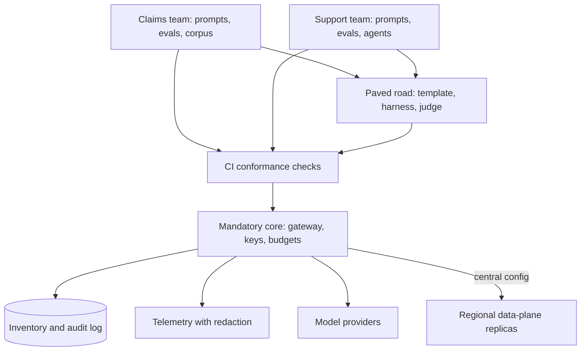

## TL;DR
Pure centralization becomes a ticket queue for every agent team; pure federation becomes duplicated
gateways, spend and no inventory. Most organisations want a thin mandatory core (identity, model access,
budgets, audit, telemetry) with domain-owned prompts, evals, tools and agents.

## For agent builders
- **Why it matters for agents.** It decides what you build yourself and what you inherit: whether your
  agent gets model access, tracing, judges and quotas from a gateway and template, or whether you wire
  provider keys, tracing and guardrails per agent.
- **Where it shows up in your stack.** The gateway virtual key your agent calls with, its per-team
  quota and priority class, the paved-road agent template, and the CI conformance check on your bundle.
- **What you control.** Your agent's prompts, tools, golden set, rubrics and thresholds, which stay with
  your team, plus registering the agent and its tools in the inventory.
- **What you can skip.** Team Topologies and Data Mesh theory; know the mandatory core, the paved road and
  why quality ownership stays with you.

## Decision case
### Scenario
A payments software company has 8 teams shipping agents. One business unit, EU payments, runs agents
with refund and chargeback tools. The CTO asks for a platform model. All figures are illustrative.
- **Today:** about $60k a month of model spend across 5 provider accounts; each team wires its own
  tracing; a nightly batch job on a shared key causes 429s for the support agent.
- **Constraints:**
  - EU payments traffic must stay inside the company's EU network, so it cannot route through a US gateway;
  - the audit in 4 months asks "which agents can move money", answered as a query, not a survey;
  - a team reaches its first production call within 2 days of asking;
  - interactive agents never get 429s caused by another team's batch work;
  - the platform team has 4 engineers, about 80 engineer-days a month.

### Options
| Option | How it works | EU residency | Money-moving audit | Onboarding | Quota isolation | Platform load |
|---|---|---|---|---|---|---|
| **A. Full centralization** | platform owns keys, gateway, prompts and reviews every change | only if the gateway moves to the EU, for everyone | yes | queue: 8 teams × 3 requests × 2 days = 48 of 80 days on review | yes | over half on review: fails |
| **B. Federated, policy document** | teams keep keys, tools and tracing | yes | no inventory: fails | fast | separate accounts, no shared pool | low; 8 × 6 = 48 engineer-weeks duplicated in the teams |
| **C. Thin core, one US gateway** | mandatory gateway, virtual keys, tool inventory, trace pipeline, paved road | fails, or EU payments keeps its own keys and leaves a hole in the inventory | partial | self-service | per-team keys and priority classes | one quarter to build |
| **D. Thin core, central control plane, EU data-plane replicas** | as C; EU payments runs gateway and agent-runtime replicas in its network on central config | yes | yes: every agent's tools and side-effect classes in one registry | self-service | per-team keys and priority classes | as C plus operating one EU replica set |

### Decision
Choose **D**, because it is the only option that meets residency and the audit together without turning
the platform into a review queue.
- **Residency:** EU payments traffic and payloads stay in its network; only configuration flows in from
  the central control plane, and only telemetry aggregates flow out.
- **Audit:** every agent registers its tools with a side-effect class (read-only, reversible,
  consequential). CI rejects calls to unregistered tools, so "which agents can move money" is a query.
  B cannot answer it, and C answers it only if EU payments joins.
- **Quota:** per-team virtual keys with tokens-per-minute limits and an interactive-before-batch priority
  class end the nightly 429s.
- **Capacity:** prompts, golden sets and refund thresholds stay with the teams, so the platform spends
  nothing on review. A spends 48 of its 80 monthly days there.
- **Money:** one pooled account means even a 10% volume discount is about $6k a month, which helps pay for
  the EU replicas.

**What would change it:**
- **The provider offers an EU endpoint the EU unit accepts through a central EU gateway:** C is enough,
  with one less deployment to run.
- **EU payments becomes a separate legal entity with its own auditors:** give it its own control plane,
  which is federation for that unit only.
- **Fewer than about four teams:** no platform; make the most mature team's stack reusable.

### Trade-offs accepted
- **A second data-plane deployment to operate.** It is on-call surface justified by regulation. Monitor
  its config version and staleness like every other replica.
- **Self-service needs product work first.** Until onboarding is self-service, teams wait; publish the
  lead time and track the median against the 2-day target.
- **Domain-owned quality varies by team.** The paved road's eval harness and judge narrow the gap; track
  how many teams run a golden set in CI.
- **Revoking direct keys forces migrations.** Do it on a dated schedule and track the share of invoice
  spend the gateway can attribute.

### Review rubric
- **The mandatory core is listed explicitly**, and each item is justified by "only works when complete".
- **Quality ownership stays with domains**, and the write-up says which artefacts each team keeps.
- **Residency or isolation needs are mapped to the control-plane and data-plane split**, not to a
  separate platform by default.
- **Platform load is computed** (review requests × effort) against the team's capacity.
- **Adoption metrics are named** (spend through the gateway, onboarding time, unregistered tools found)
  with targets.
- **At least two conditions that would change the choice** are stated, each tied to a measurable fact.

## Why it exists
- **Adoption outruns any decision.** A team can reach production with a provider API key and a credit
  card in an afternoon, so by the time anyone asks "what AI do we run", the honest answer is a survey. The
  federated default is not a decision anyone made; it is what happens without one.
- **That default has concrete costs:**
  - spend spread over many accounts that never reach volume pricing;
  - three home-grown gateways and four tracing setups;
  - guardrails configured differently per team;
  - no way to answer a regulator's or customer's question about which models process which data.
- **The reflex fix, a central AI team or centre of excellence owning all access and reviewing every use
  case, fails differently.**
  - It cannot know the claims, support and legal domains well enough to own their prompts and quality
    bars, so quality disputes replace quality.
  - Every model or prompt request waits in a queue; the most urgent teams route around it, recreating the
    shadow usage centralization meant to end.
  - Measured by what it ships, it starts building applications for the loudest business unit and stops
    being a platform.
- **The decision exists because both failure modes are real and opposite.** Conway's law predicts the
  platform will tend to follow the organisation's communication structure, so the question is which
  responsibilities must be owned once and which must stay with the people who understand the domain.
- **Two established answers translate directly.** Team Topologies: a platform team treating the platform
  as a product consumed by stream-aligned teams. Data Mesh (for analytics): domain ownership with federated
  computational governance. For AI: domains own prompts and evals, the platform owns the rails, and rules
  are enforced by code rather than review.

## How it works
### The two poles
| | Centralization | Federation |
|---|---|---|
| Gateway and keys | platform team runs the gateway with all provider keys | each team or business unit picks providers and holds keys |
| Model list | one approved list | per team |
| Registries, eval harness, judges | central | built or bought per team |
| Tracing | one trace pipeline | per team |
| Guardrails and governance | baseline guardrails, risk classification, model cards | each sets its own quality bar |
| Applications | often built centrally too | built by product teams |
| Central function | owns everything; teams request access and capacity | at most a policy document and a quarterly review |

### What must be owned once (the mandatory core)
These only work if there is exactly one of them, *because* their value comes from completeness:
- **Identity and model access through a single gateway**, so every call is authenticated, attributed and
  rate-limited.
- **Budgets and chargeback**, so finance sees one account and the volume discount applies.
- **Inventory and audit log**, so "which models touched this tenant's data" is a query.
- **The telemetry pipeline with its redaction policy**, so compliance holds for every team.
- **The deprecation calendar**, so a provider sunset is handled once.
- **The approved-model list with risk tiers.**

- **Keep it thin *because*** every mandatory item is friction, and friction breeds workarounds.

**Pooled keys pool quota.** Provider rate limits and quotas are typically set per account or project, so
shared keys share the budget:
- **The failure:** one team's overnight batch summarisation job consumes the tokens-per-minute budget a
  customer-facing assistant needs, and the assistant sees 429s it did nothing to cause.
- **The requirement:** a central gateway is only safe if it also owns per-team quotas and priority classes
  (interactive before batch), so the shared pool is partitioned, not first-come-first-served.

### What must stay with the domain
- **Quality is domain knowledge.** Prompts, golden sets, rubrics, retrieval corpora, agent designs and the
  acceptance thresholds for a claims extractor can only be owned by the claims team, *because* only they
  can judge an output.
- **Federating these is not a concession;** it is the only way the quality bar means anything.
- **The platform supports, not imposes:** a shared eval harness, judge services, templates and training.

### Where agents and tools fall
Agents add one ownership question chat apps did not raise: who owns the tools.

| Item | Owner | Why |
|---|---|---|
| Agent design, prompts, step budgets, golden tasks | domain team | only they can judge task success |
| Domain tools (claims lookup, refund API) | domain team, registered centrally | they know the semantics; the platform needs the inventory |
| Shared tools (web search, document parsing, code sandbox) | platform, on the paved road | built once, secured once |
| Tool permission and approval policy for consequential actions | central rules, domain-set values | the audit must be complete; thresholds are domain judgement |
| Agent traces and cost per task | central pipeline, domain dashboards | attribution only works when complete |

### The paved road
The shared-but-optional layer between mandatory and federated:
- **What it contains:** a reference application template with tracing, evals and guardrails pre-wired; a
  managed judge; dataset tooling; golden-path documentation.
- **It works only when easier than bypassing,** a product requirement on the platform team: self-service
  onboarding, a published SLA for requests, and a roadmap driven by adoption metrics, not feature counts.
- **Money is part of "easier".** A markup over provider prices makes bypassing cheaper, so charge back at
  cost (or start with showback, reporting spend without billing it) until the pooled discount makes the
  gateway visibly cheaper than a private key.
- **Governance is computational.** CI conformance checks (spans carry mandatory attributes, model pins are
  on the approved list, bundles are registered) replace review meetings, *because* review scales with
  headcount and checks scale with code.

### Mapping to control plane and data plane
- **The split often lands on the control-plane boundary:** centralize the control plane (policy, keys,
  inventory, rollout state, deprecations) and allow federated data-plane deployments.
- **Why:** a business unit with residency or isolation requirements runs its own gateway replicas in its
  own region or network while consuming central configuration.
- **The reverse,** federated policy with a shared gateway, is rarely stable.

### Moving the line as the organisation grows
| Stage | Right move |
|---|---|
| One to three teams | no platform, only the most mature team's stack; make that stack reusable |
| A handful of teams | a shared gateway and telemetry pipeline, worth a part-time owner |
| Past roughly ten teams, or the first regulated use case | a dedicated platform team with the mandatory core pays for itself |

Signals that the line is in the wrong place are measurable:
- **Share of model spend** flowing through the gateway.
- **Median time** from "we want to use a model" to the first production call.
- **Age of the platform's request queue.**
- **Unregistered use cases** found per audit.

## Diagram
Domain teams own quality and reach the mandatory core either through the paved road or directly, but always
through CI conformance checks; regional replicas run the data plane on central configuration.



## Examples
### Worked scenario: an insurer with 14 teams
All figures illustrative.

**Starting point:**
- **14 product teams** building on LLMs: three bought their own provider keys, two built gateways, one has
  an evaluation harness, and the rest copy prompts between repositories.
- **Spend:** around $180k a month across seven accounts, so no account reaches the provider's volume tier
  and finance cannot attribute spend to products.
- **Compliance** asks which models process policyholder data and receives an estimate.

| Option | What happens | Cost | Outcome |
|---|---|---|---|
| **A. Full centralization** | a six-person platform team takes every key, builds gateway, registries, harness and tracing, and reviews each team's prompts | roughly 25 requests a month × two engineer-days each = about 50 of the team's 120 engineer-days on review | little left for the platform; the queue grows; the two teams with deadlines keep their keys |
| **B. Leave it federated** | each team builds its own gateway, tracing and harness | about six engineer-weeks × 14 teams ≈ 84 engineer-weeks of duplicated work | 14 guardrail configurations and still no inventory |
| **C. Hub and spoke** | a quarter spent on the mandatory core only: gateway with keys, budgets and audit; trace pipeline with redaction; approved-model list; deprecation calendar; paved-road template. Keys outside the gateway revoked on a dated schedule | one quarter of platform work | spend in one account, so even a 10% volume discount is worth about $18k a month; inventory becomes a query; teams keep prompts, evals and corpora and inherit tracing from the template |

**Option C's own success metrics:**
- **Share of spend through the gateway:** target near 100%.
- **Median onboarding:** under two days via self-service.
- **Unregistered use cases at the next audit:** zero.

### Computational governance: the CI conformance check
Pure Python: what replaces the review meeting. Each team's bundle manifest is checked against the
platform's rules in CI; the approved list and registry would be fetched from the control plane.

```python
import sys

APPROVED = {"chat-model@2026-06-01": "tier-2", "small-model@2026-04-15": "tier-1"}
REGISTERED = {"claims-extractor", "support-assistant"}
MANDATORY_SPAN_KEYS = {"app.tenant", "app.bundle", "app.config_version"}

def conformance(manifest: dict) -> list:
    errs = []
    if manifest["name"] not in REGISTERED:
        errs.append("bundle not registered in the inventory")
    tier = APPROVED.get(manifest["model"])
    if tier is None:
        errs.append(f"model {manifest['model']} not on the approved list")
    elif manifest["risk_tier"] == "high" and tier != "tier-2":
        errs.append("high-risk use case needs a tier-2 approved model")
    missing = MANDATORY_SPAN_KEYS - set(manifest["span_keys"])
    if missing:
        errs.append(f"spans missing mandatory keys: {sorted(missing)}")
    if manifest.get("provider_key"):
        errs.append("direct provider key found; route through the gateway")
    return errs

m = {"name": "claims-extractor", "model": "chat-model@2026-06-01", "risk_tier": "high",
     "span_keys": ["app.tenant", "app.bundle"], "provider_key": None}
errs = conformance(m)
print("\n".join(errs) or "conformant")   # spans missing mandatory keys: ['app.config_version']
sys.exit(1 if errs else 0)
```

### Worked scenario: shipping a new agent under each platform model
Illustrative effort for one support team shipping a ticket-triage agent with three tools.

| Task | Federated, no core | Hub and spoke with paved road |
|---|---|---|
| Model access and keys | buy a key, negotiate quota: 2 days | self-service virtual key: under an hour |
| Tracing for runs, steps and tool calls | build and wire: 5 days | inherited from the agent template |
| Shared tools (search, document parsing) | build or wrap: 4 days | import from the paved road |
| Guardrails and approval gates | design per team: 3 days | template defaults, domain thresholds |
| Agent golden set and rubric | 4 days | 4 days: stays with the team either way |
| Total | ~18 days | ~5 days |

- **The domain work does not shrink,** which is the point: the core removes undifferentiated plumbing,
  not the team's ownership of agent quality.

## Production patterns
- **Gateway as the only egress to providers.** Revoke direct provider keys on a dated schedule and block
  provider API domains at the network egress proxy except from the gateway. Monitor the share of provider
  invoice spend that the gateway can attribute; the gap is bypass traffic.
- **Per-team virtual keys with budgets and rate limits.** Gateways such as LiteLLM's proxy issue virtual
  keys per team with spend budgets and tokens-per-minute and requests-per-minute limits, which partitions a
  pooled provider quota. Add a priority class so interactive traffic is served before batch. Monitor 429s
  per team and quota headroom at peak.
- **Showback before chargeback.** Publish monthly spend per team and feature from gateway telemetry at cost
  for a quarter before billing it, so teams trust the numbers. Monitor attribution coverage (spend with a
  team and feature label) before turning on billing.
- **Policy as code on manifests.** Express platform rules (approved models, mandatory attributes, risk
  tiers) as tests that run in every team's CI, for example Rego policies run with Conftest or plain test
  scripts like the one above. Monitor conformance failures per team and the time to fix them.
- **Self-service onboarding with a published lead time.** A form or API that issues a gateway key, a
  telemetry project and the paved-road template, with an SLO such as "first production call within two
  days". Monitor median and p90 onboarding time and the request-queue age.
- **Enabling engineers, time-boxed.** Platform engineers embed with a team for a few weeks to adopt the
  paved road, then leave. Monitor how many teams are on the template and whether they stay after the
  embed ends.
- **Agent and tool registry in the inventory.** Each agent registers its tools, their side-effect class
  (read-only, reversible, consequential) and approval rules; CI rejects an agent manifest calling an
  unregistered tool. Monitor unregistered tool calls seen in traces.

## Trade-offs
- **Centralized access: pooled pricing and one enforcement point vs bottleneck risk.** You also get a
  complete inventory, but a single point of failure and a possible queue; it tips back toward federation
  only when gateway outages or queue cost more than the duplication did.
- **Federated prompts and evals: domain quality vs duplication.** Harnesses and standards duplicate;
  offering the harness as a paved road recovers most consistency without taking ownership away.
- **Long mandatory list: compliance vs workarounds.** Every item added to the core should be justified by
  something that only works when complete.
- **Central chargeback: precise vs meaningless.** Precise when all traffic flows through one gateway,
  meaningless when 40% bypasses it; attribution quality is a direct function of how mandatory the gateway
  really is.
- **Federated data-plane deployments: residency and isolation vs operational surface.** Each one is a
  surface the platform must support; justify it by regulation, not preference.

## Pitfalls
- **The platform team building applications for one business unit.** Symptom: a roadmap full of that
  unit's features while other teams wait, and the platform stagnating. Fix: measure adoption, not
  features.
- **Mandating the gateway without self-service onboarding.** Symptom: shadow keys reappear within a
  quarter, because the sanctioned path was slower than a credit card. Fix: self-service with a published
  lead time.
- **Federation without an inventory.** Symptom: a compliance questionnaire answered by survey, and a
  provider sunset discovered separately by each team. Fix: inventory in the mandatory core.
- **Measuring the platform by features shipped.** Symptom: a rich platform with a third of spend bypassing
  it. Fix: spend-through-gateway as the headline metric.
- **Centralizing prompts and golden sets.** Symptom: a central team defending a quality bar for a domain it
  does not understand, and the domain team disowning the result. Fix: domain ownership.
- **Governance by review meeting.** Symptom: a monthly committee that cannot keep up, and approvals that
  become rubber stamps. Fix: CI conformance checks.
- **Pooling provider keys without per-team quotas.** Symptom: a customer-facing assistant throwing 429s
  every night when another team's batch job runs, then that team asking for its own key back. Fix:
  per-team quotas and priority classes.
- **Every agent team wrapping the same tools.** Symptom: five web-search or PDF-parsing tools with
  different timeouts, auth and security holes. Fix: shared tools on the paved road, domain tools registered.

## When to use
- **Decide explicitly when the second team starts an LLM project;** the cheapest moment to make the gateway
  and telemetry mandatory is before anyone has to migrate.
- **Centralize what must be complete to be useful, federate what needs domain judgement,** and put
  everything else on the paved road.
- **Revisit the line** when the number of teams, the regulatory load or the spend concentration changes.
- **Measure:** spend through the gateway, time to first production call, queue age and audit findings.
  Day to day it shows up as the argument over who owns a prompt, who pays for a judge, and whether a team
  may hold its own key.
- **Interviews:** name the mandatory core, explain why quality ownership cannot be centralized, and describe
  computational governance instead of committees.

## Role lens
- **Engineer:** Builds on the paved-road template, registers bundles and pins approved models, and
  adds the CI conformance checks that make federated governance enforceable.
- **Architect:** Draws the line between the mandatory core, the paved road and domain ownership, and
  defines the adoption metrics that tell the organisation when to move it.
- **FDE:** Fits a customer deployment into their platform model, running data-plane components in
  the customer's boundary while respecting their central policy, keys and inventory.

## Check yourself
**Q:** After a compliance scare, a CTO proposes moving all AI work into one central team. What would
you centralize, what would you refuse to centralize, and how would you stop the central team from
becoming a bottleneck?
**A:** Centralize what the scare actually needs: model access through one gateway with keys, budgets
and audit, the telemetry pipeline with redaction, the inventory and risk classification of use cases,
the approved-model list and the deprecation calendar. Those answer the compliance question completely
only if they are complete, which is the argument for making them mandatory. Refuse to centralize
prompts, golden sets, rubrics, corpora and agent designs, because quality judgement lives with the
domain and a central team owning them would produce either a queue or an unowned quality bar. To
avoid the bottleneck, run the platform as a product: self-service onboarding with a published lead
time, a paved-road template that is faster than building, conformance checks in CI instead of review
meetings, and adoption metrics such as spend through the gateway and time to first production call
as the team's success criteria. Offer enabling engineers to embed with teams temporarily rather than
taking their work over.

## Interview questions
### What belongs in the mandatory core of an AI platform, and why keep it thin?
- **Core:** identity and model access through one gateway, budgets and chargeback, inventory and audit,
  telemetry with redaction, the deprecation calendar and the approved-model list.
- **Test for inclusion:** the item only delivers value when complete; a partial inventory or partial
  budget is useless.
- **Keep it thin** because every mandatory item is friction, and friction produces shadow keys.

### Six months after mandating a central gateway, a third of spend still bypasses it. How do you diagnose it?
- **Compare paths:** measure onboarding lead time and price through the gateway against a private key; if
  the sanctioned path is slower or marked up, bypass is rational.
- **Find the traffic:** reconcile provider invoices per account against gateway-attributed spend to locate
  the bypassing teams.
- **Fix the product, then enforce:** self-service onboarding, at-cost charging, then dated key revocation
  and egress blocking.

### Why not centralize prompts and golden sets along with everything else?
- **Quality is domain knowledge:** only the claims team can judge a claims extraction, so a central owner
  produces quality disputes instead of quality.
- **Queues form:** every prompt change waits on a team that cannot prioritise across domains.
- **Instead:** offer a shared harness, judge services and templates, and let domains own content and
  thresholds.

### Ten teams are building agents. Which parts of an agent would you centralize and which leave with the team?
- **Centralize:** model access and keys, per-team quotas, the trace pipeline for runs and tool calls, the
  tool inventory with side-effect classes, and shared tools such as search or a code sandbox.
- **Leave with the team:** agent design, prompts, domain tools, step budgets, golden tasks and acceptance
  thresholds, because only the domain can judge task success.
- **Bridge with a paved road:** an agent template with tracing, approval gates and eval harness pre-wired.

### Your agent's model calls start failing with 429s every night, though its traffic is flat. What is going on in the platform?
- **Pooled quota:** provider rate limits are typically per account or project, so another team's batch
  job consumes the shared key, and a multi-step agent hits the limit on every step.
- **Fix in the core:** per-team virtual keys with tokens-per-minute limits, a priority class that serves
  interactive agents before batch, and separate pools for heavy batch work. Monitor 429s per team and
  quota headroom at peak.
- **Interim:** retries with backoff in the agent loop, bounded by the step budget.

### When would you deliberately allow a federated data plane?
- **Residency or isolation requirements:** a business unit that must keep traffic in a region or network
  runs its own gateway replicas.
- **Keep the control plane central:** policy, keys, inventory and rollout state stay single, so governance
  still holds.
- **Justify each by regulation, not preference,** because each deployment is an operational surface to
  support.

## Quiz
### Q: Which responsibility is strongest as a candidate for the mandatory central core?
- [ ] The golden datasets for each product's evaluation
- [x] Model access, keys and budgets through a single gateway
- [ ] The agent design for the support assistant
- [ ] The retrieval corpus for the legal team
> Access and budgets only deliver inventory, attribution and pooled pricing when they are complete,
> which requires a single enforcement point. Golden sets, agents and corpora need domain judgement.

### Q: Which symptom most clearly indicates over-centralization rather than under-centralization?
- [ ] Compliance cannot list which models process customer data
- [ ] Three teams run three different gateways
- [x] Teams with deadlines keep their own provider keys because the sanctioned path takes weeks
- [ ] Provider spend is spread across many accounts
> Shadow keys reappearing despite a mandate means the central path is slower than bypassing it. The
> other three symptoms are what federation without a core looks like.

### Q: What distinguishes a paved road from a mandate in a federated platform?
- [ ] A paved road is enforced by CI, a mandate by policy documents
- [ ] A paved road applies only to new teams
- [x] A paved road is adopted because it is easier than the alternative, while a mandate is required regardless
- [ ] A paved road covers infrastructure, a mandate covers prompts
> The paved road competes with building it yourself and wins on convenience; mandates are reserved
> for the few things that must be complete to work. Both can be checked in CI.

## Use cases & projects
### Use cases
- **Many teams shipping agents at once.** A gateway, trace pipeline and agent template stop each team
  rebuilding the same plumbing.
- **Agents with consequential tools in a regulated firm.** A central tool inventory with side-effect
  classes answers "which agents can move money" as a query.
- **Quota contention between agents and batch jobs.** Per-team virtual keys and priority classes keep
  interactive agents responsive.
- **Shared tools.** Web search, document parsing and a code sandbox built once on the paved road, with
  domain tools left to their teams.

### Mini project
**Conformance check for agent manifests (1-2 hours).**
- **Goal:** replace a review meeting with a CI check that every agent manifest must pass.
- **Steps:** define an agent manifest (name, model pin, tools with side-effect class, approval rules,
  span keys); extend the conformance script above to reject unregistered agents, unapproved models,
  unregistered tools, consequential tools without an approval rule and missing mandatory span keys; write
  three manifests, one conformant and two violating.
- **Done when:** the check exits non-zero with a specific message for each violating manifest, passes the
  conformant one, and runs as a CI step on every push.
