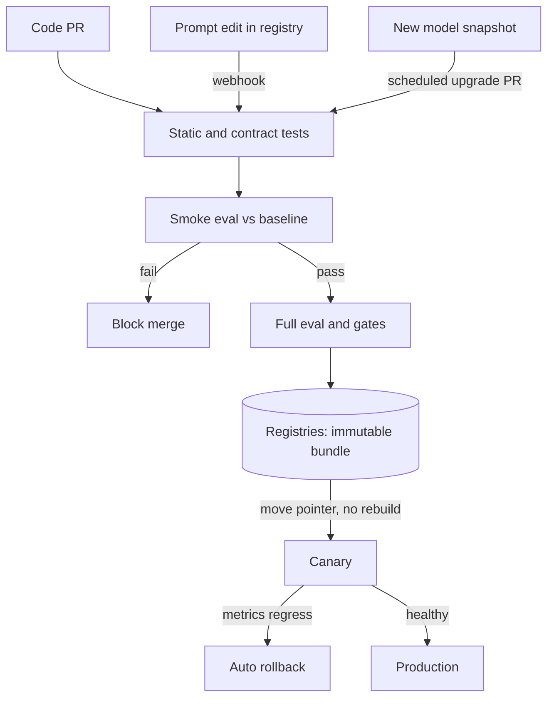

## TL;DR
An LLM app ships three artifacts (code, prompts and config, model) and any one changes behaviour. CI/CD
for them adds evals sized to each stage's blast radius, cached model calls, and promotion of one tested,
immutable bundle.

## Why it exists
- **Classic CI/CD assumptions break.** A conventional pipeline assumes behaviour is determined by code,
  tests are deterministic, and the bits that passed are the bits that run. An LLM app violates all three:
  behaviour depends on code, prompt text, the model behind an API alias, decoding parameters and the
  retrieval index, and outputs are sampled, not computed.
- **The model changes underneath you.** A provider updates the model behind `-latest`, a training job
  produces a new adapter, an index is re-embedded. A green unit suite says nothing about whether answers
  got worse.
- **The three usual shortcuts fail.** Prompts as string constants get review but no evidence: a PR fixes
  the one complaint in the ticket and regresses ten other cases that users find. Live dashboard edits are
  fast but have no review, no rollback, and no record of which prompt produced which answer.
- **Running the whole suite on every commit is the right instinct done badly.** Thousands of model calls
  per push cost real money and take tens of minutes, so within a month the step is marked optional and
  skipped.
- **What works.** Treat prompts and models as first-class release artifacts: know which artifact changed,
  run an eval of depth proportional to the stage's risk, gate on aggregate quality rather than exact
  strings, and promote the exact bundle that was tested.

## How it works
### Three artifacts, three cadences
| Artifact | Changes | Evaluation | Often edited by |
|---|---|---|---|
| Application code | daily | deterministic tests | engineers |
| Prompts and configuration | hourly to daily | cheap to evaluate | product managers, forward-deployed engineers |
| Models | weekly to quarterly | expensive; capacity and cost consequences | ML / platform team |

- **A release is a bundle:** `{code sha, prompt versions, model id or weights revision, decoding params, index snapshot}`.
- **The pipeline tests and promotes bundles**, because testing a prompt against one model and deploying
  it with another tests nothing.

### The test ladder
Depth grows with the blast radius of the stage, because cost and wall-clock time scale with model calls.

1. **Static and unit tests (seconds, no model calls).** Every template renders with every declared
   variable; output parsers run against recorded model outputs; tool JSON schemas validate; guardrail
   rules compile; the rendered prompt stays under its token budget.
2. **Contract tests with recorded responses.** Replay fixtures through the real code path to check
   plumbing (retries, streaming, parsing). They prove the wiring, not the quality.
3. **Smoke eval on every PR (minutes, a few dollars).** A stratified subset of the golden set, 50 to 200
   items as an illustrative size. Score with deterministic checks where possible and an LLM judge where
   necessary; compare with the baseline score recorded by the last green build of main.
4. **Full eval on merge, nightly and on release candidates.** The whole golden set plus slices, cost and
   latency, with every output stored as a build artifact so reviewers can diff behaviour.
5. **Deploy with a canary** and online metrics, and an automatic rollback trigger.

### Gating on distributions, not strings
- **Exact-match assertions on free text flake**, because outputs are sampled.
- **Compare score distributions instead:** a mean with a confidence interval against the champion,
  absolute floors for safety and schema validity, and per-slice floors.
- **Stored outputs are the review artifact.** The diff between the candidate's and the champion's answers
  on the same items is what a reviewer actually reads.
- **Statistics:** the `evaluation-gates-for-production-releases` lesson covers them.

### Content-addressed caching
- **Where it sits.** Eval cost is dominated by model calls, so the cache sits at the model-client boundary.
  Every call is keyed by `hash(model id, decoding params, exact rendered request)`.
- **What "rendered request" means.** The full message list (prompt text, retrieved context, tool
  definitions) the application actually sends.
- **Why not key on `(prompt version, item input)`.** A code or index change that alters retrieval or prompt
  assembly changes the request and misses the cache. A key built only from the item's input would serve
  the old output and hide the change.
- **What it buys.** A PR that touches one prompt re-runs only the items whose requests that prompt affects.
  A code-only PR that leaves every request byte-identical re-runs nothing and just re-scores. This is what
  makes a per-PR eval affordable.
- **The key must include every pin.** A key that omits the model id will happily serve stale outputs after
  a model upgrade and hide the change.
- **Accept knowingly:** with temperature above zero, a cache hit replays one frozen sample, so the cached
  smoke eval measures that sample, not the sampling variance.

### Promote, do not rebuild
- **Promotion moves a pointer.** The bundle that passed the release eval goes dev → staging → production by
  moving a pointer in the prompt and model registries.
- **Never rebuild at deploy time**, because a rebuild re-resolves floating aliases (`-latest`, `main`) and
  can ship something that was never tested.

### Prompts as code versus prompts as config
| Approach | How a prompt deploys | Gain | Cost |
|---|---|---|---|
| Prompts in the repository | normal PR pipeline | simple, reviewable | non-engineers blocked; prompt deploys coupled to code deploys |
| Prompt registry | a label change is the deploy; a registry webhook triggers the same eval gate before the `production` label moves | fast, decoupled | a second deploy path to gate |
| Hybrid (most mature teams) | registry is the source of truth; the pipeline is the only thing allowed to move production labels | both | discipline on label permissions |

### When the yardstick changes
- **A baseline is relative** to the dataset version and scorer version it was measured with.
- **Yardstick changes move every score.** Adding twenty items to the golden set, relabeling a slice, or
  upgrading the judge model changes every score without any change to the bundle.
- **Treat them as their own kind of change:**
  1. re-run the current champion under the new yardstick;
  2. write a new baseline tagged with the dataset hash and scorer version;
  3. only then compare candidates.
- **Self-describing baselines.** A baseline file that records its own dataset hash and scorer version lets
  the job refuse a comparison that would otherwise blame a prompt for a judge upgrade.
- **Trigger on the yardstick too:** changes to `data/golden/**` or to scorer code should run the eval job.

### Model changes are releases too
- **Pin the model snapshot in the bundle.**
- **Run a scheduled "model upgrade" job** that opens a PR with the new snapshot and the full eval when the
  provider announces a new version or a deprecation.
- **Treat a retrained adapter** arriving in the model registry the same way. The trigger differs; the
  ladder is identical.

## Diagram
Each artifact change enters the same ladder; only the pipeline moves the production pointer, and the
promoted bundle is the one that was tested.



## Examples
### PR-time smoke eval with a content-addressed cache
A PR-time smoke eval that sits as one job in the pipeline.

- **The YAML fragment** shows where it runs.
- **The script** wraps the content-addressed cache around the model client and compares against the
  baseline written by the last green build of `main`, refusing if that baseline used a different dataset
  or scorer.
- **Your pieces:** `call_app`, `llm_call`, `score` and `SCORER_VERSION` are your application's entrypoint
  (accepting an injected model client), your raw provider call, your scorer and its version string.
- **Cost:** with a 100-item smoke set and a warm cache, a PR that edits one prompt used by 30 items pays for
  30 application model calls (and 30 judge calls, if a judge scorer goes through the same cache), not 100
  of each.

```yaml
# .github/workflows/llm-ci.yml (fragment): trigger on anything that changes the bundle
on:
  pull_request:
    paths: ["app/**", "prompts/**", "release.json", "data/golden/**", "evals/scorers/**"]
jobs:
  smoke-eval:
    runs-on: ubuntu-latest
    steps:
      - uses: actions/checkout@v4
      - run: python scripts/smoke_eval.py --subset smoke   # nightly job runs --subset full
```

```python
# scripts/smoke_eval.py
import hashlib, json, pathlib, sys

bundle = json.load(open("release.json"))   # {"model": "vendor-model-2025-04-14", "prompt": "support_answer@v12", "params": {...}}
subset = sys.argv[sys.argv.index("--subset") + 1]
data = pathlib.Path(f"data/golden/{subset}.jsonl").read_bytes()
items = [json.loads(l) for l in data.splitlines()]
yardstick = {"dataset": hashlib.sha256(data).hexdigest()[:12], "scorer": SCORER_VERSION}
cache = pathlib.Path(".evalcache"); cache.mkdir(exist_ok=True)

def cached_llm(messages):   # key = model + params + the exact rendered request, so any change that alters it misses
    blob = json.dumps([bundle["model"], bundle["params"], messages], sort_keys=True)
    p = cache / hashlib.sha256(blob.encode()).hexdigest()
    if p.exists():
        return json.loads(p.read_text())
    out = llm_call(bundle["model"], bundle["params"], messages)
    p.write_text(json.dumps(out)); return out

def run_item(item):
    out = call_app(bundle, item["input"], llm=cached_llm)   # the production code path; only its model calls are cached
    return {"id": item["id"], "output": out, "score": score(item, out)}

results = [run_item(i) for i in items]
mean = sum(r["score"] for r in results) / len(results)
base = json.load(open(f"eval_baselines/main-{subset}.json"))   # written by the last green build of main
if base["yardstick"] != yardstick:                              # new items or a new judge: scores are not comparable
    sys.exit("baseline was measured with a different dataset or scorer; re-baseline the champion first")
json.dump({"bundle": bundle, "yardstick": yardstick, "mean": mean, "items": results}, open("eval_out.json", "w"))
print(f"candidate={mean:.3f} baseline={base['mean']:.3f} n={len(results)}")
sys.exit(0 if mean >= base["mean"] - 0.02 else 1)   # smoke tolerance; the release gate uses a paired CI instead
```

### Worked scenario: what each kind of PR costs with a warm cache
Same 100-item smoke set, judge calls routed through the same cache. Call counts follow from the cache key;
they are not a benchmark.

| Change in the PR | Requests that change | App calls | Judge calls | Gate outcome |
|---|---|---|---|---|
| Refactor that leaves every rendered request byte-identical | none | 0 | 0 | re-score only, seconds |
| Edit one prompt used by 30 items | 30 | 30 | 30 | compare with baseline |
| Retrieval change that alters context for 55 items | 55 | 55 | 55 | compare with baseline |
| Model snapshot bump in `release.json` | all 100 (model id is in the key) | 100 | 100 | full cost, as it should be |
| 20 items added to the smoke set | yardstick hash changes | 20 to re-baseline the champion | 20 | refused until re-baselined |

- **Read the last row carefully.** The champion's 100 existing requests are still cached, so re-baselining
  costs only the 20 new items; without the yardstick check the PR would be blamed for a dataset change.
- **Judge calls follow app calls** because the judge's request embeds the candidate output: a changed answer
  is a changed judge request.

## Production patterns
- **Path-filtered eval triggers** — when only some PRs touch the bundle. Use the `paths` filter shown above
  (code, prompts, `release.json`, golden data, scorers) so docs-only PRs skip model calls. Monitor eval
  minutes and spend per PR.
- **Required status check on the smoke eval** — when people start merging around a red eval. Mark the
  smoke-eval job as a required check in branch protection so a failing eval blocks merge. Monitor how often
  admins override it.
- **Cancel superseded runs** — when developers push several commits to one PR. In GitHub Actions set a
  `concurrency` group per PR with `cancel-in-progress: true` so only the latest commit pays for an eval.
  Monitor queued-run counts and eval wall-clock time.
- **Eval outputs as build artifacts** — when reviewers need to read behaviour, not just a score. Upload
  `eval_out.json` with `actions/upload-artifact` and post the candidate-versus-champion diff on the PR.
  Monitor whether reviewers open it before approving.
- **Pipeline-only production labels** — when prompts live in a registry. Give only the CI service account
  permission to move the `production` label, triggered by the registry webhook after the gate passes.
  Alert on any label move without a linked eval run.
- **Scheduled model-upgrade job** — when you pin provider snapshots. A cron-triggered workflow
  (`on: schedule`) checks for new snapshots or deprecation notices and opens a PR with the full eval
  attached. Monitor days remaining before each pinned snapshot's deprecation date.

## Trade-offs
- **Fast per-PR evals vs resolution.** Smoke evals catch gross regressions in minutes, but a 100-item
  subset cannot resolve a one- or two-point change. The moment you need that resolution you must pay for
  the full set or a canary.
- **Cheap cached evals vs hidden changes.** Caching makes evals cheap and fast, yet every omitted pin in
  the cache key becomes a way to hide a real change. The more aggressive the cache, the more disciplined
  the key must be.
- **Prompts-as-config vs a second deploy path.** It decouples prompt deploys from code deploys and unblocks
  non-engineers, but that path must be gated as strictly as the first or it becomes the bypass everyone
  uses.
- **Aggregate gates vs individual catastrophes.** Gating on aggregate scores tolerates sampling noise, but
  it also tolerates an individual catastrophic answer. Safety and schema checks therefore need absolute
  per-item floors, not averages.
- **Pinned snapshots vs deprecation.** Pinning gives reproducible builds, but snapshots get deprecated.
  Without a scheduled upgrade job, pinning turns into an emergency migration on the provider's timetable.

## Pitfalls
- **Evaluating a copy of the prompt chain.** Running evals against a reimplementation inside the test
  harness instead of the production entrypoint. Symptom: a green pipeline and a production regression
  caused by code the eval never executed. Fix: call the real entrypoint with an injected model client.
- **Comparing against a fixed threshold.** Rather than the current champion. Symptom: quality erodes a
  point per release while every release passes, and nobody notices until a customer does.
- **Retrying a flaky eval until it goes green.** Symptom: a gate whose pass rate is uncorrelated with
  quality and a team that has stopped reading the numbers.
- **Moving the `production` label from the UI.** Without the pipeline. Symptom: an incident whose timeline
  contains a prompt change with no PR, no eval and no author.
- **Using `-latest` model aliases in the bundle.** Symptom: a score change on a day with no commits, traced
  eventually to a provider update. Fix: pin the snapshot.
- **Comparing against a stale yardstick.** A baseline measured on an older golden-set or judge version.
  Symptom: every PR failing (or passing) by the same few points the day the dataset grew, with no prompt to
  blame.

## When to use
- **Use when** more than one person edits prompts or a prompt is deployed to real users: that is when "we
  changed something and it got worse" becomes unanswerable.
- **Start cheap.** Unit tests on templates and parsers plus a 50-item smoke eval against a stored
  baseline; add the full suite and canary when release frequency or user impact justifies them.
- **Measure** pipeline cost per PR, eval wall-clock time, cache hit rate and, most importantly, the number
  of production regressions the pipeline would have caught.
- **Interviews:** the expected answer to "how do you deploy a prompt change safely" is this ladder: unit,
  recorded-response contract, smoke eval versus baseline, full eval with gates, canary with rollback, with
  the bundle, not the prompt, as the unit of release.

## Role lens
- **Engineer:** Builds the smoke-eval job, the content-addressed cache and the baseline file, and keeps the
  harness calling the real application entrypoint rather than a reimplementation.
- **Architect:** Decides that the bundle is the unit of release, which registry owns each artifact, and that
  the pipeline is the only path allowed to move a production label.
- **FDE:** Reproduces a lightweight version of the ladder inside the customer's CI, often with the
  customer's own golden set, so their change-management process has evidence rather than a demo.

## Check yourself
**Q:** A product manager edits a system prompt in the registry UI at 4 pm and moves the `production`
label; latency is unchanged but support tickets about wrong refund amounts double overnight. The code
pipeline is green. What went wrong structurally, and how would you change the pipeline so it cannot
happen again?
**A:** Structurally, the prompt had a deploy path that bypassed every test: the code pipeline only runs on
commits, and the registry label move was an unreviewed, un-evaluated production change. The fix is not
to forbid non-engineers from editing prompts but to make the label move itself the thing the pipeline
gates. Registry edits create a new immutable version; a webhook or scheduled job runs the smoke eval and,
for `production`, the full eval and gates against the champion on the same golden set, including a
refund-intent slice with a floor; only the pipeline's service account may move the production label,
and it writes the eval evidence next to the version. Rollback is moving the label back. Finally, add the
incident's cases to the golden set so the regression is a permanent test.

## Interview questions
### Why can't a normal CI pipeline with unit tests protect an LLM application?
- **Behaviour lives outside the code.** Prompt text, the model behind an alias, decoding params and the
  index all change answers, and none of them is exercised by unit tests on code.
- **Outputs are sampled,** so exact-match assertions flake; you need eval scores compared as distributions
  against a champion.
- **So the unit of release is the bundle,** tested by an eval whose depth matches the stage's blast radius.

### A code-only PR changed how retrieved chunks are ordered, and the smoke eval re-ran nothing. What is wrong?
- **The cache key is too coarse.** It is probably keyed on prompt version and item input instead of the
  exact rendered request, so a different message list hit an old entry.
- **Fix:** key on model id, decoding params and the full rendered message list at the model-client
  boundary, so any change in what the app sends misses the cache.
- **Verify** by asserting the miss count is non-zero on a PR known to change retrieval.

### When would you not run an eval on every PR?
- **When the PR cannot change the bundle,** such as docs or infra-only changes; path filters skip them.
- **When the eval is too expensive to stay fast,** run a stratified smoke subset per PR and the full suite
  on merge, nightly and release candidates, otherwise the step gets marked optional.
- **The cost:** a 100-item subset cannot resolve a one- or two-point change, so small regressions wait for
  the full eval or canary.

### How do you handle a provider deprecating the model snapshot you pinned?
- **Pin and schedule.** The bundle pins the snapshot; a scheduled upgrade job opens a PR with the new
  snapshot as soon as a new version or deprecation is announced.
- **Same ladder:** the full eval runs against the champion, the cache misses on every item because the
  model id is in the key, and promotion is a pointer move.
- **Monitor** days left before each pinned snapshot is retired, so the migration is never on the
  provider's emergency timetable.

### The golden set grew by 20 items and every PR started failing by the same margin. What happened?
- **The yardstick changed, not the bundles.** Scores against the new dataset are not comparable with a
  baseline measured on the old one.
- **Fix:** record the dataset hash and scorer version in the baseline, refuse mismatched comparisons, and
  re-run the champion to write a new baseline before comparing candidates.
- **Trigger** the eval job on `data/golden/**` and scorer changes so re-baselining happens automatically.

## Quiz
### Q: Why does the PR stage run a stratified subset of the golden set rather than the full suite?
- [ ] Subsets are statistically more reliable than the full set
- [x] Eval cost and time scale with model calls, so depth is matched to the blast radius of each stage
- [ ] Full suites can only be run against production models
- [ ] GitHub Actions cannot run jobs longer than ten minutes
> Every item is a model call that costs money and time; a per-PR job must stay fast and cheap or it will be
> skipped. The full suite runs on merge, nightly and on release candidates where the stakes justify it.

### Q: Why should the tested bundle be promoted by pointer rather than rebuilt at deploy time?
- [ ] Rebuilding is slower because weights must be downloaded again
- [ ] Registries cannot store more than one version at a time
- [x] A rebuild re-resolves floating aliases and can deploy a model or prompt that was never evaluated
- [ ] Promotion avoids the need for a canary stage
> The whole point of the gate is that the exact bits that passed are the bits that run. A rebuild that
> resolves `-latest` or `main` again may pick up a provider update or a prompt edit the eval never saw.

### Q: What is the strongest reason to put the model snapshot id inside the eval cache key?
- [ ] It makes the cache directory easier to browse
- [ ] Providers require it for billing attribution
- [x] Without it, a model upgrade would be served stale cached outputs and the change would be invisible
- [ ] Hashing is cheaper when the key is longer
> The cache exists to skip calls whose inputs have not changed. If the model id is not part of the key,
> swapping the model counts as "unchanged" and the eval silently measures the old model's cached outputs.
