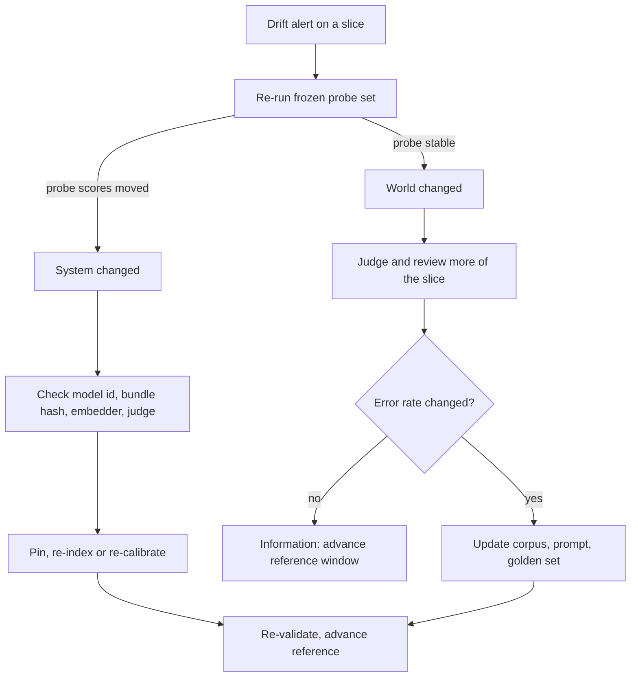

## TL;DR
Drift is any change between the conditions your agent was validated under and the ones it serves:
tasks, the right answer, or the model, prompt, tools, corpus, embedder or judge. Detect it against a
reference window; act only if outcomes changed.

## For agent builders
- **Why it matters for agents.** An agent depends on more moving parts than a model: the provider model
  behind an alias, tool APIs whose responses change shape, a RAG corpus that ages, and users who start
  asking for tasks you never tested. Any of these shifts behaviour with no error raised.
- **Where it shows up in your stack.** Task and intent mix in your traces, tool-call mix and tool error
  rates, retrieval scores, the reported response model id, and a frozen probe set of agent tasks run on
  a schedule.
- **What you control.** Pinning model snapshots, embedders and judges, hashing the resolved bundle
  (prompt plus tool schemas), the reference window, and which slices get extra judging when they shift.
- **What you can skip.** Deriving PSI or two-sample test theory; know what each detects, the rule-of-thumb
  cut-offs, and that only labels reveal concept drift.

## Why it exists
- **Every evaluation is a snapshot.** A golden set, a canary and a benchmark all say "acceptable on
  *this* distribution at *this* time"; nothing in that survives a change in either variable.
- **The world moves quietly.** Users ask about a product launched after indexing; a new segment writes in
  an untuned language; a regulation flips the right answer to "can I return this?" while the question
  text does not; the vendor retrains the model behind your alias. None raises an error.
- **Naive responses fail predictably.**
  - "Re-run the golden set weekly" catches regressions on old questions, not failures on new ones, because
    the set is frozen on the old distribution.
  - "Watch the quality metric" is right in spirit but late: judged quality needs enough samples and labels
    arrive days later, so Monday's drift alerts the following week.
  - "Retrain or re-index on a schedule" is cost without diagnosis: it fixes some drifts, cannot fix others
    (a prompt that is now wrong), and tells you nothing about which you had.
- **The concept separates three questions:** *what* moved (inputs, outcomes, or a component), *how* it
  moved (abrupt, gradual, seasonal), and *whether it matters* (did the error rate change on the affected
  slice). Only the third justifies action, but you cannot answer it without the first two.

## How it works
### The statistical vocabulary
Treat the system as a function from inputs **X** to outputs **Y**, validated on data from a joint
distribution P(X, Y). Drift is any change in it; name which factor moved:

| Type | What changes | Example | Visible without labels? |
|---|---|---|---|
| **Covariate shift** (data / input drift) | P(X); P(Y\|X) stays | support bot gets shipping instead of billing questions; may be correct, but outside validated territory | yes |
| **Prior / label shift** | P(Y); P(X\|Y) stays | fraud goes from 1% to 3% of traffic; thresholds tuned for the old base rate are wrong even if scores are unchanged | partly |
| **Concept drift** | P(Y\|X) | policy, price, law or product name changes; same input, new correct output | no: the dangerous one, only ground truth reveals it |
| **Prediction / output drift** | what the system emits | output length or refusal mix moves | yes: cheapest early warning, but ambiguous (happens under all of the above and when the system changes) |

- **For generative systems Y is "the correct behaviour".** Label shift then means, for example, the share
  of requests whose right response is "escalate to a human" or "refuse" has moved, which matters because
  prompts and thresholds were tuned for the old mix.

### Drift shape decides the detector (Gama et al. taxonomy)
| Shape | Typical cause | Detector |
|---|---|---|
| **Sudden** | a release, a provider update | short window and a change-point test |
| **Gradual** | new segment ramping up | long window and a trend test |
| **Incremental** | slow vocabulary change | long window and a trend test |
| **Recurring** | seasonality: tax season, Black Friday | baseline from the same season, not last week |

### What drifts in an LLM application that did not drift in classic ML
In classic ML the model was yours and frozen; only the world moved. In LLM systems components move too,
each with its own detector and fix:

| Source | What happens | Detect by | Fix |
|---|---|---|---|
| **Upstream model** | provider updates the model behind an alias or changes a default; same prompt, new behaviour across *all* tenants at one timestamp | proxies shifting globally at once; the response's reported model id | pin snapshots; treat upgrades as releases |
| **Prompt / configuration** | someone edits the system prompt, a tool description or temperature outside the release path | hash the resolved bundle per request; alert on hash change without a deploy | route edits through releases |
| **Knowledge / corpus** | RAG index falls behind (stale prices, retired policies); answers confidently out of date | document age at retrieval; groundedness against the *current* source of truth, not the index | refresh the corpus |
| **Embedding** | embedder upgraded but index built with the old one; vectors no longer share a space | collapse in retrieval scores on a fixed probe set | version embeddings with the index; re-index together |
| **Judge** | the LLM-as-a-judge alias updates; every quality series steps that day | re-score a fixed, human-labelled calibration set on a schedule | re-calibrate and pin |
| **Feedback loop** | users learn which phrasings work; outputs enter the system's own corpus or training data | only by comparing against held-out, never-served data | keep held-out data |
| **Tools (agents)** | an upstream API adds fields, renames an enum or paginates differently; the agent misreads results or sends stale arguments | tool error and retry rate per tool; schema validation on tool responses | version tool adapters; validate responses |
| **Agent memory** | long-term memory accumulates outdated or agent-written notes that steer later runs | memory age at retrieval; probe tasks run with empty versus populated memory | expiry and review policies for memory |

### Detecting it
Detection compares a **reference window** (the validated traffic, or the same period last cycle) with a
**current window**, per feature and per slice:

1. **Choose the signal.**
   - Categorical features (intent, language, tenant, tool called, finish reason): bucket distribution.
   - Numeric (input length, retrieval score, latency): buckets or the empirical CDF.
   - Free text: embed it and compare the embedding clouds.
2. **Pick a statistic.**
   - **PSI** (population stability index) for buckets: `PSI = Σ_b (cur_b − ref_b) · ln(cur_b / ref_b)`, a
     symmetric, interpretable number where 0 means identical.
   - **PSI cut-offs (credit-risk rule of thumb):** under 0.1 stable, 0.1–0.25 worth a look, above 0.25 a
     real shift. Convention, not theory: re-derive them from your own history.
   - **KS test** for continuous features; **Jensen–Shannon divergence** for a bounded, symmetric measure.
   - **Classifier two-sample test** for embeddings: train a classifier to tell reference from current. AUC
     near 0.5 means indistinguishable, and its most confident "current" examples show *what* moved, which
     a single divergence number never does.
3. **Control for noise.** Minimum window sizes, like-with-like comparisons (same weekday, same season),
   and slicing by tenant and intent, because a global PSI of 0.03 can hide one tenant at 0.6.
4. **Separate "the world moved" from "the system moved".** Re-run a **frozen probe set** (a fixed slice of
   the golden set with known-good outputs) on a schedule and whenever an alert fires. Its inputs never
   change, so if its scores move, a component changed (model, prompt, embedder, judge); if it holds while
   production moves, the world changed. This one check halves most drift investigations.
5. **Separate "moved" from "broke".** A shift raises priority for slow signals: route more of that slice to
   judging and human review and check whether its error rate changed. Input drift with stable outcomes is
   information, not an incident. Concept drift is confirmed only by labels, so the detector decides where
   to spend them.

### Responding
Diagnosis comes first because each type has a different fix:

| Diagnosis | Fix |
|---|---|
| New inputs | extend the golden set and prompt coverage |
| Concept drift | update the corpus, policy text or labels, then re-validate |
| Upstream model change | pin, evaluate, canary |
| Embedding mismatch | re-index |
| Judge shift | re-calibrate and pin |

- **Retraining fixes one of these, not all of them.**
- **Move the reference window forward after the fix**, because the newly validated distribution is the
  new baseline.

## Diagram
The frozen probe set is the first fork: it tells you whether to inspect components or the world, and only
a change in outcomes turns a shift into work.



## Examples
### PSI on intent mix and a classifier two-sample test on embeddings
Two detectors on one week of support-assistant traffic: PSI on the intent mix, and a classifier
two-sample test on input embeddings.
- **The intent shift** is real but moderate.
- **The embedding test on a synthetic shift** shows what a clearly separable week looks like (AUC ≈
  0.87–0.88) versus an unshifted one (≈ 0.5 on the same code, give or take cross-validation noise).

```python
import numpy as np
from sklearn.linear_model import LogisticRegression
from sklearn.model_selection import cross_val_score

def psi(expected, actual, eps=1e-6):
    """Population Stability Index between two bucket distributions (fractions summing to 1)."""
    e, a = np.asarray(expected) + eps, np.asarray(actual) + eps
    return float(np.sum((a - e) * np.log(a / e)))

# Intent mix: reference week vs this week (fractions of requests)
ref = [0.30, 0.25, 0.20, 0.15, 0.10]      # billing, shipping, returns, account, other
cur = [0.22, 0.20, 0.33, 0.15, 0.10]
print(f"intent PSI = {psi(ref, cur):.3f}")  # 0.101: 'returns' rose from 20% to 33%; look at that slice

def embedding_drift_auc(ref_emb, cur_emb):
    """Classifier two-sample test: can a model tell this week's inputs from the reference week's?"""
    X = np.vstack([ref_emb, cur_emb])
    y = np.r_[np.zeros(len(ref_emb)), np.ones(len(cur_emb))]
    clf = LogisticRegression(max_iter=1000)
    return cross_val_score(clf, X, y, cv=5, scoring="roc_auc").mean()
# AUC 0.5 = indistinguishable. Use a few thousand embeddings per window, then inspect the inputs the
# classifier is most confident are 'current' to see what actually changed.

rng = np.random.default_rng(0)
ref_emb = rng.normal(0, 1, (2000, 64))
cur_emb = rng.normal(0, 1, (2000, 64)); cur_emb[:, :8] += 0.6   # shift along a few directions
print(f"embedding drift AUC = {embedding_drift_auc(ref_emb, cur_emb):.2f}")   # ~0.87-0.88
# Ceiling for a linear separator: Phi(0.6*sqrt(8)/sqrt(2)) = Phi(1.2) ~ 0.885
```

Reading the PSI by hand:

| Bucket | ref → cur | Contribution |
|---|---|---|
| returns | 0.20 → 0.33 | (0.33 − 0.20) · ln(1.65) ≈ 0.065 |
| billing | 0.30 → 0.22 | (0.22 − 0.30) · ln(0.733) ≈ 0.025 |
| shipping | 0.25 → 0.20 | ≈ 0.011 |
| account, other | unchanged | 0 |
| **Total** | | **≈ 0.10** |

- **Interpretation:** the mix moved noticeably; whether it matters depends on whether the returns slice,
  now a third of traffic, was well covered by the prompt and golden set.

### Catching configuration drift with a bundle hash
Pure Python: hash the *resolved* bundle on every request and flag any hash that no deploy produced. This
catches prompt and parameter edits that bypassed the release path.

```python
import hashlib, json

def bundle_hash(bundle: dict) -> str:
    canon = json.dumps(bundle, sort_keys=True, separators=(",", ":"))
    return hashlib.sha256(canon.encode()).hexdigest()[:12]

released = {"model": "m-2026-05", "prompt": "Answer using the policy docs.", "temperature": 0.2}
deployed_hashes = {bundle_hash(released)}           # written by the release pipeline

def check_request(resolved: dict):                 # None if the hash came from a deploy
    h = bundle_hash(resolved)
    return None if h in deployed_hashes else f"config drift: hash {h} not from any deploy"

print(check_request(dict(released)))                           # None
print(check_request({**released, "temperature": 0.7}))         # flagged: someone edited a default
```

### Worked triage: three alerts, three different fixes
Illustrative week for a support assistant; the probe set splits each case in one step.

| Alert | Frozen probe set | Other evidence | Diagnosis | Fix |
|---|---|---|---|---|
| Refusal rate up on every tenant at 02:00 | dropped | reported model id changed | upstream model drift | pin snapshot, evaluate, canary |
| Retrieval scores down, citations irrelevant | dropped on retrieval probes | embedder upgraded last night | embedding drift | re-index with the new embedder, or revert it |
| Returns intent up to 33% (PSI 0.10) | stable | judged error rate on returns unchanged | covariate shift, harmless | add returns cases to the golden set, advance reference |

### Worked scenario: tool drift in an order-lookup agent
Illustrative numbers. The order API started returning `status: "in_transit"` where it used to return
`"shipped"`, with no change on the agent side.

| Signal | Reference week | This week | Read |
|---|---|---|---|
| `get_order` error rate | 0.4% | 0.5% | flat: the call succeeds |
| Tool-call PSI (which tool is called) | | 0.18 | the agent now calls `escalate` far more often |
| Frozen probe set (40 agent tasks, recorded tool results) | 38/40 | 38/40 | stable, so the agent itself did not change |
| Live probe (same tasks, live tools) | 38/40 | 29/40 | the world changed: a tool |
| Escalation rate | 6% | 14% | users feel it |

- **Diagnosis:** recorded versus live probes split agent drift from tool drift in one step; the new enum
  value was not in the tool description, so the model treated it as unknown and escalated.
- **Fix:** validate tool responses against a versioned schema in the adapter, update the tool description,
  and add the new status to the golden set.

## Production patterns
- **Resolved-bundle hash on every trace.** Compute a hash over model id, prompt text, tool schemas and
  decoding parameters at request time and attach it to the trace; alert when a hash appears that the
  release pipeline did not record. Monitor distinct hashes per environment per day.
- **Scheduled frozen probe set.** Run a fixed set of a few dozen to a few hundred golden cases (size is
  illustrative) daily and on every drift alert, through the full production path. Monitor probe scores as
  their own time series; any move without a deploy means a component changed.
- **Slice-level PSI with smoothing.** Compute PSI per tenant and intent with an epsilon or a pooled
  "other" bucket so new categories do not produce infinities, and rank slices by score instead of
  alerting on each. Monitor the top-ranked slices weekly and the count of unseen categories.
- **Seasonal reference windows.** For recurring traffic, compare against the same weekday or the same
  period last cycle (month-end, tax season) rather than the previous week. Monitor alert recurrence: an
  alert that fires every Monday means the baseline is wrong.
- **Embedding version stamped on the index.** Store the embedder id in index metadata and check it at
  query time, refusing or alerting on a mismatch, so an embedder upgrade cannot silently query an old
  index. Monitor mean top-k retrieval score on a fixed probe query set.
- **Library-backed drift reports.** Tools such as Evidently compute per-column drift tests (PSI, KS,
  Jensen–Shannon and others) between a reference and current dataset; run them as a scheduled job on
  logged features. Monitor the share of drifted columns per slice, not a single global flag.
- **Recorded and live agent probes.** Run the same agent tasks twice on a schedule: once against recorded
  tool results, once against live tools. If only the live run drops, a tool or corpus drifted; if both
  drop, the model or prompt did. Monitor the gap between the two pass rates.

## Trade-offs
- **Label-free detectors: cheap and immediate vs blind to concept drift.** PSI, embedding tests and
  output proxies cannot see it; once ground truth lags by weeks you need both, and the detectors decide
  where scarce labels go.
- **Short vs long windows.** Short windows catch sudden shifts fast but alert on noise; long windows are
  stable but late. Running both with different thresholds is usually cheaper than tuning one to do both.
- **Fine slicing: exposes hidden drift vs shrinking samples.** Each slice multiplies alert series; beyond a
  few dozen slices, rank slices by drift score rather than alerting on each.
- **Pinning every component: attributable vs upgrade burden.** Pinning the snapshot, embedder and judge
  removes a class of surprises, at the price of scheduled upgrades and the risk of running on a model the
  provider is about to retire.
- **Advancing the reference window: relevant vs normalised drift.** It keeps detectors relevant, but
  moving it without validating quietly normalises the drift you were supposed to catch.

## Pitfalls
- **Treating a drift alert as a defect.** Symptom: retraining or re-prompting for an input shift whose
  outcomes were fine, and a worse system afterwards. Fix: check outcomes on the slice first.
- **Comparing week over week during seasonal traffic.** Symptom: a recurring alert every Monday or
  month-end that everyone ignores, which then masks a real shift. Fix: seasonal baselines.
- **Monitoring inputs and outputs but not components.** Symptom: a global step change with no deploy in
  the log, traced days later to a provider alias update or judge upgrade. Fix: model id and bundle hash.
- **Upgrading the embedding model without re-indexing.** Symptom: retrieval scores collapse on the probe
  set and answers cite irrelevant documents while the model is unchanged. Fix: version and re-index
  together.
- **Letting the golden set stay frozen while traffic moves.** Symptom: a green eval suite alongside rising
  complaints from a segment with no representation in it. Fix: feed confirmed shifts into the set.
- **PSI with empty buckets and no smoothing.** Symptom: infinite or NaN scores that crash the job or get
  silently clipped, hiding exactly the new categories that signal drift. Fix: epsilon smoothing.
- **Trusting tool responses to keep their shape.** Symptom: an agent quietly escalates or answers wrongly
  after an upstream API change, with tool error rate flat. Fix: schema-validate tool responses and alert on
  the tool-call mix.

## When to use
- **Every production system needs it**, because every system runs longer than its validation data stays
  representative.
- **Day one:** intent and language mix, input length, output proxies, and a hash of the resolved bundle so
  configuration drift is caught instantly.
- **Later:** embedding-based input drift once you have a few thousand requests per window; judge
  re-calibration once you rely on an LLM judge.
- **Measure per slice and feed back:** each confirmed shift goes into the golden set, because the shift
  that moved production is exactly the distribution your next evaluation must contain.
- **Interviews:** distinguish covariate shift from concept drift, explain why model, prompt, corpus,
  embedder and judge need pinning and hashing, and insist a detected shift is a question about outcomes,
  not an answer.

## Role lens
- **Engineer:** Implements the window comparisons, bundle hashing and slice-level PSI jobs, and wires a
  drift score into the sampler so shifted slices get judged and reviewed first.
- **Architect:** Decides which components are pinned, how reference windows are chosen and advanced,
  and the policy that turns a confirmed shift into a re-validation and a golden-set update.
- **FDE:** Spots customer-side drift first: a new product line, a reorganised knowledge base or a
  changed policy, and gets it into the corpus and the regression suite before the complaints arrive.

## Check yourself
**Q:** A claims-extraction system's accuracy on its monthly human-reviewed sample fell from 94% to 87%.
Input-length and field-mix PSIs are below 0.05, and no deploy happened. Walk through how you would find
the cause and what you would do for each possibility.
**A:** First confirm the drop is real: on a review sample of a few hundred cases, seven points is
well outside sampling noise, but on fifty it may not be. Stable input statistics then rule out the
obvious covariate shift, so look at the components and at concept drift. The fastest split is to
re-run the frozen probe set: if it also dropped, the system changed even though nobody deployed; if it
held, the world changed. Check the model id reported in responses and the bundle hash per request: if the
provider alias moved, every tenant's proxies will have stepped at one timestamp, and the fix is to pin
the previous snapshot, evaluate the new one and canary it. Check the judge or review process: if the
reviewers' guidelines changed, the "drop" is a measurement change. Then test for concept drift: pull
the failed cases and see whether the correct extraction changed, for example a new claim form layout
or a renamed field; inputs can look statistically identical while the mapping changed. That fix is
prompt and golden-set updates plus re-validation. Finally run the classifier two-sample test on
document embeddings, because a layout change can be invisible to length and field-mix buckets while
being obvious in embedding space.

## Interview questions
### Explain covariate shift versus concept drift with an LLM example, and why the difference matters.
- **Covariate shift:** the questions change but each still has the same right answer, for example a
  support bot suddenly receiving mostly returns questions. Detectable from inputs alone.
- **Concept drift:** the same question has a new right answer, for example a return window shortened by
  policy. Inputs look identical, so only labels or a current source of truth reveal it.
- **Why it matters:** the fixes differ (extend coverage versus update corpus, policy text and labels),
  and only one can be caught without labels.

### Every quality metric of your RAG agent dropped overnight across all tenants and nobody deployed. What do you check?
- **Re-run the frozen probe set:** if it dropped too, a component changed, not the world.
- **Then check components in order:** the model id reported in responses (alias update), the resolved
  bundle hash (an out-of-band prompt edit), the embedder version on the index, and the judge model.
- **A global, single-timestamp step** is the signature of an upstream change rather than a user-mix change.

### Your intent PSI is 0.12 for one tenant. Do you retrain, re-prompt or do nothing?
- **None yet.** PSI says inputs moved, not that outcomes got worse; acting on it alone can make the system
  worse.
- **Spend labels on the slice:** route more of that tenant to judging and human review and compare its
  error rate with the reference window.
- **Act only if outcomes changed;** if they did not, add the new cases to the golden set and advance the
  reference.

### Your agent's escalation rate doubled but no deploy happened and the model id is unchanged. How do you find the cause?
- **Split agent from environment:** re-run probe tasks with recorded tool results and with live tools; a
  drop only in the live run points at a tool or corpus, not the model or prompt.
- **Check the tool-call mix and per-tool responses:** a PSI jump in which tools are called, or new values in
  a tool's response, usually names the culprit.
- **Fix at the adapter:** validate and normalise tool responses, update tool descriptions, and add the new
  cases to the golden set.

### When would you use a classifier two-sample test instead of PSI?
- **For high-dimensional inputs** such as text embeddings, where bucketing is meaningless.
- **When you need to know what moved:** the classifier's most confident "current" examples are the new
  kind of traffic, which a single divergence number never shows.
- **Cost:** it needs a few thousand embeddings per window and a training run, so it is a scheduled job
  rather than a per-request check.

### What does pinning every component cost, and when would you not pin?
- **Gain:** drift becomes attributable, because only the world can move a pinned system.
- **Cost:** a scheduled upgrade burden and the risk of running on a snapshot the provider is about to
  retire.
- **Exception:** a low-stakes internal tool may track a provider alias deliberately, with the frozen probe
  set and response model id as the safety net.

## Quiz
### Q: Which kind of drift cannot be detected by any statistic computed on inputs and outputs alone?
- [ ] Covariate shift, because input distributions are high-dimensional
- [ ] Prediction drift, because outputs are free text
- [x] Concept drift, because the inputs and outputs can look identical while the correct output has changed
- [ ] Upstream model drift, because the provider does not announce it
> Concept drift is a change in P(Y|X): the same question now has a different right answer. Only
> labels or ground truth can reveal it. Input, output and model-id signals all detect the other types.

### Q: An intent-mix PSI of 0.10 is reported for one tenant. What is the correct next step?
- [ ] Roll back to the previous bundle immediately
- [ ] Retrain or re-prompt, since the distribution has moved
- [x] Route that tenant's slice to more judging and review to learn whether outcomes changed
- [ ] Raise the threshold, since 0.10 is within normal variation for all systems
> PSI says the inputs moved, not that the system is wrong. A shift of this size justifies spending
> labels on that slice; action follows only if the error rate on the shifted traffic has changed.

### Q: Why does the classifier two-sample test on embeddings add something a divergence score does not?
- [ ] It is the only test that works on categorical data
- [x] The classifier's most confident "current" examples show what moved, not just that something moved
- [ ] It needs no reference window
- [ ] It detects concept drift without labels
> A single divergence number says how far apart two windows are. A trained discriminator can be
> inspected: the inputs it is surest belong to the new window are the new kind of traffic, which is
> what you need to extend the golden set and prompt.

## Use cases & projects
### Use cases
- **Provider alias updates under an agent.** The frozen probe set and the response model id show the model
  moved, not the users.
- **Tool APIs changing shape.** Tool-call mix and response validation catch an upstream change before the
  escalation rate does.
- **Stale RAG corpora.** Document age at retrieval and groundedness against the current source of truth
  reveal answers that are confidently out of date.
- **New task types arriving.** Intent PSI and embedding two-sample tests show users asking the agent for
  things your golden set never covered.

### Mini project
**Drift triage for a tool-calling agent (2-3 hours).**
- **Goal:** tell model drift, tool drift and task-mix drift apart with three cheap checks.
- **Steps:** build a small agent with two tools and 30 probe tasks; record tool results once; compute a
  bundle hash and an intent PSI over logged tasks; then inject three changes in turn (change the prompt
  out of band, change a tool's response enum, shift the task mix) and run recorded and live probes after
  each.
- **Done when:** a triage script, given only the logs and probe results, labels each injected change
  correctly from the evidence (hash alert, recorded-versus-live gap, PSI with stable outcomes).
