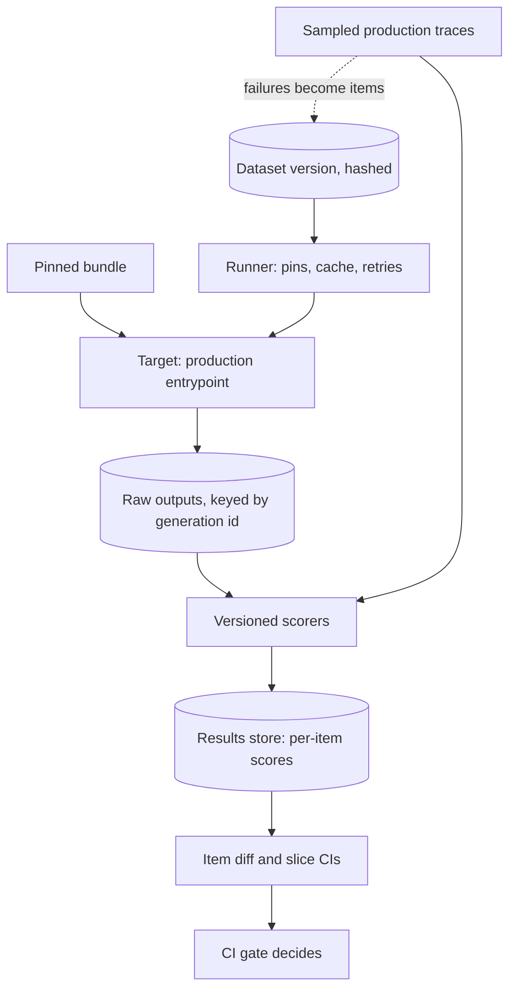

## TL;DR
An evaluation framework turns one engineer's eval script into a shared service with five fixed
interfaces (datasets, target, scorers, runner, results), so an eval score becomes a currency every team
can compare and accept.

## Why it exists
- **A second team builds a second engine.** The `evals/eval-harness` lesson explains one engine. Team A
  stores CSV with a `label` column and reports "87% pass"; team B keeps JSONL with a `reference` field and
  reports "judge score 0.71". Asked about a new model snapshot, every team re-runs something different and
  the decision is made on anecdotes.
- **Numbers are unstable even within one team.** The rubric lives in a notebook, the dataset was edited
  last Tuesday, and the "baseline" was measured against a model alias that has since been updated.
- **The naive alternatives fail specifically.** Notebooks are not repeatable, so Friday's number cannot be
  compared with Tuesday's. A spreadsheet of hand-checked outputs is honest but stale within a sprint and
  cannot gate a pipeline.
- **Public benchmarks and dashboards miss the point.** Benchmarks (MMLU, HumanEval and friends) measure the
  base model, not your prompt, retrieval, tools and guardrails, and the popular ones are widely suspected
  to have leaked into frontier-model training data. A dashboard without dataset discipline, calibrated
  scorers and pinned runs renders noise with good typography.
- **The contribution is standard interfaces, not cleverness.** With one schema, pieces become swappable (a
  new judge, a new dataset version), runs compare across teams and weeks, caching makes per-PR evals
  affordable, and every score links back to its trace.

## How it works
### The five interfaces
1. **Dataset.** Items of `{id, input, expected or reference, slice metadata}`, stored as immutable,
   content-hashed versions.
   - Immutable *because* a score only means something relative to a dataset version; an item relabeled in
     place silently moves every baseline.
   - Which datasets exist and how items get in: the `golden-dataset-strategy` lesson.
2. **Target.** An adapter that calls the production code path with a pinned bundle (model snapshot, prompt
   version, decoding parameters, index snapshot).
   - It calls the real application *because* evaluating a copy of the prompt evaluates the copy: template
     rendering, post-processing and retrieval are part of what ships.
3. **Scorers.** Three families, each with a name and a version (see the table below). Every score is stored
   as `{item_id, scorer, scorer_version, value, rationale}`, the version *because* a judge upgrade changes
   scores without any change to the application.
4. **Runner.** Executes dataset × target with concurrency, retries and timeouts.
   - Caches model calls keyed by the exact request sent (model id, decoding params, rendered messages).
   - Writes raw outputs *before* scoring and records a manifest of every pin. Raw outputs first *because*
     scorers change: re-scoring with a new judge should cost judge calls only, never a target re-run.
   - Records timeouts as errors, not zero scores, so a provider incident does not masquerade as a
     regression.
5. **Results store and comparison.** Per-run aggregates per slice with confidence intervals, and a
   per-item diff between any two runs that share a dataset version. The item diff is what a reviewer reads;
   the aggregate is what the gate reads.

### Scorer families
| Family | Examples | Strength | Cost and caveat |
|---|---|---|---|
| **Deterministic** | exact match, regex, JSON-schema validity, unit tests that execute generated code | cheap, unambiguous | only applies to structured outputs |
| **Model-graded** | LLM judge against a rubric, against a reference answer, or pairwise between two outputs | covers free text | a model call per item; the judge is itself a model that drifts, so calibrate against human labels and pin its snapshot |
| **Human** | expert review | ground truth | used to calibrate judges and to sign off high-risk changes |

### Three categories of framework, chosen by the question
| Category | Examples | Answers | Does not answer |
|---|---|---|---|
| **Capability benchmark harnesses** | EleutherAI's lm-evaluation-harness, HELM | "which base model" | anything about your application |
| **Application eval frameworks** | Promptfoo (prompts × providers × test cases with assertions), DeepEval (pytest-style tests), RAGAS (retrieval metrics such as faithfulness and context precision) | "did this prompt or pipeline change help", on *your* dataset through *your* pipeline | production feedback |
| **Platform-integrated tools** | Braintrust, LangSmith, Langfuse | "how do we close the loop with production": a bad trace becomes a dataset item with one click; scores attach to traces | base-model choice |

- **The `evals/tooling` lesson** compares the tools.
- **The architectural point:** a team usually needs one from the second category wired to one from the
  third, and the first only when choosing a base model.

### Where it plugs into the platform
- **Registries.** The prompt registry and model registry store a version's eval results as metadata, and
  promotion reads them.
- **CI.** CI calls the framework through a CLI or SDK and applies the gate policy (the
  `evaluation-gates-for-production-releases` lesson). The framework reports; the pipeline decides.
- **Observability.** The stack runs the *same* scorers on sampled production traces, so offline and online
  numbers share a definition.
- **Dataset pipeline (the reverse flow).** Failures mined from traces and error analysis become candidate
  items.

### Build or adopt
- **Differentiating assets** are the dataset and the scorers, never the runner or the results store.
- **Adopt** when the task shape is common (chat, RAG, classification); write only the target adapter and
  custom scorers.
- **Build a thin layer** when the target does not fit the framework's data model (long multi-turn agents
  with tool side effects, simulated users), when data residency forbids a SaaS store, or when scorers must
  run inside your network.
- **Even then,** keep the five interfaces and reuse an open-source store rather than inventing a results
  format.

## Diagram
Raw outputs are stored before scoring, so a scorer change re-scores stored outputs instead of re-running
the target; the same scorers also run on production traces.



## Examples
### A minimal framework skeleton
The five interfaces as code. The point is the shape:

- **Scorers carry a version,** and the target is the production entrypoint.
- **Raw output is stored before any scoring** under a *generation id* that hashes only what determines the
  outputs (dataset version and bundle). The run id adds the scorer versions on top.
- **So an interrupted run resumes** without paying again for finished items.
- **Swapping `judge@rubric-v3` for `judge@rubric-v4`** on a 1,000-item set yields a new run id but reuses
  all 1,000 stored outputs: 1,000 judge calls, zero target calls.
- **A changed prompt** changes the bundle, hence the generation id, hence fresh outputs.
- **Repeats for a noise-floor measurement** need a repeat index in the generation id; otherwise every
  "repeat" replays the same stored sample and the measured noise is zero.

```python
from dataclasses import dataclass, asdict
from typing import Any, Callable
import hashlib, json, pathlib, time

@dataclass
class Item:                      # one row of a content-hashed dataset version
    id: str; input: dict; expected: Any = None; slice: str = "default"

@dataclass
class Scorer:                    # name + version travel with every score it produces
    name: str; version: str; fn: Callable[[Item, str], tuple[float, str]]

Target = Callable[[dict], str]   # the production code path, with the pinned bundle inside

def json_field_equals(field: str) -> Scorer:            # deterministic family
    def fn(item, out):
        try:
            return float(json.loads(out).get(field) == item.expected), ""
        except json.JSONDecodeError:
            return 0.0, "invalid JSON"
    return Scorer(f"json_eq:{field}", "1", fn)

def rubric_judge(judge: Target, rubric_version: str) -> Scorer:   # model-graded family
    def fn(item, out):
        v = json.loads(judge({"input": item.input, "output": out, "reference": item.expected}))
        return float(v["score"]), v["reason"]          # judge prompt asks for {"score": 0..1, "reason": "..."}
    return Scorer("judge", rubric_version, fn)

def run(dataset_version: str, items: list[Item], target: Target, scorers: list[Scorer], bundle: dict) -> dict:
    h = lambda o: hashlib.sha256(json.dumps(o, sort_keys=True).encode()).hexdigest()[:12]
    gen_id = h({"dataset": dataset_version, "bundle": bundle})          # what determines the outputs
    run_id = h({"gen": gen_id, "scorers": [f"{s.name}@{s.version}" for s in scorers]})
    path = pathlib.Path(f"outputs/{gen_id}.jsonl"); path.parent.mkdir(exist_ok=True)
    done = {r["id"]: r["output"] for r in map(json.loads, path.open())} if path.exists() else {}
    rows = []
    with path.open("a") as raw:
        for it in items:
            if it.id not in done:                       # a new judge reuses these: re-scoring costs judge calls only
                done[it.id] = target(it.input)
                raw.write(json.dumps({"id": it.id, "output": done[it.id]}) + "\n"); raw.flush()
            out = done[it.id]                           # persisted before any scorer runs
            scores = [dict(zip(("value", "rationale"), s.fn(it, out)), scorer=f"{s.name}@{s.version}")
                      for s in scorers]                 # one call per scorer: a judge call costs money
            rows.append({"item": asdict(it), "output": out, "scores": scores})
    return {"run_id": run_id, "gen_id": gen_id, "started": time.time(), "rows": rows}
```

### Using it: a judge upgrade re-scores without re-running the app
Continues the skeleton above with stand-in target and judge functions that count their calls. Swapping the
rubric version produces a new run id over the same stored outputs.

```python
calls = {"target": 0, "judge": 0}

def app(inp):                                   # stand-in for the production entrypoint
    calls["target"] += 1
    return json.dumps({"intent": "refund" if "money back" in inp["text"] else "other"})

def judge(req):                                 # stand-in for a pinned judge model
    calls["judge"] += 1
    return json.dumps({"score": 1.0, "reason": "matches reference"})

items = [Item("t1", {"text": "I want my money back"}, "refund", "refunds"),
         Item("t2", {"text": "Where is my parcel"}, "other", "shipping")]
bundle = {"model": "vendor-model-2025-04-14", "prompt": "intent@v7", "params": {"temperature": 0}}

r1 = run("golden-v8@5c2e91", items, app, [json_field_equals("intent"), rubric_judge(judge, "rubric-v3")], bundle)
r2 = run("golden-v8@5c2e91", items, app, [json_field_equals("intent"), rubric_judge(judge, "rubric-v4")], bundle)
print(r1["gen_id"] == r2["gen_id"], r1["run_id"] != r2["run_id"])   # True True: same outputs, new run
print(calls)                                                         # {'target': 2, 'judge': 4}
```

### Worked scenario: what each change costs on a 1,000-item set
Call counts follow from the generation id and run id above; they are not a benchmark.

| Change | Generation id | Target calls | Judge calls | Comparable with the old champion run? |
|---|---|---|---|---|
| New rubric version | same | 0 | 1,000 | only after re-scoring the champion with the new rubric |
| New prompt version | new | 1,000 | 1,000 | yes, same dataset and scorer versions |
| Run interrupted at item 600, then resumed | same | 400 on resume | 1,000 (scores are recomputed) | yes |
| Dataset relabeled in place (no new version) | same, wrongly | 0 | 1,000 | no, and nothing warns you: why datasets must be immutable |

## Production patterns
- **One scorer library, versioned like code** — when several teams evaluate. Publish scorers as a package
  with explicit versions and record `scorer@version` on every score. Monitor how many teams' runs use an
  out-of-date scorer version.
- **Judge calibration set** — whenever a model-graded scorer gates anything. Keep a few hundred
  human-labeled items, measure judge-to-human agreement on every judge or rubric change, and refuse to
  promote a judge that falls below the agreed level. Monitor agreement over time.
- **Promptfoo in CI for prompt-level checks** — when the task is a prompt over common providers. Keep a
  `promptfooconfig.yaml` of prompts, providers and tests with assertions such as `is-json`, `contains` or
  `llm-rubric`, and run `npx promptfoo eval` in the PR job. Monitor pass rate per assertion type.
- **Same scorers online** — when offline and online numbers disagree. Run the framework's scorers on a
  sample of production traces in the observability platform and chart them next to the offline score.
  Monitor the offline-online gap per slice.
- **Trace-to-dataset loop** — when incidents keep surprising you. Make "add this trace to the candidate
  set" one action in the platform, with review before it enters a golden version. Monitor the fraction of
  incidents that already had a dataset item.

## Trade-offs
- **Comparability vs fit.** One framework across teams makes numbers comparable but forces every task into
  its data model. It flips when a team's target (a long tool-using agent, a simulated user) does not fit and
  they fork.
- **Coverage vs cost and drift.** Model-graded scorers cover free text that deterministic checks cannot, at
  the price of a judge call per item and a second model's drift. Prefer deterministic scorers whenever the
  output is structured.
- **SaaS convenience vs data boundary.** SaaS platforms give datasets, traces and experiments in one place
  with no operations burden, but production traces (customer data) leave your boundary. Self-host or build
  when residency or PII rules apply.
- **Per-PR feedback vs cache effectiveness.** Running the eval on every PR gives fast feedback, and the
  cache keeps it cheap only while most items are unaffected. A prompt touched by every item invalidates the
  cache, which is why tiered datasets exist.

## Pitfalls
- **Evaluating a copy of the prompt inside the framework.** Instead of the production code path. Symptom: a
  green eval followed by a production regression caused by template or post-processing differences.
- **Using an uncalibrated judge scorer.** Symptom: "improvements" that turn out to be longer answers, or
  scores that jump when the judge model is upgraded. Fix: calibrate against human labels and pin it.
- **Storing aggregates only.** Symptom: a two-point drop that nobody can explain because there are no raw
  outputs to diff against the champion.
- **Letting the dataset schema drift.** Teams add fields ad hoc. Symptom: two runs "on the same dataset"
  with different item counts, which the comparison tool should refuse to compare.
- **Reading a capability benchmark as application quality.** Symptom: the model with the higher public
  score loses on your golden set because your task depends on retrieval and formatting, not trivia.

## When to use
- **Use when** a second person needs to run or read an eval, or the moment an eval gates anything.
- **Pick the category by the question:** base-model choice means a capability harness; a prompt or
  pipeline change means an application framework over your golden set; closing the loop with production
  means a platform-integrated store.
- **Measure the framework itself:** time from PR to eval result, cost per run and cache hit rate,
  judge-to-human agreement, and the fraction of production incidents that already had a dataset item.
- **Interviews:** draw the five interfaces and explain why raw outputs are stored before scoring and why a
  scorer carries a version.

## Role lens
- **Engineer:** Writes the target adapter against the production entrypoint and the custom scorers, and
  wires the framework's CLI into the PR pipeline with content-addressed caching.
- **Architect:** Decides which category of framework the organisation standardises on, where results and
  traces are stored given data-residency rules, and which interfaces every team must conform to.
- **FDE:** Stands up the framework inside a customer's environment with their golden set, so acceptance
  is argued from item-level diffs rather than from demos of hand-picked prompts.

## Check yourself
**Q:** Four product teams each have their own eval script, and leadership wants a company-wide decision on
moving to a new model snapshot next month. What do you build, and what do you refuse to build?
**A:** Build the shared interfaces, not a new harness per team: a dataset schema with content-hashed
versions, a target adapter contract that calls each team's production entrypoint with a pinned bundle,
a scorer library with names and versions (deterministic where outputs are structured, a calibrated judge
elsewhere), one runner that stores raw outputs and a manifest, and a results store that diffs runs item by
item. Then run champion and candidate snapshots through every team's golden set on identical items and
report per-slice deltas with confidence intervals. Refuse to decide from public benchmark scores, from
aggregate numbers computed by four different rubrics, or from runs whose judge versions differ.

## Interview questions
### What are the core interfaces of an evaluation framework, and why standardise them?
- **Dataset, target, scorers, runner, results store,** each with a fixed schema and versions.
- **Why:** with one schema, runs compare across teams and weeks, components such as a judge become
  swappable, caching becomes possible, and every score links back to its trace.
- **The differentiating assets** are your dataset and scorers, not the runner.

### Your eval says a change helped, but production complaints rose. How do you debug the framework?
- **Check the target first:** does the adapter call the production entrypoint, or a copy of the prompt that
  skips retrieval and post-processing?
- **Check the scorer:** is the judge calibrated against human labels, or rewarding longer answers?
- **Check coverage:** run the same scorers on sampled production traces and compare slices; the failing
  cases may not exist in the dataset.

### When would you not adopt an off-the-shelf eval framework?
- **When the target does not fit its data model,** such as long multi-turn agents with tool side effects or
  simulated users.
- **When residency forbids a SaaS store** or scorers must run inside your network.
- **Even then** keep the five interfaces and reuse an open-source results store rather than invent a
  format.

### You upgrade the judge rubric on a 1,000-item set. What should it cost, and what must you re-run?
- **Cost:** 1,000 judge calls and zero target calls, because raw outputs were stored before scoring under a
  generation id that excludes scorer versions.
- **Re-run:** re-score the champion under the new rubric too, because scores across scorer versions are not
  comparable.
- **Watch for** repeats: a noise measurement needs a repeat index in the generation id, or it replays one
  sample.

### Which category of framework do you use to pick a base model versus a prompt change?
- **Base model:** a capability harness such as lm-evaluation-harness or HELM narrows candidates, then your
  golden set decides.
- **Prompt or pipeline change:** an application framework running your dataset through your pipeline.
- **Closing the loop:** a platform-integrated store that turns production traces into dataset items.

## Quiz
### Q: Why does a well-designed framework persist raw outputs before any scoring happens?
- [ ] Because scoring is too slow to run inline with generation
- [x] Because scorers change and re-scoring stored outputs avoids paying for the target's model calls again
- [ ] Because raw outputs are needed to compute the cache key
- [ ] Because judges cannot score streamed responses
> Scorers are versioned and get replaced; with raw outputs stored, a new judge or rubric re-scores at judge
> cost only, and reviewers can diff candidate against champion. The cache key is built from the input and
> pins, not from the output.

### Q: Which framework category answers "should our RAG support bot move from model X to model Y"?
- [ ] A capability benchmark harness such as lm-evaluation-harness or HELM
- [x] An application eval framework running your golden set through your pipeline with your scorers
- [ ] A public leaderboard comparing the two models' chat ratings
- [ ] The provider's own published evaluation of model Y
> The decision depends on how the model behaves inside your prompt, retrieval and formatting; only your
> dataset and scorers measure that. Benchmarks and leaderboards measure the base model on other tasks.

### Q: All scores rise five points overnight with no change to code, prompts, model or dataset version. What is the most likely cause?
- [ ] The cache served stale outputs from a previous run
- [ ] The golden set gained easier items
- [x] The judge scorer's model or rubric changed, which is why scorers carry a version
- [ ] Production traffic shifted toward easier queries
> A model-graded scorer is itself a model; if its snapshot or rubric moves, every candidate and champion
> shifts together. Pinning the judge version and re-baselining the champion under the same scorer is the
> defence; a cache would reproduce old scores, not new ones, and an unchanged dataset version rules out new items.
