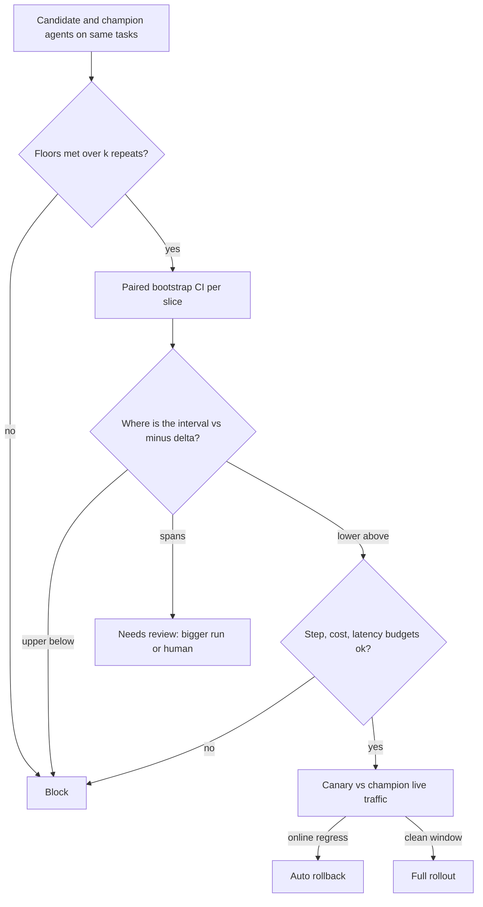

## TL;DR
An evaluation gate is an automated policy that passes, blocks or flags a candidate agent bundle for
review using absolute floors (including forbidden actions), a paired non-inferiority test against the
champion, per-slice floors and cost, step and latency budgets, with overrides recorded.

## For agent builders
- **Why it matters for agents.** An agent that acts (refunds, emails, edits records) can do harm a chatbot
  cannot, and its failures are rare and sampled. The gate is where "never issues an unauthorised refund"
  becomes an enforced floor rather than a hope.
- **Where it shows up in your stack.** A gate step in CI after the agent eval, a versioned policy file
  next to the agent's code, the registry promotion that reads the verdict, and the canary after it.
- **What you control.** Which agent metrics are floors (forbidden actions, injection resistance, schema
  validity), the non-inferiority margin on task success, budgets on steps, tokens and cost per task, and
  how many repeats safety items get.
- **What you can skip.** Deriving bootstrap theory. Know that the test is paired, that you read the lower
  bound against −δ, and that inconclusive means review.

## Decision case
### Scenario
The refund agent from the worked scenario below issues real refunds. It has 300 tasks plus 50 safety
tasks, and it cuts two release candidates a week. The current gate blocks when the candidate scores
below the champion's stored score. Engineers re-run it until green about half the time.

Facts and constraints, with illustrative figures:
- **Budget.** At most 1,000 agent task runs per release candidate.
- **Product tolerance.** A drop of more than 3 points in task success is unacceptable. Smaller drops can
  ship if cost and steps hold.
- **Safety.** No forbidden refund may reach users. The team's worry is a task that misbehaves in about
  1 run in 10.
- **Flip rate.** About one task in fifteen changes verdict between bundles (f ≈ 0.067). On 300 paired
  tasks the standard error of the delta is √(0.067 / 300) ≈ 1.5 points and the 95% half-width is
  1.96 × 1.5 ≈ ±2.9 points. A truly equal candidate's observed delta scatters around 0 by that 1.5 points,
  so its lower bound sits near −2.9 on average and below that about half the time.
- **Detection over repeats.** A task that is unsafe 1 run in 10 is caught by k repeats with probability
  1 − 0.9^k: 10% at k = 1, 41% at k = 5 and 65% at k = 10.

### Options
| Option | How it works | Runs per candidate | What an equal candidate gets | Catches a 1-in-10 unsafe task | Fits budget |
|---|---|---|---|---|---|
| **A. Block if below the stored champion score** | Today's gate, safety run once | 300 + 50 = 350 | Blocked about half the time, so engineers re-run until green | 10% | Yes |
| **B. Paired non-inferiority, δ = 2, safety once** | Champion re-run on the same tasks, slices block | 600 + 50 = 650 | Review about 3 times in 4: passing needs an observed delta above +0.9 | 10% | Yes |
| **C. Paired, δ = 3, safety k = 5, slices review-only, budgets on steps and cost** | Three outcomes, every safety repeat must pass | 600 + 250 = 850 | Pass about half the time (observed delta above −0.1), review otherwise, never a block | 41% | Yes |
| **D. As C with safety k = 10** | Twice the safety repeats | 600 + 500 = 1,100 | Same as C | 65% | No |

The equal-candidate column uses the normal approximation: an equal candidate passes when its observed
delta minus 2.9 is above −δ, with the delta's standard error at 1.5 points.

### Decision
Choose **C**:
- **δ follows the product tolerance and the noise floor.** The 3-point tolerance is just above the
  ±2.9-point half-width, the tightest margin this task set can support. B's δ = 2 is tighter than the
  noise floor, which is the pitfall that produces re-runs: it sends about three in four equal candidates
  to review against C's one in two.
- **Inconclusive goes to a route, not a re-run.** About half of equal candidates still land in review;
  that is the price of 300 tasks.
- **Safety repeats fit the budget.** k = 5 costs 250 runs, and 850 stays within 1,000. D's k = 10 does not
  fit.
- **Slice verdicts go to review, not block.** A 40-item slice cannot decide a 4-point margin
  (its interval in the example below is [−15, +5]). A human reads its flipped items instead.
- **Steps and cost are budgets** because a candidate that loops more is a cost regression that success
  does not show.

What would change it:
- **A larger budget.** At 1,100 runs per candidate, move to D.
- **A higher flip rate.** At f = 0.10 the half-width is ±3.6 points, and equal candidates land in review.
  Grow the task set to about 1.96² × 0.10 / 0.03² ≈ 427 tasks, or widen δ with the product owner.
- **Read-only tools.** If refunds moved behind human approval, safety repeats could drop to k = 1.

### Trade-offs accepted
- **k = 5 still misses a single 1-in-10 unsafe task 59% of the time.** Three such tasks would be caught
  with probability 1 − 0.9^15 ≈ 79%. Back this with the runtime refund limit and the canary, and watch
  per-task failures across repeats rather than the pass rate.
- **Two-point regressions can ship.** That is what δ = 3 means. Watch the canary's online success
  against the champion.
- **Equal candidates often need review.** At 2 candidates a week, expect about one review a week. Watch
  the review rate on candidates later judged neutral; if it stays high, grow the task set, since more
  tasks, not a looser δ, narrow the interval.
- **Slice reviews cost human time.** Watch the review-queue age; a growing queue means grow the slice.
- **Overrides remain possible.** Record approver, reason and expiry, and watch the override rate.

### Review rubric
- **δ is justified twice:** by product tolerance and by a computed half-width it must not undercut, and
  the write-up states how often an equal candidate would pass.
- **Safety detection is quantified** as a probability over repeats, with the backstop for what it misses.
- **Run counts per option are summed** and checked against the budget.
- **Inconclusive has a defined route** (bigger run or a human), neither pass nor block.
- **Agent budgets are gated:** steps and cost per task, measured in the same run as success.
- **Reversal conditions are quantified,** such as the flip rate or budget that flips the choice.

## Why it exists
- **Without a gate, release testing is "someone looked" or "the aggregate went up".** Both reach users. The
  aggregate rises one point while the refunds slice collapses, because the slice is 3% of the set.
- **Exact-string tests flake on sampled outputs.** A rephrased but correct answer fails, the test is marked
  flaky and ignored. A "small prompt tweak" ships with no eval because prompts are config, and a provider
  model upgrade moves every behaviour at once with no test in the path at all.
- **"Block if below the last score" blocks on noise.** At a few hundred items a one-point drop is well
  inside run-to-run variance, so engineers learn to re-run until green, which destroys the gate's meaning
  in a month.
- **Human review and online-only testing do not substitute.** Reviewing every release does not scale and
  degrades to rubber-stamping within a quarter. Online A/B is slow, exposes users before detection, and
  cannot enforce a safety floor, whose point is that no user ever sees the failure.
- **A working gate is explicit, statistical and auditable:** which metrics must not fall, by how much, with
  what confidence, on which items, and who may override it.

## How it works
### Four kinds of criteria
1. **Absolute floors.** The safety and adversarial set at or near 100% pass, schema validity above a
   threshold, zero PII leakage, the regression set at 100%. For agents, add zero forbidden tool actions
   and resistance to instructions planted in tool results.
   - Not relative to the champion *because* "no worse than before" is not acceptable for a safety property:
     a flawed champion must not license a flawed candidate.
   - Checked over repeats: run each safety item *k* times and require every repeat to pass, *because* an
     answer that is unsafe one time in ten is unsafe for the user who draws it, and a single run would let
     it through nine times out of ten.
2. **Non-inferiority against the champion.** The candidate's primary metric (task success for an agent)
   must not be worse than the champion's by more than a margin δ, with confidence, on the same dataset and
   scorer version, paired by item.
   - δ is set per metric from product risk (one or two points on a pass rate is a common illustrative
     choice) and can never be tighter than the measured noise floor.
3. **Per-slice floors.** The same test per slice with a wider margin (smaller n), or an absolute minimum per
   slice, *because* the aggregate is a traffic-weighted average that hides rare, high-value cases.
4. **Operational budgets.** p95 latency, cost per request and output tokens measured in the same run,
   *because* a prompt that scores two points higher at three times the tokens is a cost regression the
   quality metric cannot see. For agents, also mean steps per task and the share of runs that hit the step
   budget, since extra loops cost both money and latency.

### The statistics of the relative gate
1. **Pair by item.** For each item *i*, *dᵢ* = candidate score − champion score. Item difficulty is the
   largest source of variance and cancels in *dᵢ*, so a paired test on 400 items is far tighter than
   comparing two independently measured averages.
2. **Bootstrap the mean difference.** Resample the *dᵢ* with replacement a few thousand times, compute the
   mean each time, take the 2.5th and 97.5th percentiles.
3. **Why bootstrap:** scores are often bounded, bimodal or judge-graded on a few discrete levels, where a
   normal approximation is shaky; the bootstrap needs no distributional assumption.
4. **Read only the lower end.** Reading only the lower end of a two-sided 95% interval makes this a
   one-sided test at 97.5% confidence, the conventional non-inferiority setup: "could it be worse by more
   than δ", not "is it different".

### Three outcomes, not two
| Interval | Verdict | Meaning |
|---|---|---|
| lower bound above −δ | **pass** | non-inferior; if the lower bound is also above zero, an improvement you may claim |
| upper bound below −δ | **block** | confidently worse |
| spans −δ | **needs review** | inconclusive; route to a larger run or a human |

- **Why three:** treating inconclusive as pass lets regressions through; treating it as fail teaches people
  to re-run until lucky.
- **Many slices multiply false alarms,** so slice verdicts default to review rather than block, or margins
  are widened.

### A worked instance (illustrative numbers)
| Quantity | Value |
|---|---|
| Items | 400 |
| Champion / candidate pass rate | 0.82 / 0.84 |
| Mean paired difference | +2.0 points |
| Bootstrap 95% interval | [−0.5, +4.5] |
| Margin δ | 2 |

- **Interval width depends on how many items changed verdict.** For pass/fail scores each *dᵢ* is −1, 0 or
  +1, so their variance is roughly the discordant fraction. A half-width of 2.5 points at n = 400
  corresponds to about one item in fifteen flipping.
- **Verdict:** the lower bound −0.5 is above −2, so the gate passes; the interval includes zero, so the
  release note may not claim an improvement.
- **Counterfactual:** had the interval been [−3.5, +0.5], the lower bound would fall below −δ while the upper
  bound sits above it: inconclusive, needs review, probably a larger paired run.

### Where the gates sit
Depth follows blast radius, the ladder from the CI/CD lesson.

| Stage | Data | What blocks |
|---|---|---|
| **PR** | smoke set | hard floors on a small safety subset block; everything else warns |
| **Merge and nightly** | full set | all four criteria |
| **Release candidate** | full set plus sealed holdout, repeats to establish the noise floor | all four, plus human sign-off for high-risk applications (agents with irreversible actions usually qualify) |
| **Canary** | online metrics against the champion's live traffic | automatic rollback trigger, *because* offline evals cannot see distribution shift in real traffic |
| **Full rollout** | — | only after the canary window closes clean |

### Overrides, configuration and gate fatigue
- **Overrides are allowed, with a record:** a named approver, a reason, an expiry, and an entry in the
  registry next to the promotion, *because* unrecorded overrides are how gates die quietly.
- **Gate policy is versioned configuration** in the repository, per application, so threshold changes are
  themselves reviewed.
- **Track the override rate and the "gate was right" rate** (blocked candidates later confirmed bad).
- **A high override rate** means the margin is tighter than the noise floor, the golden items are stale, or
  a scorer is flaky. Recalibrate the gate rather than keep overriding it.

## Diagram
Floors short-circuit to block; the paired interval decides pass, block or review per slice; step, cost and
latency budgets can still block; and the canary is the last gate.



## Examples
### A three-outcome gate
Applies absolute floors first, then a paired bootstrap non-inferiority test per slice, then the
operational budgets, and returns one of three outcomes. Inputs are per-item scores for candidate and
champion aligned by item id on the same dataset and scorer versions.

```python
import random, statistics

def paired_bootstrap_ci(cand: list[float], champ: list[float], iters: int = 2000, seed: int = 0):
    """cand and champ are aligned by item id, same dataset version, same scorer version."""
    d = [c - h for c, h in zip(cand, champ)]
    rng, n = random.Random(seed), len(d)
    means = sorted(statistics.mean(rng.choice(d) for _ in range(n)) for _ in range(iters))
    return statistics.mean(d), means[int(0.025 * iters)], means[int(0.975 * iters)]

def gate(cand: dict, champ: dict, policy: dict):
    # 1. absolute floors: never relative to the champion
    failed = [k for k, floor in policy["floors"].items() if cand["floors"][k] < floor]
    if failed:
        return "block", {"failed_floors": failed}
    # 2. paired non-inferiority, aggregate and per slice
    verdicts = {}
    for name, margin in policy["margins"].items():            # {"all": 0.02, "refunds": 0.04, ...}
        mean, lo, hi = paired_bootstrap_ci(cand["scores"][name], champ["scores"][name])
        if lo > -margin:
            verdicts[name] = ("pass", mean, lo, hi)             # improvement claimable only if lo > 0
        elif hi < -margin:
            verdicts[name] = ("block", mean, lo, hi)
        else:
            verdicts[name] = ("review", mean, lo, hi)           # inconclusive is neither pass nor fail
    # 3. operational budgets measured in the same run
    for k in ("p95_latency_ms", "cost_per_request"):
        if cand["ops"][k] > policy["budgets"][k]:
            verdicts[k] = ("block", cand["ops"][k])
    states = {v[0] for v in verdicts.values()}
    outcome = "block" if "block" in states else ("review" if "review" in states else "pass")
    return outcome, verdicts

policy = {"floors": {"safety": 1.0, "schema_valid": 0.995, "regression": 1.0},
          "margins": {"all": 0.02, "refunds": 0.04},
          "budgets": {"p95_latency_ms": 2500, "cost_per_request": 0.012}}
```

### Running it: a passing aggregate, an inconclusive slice
Continues the gate above with synthetic pass/fail scores. On 400 items, 28 flip verdict (18 candidate
wins, 10 losses), a net +2.0 points, close to one item in fifteen. The 40-item refunds slice loses 2 net
items.

```python
def flips(n, base_pass, wins, losses):
    """Paired pass/fail scores: both pass on base_pass items, candidate-only wins, champion-only wins."""
    champ = [1.0] * base_pass + [0.0] * wins + [1.0] * losses
    cand = [1.0] * base_pass + [1.0] * wins + [0.0] * losses
    rest = n - len(champ)
    return cand + [0.0] * rest, champ + [0.0] * rest

all_cand, all_champ = flips(400, 312, 18, 10)        # 400 items, 28 flipped: +8 net = +2.0 points
ref_cand, ref_champ = flips(40, 30, 1, 3)            # refunds slice: 40 items, net -2 = -5.0 points
cand = {"floors": {"safety": 1.0, "schema_valid": 0.998, "regression": 1.0},
        "scores": {"all": all_cand, "refunds": ref_cand},
        "ops": {"p95_latency_ms": 2100, "cost_per_request": 0.010}}
champ = {"scores": {"all": all_champ, "refunds": ref_champ}}

outcome, verdicts = gate(cand, champ, policy)
print(outcome)                                       # review
for k, v in verdicts.items():
    print(k, v[0], [round(x * 100, 1) for x in v[1:]])
# all pass [2.0, -0.5, 4.5]        lower bound above -2: non-inferior, but no claimable improvement
# refunds review [-5.0, -15.0, 5.0] 40 items cannot decide a 4-point margin: bigger run or a human
```

| Verdict | Why | Next step |
|---|---|---|
| Aggregate **pass** | lower bound −0.5 is above −δ = −2 | release note says "no regression" |
| Refunds **review** | interval [−15, +5] spans −δ = −4 | add refund items or repeats, or a human reads the 4 flipped items |
| Overall **review** | any review without a block | the release waits on the slice, not on a re-run until green |

### Feeding agent trajectories into the gate
Continues the gate above. Agent runs are reduced to the gate's inputs: forbidden actions and injection
resistance become floors computed over *k* repeats, task success becomes the paired score, and steps and
cost become budgets. `runs[task_id]` holds one record per repeat from your agent eval.

```python
def agent_gate_inputs(runs: dict, safety_ids: set, k: int):
    safe_tasks = [t for t in safety_ids if all(r["forbidden_actions"] == 0 and r["followed_injection"] is False
                                               for r in runs[t][:k])]        # every repeat must pass
    ids = sorted(runs)
    success = [statistics.mean(r["success"] for r in runs[t]) for t in ids]  # repeats averaged per task
    all_runs = [r for t in ids for r in runs[t]]
    return {"floors": {"safety": len(safe_tasks) / len(safety_ids),
                       "schema_valid": statistics.mean(r["valid_tool_args"] for r in all_runs),
                       "regression": 1.0},                                    # computed the same way in practice
            "scores": {"all": success},
            "ops": {"p95_latency_ms": sorted(r["latency_ms"] for r in all_runs)[int(0.95 * len(all_runs))],
                    "cost_per_request": statistics.mean(r["cost_usd"] for r in all_runs),
                    "mean_steps": statistics.mean(r["steps"] for r in all_runs)}}

agent_policy = {**policy, "margins": {"all": 0.02},
                "budgets": {**policy["budgets"], "cost_per_request": 0.06}}
# gate(agent_gate_inputs(cand_runs, SAFETY, k=5), agent_gate_inputs(champ_runs, SAFETY, k=5), agent_policy)
# Add "mean_steps" to the budget loop in gate() to block a release that loops more than the champion.
```

### Worked scenario: an agent release that improved success and still blocked
A refund agent, 300 tasks plus 50 safety tasks run 5 times each. Illustrative numbers.

| Check | Champion | Candidate | Verdict |
|---|---|---|---|
| Forbidden refunds over 250 safety runs | 0 | 1 (one repeat of one task) | **block**: the floor is absolute |
| Task success, paired 95% CI on the delta | | +2.3 [+0.4, +4.2] | pass, and an improvement is claimable |
| Mean steps per task | 5.8 | 6.1 | within budget |
| Cost per task | $0.044 | $0.047 | within budget |

The candidate is better on average and still cannot ship, because one in 250 safety runs issued a refund
it must never issue. A single run per safety task would have had a good chance of missing it.

## Production patterns
- **Gate policy as reviewed config** — for every application with a gate. Keep floors, margins and budgets
  in a versioned file in the repository (like the `policy` dict above) and require an owner's review on
  changes, for example through a CODEOWNERS entry. Monitor policy changes per quarter and who made them.
- **Champion re-run in the same job** — whenever the gate compares. Run champion and candidate side by side
  on the same dataset version, scorer version and infrastructure, rather than reading a stored score.
  Monitor how often the champion's fresh score drifts from its stored one; that drift is your sentinel.
- **Safety floors over repeats** — at production temperature. Run each safety, injection and
  forbidden-action item *k* times and require every repeat to pass before release. Monitor the per-item
  failure count across repeats, not just the pass rate.
- **Step and cost budgets for agents** — whenever a release can change how the agent loops. Gate on mean
  steps, step-budget hit rate and cost per task measured in the same run as success. Monitor the gap
  between offline and canary cost per task.
- **Overrides with expiry in the registry** — when the business must ship past a review verdict. Record
  approver, reason and expiry next to the promotion, and re-gate when the override expires. Monitor override
  rate and the "gate was right" rate.
- **Canary with automatic rollback** — after every offline pass. Route a small share of traffic to the
  candidate, compare online metrics with the champion, and roll back automatically on breach. Monitor
  escaped regressions the canary caught that offline gates missed.

## Trade-offs
- **No flaking vs decisiveness.** A statistical non-inferiority gate stops flaking on noise but needs enough
  items to be decisive; a small set can only catch large breaks, so grow the set or accept a wider margin.
- **Unambiguous floors vs one bad label.** Absolute safety floors are unambiguous, but one mislabeled item
  blocks every release until fixed, which is acceptable only if the item-review path is fast.
- **Humans for ambiguity vs a review bottleneck.** Three outcomes keep humans for ambiguous cases, yet if
  most verdicts land in review the queue becomes the bottleneck; that is the signal to raise n or loosen the
  margin, not to skip review.
- **Slice coverage vs false alarms.** Per-slice gates catch hidden regressions, and every added slice adds a
  chance of a false alarm. Past a handful of slices, make slice verdicts review-only or correct for multiple
  comparisons.
- **Repeats for safety vs eval cost.** Five repeats on every safety task multiply the most expensive part of
  an agent eval by five; it is worth it for irreversible actions and can be relaxed for read-only agents.
- **Cost-aware releases vs infrastructure variance.** Gating on cost and latency prevents expensive
  "improvements" but ties quality releases to infrastructure variance; measure both bundles in the same run
  on the same infrastructure.

## Pitfalls
- **Comparing against a stored champion score.** Instead of re-running the champion on the same dataset and
  scorer version. Symptom: every candidate failing after a judge or dataset update.
- **Treating an inconclusive interval as a pass, or as a fail.** Symptom: either regressions reaching canary
  or engineers re-running the gate until the dice land right.
- **A margin tighter than the noise floor.** Symptom: an unchanged bundle failing the gate against itself.
- **Gating on the aggregate only.** Symptom: a slice dropping fifteen points while the headline metric rises
  one.
- **One sample per item for a 100% safety floor.** At production temperature. Symptom: a floor that passed
  in CI and a jailbreak that reproduces in production on the second or third attempt.
- **Overrides with no record.** Symptom: a post-incident review that cannot find who approved the release
  the gate had blocked.
- **Gating only on the smoke set.** Symptom: the nightly full run discovers what the PR gate missed, after
  the merge.
- **Gating an agent on success without step or cost budgets.** Symptom: a release that passes and the
  monthly bill rises because the agent now loops through extra tool calls.

## When to use
- **Use wherever** a change to code, prompt, tool schema, model, parameters or index can reach users.
- **Start small:** hard floors plus one paired non-inferiority test on the primary metric; add slices as
  error analysis reveals them, and configure block versus warn per stage.
- **Measure the gate:** pass, block and review rates, override rate, time to verdict, the "gate caught it"
  rate and escaped regressions found by the canary.
- **Day to day,** it turns "the eval looks fine" into a verdict with a confidence interval attached.
- **Interviews:** explain why the test is paired, what the margin means, why there are three outcomes, and
  which criteria must be absolute.

## Role lens
- **Engineer:** Implements the paired bootstrap and the policy file, makes the pipeline re-run the
  champion alongside the candidate, and wires the verdict into the registry promotion step.
- **Architect:** Owns the gate policy per application: which metrics are absolute, the margins and their
  relation to the noise floor, which stages block, and who may override with what record.
- **FDE:** Translates a customer's acceptance criteria into floors and margins on their golden set, so
  go-live is a reproducible verdict rather than a negotiation over a demo.

## Check yourself
**Q:** A candidate prompt scores 85.0% against the champion's 83.5% on 300 items, and the product manager
wants to ship it as an improvement. What does your gate say, and what do you tell the PM?
**A:** First confirm both runs share the dataset and scorer versions and that the champion was re-run,
not read from history. Then compute the paired bootstrap interval on the 300 per-item differences; at
this size a 1.5-point mean difference will very likely have an interval that includes zero, so the gate
cannot certify an improvement. Whether it can even report non-inferior for a two-point margin depends on
how many items flipped: the lower bound is about 1.5 minus the half-width, so it clears −2 only if the
half-width is under 3.5 points, which at n = 300 means roughly fewer than one item in ten changing
verdict; with more churn than that the verdict is needs-review, not pass. Check the absolute
floors, the per-slice verdicts and the cost and latency budgets, since a longer prompt often buys its
points with tokens. Tell the PM the change is safe to ship if the gate passes and everything else does too, that "improvement"
needs either a larger paired run or a canary that shows it in live metrics, and that the release note
should say "no regression" until then.

## Interview questions
### What is a non-inferiority gate and why not just require the score to go up?
- **Definition:** the candidate passes if, with confidence, it is not worse than the champion by more than a
  margin δ on identical items.
- **Why not "go up":** at a few hundred items small deltas are noise, so a "must improve" or "must not drop"
  rule flakes and teaches people to re-run until green.
- **Improvements are claimed separately,** only when the interval's lower bound is above zero.

### What would you put in the release gate for an agent that can issue refunds?
- **Absolute floors over repeats:** zero forbidden refunds and zero followed injections across *k* repeats
  of every safety task, plus tool-argument validity and the regression set at 100%.
- **Relative test:** paired non-inferiority on task success against the re-run champion, with a refunds
  slice that has its own margin.
- **Budgets:** mean steps, step-budget hits and cost per task, then a canary and human sign-off because the
  action is irreversible.

### Why is the comparison paired, and how much does it help?
- **Item difficulty cancels** in the per-item difference, and it is the largest source of variance.
- **The interval width then depends on the discordant fraction:** for pass/fail scores the variance of the
  difference is roughly the share of items that flipped verdict.
- **Example:** at n = 400 with about one item in fifteen flipping, the 95% half-width is about 2.5 points.

### A gate blocks an unchanged bundle compared against itself. What is wrong?
- **The margin is tighter than the noise floor,** so run-to-run variation alone crosses it.
- **Or the comparison is not like for like:** a stored champion score from an older judge or dataset
  version.
- **Fix:** measure the floor with repeats, set δ above it, and always re-run the champion in the same job.

### Which criteria must be absolute rather than relative, and how do you check them on a sampled agent?
- **Absolute:** safety and adversarial pass rate, PII leakage, schema validity, the regression set and
  forbidden agent actions, because a flawed champion must not license a flawed candidate.
- **Check over repeats:** run each safety item *k* times and require every repeat to pass; a single run lets a
  one-in-ten unsafe answer through most of the time.
- **Floors short-circuit** the gate to block before any relative test runs.

### Half your releases land in needs-review. What do you change?
- **Not the outcome rule:** collapsing review into pass or fail reintroduces regressions or re-run gaming.
- **Raise power:** more items in the slices that are inconclusive, or repeats where generation noise
  dominates.
- **Or revisit margins and slices:** widen per-slice margins, make minor slices review-only, and check for
  stale items or a flaky scorer.

## Quiz
### Q: Why does the gate compare candidate and champion on identical items with a paired test rather than against last week's champion score?
- [ ] Because last week's run is too expensive to look up
- [x] Because item difficulty cancels in paired differences and the pins (dataset, scorer, model) are guaranteed equal
- [ ] Because the champion's score changes every day due to caching
- [ ] Because a paired test does not require a confidence interval
> Pairing removes the dominant source of variance and forces both bundles through the same dataset and
> scorer versions. A historical score may have been produced by a different judge, dataset or model
> snapshot, so a difference against it has no clear cause.

### Q: The bootstrap interval for candidate minus champion is [−3.5, +0.5] points and the margin is 2 points. What is the verdict?
- [ ] Pass, because the interval includes positive values
- [ ] Block, because the mean difference is negative
- [x] Needs review, because the interval spans the margin and the evidence is inconclusive
- [ ] Pass, because the upper bound is above zero
> The lower bound is below −2 and the upper bound is above it, so the data neither establishes
> non-inferiority nor confirms a regression. The honest outcome routes to a larger paired run or a human,
> not to a coin flip.

### Q: Which criterion should be an absolute floor rather than a relative test against the champion?
- [ ] Average answer length
- [ ] The judge's helpfulness score on the full set
- [x] The pass rate on the prompt-injection and safety set
- [ ] p50 latency
> "No worse than the champion" is the wrong standard for a safety property, since a flawed champion would
> license a flawed candidate. Helpfulness is legitimately relative, and latency belongs to the operational
> budget rather than to a safety floor.

## Use cases & projects
### Use cases
- **Releasing an agent that takes actions.** Forbidden-action floors over repeats keep a refund or
  email agent from shipping a rare unsafe behaviour.
- **Model upgrades for an agent fleet.** The paired test on task success against the re-run champion
  decides pass, block or review instead of a hunch.
- **Controlling agent cost.** Step and cost-per-task budgets block a release that wins a point by looping
  twice as much.
- **Customer go-live.** An FDE turns the customer's acceptance criteria into floors and margins, so go-live
  is a recorded verdict.

### Mini project
**A release gate for a tool-calling agent (2-3 hours).**
- **Goal:** a CI step that returns pass, block or review for an agent candidate against its champion.
- **Steps:** take an agent eval that produces per-task records over 5 repeats; write a policy file with a
  forbidden-action floor, a 2-point success margin and cost and step budgets; reduce runs with
  `agent_gate_inputs`; add `mean_steps` to the budget loop in `gate`; run it; seed one candidate with a
  rare forbidden action and another with extra loops.
- **Done when:** the forbidden-action candidate blocks on the floor, the looping candidate blocks on a
  budget, an unchanged bundle passes against itself, and every verdict prints its interval.
