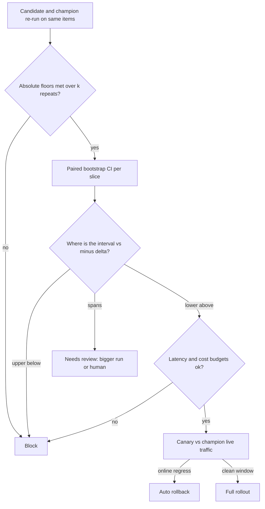

## TL;DR
An evaluation gate is an automated policy that passes, blocks or flags a candidate bundle for review
using absolute floors, a paired non-inferiority test against the champion, per-slice floors and cost and
latency budgets, with every override recorded.

## Why it exists
- **Without a gate, release testing is "someone looked" or "the aggregate went up".** Both reach users. The
  aggregate rises one point while the refunds slice collapses, because the slice is 3% of the set.
- **Exact-string tests flake on sampled outputs.** A rephrased but correct answer fails, the test is marked
  flaky and ignored. A "small prompt tweak" ships with no eval because prompts are config, and a provider
  model upgrade moves every behaviour at once with no test in the path at all.
- **"Block if below the last score" blocks on noise.** At a few hundred items a one-point drop is well
  inside run-to-run variance, so engineers learn to re-run until green, which destroys the gate's meaning
  in a month.
- **Human review and online-only testing do not substitute.** Reviewing every release does not scale and
  degrades to rubber-stamping within a quarter. Online A/B is slow, exposes users before detection, and
  cannot enforce a safety floor, whose point is that no user ever sees the failure.
- **A working gate is explicit, statistical and auditable:** which metrics must not fall, by how much, with
  what confidence, on which items, and who may override it.

## How it works
### Four kinds of criteria
1. **Absolute floors.** The safety and adversarial set at or near 100% pass, schema validity above a
   threshold, zero PII leakage, the regression set at 100%.
   - Not relative to the champion *because* "no worse than before" is not acceptable for a safety property:
     a flawed champion must not license a flawed candidate.
   - Checked over repeats: run each safety item *k* times and require every repeat to pass, *because* an
     answer that is unsafe one time in ten is unsafe for the user who draws it, and a single run would let
     it through nine times out of ten.
2. **Non-inferiority against the champion.** The candidate's primary metric must not be worse than the
   champion's by more than a margin δ, with confidence, on the same dataset and scorer version, paired by
   item.
   - δ is set per metric from product risk (one or two points on a pass rate is a common illustrative
     choice) and can never be tighter than the measured noise floor.
3. **Per-slice floors.** The same test per slice with a wider margin (smaller n), or an absolute minimum per
   slice, *because* the aggregate is a traffic-weighted average that hides rare, high-value cases.
4. **Operational budgets.** p95 latency, cost per request and output tokens measured in the same run,
   *because* a prompt that scores two points higher at three times the tokens is a cost regression the
   quality metric cannot see.

### The statistics of the relative gate
1. **Pair by item.** For each item *i*, *dᵢ* = candidate score − champion score. Item difficulty is the
   largest source of variance and cancels in *dᵢ*, so a paired test on 400 items is far tighter than
   comparing two independently measured averages.
2. **Bootstrap the mean difference.** Resample the *dᵢ* with replacement a few thousand times, compute the
   mean each time, take the 2.5th and 97.5th percentiles.
3. **Why bootstrap:** scores are often bounded, bimodal or judge-graded on a few discrete levels, where a
   normal approximation is shaky; the bootstrap needs no distributional assumption.
4. **Read only the lower end.** Reading only the lower end of a two-sided 95% interval makes this a
   one-sided test at 97.5% confidence, the conventional non-inferiority setup: "could it be worse by more
   than δ", not "is it different".

### Three outcomes, not two
| Interval | Verdict | Meaning |
|---|---|---|
| lower bound above −δ | **pass** | non-inferior; if the lower bound is also above zero, an improvement you may claim |
| upper bound below −δ | **block** | confidently worse |
| spans −δ | **needs review** | inconclusive; route to a larger run or a human |

- **Why three:** treating inconclusive as pass lets regressions through; treating it as fail teaches people
  to re-run until lucky.
- **Many slices multiply false alarms,** so slice verdicts default to review rather than block, or margins
  are widened.

### A worked instance (illustrative numbers)
| Quantity | Value |
|---|---|
| Items | 400 |
| Champion / candidate pass rate | 0.82 / 0.84 |
| Mean paired difference | +2.0 points |
| Bootstrap 95% interval | [−0.5, +4.5] |
| Margin δ | 2 |

- **Interval width depends on how many items changed verdict.** For pass/fail scores each *dᵢ* is −1, 0 or
  +1, so their variance is roughly the discordant fraction. A half-width of 2.5 points at n = 400
  corresponds to about one item in fifteen flipping.
- **Verdict:** the lower bound −0.5 is above −2, so the gate passes; the interval includes zero, so the
  release note may not claim an improvement.
- **Counterfactual:** had the interval been [−3.5, +0.5], the lower bound would fall below −δ while the upper
  bound sits above it: inconclusive, needs review, probably a larger paired run.

### Where the gates sit
Depth follows blast radius, the ladder from the CI/CD lesson.

| Stage | Data | What blocks |
|---|---|---|
| **PR** | smoke set | hard floors on a small safety subset block; everything else warns |
| **Merge and nightly** | full set | all four criteria |
| **Release candidate** | full set plus sealed holdout, repeats to establish the noise floor | all four, plus human sign-off for high-risk applications |
| **Canary** | online metrics against the champion's live traffic | automatic rollback trigger, *because* offline evals cannot see distribution shift in real traffic |
| **Full rollout** | — | only after the canary window closes clean |

### Overrides, configuration and gate fatigue
- **Overrides are allowed, with a record:** a named approver, a reason, an expiry, and an entry in the
  registry next to the promotion, *because* unrecorded overrides are how gates die quietly.
- **Gate policy is versioned configuration** in the repository, per application, so threshold changes are
  themselves reviewed.
- **Track the override rate and the "gate was right" rate** (blocked candidates later confirmed bad).
- **A high override rate** means the margin is tighter than the noise floor, the golden items are stale, or
  a scorer is flaky. Recalibrate the gate rather than keep overriding it.

## Diagram
Floors short-circuit to block; the paired interval decides pass, block or review per slice; budgets can
still block; and the canary is the last gate.



## Examples
### A three-outcome gate
Applies absolute floors first, then a paired bootstrap non-inferiority test per slice, then the
operational budgets, and returns one of three outcomes. Inputs are per-item scores for candidate and
champion aligned by item id on the same dataset and scorer versions.

```python
import random, statistics

def paired_bootstrap_ci(cand: list[float], champ: list[float], iters: int = 2000, seed: int = 0):
    """cand and champ are aligned by item id, same dataset version, same scorer version."""
    d = [c - h for c, h in zip(cand, champ)]
    rng, n = random.Random(seed), len(d)
    means = sorted(statistics.mean(rng.choice(d) for _ in range(n)) for _ in range(iters))
    return statistics.mean(d), means[int(0.025 * iters)], means[int(0.975 * iters)]

def gate(cand: dict, champ: dict, policy: dict):
    # 1. absolute floors: never relative to the champion
    failed = [k for k, floor in policy["floors"].items() if cand["floors"][k] < floor]
    if failed:
        return "block", {"failed_floors": failed}
    # 2. paired non-inferiority, aggregate and per slice
    verdicts = {}
    for name, margin in policy["margins"].items():            # {"all": 0.02, "refunds": 0.04, ...}
        mean, lo, hi = paired_bootstrap_ci(cand["scores"][name], champ["scores"][name])
        if lo > -margin:
            verdicts[name] = ("pass", mean, lo, hi)             # improvement claimable only if lo > 0
        elif hi < -margin:
            verdicts[name] = ("block", mean, lo, hi)
        else:
            verdicts[name] = ("review", mean, lo, hi)           # inconclusive is neither pass nor fail
    # 3. operational budgets measured in the same run
    for k in ("p95_latency_ms", "cost_per_request"):
        if cand["ops"][k] > policy["budgets"][k]:
            verdicts[k] = ("block", cand["ops"][k])
    states = {v[0] for v in verdicts.values()}
    outcome = "block" if "block" in states else ("review" if "review" in states else "pass")
    return outcome, verdicts

policy = {"floors": {"safety": 1.0, "schema_valid": 0.995, "regression": 1.0},
          "margins": {"all": 0.02, "refunds": 0.04},
          "budgets": {"p95_latency_ms": 2500, "cost_per_request": 0.012}}
```

### Running it: a passing aggregate, an inconclusive slice
Continues the gate above with synthetic pass/fail scores. On 400 items, 28 flip verdict (18 candidate
wins, 10 losses), a net +2.0 points, close to one item in fifteen. The 40-item refunds slice loses 2 net
items.

```python
def flips(n, base_pass, wins, losses):
    """Paired pass/fail scores: both pass on base_pass items, candidate-only wins, champion-only wins."""
    champ = [1.0] * base_pass + [0.0] * wins + [1.0] * losses
    cand = [1.0] * base_pass + [1.0] * wins + [0.0] * losses
    rest = n - len(champ)
    return cand + [0.0] * rest, champ + [0.0] * rest

all_cand, all_champ = flips(400, 312, 18, 10)        # 400 items, 28 flipped: +8 net = +2.0 points
ref_cand, ref_champ = flips(40, 30, 1, 3)            # refunds slice: 40 items, net -2 = -5.0 points
cand = {"floors": {"safety": 1.0, "schema_valid": 0.998, "regression": 1.0},
        "scores": {"all": all_cand, "refunds": ref_cand},
        "ops": {"p95_latency_ms": 2100, "cost_per_request": 0.010}}
champ = {"scores": {"all": all_champ, "refunds": ref_champ}}

outcome, verdicts = gate(cand, champ, policy)
print(outcome)                                       # review
for k, v in verdicts.items():
    print(k, v[0], [round(x * 100, 1) for x in v[1:]])
# all pass [2.0, -0.5, 4.5]        lower bound above -2: non-inferior, but no claimable improvement
# refunds review [-5.0, -15.0, 5.0] 40 items cannot decide a 4-point margin: bigger run or a human
```

| Verdict | Why | Next step |
|---|---|---|
| Aggregate **pass** | lower bound −0.5 is above −δ = −2 | release note says "no regression" |
| Refunds **review** | interval [−15, +5] spans −δ = −4 | add refund items or repeats, or a human reads the 4 flipped items |
| Overall **review** | any review without a block | the release waits on the slice, not on a re-run until green |

## Production patterns
- **Gate policy as reviewed config** — for every application with a gate. Keep floors, margins and budgets
  in a versioned file in the repository (like the `policy` dict above) and require an owner's review on
  changes, for example through a CODEOWNERS entry. Monitor policy changes per quarter and who made them.
- **Champion re-run in the same job** — whenever the gate compares. Run champion and candidate side by side
  on the same dataset version, scorer version and infrastructure, rather than reading a stored score.
  Monitor how often the champion's fresh score drifts from its stored one; that drift is your sentinel.
- **Safety floors over repeats** — at production temperature. Run each safety and injection item *k* times
  and require every repeat to pass before release. Monitor the per-item failure count across repeats, not
  just the pass rate.
- **Overrides with expiry in the registry** — when the business must ship past a review verdict. Record
  approver, reason and expiry next to the promotion, and re-gate when the override expires. Monitor override
  rate and the "gate was right" rate.
- **Canary with automatic rollback** — after every offline pass. Route a small share of traffic to the
  candidate, compare online metrics with the champion, and roll back automatically on breach. Monitor
  escaped regressions the canary caught that offline gates missed.

## Trade-offs
- **No flaking vs decisiveness.** A statistical non-inferiority gate stops flaking on noise but needs enough
  items to be decisive; a small set can only catch large breaks, so grow the set or accept a wider margin.
- **Unambiguous floors vs one bad label.** Absolute safety floors are unambiguous, but one mislabeled item
  blocks every release until fixed, which is acceptable only if the item-review path is fast.
- **Humans for ambiguity vs a review bottleneck.** Three outcomes keep humans for ambiguous cases, yet if
  most verdicts land in review the queue becomes the bottleneck; that is the signal to raise n or loosen the
  margin, not to skip review.
- **Slice coverage vs false alarms.** Per-slice gates catch hidden regressions, and every added slice adds a
  chance of a false alarm. Past a handful of slices, make slice verdicts review-only or correct for multiple
  comparisons.
- **Cost-aware releases vs infrastructure variance.** Gating on cost and latency prevents expensive
  "improvements" but ties quality releases to infrastructure variance; measure both bundles in the same run
  on the same infrastructure.

## Pitfalls
- **Comparing against a stored champion score.** Instead of re-running the champion on the same dataset and
  scorer version. Symptom: every candidate failing after a judge or dataset update.
- **Treating an inconclusive interval as a pass, or as a fail.** Symptom: either regressions reaching canary
  or engineers re-running the gate until the dice land right.
- **A margin tighter than the noise floor.** Symptom: an unchanged bundle failing the gate against itself.
- **Gating on the aggregate only.** Symptom: a slice dropping fifteen points while the headline metric rises
  one.
- **One sample per item for a 100% safety floor.** At production temperature. Symptom: a floor that passed
  in CI and a jailbreak that reproduces in production on the second or third attempt.
- **Overrides with no record.** Symptom: a post-incident review that cannot find who approved the release
  the gate had blocked.
- **Gating only on the smoke set.** Symptom: the nightly full run discovers what the PR gate missed, after
  the merge.

## When to use
- **Use wherever** a change to code, prompt, model, parameters or index can reach users.
- **Start small:** hard floors plus one paired non-inferiority test on the primary metric; add slices as
  error analysis reveals them, and configure block versus warn per stage.
- **Measure the gate:** pass, block and review rates, override rate, time to verdict, the "gate caught it"
  rate and escaped regressions found by the canary.
- **Day to day,** it turns "the eval looks fine" into a verdict with a confidence interval attached.
- **Interviews:** explain why the test is paired, what the margin means, why there are three outcomes, and
  which criteria must be absolute.

## Role lens
- **Engineer:** Implements the paired bootstrap and the policy file, makes the pipeline re-run the
  champion alongside the candidate, and wires the verdict into the registry promotion step.
- **Architect:** Owns the gate policy per application: which metrics are absolute, the margins and their
  relation to the noise floor, which stages block, and who may override with what record.
- **FDE:** Translates a customer's acceptance criteria into floors and margins on their golden set, so
  go-live is a reproducible verdict rather than a negotiation over a demo.

## Check yourself
**Q:** A candidate prompt scores 85.0% against the champion's 83.5% on 300 items, and the product manager
wants to ship it as an improvement. What does your gate say, and what do you tell the PM?
**A:** First confirm both runs share the dataset and scorer versions and that the champion was re-run,
not read from history. Then compute the paired bootstrap interval on the 300 per-item differences; at
this size a 1.5-point mean difference will very likely have an interval that includes zero, so the gate
cannot certify an improvement. Whether it can even report non-inferior for a two-point margin depends on
how many items flipped: the lower bound is about 1.5 minus the half-width, so it clears −2 only if the
half-width is under 3.5 points, which at n = 300 means roughly fewer than one item in ten changing
verdict; with more churn than that the verdict is needs-review, not pass. Check the absolute
floors, the per-slice verdicts and the cost and latency budgets, since a longer prompt often buys its
points with tokens. Tell the PM the change is safe to ship if the gate passes and everything else does too, that "improvement"
needs either a larger paired run or a canary that shows it in live metrics, and that the release note
should say "no regression" until then.

## Interview questions
### What is a non-inferiority gate and why not just require the score to go up?
- **Definition:** the candidate passes if, with confidence, it is not worse than the champion by more than a
  margin δ on identical items.
- **Why not "go up":** at a few hundred items small deltas are noise, so a "must improve" or "must not drop"
  rule flakes and teaches people to re-run until green.
- **Improvements are claimed separately,** only when the interval's lower bound is above zero.

### Why is the comparison paired, and how much does it help?
- **Item difficulty cancels** in the per-item difference, and it is the largest source of variance.
- **The interval width then depends on the discordant fraction:** for pass/fail scores the variance of the
  difference is roughly the share of items that flipped verdict.
- **Example:** at n = 400 with about one item in fifteen flipping, the 95% half-width is about 2.5 points.

### A gate blocks an unchanged bundle compared against itself. What is wrong?
- **The margin is tighter than the noise floor,** so run-to-run variation alone crosses it.
- **Or the comparison is not like for like:** a stored champion score from an older judge or dataset
  version.
- **Fix:** measure the floor with repeats, set δ above it, and always re-run the champion in the same job.

### Which criteria must be absolute rather than relative, and how do you check them with sampled outputs?
- **Absolute:** safety and adversarial pass rate, PII leakage, schema validity, the regression set, because
  a flawed champion must not license a flawed candidate.
- **Check over repeats:** run each safety item *k* times and require every repeat to pass; a single run lets a
  one-in-ten unsafe answer through most of the time.
- **Floors short-circuit** the gate to block before any relative test runs.

### Half your releases land in needs-review. What do you change?
- **Not the outcome rule:** collapsing review into pass or fail reintroduces regressions or re-run gaming.
- **Raise power:** more items in the slices that are inconclusive, or repeats where generation noise
  dominates.
- **Or revisit margins and slices:** widen per-slice margins, make minor slices review-only, and check for
  stale items or a flaky scorer.

## Quiz
### Q: Why does the gate compare candidate and champion on identical items with a paired test rather than against last week's champion score?
- [ ] Because last week's run is too expensive to look up
- [x] Because item difficulty cancels in paired differences and the pins (dataset, scorer, model) are guaranteed equal
- [ ] Because the champion's score changes every day due to caching
- [ ] Because a paired test does not require a confidence interval
> Pairing removes the dominant source of variance and forces both bundles through the same dataset and
> scorer versions. A historical score may have been produced by a different judge, dataset or model
> snapshot, so a difference against it has no clear cause.

### Q: The bootstrap interval for candidate minus champion is [−3.5, +0.5] points and the margin is 2 points. What is the verdict?
- [ ] Pass, because the interval includes positive values
- [ ] Block, because the mean difference is negative
- [x] Needs review, because the interval spans the margin and the evidence is inconclusive
- [ ] Pass, because the upper bound is above zero
> The lower bound is below −2 and the upper bound is above it, so the data neither establishes
> non-inferiority nor confirms a regression. The honest outcome routes to a larger paired run or a human,
> not to a coin flip.

### Q: Which criterion should be an absolute floor rather than a relative test against the champion?
- [ ] Average answer length
- [ ] The judge's helpfulness score on the full set
- [x] The pass rate on the prompt-injection and safety set
- [ ] p50 latency
> "No worse than the champion" is the wrong standard for a safety property, since a flawed champion would
> license a flawed candidate. Helpfulness is legitimately relative, and latency belongs to the operational
> budget rather than to a safety floor.
