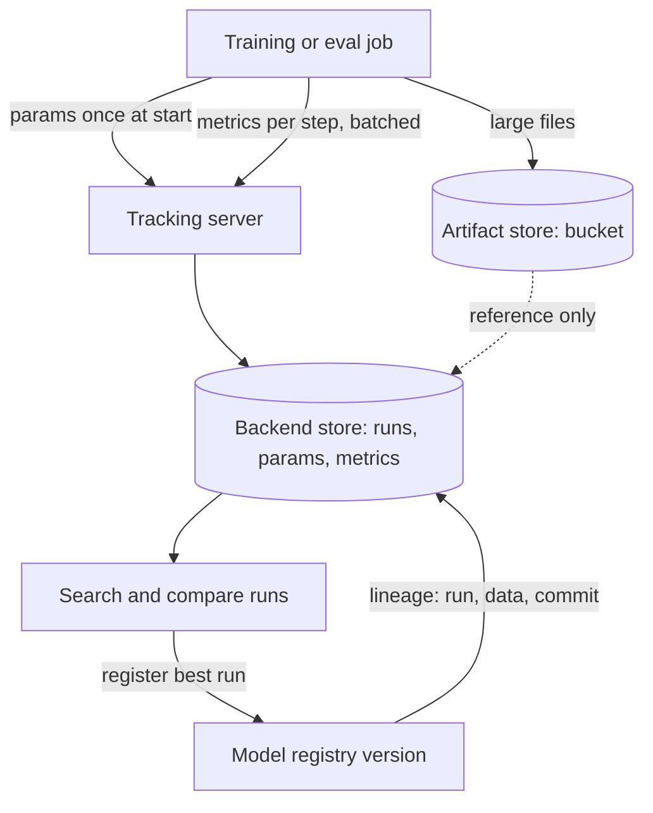

## TL;DR
Experiment tracking stores every training or eval run (params, code and data versions, step metrics,
artifacts) so runs can be compared, reproduced and promoted. MLflow and W&B share that data model and
differ in hosting, UI and ecosystem.

## Why it exists
- **Runs outpace memory.** Week one is a spreadsheet of learning rates and scores. By week three it is
  missing the run everyone discusses, nobody knows which checkpoint produced the 0.91, and its config was
  edited in place since.
- **Fine-tuning is combinatorial.** LoRA rank, learning rate, data mix, epochs and base model revision
  interact, so a result without its full configuration cannot be reproduced or trusted.
- **LLM app evals are experiments too.** A prompt version, model snapshot, dataset version and judge
  configuration go in; scores come out. Results in notebook cells and Slack screenshots cannot answer "did
  the last three prompt changes help on the refund slice" without re-running everything.
- **Logs and file names fail because comparison and lineage are the whole job.** You must filter a thousand
  runs by parameter, overlay metric curves, and follow a model version back to its run, data and commit:
  a database with a specific schema and a UI on top, which is what a tracker is.

## How it works
### The data model both tools share
| Concept | What it is | Why |
|---|---|---|
| **Experiment** (MLflow) / **project** (W&B) | groups runs | one place to compare |
| **Parameters** | fixed at start, treated as immutable | changing them mid-run would make comparisons meaningless |
| **Metrics** | time series against a step or epoch | see divergence or over-fitting at step *k*, not just the final number |
| **Artifacts** | files: checkpoints, per-item eval outputs, plots, configs | error analysis and lineage |
| **Tags** | free-form labels | filtering |
| **Captured context** | git commit, command line, Python environment, optionally system metrics such as GPU utilisation | reproducibility |

- **Param immutability differs by tool.** MLflow rejects re-logging a param with a different value. W&B
  lets `config` be updated, but that is an escape hatch, not the model.
- **System metrics:** W&B records them by default; MLflow does once system-metrics logging is switched on.
- **Runs can be nested** for hyperparameter sweeps.
- **Everything is queryable:** "all runs where `lora_r=16` sorted by `eval_acc`" is one call.

### What happens when you call `log`
Both clients are thin writers to a store; their transport explains several sharp edges.

- **MLflow over REST.** The client sends each logging call to the tracking server (or writes to a local
  `mlruns` directory with no server). The server writes SQL rows: params as key/value *strings*, metrics as
  `(key, value, timestamp, step)` rows, plus a "latest value" per metric that the run table and search use.
- **MLflow batching.** `log_metrics` and `log_params` exist *because* one HTTP round trip per scalar at
  every training step is slow; recent versions also offer asynchronous logging.
- **W&B background process.** `init` starts a process that buffers everything to a local run directory and
  streams it to the server, *because* a training loop must never block on the network.
- **W&B offline mode** falls out of that design: `WANDB_MODE=offline`, uploaded later with `wandb sync`,
  for air-gapped clusters.
- **Artifacts take a separate path.** Large files go to the artifact store (bucket or W&B storage); only a
  reference lands in the run.

### Three sharp edges that follow
1. **MLflow params are strings,** so a filter such as `params.lr > 0.001` is not a numeric comparison. Put
   numbers you will range-query into metrics or tags you control.
2. **MLflow sorts on a metric's *last* logged value, not its best.** Log a separate `best_eval_acc` if that
   is what you will rank by.
3. **W&B requires the `step` passed to `log` to increase monotonically.** A call with an earlier step is
   dropped with a warning, which bites when resuming a run or logging eval results after the training loop
   has advanced.

### MLflow
- **Origin and licence:** Apache-licensed open source that started at Databricks.
- **Two stores:** a backend store (a SQL database for runs, params and metrics) and an artifact store (local
  disk, S3, GCS or Azure Blob for files). That is why self-hosting is a container plus a database plus a
  bucket.
- **Around tracking:** a model registry with versions and aliases; a packaging format with "flavours"
  (`pyfunc`, `transformers`, `sklearn` and others) so any registered model loads with one call; and
  autologging that captures params and metrics from common frameworks without explicit calls.
- **GenAI features:** through the later 2.x releases and the 3.x line it added tracing, LLM evaluation APIs
  and a prompt registry, so an LLM team can keep evals and prompts in the same store as training runs.
- **Hosting:** Databricks offers a managed version, and some cloud ML platforms (Amazon SageMaker, for
  example) offer managed MLflow tracking servers; otherwise you self-host.

### Weights & Biases
- **SaaS-first,** with a self-hosted server option for data-residency requirements.
- **API:** `wandb.init(project=..., config=...)`, `wandb.log({...}, step=...)` and `run.finish()`.
- **Distinguishing pieces:**
  - **Artifacts:** versioned datasets and models with an automatic lineage graph (which run consumed which
    artifact version and produced which).
  - **Sweeps:** a built-in hyperparameter search orchestrator that schedules agents across machines.
  - **Tables** for per-example analysis in the UI, and **Reports** for sharing.
  - **Weave:** its toolkit for tracing and evaluating LLM applications.
- **Why teams pick it:** the UI. **Why they do not:** cost per seat, and metrics and artifacts leave the
  network unless you self-host.

### How an LLM team uses either
| Run type | Params | Metrics | Artifacts | Then |
|---|---|---|---|---|
| Fine-tuning | `base_model`, `base_revision`, `lora_r`, `lr`, `train_set` version hash, `git_sha` | train and eval loss per step | adapter directory, per-item eval outputs | register the adapter as a model version so lineage flows into the registry |
| Evaluation | prompt version, model snapshot, dataset hash, judge config | aggregate and per-slice scores | per-item outputs file | error analysis starts from the run page |

The tracker becomes the place where "what did we try and what happened" is answered.

### Choosing
- **Data residency or regulated environments** push toward self-hosted MLflow or a W&B server.
- **Already on Databricks:** you get MLflow for free.
- **Research-heavy teams running sweeps daily** usually prefer W&B's UI and sweep orchestration.
- **LLM application teams** increasingly keep traces and evals in an observability platform such as
  Langfuse or LangSmith and use the tracker only for training.
- **The important decision** is one system of record per artifact class, not one tool for everything.

## Diagram
A run writes params once, metrics per step and artifacts by reference; registering from the run carries
lineage into the registry.



## Examples
### The same LoRA run logged to MLflow and to W&B
The same LoRA fine-tuning run logged two ways. Parameters are fixed at the start, metrics are
step-indexed, artifacts are files, and the dataset and code versions are logged as params so the run is
reproducible.

`train_and_eval` is your loop, yielding per-step metrics. The two halves are alternatives, shown together
only for comparison (as written, the loop would train twice).

```python
import mlflow, wandb, subprocess

cfg = {"base": "meta-llama/Llama-3.1-8B-Instruct", "base_revision": "<hf commit sha>",
       "lora_r": 16, "lr": 2e-4, "epochs": 2,
       "train_set": "tickets-v3@9c1e04", "golden_set": "golden-v8@5c2e91"}
cfg["git_sha"] = subprocess.check_output(["git", "rev-parse", "HEAD"]).decode().strip()

# --- MLflow: self-hosted tracking server; runs grouped by experiment -------------------------
mlflow.set_tracking_uri("http://mlflow.internal:5000")
mlflow.set_experiment("support-classifier")
with mlflow.start_run(run_name="lora-r16-lr2e-4") as run:
    mlflow.log_params(cfg)                                            # immutable for the run's lifetime
    for step, (train_loss, eval_acc) in enumerate(train_and_eval(cfg)):
        mlflow.log_metrics({"train_loss": train_loss, "eval_acc": eval_acc}, step=step)
    mlflow.log_artifact("outputs/eval_items.jsonl")                   # per-item outputs for error analysis
    mlflow.log_artifacts("outputs/adapter", artifact_path="model")    # raw files; use a flavour's log_model for pyfunc loading
    print("register with run id:", run.info.run_id)

# Comparison is the point: params are strings (quote them); ordering uses each metric's LAST value
best = mlflow.search_runs(experiment_names=["support-classifier"], filter_string="params.lora_r = '16'",
                          order_by=["metrics.eval_acc DESC"], max_results=5)

# --- W&B: SaaS or self-hosted server; config + log + a versioned Artifact with lineage --------
run = wandb.init(project="support-classifier", name="lora-r16-lr2e-4", config=cfg)
for step, (train_loss, eval_acc) in enumerate(train_and_eval(cfg)):
    wandb.log({"train_loss": train_loss, "eval_acc": eval_acc}, step=step)
art = wandb.Artifact("support-classifier-adapter", type="model", metadata=cfg)
art.add_dir("outputs/adapter")
art.add_file("outputs/eval_items.jsonl")
run.log_artifact(art)                                                 # becomes v0, v1, ... in the lineage graph
run.finish()
```

### Worked scenario: the run table hides the best checkpoint
Pure Python, runnable. Two runs from one sweep; ranking by the last logged value (what the run table
sorts on) picks the wrong one.

```python
curves = {                       # eval_acc per eval step, two runs from the same sweep
    "lora-r16": [0.80, 0.88, 0.91, 0.86],   # peaked at step 2, then over-fit
    "lora-r8":  [0.82, 0.86, 0.88, 0.89],   # still climbing at the end
}

by_last = sorted(curves, key=lambda r: curves[r][-1], reverse=True)   # what a run table sorts on
by_best = sorted(curves, key=lambda r: max(curves[r]), reverse=True)  # what you meant
print("by last value:", by_last)   # ['lora-r8', 'lora-r16']
print("by best value:", by_best)   # ['lora-r16', 'lora-r8']

for run, c in curves.items():      # log these as their own metrics so the tracker can rank on them
    best_step = max(range(len(c)), key=c.__getitem__)
    print(run, {"best_eval_acc": max(c), "best_step": best_step})
```

| Run | Last `eval_acc` | Best `eval_acc` | Best step | Rank by last | Rank by best |
|---|---|---|---|---|---|
| lora-r16 | 0.86 | 0.91 | 2 | 2nd | 1st |
| lora-r8 | 0.89 | 0.89 | 3 | 1st | 2nd |

- **Fix:** log `best_eval_acc` and `best_step` as metrics, keep the checkpoint from the best step as an
  artifact, and rank on that.
- **Still check the curve:** a single peak can be luck that the next seed will not repeat.

## Production patterns
- **Self-hosted MLflow with real stores** — when data must stay in your network. Run the tracking server
  against a SQL database (`--backend-store-uri`) and a bucket for artifacts, behind your SSO proxy, rather
  than the default local file store. Monitor database size, artifact bucket growth and server latency on
  `log_metrics`.
- **Mandatory run metadata** — when promoted models must be auditable. Wrap run start in a helper that logs
  `git_sha`, dataset hashes and base revision, and refuses to start if any is missing. Monitor the share of
  runs, and of registered versions, carrying all required params.
- **Rank on a best-value metric** — whenever a metric can peak before the end. Log `best_eval_acc` and the
  step it occurred at alongside the per-step series, and sort on that. Monitor the gap between last and best
  values to spot over-fitting.
- **Offline logging for air-gapped jobs** — when training nodes have no egress. Set `WANDB_MODE=offline` and
  upload later with `wandb sync` from a node that can reach the server. Monitor runs left un-synced.
- **Artifact retention tied to the registry** — when per-item outputs and checkpoints pile up. Apply bucket
  lifecycle rules to run artifacts, but exclude anything a registered model version references. Monitor
  storage growth and any registry version whose source URI no longer resolves.

## Trade-offs
- **Self-hosted MLflow vs operations.** It keeps data in your network and costs nothing in licences, but you
  operate a server, a database and an artifact store, and the UI is thinner than W&B's.
- **W&B convenience vs cost and residency.** Its hosted UI, sweeps and lineage graph save engineering time,
  but per-seat pricing and data leaving the network flip the decision in regulated environments unless you
  run the self-hosted server.
- **Per-item artifacts vs storage.** Logging every per-item output makes error analysis one click away, at
  the cost of storage that grows with runs times dataset size; sample or compress once eval sets reach six
  figures.
- **Autologging vs signal.** It captures params and metrics with zero code, but also whatever the framework
  decides is interesting, which can bury the three numbers you care about under three hundred.
- **Training tracker vs observability platform for evals.** The tracker unifies history; the observability
  platform links evals to traces. The winner depends on whether your evals start from production traces or
  from training jobs.

## Pitfalls
- **Logging the final metric only.** Symptom: a run that looks best on its last value while its curve shows
  it diverged and recovered by luck, which the next seed will not repeat.
- **Forgetting the data version and git commit in params.** Symptom: a top run that nobody can reproduce
  because the training set was regenerated since.
- **Mutating a config dict after `log_params`.** And assuming the tracker noticed. Symptom: runs whose
  recorded learning rate differs from the one actually used.
- **Treating the tracker as a backup for weights.** Symptom: a bucket bill that doubles monthly and a
  cleanup that deletes the one checkpoint the registry still points to.
- **Ranking by a metric whose final value is not its best.** Such as eval accuracy after over-fitting.
  Symptom: the run table hides the checkpoint that actually peaked, because sorting uses the last value.
- **Logging with a lower step in W&B.** Resuming a run or logging post-training evals with a step lower than
  the last one. Symptom: eval points that silently never appear on the chart, with only a warning in the
  console.
- **Running evals outside the tracker "because it is just a prompt change".** Symptom: a team arguing from
  memory about whether version 11 or 12 did better on the hard slice.

## When to use
- **Use from** the first fine-tuning run or the first eval you intend to compare against a later one, which
  is essentially always.
- **Choose MLflow** when you need self-hosting, already run Databricks, or want the registry and model
  packaging in the same system.
- **Choose W&B** when sweep orchestration, the UI and artifact lineage are worth the subscription, and data
  can leave your network or you will run the self-hosted server.
- **Measure** whether every registered model version links to a run, whether every run has a data version
  and commit, and how long it takes a new team member to find "the best run on the refund slice".
- **Interviews:** describe the run data model, how lineage flows from a run into the registry, and the
  hosting and ecosystem differences between the two tools.

## Role lens
- **Engineer:** Instruments training and eval scripts with params, step metrics and artifacts, and
  registers the resulting model version from the run so lineage is automatic.
- **Architect:** Chooses the system of record per artifact class, decides self-hosted versus SaaS from
  residency and cost, and sets the minimum metadata every run must carry.
- **FDE:** Stands up a tracker inside the customer's environment when their data cannot leave, so
  customer-specific fine-tuning and evals have the same history and reproducibility as internal work.

## Check yourself
**Q:** A colleague reports that run 42 reached 0.91 accuracy and asks you to promote its adapter. The
run page shows only `lr` and `epochs` as params and a single final metric. What questions do you ask
before promoting, and what should the run have logged to make them unnecessary?
**A:** First, which base model revision, which training set version and which code commit produced it;
without those the adapter cannot be retrained or audited. Second, what the evaluation set was and
whether it was the current golden version, because 0.91 on last month's set is not comparable to this
week's baseline. Third, how the metric evolved over steps, since a single final number can hide a
divergent run that landed on a good value by chance. Fourth, where the per-item outputs are, so the
refund-intent slice can be checked. The run should have logged base revision, dataset hashes, git sha
and LoRA settings as params, train and eval metrics per step, and the eval outputs and adapter as
artifacts, with the adapter registered from the run so the registry version carries that lineage.

## Interview questions
### What is the difference between a parameter, a metric and an artifact in a tracking run?
- **Parameters** are the configuration, fixed at start, because changing them mid-run changes the question
  the run answers.
- **Metrics** are step-indexed time series, so you can see divergence or over-fitting rather than one final
  number.
- **Artifacts** are files (checkpoints, per-item outputs, plots) stored in a bucket with only a reference in
  the run.

### A search for `params.lr > 0.001` returns runs with lr = 0.0002. What is going on?
- **MLflow stores params as strings,** so the comparison is lexicographic, not numeric.
- **Fix:** log values you will range-query as metrics or as tags you control with a sortable format, and
  keep params for exact-match filters.
- **Related trap:** run-table sorting uses each metric's last value, so log a best-value metric too.

### How do you choose between MLflow and W&B for a regulated customer?
- **Residency usually decides:** MLflow is self-hosted by default; W&B is SaaS-first with a self-hosted
  server option.
- **Then ecosystem:** MLflow brings a registry and model flavours; W&B brings sweeps, a lineage graph and a
  richer UI, at a per-seat cost.
- **Either way,** pick one system of record per artifact class and enforce required run metadata.

### Eval results logged after training never appear on the W&B chart. Why?
- **Steps must increase monotonically in W&B.** A `log` call with a step lower than the last one is dropped
  with a warning.
- **This bites** when resuming a run or logging post-training evals at an earlier step.
- **Fix:** log evals at the current or a later step, or under a separate metric axis, and watch the console
  for the warning.

### When would you not put LLM eval runs in the training tracker?
- **When evals start from production traces:** an observability platform such as Langfuse or LangSmith
  links each eval to the traces it came from.
- **The cost** is split history between two systems, so define which one is the record for eval runs.
- **Keep training** runs, adapters and lineage into the registry in the tracker.

## Quiz
### Q: Why are a run's parameters fixed at the start while metrics are logged over time?
- [ ] Parameters are stored in a different database table for speed
- [x] Parameters define the experiment and must stay constant for comparison, while metrics describe how it unfolded
- [ ] Metrics cannot be stored as strings
- [ ] Parameters are only used by sweeps
> A run is an answer to "what happens with this configuration"; if the configuration changes mid-run the
> question changes. Step-indexed metrics let you see divergence and over-fitting instead of a final number.

### Q: Which difference most often decides between MLflow and W&B in a regulated enterprise?
- [ ] W&B cannot log artifacts
- [ ] MLflow has no model registry
- [x] Self-hosting and data residency: MLflow is self-hosted by default, W&B is SaaS-first with a self-hosted option
- [ ] MLflow only supports PyTorch
> Both tools cover the core data model. Where metrics, configs and artifacts are allowed to live is usually
> the constraint that decides, with W&B's UI and sweeps as the counterweight when residency is not binding.

### Q: What links a registered model version back to the data it was trained on?
- [ ] The alias assigned at promotion time
- [x] The run that produced it, which logged the dataset version as a parameter
- [ ] The artifact file's modification timestamp
- [ ] The model card's free-text description
> Lineage is captured at training time in the run; registering from the run carries that link into the
> version. An alias says where a model is deployed, not where it came from.
