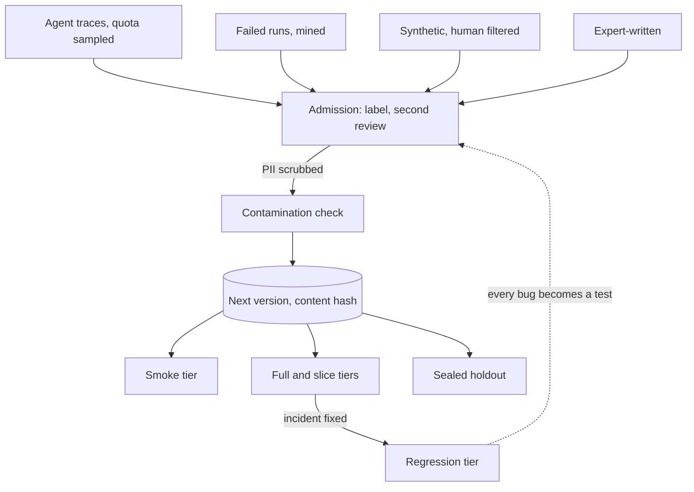

## TL;DR
An agent's golden data is a portfolio of tiered, versioned task sets, each with an owner, intake from
failed production runs, and a size set by the smallest regression it must detect, because one static set
goes stale, leaks and is mis-sized.

## For agent builders
- **Why it matters for agents.** Every agent eval and release gate is only as good as its task set. A set
  written before you added a refund tool cannot see refunds failing, and a set copied into few-shot
  examples measures memory, not the agent.
- **Where it shows up in your stack.** Datasets in your eval platform (Braintrust, LangSmith, Langfuse) or
  content-hashed JSONL in the repo, a "trace to dataset" button in observability, and a regression item in
  every agent bug-fix PR.
- **What you control.** What an agent item holds (task, starting state, tool fixtures, expected final
  state, forbidden actions), the tiers and their sizes, who may change an expected outcome, and the
  contamination check against prompts and fine-tuning data.
- **What you can skip.** Exotic sampling theory. The half-width formula, per-slice quotas and pairing are
  enough to size agent task sets.

## Decision case
### Scenario
The support agent from the sizing scenario below has four tools and a 350-item task set: 200
`search_orders` items and 50 each for `issue_refund`, `update_address` and `escalate_to_human`.

Last quarter a prompt edit cut refund success by about 8 points and passed the gate, because the refund slice
was too small to see it. There were also 30 production incidents with no regression item.

Facts and constraints, with illustrative figures:
- **Labelling budget.** 400 new items this quarter. Each needs a label and a second review at about
  6 minutes each: 400 × 12 = 4,800 minutes, 80 hours of the two domain reviewers' time.
- **Gate target.** Bound the refund slice's candidate-minus-champion delta to ±5 points with a paired
  comparison.
- **Flip rate.** The measured flip rate between recent candidates is f = 10%. With the paired rule the
  refund slice needs n ≈ 1.96² × 0.10 / 0.05² ≈ 154 items.
- **Overfitting.** Prompt authors iterate daily against the full set, and nobody can tell whether gains
  are real.

### Options
For each option, the refund half-width is 1.96 × √(0.10 / n) in points.

| Option | How the 400 items are spent | Refund items | Refund paired half-width | Incidents covered | Overfitting check |
|---|---|---|---|---|---|
| **A. Uniform from traffic** | 400 traces sampled by traffic share; refunds get 20%, 80 items | 130 | ±5.4: misses the target | No | No |
| **B. Equal quota** | 100 more per slice | 150 | ±5.1: just misses | No | No |
| **C. Risk-weighted portfolio** | 30 regression items from incidents, 110 refund, 100 address, 60 escalation (adversarial and safety), 100 sealed holdout | 160 | ±4.9: meets it | All 30 | 100-item holdout |
| **D. Synthetic refund items** | Generate refund cases, then label and review them | Up to 400 | Meets it on paper | No | No |

### Decision
Choose **C**:
- **It is the only option that meets the gate target.** A and B spread labels by traffic or evenly, and
  neither reaches 154 refund items.
- **D buys count, not coverage.** Generated items still need the same label and review, so the budget
  is the same, and a generator writes easier cases than users do.
- **The 30 regression items are the cheapest coverage on the list.** Each one is a failure that already
  happened, and the regression tier must pass at 100%.
- **The holdout answers the overfitting question.** It is readable only by the release job's service
  account.
- **The arithmetic adds up:** 30 + 110 + 100 + 60 + 100 = 400.

What would change it:
- **A higher flip rate.** At f = 20% the refund slice needs about 307 items, and at 160 the half-width is
  ±6.9. Either buy more labelling time or gate refunds on ±7 points and say so.
- **A refund policy change.** Relabelling the refund slice comes first, because a stale expected state
  makes every new item worthless. That is a new version, never an edit in place.
- **No capacity for two sets.** Rotate items into the holdout each version instead of sealing 100 now.

### Trade-offs accepted
- **`search_orders` gets no new items.** Its 200 items stay at ±5.5 points on a single run at p = 0.8. Watch its share of
  production failures, and re-weight next quarter if it rises.
- **The holdout is coarse.** At 100 items and p = 0.8 its half-width is ±7.8 points, so only a large
  full-versus-holdout gap is visible. Watch the gap at each release, not on each PR.
- **The aggregate no longer matches traffic.** Report a traffic-weighted score next to the per-slice
  floors.
- **Reviewer time is the binding resource.** Watch inter-annotator agreement per slice; persistent
  disagreement means the task definition needs work before more items.

### Review rubric
- **Item counts come from the smallest regression to detect,** using the paired or unpaired rule with
  the measured flip rate, not round numbers.
- **The budget is allocated explicitly** and sums to the stated total.
- **Risk outranks traffic share:** the slice with money or safety at stake gets items first, with the
  reason stated.
- **Incidents become regression items,** and the plan says how new incidents keep flowing in.
- **Overfitting and contamination are addressed** with a sealed holdout or rotation and access control.
- **Reversal conditions are quantified,** such as the flip rate at which the plan stops meeting its target.

## Why it exists
- **The single file fails four ways.** Most teams start with fifty examples the first engineer wrote in an
  afternoon (the `evals/golden-dataset` lesson covers what an item is and how it is labeled). It works for
  a quarter, then goes stale, leaks, is mis-sized and has no owner.
- **Stale and leaking.** The product adds a refunds flow and a second language, traffic shifts, and the set
  still measures last quarter, so the eval stays green while users complain. Someone copies the best
  examples into the few-shot prompt, then into fine-tuning data; the score climbs toward 100% and stops
  carrying information.
- **Wrong size and no owner.** Fifty items cannot separate a two-point regression from noise, so engineers
  ignore the wobble; five thousand items cost real money and an hour per run, so it is skipped on busy
  days, which are the days it matters. Nobody may fix a wrong label, or everyone edits and the baseline
  moves silently.
- **The naive fixes do not solve it.** "Just use production logs" gives inputs without agreed outputs,
  skewed to the common case, with customer PII inside. "Use a public benchmark" measures the model, not
  your prompt, retrieval and tools. "Make it bigger" trades noise for cost without fixing staleness or
  leakage.
- **The strategy treats golden data as a managed platform asset** with tiers, versions, owners and a refresh
  loop, the way a mature team treats its test suite rather than a folder of scripts.

## How it works
### What an agent item holds
- **Task input:** the user request plus any conversation history the agent starts with.
- **Starting state and tool fixtures:** the environment the tools see (accounts, orders, files), or
  recorded tool results, so the run is repeatable and side-effect free.
- **Expected outcome:** a final state or answer criteria, not one exact tool sequence, because agents
  often reach the same correct state by different valid paths.
- **Constraints:** forbidden actions (no refund above a limit, no email to external addresses) and an
  optional step budget, scored as floors.

### A portfolio, not a file
Each tier has a purpose, a size and a cadence; tiers exist *because* cost multiplied by run frequency must
stay affordable while the release gate stays powerful. Sizes are illustrative.

| Tier | Size | Runs | Job |
|---|---|---|---|
| **Smoke** | tens to a couple of hundred, stratified | every PR | catch catastrophic breakage (broken template, parser that no longer matches, a tool schema the model can no longer call), not two-point drifts |
| **Full** | hundreds to low thousands, per-slice quotas | merge, nightly, release candidates | the set gates are computed on |
| **Slice sets** | small, per intent, language, tenant, document type or tool | with the full set | each carries its own floor because the aggregate hides a collapsed slice |
| **Regression** | one item per fixed production incident, never pruned | every run | expected at 100% pass; "every bug becomes a test" is the cheapest coverage you will ever buy |
| **Adversarial and safety** | prompt injection (including instructions planted in tool results and retrieved pages), jailbreak attempts, PII extraction | release and nightly | gated by absolute floors, not relative to the champion |
| **Sealed holdout** | a subset prompt authors never see, never in few-shot or training data | release only | detects overfitting to the development set |

- **The overfitting signal** is the gap between full-set and holdout scores.

### The statistics that set the sizes
```
standard error of one pass-rate run = √(p(1−p)/n)
95% half-width = 1.96 × √(p(1−p)/n)
```

| n (at p = 0.8) | 95% half-width |
|---|---|
| 50 | about ±11 points |
| 200 | ±5.5 |
| 1,000 | ±2.5 |

- **So a smoke set can only detect large breaks,** and anyone claiming a two-point improvement on a hundred
  items is reading noise. Agent task success is a pass rate, so the same table applies.
- **Pairing tightens this considerably.** When candidate and champion run on the *identical* items, item
  difficulty cancels in the per-item difference, which is why both must run on the same dataset version
  (the `evaluation-gates-for-production-releases` lesson does the arithmetic).
- **Size each slice** from the smallest regression you must detect there, not from a round number.

### The sizing rule
For a target 95% half-width *h* on the candidate-minus-champion difference:

```
unpaired:  n ≈ 1.96² · 2p(1−p) / h²
paired:    n ≈ 1.96² · f / h²      (f = fraction of items whose verdict differs between the two bundles)
```

- **At p = 0.8 and h = 2 points:** unpaired needs about 3,070 items; paired with f = 10% needs about 960.
- **Detecting, not just bounding, costs more:** roughly double the items for 80% power.
- **f is unknown** until you have run the champion against a few candidates, so measure it and resize.
  Sampled agents often have a higher f than single-call apps, because one different early tool choice
  changes the whole run.

### The sourcing pipeline
| Source | How | Because |
|---|---|---|
| **Production traces** | sampled with per-slice quotas, stratified by outcome (thumbs-down, escalation, abandoned session, step budget exhausted), not uniformly | uniform sampling drowns rare intents in the head of the distribution |
| **Failure mining** | error analysis of incidents and failed agent runs | real failures are the highest-value items |
| **Synthetic generation** | for slices with too little real traffic, admitted only after a human labels and filters them | a generator shares the model's blind spots and writes easier cases than users do |
| **Expert-written** | for policy-critical behaviour | traffic rarely exercises it |

- **What "expected" stores depends on the task:** a label for classification, executable tests for code,
  a final environment state for agents, and for free text usually a short list of must-include facts and
  must-not behaviours rather than one reference phrasing.
- **Criteria beat one reference phrasing** *because* a judge grading against criteria penalises legitimate
  rewording less, and a policy change then edits a named criterion instead of a paragraph nobody can diff.

### Admission workflow
1. **Proposed** from one of the sources above.
2. **Labeled** by the task owner.
3. **Checked by a second reviewer.** Measure inter-annotator agreement; a slice with persistent
   disagreement has an under-specified task, not bad reviewers.
4. **Merged into the *next* version,** never the current one.

- **PII is scrubbed or replaced** with synthetic values before storage, *because* a golden set lives for
  years and gets copied to laptops. Tool fixtures recorded from production need the same scrub.

### Versioning and ownership
- **A version is immutable,** identified by a content hash, with a changelog of items added, removed or
  relabeled and why.
- **Relabeling is a version bump, never an edit,** *because* a baseline recorded against version A is
  meaningless once A's labels change.
- **Correctness is owned by the task-definition role** (product or domain); engineering owns the pipeline;
  the person who wrote the prompt under test does not label the holdout.
- **A datasheet** (purpose, sources, slices, known gaps) travels with each set so a new team can judge what
  a score on it means.

### Lifecycle
- **Refresh is triggered, not calendar-driven:**
  - when production slice mix shifts (monitoring tells you);
  - when a policy changes an expected answer;
  - when a tool is added, removed or changes its schema;
  - when a slice has sat at 100% for every candidate for months (move those items to smoke or regression;
    they no longer discriminate);
  - after every incident.
- **Contamination defence is mechanical.** The registry checks that no golden input's hash or
  near-duplicate appears in prompt templates, few-shot banks or fine-tuning corpora, and the sealed holdout
  is excluded from any export engineers can read.

## Diagram
Items flow from four sources through admission into the next immutable version; tiers are cut from it,
and failed agent runs feed back as regression items.



## Examples
### Turning a failed agent run into a regression item
A production run refunded the wrong order. The trace already holds the task, the tool results and the
state; the conversion keeps those as fixtures and replaces the agent's wrong outcome with the reviewed
correct one. `scrub` is your PII scrubber.

```python
import json

def trace_to_item(trace, correct_state, forbidden, item_id, reviewer):
    fixtures = [{"tool": c["tool"], "args": c["args"], "result": scrub(c["result"])}
                for c in trace["tool_calls"]]                    # recorded world, not the live one
    return {
        "id": item_id,
        "slice": trace["intent"],                                # e.g. "refunds"
        "tier": "regression",                                    # never pruned, must pass 100%
        "input": {"task": scrub(trace["user_message"])},
        "fixtures": fixtures,
        "expected": {"state": correct_state},                    # outcome, not the exact tool sequence
        "forbidden": forbidden,                                  # path constraints scored as floors
        "source": {"trace_id": trace["id"], "reviewed_by": reviewer},
    }

item = trace_to_item(
    trace=json.load(open("incidents/INC-2291.json")),
    correct_state={"order_1182": "refunded", "order_1183": "unchanged"},
    forbidden=[{"tool": "issue_refund", "args": {"order_id": "1183"}}],
    item_id="reg-2291", reviewer="domain:refunds-lead")
# Merge into the NEXT version with a changelog line: "reg-2291: refund on wrong order (INC-2291)"
```

### Sizing, quota sampling and cutting a version
A support assistant with six intents whose production traffic splits roughly 60/20/10/5/3/2 percent.

| Sampling | Items per intent | Total | Rarest intent |
|---|---|---|---|
| Uniform, 300 traces | about 180/60/30/15/9/6 | 300 | six items: cannot be measured at all |
| Quota of 40 per slice from the full trace pool | 40 each | 240 | measurable to roughly ±12 points at p = 0.8 |

- **Report the aggregate both ways:** traffic-weighted and as per-slice floors.
- **The code** shows the size arithmetic, the quota sampler and how a version is cut.

```python
import hashlib, json, math, random
from collections import defaultdict

def half_width_points(p, n):            # 95% half-width in percentage points for a pass-rate metric
    return 100 * 1.96 * math.sqrt(p * (1 - p) / n)

for n in (40, 50, 200, 1000):
    print(f"n={n:5d}: ±{half_width_points(0.8, n):.1f} points")   # ±12.4, ±11.1, ±5.5, ±2.5

def items_for_paired_gate(h, flip_rate):  # n so the paired 95% half-width on the delta is h (fractions)
    return math.ceil(1.96**2 * flip_rate / h**2)          # items_for_paired_gate(0.02, 0.10) -> 961

def stratified_sample(candidates, quota_per_slice, seed=7):
    """candidates: labeled production traces; a fixed quota per slice keeps rare intents measurable."""
    by_slice = defaultdict(list)
    for c in candidates:
        by_slice[c["slice"]].append(c)
    rng = random.Random(seed)
    chosen = []
    for slice_name, items in sorted(by_slice.items()):
        rng.shuffle(items)
        chosen += items[:quota_per_slice]           # a slice with fewer than quota items is a coverage gap to log
    return chosen

def cut_version(items, parent, changelog, tier="full", sealed=False):
    body = json.dumps(sorted(items, key=lambda i: i["id"]), sort_keys=True).encode()
    slices = {i["slice"] for i in items}
    return {"version": hashlib.sha256(body).hexdigest()[:12],   # content hash: an edit is a new version
            "parent": parent, "n": len(items), "tier": tier, "sealed": sealed,
            "per_slice": {s: sum(i["slice"] == s for i in items) for s in sorted(slices)},
            "changelog": changelog}                            # e.g. "relabeled 15 refund items after policy change 2025-06"
```

### Worked scenario: sizing an agent's task set by tool
An agent with four tools; per-tool slices at p = 0.8 using the half-width table above. Illustrative.

| Slice (by main tool) | Share of traffic | Items | 95% half-width | Can it catch a 10-point drop? |
|---|---|---|---|---|
| `search_orders` | 55% | 200 | ±5.5 | usually, and reliably with a paired comparison |
| `issue_refund` | 20% | 50 | about ±11 | no: the interval is wider than the drop; raise to 200 before gating on it |
| `update_address` | 15% | 50 | about ±11 | no |
| `escalate_to_human` | 10% | 50 | about ±11 | no, but it carries a safety floor anyway |

The refund slice is the one with money at stake, so it gets the larger quota first even though it is not
the largest share of traffic.

### A mechanical contamination check
Pure Python, runnable. Before a version is cut, compare golden inputs against prompt templates, few-shot
banks and fine-tuning corpora: exact match after normalisation, then word 8-gram overlap for near
duplicates. The 0.5 threshold is a starting point to tune, not a standard.

```python
import hashlib, re

def norm(text):
    return re.sub(r"\s+", " ", text.lower()).strip()

def shingles(text, k=8):                     # word 8-grams catch light paraphrase and copy-paste
    w = norm(text).split()
    return {" ".join(w[i:i + k]) for i in range(max(1, len(w) - k + 1))}

def contamination(golden_inputs, corpus_docs, threshold=0.5):
    exact = {hashlib.sha256(norm(d).encode()).hexdigest() for d in corpus_docs}
    corpus_sh = [shingles(d) for d in corpus_docs]
    hits = []
    for gid, text in golden_inputs.items():
        if hashlib.sha256(norm(text).encode()).hexdigest() in exact:
            hits.append((gid, "exact")); continue
        s = shingles(text)
        best = max((len(s & c) / len(s) for c in corpus_sh), default=0.0)
        if best >= threshold:                # share of the item's 8-grams found in one corpus doc
            hits.append((gid, f"near-duplicate {best:.0%}"))
    return hits

golden = {"g17": "I was charged twice for my annual plan and want one of the payments refunded please",
          "g18": "How do I change the billing email on my account"}
few_shot_bank = ["Example user: I was charged twice for my annual plan and want one of the payments refunded",
                 "Example user: my parcel never arrived"]
print(contamination(golden, few_shot_bank))   # [('g17', 'near-duplicate 89%')]
```

- **On a hit,** remove the item from the bank or the corpus, or retire it from the golden set into a new
  version; never leave both in place.

## Production patterns
- **Regression item in every incident fix** — for any team with on-call. Make "added regression item" a
  required checkbox in the bug-fix PR template, and fail the eval if the regression tier drops below 100%.
  Monitor the fraction of incidents with a matching regression item.
- **Trace-to-task conversion with fixtures** — for agents. Turn a failed production run into an item that
  keeps its tool results as scrubbed fixtures and stores a reviewed expected final state, so the regression
  replays without live systems. Monitor items whose fixtures no longer match the current tool schemas.
- **Outcome-stratified trace sampling** — when refreshing the full set. Pull a fixed quota per slice,
  weighted toward thumbs-down, escalated, abandoned and budget-exhausted runs, through a PII scrubber before
  labeling. Monitor items per slice against the quota and the coverage gaps logged by the sampler.
- **Contamination check as a CI step** — whenever prompts, few-shot banks or training corpora change. Run the
  hash and n-gram check above against the current golden versions and block the merge on a hit. Monitor
  hits per month and the gap between full-set and holdout scores.
- **Holdout behind access control** — when prompt authors iterate fast. Store the sealed holdout in a
  separate bucket or project only the release job's service account can read, and exclude it from exports.
  Monitor access logs and the full-versus-holdout gap at each release.
- **Measured flip rate drives size** — once you have run a few candidates. Record the fraction of items whose
  verdict differs between candidate and champion, and recompute paired sizes per slice from it. Monitor
  confidence-interval width per slice against the regression size you must detect.

## Trade-offs
- **Measurable rare slices vs a traffic-faithful aggregate.** Per-slice quotas make rare cases measurable,
  but the aggregate no longer reflects traffic. Report both a traffic-weighted score and per-slice floors,
  and drop the quota only for slices nobody cares about.
- **Overfitting detection vs analysability.** A sealed holdout detects overfitting to the development set,
  but you cannot error-analyse what you are not allowed to read. A small team without capacity for two sets
  should rotate items into the holdout instead.
- **Fresh failures vs a pessimistic set.** Mining failures keeps the set current, but a set made only of past
  failures makes every candidate look worse than traffic would; keep a randomly sampled, stratified core
  alongside it.
- **Cheap synthetic coverage vs realism.** Synthetic items cover rare slices cheaply but share the
  generator's blind spots and run easier than real users. The trade flips in their favour only once humans
  have labeled and filtered them.
- **Recorded fixtures vs a living world.** Fixtures make agent items repeatable and safe, but they freeze
  tool outputs; when a tool's real responses change shape, items go stale until fixtures are re-recorded.
- **Tight intervals vs cost per run.** Larger sets tighten confidence intervals and raise cost per run;
  tiering and content-addressed caching reconcile the two, and without caching a large full set gets
  skipped.

## Pitfalls
- **Golden items copied into few-shot prompts or fine-tuning data.** Symptom: a development-set score near
  100% while the sealed holdout and production CSAT do not move.
- **Editing expected outputs in place.** Symptom: a champion baseline that shifts without any deploy, so
  last month's runs are no longer comparable.
- **Uniform sampling from logs.** Symptom: a flat aggregate while a rare but high-value intent regresses all
  the way to production.
- **A museum of past failures.** Symptom: every candidate "regressing" ten points relative to what users
  actually experience.
- **Nobody owning correctness.** Symptom: label disputes settled by whoever ran the eval, and an
  inter-annotator agreement that has never been measured.
- **Items stale after a policy change.** Symptom: the gate blocks a legitimately correct new behaviour,
  engineers start overriding it, and it stops meaning anything.
- **Expecting one exact tool sequence.** Symptom: a better agent that takes a shorter valid path "fails"
  dozens of items. Fix: store expected final state plus forbidden actions instead.

## When to use
- **Use when** an eval gates anything or more than one person edits the set.
- **Before that,** one stratified file with a content hash is enough.
- **Measure the asset itself:** coverage and confidence-interval width per slice, median item age, the
  fraction of production incidents with a regression item, agreement on relabels, and cost per run per tier.
- **Day to day:** every bug-fix PR adds a regression item, and every product change triggers a version bump
  with a changelog.
- **Interviews:** expect how big a set must be to detect a given regression, how you keep it out of the
  prompt, and who is allowed to change a label.

## Role lens
- **Engineer:** Writes the quota sampler and the contamination check, adds a regression item with every
  incident fix, and cuts content-hashed versions rather than editing files in place.
- **Architect:** Defines the tiers, the ownership model and the holdout policy, and decides which slices
  carry floors in the release gate and what cost per run the platform will fund.
- **FDE:** Builds the customer's first golden set from their real tickets with their domain experts labeling,
  because acceptance criteria argued from the customer's own data survive procurement reviews.

## Check yourself
**Q:** A team's 120-item golden set has read 94% for six months while production satisfaction has fallen.
What has most likely gone wrong, and what is your plan for the next two sprints?
**A:** Three candidates, checked in order. Leakage: grep prompts, few-shot banks and fine-tuning data for
golden inputs; if found, the 94% measures memorisation. Staleness: compare the set's slice mix with current
traffic and the product's recent changes; a set built before the refunds flow cannot see refunds failing.
Size: at n = 120 and p ≈ 0.94 the 95% half-width is roughly ±4 points (it would be about ±7 near p = 0.8),
and each slice holds only a fraction of the 120 items, so a real drop on one slice can hide in the noise. Plan: cut a new version
with per-slice quotas sampled from recent traces stratified by negative outcomes, add regression items
from the complaints, carve out a sealed holdout the prompt authors never see, record the new baseline
for the champion on that version, and put slice floors into the gate.

## Interview questions
### Why split golden data into tiers instead of one big set?
- **Cost times frequency.** A per-PR run must be cheap, so the smoke tier is small; the gate needs power, so
  the full tier is large and runs less often.
- **Different jobs need different rules:** the regression tier must pass 100%, safety has absolute floors,
  and the sealed holdout exists only to detect overfitting.
- **Slices carry their own floors** because an aggregate hides a collapsed slice.

### What does a golden item for a tool-calling agent contain, and why not an expected tool sequence?
- **Contents:** the task, starting state or recorded tool fixtures, an expected final state or answer
  criteria, and forbidden actions as constraints.
- **Not a sequence** because agents reach the same correct state by different valid paths; exact-sequence
  items fail better agents and flake on sampling.
- **Fixtures** keep the run repeatable and free of side effects; re-record them when tool schemas change.

### How many items do you need to detect a two-point regression at an 80% pass rate?
- **Unpaired:** about 1.96² × 2 × 0.8 × 0.2 / 0.02², roughly 3,070 items just to bound the difference to ±2
  points.
- **Paired on identical items:** about 1.96² × f / 0.02²; with 10% of verdicts flipping, about 960.
- **Reliable detection** at 80% power needs roughly double; measure the flip rate and resize per slice.

### Your agent's golden-set score rose to 98% but production CSAT is flat. How do you investigate?
- **Suspect leakage first:** run a contamination check of golden inputs against prompts, few-shot banks and
  fine-tuning corpora.
- **Compare with the sealed holdout:** a large full-versus-holdout gap means overfitting to the development
  set.
- **Check staleness:** compare slice mix with current traffic; new flows or new tools may have no items.

### When would you not keep a sealed holdout?
- **When the team cannot afford two curated sets;** you cannot error-analyse what nobody may read.
- **Instead,** rotate items into a holdout periodically, or keep a small sealed slice for releases only.
- **The cost of skipping it** is that development-set scores drift upward from overfitting with nothing to
  reveal it.

### Who should be allowed to change an expected answer, and how?
- **The task owner** (product or domain) decides correctness; engineering owns the pipeline; the prompt
  author does not label the holdout.
- **Every change is a new version** with a changelog and a second reviewer, never an in-place edit.
- **Then re-baseline the champion** on the new version so comparisons stay valid.

## Quiz
### Q: Why keep a sealed holdout that prompt authors are never allowed to read?
- [ ] To reduce the cost of the per-PR smoke run
- [x] To detect overfitting of prompts and few-shot examples to the development set
- [ ] To satisfy data-residency rules for customer traces
- [ ] To measure inter-annotator agreement on hard items
> Anything authors can read eventually shapes the prompt, so development-set scores drift upward without
> real improvement. A gap between full-set and holdout scores is the overfitting signal; cost and residency
> are solved by other mechanisms.

### Q: On a 100-item set a candidate scores 84% against the champion's 82%. What should you conclude?
- [ ] The candidate is better and can be promoted
- [ ] The candidate is worse because two points is within rounding
- [x] Nothing yet: at n = 100 the noise is several points, so run a paired comparison on a larger set
- [ ] The golden set is contaminated
> With p around 0.8 and n = 100 the 95% half-width is roughly ±8 points, far wider than the observed
> difference. A paired run on the same, larger dataset version is what can distinguish signal from noise.

### Q: A policy change makes 15 expected answers wrong. What is the correct way to update the golden set?
- [ ] Edit the 15 expected outputs in place so the next run is correct
- [ ] Delete the 15 items and shrink the set
- [x] Cut a new version with the relabels in its changelog and re-baseline the champion on that version
- [ ] Move the 15 items into the sealed holdout
> Baselines are recorded against a dataset version; editing in place silently invalidates every earlier
> comparison. A new content-hashed version with a changelog keeps history comparable, and re-running the
> champion gives the gate a valid reference.

## Use cases & projects
### Use cases
- **Launching a support agent.** The first golden set is built from real tickets with domain experts
  labeling expected outcomes per intent.
- **Adding a new tool.** A new slice with its own quota and floor is cut before the tool ships, so the
  gate can see it.
- **Incident follow-up.** Every failed agent run that caused an incident becomes a regression item with
  fixtures and forbidden actions.
- **Prompt-injection defence.** An adversarial tier plants instructions in tool results and retrieved
  pages, gated by absolute floors.

### Mini project
**Build a versioned task set for a small agent (2-3 hours).**
- **Goal:** a tiered, content-hashed golden set for a tool-calling agent, sized from the half-width table.
- **Steps:** define 3 slices by tool; write or mine 10 tasks per slice with starting state, expected final
  state and one forbidden action each; convert one failed run into a regression item with fixtures; run
  the contamination check against your few-shot bank; cut smoke, full and regression versions with
  `cut_version`.
- **Done when:** each version has a content hash, per-slice counts and a changelog, the contamination check
  reports zero hits, and you can state each slice's 95% half-width.
