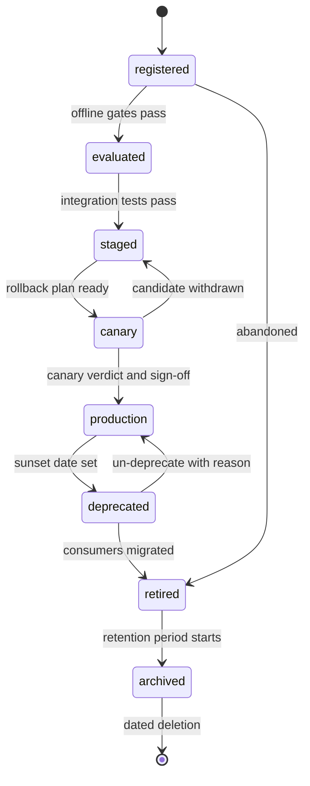

## TL;DR
Every agent pins a model that will be retired. A lifecycle policy names a version's states and the evidence
each move needs; the deprecation half dates retirements, freezes new pins, migrates agents with evaluation
and archives. Without it, every sunset is an emergency.

## For agent builders
- **Why it matters for agents.** Your agent's tool choice, refusal behaviour and output format are tuned
  to one model snapshot. When that snapshot retires, the successor may call tools differently, tokenize
  your long system prompt into more tokens or hit a lower quota, so every sunset is an agent migration.
- **Where it shows up in your stack.** Provider deprecation pages, the model id pinned in your agent's
  config or bundle, the model registry, and the CI check that rejects pins to deprecated versions.
- **What you control.** Pinning snapshot ids, watching sunset dates, running your agent eval suite (task
  completion, tool-call accuracy, cost per task) on the successor, and canarying the switch.
- **What you can skip.** Designing the platform-wide state machine, unless you run the platform; consume
  its dates and freeze rules instead.

## Why it exists
- **Models do not stay still.** Providers retire snapshots on published schedules and ship successors that
  behave differently. Self-hosted weights are superseded by a better fine-tune, a cheaper quantisation or a
  serving-stack security fix. Embedding upgrades invalidate every index built with the old model.
- **Many things depend on each version.** Dozens of prompts, bundles and tenants, usually built by people
  who have since moved to another project.
- **"Pin and upgrade when convenient" fails** because supply is not under your control. A pinned provider
  snapshot has a shutdown date; on it, requests fail or are silently redirected to a different-behaving
  successor. Teams find out through an incident, migrate a dozen bundles in a week without evaluation, and
  ship regressions to avoid an outage.
- **"Always use the latest alias" fails the other way:** every provider release becomes an unreviewed
  production change.
- **The platform is a provider too.** A platform team serving twenty product teams that retires a
  fine-tune without notice, freeze and migration path causes the same incident internally. The policy makes
  "this version will stop existing" a planned, evaluated, dated, owned event in both directions of the
  supply chain.

## How it works
### States and transitions
A version moves through a small state machine; the registry lesson covers alias mechanics, this one the
policy around them.

| State | Meaning |
|---|---|
| **registered** | artifact and lineage recorded, no claims made |
| **evaluated** | offline gates passed, evidence attached |
| **staged** | deployable to pre-production |
| **canary** | serving a fraction of production |
| **production** | the champion for one or more aliases |
| **deprecated** | still served, no new consumers, sunset date set |
| **retired** | not served; requests fail with a clear error |
| **archived** | bytes kept for the retention period, then deleted |

- **Transitions are restricted *because* each state is a promise to consumers.** Production → retired is
  forbidden, not merely discouraged, so nobody can switch off a model that still has callers.
- **Each transition records who, when and why**, which makes the lifecycle itself an audit trail.

### Evidence per gate
| Move to | Required evidence |
|---|---|
| evaluated | eval report against the current golden set, plus slice results |
| staged | integration tests against the real serving config |
| canary | rollback plan and the candidate's monitoring dashboard |
| production | canary verdict and sign-off from the owning team |

- **The policy fixes *what* is required, not *how good* the numbers must be;** thresholds belong to the
  use case's evaluation gates. The split exists *because* the lifecycle is platform-wide while quality
  bars are domain-specific.

### Provider models have a lifecycle too
- **Register a hosted model as a virtual version** carrying the provider's snapshot id, its announced
  retirement date if any, and the recommended successor.
- **Read the provider's current page, never assume a notice period.** Providers publish schedules and
  typically give weeks to months of notice, but it varies by provider, model tier and GA versus preview,
  and providers revise the terms.
- **Mirror every external deprecation as an internal one**, *because* consumers should learn about
  retirements from one place in one format.
- **Decide explicitly on auto-upgrade.** Some clouds offer deployments that auto-upgrade to the successor
  when a version retires; that is a silent model change in production, so the policy must allow or forbid
  it.

### The deprecation workflow
1. **Decide and date.** Triggers: provider sunset, a validated successor, a security or compliance finding,
   cost, or a version with no owner. Set the sunset at least the policy's notice period ahead, except
   security retirements, which have an expedited path.
2. **Announce.** Mark the version deprecated in the registry and notify every consumer through the channel
   they registered. Targeted, not broadcast, *because* "we emailed everyone" is how migrations get missed.
3. **Inventory consumers.** "Who still calls this version" comes from gateway per-request telemetry and
   bundle-registry pins, never from asking around. Each consumer gets a tracked migration item with an
   owner.
4. **Freeze.** From a fixed date before sunset, no new bundle may pin the version and CI fails such pins;
   existing traffic continues. This stops the list growing while you shrink it.
5. **Migrate with evaluation.** Each consumer evaluates the successor on its own golden set, fixes prompts
   where behaviour changed, and promotes through the normal canary path. The scheduled model-upgrade job
   from the CI/CD lesson is the mechanism; the policy makes it mandatory.
6. **Brownout.** In the last weeks, make the version unavailable for short, announced windows. Consumers
   who ignored every notice find the dependency in a planned ten-minute window instead of at sunset,
   *because* an error in a test window costs less than the same error on retirement day.
7. **Retire and archive.** Serving stops; requests return a specific error naming the successor. Weights,
   config and evaluation evidence stay archived for the policy's retention period, *because* audits,
   incident investigations and reproducibility need to re-run the model in production on a given date.
   Deletion is its own dated, recorded event.

**"Same quality on the golden set" is not the whole migration check.** A successor usually also changes:
- **Tokenizer**, so token counts, cost and effective context length move.
- **Latency profile, rate limits and quota.**
- **Refusal behaviour.**
- **Structured-output and tool-calling support, and default parameters.**

The checklist covers each, *because* the regressions that slip through are typically a cost or a 429
surprise, not a quality drop.

**Agents add task-level checks to the migration.** Run the agent eval suite end to end, not just
single-turn prompts:
- **Tool-call accuracy and argument validity** per tool, because successors differ in how strictly they
  follow tool schemas.
- **Steps and tokens per task**, because a model that plans differently changes cost even at equal price.
- **Behaviour at approval gates and refusals**, because a more cautious or bolder successor shifts how
  often the agent asks a human.

**Provider models cannot be archived as weights.** Once the vendor retires a snapshot, its behaviour can
never be re-run. Archive the bundle (prompts, parameters, tool schemas), the evaluation evidence and logged
inputs and outputs on a representative sample, captured *before* the sunset while the model still answers.

### Compatibility promises
- **State what consumers may assume across versions:** which response fields are stable, whether output
  format is guaranteed, and that behaviour is *not* guaranteed identical.
- **Bound the support window.** Many platforms adopt an "N−1" or "N−2" rule: the current major version and
  the one or two before it are supported; older ones are deprecated automatically. That bounds how many
  versions anyone must keep evaluated, monitored and secure at once.

## Diagram
The happy path runs top to bottom; note there is no edge from production to retired, so every retirement
passes through deprecated, where consumers are inventoried and migrated.



## Examples
### Lifecycle state machine and deprecation planner
A lifecycle state machine with restricted transitions, and a deprecation planner that turns a sunset date
into dated obligations plus a list of consumers still pinned to the old version. Durations are
illustrative policy values, not a standard.

```python
from datetime import date, timedelta

TRANSITIONS = {                       # what may follow each state
    "registered": {"evaluated", "retired"},
    "evaluated":  {"staged", "retired"},
    "staged":     {"canary", "retired"},
    "canary":     {"production", "staged"},        # back to staged = candidate withdrawn
    "production": {"deprecated"},                  # never straight to retired: consumers must move first
    "deprecated": {"retired", "production"},       # un-deprecate allowed, with a recorded reason
    "retired":    {"archived"},
}

def move(version, new_state, actor, reason):
    if new_state not in TRANSITIONS[version["state"]]:
        raise ValueError(f"{version['id']}: {version['state']} -> {new_state} not allowed")
    version["history"].append((date.today(), version["state"], new_state, actor, reason))
    version["state"] = new_state

POLICY = {"notice_days": 90, "freeze_days": 60, "brownout_days": 14}   # illustrative

def deprecation_plan(version, sunset, consumers):
    """Sunset date -> dated obligations and the consumers still to chase."""
    todo = [c["bundle"] for c in consumers
            if c["pinned_model"] == version["id"] and not c.get("migration_pr")]
    return {"announce_by": sunset - timedelta(days=POLICY["notice_days"]),
            "freeze_new_pins": sunset - timedelta(days=POLICY["freeze_days"]),
            "brownouts_from": sunset - timedelta(days=POLICY["brownout_days"]),
            "sunset": sunset, "unmigrated": todo}

v = {"id": "chat-model@2025-03-01", "state": "production", "history": []}
move(v, "deprecated", actor="platform-team", reason="provider sunset announced")
plan = deprecation_plan(v, date(2026, 12, 15), consumers=[
    {"bundle": "support-assistant@41", "pinned_model": v["id"]},
    {"bundle": "claims-extractor@7", "pinned_model": v["id"], "migration_pr": 812},
])
print(plan)   # announce_by 2026-09-16, freeze 2026-10-16, brownouts 2026-12-01, unmigrated: support-assistant@41
```

- **Where the consumer list comes from:** the bundle registry's pins joined with gateway telemetry.
- **What happens to it:** each unmigrated entry becomes a ticket owned by the bundle's team, and the freeze
  date is enforced by a CI check on pinned model ids.

### The CI check that enforces the freeze
Pure Python: fail the build if any bundle pins a model past its freeze date. The deprecated list would be
read from the registry; here it is inline.

```python
import sys
from datetime import date

DEPRECATED = {"chat-model@2025-03-01": {"freeze": date(2026, 10, 16), "successor": "chat-model@2026-06-01"}}

def pin_violations(bundles, today):
    out = []
    for name, model in bundles.items():
        d = DEPRECATED.get(model)
        if d and today >= d["freeze"]:
            out.append(f"{name} pins {model} (frozen since {d['freeze']}); use {d['successor']}")
    return out

bundles = {"support-assistant@42": "chat-model@2025-03-01", "faq-bot@3": "chat-model@2026-06-01"}
problems = pin_violations(bundles, today=date(2026, 10, 20))
print("\n".join(problems) or "ok")
sys.exit(1 if problems else 0)   # non-zero exit fails the pipeline
```

### Worked migration: the successor that passed every eval
Illustrative numbers for one bundle moving to a successor model.

| Check | Old snapshot | Successor | Verdict |
|---|---|---|---|
| Golden-set score | 4.3 | 4.3 | pass |
| Input tokens per request (same prompts, new tokenizer) | 2,000 | 2,300 | +15% cost before any price change |
| Effective context for retrieved chunks | 12 chunks | 10 chunks | prompt budget must be re-tuned |
| Requests per minute quota on the account | 600 | 300 | 429s at peak unless quota is raised |
| Tool-call format | supported | supported, stricter schema | two tool definitions need fixing |

- **Takeaway:** quality alone would have promoted it; the checklist caught a cost rise, a context squeeze
  and a quota cut before the canary did.

### Worked migration: a research agent on a successor model
Illustrative numbers from running a 200-task agent eval suite on both snapshots.

| Agent metric | Old snapshot | Successor | Read |
|---|---|---|---|
| Task completion | 78% | 81% | better |
| Mean steps per task | 5.2 | 7.0 | plans in smaller steps |
| Input tokens per task (whole transcript, re-sent each step) | 41k | 63k | steps × tokenizer change compound |
| Invalid tool arguments | 0.8% | 2.9% | stricter date format expected by one tool |
| Cost per task at equal per-token price | $0.12 | $0.18 | +50% |

- **Decision:** migrate, but first fix the date argument in the tool description and cap steps, then
  re-run the suite; a single-prompt golden set would have shown only the completion gain.

## Production patterns
- **Inventory from gateway telemetry.** Group gateway request logs by resolved model id, bundle and owning
  team over a trailing window (for example 30 days) and join with registry pins; any caller missing from
  the registry is an unknown consumer to chase. Monitor request share still on the deprecated version,
  per team, weekly until it reaches zero.
- **Registry tags for lifecycle state.** MLflow's registry moved from fixed stages to aliases plus
  free-form tags; teams record lifecycle state and sunset dates as model-version tags (for example
  `lifecycle=deprecated`, `sunset=2026-12-15`) that CI and dashboards read. Monitor versions by state and
  any deprecated version past its sunset still serving.
- **Pin check in CI.** A pre-merge job compares every pinned model id with the deprecated list and fails
  after the freeze date, with an exception file whose entries carry an expiry. Monitor open exceptions and
  their expiry dates.
- **Explicit upgrade policy on cloud deployments.** Azure OpenAI deployments, for example, have a version
  upgrade setting (auto-upgrade to a new default, upgrade when the current version expires, or no
  auto-upgrade); set it deliberately per deployment and record it in the bundle. Monitor the reported
  model version per deployment for unplanned changes.
- **Announced brownouts.** In the final weeks, return the retirement error (naming the successor) for
  short, pre-announced windows, then lengthen them. Monitor which callers hit the error during each window;
  each one is a consumer the inventory missed.
- **Pre-sunset record capture for provider models.** Before the sunset, replay a representative sample
  through the old snapshot and archive inputs, outputs, bundle and eval evidence. Monitor that the archive
  exists before retirement is approved.
- **Agent eval suite as the migration gate.** When a successor is announced, the upgrade job runs every
  agent's task-level suite (completion, tool-call accuracy, steps and cost per task) on it and opens a PR
  with the diff. Monitor how many agents have a passing successor run before the freeze date.

## Trade-offs
- **Long notice vs version sprawl.** Consumers get time to evaluate properly, but more versions stay alive,
  each monitored, patched and paid for. Shorter notice suits versions that are cheap to keep; longer suits
  migrations needing re-prompting and re-indexing.
- **Mirroring provider deprecations: one calendar vs messenger pressure.** The platform relays dates it
  does not control; when the provider shortens a window, the platform absorbs the pressure.
- **Early freeze: shrinks the list vs blocks legitimate needs.** A team may need the old behaviour for one
  more release; an exception path with an expiry date handles that without reopening the freeze.
- **Auto-upgrade deployments: no sunset incident vs unreviewed change.** Every retirement becomes a silent
  behaviour change; acceptable for low-stakes internal tools, not for regulated or customer-facing flows.
- **Long archival: audit and reproducibility vs storage and sensitivity.** It creates a sensitive artifact
  store; follow the compliance requirement rather than defaulting to "forever".

## Pitfalls
- **Learning about a provider retirement from an error.** Symptom: a week of emergency migrations, skipped
  evaluations and a regression blamed on the new model rather than the process. Fix: mirror provider
  schedules internally.
- **Deprecating by broadcast email.** Symptom: sunset day reveals several unknown consumers, found only
  because their error rate went to 100%. Fix: targeted notice plus brownouts.
- **Retiring without an inventory.** Symptom: the platform team asks in chat "does anyone still use model
  X?" and is wrong. Fix: telemetry joined with pins.
- **No freeze window.** Symptom: the migration list grows during the migration as new bundles keep pinning
  the version. Fix: CI pin check from the freeze date.
- **Retiring and deleting the artifact in one step.** Symptom: an audit or post-mortem needs last quarter's
  behaviour and cannot reproduce it. Fix: archive with a separate, dated deletion.
- **Treating an embedding model like a chat model.** Symptom: a successor promoted without re-indexing and
  retrieval quality collapsing on promotion day. Fix: embedder lifecycle tied to its indexes.
- **Validating the successor on quality alone.** Symptom: a migration passes every eval, then blows the
  monthly cost forecast or hits 429s, because tokenization, pricing or quota differ. Fix: the full
  migration checklist.
- **Migrating an agent on single-turn evals.** Symptom: the new model scores well per prompt, then agents
  take more steps and send invalid tool arguments in production. Fix: task-level agent evals on the
  successor.

## When to use
- **Write the policy as soon as more than one team depends on a model** you serve or pin, or you depend on
  a provider snapshot in production, which is almost immediately.
- **Start small:** name the states, forbid dangerous transitions, require an inventory before any
  retirement, and set notice and freeze periods you can honour.
- **Measure:** retirements that happened as planned, dated events versus incidents, and consumers still
  unmigrated at the freeze date.
- **Day to day:** the upgrade job opening PRs, CI rejecting pins to deprecated versions, and a dashboard of
  versions by state.
- **Interviews:** expect "how would you handle a provider sunset across many teams"; the strong answer has
  inventory, freeze, per-consumer evaluation, brownouts and archival, in that order.

## Role lens
- **Engineer:** Pins snapshot ids in bundles, runs the upgrade job's evaluation when a successor is
  announced, and adds the CI check that fails builds pinning a deprecated version.
- **Architect:** Owns the state machine, the notice and freeze periods, the retention rule for retired
  artifacts, and the decision on whether auto-upgrading deployments are permitted anywhere.
- **FDE:** Translates a provider's deprecation into a migration plan the customer can approve, runs the
  evaluation on the customer's golden set, and schedules the cutover inside their change window.

## Check yourself
**Q:** A provider announces that the snapshot behind your most-used model retires in four months. Twelve
bundles across five teams pin it. Describe the plan, including what you would refuse to do.
**A:** First register the deprecation internally with the sunset date and the recommended successor, so
all five teams see one calendar. Build the inventory from bundle pins joined with gateway telemetry,
then open one tracked migration item per bundle with the owning team named. Set a freeze date, say
two months out, after which CI rejects new pins to the old snapshot. Each team evaluates the successor
against its own golden set and canaries it through the normal path, because the successor's behaviour
is not identical; the platform provides the upgrade job but does not do the evaluation for them. In
the last weeks, run announced brownouts to flush unknown consumers. On sunset, retire with an error
naming the successor and archive evidence for the retention period. Refuse to enable silent
auto-upgrade on customer-facing bundles and refuse to skip evaluation to meet the date; if a team
cannot migrate in time, the fallback is a short, dated exception, not an unreviewed switch.

## Interview questions
### What is the difference between a lifecycle policy and a deprecation policy?
- **Lifecycle** names the states a version passes through, who may move it and what evidence each forward
  move needs, from registered to production.
- **Deprecation** is the exit half: notice period, freeze, consumer inventory, evaluated migration,
  brownouts, retirement and archival.
- **Why both:** without the exit half, retirements happen on the provider's calendar as incidents.

### How do you find every consumer of a model version before retiring it?
- **Join two sources:** bundle-registry pins (declared use) and gateway per-request telemetry (actual use)
  over a trailing window.
- **Treat mismatches as findings:** traffic with no registered pin is an unknown consumer; pins with no
  traffic may be dead bundles to clean up.
- **Use brownouts as the last net:** short announced outages surface anything both sources missed.

### Would you let a cloud deployment auto-upgrade to the successor model? When?
- **For low-stakes internal tools, possibly:** it removes the sunset incident at the cost of an unreviewed
  behaviour change.
- **Not for customer-facing or regulated flows,** where any model change must pass evaluation and canary.
- **Either way, decide explicitly** per deployment and log the reported model version so an upgrade is
  visible.

### A successor matches the old model on your agent's golden set. What else could break in migration?
- **Cost:** a new tokenizer can raise token counts per request, so spend rises even at the same price.
- **Capacity:** rate limits and quota may differ, producing 429s at peak.
- **Behaviour at the edges:** refusal rate, structured-output and tool-calling strictness, default
  parameters and effective context length, each on the migration checklist.

### Why keep archived evidence for a provider model you can never run again?
- **Audits and post-mortems** ask what the system did on a given date; the bundle, eval evidence and logged
  sample outputs are the only record once the snapshot is gone.
- **Capture it before sunset,** by replaying a representative sample while the model still answers.
- **Bound it** by the compliance retention period, because the archive is sensitive data.

### How would you evaluate a successor model for a tool-calling agent before the old one retires?
- **Run the task-level suite end to end:** completion, tool-call accuracy and argument validity per tool,
  steps and tokens per task, and approval or refusal behaviour.
- **Compare cost per task, not per call,** because a successor that plans in more steps multiplies the
  re-sent transcript.
- **Fix, re-run, then canary:** adjust tool descriptions and step caps where it regressed, and ramp by
  session with task-level guards.

## Quiz
### Q: Why does a sound lifecycle forbid moving a version directly from production to retired?
- [ ] Retired versions cannot be archived without a deprecated step in the history
- [x] The deprecated state is where consumers are inventoried and migrated; skipping it switches off a model that still has callers
- [ ] Provider APIs require a deprecation flag before a snapshot can be deleted
- [ ] It prevents the registry from reusing the version number
> Deprecated is a serving state with a sunset date, during which the consumer list shrinks to zero
> under observation. Retiring straight from production skips that work and causes an outage.

### Q: What is the purpose of a freeze window before a model's sunset?
- [ ] To stop all traffic to the version so consumers notice early
- [ ] To give the provider time to prepare the successor
- [x] To stop new bundles pinning the version so the migration list cannot grow while it is being worked down
- [ ] To lock the golden set so evaluations are comparable
> Freezing new pins, enforced in CI, bounds the migration; stopping traffic is what brownouts do later,
> briefly and by announcement, to find consumers the inventory missed.

### Q: Why keep a retired self-hosted model's weights and evaluation evidence after it stops serving?
- [ ] So it can be promoted back if the successor fails
- [ ] Because providers require it for billing reconciliation
- [x] Audits and incident investigations may need to reproduce the behaviour that was in production on a given date
- [ ] To seed the training data for the next fine-tune
> Archival is about reproducibility and accountability for past decisions, for a defined retention
> period. Rolling back to a retired version is not a goal; the successor has its own rollback target.

## Use cases & projects
### Use cases
- **Provider sunsets a snapshot your agents pin.** Inventory every agent on it, freeze new pins and
  migrate each with its own task-level eval.
- **Moving agents to a cheaper or faster model.** The same lifecycle gates apply even when nobody forced
  the change.
- **Retiring an internal fine-tune.** A platform team retiring an agent-tuned model gives agent teams
  notice, a successor and brownouts.
- **Embedding model upgrades under RAG agents.** The embedder and its indexes move through the lifecycle
  together.

### Mini project
**Successor readiness report for an agent (2-3 hours).**
- **Goal:** decide with evidence whether an agent can move to a successor model before a sunset.
- **Steps:** pick two models from one provider; run a 30-task agent suite on both, logging completion,
  steps, input tokens, invalid tool arguments and cost per task; write the deprecation plan dates (announce,
  freeze, brownout, sunset) for an assumed sunset; add a CI check that fails if the agent config pins the
  old model after the freeze date.
- **Done when:** a one-page report shows the metric diff, the fixes needed, the dated plan, and the CI
  check failing on a test config that still pins the old model.
