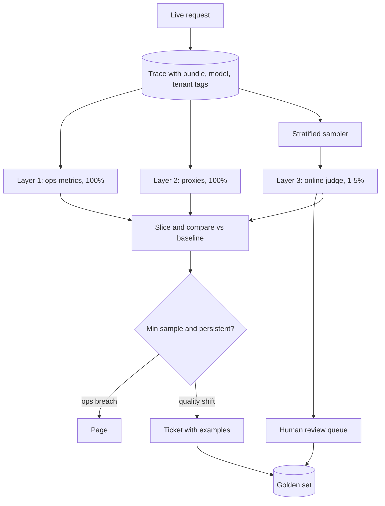

## TL;DR
An agent can return fast 200s while it loops, skips tools or errs. Monitoring layers
operational signals, label-free behavioural proxies (steps, tool mix, refusals) and late quality signals
over live traffic, sliced by version and tenant, so silent regressions become alerts with traces attached.

## For agent builders
- **Why it matters for agents.** Agent failures are quiet: the run "succeeds" after twelve steps instead
  of four, stops calling the search tool, or picks a write tool when it should ask. Only per-step and
  per-task signals on live traffic catch that before users do.
- **Where it shows up in your stack.** Trace spans for every LLM and tool call (OpenTelemetry GenAI
  attributes or your tracing vendor), a metrics store for proxies, an online judge on sampled runs, and a
  review queue that feeds your eval set.
- **What you control.** Which proxies you compute (steps per task, tool-call mix, tool error rate,
  refusal rate, finish reason), sampling rates per slice, alert thresholds with sample floors, and the
  tags on every span.
- **What you can skip.** Classic ML label-drift dashboards for tabular models; for agents, task-level
  proxies and sampled judging do most of the work.

## Decision case
### Scenario
A B2B platform runs one RAG support agent for 40 tenants and must choose how to sample its online
groundedness judge. All figures are illustrative.
- **Traffic:** 100,000 runs a day. Four large tenants run 15,000 a day each (60,000); 36 small tenants
  share the other 40,000, between 300 and 4,000 runs a day each.
- **Judge:** about $0.01 per judged run; groundedness scores have sd ≈ 0.8.
- **Constraints:**
  - online-judge spend at most $1,000 a month (30 days);
  - detect a 0.4-point groundedness drop for **every** tenant within one day, because contracts
    promise per-tenant quality reviews;
  - at most a couple of false pages a week, or on-call mutes the channel;
  - proxies (steps per task, search-call rate, citation presence) already run on 100% of traffic.
- **Alert rule:** a tenant alerts when its daily drop exceeds 2 standard errors of the difference,
  se = √(2 × 0.64 / n).
- **Detection floor:** "detect" means a real 0.4 drop alerts on at least 80% of days. That needs
  n ≈ 16 σ² / δ² = 16 × 0.64 / 0.4² = 64 judged runs per tenant per side, where the threshold is
  2 × 0.141 ≈ 0.28. At n = 32 the threshold is exactly 0.4, so a 0.4 drop alerts only half the time;
  the worked example's floor of 50 (threshold 0.32) catches it on about 7 days in 10.

### Options
| Option | How it works | Judged a day | Cost a month | Smallest tenant judged a day | Meets the 0.4 target |
|---|---|---|---|---|---|
| **A. Uniform 1%** | judge 1 in 100 runs | 1,000 | 1,000 × 30 × $0.01 = $300 | 300 × 1% = 3 | no: threshold 2 se ≈ 1.3 |
| **B. Uniform 5%** | judge 1 in 20 runs | 5,000 | $1,500: fails | 15 | no: threshold 2 se ≈ 0.58 |
| **C. 1% plus a per-tenant floor of 64** | 1% everywhere, topped up to 64 a day per tenant | 4 × 150 + 36 × 64 = 2,904 | 2,904 × 30 × $0.01 ≈ $871 | 64 | yes: threshold 0.28, 80% of 0.4 drops caught |
| **D. Judge everything** | every run scored | 100,000 | $30,000: fails | 300 | yes |

### Decision
Choose **C, stratified sampling with a per-tenant floor**, because it is the only option that meets the
per-tenant detection target inside the budget.
- **Detection:** every tenant gets 64 judged runs a day, so a real 0.4-point drop alerts on 80% of days;
  A and B leave small tenants at 3 and 15, where the alert threshold alone is 1.3 and 0.58.
- **Budget:** about $871 fits under $1,000, leaving about $129 for the review queue's re-judging.
- **Where the money goes:** 2,304 of the 2,904 daily judgments go to small tenants, the slices uniform
  sampling starves. The four large tenants already clear the floor at 1%.
- **Noise:** 40 tenants checked daily at a 5% false rate would give about 2 false alerts a day, so a judge
  drop opens a ticket and needs two consecutive days to escalate. Only proxy SLO burn rates page.

**What would change it:**
- **The contract drops per-tenant quality reviews:** A at $300 covers the aggregate.
- **Slicing by tenant and 5 intents (200 slices):** the floor would cost 12,800 judged a day, $3,840 a
  month. Floor the tenants and let intents share the sample instead.
- **Judge cost falls tenfold:** D becomes affordable at about $3,000 a month only if the budget grows.

### Trade-offs accepted
- **Small tenants are over-sampled per run.** Their judged runs cost more per unit of traffic; track
  judge spend per tenant so the floor stays explained.
- **Daily windows, not hourly, for small tenants.** A drop shows within a day, not an hour. The 100%
  proxies (search-call rate, citations) still catch alias updates within the first hour.
- **Two-day persistence delays escalation.** A real drop opens a ticket on day one; escalation waits for
  day two. Watch the ticket queue age.
- **The judge itself can drift.** Pin its snapshot and re-measure judge-human agreement monthly.

### Review rubric
- **The detection target is written as a number** (effect size, slice, time window) before choosing a
  sampling rate.
- **Judged samples per slice are computed** for the smallest slice, not only the average.
- **Costs are recomputed** from judged runs a day × days × cost per judgment.
- **The false-alert rate across all slices is estimated**, and page versus ticket routing follows from it.
- **Cheap 100% proxies are named** as the fast layer, with the judge as confirmation.
- **At least two conditions that would change the choice** are stated, each tied to a measurable fact.

## Why it exists
- **Correctness is not a status code.** The model confidently cites the wrong refund policy; the retriever
  returns last year's price list; the agent stops calling the search tool because the vendor quietly
  updated the model and it now answers from memory. All HTTP 200, p95 within budget, dashboards green.
- **Ground truth is late or absent.** A bank's classifier gets labels when the loan defaults, months
  later; a support assistant never learns whether the problem was solved unless you build the loop. So
  you cannot monitor "accuracy" the way you monitor error rate.
- **Each naive alternative covers one corner.**
  - "We have evals in CI" measures a fixed set at release time; production is a different, changing
    distribution, and the model can change underneath a provider alias.
  - "We watch user complaints" is sparse, biased toward the angriest users and days late.
  - "We log everything" produces terabytes nobody reads.
- **What monitoring buys:** a continuous, cheap, per-segment answer to "is the system behaving as it did
  when we validated it?", with a path from any alert to the concrete requests behind it.

## How it works
### The three layers at a glance
| Layer | Examples | Coverage | Label latency |
|---|---|---|---|
| 1. Operational | latency, errors, tokens, cost | 100% | seconds |
| 2. Behavioural proxies | refusals, schema failures, length, tool-call mix | 100% | seconds |
| 3. Quality and outcomes | judge scores, feedback, business metrics | sampled or sparse | minutes to days |

### Layer 1: operational signals
- **The ordinary SRE set:** request rate; error rate by class (provider 429s, 5xxs, timeouts, guardrail
  blocks); latency as time-to-first-token and total; input and output tokens; cost per request; tool-call
  failures and retries.
- **AI-specific labels on every series:** model id, prompt version, bundle id and tenant, *because* the
  first question after any anomaly is "which version, which customer".

### Layer 2: behavioural proxies (no labels needed)
Cheap functions of the output, computed on 100% of traffic:
- **Refusal rate** (a small classifier or pattern match) and "I don't know" rate.
- **Schema-validation failure rate** for structured outputs.
- **Output length distribution**, plus empty or truncated responses (finish reason) and repetition.
- **Language mismatch** between input and output.
- **Tool-call rate and which tools.**
- **RAG signals:** citation presence and retrieval score distribution.

- **Agent signals, per run:** steps (LLM calls) per task, tool-call error and retry rate per tool, the
  share of runs hitting the step budget, repeated identical tool calls (a loop signature), and runs
  ending without a final answer.

- **None of these is quality; their *shift* is informative.** If refusal rate doubles after a model
  update, something changed, and you know within minutes, not after the weekly feedback review.
- **Chosen *because* they are deterministic, free, and move early.**

### Layer 3: quality and outcome signals
- **Online judge.** An LLM scores a sample of live responses against a rubric (groundedness, completeness,
  policy adherence). Sampled *because* a judge call is another inference over the full prompt and
  response, often comparable to or more than the request it scores. 1–5% is a common order of magnitude
  (illustrative), stratified so small tenants are still covered.
- **Human review queues.** Low-judge-score or flagged traces go to reviewers; the labels calibrate the
  monitor and grow the golden set.
- **Explicit feedback.** Thumbs, ratings, "report". Sparse and selection-biased, so track negative
  feedback per hundred responses, not raw count.
- **Implicit feedback.** Regenerate, copy, abandon, escalate to human, task completion. Higher volume,
  less precise; correlate once with human labels to learn what each means.
- **Business outcomes.** Resolution rate, conversion, handle time: the slowest signal and the one leaders
  believe.

| Signal | Label latency |
|---|---|
| Implicit feedback | seconds |
| Explicit feedback | minutes |
| Online judge | minutes to hours |
| Business metrics | days |

- **Design principle:** use fast proxies to decide where to spend slow, expensive labels.

### Slicing, baselines and alerting
1. **Slice everything** by version, tenant, intent class, language and input-length bucket, because
   aggregates hide regressions: a 2% drop in overall judge score can be a 40% drop for one tenant or
   intent.
2. **Compare against a time-controlled baseline:** the same hour last week, or the incumbent in a
   concurrent canary.
3. **Alert on sudden shifts and slow trends separately.**
4. **Require a minimum sample per window**, *because* judged metrics on thirty requests are noise.
5. **Route by type:** operational breaches page; quality shifts open a ticket with the top disagreeing
   examples attached.

**The multiple-testing cost of slicing.** Every slice is another hypothesis test. With 200 slices checked
hourly at a threshold that fires falsely 5% of the time, expect about ten false alerts per run from noise
alone. Two defences:
- **Scale the threshold to the slice's standard error:** a drop must exceed roughly two standard errors
  of the difference, so small slices need bigger drops.
- **Require persistence** across consecutive windows before alerting.

### From proxies to SLOs
- **Write key proxies as SLOs:** "99% of extraction responses pass schema validation over 28 days", or
  "refusal rate on the billing intent stays below 3%".
- **Each gets an error budget;** alert on how fast it burns, not on single bad windows.
- **Fast burn pages** (a large fraction of the month's budget gone in an hour); **slow burn opens a
  ticket.**
- **Why it works:** it is the same machinery used for availability, applied to behaviour, and it stops
  quality alerting from being either silent or noisy.

### Close the loop
- **Derive every metric from traces**, so an alert drills into the requests behind it.
- **Turn every reviewed failure into a golden-set case.** Monitoring that does not feed the eval suite
  finds the same regression twice.

## Diagram
Every request produces a version-tagged trace; cheap layers cover all of it, the judge covers a stratified
sample, and only slice-aware, sample-guarded shifts become pages or tickets.



## Examples
### Windowed monitor per bundle and tenant
A windowed monitor over logged events: proxies on all requests, judge scores on the sampled subset,
compared per version against a baseline window with a minimum-sample guard.

```python
import math
from collections import defaultdict
from statistics import mean, stdev

MIN_N = 200                       # no verdicts on tiny windows
LIMITS = {"refusal_rate": 0.05, "schema_fail_rate": 0.02, "judge_drop": 0.3}

def summarise(events):            # events: dicts from the trace store, one per request
    by = defaultdict(list)
    for e in events:
        by[(e["bundle"], e["tenant"])].append(e)
    out = {}
    for key, es in by.items():
        judged = [e["judge"] for e in es if e.get("judge") is not None]   # sampled subset
        out[key] = {"n": len(es),
                    "refusal_rate": mean(e["refused"] for e in es),
                    "schema_fail_rate": mean(not e["schema_ok"] for e in es),
                    "p95_ms": sorted(e["ms"] for e in es)[math.ceil(0.95 * len(es)) - 1],  # nearest rank
                    "cost_per_req": mean(e["cost"] for e in es),
                    "judge_mean": mean(judged) if judged else None, "judge_n": len(judged),
                    "judge_sd": stdev(judged) if len(judged) > 1 else None}
    return out

def judge_dropped(c, b, z=2.0):   # drop must be large relative to its own noise
    se = math.sqrt(c["judge_sd"] ** 2 / c["judge_n"] + b["judge_sd"] ** 2 / b["judge_n"])
    return b["judge_mean"] - c["judge_mean"] > max(LIMITS["judge_drop"], z * se)

def alerts(current, baseline):
    found = []
    for key, c in current.items():
        if c["n"] < MIN_N:
            continue
        b = baseline.get(key)
        for m in ("refusal_rate", "schema_fail_rate"):
            if c[m] > LIMITS[m] and (b is None or c[m] > 2 * b[m]):
                found.append((key, m, c[m], "page"))
        if b and c["judge_n"] >= 50 and b["judge_n"] >= 50 and judge_dropped(c, b):
            found.append((key, "judge_mean", c["judge_mean"], "ticket+examples"))
    return found
# Run hourly: alerts(summarise(last_hour), summarise(same_hour_last_week)).
# With sd ≈ 0.8 and 50 judged per side, se ≈ 0.16, so only drops above ~0.32 fire: the
# floor of 50 judged requests is what bounds the smallest regression this slice can see.
```

### Burn-rate SLO and slice false alarms, in numbers
Pure Python for the SLO "99% of extraction responses pass schema validation over 28 days".

```python
SLO = 0.99
WINDOW_H = 28 * 24                    # 672 hours in the SLO window
budget = 1 - SLO                      # 1% of requests may fail

def burn_rate(failed: int, total: int) -> float:
    return (failed / total) / budget  # 1.0 means the budget lasts exactly the window

for label, failed, total in [("normal hour", 9, 1200), ("bad release", 200, 1200)]:
    r = burn_rate(failed, total)
    print(f"{label}: burn {r:.2f}x, budget gone in {WINDOW_H / r:.0f} h")

slices, false_rate = 200, 0.05
print(f"false alerts per run, one window: {slices * false_rate:.1f}")
print(f"same, two consecutive windows: {slices * false_rate ** 2:.1f}")   # if windows independent
# normal hour: burn 0.75x, budget gone in 896 h
# bad release: burn 16.67x, budget gone in 40 h
# false alerts per run, one window: 10.0
# same, two consecutive windows: 0.5
```

| Situation | Number | Action |
|---|---|---|
| Normal hour, 9 of 1,200 fail | burn 0.75x | nothing |
| Bad release, 200 of 1,200 fail | burn 16.67x, budget gone in 40 h | page (fast burn) |
| 200 slices, single-window threshold | ~10 false alerts per run | too noisy to page on |
| Same, persistence over 2 windows | ~0.5 per run (independence assumed) | ticket-worthy |

### Agent run proxies from traces
Per-run proxies computed from the spans of one agent run; feed the output into the windowed monitor
above as extra metrics.

```python
from collections import Counter

STEP_BUDGET = 15

def run_proxies(spans: list[dict]) -> dict:
    llm = [s for s in spans if s["kind"] == "llm"]
    tools = [s for s in spans if s["kind"] == "tool"]
    calls = Counter((s["tool"], s["args_hash"]) for s in tools)
    return {
        "steps": len(llm),
        "hit_budget": len(llm) >= STEP_BUDGET,
        "tool_error_rate": sum(s["error"] for s in tools) / len(tools) if tools else 0.0,
        "repeat_calls": sum(n - 1 for n in calls.values() if n > 1),   # loop signature
        "no_final_answer": not llm or llm[-1].get("finish_reason") != "stop",
        "tools_used": sorted({s["tool"] for s in tools}),
    }
# Alert examples: p95 steps per task up 50% vs last week on n >= 200 runs, or the
# share of runs that never call "search" doubling after a model alias change.
```

### Worked scenario: an alias update changes tool use
Illustrative numbers for a RAG support agent after its provider alias moved overnight.

| Proxy (per 1,000 runs) | Last week | Today | Read |
|---|---|---|---|
| Runs calling the search tool | 920 | 610 | the model now answers from memory |
| Mean steps per task | 3.8 | 2.9 | fewer steps looks "cheaper" |
| Citation presence | 88% | 57% | answers lost grounding |
| Judged groundedness (sampled) | 4.3 | 3.6 | confirms the quality drop |

- **The proxies moved within the first hour; the judge confirmed by mid-morning; feedback would have
  taken days.** The fix was pinning the snapshot and canarying the new one.

## Production patterns
- **Version and model tags from the OpenTelemetry GenAI conventions.** Record `gen_ai.request.model` and
  `gen_ai.response.model` on each LLM span, plus token usage attributes; the response model shows the
  resolved snapshot behind an alias, which is how an overnight vendor update becomes visible. Monitor
  distinct response-model values per bundle.
- **Bounded-cardinality metric labels.** Put bundle and model ids on Prometheus series, but keep high-
  cardinality dimensions (per-tenant for thousands of tenants, request ids) in traces or a columnar store
  and aggregate there. Monitor active series count per metric.
- **Stratified judge sampling with a per-slice floor.** Sample a fixed percentage overall but guarantee a
  minimum number of judged requests per tenant and intent per day, so small tenants clear the 50-judged
  floor. Monitor judged count per slice against the floor.
- **Multiwindow burn-rate alerts.** The Google SRE Workbook's approach pages when a short and a long
  window both show a high burn rate (its example pages at about 2% of a 30-day budget in one hour, a burn
  rate of 14.4) and tickets on slow burns. Apply it to schema-pass and refusal SLOs. Monitor alert
  precision after each incident review.
- **Pinned, calibrated judge.** Pin the judge model snapshot and re-measure its agreement with human
  labels on a fixed set on a schedule and whenever the judge changes. Monitor judge-human agreement;
  a step change in every quality series on one day usually means the judge moved.
- **Alert-to-eval loop.** Every confirmed quality ticket exports its traces as new golden-set cases
  before closing. Monitor the share of incidents that produced at least one new eval case.
- **Run-level rollups for agents.** Aggregate spans by run id into one row per task (steps, tools used,
  tool errors, cost, outcome) and alert on those rows, because per-call dashboards hide loops. Monitor
  p95 steps per task and the share of runs hitting the step budget.

## Trade-offs
- **1% judge sampling: cheap vs coverage.** A small tenant may get five scored requests a day;
  stratified sampling fixes coverage at the cost of a more complex sampler.
- **Proxies: free and fast vs indirect.** A refusal-rate drop can mean a better model or a jailbroken one,
  so proxies trigger investigation, not conclusions.
- **Fine slicing: catches per-tenant regressions vs alert volume.** It multiplies series and shrinks
  samples per slice; past a point, anomaly detection on the slice set beats fixed thresholds.
- **Online judges: continuous signal vs judge bias and drift.** The judge drifts when its model updates;
  pin it and re-calibrate against human labels periodically.
- **Full prompt and output capture: debuggable vs sensitive.** It creates a data store with retention and
  access obligations; hashing or redaction trades debuggability for safety.

## Pitfalls
- **Monitoring only HTTP health.** Symptom: a week of green dashboards, then a customer escalation about
  answers wrong since the last model update. Fix: add proxies and sampled judging.
- **Alerting on raw judge scores without a sample floor.** Symptom: 3 a.m. pages caused by twelve unlucky
  requests, then the alert gets muted. Fix: minimum sample and standard-error thresholds.
- **Events not tagged with bundle, prompt and model version.** Symptom: a regression you can see but not
  attribute to a release, so rollback becomes guesswork. Fix: tags on every event.
- **Treating thumbs-down counts as representative.** Symptom: optimising for the loudest segment while the
  silent majority's task completion falls. Fix: rates plus implicit and outcome signals.
- **Dashboards without drill-down.** Symptom: "quality down 8%" and a two-hour hunt for one example. Fix:
  derive metrics from traces and attach examples.
- **Letting the judge model auto-update.** Symptom: a step change in every quality series on the day the
  vendor shipped, with no change in your system. Fix: pin the judge.
- **Fixed thresholds across hundreds of slices.** Symptom: a daily stream of one-window alerts on small
  tenants that never reproduce, until the channel is muted. Fix: per-slice standard errors and persistence.
- **Monitoring agent calls but not agent runs.** Symptom: per-call latency and errors are flat while cost
  per task doubles because the agent loops. Fix: roll spans up by run id and alert on steps per task.

## When to use
- **From the first production deployment:** operational metrics and the cheapest proxies (schema
  failures, refusals, length, finish reason) sliced by version cost almost nothing and catch loud failures.
- **Add sampled judging** once you have a rubric that correlates with human labels; add feedback capture
  as soon as the product surface allows.
- **Invest in slicing** once you have more than a handful of tenants or intents.
- **Measure what the system is for:** a RAG assistant needs groundedness and citation rate; an agent needs
  tool-failure and step-count distributions; a structured extractor needs schema validity and field-level
  agreement on a sample.
- **Interviews:** distinguish proxies from quality, explain label latency, and show how an alert leads to
  examples and then to a new eval case.

## Role lens
- **Engineer:** Emits version-tagged events, implements the proxy checks and the sampler, and builds the
  drill-down from an alert to the traces that caused it.
- **Architect:** Chooses the signal set per use case, the judge sampling and calibration policy, the
  slicing dimensions, and which alerts page versus ticket, within the data-retention constraints.
- **FDE:** Agrees with the customer which outcome metric counts as success, wires their feedback
  channels into the monitor, and reviews the per-tenant slice with them during hypercare.

## Check yourself
**Q:** Your support assistant's provider model alias updated overnight. Nothing crashed. Describe how a
well-designed monitor would surface the change within hours and what it would show you.
**A:** Operational series would show a cost-per-request or latency step change tagged to the same bundle
id, since the bundle did not change but the model behind the alias did. Behavioural proxies would move
first: output length distribution, refusal rate, tool-call rate or schema-failure rate shifting at the
same timestamp across all tenants, which is the signature of an upstream change rather than a user
mix change. The sampled online judge would show a score shift within a few hours once the minimum
sample accrues, with the lowest-scoring traces attached for review. Explicit feedback would lag by a
day. Where the provider returns the resolved model snapshot in response metadata, logging it would show
that value changing at the same timestamp, which is the root cause; the fix is to pin snapshots and
treat any model change, alias update included, as a release that goes through shadow or canary.

## Interview questions
### What is the difference between a behavioural proxy and a quality metric, and why monitor both?
- **A proxy** is a cheap, deterministic function of the output (refusal rate, schema failures, length,
  tool-call mix) computed on 100% of traffic; its shift says something changed, not whether it got worse.
- **A quality metric** (judge score, human label, outcome) measures goodness but is sampled, slow or sparse.
- **Together:** proxies detect early and point to where to spend expensive judge and human labels.

### Overall judge score is flat but one enterprise tenant says answers got worse. How do you investigate?
- **Slice by tenant and intent**, because an aggregate can hide a 40% drop in one segment behind a 2%
  overall move.
- **Check the slice's sample:** if that tenant has few judged requests, raise its stratified floor before
  concluding anything.
- **Pull the lowest-scoring traces** for the tenant, compare with the same hour last week, and check
  whether its documents, language or intents differ from the golden set.

### You have 200 tenant-by-intent slices and a 5% false-positive threshold. What goes wrong and how do you fix it?
- **About ten false alerts every run** from noise alone, so the channel gets muted.
- **Fixes:** thresholds scaled to each slice's standard error, persistence across consecutive windows,
  and paging only on SLO burn rates; slice anomalies open tickets.

### Why sample the online judge instead of scoring every response?
- **Cost:** a judge call is another inference over the full prompt and response, often comparable to or
  more than the request it scores, so 100% judging roughly doubles inference spend.
- **Enough signal:** 1–5% (illustrative), stratified so small tenants still reach a minimum count, detects
  meaningful shifts at a fraction of the cost.
- **Cost of under-sampling:** with sd ≈ 0.8 and 50 judged per side, only drops above about 0.32 are
  detectable.

### How would you turn "schema validity" of agent tool calls and outputs into an alert that neither stays silent nor floods?
- **Define an SLO per surface:** for example 99% of tool calls pass argument validation, and 99% of
  extraction responses pass schema validation, over 28 days, each giving a 1% error budget.
- **Alert on burn rate:** page on a fast burn in a short and long window, ticket on a slow burn.
- **Attach examples:** every alert links to the failing traces, and fixed failures become eval cases.

### What would you monitor on a production tool-calling agent that a chat app does not need?
- **Run-level proxies:** steps per task, share of runs hitting the step budget, repeated identical tool
  calls and runs ending without a final answer, because loops are invisible per call.
- **Tool behaviour:** call mix per tool and error and retry rate per tool, so a model that stops using
  search or sends bad arguments shows up within the hour.
- **Outcomes:** task completion, escalations and rejected approvals, sampled with a judge on full traces.

## Quiz
### Q: Why are behavioural proxies such as refusal rate and schema-failure rate monitored on every request while judge scores are sampled?
- [ ] Judge scores are only valid on requests with user feedback
- [x] Proxies are deterministic and nearly free to compute, whereas each judge call is another LLM inference, often as costly as the request it scores
- [ ] Proxies are more accurate measures of answer quality than judges
- [ ] Sampling is required by data-protection rules for judged content
> Proxies are cheap functions of the output, so full coverage is affordable; judging adds a second inference per scored request, so it is sampled and used to decide where expensive human labels go.

### Q: A monitor reports overall judge score unchanged after a release, yet one enterprise customer complains loudly. What design gap most likely explains it?
- [ ] The judge model was not run at temperature zero
- [ ] The release did not include a prompt change
- [x] Metrics were not sliced by tenant, so a large drop in one tenant was hidden by the aggregate
- [ ] Explicit feedback was not collected from that customer
> Aggregates average across tenants and intents. A regression confined to one segment can be invisible in the overall mean, which is why every series is sliced by version, tenant and intent.

### Q: Which alert design most reduces false pages from a noisy quality metric?
- [ ] Alert on the metric's raw value every five minutes
- [ ] Alert only when a human reviewer confirms the drop
- [x] Require a minimum sample per window and compare against a time-matched baseline before alerting
- [ ] Replace the judge with a keyword match
> Judged metrics vary widely on small samples and with time of day. A sample floor and a time-matched baseline separate real shifts from noise and from weekly seasonality.

## Use cases & projects
### Use cases
- **Catching silent provider updates.** Tool-call mix and citation rate move within an hour when an alias
  changes the model under your agent.
- **Detecting looping agents.** Steps per task and repeated identical tool calls flag runaway loops
  before the cost report does.
- **Per-tenant quality for B2B agents.** Stratified judging shows one customer's agent answers degrading
  while the aggregate stays flat.
- **Growing the eval set from production.** Low-scoring traces go to review and come back as golden-set
  cases for the next release gate.

### Mini project
**A run-level monitor for a tool-calling agent (2-3 hours).**
- **Goal:** compute agent proxies from traces and alert on a regression you inject.
- **Steps:** log spans (LLM and tool calls with run id, bundle id, tool name, error, finish reason) from a
  small agent over 300 tasks; roll them up per run; compute steps per task, tool error rate and repeat
  calls by bundle; then switch to a prompt that discourages tool use and run 300 more tasks.
- **Done when:** an alert with a minimum-sample guard fires on the second bundle, links to the five worst
  runs, and does not fire when you rerun the first bundle.
