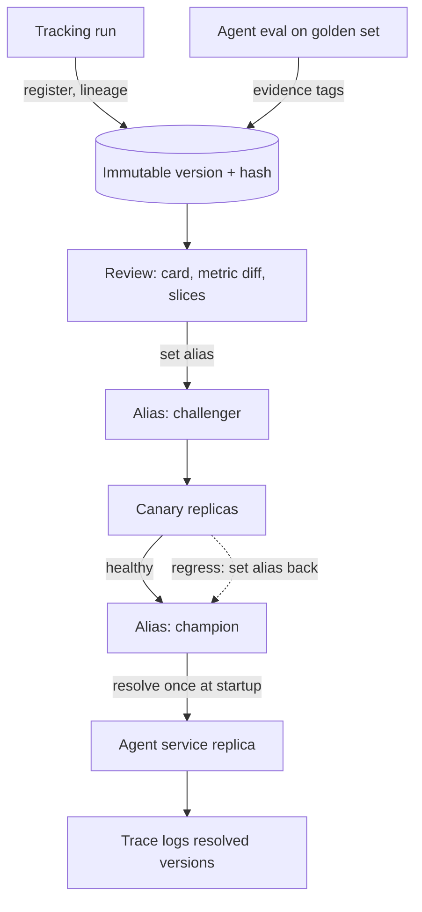

## TL;DR
An agent depends on several models: the main LLM, a router, an embedder, a judge or guard. A model
registry maps each to immutable versions and mutable aliases like `champion`, so "what is this agent
running" has one answer and rollback is a pointer move.

## For agent builders
- **Why it matters for agents.** An agent run touches many models: the planner LLM, a cheaper router or
  summariser, the embedder behind RAG, a guardrail classifier, a fine-tuned tool-calling adapter. Any of
  them changing silently changes the agent, and only a registry tells you which versions a run used.
- **Where it shows up in your stack.** MLflow's model registry, the Hugging Face Hub pinned by commit sha
  for open weights, and "virtual" versions that record a provider snapshot id for hosted models.
- **What you control.** Which artifacts count as a model (adapters, quantized variants, embedders,
  judges), alias names per environment and tenant, resolving aliases once at startup, and logging every
  resolved version into the agent's trace.
- **What you can skip.** Registry internals and the old fixed-stage workflow. If your agent only calls one
  hosted model, a pinned snapshot id in config is enough until a second model or a fine-tune appears.

## Why it exists
- **Files in a bucket do not say what is serving.** Names like `adapter_final_v2_really.safetensors`,
  hand-copied retrains, rollbacks that mean "find the old file and hope", and no answer to "which data was
  this trained on".
- **An LLM "model" is several artifacts.** A base model identity, a LoRA adapter, a quantization choice, a
  tokenizer revision and a serving configuration can each drift independently while all still look like
  "the model". An agent multiplies that by the number of model roles it uses.
- **The naive fixes fail predictably.** Git does not survive multi-gigabyte weights even with LFS and has no
  lineage to runs or evals. "Deploy the newest file" makes deploys non-deterministic: two replicas started
  an hour apart can serve different models. A spreadsheet is the pattern with no enforcement, wrong within
  a week.
- **The registry borrows from package managers:** immutable versions with content hashes, and mutable
  named pointers that environments resolve. It adds what models need and packages do not: lineage,
  evaluation evidence, a model card and an approval state.

## How it works
### Entities
- **Registered model:** a name, such as `support-classifier`.
- **Version (immutable):** records
  - the artifact URI and content hash of the weights;
  - the format or flavour (a Transformers checkpoint, a LoRA adapter, an ONNX graph, a pyfunc wrapper);
  - an input and output signature, plus the params and metrics of the producing run;
  - lineage: tracking run id, training dataset version, code commit, parent base model and its revision;
  - free-form tags, a description or model card, and an approval state.
- **Why immutable:** a deployment that resolved version 7 must mean the same bytes next year, and evidence
  attached to a version is meaningless if the bytes can change underneath it.
- **Alias (mutable):** a pointer from a name to a version: `champion`, `challenger`, `staging`,
  `tenant-acme`. Promotion is setting an alias; rollback is setting it back to the previous version.
- **Stages versus aliases.** MLflow's registry originally used fixed stages (Staging, Production,
  Archived). Newer versions replaced them with free-form aliases plus tags, because fixed stages could not
  express "two production models for two tenants" or "the canary candidate".

### What counts as a model in an agent
Register every artifact whose change alters model behaviour:

| Artifact | Why it is registered | Agent role |
|---|---|---|
| Fine-tuned weights and LoRA adapters | the obvious case | a tool-calling or domain adapter |
| Quantized variants | one version per quantization, because they are evaluated separately | a cheaper self-hosted planner |
| Embedding models | their version must match the vector index built with them | RAG retrieval and memory search |
| Reward or judge models | a judge change moves every score | eval judge, guardrail, reflection critic |
| Provider-hosted models | a "virtual" version records only a provider snapshot id and decoding config | the main agent LLM |

- **Virtual versions matter:** they give an API-based model the same lifecycle, evidence and rollback story
  as self-hosted weights.
- **Bundles:** a release bundle references a model version and a prompt version; some teams register the
  bundle itself as a model so one alias move changes both.

### Lifecycle
1. **Register from a tracking run**, so lineage is automatic.
2. **Attach evidence:** the eval run fingerprint and scores on a named golden-set version (for an agent,
   task success and tool-call validity on the agent golden set).
3. **Request review.** The reviewer reads the model card, the metric diff against the champion and the
   slice results.
4. **Promote by alias, deploy, observe the canary**, then promote to `champion`.
5. **Deprecate later:** mark the version archived, keep the bytes for the retention period the lifecycle
   policy specifies, and refuse new deployments of it.

### Serving integration
- **Config references an alias:** `models:/support-classifier@champion`.
- **At process start** the server resolves the alias to a version, downloads the artifact by hash,
  verifies it, and logs the resolved version into every trace and response header.
- **Resolve once, at startup, deliberately.** A running replica never changes model mid-flight, and a
  rollout happens by starting new replicas against the new alias target, which is what a canary needs.
  For agents this also means one run never switches models between steps.
- **Embedders use the same mechanism** to prevent the classic bug of querying an index built with embedder
  v2 using embedder v3: the index build records the embedder version and the query path refuses a mismatch.
  Agent long-term memory stores built from embeddings have the same constraint.

### Rollback is a rollout
- **A pointer move in the registry, a new rollout in serving.** Its real duration is the time to start
  replicas on the previous version: download, verify and load.
- **API model:** seconds. **Tens of gigabytes of self-hosted weights:** it can be many minutes.
- **So keep the previous champion warm.** Teams keep its artifact cached on serving nodes (or a few
  previous-version replicas running) until the new champion has survived its canary window.
- **Measure rollback time end to end;** the alias move is the fast part.

### Hugging Face Hub as a registry
- **For open weights the Hub is a git-backed registry:** each repository has a commit history, a model card
  in the README, and `from_pretrained(..., revision="<commit sha>")` pins an exact version.
- **Pinning to a branch name such as `main`** is the same mistake as a floating `-latest` alias.
- **Mirror the pinned revision** into your own registry so an upstream deletion or license change cannot
  break a deploy.

### Governance
- **What auditors and security reviewers ask for:** access control on alias moves, signed or hash-verified
  artifacts, a model card per version, and a record of who approved what.
- **Design it in:** cheap up front, expensive to retrofit.

## Diagram
Versions flow in from tracked runs and gather evidence; aliases point at them; the agent service resolves
each model role's alias once at startup and logs what it got.



## Examples
### Register, attach evidence, promote and resolve with MLflow
The registry lifecycle with MLflow's client API: register a version from a tracked run, attach the
evidence a reviewer needs, promote by alias, and have the server resolve the alias once at startup. Tag
values are illustrative; the lineage fields are what matter.

```python
import mlflow
from mlflow import MlflowClient

client = MlflowClient()
NAME = "support-classifier"

# 1. Register the artifact a tracked run produced; the run id is the lineage link to params, data and code
run_id = "3f1c0a9e2b7d"                                          # the run that trained the LoRA adapter
mv = mlflow.register_model(f"runs:/{run_id}/model", NAME)        # returns a new immutable version number

# 2. Attach the evidence a reviewer and, later, an auditor will ask for
client.set_model_version_tag(NAME, mv.version, "base_model", "meta-llama/Llama-3.1-8B-Instruct")
client.set_model_version_tag(NAME, mv.version, "base_revision", "<hf commit sha>")   # pinned, not 'main'
client.set_model_version_tag(NAME, mv.version, "golden_set", "golden-v8@5c2e91")
client.set_model_version_tag(NAME, mv.version, "eval_fingerprint", "run:9a71cc")
client.set_model_version_tag(NAME, mv.version, "eval_accuracy", "0.912")
client.update_model_version(NAME, mv.version,
                            description="Retrained on Q3 tickets; fixes refund-intent confusion")

# 3. Promote by moving a pointer; rollback is this same call with the previous version number
client.set_registered_model_alias(NAME, "challenger", mv.version)
# ... canary healthy for the agreed window ...
client.set_registered_model_alias(NAME, "champion", mv.version)

# 4. The serving process resolves the alias once at startup and records what it got
resolved = client.get_model_version_by_alias(NAME, "champion")
print("serving", NAME, "version", resolved.version, "from", resolved.source)   # log into every trace
model = mlflow.pyfunc.load_model(f"models:/{NAME}/{resolved.version}")   # load the version just resolved, not the
                                                                          # alias again: it may move in between
```

### An agent service resolving every model role at startup
Pure Python, runnable. The agent declares its model roles; at startup it resolves each alias once,
refuses to start if the embedder does not match the memory index, and stamps the resolved set on every
run's trace. `resolve` stands in for `get_model_version_by_alias` or a provider-snapshot lookup.

```python
class EmbedderMismatch(RuntimeError):
    pass

REGISTRY = {("agent-llm", "champion"): "provider:vendor-model-2025-04-14",   # virtual version
            ("router", "champion"): "router-adapter:3",
            ("kb-embedder", "champion"): "kb-embedder:4",
            ("guard", "champion"): "guard-classifier:2"}

def resolve(name, alias="champion"):
    return REGISTRY[(name, alias)]

def start_agent_service(roles, index_meta):
    pins = {role: resolve(name) for role, name in roles.items()}   # once, at startup
    if pins["embedder"] != index_meta["embedder"]:                 # memory or RAG index built with another embedder
        raise EmbedderMismatch(f"index built with {index_meta['embedder']}, resolved {pins['embedder']}")
    return pins

pins = start_agent_service({"planner": "agent-llm", "router": "router", "embedder": "kb-embedder",
                            "guard": "guard"}, {"name": "kb-main", "embedder": "kb-embedder:4"})
print(pins)   # attach this dict to every agent run's root span, so any trajectory names its models
```

### Refusing an embedder-index mismatch at startup
Pure Python, runnable. The index build job records the embedder version; the query service compares it
with the embedder version it resolved from the registry and refuses to start on a mismatch.

```python
class EmbedderMismatch(RuntimeError):
    pass

def check_index(index_meta, resolved_embedder):
    built_with = index_meta["embedder"]                 # written by the index build job
    if built_with != resolved_embedder:
        raise EmbedderMismatch(f"index {index_meta['name']} built with {built_with}, "
                               f"but this replica resolved {resolved_embedder}")

index_meta = {"name": "kb-main", "embedder": "kb-embedder:4"}      # name:version from the registry
check_index(index_meta, "kb-embedder:4")                           # ok: same vector space
try:
    check_index(index_meta, "kb-embedder:5")                       # someone moved the embedder alias
except EmbedderMismatch as e:
    print("refusing to serve:", e)   # loud failure instead of silently nonsense neighbours
```

### Worked scenario: what a rollback really costs
Illustrative orders of magnitude for one replica, not a benchmark. An 8B-parameter model in fp16 is about
16 GB (8 billion × 2 bytes).

| Model | Alias move | Get bytes | Verify hash | Load and warm up | End to end |
|---|---|---|---|---|---|
| Provider snapshot (virtual version) | instant | none | none | none | seconds: restart with the old snapshot id |
| 8B fp16, previous champion cached on node | instant | none | about 16 GB to hash | load into GPU | well under a minute to a few minutes |
| 8B fp16, not cached, pulled from object store | instant | ~16 GB download | about 16 GB to hash | load into GPU | many minutes, worse if every replica pulls at once |

- **The alias move is the fast part.** Everything after it is a rollout.
- **Keeping the previous champion cached** removes the slowest step until the new champion has survived its
  canary window.
- **For an agent with mixed roles, rollback time is per role.** Rolling back the hosted planner takes
  seconds; rolling back a self-hosted 8B tool-calling adapter takes the self-hosted rows above.

## Production patterns
- **Alias URIs in serving config** — for every deployment. Reference `models:/<name>@champion` in config,
  resolve once at startup with `get_model_version_by_alias`, then load by the resolved version number.
  Monitor that every replica logs a resolved version and that versions across replicas agree outside a
  rollout.
- **Model-role manifest per agent** — when one agent uses several models. Declare roles (planner, router,
  embedder, guard) in the agent's config, resolve them together at startup, and attach the resolved set to
  every run's root span. Monitor runs whose spans lack a resolved version for any role.
- **Pinned and mirrored Hub revisions** — when serving open weights. Download with an explicit commit sha
  (`snapshot_download(repo_id, revision=sha)` in `huggingface_hub`) into your own artifact store and load
  from there. Monitor upstream repositories for force-pushes, gating or license changes.
- **Warm previous champion** — when weights are tens of gigabytes. Keep the prior champion's artifact on
  serving nodes' local disk until the new champion passes its canary window. Monitor end-to-end rollback
  time in drills, not just the alias move.
- **Promotion only by the pipeline** — when audits matter. Restrict alias-set permission on `champion` to a
  CI service account that checks for eval evidence tags before moving it. Alert on any version promoted
  without an `eval_fingerprint` tag.
- **Embedder version stamped on the index** — for any RAG system or agent memory store. The index build
  writes the embedder version into the index metadata; the query service refuses to start on mismatch.
  Monitor mismatch refusals and retrieval quality after embedder changes.

## Trade-offs
- **Deterministic deploys vs storage.** Immutable versions plus aliases give deterministic deploys and
  one-call rollback, at the cost of storage for every version ever promoted; a retention policy matters
  once weights are tens of gigabytes.
- **Stable replicas vs instant switches.** Resolving the alias at startup keeps replicas stable and rollouts
  explicit, but a hot swap without restart is impossible by design. Teams that want instant global
  switches must accept replicas that disagree for a while.
- **Virtual versions vs discipline.** Registering provider-hosted models gives API models the same
  lifecycle, but it only helps if application code reads the model id from the registry rather than from
  its own config.
- **Governance vs ceremony.** A full registry with approvals and signing satisfies auditors and security;
  for a two-person team with one model it is ceremony, and a pinned artifact URI in a config file is the
  honest minimum.
- **Atomic bundles vs attribution.** Registering model plus prompt as one versioned unit makes promotion
  atomic, but it multiplies versions whenever either half changes and blurs which half caused a metric
  move. With four agent model roles the blur gets worse.

## Pitfalls
- **Pointing serving config at a branch or `latest` tag.** Instead of a version or alias. Symptom: two
  replicas returning different answers for the same input after a rolling restart.
- **Registering weights without the tokenizer and serving config.** Symptom: a version that scores well in
  the eval harness and produces garbage in production because the tokenizer revision differs. For tool
  calling, a missing chat template shows up as malformed tool calls.
- **Advancing the embedding model without rebuilding the index.** Symptom: retrieval quality collapsing
  after a "routine" model upgrade while every service reports healthy.
- **Attaching eval results to the alias rather than the version.** Symptom: a rolled-back champion that
  inherits the evidence of the version that replaced it.
- **Resolving the alias, then loading by alias again.** Symptom: a replica whose logged version differs
  from the weights it actually loaded, because a promotion landed between the calls.
- **Pinning only to a Hub repository name and mirroring nothing.** Symptom: a broken deploy the day the
  upstream author force-pushes, gates the repository or changes the license.
- **Registering only the main LLM.** Leaving the router, guard and embedder in ad-hoc config. Symptom: an
  agent regression traced weeks later to a guard-classifier swap nobody recorded.

## When to use
- **Use when** a model is first retrained, quantized or swapped after launch, two environments need
  different models, or an agent starts depending on a second model role.
- **Before then** a pinned artifact URI with a hash in config is sufficient and honest.
- **Include provider-hosted models** as virtual versions once an API model swap would be a user-visible
  change, which is nearly always.
- **Measure** whether every serving replica logs a resolved version, how long a rollback takes end to end,
  and whether every promoted version carries eval evidence and a lineage link.
- **Interviews:** explain immutable versions versus aliases, why aliases are resolved at startup, how the
  registry prevents an embedder-index mismatch, and how provenance flows from a tracking run into a
  registered version and out into a trace.

## Role lens
- **Engineer:** Registers versions from training runs, wires the server to resolve aliases at startup and
  log the resolved version, and refuses index queries whose embedder version mismatches.
- **Architect:** Defines what counts as a model artifact, the alias vocabulary per environment and tenant,
  the approval and retention policy, and whether bundles or components are the unit of promotion.
- **FDE:** Keeps a customer-scoped registry or alias set so that a fine-tuned adapter trained on one
  client's data can never be promoted into another tenant's serving path.

## Check yourself
**Q:** A team serves a RAG system with an open embedding model loaded from a Hub repository's `main`
branch. One morning retrieval quality drops sharply, no deploy happened, and every health check is
green. Walk through the likely cause and how a registry would have prevented it.
**A:** The likely cause is that the upstream repository received a new commit on `main`, so replicas that
restarted overnight loaded a different embedding model than the one that built the index; query vectors
and index vectors now live in different spaces, nearest neighbours are nonsense, and nothing errors
because the shapes still match. A registry prevents this in three places: the embedder is a registered
version pinned to a commit hash and mirrored, so a restart loads identical bytes; the index build
records the embedder version it used; and the query path checks that the resolved embedder version
equals the index's recorded version and refuses to serve, or alerts, on mismatch. The fix is to pin the
revision, rebuild or roll back, and add the mismatch check so the failure becomes loud.

## Interview questions
### What is the difference between a model version and an alias, and why do you need both?
- **A version is immutable:** exact bytes by hash, lineage and evidence, so version 7 means the same thing
  next year.
- **An alias is a mutable pointer** such as `champion` that environments resolve; promotion and rollback
  are alias moves.
- **Both are needed** because deploys must be deterministic (versions) while what an environment runs must
  change without code edits (aliases).

### Your agent uses a hosted planner, a self-hosted router and an embedder. How do you version them?
- **Register each role.** The planner as a virtual version (provider snapshot id plus decoding config), the
  router adapter and embedder as real versions with hashes and lineage.
- **Resolve all roles once at startup** and attach the resolved set to every run's trace, so a trajectory
  names every model it touched.
- **Gate role changes on the agent eval,** not only the component's own metric, because a better router
  can still lower end-to-end task success.

### Two replicas give different answers to the same input after a rolling restart. How do you debug it?
- **Compare the resolved versions** each replica logged at startup; if they differ, config pointed at
  something floating such as `latest` or a Hub branch.
- **If versions match,** compare tokenizer revision and serving config, which may not be part of the
  registered version.
- **Fix** by pinning to a version or alias resolved once, and registering tokenizer and serving config with
  the weights.

### When would a model registry be overkill?
- **One model, two people, never retrained:** a pinned artifact URI with a hash in config is the honest
  minimum.
- **The flip point** is the first retrain, quantization or swap after launch, or a second environment that
  needs a different model.
- **API-only teams still benefit** once a provider snapshot change would be user visible, via virtual
  versions.

### Your rollback took twenty minutes even though the alias move was instant. Why, and what would you change?
- **Rollback is a rollout:** each replica must download, hash-verify and load the old weights, and an 8B
  fp16 model is about 16 GB.
- **Many replicas pulling at once** contend for object-store bandwidth.
- **Change:** keep the previous champion cached on nodes or a few old-version replicas warm through the
  canary window, and measure rollback end to end in drills.

### How do you stop a fine-tuned adapter for one customer reaching another tenant's agent?
- **Scope aliases per tenant** (for example `tenant-acme`) and keep the serving path for each tenant
  resolving only its own aliases.
- **Record the training dataset version** in lineage so it is clear which customer's data an adapter used.
- **Restrict who can set tenant aliases** and audit every move.

## Quiz
### Q: Why does a serving process resolve the `champion` alias at startup rather than on each request?
- [ ] Alias lookups are too slow for request latency budgets
- [x] A replica should never change model mid-flight; rollouts happen by starting new replicas, which is what a canary needs
- [ ] Registries only allow one resolution per client
- [ ] Per-request resolution would bypass the model cache
> Resolving once makes each replica's behaviour stable and attributable; a change in the alias target
> becomes a controlled rollout instead of an instantaneous, unobservable fleet-wide switch.

### Q: What does registering a provider-hosted model as a "virtual version" buy you?
- [ ] Lower API cost through registry-level caching
- [ ] The ability to fine-tune the provider's weights locally
- [x] The same lifecycle, evidence and rollback story for API models as for self-hosted weights
- [ ] Automatic migration when the provider deprecates a snapshot
> The version holds a snapshot id and decoding config, so swapping the API model is a promoted, evaluated
> change with a rollback, not a config edit nobody can trace.

### Q: Which lineage field is most important for an auditor asking "what was this model trained on"?
- [ ] The alias the model currently holds
- [ ] The artifact storage region
- [x] The link from the version to the tracking run and its dataset version
- [ ] The model's parameter count
> Lineage flows from the training run, which recorded the dataset version, code commit and params, into
> the registered version; without that link the question has no verifiable answer.

## Use cases & projects
### Use cases
- **Shipping a fine-tuned tool-calling adapter.** The adapter is registered from its training run, gated
  on the agent eval, and promoted to `champion` by alias.
- **Swapping the hosted planner model.** A virtual version records the new snapshot id, so the swap has
  evidence and a one-call rollback.
- **Keeping RAG and agent memory consistent.** The embedder version stamped on the index stops an embedder
  upgrade from silently breaking retrieval.
- **Per-tenant agent models.** Tenant aliases keep one customer's fine-tuned adapter out of every other
  tenant's agent.

### Mini project
**Model-role manifest for a RAG agent (1-2 hours).**
- **Goal:** an agent service that knows, and logs, exactly which model versions every run used.
- **Steps:** run MLflow locally; register two versions of an embedder and one of a small classifier, and
  record a hosted planner as a virtual version (a tiny pyfunc wrapper whose tags hold the provider snapshot
  id); give each a `champion` alias; write a startup routine that
  resolves all roles once, checks the embedder against the index metadata, and attaches the set to each
  run's trace.
- **Done when:** moving the embedder alias makes the service refuse to start, moving it back restores it,
  and every trace from a test run lists all resolved versions.
