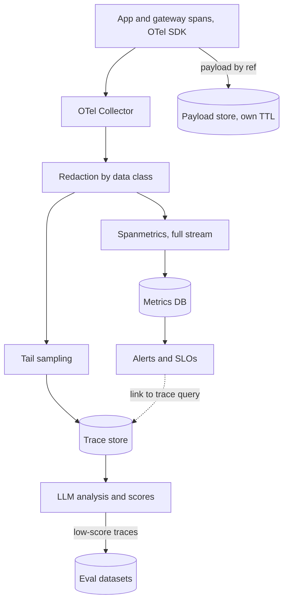

## TL;DR
An observability stack turns every agent run into queryable data: one trace per run with a span per LLM
and tool call, a collector that redacts and samples, separate stores for traces, metrics and payloads,
scores attached to traces, and alerting.

## For agent builders
- **Why it matters for agents.** An agent run is a tree: plan, call a model, call tools, call the model
  again, maybe hand off to a sub-agent. Without one trace per run you cannot answer "why did it take 14
  steps", "which tool failed" or "what did this task cost".
- **Where it shows up in your stack.** The OpenTelemetry SDK or your framework's tracing hooks, GenAI
  semantic-convention attributes on model spans, a collector, and an LLM trace viewer such as Langfuse,
  LangSmith or Arize Phoenix.
- **What you control.** The span tree shape (run, step, model call, tool call), mandatory attributes
  (tenant, bundle, run id), what payloads you capture and where, sampling policies that keep failed runs,
  and scores written back by trace id.
- **What you can skip.** Running the collector fleet yourself if a platform team does; you still own
  instrumentation and attributes.

## Why it exists
- **One team, one vendor SDK works; many teams break it in four places at once.**
  - **No common answers:** each team instruments differently, so nobody can say "what did we spend on
    model X across the company" or "which tenants did the provider outage hit".
  - **Uncontrolled data:** prompts with customer data flow into whichever SaaS a team picked, with
    retention nobody checked.
  - **Fragmented requests:** one request through the gateway, application, retriever and three tool calls
    appears as four unrelated records in four systems.
  - **No eval join key:** pulling failed traces into a dataset and re-scoring them needs a key shared by
    the trace store and the eval tool.
- **"Pick one vendor for everyone" trades consistency for lock-in.** Every span is in their format, every
  dashboard theirs, and migrating means re-instrumenting every service.
- **"Reuse the existing APM" sees latency and errors only.** It has no tokens, cost, prompt versions,
  judge scores or a way to open a span and read the completion, because classic APM has no notion of a
  generation.
- **The stack separates concerns:** a neutral wire format at the edge (instrument once), central policy
  (redaction, sampling, routing), stores per signal, and LLM analysis tools that consume the data rather
  than own it. Any alert, invoice line or quality score traces back to its requests, across teams, without
  data leaving your control.
- **Scope:** the deep topics live in the Observability module; this lesson is how they fit together as a
  platform.

## How it works
### The five layers
| Layer | Job | Typical owner |
|---|---|---|
| 1. Instrumentation | emit spans with GenAI and platform attributes | application teams |
| 2. Collection | redact, sample, batch, fan out | platform |
| 3. Storage by signal | traces, metrics, payloads in separate stores | platform and data governance |
| 4. LLM analysis and evals | trace viewer, scores, datasets | AI engineering |
| 5. Metrics, SLOs, alerting | dashboards and pages linked to traces | SRE and product owners |

### Layer 1: instrumentation
- **Traces, one tree of spans per request:** one span per model call, retrieval, tool call and guardrail
  check.
- **OpenTelemetry as SDK and wire format**, *because* it is vendor-neutral and already carries W3C trace
  context across HTTP and queue boundaries, which makes the gateway's span and the application's span one
  trace.
- **GenAI semantic conventions** name the LLM attributes: operation, provider, requested and actual model,
  input and output token counts, finish reasons, and optionally prompt and completion content as events.
- **Pin a conventions version and keep a mapping layer**, because the conventions are still evolving and
  attribute names have changed between versions.
- **Mandatory platform keys on every span:** tenant, user (pseudonymous), bundle and prompt version, config
  version, request id. Mandatory *because* every later question is a group-by on them.

### The agent span tree
An agent run should be one trace with a predictable shape:

| Span | Children | Key attributes |
|---|---|---|
| Agent run (root) | steps | run id, task type, bundle, final status, step count |
| Step | one model call, zero or more tool calls | step index |
| Model call | none | requested and response model, input and output tokens, finish reason |
| Tool call | downstream HTTP or DB spans | tool name, argument hash, error, duration |
| Sub-agent or handoff | its own steps | parent run id |

- **Recent GenAI convention versions also name agent and tool operations** (for example invoking an agent
  and executing a tool); use them when your pinned version has them, and your own `app.` attributes
  otherwise.
- **Long agent sessions break tail sampling's "complete" window**, so make the sampling unit the run (or
  a step) and record the run's final status on the root span.

### Layer 2: collection
Services send to an OpenTelemetry Collector, not straight to a backend. Platform policy runs there:
1. **Redaction:** an attributes or redaction processor strips or hashes payload fields per the tenant's
   data classification.
2. **Tail sampling:** keep 100% of traces with errors, low scores or high latency and a small fraction of
   the rest.
3. **Batching:** a batch processor reduces write amplification.
4. **Fan-out:** exporters send the same stream to several backends.

- **Centralised *because*** each application team getting redaction right independently is what fails.
- **Tail over head sampling *because*** the traces you want are rare and only identifiable once the trace
  is complete.

**Two easy-to-miss consequences of tail sampling:**
- **"Complete" means "no new spans for a configured wait"**, typically seconds, and all spans of a trace
  must reach the same collector instance (a trace-id-aware load balancer in front). A judge score arriving
  minutes later, or an agent session trickling spans over an hour, is outside the window. Such signals need
  their own path, for example keeping all payloads in a short-retention hot store and promoting the ones a
  later score flags.
- **Anything you *count* must be derived before the sampler drops spans.** Order the pipelines so metrics
  and token-usage series come from the full stream; only the trace export is sampled.

### Layer 3: storage, by signal
Three signals, three stores, chosen by cardinality and retention:

| Signal | Shape | Store | Notes |
|---|---|---|---|
| **Traces** | high volume, structured, weeks of retention | trace store | tail-sampled |
| **Metrics** | low cardinality, long retention | time-series database | derived from spans, unsampled |
| **Payloads** (prompts, completions) | sensitive, bulky | own store with its own access control and retention | referenced from spans by id |

- **Span-derived metrics:** a spanmetrics connector in the collector derives request rate, error rate and
  latency histograms per model, bundle and tenant, so nobody hand-instruments counters.
- **It does not sum attribute values.** Token and cost series come from a token-usage metric emitted by the
  instrumentation (the GenAI conventions define one) or a job over an *unsampled* copy of the model spans.
  A job over the tail-sampled trace store undercounts spend by roughly the fraction of normal traces
  discarded.
- **Payload size is a budget decision.** A full RAG trace with retrieved chunks can be tens of kilobytes;
  at a million requests a day that is tens of gigabytes a day (illustrative), so payload retention is not
  a default.

### Layer 4: LLM-specific analysis and the evaluation loop
- **Tools:** Langfuse, LangSmith and Arize Phoenix: a trace viewer rendering prompts and completions,
  sessions and users, prompt-version comparison.
- **Scores attached to traces are the crucial part:** user feedback, human annotation and LLM-as-a-judge
  results.
- **The loop:** filter traces by low score → add them to a dataset → run the candidate bundle against it →
  compare.
- **Shared stream:** these tools increasingly accept OpenTelemetry ingestion, so they consume what the
  collector exports instead of needing their own instrumentation. Self-host versus their cloud is a
  data-residency decision.

### Layer 5: metrics, SLOs and alerting
- **Inputs:** latency percentiles, error classes, tokens and cost per tenant and feature, plus behavioural
  proxies and judge aggregates from the monitoring lesson.
- **Every alert links to a trace query**, *because* an alert without examples is a two-hour hunt.

### What makes it a platform rather than a tool
- **Trace context through the gateway**, so cost attribution and debugging work end to end.
- **One redaction policy and one set of mandatory attributes.**
- **One place where a judge score and a user's thumbs-down land on the same trace.**
- **Swappable backends:** change an exporter, not the instrumentation.

## Diagram
Note the fork after redaction: metrics are computed from the full stream, and only the trace export is
tail-sampled; payloads sit in their own store, linked by reference.



## Examples
### Instrumenting one request with the OpenTelemetry SDK
A root span for the request, child spans for retrieval and the model call, GenAI attributes on the model
span, and the platform's mandatory keys.
- **`retrieve` and `call_model`** are the application's existing functions.
- **The exporter sends to a collector** whose address comes from the standard
  `OTEL_EXPORTER_OTLP_ENDPOINT` variable.
- **The completion preview is a custom event**, not a semantic-convention one, because the conventions'
  content-capture names have changed several times and content capture is opt-in.

```python
from opentelemetry import trace
from opentelemetry.sdk.trace import TracerProvider
from opentelemetry.sdk.trace.export import BatchSpanProcessor
from opentelemetry.exporter.otlp.proto.http.trace_exporter import OTLPSpanExporter

provider = TracerProvider()
provider.add_span_processor(BatchSpanProcessor(OTLPSpanExporter()))   # -> collector, not a vendor
trace.set_tracer_provider(provider)
tracer = trace.get_tracer("support-assistant")

MODEL = "model-id-from-bundle"          # pinned in the bundle, never hard-coded here

def answer(question, tenant, bundle="support-assistant@41", config_version=118):
    keys = {"app.tenant": tenant, "app.bundle": bundle,               # mandatory platform keys,
            "app.config_version": config_version}                     # on every span: attributes
    with tracer.start_as_current_span("answer", attributes=keys):    # are not inherited by children
        with tracer.start_as_current_span("retrieve", attributes=keys) as s:
            docs = retrieve(question)
            s.set_attribute("retrieval.doc_count", len(docs))
        with tracer.start_as_current_span(f"chat {MODEL}", attributes=keys) as s:  # GenAI span name
            s.set_attributes({"gen_ai.operation.name": "chat",
                              "gen_ai.provider.name": "anthropic",     # 'gen_ai.system' in older versions
                              "gen_ai.request.model": MODEL})
            resp = call_model(MODEL, question, docs)
            s.set_attributes({"gen_ai.response.model": resp.model,
                              "gen_ai.usage.input_tokens": resp.usage.input_tokens,
                              "gen_ai.usage.output_tokens": resp.usage.output_tokens})
            ref = payloads.put(tenant, question, docs, resp.text)  # full payload: own store, own TTL
            s.set_attribute("app.payload_ref", ref)                 # span carries only the pointer
            s.add_event("app.completion_preview", {"preview": resp.text[:200]})  # redacted downstream
        return resp.text
```

The collector pipeline for this stream, in prose:
1. **An OTLP receiver.**
2. **A redaction processor** that drops `preview` for tenants classified as confidential.
3. **Tail sampling** keeping every trace with an error status or latency above the budget plus a 5% sample
   (illustrative) of the rest.
4. **A spanmetrics connector** producing per-model, per-bundle rate, error and latency series.
5. **Exporters** to the trace store, the metrics database and the LLM analysis tool.

### Tracing a tool-calling agent loop
One trace per run: a root span, a span per step, and child spans for the model call and each tool call.
`call_model` and `TOOLS` are the agent's own functions; `keys` reuses the mandatory platform keys.

```python
import hashlib, json
from opentelemetry import trace
from opentelemetry.trace import Status, StatusCode

tracer = trace.get_tracer("ticket-agent")
MAX_STEPS = 12

def run_agent(task, keys, run_id):
    with tracer.start_as_current_span("agent.run", attributes={**keys, "app.run_id": run_id}) as root:
        messages = [{"role": "user", "content": task}]
        for step in range(MAX_STEPS):
            with tracer.start_as_current_span("agent.step", attributes={**keys, "app.step": step}):
                with tracer.start_as_current_span(f"chat {MODEL}", attributes=keys) as s:
                    resp = call_model(MODEL, messages)
                    s.set_attributes({"gen_ai.request.model": MODEL,
                                      "gen_ai.response.model": resp.model,
                                      "gen_ai.usage.input_tokens": resp.usage.input_tokens,
                                      "gen_ai.usage.output_tokens": resp.usage.output_tokens})
                if not resp.tool_calls:
                    root.set_attributes({"app.steps": step + 1, "app.status": "answered"})
                    return resp.text
                messages.append(resp.as_message())             # the assistant turn, once per step
                for tc in resp.tool_calls:
                    arg_hash = hashlib.sha256(json.dumps(tc.args, sort_keys=True).encode()).hexdigest()[:8]
                    with tracer.start_as_current_span(f"tool {tc.name}", attributes={
                            **keys, "app.tool": tc.name, "app.tool.args_hash": arg_hash}) as t:
                        try:
                            result = TOOLS[tc.name](**tc.args)
                        except Exception as e:
                            t.set_status(Status(StatusCode.ERROR, str(e))); result = f"error: {e}"
                    messages.append({"role": "tool", "tool_call_id": tc.id, "content": str(result)})
        root.set_attributes({"app.steps": MAX_STEPS, "app.status": "step_budget_exhausted"})
        root.set_status(Status(StatusCode.ERROR, "step budget exhausted"))   # tail sampler keeps it
```

- **The argument hash** lets a query find repeated identical tool calls, the usual loop signature.
- **Marking budget exhaustion as an error** means the `errors` tail-sampling policy keeps every runaway run.

### The same pipeline as Collector configuration
A sketch using components from the OpenTelemetry Collector contrib distribution; check field names against
the collector version you run. Two trace pipelines read the same receiver: one feeds spanmetrics from the
full stream, the other tail-samples for storage.

```yaml
receivers:
  otlp:
    protocols:
      grpc: {}
      http: {}
processors:
  attributes/redact:              # span attributes; event-level redaction needs the transform processor
    actions:
      - key: enduser.id
        action: hash
      - key: app.raw_prompt
        action: delete
  tail_sampling:
    decision_wait: 10s            # "complete" = no new spans for this long
    policies:
      - name: errors
        type: status_code
        status_code: {status_codes: [ERROR]}
      - name: slow
        type: latency
        latency: {threshold_ms: 8000}
      - name: baseline
        type: probabilistic
        probabilistic: {sampling_percentage: 5}
  batch: {}
connectors:
  spanmetrics:
    dimensions:                   # bounded-cardinality labels only
      - name: gen_ai.request.model
      - name: app.bundle
exporters:
  otlphttp/traces:
    endpoint: https://traces.internal.example:4318
  prometheusremotewrite:
    endpoint: https://metrics.internal.example/api/v1/write
service:
  pipelines:
    traces/all:                   # unsampled: every span counts toward metrics
      receivers: [otlp]
      processors: [attributes/redact, batch]
      exporters: [spanmetrics]
    traces/sampled:
      receivers: [otlp]
      processors: [attributes/redact, tail_sampling, batch]
      exporters: [otlphttp/traces]
    metrics:
      receivers: [spanmetrics]
      processors: [batch]
      exporters: [prometheusremotewrite]
```

### Worked numbers: payload budget and the sampled-cost trap
Illustrative platform: 1,000,000 requests a day, 30 KB average payload, 2% of traces with errors or slow.

| Quantity | Calculation | Result |
|---|---|---|
| Payload volume | 1,000,000 × 30 KB | ~30 GB a day |
| 90-day payload retention | 30 GB × 90 | ~2.7 TB |
| Traces kept by tail sampling | 2% + 5% of the other 98% | ~6.9% of traces |
| Cost job run on the trace store | sees ~6.9% of calls, skewed to slow, expensive ones | attributed spend far below the invoice and shifts whenever sampling changes |
| Cost from a token-usage metric on the full stream | every call counted before sampling | matches the invoice within pricing error |

- **Agents multiply it:** a 10-step run re-sends its growing transcript every step, so payload per run is
  far larger than per chat request. Store each tool result once and reference it, rather than copying the
  whole transcript onto every model span.

## Production patterns
- **Trace-aware load balancing in front of tail samplers.** Run a first collector tier with the
  `loadbalancing` exporter routing by trace id, so every span of a trace reaches the same sampling
  instance. Monitor late-arriving spans and sampling-decision counts per policy.
- **Token usage as a metric, not a trace query.** Emit the GenAI conventions' client token-usage histogram
  (`gen_ai.client.token.usage`) from instrumentation, labelled by model and token type, and price it in the
  metrics layer. Monitor the gap between attributed spend and the provider invoice each month.
- **Payload store with per-tenant TTL.** Write prompts and completions to object storage or a database
  keyed by a reference id, with retention set by data classification; spans carry only the reference.
  Monitor payload bytes per tenant per day and expired-object deletion lag.
- **Opt-in content capture.** Leave prompt and completion capture off by default in instrumentation
  libraries (they gate it behind an explicit setting) and enable it per service after a data review.
  Monitor which services have it on.
- **Scores written back by trace id.** Analysis tools such as Langfuse attach scores to a trace id; have
  the online judge and the feedback endpoint write scores keyed by the same id the gateway generated.
  Monitor the share of scores that join to a stored trace.
- **Mandatory-attribute contract test.** A CI test runs the service against a stub model and asserts every
  model span carries tenant, bundle and config version; dashboards track the share of production model
  spans missing them. Monitor that share; above zero means attribution is leaking.
- **Run-level root spans for agents.** Record run id, step count, final status and total tokens on the
  agent's root span, and mark step-budget exhaustion as an error so tail sampling keeps it. Monitor p95
  steps per run and the share of runs ending in a non-answered status.

## Trade-offs
- **OpenTelemetry vs vendor SDKs.** OTel keeps instrumentation neutral and composable; vendor SDKs capture
  richer LLM detail with less code. The SDK wins only for a single team with one tool and no residency
  constraints.
- **Tail vs head sampling.** Tail keeps every interesting trace but buffers whole traces in the collector,
  needing memory and sticky routing; head sampling is cheap but throws away the errors you wanted.
- **Full payloads vs safety.** Storing prompts and completions makes incidents reproducible but creates a
  sensitive store with obligations; hashing or short previews trade debuggability for safety, differently
  per tenant classification.
- **Span-derived metrics: consistency vs cardinality bill.** No hand-written counters, but the labels you
  allow (tenant × bundle × model) set the metrics bill.
- **Self-hosted vs cloud analysis tool.** Self-hosting keeps data in your boundary but adds an operational
  surface; the vendor cloud is simpler until the first customer asks where their prompts are stored.

## Pitfalls
- **Breaking trace context at the gateway or a queue.** Symptom: cost attributed to "unknown" and model
  spans with no parent, so a slow request cannot be followed end to end. Fix: propagate W3C trace context
  everywhere.
- **Logging prompts as text lines in the application logger.** Symptom: customer data in the log SaaS,
  discovered during a retention audit, with no per-tenant redaction possible. Fix: payload store plus
  collector redaction.
- **User id or request id as a metric label.** Symptom: the metrics database runs out of memory or the
  vendor bill multiplies as series count explodes. Fix: keep those in traces.
- **Head sampling at a flat percentage.** Symptom: an error-rate alert with no example traces, because the
  failures were in the discarded 90%. Fix: tail sampling with error and latency policies.
- **Mandatory attributes left optional.** Symptom: a regression visible in aggregate but not attributable
  to a bundle or prompt version, so rollback becomes guesswork. Fix: contract tests.
- **Judge scores stored without the trace id.** Symptom: a quality dashboard that cannot be joined to the
  requests it describes. Fix: write scores keyed by trace id.
- **One trace per model call instead of per agent run.** Symptom: a slow or failed task shows up as a dozen
  unrelated traces, so nobody can see the loop. Fix: a root span for the run with steps and tool calls as
  children, and context propagated into tool services.
- **Computing cost or volume from the sampled trace store.** Symptom: attributed spend that is a small,
  unstable fraction of the invoice and moves whenever someone changes the sampling rate. Fix: an
  unsampled token-usage metric.

## When to use
- **Build the stack, not one tool,** as soon as a second team, a second model provider or a compliance
  requirement appears.
- **Before that,** a single LLM-tracing tool with OpenTelemetry under it is enough and migrates cleanly
  later.
- **Order:** tracing through the gateway and mandatory attributes, then the collector with redaction, then
  derived metrics and scores.
- **Measure:** share of model spend attributed to a tenant and feature, time from an alert to an example
  trace, and whether a judge score joins to its request.
- **Interviews:** draw the five layers and justify two choices: why redaction and sampling live in the
  collector, and why payloads are stored separately from spans.

## Role lens
- **Engineer:** Instruments model, retrieval and tool calls with the standard attributes, propagates
  trace context across services, and writes the collector configuration for sampling and redaction.
- **Architect:** Chooses the wire format, the per-signal stores, the retention and redaction policy
  per data classification, and the mandatory attribute set every team must emit.
- **FDE:** Connects the customer's existing APM and SIEM to the stack, agrees which payloads may be
  stored and for how long, and gives the customer a trace view for their own debugging.

## Check yourself
**Q:** Finance says the provider invoice is 30% higher than the sum of what each product team reports.
Compliance separately asks whether any prompt containing a customer's account number was stored.
Which parts of a well-built observability stack answer each question, and what is missing if they
cannot?
**A:** The spend gap is a cost-attribution question answered by spans: every model span carries
tokens, model and tenant and bundle attributes, and a cost series is computed from those token counts
(a query or job over the trace store, or a token-usage metric emitted by the instrumentation, since
spanmetrics only derives call counts and durations) priced per model and grouped by tenant and bundle. If the sum does not match the invoice, either some spans lack tenant or bundle, which means the
mandatory attributes are not enforced, or some calls bypass the instrumented path, which means keys
exist outside the gateway. Two quieter causes are worth checking: the cost job reads the tail-sampled
trace store rather than an unsampled metric, so it undercounts by design; or a client library retries
below the instrumented span, so one span can stand for more than one billed call. The compliance question is answered by the collector's redaction policy
and the payload store: if account numbers are redacted before export for the relevant classification,
the answer is a configuration document plus a query over the payload store for that tenant's
retention window. If prompts were logged as plain log lines in a third-party log service, there is no
reliable answer, which is the failure the stack exists to prevent.

## Interview questions
### Why put an OpenTelemetry Collector between services and backends?
- **Central policy:** redaction, sampling and routing run once, instead of every team reimplementing them
  and some getting it wrong.
- **Fan-out and portability:** the same stream goes to the trace store, metrics database and LLM analysis
  tool, and swapping a backend is an exporter change.
- **Correct ordering:** metrics can be derived from the full stream before tail sampling drops traces.

### Your error-rate alert fires but there are no example traces. What went wrong?
- **Likely head sampling:** a flat percentage decided at request start discarded most failures.
- **Or a broken tail-sampling setup:** spans of one trace spread across collector instances, so no instance
  saw the error span with its trace.
- **Fix:** tail sampling with error and latency policies behind a trace-id-aware load balancer, and link
  each alert to a trace query.

### How do you design payload storage for agent prompts, completions and tool results?
- **Separate store, referenced from spans by id**, because payloads are bulky and sensitive.
- **Retention and access per data classification:** for example short TTL and redaction for confidential
  tenants; spans keep only the pointer.
- **Budget it:** at a million requests a day and tens of kilobytes each, payloads are tens of gigabytes a
  day (illustrative), so retention is a cost decision.

### Attributed spend is 30% below the invoice. What are the candidate causes?
- **Missing attributes:** spans without tenant or bundle, so mandatory keys are not enforced.
- **Bypass:** calls made outside the gateway with their own keys.
- **Measurement:** cost computed from the tail-sampled trace store, or SDK retries hidden below one span.

### When is a single vendor SDK the right call instead of a full stack?
- **One team, one tool, no residency constraints:** the SDK captures richer LLM detail with less code.
- **Keep an exit:** use OpenTelemetry underneath where possible, so moving to the full stack later is a
  configuration change rather than re-instrumentation.
- **Switch** when a second team, a second provider or a compliance requirement appears.

### How would you instrument a tool-calling agent so a slow, looping run can be debugged?
- **One trace per run:** a root span with run id, final status and step count; a span per step; children
  for each model call and tool call, with context propagated into tool services.
- **Attributes that answer agent questions:** tokens per model call, tool name, argument hash and error per
  tool call, so repeated identical calls and failing tools are one query away.
- **Keep the bad runs:** mark step-budget exhaustion and failed runs as errors so tail sampling retains
  them, and write judge scores back by trace id.

## Quiz
### Q: Why does a platform route telemetry through an OpenTelemetry Collector instead of exporting directly from each service to the backend?
- [ ] The collector compresses traces so storage is cheaper
- [x] Redaction, sampling and fan-out are enforced in one place rather than re-implemented by every team
- [ ] Backends cannot accept connections from many services at once
- [ ] It is the only way to derive metrics from spans
> Each application getting redaction and sampling right independently is the thing that fails. A
> central collector applies policy once and can export the same stream to several backends.

### Q: Why is tail-based sampling preferred over head-based sampling for LLM traces?
- [ ] It uses less memory in the collector
- [ ] It samples a fixed fraction, which keeps costs predictable
- [x] The traces worth keeping (errors, low scores, slow requests) are only identifiable once the trace is complete
- [ ] Head sampling is unsupported by the GenAI semantic conventions
> A decision at the start of a request cannot know it will fail or score badly. Tail sampling waits
> for the whole trace, keeps all of the interesting ones and a small fraction of the rest, at the
> price of buffering.

### Q: Why are prompts and completions stored separately from spans and metrics?
- [ ] Span attributes have a hard size limit of a few bytes
- [x] They are bulky and sensitive, so they need their own retention and access control, referenced from spans by id
- [ ] Metrics databases cannot store strings
- [ ] Analysis tools require a dedicated payload API
> Payloads dominate volume and carry customer data; keeping them in a dedicated store lets the
> platform apply per-tenant retention and access rules without touching the trace or metrics stores.

## Use cases & projects
### Use cases
- **Debugging a looping agent.** The run's span tree shows twelve steps with the same tool and argument
  hash, pointing at the prompt or tool description.
- **Cost per task across teams.** Token-usage metrics labelled by bundle and tenant answer what each agent
  feature costs, matching the invoice.
- **Turning bad runs into evals.** Low-scored agent traces are filtered in the trace viewer and exported to
  a dataset for the next release gate.
- **Compliance for agents that read customer data.** Collector redaction and a payload store with
  per-tenant TTL answer what was stored and for how long.

### Mini project
**Trace an agent end to end (2-3 hours).**
- **Goal:** see every agent run as one trace and find a deliberately injected loop from the data alone.
- **Steps:** instrument a two-tool agent with the OpenTelemetry SDK (run, step, model and tool spans with
  run id, bundle and argument hash); export to a local collector or an LLM trace viewer that accepts OTLP;
  run 50 tasks, including some where one tool always returns an error so the agent retries.
- **Done when:** one query lists runs with repeated identical tool calls, every model span carries the
  mandatory attributes, and total tokens per run add up to the sum over its model spans.
