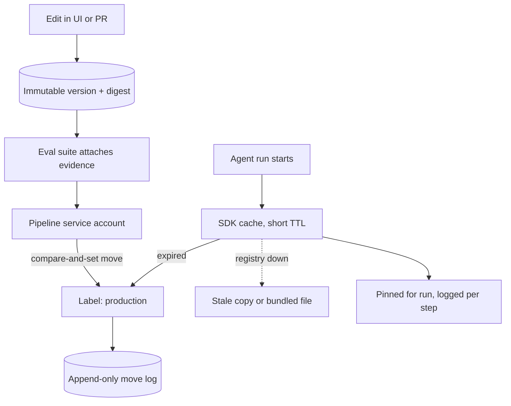

## TL;DR
A prompt registry stores an agent's system prompts and tool descriptions as immutable, numbered versions
with model settings, plus mutable labels like `production` or `canary`, so agent behaviour changes get
history, evidence and rollback without a code deploy.

## For agent builders
- **Why it matters for agents.** Most agent behaviour lives in text: the system prompt, tool descriptions,
  planner and reflection prompts. When an agent run goes wrong, the first question is which versions of
  that text it ran with, and only a registry answers it.
- **Where it shows up in your stack.** Prompt management in observability platforms (Langfuse, LangSmith,
  Braintrust), MLflow's prompt registry, or a home-grown versions-and-labels table, read through an SDK
  with a TTL cache.
- **What you control.** What a version contains (messages, tool descriptions, model id, decoding params),
  who may move `production`, the cache TTL, and resolving the label once per agent run rather than once
  per step.
- **What you can skip.** Vendor comparisons. The immutable-version and mutable-label split matters; the
  product hosting it rarely does.

## Why it exists
- **Prompts are behaviour-defining config edited by people who do not ship code.** String constants are
  fine for one engineer and one prompt. They stop being fine when a product manager wants a new tone, a
  forward-deployed engineer needs a customer variant, or an incident review asks "which prompt produced
  this response at 02:14 on Tuesday".
- **Constants make every change expensive.** Every tweak is a code deploy, variants become nested
  if-statements, and the trace holds the rendered text at best and nothing at worst.
- **A mutable `prompts` table is worse.** An admin page solves the deploy problem, but a mutable row has no
  history: a bad edit looks like the previous good one, there is no review, no eval evidence, and rollback
  means remembering the old text. Teams discover this at 3 am.
- **The registry separates content from pointer.** Content is immutable once created, so every past trace
  resolves forever. The pointer saying which content an environment uses is mutable, so deploy and
  rollback are a pointer move. It is the model registry's version/alias split, applied to text.

## How it works
### Data model
| Object | Mutable? | Holds | Why |
|---|---|---|---|
| **Prompt** | n/a | a name, such as `support_answer` | the stable handle code asks for |
| **Version** | no, append-only | template body (usually a list of chat messages with roles, not one string), declared variables and types, model settings it was tuned against (model id, temperature, max tokens, output schema), content digest, author, change note, created timestamp | a trace that recorded `support_answer@v12` must resolve to the same text in a year |
| **Label** | yes | pointer from `(prompt, label)` to a version: `production`, `staging`, `canary`, or tenant-scoped like `tenant:acme` | deploying code to change which version runs is what the registry exists to avoid |
| **Evidence** | attached to a version | eval run fingerprints and scores on a named golden-set version, links to the approving review | "was this text tested" has one answer regardless of where it is deployed |
| **Move log** | append-only | `who`, `from`, `to`, `when`, `why` for every label move | rollback needs the previous target; an audit needs what was live at 02:14 on Tuesday |

- **Deploy is a label move; rollback is the same operation in reverse.** An A/B test is two labels
  resolved by a routing rule.
- **Label moves are compare-and-set:** "move `production` from v12 to v13, only if it is still v12", so two
  people promoting at once cannot silently overwrite each other.
- **For agents, tool descriptions belong in the version too.** The model reads them like prompt text, and
  rewording one changes tool selection as much as editing the system prompt does.

### Prompt and model are a pair
- **A prompt is tuned to a model.** The same text that works on one model family may over-refuse, ignore
  the schema, change tone or call tools differently on another.
- **So a version stores model id and decoding parameters** alongside the text.
- **Swapping the model under an unchanged prompt is a new bundle** and must be re-evaluated; the registry
  makes that visible by refusing to pretend the text alone is the artifact.

### Runtime fetch
1. **Fetch by name and label at request time** through an SDK that keeps an in-memory copy with a short
   TTL and refreshes in the background.
2. **Serve the stale copy** if the registry is unreachable.
3. **Ship a bundled copy** of the production versions with the application as a last-resort fallback.

- **Why this matters:** the registry is never on the hot path in the sense that its outage cannot take the
  product down, which is the condition under which it is acceptable to let it control behaviour at all.
- **Log every call's prompt name, version and digest into the trace.** Observability platforms with prompt
  management (Langfuse is the common open-source example) link a trace to its prompt version
  automatically, turning "find every answer produced by v12" into a filter.
- **Resolve once per agent run.** An agent run spans many model calls, sometimes minutes. Resolve the label
  at run start and pin that version for every step, because a label move mid-run would otherwise mix two
  prompt versions inside one trajectory.

### TTL is the propagation delay
- **Every label move, rollback included, takes up to one TTL to land.** With a 60-second TTL and fifty
  replicas, for up to a minute after a move some replicas serve the old version and some the new.
- **Fine for a planned deploy, too slow for an emergency rollback** of a harmful prompt. That is why some
  SDKs and home-grown registries add push invalidation (a webhook or pub/sub message that evicts the
  cached entry) on top of the TTL.
- **Runs already in flight keep their pinned version.** A rollback stops new runs from using the bad
  version; for a harmful agent prompt you also need a way to cancel or stop runs that started before it.

### Change workflow
1. **Create a draft version.**
2. **Run the eval suite** against it (the registry or the CI pipeline triggers this) and attach the results.
3. **Get a review.** A diff view between two versions, both text and settings, is the review artifact.
4. **Move the label**, done only by the pipeline's service account, so a UI edit can create a version but
   cannot deploy it.

- **Declared variables are an interface** between the prompt and the code that renders it. A version that
  adds `{{customer_tier}}` can be labeled `production` only once the deployed code supplies that variable.
- **So validate at the label move** (the version's variable set against what the running application
  declares it provides), and make rendering fail loudly on a missing variable rather than send the literal
  placeholder to the model.
- **The same goes for tools.** A system prompt that tells the agent to use a tool the deployed code does
  not register should be refused at the label move, not discovered as a failed tool call.

### Where to host it
| Option | Gives you | Watch out for |
|---|---|---|
| Prompts in a git directory with a build step | review and history for free | couples prompt deploys to code deploys unless the app loads them from an object store at runtime |
| Hosted registry in an observability or eval platform (Langfuse, LangSmith, Braintrust; MLflow added a prompt registry in 2025, first experimental in the 2.x line and expanded in 3.x) | labels, a UI for non-engineers, trace linkage | a vendor dependency on the request path, mitigated by caching |
| Home-grown table with versions and labels | a few hundred lines; often right for a small platform team that already owns a config service | you build the UI, diff and audit yourself |

What matters is the split between immutable versions and mutable labels, not the vendor.

## Diagram
Edits create immutable versions; only the pipeline moves a label; the agent resolves a version through a
TTL cache with stale and bundled fallbacks, pins it for the run, and logs it on every step.



## Examples
### A minimal registry
A minimal registry showing the three operations that matter:

- **Register an immutable version.** Identical content maps to the existing version, so re-registering is
  idempotent.
- **Move a label** with compare-and-set and a move log.
- **Fetch with a TTL cache** that serves stale on failure.

A real deployment backs `store` with a database and adds the bundled-file fallback for a cold start while
the registry is down.

```python
import hashlib, json, time

class PromptRegistry:
    def __init__(self, store):                 # store: {"versions": {name: [...]}, "labels": {(name, label): {...}}}
        self.store, self._cache = store, {}

    def register(self, name, messages, model, params, author, note):
        body = json.dumps({"messages": messages, "model": model, "params": params}, sort_keys=True)
        digest = hashlib.sha256(body.encode()).hexdigest()[:12]
        versions = self.store["versions"].setdefault(name, [])
        for v in versions:
            if v["digest"] == digest:
                return v["version"]            # same content, same version: registering is idempotent
        v = {"version": len(versions) + 1, "digest": digest, "messages": messages, "model": model,
             "params": params, "author": author, "note": note, "created": time.time(), "evals": {}}
        versions.append(v)                     # append-only: a version is never edited or deleted
        return v["version"]

    def set_label(self, name, label, version, by, expected):   # deploy and rollback are both this one call
        cur = self.store["labels"].get((name, label), {}).get("version")
        if cur != expected:                    # compare-and-set: a concurrent move must not be clobbered
            raise RuntimeError(f"{name}:{label} is v{cur}, not v{expected}")
        self.store["labels"][(name, label)] = {"version": version, "by": by, "at": time.time()}
        self.store.setdefault("moves", []).append((name, label, cur, version, by, time.time()))  # rollback target

    def get(self, name, label="production", ttl=60):
        now, hit = time.time(), self._cache.get((name, label))
        if hit and now - hit["at"] < ttl:
            return hit["v"]
        try:
            ver = self.store["labels"][(name, label)]["version"]
            v = self.store["versions"][name][ver - 1]
            self._cache[(name, label)] = {"v": v, "at": now}
            return v
        except Exception:
            if hit:
                return hit["v"]                # registry down: serve stale rather than fail the request
            raise

reg = PromptRegistry({"versions": {}, "labels": {}})
v1 = reg.register("support_answer",
                  [{"role": "system", "content": "Answer using only the provided context: {{context}}"},
                   {"role": "user", "content": "{{question}}"}],
                  model="vendor-model-2025-04-14",        # a dated snapshot id, never a floating alias
                  params={"temperature": 0.2, "max_tokens": 600}, author="ana", note="initial")
reg.set_label("support_answer", "production", v1, by="ci:release-42", expected=None)
p = reg.get("support_answer")
# Log p["version"] and p["digest"] on every trace so any answer resolves to its exact prompt.
```

### Guarded promotion, strict rendering and rollback
Continues the registry above. A new version needs `{{customer_tier}}`; promotion is refused until the
deployed code declares it supplies that variable, and rollback reads its target from the move log.

```python
import re

VAR = re.compile(r"\{\{(\w+)\}\}")

def template_vars(messages):
    return {name for msg in messages for name in VAR.findall(msg["content"])}

def render(messages, **values):            # fail loudly instead of sending a literal placeholder
    def sub(m):
        if m.group(1) not in values:
            raise KeyError(f"missing template variable {m.group(1)!r}")
        return str(values[m.group(1)])
    return [{**msg, "content": VAR.sub(sub, msg["content"])} for msg in messages]

def promote(reg, name, version, app_provides, by):
    v = reg.store["versions"][name][version - 1]
    missing = template_vars(v["messages"]) - set(app_provides)
    if missing:                            # the variable set is the prompt/code interface
        raise RuntimeError(f"v{version} needs {sorted(missing)}; deployed code does not supply them")
    cur = reg.store["labels"].get((name, "production"), {}).get("version")
    reg.set_label(name, "production", version, by=by, expected=cur)

def rollback(reg, name, by):
    moves = [m for m in reg.store["moves"] if m[:2] == (name, "production")]
    _, _, prev, cur, _, _ = moves[-1]      # the move log knows what the label pointed at before
    if prev is None:
        raise RuntimeError("nothing to roll back to")
    reg.set_label(name, "production", prev, by=by, expected=cur)

v2 = reg.register("support_answer",
                  [{"role": "system", "content": "Tier {{customer_tier}}. Use only: {{context}}"},
                   {"role": "user", "content": "{{question}}"}],
                  model="vendor-model-2025-04-14", params={"temperature": 0.2, "max_tokens": 600},
                  author="raj", note="tier-aware tone")
try:
    promote(reg, "support_answer", v2, {"context", "question"}, by="ci:release-43")
except RuntimeError as e:
    print("blocked:", e)          # blocked: v2 needs ['customer_tier']; deployed code does not supply them
promote(reg, "support_answer", v2, {"context", "question", "customer_tier"}, by="ci:release-44")
rollback(reg, "support_answer", by="oncall:lee")   # production is v1 again, and the move is logged
```

### An agent run that pins its prompt version
Continues the registry above. The agent resolves `production` once, keeps that version for every step and
stamps it on each step's trace span. `llm`, `tools` and `span` are your model client, tool registry and
tracer.

```python
def run_agent(reg, task, llm, tools, span, max_steps=10):
    p = reg.get("support_agent")                 # resolve the label ONCE per run
    pin = {"prompt": "support_agent", "version": p["version"], "digest": p["digest"]}
    messages = render(p["messages"], question=task["question"], context="")
    for step in range(max_steps):
        reply = llm(model=p["model"], params=p["params"], messages=messages,
                    tools=p.get("tools", []))     # tool descriptions are versioned with the prompt
        span(step=step, **pin, tool=reply.get("tool_call"))   # every step carries the same pin
        if not reply.get("tool_call"):
            return reply["content"], pin
        result = tools[reply["tool_call"]["name"]](**reply["tool_call"]["args"])
        messages += [reply["message"], {"role": "tool", "content": str(result)}]
    return None, pin                             # step budget exhausted; the pin still says what ran
```

### Worked scenario: rolling back a harmful prompt across fifty replicas
A prompt version starts giving wrong refund amounts. Fifty replicas use the SDK cache with a 60-second TTL.

| Mechanism | Time until every replica serves the old version | Notes |
|---|---|---|
| Label move, TTL only | up to 60 seconds | each replica picks it up when its entry expires |
| Label move plus push invalidation | about the delivery time of the message | replicas evict and refetch on the event |
| Prompt baked into the image at deploy time | a full redeploy | the label move changes nothing, a classic pitfall |
| Registry down during the incident | never, via the registry | replicas keep serving stale; you need a code-side kill switch |

- **The move log gives the rollback target** without anyone remembering the old text.
- **The traces give the blast radius:** filter by the bad version's id and digest to list every affected
  answer.
- **For agents, count runs, not just answers.** Agent runs that started on the bad version keep it until
  they finish; with runs lasting several minutes, the tail of bad behaviour outlasts the TTL unless you can
  cancel them.

## Production patterns
- **SDK cache with an explicit fallback** — whenever prompts are fetched at runtime. Configure the client
  cache TTL (the Langfuse SDK's `get_prompt` accepts a cache TTL and a fallback prompt) and ship the
  production versions as a bundled file. Monitor fetch error rate and how often stale or fallback copies
  are served.
- **Pipeline-only production label** — when non-engineers can edit prompts. Grant label-move permission
  for `production` only to the CI service account; humans can create versions and move `staging`. Alert on
  any production move without a linked eval run.
- **Push invalidation for emergencies** — when a one-TTL delay is too slow for rollback. Publish a message
  on label move that evicts cached entries, keeping the TTL as the backstop. Monitor time from move to
  the last replica reporting the new version.
- **Version and digest on every span** — when you need incident forensics. Add prompt name, version and
  digest as trace attributes on every model call, including every step of an agent run. Monitor the share
  of production traces that resolve to a registered version; anything under 100% is a gap.
- **Pin per run** — for any multi-step agent. Resolve the label at run start, store the pinned version in
  the run's checkpoint so a resumed run uses the same text, and monitor runs whose steps carry more than
  one version (should be zero).
- **Tenant labels instead of forks** — when customers need variants. Resolve `tenant:<id>` first and fall
  back to `production`, with the same gate for both. Monitor the number of tenant labels pointing at
  versions with no recent eval evidence.

## Trade-offs
- **Fast iteration vs a second change path.** Decoupling prompt deploys from code deploys lets
  non-engineers iterate in minutes, but it creates a second production change path that must be gated as
  strictly as code or it becomes the bypass.
- **Immutable history vs storage.** Immutable versions guarantee every trace resolves forever, at the cost
  of a growing store and a retention policy. For most teams prompts are kilobytes and this never matters;
  for multi-tenant platforms with thousands of variants it does.
- **Runtime control vs a dependency.** Runtime fetching keeps behaviour changeable without redeploy but adds
  a dependency. The TTL cache and bundled fallback remove the availability risk while introducing a
  propagation delay of one TTL.
- **Pinning per run vs fast rollback.** Pinning keeps each agent trajectory consistent and replayable, but
  in-flight runs ignore a rollback until they end; long-running agents need a cancel path as well.
- **Explicit prompt-model pairs vs migration cost.** Storing model settings with the prompt makes
  re-evaluation mandatory on model change. It also means a platform-wide model migration touches every
  prompt version rather than one config line.
- **Hosted registry vs git directory.** Hosted gives UI, labels and trace linkage out of the box; git gives
  review and blame for free. Hosted wins once people outside engineering own prompts.

## Pitfalls
- **Editing a version in place "because it is just a typo".** Symptom: two traces with the same version id
  and different rendered text, which destroys every post-incident analysis that relies on the id.
- **Resolving labels at deploy time and baking the text into the image.** Symptom: a label move that
  changes nothing until the next deploy, and an engineer who concludes the registry is broken.
- **Logging only the prompt name.** Not the version and digest. Symptom: an investigation that knows which
  prompt family failed and cannot tell whether it was before or after Tuesday's change.
- **Treating the registry as prompt-only.** Leaving temperature, model id and tool descriptions in
  application config. Symptom: a prompt that passed its eval behaves differently in production because the
  pieces were tuned apart.
- **Letting anyone with edit rights move `production` from the UI.** Symptom: a behaviour change with no
  pipeline run and no evidence attached.
- **Promoting a version whose new variable the code does not supply.** Symptom: model inputs containing a
  literal `{{customer_tier}}` or an empty slot, and answers that ignore the tier. Fix: validate variables
  at the label move and render strictly.
- **Fetching the label on every agent step.** Symptom: a trajectory whose early steps follow one prompt and
  later steps another after a label move, and a replay that cannot reproduce it. Fix: pin per run.

## When to use
- **Use when** a second person edits prompts, a prompt needs per-tenant or per-locale variants, or an audit
  or incident process must tie an agent's answer or action to the exact text that produced it.
- **Avoid (for now) when** one engineer owns a handful of prompts: a prompts directory in the repository
  with versioned file names is enough.
- **Measure** what the registry should deliver: time from prompt edit to production, number of versions
  with attached eval evidence, and whether every production trace resolves to a version.
- **Interviews:** expected depth is the immutable-version versus mutable-label split, why evidence attaches
  to versions, how the runtime fetch avoids becoming a single point of failure, and why the prompt and its
  model settings are versioned together.

## Role lens
- **Engineer:** Integrates the SDK with TTL caching and fallback, logs version and digest on every trace,
  and makes the eval pipeline run on new versions automatically.
- **Architect:** Decides where the registry lives, who may move which labels, how tenant variants are
  scoped, and that prompt plus model settings is the versioned unit.
- **FDE:** Uses tenant labels to ship customer-specific prompt variants without forking the product, and
  shows the customer's change-control team the version history and attached evidence.

## Check yourself
**Q:** Your registry stores only prompt text, and application config holds `temperature=0.7`. A platform
team migrates the whole fleet to a new model snapshot by changing one config line, and a legal-summary
prompt that passed its evals last month starts omitting mandatory disclaimers. Explain what the registry
design got wrong and what the version record should have contained.
**A:** The registry treated text as the artifact when the artifact is the pair of text and the model
settings it was evaluated against. Because the model id lived outside the version, the migration did not
create a new version, triggered no eval, and left every trace pointing at a version id that now means
something different in practice. The version record should hold the model snapshot id, temperature,
max tokens and output schema alongside the messages, with a digest over all of it; a model migration
then becomes a new version per prompt, each of which must pass the eval suite and be promoted by label.
The migration gets slower by exactly the amount of evidence it was skipping, and the disclaimer
regression would have been caught by the legal-summary golden set before the label moved.

## Interview questions
### What problem does a prompt registry solve that a prompts table in the database does not?
- **History and resolvability.** A mutable row loses the old text; immutable versions mean every trace's
  version id resolves to the exact content forever.
- **Deploy and rollback as a pointer move.** Labels are the only mutable part, moved with compare-and-set
  and logged, so rollback has a known target.
- **Evidence.** Eval results attach to versions, so you can prove what was tested before it went live.

### Two engineers promote different versions to production at the same moment. What should happen?
- **Compare-and-set on the label.** Each move says which version it expects to replace; the second one sees
  the label already moved and fails instead of silently overwriting.
- **The loser re-reads and decides.** It can re-run its gate against the new champion before trying again.
- **The move log** records both attempts' outcome, so the audit shows exactly who changed what.

### Your agent's prompt label moved while long runs were in flight. How should the agent behave?
- **Each run keeps the version it started with.** Resolve the label once at run start and pin it, so one
  trajectory never mixes two prompt versions and can be replayed exactly.
- **Store the pin in the run's checkpoint,** so a run resumed after a crash uses the same text.
- **For a harmful version, rollback is not enough:** stop or cancel the in-flight runs that pinned it, and
  find them by filtering traces on its version and digest.

### Your registry has an outage. What does the agent product do?
- **Keep serving.** The SDK serves its in-memory copy past the TTL, and a bundled file of production
  versions covers a cold start.
- **What you lose** is the ability to deploy or roll back prompts until it recovers, so keep a code-side
  kill switch for harmful behaviour.
- **Design rule:** a registry may control behaviour only if its outage cannot take the product down.

### When would you not use a hosted prompt registry?
- **When only engineers edit a few prompts:** a git directory gives review, blame and history for free.
- **When a request-path vendor dependency is unacceptable** and you already own a config service; a
  home-grown versions-and-labels table is a few hundred lines.
- **The flip point** is when non-engineers own prompts or tenants need variants; then labels and a UI pay
  for themselves.

### A rollback took a full minute to reach every replica. Is that a bug?
- **No, that is the TTL.** With a 60-second cache TTL, each of the fifty replicas picks up the move when its
  entry expires, so mixed versions serve for up to a minute.
- **For emergencies add push invalidation:** a webhook or pub/sub event that evicts cached entries
  immediately, keeping the TTL as the backstop.
- **Measure** time from label move to the last replica reporting the new version.

## Quiz
### Q: Why must prompt versions be immutable while labels are mutable?
- [ ] Immutable versions compress better in storage
- [x] Traces must resolve to the exact text forever, while deploy and rollback need to be a pointer move
- [ ] Labels are immutable too; only drafts can change
- [ ] Mutable versions would break template rendering
> Immutability of content keeps past traces meaningful and evidence attached to the right text; mutability
> of the pointer is what lets a deploy or rollback happen without shipping code.

### Q: An application fetches prompts from the registry on every request with no cache. What is the main risk?
- [ ] Prompts will be rendered with stale variables
- [ ] Versions will be created on every request
- [x] A registry outage or slowdown takes the product down with it
- [ ] Labels cannot be resolved without a cache
> Runtime fetching is acceptable only when the registry cannot become a single point of failure, which is
> what the TTL cache, background refresh and bundled fallback provide.

### Q: Where should eval results for a prompt be attached, and why?
- [ ] To the label, because that is what production uses
- [x] To the version, because evidence describes the content regardless of where it is deployed
- [ ] To the trace, because that is where the answer appears
- [ ] To the application release, because prompts ship with code
> "Was this text tested" has a single answer per version. Attaching it to a label would lose the evidence
> every time the label moved and would let an untested version inherit a tested label's history.

## Use cases & projects
### Use cases
- **Tuning a support agent's system prompt without a deploy.** A product manager drafts a version, the
  eval gate attaches evidence, and the pipeline moves `production`.
- **Versioning tool descriptions.** Rewording a tool's description is tracked, evaluated and rolled back
  like any prompt change, because it steers tool selection.
- **Incident forensics on agent runs.** Every step's span carries prompt version and digest, so "which
  runs used v13" is one trace filter.
- **Per-customer agent variants.** Tenant labels give one customer a stricter refund policy prompt without
  forking the agent's code.

### Mini project
**Add a registry with per-run pinning to a small agent (1-2 hours).**
- **Goal:** prove that an agent run is tied to exactly one prompt version, even when the label moves
  mid-run.
- **Steps:** use the minimal registry above with a system prompt and two tool descriptions; build a
  three-step agent that resolves `production` once and logs version and digest per step; start a run, move
  the label during step 2, then roll back via the move log.
- **Done when:** the trace shows every step of the in-flight run on the original version, a new run uses
  the moved label, and rollback restores the previous version with a logged move.
