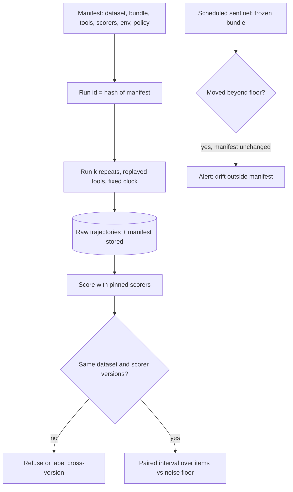

## TL;DR
A reproducible agent eval can be re-run from a recorded manifest (dataset, bundle, tools, scorers, code,
environment) to the same conclusion, with raw trajectories stored and leftover noise measured, because
unpinned comparisons across weeks compare two different agents.

## For agent builders
- **Why it matters for agents.** Agents amplify every source of drift: one different early tool choice
  changes the rest of the run, live tools return new data each day, and memory or the clock leaks today's
  state into the prompt. Without pins and repeats, "the new prompt helped" is unfalsifiable.
- **Where it shows up in your stack.** The eval harness manifest, a record-and-replay tool layer, an
  injected clock, a fresh memory store per task, dated model snapshots, and a scheduled sentinel run.
- **What you control.** What gets pinned (model, prompts, tool schemas, index, recordings), how many
  repeats per task, the temperature the eval runs at, and whether the comparison tool refuses mismatched
  runs.
- **What you can skip.** Chasing bit-exact agent runs through a hosted API. Aim for statistical
  reproduction and a re-derivable manifest.

## Decision case
### Scenario
A consultancy sells a research agent to regulated clients. The agent calls a live web-search tool, keeps
long-term memory, and runs on a hosted model at temperature 0.7. Each month the team decides whether to
adopt a new model snapshot. Clients' auditors now ask for evidence they could re-derive.

Facts and constraints, with illustrative figures:
- **Task set.** 200 labelled tasks; no labelling capacity for more this quarter.
- **Resolution.** The product owner's threshold is a 7-point change in task success; smaller moves are
  not acted on.
- **Budget.** 1,500 agent task runs a month for evaluation (about 10 model calls each).
- **Measured noise.** Five repeats of the champion on 60 tasks spread 8 points with nothing changed
  (the noise-floor scenario below).
- **Flip rate.** About 25% of tasks change verdict between two single runs of different snapshots.
  With the paired rule, one run per arm on 200 tasks gives a half-width of
  1.96 × √(0.25 / 200) ≈ ±6.9 points.
- **Evidence.** Each upgrade decision must be re-derivable from a stored manifest for the client's
  retention period.

### Options
| Option | How it works | Runs a month | Resolves 7 points? | Re-derivable? |
|---|---|---|---|---|
| **A. Single run vs last month's baseline** | Temperature 0, live tools, cached, baseline from a month ago | 200 | No: two systems a month apart, at a temperature production does not use | No: live tools and an old baseline |
| **B. Fresh paired single runs** | Champion and candidate re-run now on identical tasks, replayed tools, production temperature, and the same weekly sentinel as C | 400 + 200 sentinel = 600 | Barely: ±6.9, and no measured floor | Partly: tools are replayed, but the live clock and shared memory still leak in |
| **C. Paired, 3 repeats, frozen world, sentinel** | B plus 3 repeats per task, fixed clock, fresh memory per task, a complete manifest, and a weekly cache-off sentinel on 50 tasks | 1,200 + 200 = 1,400 | Yes: averaging repeats per task makes the interval no wider than B's and usually narrower; the bootstrap computes it from the runs | Yes |
| **D. Bit-exact on self-hosted weights** | Deterministic kernels on an open-weight model | Varies | Measures a model that is not shipped | Yes, for the wrong system |

The sentinel is 50 tasks × 4 weeks = 200 runs a month.

### Decision
Choose **C**:
- **A and D measure the wrong thing.** A compares two systems a month apart, at a temperature production does
  not use; D is bit-exact for a model clients never get.
- **B is at the edge.** Its ±6.9-point half-width is just inside the 7-point threshold, with no margin
  and no measured noise floor to check it against.
- **C fits the budget:** 1,400 of 1,500 runs. Repeats tame generation noise, and the 8-point spread on
  single runs is exactly what they address.
- **The frozen world is what makes it re-derivable.** Replayed search results, a fixed clock and fresh
  memory per task, with their hashes in the manifest, let an auditor re-run the decision.
- **The sentinel separates provider drift from candidate effects** before a snapshot is blamed.

What would change it:
- **A smaller threshold.** Resolving 3 points needs more tasks, not repeats: about
  1.96² × 0.25 / 0.03² ≈ 1,067 tasks. Repeats cannot shrink item-sampling noise.
- **A measured floor near zero.** If repeats show almost no spread (say, a locally pinned model with
  deterministic scorers), drop to one run and spend the budget on more tasks.
- **Search freshness becomes the product.** Add a live-tool check outside the gate, because replay
  cannot see it.

### Trade-offs accepted
- **Three times B's comparison runs** (1,200 against 400; 1,400 against 600 with the sentinel). Watch
  the per-metric noise floor; when it narrows, cut repeats.
- **Replay freezes the web.** Watch replay misses per run, which mean the agent asked something new.
- **Re-baselining on every deprecation.** Watch days left on the pinned snapshot.
- **The sentinel cannot use the cache,** so it is the one run that stays expensive. Watch sentinel drift
  events per quarter.

### Review rubric
- **The reproducibility level is chosen deliberately** (bit-exact, statistical or re-derivable) and tied
  to what the evidence is for.
- **Generation noise and item-sampling noise are separated,** with the remedy for each named.
- **Interval widths are computed** from task count and flip rate and compared with the decision
  threshold.
- **Every runtime input is frozen or recorded:** tools, clock and memory, with hashes in the manifest.
- **Drift outside the manifest has a detector,** such as a cache-off sentinel with a cadence.
- **Reversal conditions are quantified,** such as the task count a smaller threshold would need.

## Why it exists
- **Almost nothing holds still by default.** "Did the prompt change help?" needs everything else fixed. The
  provider updates the model behind an alias such as `-latest`, and published studies have documented large
  behaviour shifts between dated versions of the same hosted model.
- **Sampling is noisy even at temperature zero.** Above zero, every run differs. At zero, outputs are
  generally still not bit-identical across calls, because batching and floating-point reduction order on
  GPUs are not deterministic. The judge is a model and drifts for the same reasons.
- **Everything else moves too.** The dataset is edited in place, the index re-embedded, the prompt contains
  today's date or a live tool result, a dependency bump changes a tokenizer or SDK default, and a warm cache
  serves last month's outputs for a model that has since changed.
- **Naive fixes cover one source each.** "Temperature 0 and a seed" addresses sampling only, and many APIs
  treat the seed as best-effort. "Compare with last week" compares two systems. "Run it twice and see" is the
  right instinct without the bookkeeping to act on it.
- **The cost is real.** Teams ship a prompt that "improved three points" when the provider changed the model,
  or roll back a real improvement because the judge was upgraded the same day. Regulated customers want
  evidence, and "we ran it and it looked fine" is not evidence. So pin what can be pinned, measure the noise
  in what cannot, and record both.

## How it works
### Three levels, and which one you actually need
| Level | Means | Achievable when | Required for |
|---|---|---|---|
| **Bit-exact** | identical outputs | locally served open-weight models at temperature zero with fixed batching and deterministic kernels (at some throughput cost); rarely through a hosted API | debugging, special cases |
| **Statistical** | same score distribution within a measured noise band | always, with repeats | every decision eval |
| **Re-derivable** | anyone can reconstruct the run from its manifest, even if the provider has since changed | always, with a manifest | the minimum bar for any eval cited in a release |

### The eval lockfile
Every run records a manifest; each field is there *because* a specific drift has burned someone.

| Field | Contents | Because |
|---|---|---|
| **Dataset** | the content hash of the items, not a file name | files get edited in place |
| **Bundle** | model snapshot id (or weights digest), prompt versions, decoding parameters, seed where supported, tool and retrieval index snapshots | a dated snapshot, not an alias: the alias is the single most common cause of unexplained score changes |
| **Scorers** | judge model snapshot, judge prompt and rubric version, scorer code version | the judge is a model |
| **Environment** | git SHA, dependency lockfile hash, container image digest | tokenizers, SDK defaults and retry behaviour live in dependencies |
| **Runtime inputs** | anything read at request time outside the bundle: the current date, a live tool or API result, a feature-flag value, the agent's memory store contents | frozen by injecting a fixed clock and replaying recorded tool responses; the recording's hash goes in the manifest |
| **Run policy** | concurrency, timeout and retry settings, cache mode, the agent's step budget | timeouts recorded as zero scores make a provider incident look like a regression; a cache that ignores a pin hides a change |

- **Live tools break reproducibility:** an agent eval that calls a live search API is not reproducible next
  week whatever else you pin.
- **Memory breaks it too.** An agent that writes to long-term memory during task 3 sees different context
  in task 4; give each task a fresh or snapshotted memory store and record which.
- **The run id is a hash of the manifest,** so two runs with identical pins are recognisably the same
  experiment.
- **Store the manifest next to the raw outputs** in the experiment-tracking or evaluation store.

### Measure the noise you cannot pin
1. **Run the *same* bundle several times** (three to five repeats is a common illustrative choice) and compute
   the spread of the aggregate. That spread is the noise floor; no delta smaller than it may be believed.
2. **Report every metric as a mean with a confidence interval.**
3. **Compare candidate and champion on identical items** so item difficulty cancels.
4. **Evaluate at the temperature production uses,** not forced zero, *because* an eval at temperature zero of
   a system that ships at 0.7 measures a different system. Repeats, not determinism, tame the variance.

- **When one run suffices:** deterministic scorers on structured outputs from a locally pinned model can show
  a noise floor near zero. Measure it before assuming it.
- **Agents usually need repeats.** A multi-step run compounds per-step sampling, so task success often
  flips between repeats even with replayed tools.

### Two kinds of noise, two different tools
| Noise | Source | Remedy | Measured by |
|---|---|---|---|
| **Generation noise** | run-to-run variation on the same items: sampling, non-deterministic serving, a model-graded scorer, a different tool path | repeats; averaging each item's score over its repeats shrinks it | spread across repeats |
| **Item-sampling noise** | having evaluated these few hundred items rather than the whole population of requests | only more items; repeats do nothing | confidence interval over items (bootstrap over per-item scores) |

- **A delta must clear both.** A perfectly deterministic run on 100 items still has an item-level interval
  of several points.
- **Practical recipe:** average repeats per item first, then compute the paired interval over items.

### Detect drift you cannot pin
- **A dated snapshot is a promise you cannot verify from outside.**
- **A sentinel run** re-executes a frozen reference bundle on a fixed subset on a schedule.
- **If its score moves beyond the noise floor** while nothing in the manifest changed, something outside the
  manifest did (the provider, the network, the environment), and the alert fires before a candidate is
  blamed.
- **The same sentinel catches a silently updated judge.**

### Comparability as a rule, not a hope
- **Two runs are comparable only if their dataset version and scorer versions match.** The tooling should
  refuse to diff them otherwise, or label the comparison as cross-version.
- **Re-scoring is cheap when raw outputs are stored:** a new judge version re-scores champion and candidate
  from stored outputs without re-calling the target, which is how you re-baseline after a judge upgrade.

## Diagram
Every agent eval run is identified by its manifest; comparisons are refused across yardsticks, and a
cache-free sentinel watches for drift the manifest cannot pin.



## Examples
### Manifest, noise floor and comparability check
A manifest builder, a noise-floor measurement, and a comparability check. The run id is derived from the
manifest, so re-running with the same pins produces the same id; a changed pin produces a new one. The
noise floor is measured on the champion before any candidate is judged against it.

```python
import hashlib, json, statistics, subprocess, pathlib

def sha(path: str) -> str:
    return hashlib.sha256(pathlib.Path(path).read_bytes()).hexdigest()[:12]

def build_manifest(bundle: dict, dataset_version: str, scorers: dict, image_digest: str) -> tuple[str, dict]:
    git_sha = subprocess.check_output(["git", "rev-parse", "HEAD"]).decode().strip()
    m = {"dataset": dataset_version,                       # content hash of the items, never a file name
         "bundle": bundle,                                  # {"model": "vendor-model-2025-04-14", "prompt": "support@v12",
                                                            #  "params": {"temperature": 0.7, "max_tokens": 400}, "index": "idx-2025-06-01"}
         "scorers": scorers,                                # {"judge_model": "judge-2025-01-15", "rubric": "helpfulness@v3"}
         "env": {"git": git_sha, "lock": sha("uv.lock"), "image": image_digest},
         "policy": {"concurrency": 8, "timeout_s": 60, "retries": 2, "cache": "read-write"}}
    run_id = hashlib.sha256(json.dumps(m, sort_keys=True).encode()).hexdigest()[:12]
    return run_id, m

def noise_floor(run_once, k: int = 3) -> tuple[float, float]:
    """run_once() executes the SAME manifest with cache disabled and returns per-item scores.
    The spread between repeats is the smallest delta anyone is allowed to believe."""
    means = [statistics.mean(run_once()) for _ in range(k)]
    return statistics.mean(means), max(means) - min(means)

def comparable(a: dict, b: dict) -> tuple[bool, dict]:
    checks = {k: a[k] == b[k] for k in ("dataset", "scorers")}
    checks["same_model"] = a["bundle"]["model"] == b["bundle"]["model"]   # false is fine for a model-upgrade eval, but say so
    return all(checks[k] for k in ("dataset", "scorers")), checks

# champion_mean, floor = noise_floor(lambda: run_eval(champion_manifest, cache=False))
# delta = candidate_mean - champion_mean
# if abs(delta) <= floor: print("within noise: not a result")  # generation noise only; the paired interval
#                                                               # over items (gate lesson) must also exclude it
```

### Freezing an agent's world: replayed tools, fixed clock, fresh memory
Pure Python, runnable. The agent sees a recorded world: tool calls are answered from a recording keyed by
request hash, the clock is fixed, and each task gets an empty memory store. The recording's hash goes into
the manifest's runtime inputs.

```python
import hashlib, json, datetime

class FrozenWorld:
    def __init__(self, recording: dict, now: str):
        self.recording = recording                       # {request_hash: tool_result}
        self.now = datetime.datetime.fromisoformat(now)  # injected clock: no "today" leaking in
        self.misses = []

    @staticmethod
    def key(tool, args):
        return hashlib.sha256(json.dumps([tool, args], sort_keys=True).encode()).hexdigest()[:16]

    def call_tool(self, tool, args):
        k = self.key(tool, args)
        if k not in self.recording:                      # a new path: record it, never call live in an eval
            self.misses.append((tool, args))
            return {"error": "not in recording"}
        return self.recording[k]

    def new_memory(self):
        return {}                                        # fresh per task, so task order cannot leak state

rec = {FrozenWorld.key("search_orders", {"customer": "c42"}): [{"id": "1182", "status": "delivered"}]}
world = FrozenWorld(rec, now="2025-06-01T09:00:00")
print(world.call_tool("search_orders", {"customer": "c42"}))   # replayed
print(world.call_tool("search_orders", {"customer": "c43"}))   # miss, logged
recording_hash = hashlib.sha256(json.dumps(rec, sort_keys=True).encode()).hexdigest()[:12]
runtime_inputs = {"clock": "2025-06-01T09:00:00", "tools": recording_hash, "memory": "fresh-per-task"}
```

### Repeats per item, then a paired interval over items
Pure Python, runnable, with synthetic scores. The candidate is truly 3 points better on every item, with
three repeats each on 100 identical items. Repeats shrink generation noise, but the interval over items
still includes zero: only more items can resolve a gain this small.

```python
import random, statistics

def paired_interval(champ, cand, n_boot=2000, seed=0):
    """champ, cand: {item_id: [score per repeat]} on IDENTICAL items.
    Average repeats per item first (shrinks generation noise), then bootstrap over items
    (quantifies item-sampling noise, which repeats cannot touch)."""
    ids = sorted(champ)
    diffs = [statistics.mean(cand[i]) - statistics.mean(champ[i]) for i in ids]
    rng = random.Random(seed)
    boots = sorted(statistics.mean(rng.choices(diffs, k=len(diffs))) for _ in range(n_boot))
    return statistics.mean(diffs), boots[int(0.025 * n_boot)], boots[int(0.975 * n_boot)]

rng = random.Random(42)                       # synthetic pass/fail scores, 3 repeats per item
p_champ = {f"i{k}": rng.random() for k in range(100)}           # each item's true pass probability
p_cand = {k: min(1.0, p + 0.03) for k, p in p_champ.items()}    # candidate truly +3 points per item
draw = lambda p: [float(rng.random() < p) for _ in range(3)]
champ = {k: draw(p) for k, p in p_champ.items()}
cand = {k: draw(p) for k, p in p_cand.items()}

delta, lo, hi = paired_interval(champ, cand)
print(f"delta={delta:+.3f}  95% CI [{lo:+.3f}, {hi:+.3f}]")   # an interval several points wide around +0.03
print("result" if lo > 0 or hi < 0 else "not yet a result: interval includes zero")
```

### Worked scenario: Friday's "three-point win"
A prompt change scores three points above a baseline measured three weeks earlier. Comparing the two
manifests field by field explains it before anyone re-runs anything.

| Manifest field | Baseline (3 weeks ago) | Friday's run | Comparable? |
|---|---|---|---|
| Dataset hash | golden-v8 | golden-v9 (20 items added) | no: different yardstick |
| Model | alias `-latest` | alias `-latest` | unknown: the alias may have moved |
| Judge | rubric v3 | rubric v3, judge snapshot updated | no: the judge is a model |
| Prompt | v11 | v12 | the change under test |

- **Verdict:** three uncontrolled changes besides the prompt, so the three points belong to nobody yet.
- **Fix:** pin a dated model snapshot, re-run champion and candidate now with identical manifests except the
  prompt, cache off, repeats per item, paired interval over items.

### Worked scenario: an agent's noise floor
A research agent on 60 tasks with replayed tools, run five times on the same manifest. Illustrative numbers.

| Repeat | Tasks succeeded | Success rate |
|---|---|---|
| 1 | 41 | 68.3% |
| 2 | 44 | 73.3% |
| 3 | 42 | 70.0% |
| 4 | 39 | 65.0% |
| 5 | 43 | 71.7% |

- **The spread is 65.0% to 73.3%, about 8 points,** with nothing changed. A candidate that "wins by 5"
  from one run each is inside the floor.
- **Most flips trace to step one or two:** the agent picks a different first search query, so the rest of
  the trajectory diverges. Averaging repeats per task, then pairing, is what makes a delta believable.

## Production patterns
- **Harness refuses incomplete manifests** — for any eval that gates or is cited. Fail the run at start if a
  dataset hash, model snapshot, judge snapshot, lockfile hash or image digest is missing, or if any model id
  matches an alias pattern such as `-latest`. Monitor the fraction of runs with a complete manifest.
- **Scheduled sentinel with the cache off** — when you depend on hosted models. Run a frozen champion bundle
  on a fixed subset daily or weekly, cache disabled, and alert when its score leaves the measured noise band.
  Monitor sentinel drift events per quarter.
- **Recorded tool responses for agent evals** — when the application calls live tools. Record tool responses
  once, replay them by request hash during evals, inject a fixed clock, and put the recording's hash in the
  manifest. Monitor replay misses, which mean the agent asked something new.
- **Isolated memory per task** — for agents with long-term memory. Start each eval task from an empty or
  snapshotted memory store and record the snapshot id in the manifest, so task order cannot change results.
  Monitor results that change when task order is shuffled.
- **Noise floor stored per metric** — before any gate trusts a delta. Re-measure the floor with repeats on
  the champion whenever the model, judge or dataset version changes, and store it with the baseline. Monitor
  floor width over time; a widening floor often means a provider-side change.
- **Retained evidence with the promoted bundle** — for regulated or customer-facing commitments. Store
  manifest, raw outputs, scores and approvals together and keep them for the retention period your policy
  sets. Monitor that every promoted bundle has a retrievable evidence record.

## Trade-offs
- **Stable comparisons vs re-baselining.** Pinning dated snapshots gives stable comparisons, but every
  deprecation forces a re-baseline. When the provider deprecates faster than you re-baseline, a scheduled
  model-upgrade job with a full eval is the only sustainable answer.
- **Quantified noise vs cost.** Repeated runs quantify noise at a multiple of the cost. Once a deterministic
  scorer on a locally pinned model shows a near-zero floor, a single run is enough, but only after the floor
  has been measured. Agent runs cost several model calls each, so repeats bite harder.
- **Production temperature vs cleanliness.** Evaluating at production temperature measures what ships but is
  noisier; evaluating at zero is cleaner and may measure a system you do not ship. The choice follows what
  production actually does.
- **Replayed tools vs realism.** Replay makes agent evals repeatable and free, but a frozen recording cannot
  show a tool whose live output has changed; keep a separate live-tool check outside the gate.
- **Cheap cached re-runs vs hidden changes.** Content-addressed caching makes re-runs nearly free, yet a key
  that omits any pin hides a change. The sentinel run must bypass the cache, which is exactly the run you
  cannot make cheap.

## Pitfalls
- **A model alias instead of a dated snapshot in the manifest.** Symptom: scores jumping on a day when nobody
  deployed anything.
- **A silently upgraded judge.** Symptom: champion and candidate shifting together, which preserves the delta
  but breaks every absolute floor in the gate.
- **Datasets referenced by file name.** Symptom: two runs "on golden.jsonl" disagreeing on the item count.
- **Treating "three identical repeats" as proof.** Symptom: a deterministic eval on 80 items whose two-point
  win vanishes on the next dataset version, because repeats never measured item-sampling noise.
- **Timeouts counted as zero scores.** Symptom: eval scores that correlate with the provider's status page.
- **Assuming temperature zero means deterministic.** Symptom: a bug report that some outputs differ between
  identical runs (how many depends on the provider, output length and load), filed as a regression.
- **Comparing runs scored by different judge versions.** Symptom: a "regression" that vanishes when both runs
  are re-scored from stored outputs with the same judge.
- **Shared agent memory across eval tasks.** Symptom: results that change when the task file is reordered.
  Fix: fresh or snapshotted memory per task, recorded in the manifest.

## When to use
- **Always:** every eval that informs a decision gets a manifest; the rigour scales with the stakes.
- **Development loop:** re-derivable is enough, and the framework captures the manifest automatically.
- **Release gate:** statistical reproduction is required: repeats to establish the noise floor, identical
  dataset and scorer versions, paired comparison.
- **Regulated or customer-facing commitments:** store the full evidence (manifest, raw outputs, scores,
  approvals) with the promoted bundle.
- **Measure** the fraction of runs with a complete manifest, the noise floor per metric, sentinel drift events
  per quarter, and how often the comparability check refuses a diff.
- **Interviews:** the usual question is "how would you know the model changed underneath you?"; the sentinel
  run is the answer.

## Role lens
- **Engineer:** Makes the harness refuse to start without a complete manifest, pins judge and model
  snapshots, stores raw outputs, and schedules the sentinel run with caching disabled.
- **Architect:** Sets the reproducibility level each stage requires, decides what evidence is retained for
  how long, and owns the policy that aliases never appear in a promoted bundle.
- **FDE:** Hands a customer the manifest and raw outputs behind an acceptance number, so their team can
  re-run it in their own environment and get the same conclusion.

## Check yourself
**Q:** A colleague reports that their prompt change raised the judge score from 0.78 to 0.83 on Friday,
against a baseline measured three weeks ago. What do you ask before believing it, and what do you run?
**A:** Ask whether both runs used the same dataset version, the same model snapshot rather than an alias,
the same judge model and rubric version, the same decoding parameters and index, and whether the baseline's
noise floor was ever measured. Three weeks is long enough for the provider, the judge or the dataset to
have moved, so the 0.05 may belong to any of them. Then run champion and candidate side by side now, with
manifests identical except for the prompt version, cache disabled, three repeats each, paired on identical
items, and report the mean difference with a confidence interval. If the interval excludes zero and the
delta exceeds the measured floor, treat the improvement as real (and confirm it on the slices that matter);
otherwise it is not yet a result.

## Interview questions
### What does "reproducible" mean for an LLM eval if outputs are not deterministic?
- **Statistical, not bit-exact:** re-running the same manifest gives the same score distribution within a
  measured noise band, and the same conclusion.
- **Re-derivable as the floor:** anyone can reconstruct the run from its manifest even after the provider
  has changed.
- **Bit-exact** is realistic only for locally served models with deterministic kernels and fixed batching.

### Your agent calls live web search and writes to long-term memory. How do you make its eval reproducible?
- **Freeze the world:** record tool responses once and replay them by request hash, inject a fixed clock,
  and put the recording's hash in the manifest.
- **Isolate memory:** start each task from an empty or snapshotted store so earlier tasks cannot leak state.
- **Then measure what is left:** repeats per task at production temperature, because the agent's own
  sampling still changes trajectories; keep a separate live-tool check outside the gate.

### How would you know the model changed underneath you?
- **A scheduled sentinel run:** a frozen reference bundle on a fixed subset, cache off, compared against its
  own noise floor.
- **If it moves while its manifest did not,** something outside the manifest changed: the provider, the
  environment or a silently updated judge.
- **The alert fires before** a candidate prompt gets blamed for the shift.

### Three repeats agree perfectly, yet the win vanished on the next dataset version. Why?
- **Repeats measure generation noise only.** They say nothing about item-sampling noise from having
  evaluated these items and not others.
- **On 80 or 100 items** the interval over items is several points wide even for a deterministic run.
- **Fix:** average repeats per item, then compute a paired bootstrap interval over items, and grow the set
  if the interval is too wide.

### Should you evaluate an agent at temperature zero to make results stable?
- **Only if production runs at zero.** An eval at zero of a system that ships at 0.7 measures a different
  system.
- **Zero is not deterministic anyway** on hosted infrastructure, because batching and floating-point order
  vary.
- **Use repeats** at the production temperature and measure the noise floor instead.

### What goes in an eval manifest, and which field causes the most unexplained score changes?
- **Fields:** dataset hash, bundle (model snapshot, prompt versions, decoding params, seed, index), scorers
  (judge snapshot, rubric), environment (git SHA, lockfile, image digest), runtime inputs and run policy.
- **Most common culprit:** a model alias instead of a dated snapshot.
- **The run id is the manifest's hash,** so identical pins are recognisably the same experiment.

## Quiz
### Q: Why must the judge model's snapshot be part of the eval manifest?
- [ ] Because judge calls are the most expensive part of the run
- [x] Because the judge is a model whose drift changes scores without any change to the application
- [ ] Because judges only work at temperature zero
- [ ] Because the cache key is derived from the judge's output
> A model-graded scorer is subject to the same provider updates as the target; if it moves, every score
> moves. Pinning it, and re-scoring stored outputs when it changes, keeps comparisons honest. Cost and
> cache keys are unrelated to the reason.

### Q: Setting temperature to zero guarantees that two identical eval runs produce identical outputs. True or false, and why?
- [ ] True, because greedy decoding always selects the same token
- [ ] True, as long as the seed parameter is also set
- [x] False, because batching and non-deterministic GPU arithmetic can change logits, so the noise floor must be measured
- [ ] False, because the tokenizer is randomised per request
> Greedy decoding is deterministic given identical logits, but logits can differ slightly across runs on
> hosted infrastructure, and seeds are often best-effort. The practical answer is repeats and a measured
> noise floor, not an assumption of determinism.

### Q: What does a scheduled sentinel run of a frozen reference bundle detect?
- [ ] Regressions introduced by a candidate prompt
- [ ] Contamination of the golden set
- [x] Drift outside the manifest, such as a provider changing the model behind a dated snapshot or an environment change
- [ ] Whether the cache hit rate is high enough
> Nothing in the sentinel's manifest changes between runs, so any movement beyond the noise floor must
> come from something the manifest cannot pin. Candidate regressions are caught by the gate, not the
> sentinel.

## Use cases & projects
### Use cases
- **Comparing two agent prompts honestly.** Identical manifests except the prompt, replayed tools and
  repeats per task turn "it feels better" into a delta with an interval.
- **Catching provider drift.** A weekly sentinel on a frozen agent bundle alerts when success moves with no
  change on your side.
- **Customer acceptance.** An FDE hands over the manifest, recordings and raw trajectories so the customer
  can re-run the agent eval in their environment.
- **Debugging a flaky agent test.** The manifest and stored trajectories show whether a failure came from
  the agent's sampling or from something that moved.

### Mini project
**Make a flaky agent eval reproducible (2-3 hours).**
- **Goal:** turn an agent eval whose success rate wobbles run to run into one with a manifest, a frozen
  world and a measured noise floor.
- **Steps:** take a small agent that calls one live API; record its tool responses for 30 tasks into a
  `FrozenWorld`; inject a fixed clock and fresh memory; build the manifest with the recording hash; run the
  same manifest five times and compute the spread; compare two prompt versions with `paired_interval`.
- **Done when:** the run id is identical across re-runs, replay misses are zero, you report the noise floor,
  and the prompt comparison states clearly whether its interval excludes zero.
