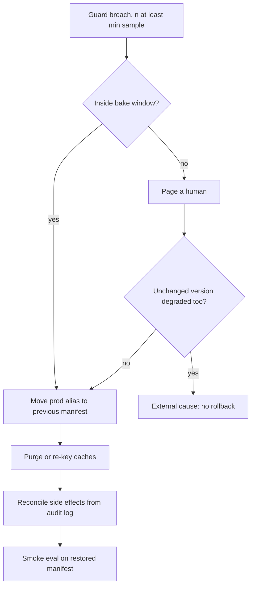

## TL;DR
Rollback returns a production agent to a previously validated bundle (model, prompt, parameters, tools,
index, guardrails) in minutes by repointing an alias, not rebuilding. It must be planned, because some
changes destroy their own undo path and agent side effects never roll back.

## For agent builders
- **Why it matters for agents.** An agent release is a bundle of model, system prompt, tool schemas and
  retrieval index. When a release makes the agent loop, pick wrong tools or refuse, reverting the whole
  bundle in minutes is the fastest fix you have.
- **Where it shows up in your stack.** A prompt or model registry with aliases, the agent's config loaded
  from a control plane, index aliases in the vector store, and the audit log of tool calls.
- **What you control.** Pinned snapshots in every manifest, version-keyed caches, tool and memory schemas
  the previous version can still read, and which runs in flight finish on which version.
- **What you can skip.** Deep GitOps tooling; a pointer, a history list and a rehearsed drill cover most
  agent teams.

## Decision case
### Scenario
An insurer runs a claims-triage agent on a self-hosted 70B model inside its own VPC (data residency rules
out a provider API). The team must decide how to keep rollback fast for its weekly releases. All figures
are illustrative.
- **Serving:** two replicas of 4 GPUs each (8 GPUs); peak load needs both replicas, 09:00-17:00.
- **Releases:** 4 a month, promoted at 09:00, each with a 48 h bake window.
- **Constraints:**
  - restore a validated manifest within 15 minutes of a guard breach (the MTTR target);
  - no drop below full capacity during the peak shift;
  - rollback-readiness spend at most $1,500 a month, at an assumed $2.50 per GPU-hour;
  - each node has spare local NVMe for one extra 140 GB set of weights.
- **Drill timings:** guard detection takes 5 min; reloading one replica takes 22 min from object storage
  and 4 min from local disk; flipping to a warm pool takes 1 min.
- **Fixed in every option:** pinned manifests, blue/green indexes, caches keyed by manifest id.

### Options
| Option | How it works | Extra spend a month | Time to restore | Capacity during rollback |
|---|---|---|---|---|
| **A. Cold from object storage** | `kubectl rollout undo`; nodes pull old weights | $0 | 5 + 2 × 22 = 49 min: fails | half for 44 min: fails at peak |
| **B. Warm pool for the whole bake** | second 8-GPU pool serves the previous manifest for 48 h | 8 × 48 × $2.50 × 4 = $3,840: fails | 5 + 1 = 6 min | full |
| **C. Previous weights on local disk** | rolling undo, one replica at a time, from NVMe | $0 | 5 + 2 × 4 = 13 min | half for 8 min: fails at peak |
| **D. Warm pool for the bake window's peak shifts, then C** | pool serves the previous manifest during both 09:00-17:00 shifts inside the 48 h (16 h), released overnight | 8 × 16 × $2.50 × 4 = $1,280 | 6 min at peak, 13 min off-peak | full at peak, half for 8 min off-peak |

### Decision
Choose **D**, because it is the only option that meets the MTTR, capacity and budget constraints together.
- **MTTR:** 6 minutes during the two peak shifts and 13 off-peak, both under 15. A's 49 minutes is the whole
  incident.
- **Capacity:** a 48 h bake promoted at 09:00 spans two peak shifts (release day and the next day). The
  warm pool covers both, when C's half-capacity reload would queue claims; off-peak, C's 8 minutes at half
  capacity are acceptable.
- **Budget:** $1,280 fits under $1,500. B buys the same 6 minutes for the 32 off-peak hours at $2,560
  more.
- **Risk shape:** breaches caused by a release tend to appear in its first hours of real traffic (the
  lesson's incident fired at T+3 h), which falls inside D's first warm shift.

**What would change it:**
- **Peak load that one replica can carry** (for example after a smaller or quantised model halves the
  load): C alone meets every constraint at $0. Promoting off-peak does not help, because any 48 h bake
  still spans two peak shifts.
- **An MTTR target under 13 minutes for the whole bake window:** B, with a budget raise.
- **Off-peak breaches that need 6-minute recovery** in your release history: extend the warm pool into
  those hours, at $80 a month per extra hour.

### Trade-offs accepted
- **The 32 off-peak hours recover in 13 minutes, not 6.** Track every rollback's measured restore time against
  the 15-minute target; two misses in a quarter reopen the decision.
- **Local disk is a single copy of the previous weights.** Verify its checksum in the pre-release
  readiness check, and fail promotion if it is missing.
- **The warm pool adds $1,280 a month of mostly idle GPUs**, and it must be re-warmed from local disk
  before day two's shift. Check that it serves the previous manifest before 09:00, and report its cost
  next to the incidents it shortened.
- **Rollback restores behaviour, not actions.** In-flight runs restart by manifest id, and claims notes
  written by the bad version are found through the audit log. That reconciliation is outside the MTTR.

### Review rubric
- **Restore time is a sum of measured parts** (detection plus reload per replica), not a single guess.
- **Capacity during the rollback is stated**, and checked against the traffic at the time it happens.
- **Costs are recomputed** from GPUs × hours × rate × releases, with the rate labelled as assumed.
- **The write-up names what a pointer flip cannot undo** (caches, in-flight runs, side effects) and who
  reconciles each.
- **A drill proves the chosen path**, with the measured time recorded against the target.
- **At least two conditions that would change the choice** are stated, each tied to a measurable fact.

## Why it exists
- **Container rollback does not transfer.** For a stateless service you redeploy the previous image. AI
  systems break that model in three ways.
- **The deployable unit is a bundle across many stores.** The prompt lives in a registry, the model behind
  a provider API or a GPU fleet, the index in a vector database, tool schemas in code, the guardrail policy
  in a config service. Rolling back one without the others yields a never-evaluated combination:
  yesterday's prompt against today's model is a new version, not the old one.
- **Some changes destroy their own undo path.** Re-embedding a corpus in place overwrites the vectors the
  old prompt was tuned against, and the old query-embedding model cannot be used against new vectors,
  because the two vector spaces are not comparable. Overwriting a fine-tuned checkpoint or adapter leaves
  nothing to return to. A vendor retiring the previous snapshot removes the old model entirely.
- **Failures are quiet and lagging.** Rollback-worthy failures are usually quality regressions, visible
  only through thumbs-down rate, escalations or judge scores, not a crash. By the time a human notices,
  the bad version has served for hours.
- **"Just tweak the prompt" compounds it.** Every edit under pressure is another unevaluated version, and
  the original cause ends up buried under three patches. Rollback makes the first incident move a
  known-good state, so diagnosis can happen calmly.

## How it works
### Make versions immutable and deployment a pointer
1. **Pin every component in a manifest:** model id with snapshot date, prompt version hash, decoding
   parameters, tool schema version, index id, guardrail policy version, and the feature flags that were on.
2. **Store manifests immutably** in the registry.
3. **Point the environment at one manifest.** The environment, say `prod`, is an alias.
4. **Deploy = move the alias forward; rollback = move it to the previous manifest.** This is O(1)
   *because* nothing is rebuilt, re-embedded or re-trained; the data plane picks up the new pointer on its
   next config refresh.

- **The rule that follows:** roll back only to a manifest that previously served production (or passed
  the same gates). Hand-assembling "old prompt + new model" during an incident is a forward change in
  disguise.

### Keep the previous version reachable
A pointer is only useful if its target still exists and is warm.

| Component | What keeps it reachable |
|---|---|
| Self-hosted models | keep previous weights loaded or at least on local disk; loading tens of gigabytes from object storage can take minutes (illustrative), which is the whole rollback budget |
| Provider models | pin snapshots and track the vendor's deprecation calendar, so the "previous" model was not retired last month |
| Indexes | build the new index beside the old (blue/green), switch the alias, keep the old one until the new one has baked; never re-embed in place |
| Fine-tunes | keep the previous adapter or checkpoint and the training data that produced it |

### Decide triggers before the release
Rollback should be a decision made in advance and executed by a rule, not debated in the incident channel.

| Signal type | Examples | Action |
|---|---|---|
| Guard metrics | error rate, p95 latency, schema-failure rate, refusal rate, cost per request, tool-failure rate | automatic, with thresholds and windows |
| Quality signals | judge score on a sample, thumbs-down rate, escalation rate | usually a human decision, because they are noisier and slower |

- **Every trigger carries a minimum sample size**, *because* a threshold evaluated on twenty requests
  produces flapping.
- **Scope automatic triggers to a bake window** after promotion (hours to a few days). Inside it, a breach
  is most likely caused by the release, so reverting is the right bet.
- **Outside the window, page a human.** A breach is then more often external (a provider incident, a
  traffic shift, a broken upstream tool), and rolling back to a version on the same provider fixes nothing
  while discarding a good release.

### Handle what a pointer flip does not restore
Rollback restores behaviour, not data. Check after the flip:
- **Caches keyed without the version.** A semantic or response cache filled by the bad version keeps
  serving its answers. Key caches by manifest id, or purge on rollback.
- **Conversations in flight.** A session whose earlier turns and compaction summaries came from the bad
  version continues under the old one; usually acceptable, but worth knowing when reading feedback.
- **Agent memory and side effects.** Notes written to long-term memory, tickets filed, emails sent:
  rollback does not undo them. The audit log identifies them for cleanup.
- **Downstream consumers.** If another team cached embeddings or outputs from the bad version, tell them.
- **State written in a new shape.** If the new version stored tool results, memory records or structured
  outputs in a new schema, the old version may fail to read them. Use expand-then-contract, as with
  database migrations: a release writes data the previous manifest can still read, and drops the old
  shape only after its bake window.

### Agent runs in flight
Long-running agents add a problem chat apps do not have: a task may span many steps and minutes.
- **Pin the manifest per run.** Record the manifest id when a run starts; a checkpointed run that resumes
  after a rollback either finishes on its original manifest or restarts on the restored one, never mixes.
- **Prefer restart for bad releases.** If the bad version planned the task, its remaining plan is suspect,
  so cancel and re-run from the user's request on the restored manifest.
- **Tool schemas are part of the contract.** If the new version added a tool argument, the old version's
  tool adapters must still accept the calls in checkpoints written by the new one, or those runs fail.

### Rehearse it
- **A rollback never executed is a hypothesis.** Exercise it in CI (deploy v2, roll back to v1, run a
  smoke eval) and in periodic game days.
- **Time it** against the MTTR target in the runbook.

## Diagram
A guard breach takes one of two paths depending on release age; the pointer flip is followed by the
cleanup a flip cannot do on its own.



## Examples
### Registry with immutable manifests and a guarded rollback
A registry with immutable manifests, an environment alias, and a guard loop that rolls back when a metric
breaches its threshold with enough samples. Promotion records history so rollback has a validated target.

```python
import time
from dataclasses import dataclass, field

@dataclass(frozen=True)
class Manifest:
    id: str; model: str; prompt: str; params: dict; tools: str; index: str; guardrails: str

@dataclass
class Registry:
    manifests: dict = field(default_factory=dict)
    alias: dict = field(default_factory=dict)      # env -> manifest id
    history: dict = field(default_factory=dict)    # env -> [manifest ids that served]
    promoted_at: dict = field(default_factory=dict)

    def promote(self, env: str, mid: str):
        assert mid in self.manifests, "unknown manifest"
        self.history.setdefault(env, []).append(mid)
        self.alias[env] = mid                      # O(1): a pointer move, nothing rebuilt
        self.promoted_at[env] = time.time()
        cache.invalidate(namespace=env)            # cached answers belonged to the old version

    def rollback(self, env: str) -> str:
        served = self.history[env]
        assert len(served) >= 2, "nothing validated to roll back to"
        served.pop()                               # drop the bad one
        self.alias[env] = served[-1]
        self.promoted_at[env] = 0.0                # restored version is not "fresh": a further
        cache.invalidate(namespace=env)            # breach pages a human, no cascading rollbacks
        return served[-1]

GUARDS = {"schema_fail_rate": (0.02, 200), "p95_ms": (6000, 200), "refusal_rate": (0.10, 200)}
BAKE_S = 48 * 3600                                 # auto-rollback only while the release is fresh

def check_guards(reg: Registry, env: str, window: dict) -> str | None:
    for metric, (limit, min_n) in GUARDS.items():
        if window["n"] >= min_n and window[metric] > limit:
            if time.time() - reg.promoted_at[env] > BAKE_S:
                alerts.page(f"{env}: {metric} breach outside bake window; human decision")
                return None
            target = reg.rollback(env)
            alerts.page(f"{env}: {metric}={window[metric]:.3f} > {limit}; rolled back to {target}")
            return target
    return None
```

### Pre-release rollback-readiness check
Run in CI before promotion: it fails the release if the previous manifest could not actually be
restored. Pure Python; the inventory dictionaries stand in for registry, vendor and index lookups.

```python
def rollback_blockers(prev: dict, new: dict, live: dict) -> list[str]:
    problems = []
    if prev["model"] not in live["models"]:
        problems.append(f"previous model {prev['model']} no longer served")
    if prev["index"] not in live["indexes"]:
        problems.append(f"previous index {prev['index']} deleted")
    if new["index"] == prev["index"] and new["embedder"] != prev["embedder"]:
        problems.append("embedding model changed on the same index: in-place re-embed")
    if not new.get("cache_key_has_manifest"):
        problems.append("response cache not keyed by manifest id")
    return problems

prev = {"model": "m-2026-05", "index": "kb-v7", "embedder": "e1"}
new = {"model": "m-2026-09", "index": "kb-v7", "embedder": "e2", "cache_key_has_manifest": False}
live = {"models": {"m-2026-05", "m-2026-09"}, "indexes": {"kb-v7"}}
for p in rollback_blockers(prev, new, live):
    print("BLOCK:", p)
# BLOCK: embedding model changed on the same index: in-place re-embed
# BLOCK: response cache not keyed by manifest id
```

### Worked incident: a rollback that did not roll back
Illustrative timeline for a release that changed the prompt and swapped the model alias.

| Time | Event | What it reveals |
|---|---|---|
| T+0 | manifest m42 promoted (new prompt, model alias left floating) | the model was not pinned to a snapshot |
| T+3 h | thumbs-down rate rises; refusal guard breaches at n = 400 | inside the 48 h bake window, so auto-rollback fires |
| T+3 h 2 min | alias moved to m41; cache namespace purged | pointer flip took minutes, as designed |
| T+4 h | quality still degraded | m41 also pointed at the floating alias, which had moved underneath |
| T+5 h | m41 re-pinned to the old snapshot and re-promoted | rollback only works on fully pinned manifests |

### Worked scenario: rolling back a ticketing agent mid-run
A ticketing agent's new manifest a18 started duplicating tickets. Figures are illustrative.

| Item | Count at rollback | Handling |
|---|---|---|
| Runs started on a18 and finished | 2,400 | audit log lists 310 duplicate tickets to close |
| Runs in flight on a18 (checkpointed) | 85 | cancelled, re-queued from the original request on a17 |
| Runs in flight on a17 | 40 | untouched |
| Memory notes written by a18 | 1,100 | tagged with manifest id, so they are quarantined in one query |

- **The flip took two minutes; reconciliation took an afternoon**, which is why every tool call and
  memory write carries the manifest id.

## Production patterns
- **Alias-based model registry.** Point serving at an alias, not a version number: MLflow's registry lets
  you set an alias such as `champion` on a model version (`MlflowClient().set_registered_model_alias`),
  and serving resolves the alias. Rollback is re-setting the alias to the previous version. Monitor which
  version each replica actually resolved.
- **GitOps revert as the rollback button.** Keep the `prod` manifest pointer in a Git repo synced by
  Argo CD or Flux; rollback is reverting the promoting commit, which leaves an audit trail. Monitor sync
  status and time from revert to fully synced.
- **Index aliases for blue/green retrieval.** Elasticsearch and OpenSearch index aliases (the `_aliases`
  API) and Qdrant collection aliases let you build `kb-v8` beside `kb-v7` and swap atomically. Keep the old
  index through the bake window. Monitor recall on a fixed query set after the swap.
- **Version in every cache key.** Prefix response and semantic cache keys with the manifest id, so a
  rollback naturally misses the bad version's entries instead of relying on a purge. Monitor cache hit
  rate dropping right after promotion or rollback, which confirms the keying works.
- **Kubernetes undo for self-hosted serving.** For model servers deployed as Deployments,
  `kubectl rollout undo deployment/<name>` returns to the previous ReplicaSet, which is fast only if the
  old image and weights are still cached on nodes. Monitor pod readiness time during drills.
- **Scheduled rollback drills.** A CI job that deploys v2, rolls back to v1 and runs a smoke eval, plus a
  quarterly game day. Monitor time-to-rollback against the MTTR target.
- **Manifest id on every agent action.** Tag each tool call, memory write and outbound message with the
  manifest id and run id, so a rollback is followed by one query listing what the bad version did.
  Monitor the share of tool calls missing the tag.

## Trade-offs
- **Warm previous model vs cost.** Instant rollback costs GPU memory or a second serving pool; for
  infrequent releases a slower cold rollback may be the cheaper choice.
- **Automatic rollback vs trust.** It shortens time-to-recover at night, but with thresholds lacking
  minimum samples or noisy metrics it rolls back healthy releases and trains people to ignore it.
- **Bundle-level rollback: safe vs coarse.** The target was validated, but it also reverts an unrelated
  good change that shipped in the same manifest, which argues for small manifests.
- **Blue/green indexes: reversible vs double storage.** During the bake window you store both; for very
  large corpora that cost can dominate and force a partial-rebuild strategy.
- **Immutable manifests and aliases: discipline vs overhead.** Every team pays registry overhead, but it
  is what makes "which version served this request" answerable at all.

## Pitfalls
- **Re-embedding the corpus in place.** Symptom: a retrieval regression after a model change with no way
  back except a multi-hour rebuild. Fix: blue/green index plus alias.
- **Caches not keyed by version.** Symptom: "we rolled back but users still see the bad answers" for as
  long as the cache TTL. Fix: manifest id in the key, or purge on rollback.
- **Relying on the vendor to keep serving the previous model.** Symptom: a rollback target returning
  model-not-found during the incident. Fix: track deprecation dates and keep a reachable fallback.
- **Rolling back only the prompt because "the model did not change".** The model alias silently updated
  underneath. Symptom: a rollback that does not restore old behaviour. Fix: pin snapshots in manifests.
- **Never rehearsing.** Symptom: the runbook fails on a permissions error at the exact moment it is
  needed. Fix: drills in CI and game days.
- **Treating rollback as the whole fix.** Symptom: memory entries, tickets or emails from the bad version
  surface days later because nobody reconciled the audit log. Fix: a reconciliation step in the runbook.
- **Auto-rolling back on every breach regardless of release age.** Symptom: a good release reverted during
  a provider outage, with the outage still present on the old version. Fix: bake-window scoping.

## When to use
- **Roll back first** whenever a release correlates with a guard breach or credible quality regression;
  diagnose second. Being wrong costs little if the previous version was validated, while debugging live
  is paid for by users.
- **Fix forward instead** only when the previous version is itself broken (a vendor retired it, an index
  was overwritten) or the fault is clearly outside the release.
- **Quick external-cause test:** if the incumbent arm of a still-running canary, or a version that has not
  changed, shows the same degradation, the release is not the cause and rollback will not help.
- **Measure:** time-to-rollback in rehearsals, kept in minutes; make the trigger list part of every
  release plan. Day to day: manifests in a registry, aliases in a control plane and a rollback button
  engineers trust.
- **Interviews:** explain why an AI rollback is harder than a container rollback and what must be true
  beforehand for a pointer flip to actually restore behaviour.

## Role lens
- **Engineer:** Builds releases as immutable manifests, keys caches by manifest id, keeps the previous
  weights or index reachable, and wires guard metrics to the rollback action.
- **Architect:** Defines the deployable unit, the retention policy for previous versions (how many, how
  warm), and which triggers are automatic versus human, balancing recovery time against cost.
- **FDE:** Agrees rollback triggers and the rollback runbook with the customer before go-live, and
  verifies in the customer's environment that the previous version is actually still deployable.

## Check yourself
**Q:** A release changed the prompt and switched the embedding model, re-indexing the corpus in place.
Two days later answer quality drops. Walk through what rollback can and cannot do here and what you
would change for next time.
**A:** The prompt can be rolled back instantly if it is versioned in a registry and the environment
alias can be repointed. The index cannot: re-embedding in place destroyed the old vectors, and the
query side cannot go back to the old embedding model either, because old-model query vectors are
meaningless against new-model document vectors. So a prompt-only rollback runs the old prompt against
retrieval from the new model, a combination never evaluated and possibly worse. The honest options are to rebuild the old index from source (hours),
or to keep the new index and fix the prompt forward with a proper canary. For next time: treat the
bundle as one manifest, build the new index blue/green beside the old and switch an alias, keep the old
index through a bake window, key any response cache by manifest id, and define the quality trigger
and minimum sample before release so the decision happens on day one rather than day two.

## Interview questions
### Why is rolling back an LLM application harder than rolling back a container?
- **The unit is a bundle in many stores:** prompt registry, provider model, vector index, tool schemas,
  guardrail config. Reverting one piece creates an unevaluated combination.
- **Some changes are irreversible unless planned:** in-place re-embedding, overwritten adapters, vendor
  snapshot retirement.
- **So the precondition is design work:** immutable manifests, an alias per environment, and previous
  artefacts kept reachable and warm.

### You rolled back and users still get bad answers. How do you debug it?
- **Check caches first:** a response or semantic cache not keyed by manifest id keeps serving the bad
  version's answers until TTL.
- **Check the manifest is fully pinned:** a floating model alias can make the "old" manifest run the new
  model.
- **Check propagation:** confirm every data-plane replica refreshed its config and resolved the old
  manifest, using the manifest id on traces.

### When would you not auto-roll back on a guard breach?
- **Outside the bake window**, because a late breach is more often external (provider incident, traffic
  shift, broken upstream tool) and the old version shares that dependency.
- **When the regression is in a tool, not the bundle**, for example an upstream API changing its
  response; disable or fix the tool instead, because both versions call it.
- **On noisy quality signals with small samples**, where auto-rollback flaps and erodes trust; route those
  to a human with a minimum sample.
- **When the previous version is itself broken**, for example retired by the vendor; fix forward instead.

### What does it cost to keep rollback instant for a self-hosted 70B model?
- **A warm previous version means duplicate capacity:** the old weights stay loaded or a second pool stays
  up, roughly doubling serving memory during the bake window.
- **Cold rollback is cheaper but slower:** loading tens of gigabytes from object storage can take minutes,
  which may be the whole recovery budget.
- **Middle ground:** keep weights on local disk of existing nodes, so a reload avoids object storage, and
  drop them after the bake window.

### Your agent release changes how it stores tool results and memory records. How do you keep it safe to roll back?
- **Expand then contract:** the release writes data the previous manifest can still read (additive
  fields, both shapes for a while), so the old agent can still load memory and checkpoints.
- **Drop the old shape** only after the release is past its bake window.
- **Test it:** the CI drill rolls back after writing records with the new version and checks the old
  version reads them.

### You roll back an agent release while 200 multi-step runs are in progress. What happens to them?
- **Decide per run, by recorded manifest id:** runs on the bad version are cancelled and restarted from
  the user's request on the restored manifest, because their plans came from the bad version.
- **Never resume a checkpoint on a different manifest** unless both versions share the tool and state
  schemas; mixing produces an agent run nobody evaluated.
- **Reconcile what rollback cannot undo:** emails sent, tickets filed and memory notes written by those
  runs, found through the audit log and memory records filtered by manifest id.

## Quiz
### Q: Why is "roll back the prompt but keep the new model" risky even when the model change looked harmless?
- [ ] Prompt registries cannot store more than one version per model
- [x] It produces a combination that was never evaluated, so it is a forward change rather than a return to a known-good state
- [ ] Models cache the prompt, so the old prompt will not take effect
- [ ] It doubles inference cost during the transition
> A rollback is only safe because its target previously passed gates and served traffic. Mixing
> components from different manifests creates a new, unvalidated version under incident pressure.

### Q: After rolling back, users keep receiving the bad version's answers for an hour. What is the most likely cause?
- [ ] The rollback pointer takes an hour to propagate through DNS
- [ ] The old model needs an hour to warm its KV cache
- [x] A response or semantic cache was keyed without the version id, so it still serves answers produced by the bad version
- [ ] The guard metrics window is one hour long
> Rollback restores the code path, not the data it produced. A cache filled by the bad version keeps
> serving until its TTL unless caches are keyed by manifest or purged on rollback.

### Q: Which practice most directly ensures that a retrieval-index change can be rolled back?
- [ ] Storing the embedding model name in the prompt
- [ ] Lowering the index's HNSW parameters so rebuilds are faster
- [x] Building the new index beside the old one and switching an alias, keeping the old index during a bake window
- [ ] Re-embedding only documents that changed since the last release
> Blue/green indexing preserves the old vectors, so rollback is an alias switch. In-place re-embedding
> overwrites them and turns rollback into a multi-hour rebuild.

## Use cases & projects
### Use cases
- **A model upgrade makes the agent loop.** Steps per task jump after a model swap; the alias moves back
  while the team fixes the prompt offline.
- **A tool-schema change breaks tool calls.** The new schema confuses the model; rollback restores the old
  schema and prompt together as one manifest.
- **A RAG agent's new index retrieves worse.** The index alias swaps back to the previous collection kept
  through the bake window.
- **An action-taking agent misbehaves.** Rollback stops new damage; the audit log, filtered by manifest
  id, drives cleanup of what already happened.

### Mini project
**One-button rollback for a toy agent (2 hours).**
- **Goal:** prove a pointer flip restores an agent's behaviour, including caches and memory.
- **Steps:** store two agent manifests (model, prompt version, tool schema version) in a JSON registry
  with a `prod` alias; tag each tool call and memory write with the manifest id; key a response cache by
  manifest id; promote a deliberately broken manifest, then run a rollback script and a 20-task smoke eval.
- **Done when:** the smoke eval passes on the restored manifest, no cached answer from the broken
  manifest is served, and one query lists every tool call and memory note the broken version made.
