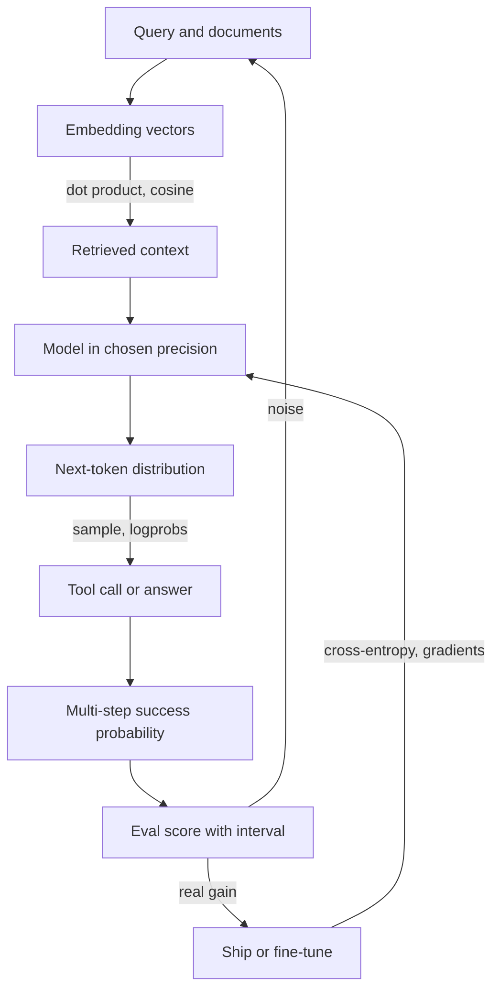

## Overview
This module covers the math you need to build agents with confidence. It is not a math course.
Each lesson takes one idea and ties it to a setting, a metric or a failure you will meet in a real
agent stack.

The six lessons fall into four groups:

- **Geometry of meaning:** linear algebra explains embeddings, dot products, cosine similarity and norms. Those decide what your retrieval, memory and tool routing return.
- **Uncertainty:** probability treats every token, tool choice and answer as a sample from a distribution. Statistics treats every eval score as an estimate with error bars.
- **Training signals:** information theory gives the loss (cross-entropy), perplexity and the KL leash in distillation and RLHF. Calculus explains how gradients, learning rates and clipping move that loss.
- **Hardware reality:** numerical precision covers fp16, bf16 and int8 quantization. These set memory budgets, NaN failures and why replays are not bit-identical.

**What you can do afterwards:**

- **Pick and defend a similarity metric:** and size the vector index it lives in.
- **Predict multi-step reliability:** of an agent from per-step success rates, and know when independence breaks.
- **Call an eval delta real or noise:** with a paired confidence interval and a sample-size estimate.
- **Read a fine-tuning run:** from its loss and grad-norm curves, and use logprobs as an uncertainty signal.
- **Choose the cheapest precision:** a self-hosted model can run at without breaking tool calls.

The module feeds the rest of the course. Retrieval and vector search build on linear algebra. Evals,
A/B tests and release gates build on statistics. SLM fine-tuning, training and serving build on
information theory, gradients and precision.

## Why it matters
- **Engineer:** You set the numbers that quietly decide behaviour: the vector index metric and whether embeddings are normalized, temperature and retry counts, learning rate, warmup and `max_grad_norm` for a fine-tune, and the dtype or quantization level of a local model. You also debug them when they go wrong.
- **Architect:** You size systems and set gates with arithmetic, not guesses: index memory from dimension and dtype, GPU memory from bytes per parameter, end-to-end agent success from per-step reliability, and how many eval tasks a release gate needs to detect the change you care about.
- **FDE:** Customers show you a slide that says "+2.5 points" or a retrieval demo that misses obvious chunks. You need to say whether the gain is noise, why the wrong chunks came back, and which confidence threshold routes calls to human review, in language a stakeholder accepts.

## Mental model
Treat an agent as a pipeline of numbers, each with an error you can estimate:

- **Vectors in:** queries, documents and tool descriptions become vectors. Similarity is a dot product, so the metric and normalization decide what context the model sees.
- **Distributions out:** the model emits a probability distribution over the next token. Sampling settings shape it, and logprobs expose how confident it was.
- **Reliability compounds:** a multi-step run succeeds only if each step does. Products of probabilities shrink fast, and real steps are rarely independent.
- **Scores are estimates:** an eval over a few hundred tasks has a standard error of several points. Compare systems on the same tasks, with intervals.
- **Training follows a gradient:** fine-tuning lowers cross-entropy by stepping along the gradient. Learning rate and clipping decide whether it converges or diverges.
- **Bits are finite:** every number lives in a format that trades range for precision. That choice sets memory, speed and overflow risk.

Read it top to bottom. Linear algebra governs the first edge, probability the middle, statistics the
gate, and information theory, calculus and precision the loop back into the model.

## Suggested order
1. linear-algebra-intuition — vectors and dot products are the most concrete starting point, and retrieval is the first place math changes what your agent sees.
2. probability-for-ai-engineers — treats every model output as a sample, which you need before reasoning about retries, thresholds or multi-step reliability.
3. statistics-for-evaluation — builds directly on probability to turn eval scores into intervals and release gates, the most frequent math decision you will make.
4. information-theory-basics — reuses distributions to explain cross-entropy loss, perplexity, KL and logprob uncertainty, which you need before reading a training run.
5. calculus-intuition-for-gradients — explains how training lowers that cross-entropy loss and how learning rate and clipping make a run converge or diverge.
6. numerical-precision — comes last because it ties memory, quantization and NaN failures back to the vectors, losses and gradients from earlier lessons.

## Capstone
### Brief
You are asked to decide whether a small self-hosted model can replace a hosted model as the tool
router for an internal support agent. The router picks one of several tools from the request text and
retrieves supporting context from a vector index.

Build a decision report backed by numbers. First, check the retrieval layer: compare metrics and
normalization on your own corpus, and size the index at two dtypes. Next, run both routers on the same
shared task set and report a paired difference with a confidence interval, plus the sample size needed
to detect the smallest gain that matters.

Then, use logprobs to build a confidence signal and route the least confident calls to review. Finally,
test the small model at two or more precisions, and predict end-to-end success of a three-step flow
from per-step rates. Compare that prediction with observed runs.

### Deliverables
- A retrieval notebook with recall@5 for dot product, cosine and normalized L2, a length-versus-norm plot, and index memory at float32 and int8.
- An eval script that outputs mean, 95% CI and paired B minus A CI per router on at least 200 shared tasks, and exits non-zero on a regression.
- A confidence-routing analysis: accuracy by quintile of mean negative logprob, with a chosen review threshold and its accuracy gap interval.
- A precision table for the small model: weight memory, tokens per second, JSON validity and argument accuracy per dtype or quantization level.
- A one-page recommendation that names the router, the precision and the evidence, including predicted versus observed three-step completion.

### Rubric
- Cosine and normalized L2 rankings are identical, and at least one memory figure is recomputed by hand from dimension, dtype and count.
- The paired CI is computed by resampling tasks, not samples, and an A-versus-A' control run contains zero in roughly 95% of simulated repeats.
- The sample-size estimate is within about 20% of a power simulation, and the recommendation states whether the task set was large enough.
- Weight memory matches bytes per parameter times parameter count within about 20%, or the gap is explained, and one NaN or overflow check is shown.
- Units (nats or bits) are labeled on every entropy and perplexity figure, and the gap between predicted and observed multi-step success is explained.
