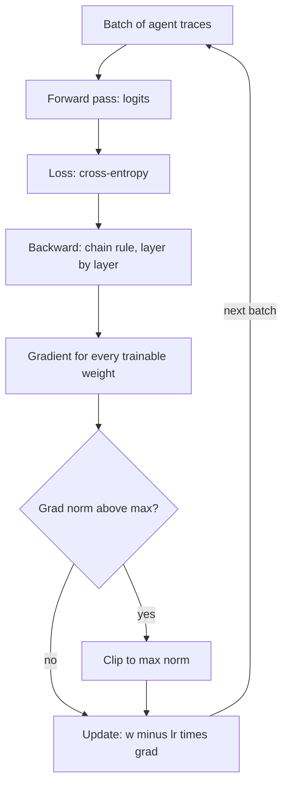

## TL;DR
A derivative says how fast the loss changes when one weight moves; the chain rule multiplies local
derivatives through every layer to get all gradients. That is enough to pick a learning rate, read a
fine-tuning loss curve and spot a diverging run.

## For agent builders
- **Why it matters for agents.** When you fine-tune a small model on agent traces (tool-call formatting,
  routing, distillation), the only knobs that move training are the learning rate, schedule, batch size
  and clipping, and each acts on the gradient.
- **Where it shows up in your stack.** `learning_rate`, `warmup_steps`, `max_grad_norm` and
  `lr_scheduler_type` in Hugging Face `TrainingArguments` (checked against transformers 4.x), the same
  knobs on hosted fine-tuning APIs, and the loss and grad-norm curves they log.
- **What you control.** Step size, how it changes over time, the cap on gradient size, and which
  parameters receive gradients at all (LoRA adapters versus full weights).
- **What you can skip.** Hand-deriving backpropagation for a transformer and multivariable calculus
  proofs. Autograd computes gradients; you need to know what they mean and how they fail.

## Why it exists
- **Training is "change weights to lower the loss".** With billions of weights you cannot try changes
  at random; you need the direction of steepest decrease for all weights at once, which is the gradient.
- **Finite differences do not scale.** Nudging each weight separately needs one forward pass per weight,
  so a 1-billion-parameter model would need a billion passes per step. The chain rule gets every
  gradient in about one forward and one backward pass.
- **The step size is a separate decision.** The gradient says which way; the learning rate says how far.
  Too small wastes compute; too large overshoots and the loss explodes.
- **Failures show up in gradient numbers.** Spikes, NaNs and flat curves all trace back to gradient size,
  so reading them is the core debugging skill for any fine-tune.

## How it works
### Derivatives
- **A derivative** `dL/dw` is the slope of the loss L as one weight w changes, holding others fixed.
- **Sign gives direction:** positive slope means increasing w raises the loss, so move w down.
- **Magnitude gives sensitivity:** a large slope means a small change in w moves the loss a lot.
- **The gradient** is the vector of all partial derivatives, one per weight. It points uphill; training
  steps the opposite way.

### The chain rule
If `z = w·x + b`, `p = sigmoid(z)` and `L = −log p`, then:

```
dL/dw = dL/dp · dp/dz · dz/dw
      = (−1/p) · p(1−p) · x = (p − y) · x       # for label y = 1; the same form holds for y = 0
```
- **Each layer contributes one local factor.** Backpropagation computes the forward values once, then
  multiplies local derivatives from the loss backward, reusing shared pieces.
- **Products of many factors** explain vanishing gradients (factors below 1) and exploding gradients
  (factors above 1) in deep stacks, which residual connections, normalization and clipping counter.

### Gradient descent and the learning rate
```
w_new = w − lr · dL/dw
```
On the bowl `L(w) = (w − 3)²` the gradient is `2(w − 3)`, so the error shrinks by a factor of
`(1 − 2·lr)` per step:

| Learning rate | Factor per step | Behaviour |
|---|---|---|
| 0.1 | 0.8 | smooth, slow convergence |
| 0.5 | 0 | lands exactly on the minimum in one step |
| 0.9 | −0.8 | overshoots each step, oscillates, still converges |
| 1.1 | −1.2 | overshoots more each step: diverges |

Real losses are not one bowl, but the lesson holds: there is a largest stable step set by curvature,
and going past it makes loss rise instead of fall.

### What optimizers and schedules add
- **Adam** keeps running averages of the gradient and its square, scaling each weight's step, so one
  learning rate works across weights of very different gradient scale.
- **Warmup** starts with a tiny learning rate while those averages settle, then ramps up.
- **Decay** (cosine or linear) shrinks steps late in training so weights settle into a minimum.
- **Clipping** rescales the whole gradient when its norm exceeds `max_grad_norm`, capping single bad steps.

## Diagram
Follow one training step: forward to the loss, backward through the chain rule, then the update.



## Misconceptions
- **"The gradient tells you how far to move."** It gives the uphill direction and the local slope, valid
  only near the current weights. The learning rate sets the distance, and past the largest stable step
  the update overshoots and the loss rises.
- **"Backprop is a clever way of nudging each weight."** That is finite differences, one pass per weight.
  Backprop applies the chain rule once from the loss backward, getting every gradient in about one forward
  and one backward pass.
- **"Oscillating loss means the run is diverging."** On the bowl, lr 0.9 overshoots every step yet
  converges, because the error factor is −0.8. Divergence is the error growing, as at lr 1.1 with factor
  −1.2.
- **"Gradient clipping makes any learning rate safe."** Clipping caps the occasional bad step. If it
  fires on most steps, the learning rate is too high and every useful step is being shrunk; lower the
  rate instead.
- **"A NaN loss means bad data."** Check the grad-norm curve first: when it climbs steadily before the
  NaN, the step size is the likely cause, and lowering the rate with warmup fixes it. A single bad batch
  shows a sudden spike instead.

## Examples
### Check a gradient by hand, then sweep learning rates
The analytic chain-rule gradient matches a finite-difference estimate; then four learning rates on a
simple bowl. Tested with numpy 2.0.2.

```python
import numpy as np

# One logistic "neuron": does this tool call succeed? z = w*x + b, p = sigmoid(z), loss = -log p
x, y = 2.0, 1.0
def loss(w, b):
    p = 1 / (1 + np.exp(-(w * x + b)))
    return -(y * np.log(p) + (1 - y) * np.log(1 - p))

def grad(w, b):
    p = 1 / (1 + np.exp(-(w * x + b)))
    dz = p - y                       # chain rule: dL/dp * dp/dz collapses to p - y
    return dz * x, dz                # dz/dw = x, dz/db = 1

w, b, h = -0.5, 0.1, 1e-6
num_w = (loss(w + h, b) - loss(w - h, b)) / (2 * h)   # finite-difference check
print("analytic dL/dw:", round(grad(w, b)[0], 6), " numeric:", round(num_w, 6))

# Learning rate on a bowl: L(w) = (w - 3)^2, gradient 2(w - 3)
for lr in (0.1, 0.5, 0.9, 1.1):
    w = 0.0
    for step in range(20):
        w -= lr * 2 * (w - 3)
    print(f"lr={lr}: w after 20 steps = {w:.3f}, loss = {(w - 3) ** 2:.3g}")
```

Output:

```
analytic dL/dw: -1.421899  numeric: -1.421899
lr=0.1: w after 20 steps = 2.965, loss = 0.0012
lr=0.5: w after 20 steps = 3.000, loss = 0
lr=0.9: w after 20 steps = 2.965, loss = 0.0012
lr=1.1: w after 20 steps = -112.013, loss = 1.32e+04
```

- **The negative gradient** (−1.42) says raising w lowers the loss, which matches intuition: the label
  is 1 and the model currently predicts below 0.5.
- **lr 0.1 and 0.9 end at the same place** by different paths (smooth versus oscillating); 1.1 explodes.

### Worked scenario: reading a LoRA fine-tune on tool-call traces
Illustrative logs from three runs of a small model trained on 5,000 agent traces.

| Run | Learning rate | Loss curve | Grad norm | Reading |
|---|---|---|---|---|
| A | 2e-6 | falls very slowly, still dropping at the end | small, steady | too small: undertrained |
| B | 2e-4 | drops fast, then flattens | steady, a few spikes clipped | healthy |
| C | 2e-3 | drops, then spikes and becomes NaN | climbs, then inf | too large: diverged |

The team kept run B, added warmup to remove its early spikes, and confirmed with a tool-call eval rather
than the loss alone.

## Production patterns
- **Run a short learning-rate sweep first.** Before a long fine-tune, train a few hundred steps at three
  or four learning rates spaced by about 3x to 10x, and keep the largest one whose loss falls smoothly.
  Monitor training and validation loss per run.
- **Log grad norm every step.** Most trainers report it; plot it next to loss. A rising grad norm
  usually precedes a loss spike, so alert on it and on any NaN.
- **Clip and warm up by default.** Set `max_grad_norm` (1.0 is a common default) and a warmup of a few
  percent of steps, then check how often clipping activates; constant clipping means the learning rate
  is too high.
- **Use a schedule that decays.** Cosine or linear decay to near zero lets the model settle; compare the
  final validation loss with a constant-rate run on the same budget.
- **Judge with a task eval, not loss.** Lower loss on traces does not guarantee better tool calls; score
  checkpoints on a held-out agent eval and keep the best checkpoint, not the last.

## Trade-offs
- **Large vs small learning rate.** Large steps train faster and can escape poor regions but risk
  divergence and forgetting; small steps are stable but may never converge within the budget.
- **Aggressive clipping vs signal.** A low clip threshold prevents blow-ups but shrinks every useful
  step too, slowing training; it flips toward helpful when data has rare extreme examples.
- **LoRA vs full fine-tuning.** Training only adapter weights uses far less memory and tolerates
  higher learning rates, but limits how much behaviour changes; full tuning needs smaller rates and
  more care with forgetting.

## Pitfalls
- **Learning rate too high.** Symptom: loss spikes, then NaN, often after an initially good drop.
  **Diagnose** by plotting grad norm and loss per step; grad norm climbs first. Fix: lower the rate
  by 3x to 10x, add warmup, keep clipping, resume from the last good checkpoint.
- **Learning rate too low.** Symptom: loss falls steadily but slowly and is still dropping at the end.
  **Diagnose** with a short sweep: a 3x larger rate falls faster without instability. Fix: raise the
  rate or train longer.
- **Gradients not flowing.** Symptom: loss flat from step one. **Diagnose** by counting trainable
  parameters and checking that their gradients are non-zero after one backward pass. Fix: unfreeze
  the right modules, check the loss mask is not excluding every token.
- **Trusting training loss alone.** Symptom: training loss keeps falling while the agent eval worsens.
  **Diagnose** by plotting validation loss and task metrics per checkpoint. Fix: stop early, add data,
  or lower the rate.

## When to use
- **Use when** fine-tuning or distilling any model, including hosted fine-tuning where you set only a
  learning-rate multiplier and epochs.
- **Use when** a training run misbehaves and you must decide between data, rate and code bugs.
- **Avoid** gradient-level tuning when prompting or retrieval already meets the target; fine-tuning
  adds a training pipeline to maintain.
- **Measure:** training and validation loss, grad norm, clip rate, and the task eval per checkpoint.

## Exercise
**Goal:** train a tiny classifier with hand-written gradients and reproduce the three learning-rate regimes.
- **Inputs:** a synthetic dataset of 500 points labeling whether an agent request needs a search tool,
  from two features you invent (for example, length and question-mark count), with a fixed seed. Keep
  the length feature unscaled (raw characters), because logistic gradients are bounded by |x| and only
  large inputs let a big step push the loss far above where it started.
- **Constraints:** numpy only; implement logistic regression's forward pass, chain-rule gradients and
  updates yourself; no autograd.
- **Deliver:** a gradient check against finite differences, loss curves for at least four learning rates,
  and a run with gradient clipping that survives a rate that otherwise diverges.
- **Acceptance:** analytic and numeric gradients agree to at least 5 decimal places; one rate converges
  smoothly, one oscillates or crawls, and one ends with loss well above its starting 0.693 without
  clipping, and for at least one such rate, clipping the gradient norm at 1.0 keeps loss within about 2x
  of its start. Compute loss with
  `np.logaddexp` so large logits give big finite numbers instead of inf.

## Role lens
- **Engineer:** Sets learning rate, warmup, schedule and clipping for fine-tunes on agent traces, and
  debugs diverging or flat runs from loss and grad-norm plots.
- **Architect:** Decides whether a behaviour should be fixed by fine-tuning at all, and what training
  budget, sweep size and evaluation gates a fine-tuning pipeline needs.
- **FDE:** Explains to a customer why their fine-tune failed (rate too high, no validation split) and
  what to change, using the loss curve they already have.

## Check yourself
**Q:** A LoRA fine-tune on 8,000 tool-call traces shows training loss falling for 300 steps, then
spiking and going to NaN at step 420. Grad norm rose from about 1 to over 50 before the spike. What
happened and what do you change?
**A:** The updates became too large for the loss surface: grad norm climbing before the spike is the
classic sign of a learning rate past the stable limit, possibly triggered by a few extreme examples. Resume
from the last good checkpoint, cut the learning rate by about 3x to 10x, add warmup if missing, keep
gradient clipping on (for example `max_grad_norm` 1.0) and check how often it fires. Also inspect the
batches around step 420 for malformed or extremely long traces, and judge the rerun with a held-out agent
eval rather than training loss alone.

## Interview questions
### What does the chain rule have to do with training a neural network?
- **Composition:** a network is a chain of functions, and the chain rule says the derivative of the whole
  is the product of each piece's local derivative.
- **Backpropagation** applies it from the loss backward, reusing intermediate results, so all gradients
  cost about one extra pass instead of one pass per weight.

### Your fine-tuning loss is flat from the first step. How do you debug it?
- **Check gradient flow:** count trainable parameters, run one backward pass, and confirm their gradients
  are non-zero and not NaN.
- **Check the loss mask and rate:** make sure label masking is not excluding every target token, and that
  the learning rate is not effectively zero after a scheduler or multiplier bug.

### When would you choose a smaller learning rate even though training gets slower?
- **When stability or retention matters:** full fine-tuning of a large model, or tuning where you must
  keep general skills, benefits from smaller steps that change weights less.
- **When noisy data dominates:** small batches or rare extreme examples make large steps erratic.

### How do warmup and gradient clipping each prevent divergence?
- **Warmup** keeps steps tiny while Adam's running statistics are still unreliable, avoiding huge early
  updates from noisy estimates.
- **Clipping** caps the gradient norm on any single step, so one bad batch cannot throw the weights far
  away; frequent clipping signals a learning rate that is too high.

## Quiz
### Q: On the loss L(w) = (w − 3)², which learning rate makes gradient descent diverge?
- [ ] 0.1
- [ ] 0.5
- [ ] 0.9
- [x] 1.1
> Each step multiplies the error by (1 − 2·lr). For 1.1 the factor is −1.2, so the error grows
> every step and flips sign; rates up to 1.0 keep the factor's magnitude at most 1.

### Q: Why does backpropagation compute all gradients far more cheaply than finite differences?
- [ ] It skips the forward pass
- [x] The chain rule reuses intermediate results, so one backward pass yields every gradient
- [ ] It only computes gradients for the last layer
- [ ] It approximates gradients with random samples
> Finite differences need a separate forward pass per weight. Backpropagation multiplies local
> derivatives backward once, sharing the work across all weights.

### Q: Grad norm climbs steadily, then loss spikes to NaN. What is the most likely cause?
- [ ] The learning rate is too small
- [ ] The validation set is too small
- [x] The learning rate is too large for the loss surface
- [ ] The model has too few layers
> Steps larger than the stable limit overshoot, raising loss and gradients each step until values
> overflow. Lower the rate, add warmup and keep clipping.

## Mastery test
**Problem:** you distill a large model's tool-calling behaviour into a 1B model. With a constant
learning rate the run is stable but the final checkpoint calls tools worse than a checkpoint from
mid-training. The validation loss on held-out traces kept falling. Explain what may be happening and
what you would change.

**A strong answer:**
- notes validation loss and task quality can diverge: the model fits token likelihood, not tool success;
- explains how: mean loss is dominated by many easy tokens, so the few decisive ones (tool name,
  argument values) can get worse while the average falls; measures loss on tool-call tokens only;
- notes held-out traces come from the teacher, so falling loss also rewards copying its style and
  errors, and checks general skills the eval needs for forgetting;
- confirms the gap is real with a paired comparison of the two checkpoints on the same eval tasks;
- adds a task eval per checkpoint and keeps the best one, not the last;
- tries learning-rate decay, fewer epochs or a lower rate, and compares on the task eval.

## Use cases & projects
### Use cases
- **Fine-tuning SLMs for tool calls.** Learning rate, warmup and clipping decide whether a small model
  learns your tool-call format or diverges.
- **Distillation of agent behaviour.** Reading loss and grad-norm curves tells you when the student is
  learning versus memorizing the teacher's traces.
- **Hosted fine-tuning.** Choosing a learning-rate multiplier and epoch count is the same gradient
  decision with fewer knobs.
- **Debugging training jobs.** NaNs, flat losses and spikes are diagnosed from gradient statistics.

### Mini project
**Learning-rate sweep for a tool-call formatter (2-3 hours).**
- **Goal:** find a stable learning rate for a LoRA fine-tune of a small open model on agent traces.
- **Steps:** prepare 1,000 short traces mapping a request to a JSON tool call; run 200 steps at three
  learning rates spaced by about 10x; log loss and grad norm; evaluate JSON validity and tool accuracy on
  100 held-out requests.
- **Done when:** you have overlaid loss and grad-norm plots, an eval table per rate, and a chosen rate
  with the evidence for it.
