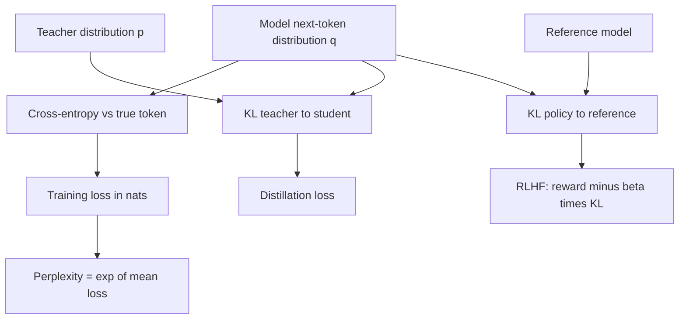

## TL;DR
Entropy measures uncertainty, cross-entropy is the loss every LLM is trained on, and KL divergence
measures how far one distribution drifts from another. Together they explain training loss,
perplexity, the KL penalty in RLHF and distillation objectives.

## For agent builders
- **Why it matters for agents.** Fine-tuning an SLM on agent traces minimizes cross-entropy; distilling
  a large agent into a small one minimizes a KL; RLHF-style tuning keeps a KL leash on the policy.
  Reading those numbers tells you whether training is working.
- **Where it shows up in your stack.** Training loss in any trainer, `logprobs` from model APIs,
  perplexity reports on model cards, the KL coefficient in preference-tuning libraries, and token-level
  uncertainty signals.
- **What you control.** Which distribution you train toward (hard labels or a teacher's soft
  probabilities), the KL penalty strength, and whether you use entropy or logprobs as a routing signal.
- **What you can skip.** Coding theory and channel capacity. You need the four formulas below, the
  units (nats or bits), and the asymmetry of KL.

## Why it exists
- **A loss must reward the right probabilities.** Accuracy only checks the top token; cross-entropy
  scores how much probability the model gave the correct token, so it improves smoothly and has useful
  gradients.
- **Loss numbers need an interpretation.** A mean loss of 2.0 nats per token means perplexity
  exp(2.0) ≈ 7.39: the model is as unsure as a uniform choice among about 7 tokens.
- **Tuning needs a leash.** Optimizing a reward model alone drifts into degenerate text that games
  the reward; a KL penalty against the original model keeps outputs close to fluent language.
- **Distillation needs a target richer than one label.** A teacher's full distribution says which wrong
  answers are nearly right; matching it with KL transfers that structure to a student.

## How it works
### Surprise and entropy
```
surprise(x)   = −log p(x)                      # rare events carry more information
H(p)          = −Σ p(x) · log p(x)             # expected surprise: uncertainty of p
```
- **Units:** natural log gives nats, log base 2 gives bits; divide nats by ln 2 ≈ 0.693 to get bits.
  Training frameworks report nats.
- **Range:** entropy is 0 when one outcome is certain and largest, log N, when N outcomes are equally
  likely. A uniform 50,000-token vocabulary has entropy ln 50,000 ≈ 10.82 nats.

### Cross-entropy
```
H(p, q) = −Σ p(x) · log q(x)                   # cost of coding p's events using q
```
- **With a one-hot target** (the actual next token), cross-entropy is just `−log q(correct token)`.
  That is the standard LLM training loss, averaged over tokens.
- **It is never below H(p).** The gap is exactly the KL divergence.

### KL divergence
```
KL(p || q) = Σ p(x) · log(p(x) / q(x)) = H(p, q) − H(p)    ≥ 0, zero only when p = q
```
- **Not symmetric:** KL(p‖q) and KL(q‖p) differ. Forward KL (truth first) punishes q for missing
  outcomes p cares about; reverse KL punishes q for putting mass where p has little.
- **In RLHF:** the objective is reward minus β · KL(policy ‖ reference), estimated on sampled tokens,
  so the policy improves reward while staying near the starting model. DPO bakes the same constraint
  into its loss through β.
- **In distillation:** the student minimizes KL(teacher ‖ student) on temperature-softened
  distributions, often mixed with ordinary cross-entropy on true labels.

### Perplexity
```
perplexity = exp(mean per-token cross-entropy in nats)
```
- **Lower is better**, and it only compares models that use the same tokenizer and the same text,
  because token boundaries change the per-token average.

## Diagram
See how one quantity, the probability the model assigns, feeds loss, perplexity and the two KL uses.



## Examples
### Entropy, cross-entropy, KL and perplexity on real numbers
A teacher and a student distribution over four next tokens, then a five-token loss. Tested with numpy 2.0.2.

```python
import numpy as np

def entropy(p):          # in nats; divide by log(2) for bits
    p = np.asarray(p, float); p = p[p > 0]
    return -(p * np.log(p)).sum()

def cross_entropy(p, q): # expected -log q under the true distribution p
    p, q = np.asarray(p, float), np.asarray(q, float)
    return -(p * np.log(q)).sum()

def kl(p, q):            # extra nats paid for using q when the truth is p
    return cross_entropy(p, q) - entropy(p)

# Next-token distributions over 4 tokens
teacher = [0.70, 0.20, 0.05, 0.05]
student = [0.40, 0.40, 0.10, 0.10]
print(f"H(teacher)        = {entropy(teacher):.3f} nats = {entropy(teacher)/np.log(2):.3f} bits")
print(f"CE(teacher, stud) = {cross_entropy(teacher, student):.3f}")
print(f"KL(teacher||stud) = {kl(teacher, student):.3f}")
print(f"KL(stud||teacher) = {kl(student, teacher):.3f}   (not symmetric)")

# Training loss on hard labels is CE with a one-hot target = -log p(correct token)
p_correct = np.array([0.9, 0.5, 0.1, 0.6, 0.8])   # model's prob of each true next token
nll = -np.log(p_correct)
print("per-token loss:", np.round(nll, 3))
print(f"mean loss = {nll.mean():.3f}, perplexity = exp(mean) = {np.exp(nll.mean()):.3f}")
```

Output:

```
H(teacher)        = 0.871 nats = 1.257 bits
CE(teacher, stud) = 1.055
KL(teacher||stud) = 0.184
KL(stud||teacher) = 0.192   (not symmetric)
per-token loss: [0.105 0.693 2.303 0.511 0.223]
mean loss = 0.767, perplexity = exp(mean) = 2.153
```

- **CE = H + KL:** 1.055 = 0.871 + 0.184; the student pays 0.184 extra nats per token.
- **One bad token dominates:** the token given 0.1 probability costs 2.303 nats, more than the other
  four combined, which is why loss is sensitive to confidently wrong predictions.

### Worked scenario: a distilled routing agent
A team distills a large model's tool-routing decisions (8 tools) into a small classifier head.

| Training target | Held-out routing accuracy | What the student learns |
|---|---|---|
| Hard labels, cross-entropy | baseline | only the teacher's top choice |
| Teacher soft probabilities, KL at T = 2 | compared on the same split | which tools are near-substitutes |
| Mixed: 0.5 · CE on labels + 0.5 · KL | chosen if it wins on the eval | both |

The point is the decision procedure, not a promised gain: train each target, compare on the same
held-out routing set with the paired statistics from the evaluation lesson, and keep the winner.

## Production patterns
- **Track loss in nats and perplexity together.** Log mean per-token training and validation loss,
  convert to perplexity for reports, and only compare runs that share a tokenizer and eval text.
- **Use token logprobs as an uncertainty signal.** Request `logprobs` where the API supports them,
  compute the mean negative logprob of a generated tool call or answer, and route high-surprise outputs
  to verification. Calibrate the threshold on labeled traces first.
- **Watch the KL in preference tuning.** Libraries for RLHF-style training log the KL between policy
  and reference; a KL that climbs fast with rising reward usually means reward hacking. Tune β and
  inspect samples at each checkpoint.
- **Distill with soft targets when you can get them.** If the teacher exposes logprobs (self-hosted or
  API top-k logprobs), add a KL term on softened distributions; otherwise fall back to hard-label
  fine-tuning on teacher outputs.
- **Use entropy of a choice as a gate.** For a classifier or router, high entropy over options means
  the model is unsure; send those cases to a larger model or a human.

## Trade-offs
- **Forward vs reverse KL.** Forward KL makes the student cover every outcome the teacher likes, which
  can blur; reverse KL makes it commit to one mode, which can drop rare but valid behaviours.
- **Strong vs weak KL penalty.** A large β keeps the tuned model safe and fluent but limits gains; a
  small β allows larger behaviour change at the risk of reward hacking and lost capabilities.
- **Perplexity vs task metrics.** Perplexity is cheap and smooth but measures fit to text, not task
  success; an agent can get lower perplexity and worse tool accuracy.

## Pitfalls
- **Comparing perplexity across tokenizers.** Symptom: a model "wins" on perplexity but loses every
  task eval. **Diagnose** by checking the tokenizers and the eval text; different token counts change the
  average. Fix: compare bits per byte or character, or use task metrics.
- **Mixing nats and bits.** Symptom: a loss target that seems impossible or trivially met.
  **Diagnose** by checking the log base in the code that reports it. Fix: convert with ln 2 and state units.
- **Reward climbs, quality falls in preference tuning.** Symptom: reward model score rises while
  human ratings drop. **Diagnose** by plotting KL to the reference and reading samples; a fast-growing
  KL signals reward hacking. Fix: raise β, stop earlier, or improve the reward model.
- **Logprob confidence used uncalibrated.** Symptom: high-logprob tool calls that are still wrong.
  **Diagnose** by binning calls by mean logprob and measuring accuracy per bin. Fix: fit the
  threshold on labeled data and refit after model changes.

## When to use
- **Use when** reading training curves, comparing checkpoints, or setting up distillation or preference tuning.
- **Use when** building uncertainty-based routing from logprobs or choice entropy.
- **Avoid** perplexity as the decision metric for agent quality; use task evals for shipping decisions.
- **Measure:** validation loss, perplexity on fixed text, KL to reference during tuning, and
  calibration of logprob-based signals.

## Exercise
**Goal:** use logprobs to build an uncertainty signal for an agent's tool calls and test whether it works.
- **Inputs:** 100 or more agent requests with known correct tool and arguments, and a model or API that
  returns token logprobs.
- **Constraints:** compute entropy, mean negative logprob and perplexity yourself from the returned
  values; state units.
- **Deliver:** per-call mean negative logprob and perplexity, accuracy by quintile of that signal, and a
  threshold that routes the least confident 20% of calls to review.
- **Acceptance:** the least confident quintile has measurably lower accuracy than the most confident;
  one perplexity value is recomputed by hand from its logprobs; units are labeled everywhere.

## Role lens
- **Engineer:** Reads loss and perplexity correctly, uses logprobs for uncertainty routing, and sets up
  distillation losses with soft targets when the teacher exposes them.
- **Architect:** Chooses between hard-label fine-tuning, distillation and preference tuning, and
  decides which information-theoretic signals become production metrics.
- **FDE:** Explains to a customer why a lower-perplexity model is not automatically better for their
  agent, and what task metric to compare instead.

## Check yourself
**Q:** A fine-tune on agent traces reports validation loss falling from 1.20 to 0.90. A teammate says
"perplexity dropped by a quarter". Is that right, and does it mean the agent got better?
**A:** Perplexity is exp(loss), so it went from exp(1.20) ≈ 3.32 to exp(0.90) ≈ 2.46, a drop of
about 26%; the loss fell 25%, so the teammate's number is close by coincidence, not by rule. It
means the model assigns more probability to the trace tokens, which is fit to the data, not task success.
Check with a held-out agent eval (tool accuracy, task completion) before claiming improvement, and make
sure both numbers use the same tokenizer and validation text.

## Interview questions
### Why do language models train on cross-entropy rather than accuracy?
- **Smooth and informative:** cross-entropy rewards raising the correct token's probability even when it
  is not yet the top choice, so every example gives a useful gradient.
- **Proper scoring:** it is minimized by predicting the true distribution, which is what sampling needs;
  accuracy ignores how much probability went where.

### What is the KL term in RLHF for, and what happens if you remove it?
- **A leash:** it penalizes the policy for drifting from the reference model, so the model keeps fluent,
  general behaviour while improving the reward.
- **Without it:** the policy exploits reward-model blind spots, producing high-reward but degenerate or
  repetitive text, and can lose capabilities.

### Your distilled student matches the teacher's top choice but generalizes poorly. What would you try?
- **Soft targets:** train on the teacher's softened full distribution with a KL term, so the student
  learns which alternatives are close, not just the winner.
- **Check the mix and data:** combine with cross-entropy on true labels, widen trace coverage, and
  compare variants on a held-out agent eval.

### When is perplexity a misleading metric?
- **Across tokenizers or texts:** per-token averages change with token boundaries, so numbers from
  different tokenizers or eval sets are not comparable.
- **For task quality:** lower perplexity on traces does not guarantee better tool calls or answers, so
  agents need task evals.

## Quiz
### Q: A model's mean per-token cross-entropy on a validation set is 2.0 nats. What is its perplexity?
- [ ] 2.0
- [ ] 4.0
- [x] About 7.39
- [ ] About 0.69
> Perplexity is exp of the mean loss in nats, and exp(2.0) is about 7.39. The model is as uncertain
> as a uniform choice among roughly 7 tokens.

### Q: Which identity links entropy, cross-entropy and KL divergence?
- [x] Cross-entropy H(p, q) equals entropy H(p) plus KL(p‖q)
- [ ] KL(p‖q) equals H(p) plus H(p, q)
- [ ] Entropy equals cross-entropy times KL
- [ ] KL is the same as cross-entropy when p is uniform
> The extra cost of using q to describe events from p is exactly the KL divergence. Because KL is never
> negative, cross-entropy is never below the entropy of p.

### Q: Why is KL(p‖q) usually different from KL(q‖p)?
- [ ] Because of floating-point rounding
- [x] Each direction weights the log ratio by a different distribution, so they penalize different mismatches
- [ ] They are always equal; the order does not matter
- [ ] Only KL(q‖p) can be negative
> Forward KL averages over p and punishes q for missing what p covers. Reverse KL averages over q and
> punishes mass where p is small, which is why distillation and RLHF choose directions deliberately.

## Mastery test
**Problem:** you preference-tune a support agent. Over 2,000 steps the reward model's score rises
steadily, KL to the reference model grows from 0.5 to 25 nats per response, and human reviewers say
answers became long, repetitive and over-apologetic. Explain what happened and what you would change.

**A strong answer:**
- identifies reward hacking: the policy exploits reward-model preferences such as length and apology;
- reads the fast-growing KL as the signal that outputs drifted far from the reference;
- raises β or adds early stopping on a KL budget, and picks checkpoints with human or task evals;
- improves the reward model with counter-examples, and adds length checks to the eval.

## Use cases & projects
### Use cases
- **Fine-tuning SLMs for agents.** Cross-entropy on traces is the training signal, and validation loss
  plus perplexity track fit.
- **Distilling agent behaviour.** KL on a teacher's soft distribution transfers routing and tool-choice
  structure to a smaller model.
- **Preference tuning.** The KL penalty keeps a tuned agent close to its reference while improving
  helpfulness.
- **Uncertainty routing.** Token logprobs and choice entropy flag low-confidence tool calls for
  verification or escalation.

### Mini project
**Logprob-based escalation for a routing agent (2-3 hours).**
- **Goal:** route uncertain tool choices to a stronger model and measure the gain.
- **Steps:** build a router over five tools with a small model that returns logprobs; compute entropy
  over the tool options per request; send the top 20% most uncertain to a larger model; evaluate on 100
  labeled requests.
- **Done when:** you have accuracy and cost for small-only, large-only and escalation setups, plus the
  entropy threshold and how you chose it.
