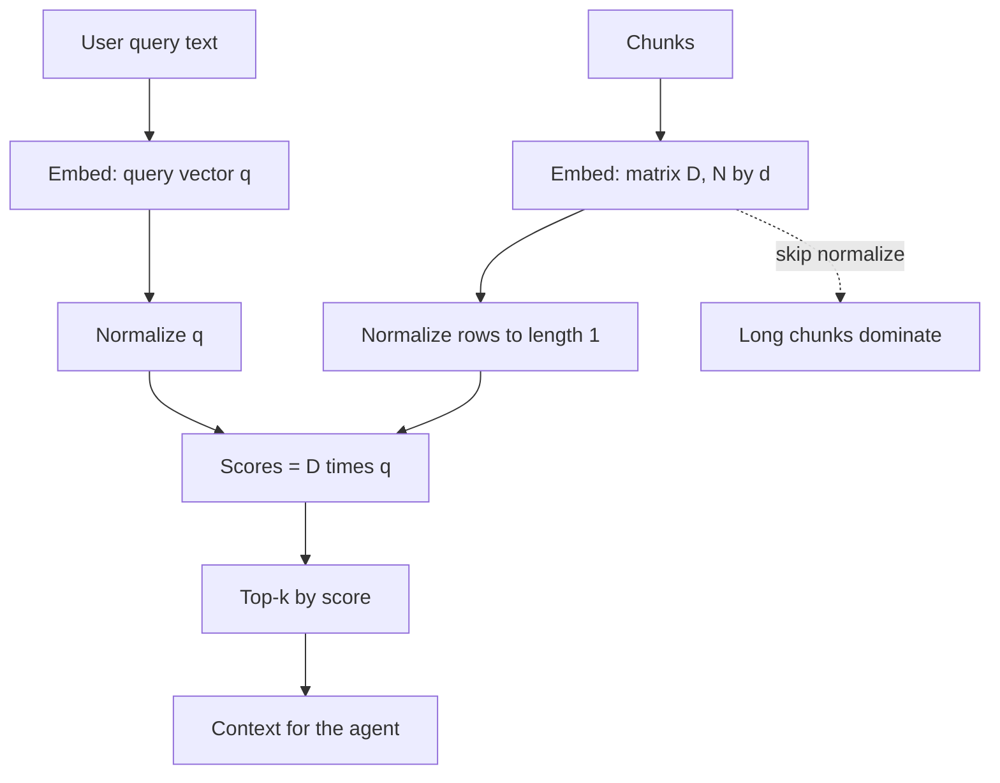

## TL;DR
Embeddings are vectors, similarity is a dot product, and a model layer is a matrix multiply. Knowing
vectors, dot products, matrices and norms lets you choose cosine versus dot product, size a vector index
and debug retrieval that returns the wrong chunks.

## For agent builders
- **Why it matters for agents.** Memory lookup, RAG retrieval, tool routing by description and
  semantic caching all rank items by a vector similarity. The wrong metric silently returns the wrong
  context to your agent.
- **Where it shows up in your stack.** Vector database metric settings (cosine, dot product, L2),
  `normalize_embeddings` options in embedding libraries, embedding dimension choices, and index memory.
- **What you control.** Whether vectors are normalized, which metric the index uses, the embedding
  dimension and dtype, and whether query and document embeddings come from the same model version.
- **What you can skip.** Eigenvalues, determinants and proofs. You need vectors, dot products, norms,
  matrix-vector products and the link between cosine and Euclidean distance.

## Why it exists
- **Meaning needs a geometry.** An embedding model maps text to a point in a few hundred to a few
  thousand dimensions so that related texts land near each other. "Near" must be defined, and that
  definition is linear algebra.
- **Ranking millions of items must be fast.** A matrix-vector product scores every stored vector against
  a query in one operation that hardware is built for.
- **Raw dot products mix two things.** They reward both direction (topic) and length (which, depending on the
  model, can track text length or other quirks), so a long generic chunk can outrank a short exact one.
- **Memory is arithmetic.** One million 1,536-dimension float32 vectors take 6.144 GB before any index
  overhead, and that number sets your vector store bill.

## How it works
### Vectors and norms
- **A vector** is a list of numbers, a point or an arrow in *d*-dimensional space.
- **The L2 norm** is its length: `‖v‖ = sqrt(v1² + v2² + … + vd²)`.
- **Normalizing** divides by the norm so the length becomes 1, keeping only direction.

### Dot product and cosine
```
a · b = a1·b1 + a2·b2 + … + ad·bd = ‖a‖ · ‖b‖ · cos(θ)
cosine(a, b) = (a · b) / (‖a‖ · ‖b‖)          # in [−1, 1], ignores length
‖a − b‖² = ‖a‖² + ‖b‖² − 2 a·b = 2 − 2·cosine   # when both are unit vectors
```
- **Dot product** grows with both alignment and length.
- **Cosine** measures alignment only, because it divides out the lengths.
- **On unit vectors** dot product equals cosine, and squared Euclidean distance ranks items in exactly
  the reverse order of cosine, so all three metrics agree. That is why "normalize, then use dot product"
  is the common recipe.

### Matrices
- **A matrix** is a stack of vectors. An index of *N* documents with dimension *d* is an `N × d` matrix.
- **Matrix-vector product** `D @ q` gives *N* dot products, one score per document, in one call.
- **A layer** in a neural network is `y = W x + b`: each output is a dot product of a weight row with the
  input. Attention scores are `Q Kᵀ`, a matrix of dot products between queries and keys.
- **Shapes must line up:** `(N × d) @ (d,)` gives `(N,)`. Most embedding bugs are shape or
  model-version mismatches.

### Dimension and memory
| Vectors | Dimension | dtype | Raw size |
|---|---|---|---|
| 1,000,000 | 1,536 | float32 (4 bytes) | 6.144 GB |
| 1,000,000 | 1,536 | float16 (2 bytes) | 3.072 GB |
| 1,000,000 | 1,536 | int8 (1 byte) | 1.536 GB |

ANN indexes such as HNSW add graph links on top of this, so treat these as lower bounds.

## Diagram
Trace how a query becomes a ranked list, and where normalization changes the answer.



## Examples
### Dot product versus cosine on a toy index
Three 4-dimension "chunk" vectors; d1 is long and generic. Tested with numpy 2.0.2.

```python
import numpy as np

# Toy 4-d "embeddings". Real ones have 384-3072 dimensions; the arithmetic is identical.
query = np.array([0.9, 0.1, 0.0, 0.4])
docs = np.array([
    [0.8, 0.2, 0.1, 0.5],    # d0: on-topic, short
    [3.0, 2.5, 2.0, 1.0],    # d1: long, generic, large norm
    [0.0, 0.9, 0.8, 0.1],    # d2: off-topic
])

dot = docs @ query                         # one matrix-vector product scores every doc
norms = np.linalg.norm(docs, axis=1)
cos = dot / (norms * np.linalg.norm(query))
print("norms :", np.round(norms, 3))
print("dot   :", np.round(dot, 3), "-> top", dot.argmax())
print("cosine:", np.round(cos, 3), "-> top", cos.argmax())

# Normalize once at index time; then dot product == cosine and is cheaper at query time
unit = docs / norms[:, None]
q_unit = query / np.linalg.norm(query)
print("dot on unit vectors:", np.round(unit @ q_unit, 3))

# Euclidean distance on unit vectors ranks the same as cosine: |a-b|^2 = 2 - 2cos
d2 = ((unit - q_unit) ** 2).sum(axis=1)
print("squared L2 on unit:", np.round(d2, 3), " 2-2cos:", np.round(2 - 2 * cos, 3))
```

Output:

```
norms : [0.97  4.5   1.208]
dot   : [0.94 3.35 0.13] -> top 1
cosine: [0.979 0.752 0.109] -> top 0
dot on unit vectors: [0.979 0.752 0.109]
squared L2 on unit: [0.041 0.496 1.783]  2-2cos: [0.041 0.496 1.783]
```

- **Raw dot product** picks d1 (score 3.35) only because its norm is 4.5; cosine picks d0 (0.979).
- **After normalizing** the dot product reproduces cosine exactly, and squared L2 equals 2 − 2·cosine.

### Worked scenario: an agent's memory keeps recalling the same long note
An assistant stores user notes as embeddings in a vector store configured with inner product, but the
embedding call did not normalize.

| Observation | Explanation |
|---|---|
| A 3,000-word meeting dump is retrieved for almost every query | its vector norm is the largest, so raw dot products favor it |
| Switching the index metric to cosine fixes ranking | cosine divides out length |
| Normalizing at write time and keeping inner product also fixes it | unit vectors make dot product equal cosine |
| Old vectors still unnormalized after the fix | re-embed or re-normalize the stored rows |

## Production patterns
- **Normalize once, at write time.** If the embedding model's docs recommend cosine, normalize vectors
  before storing (many libraries expose a flag such as `normalize_embeddings=True` in
  sentence-transformers `encode`, present in 2.x and later) and use inner product in the index. Monitor norms of stored vectors: they should
  all be 1.0.
- **Match the metric to the model.** Read the embedding model card for its intended similarity; some
  models are trained for dot product with meaningful norms. Record the metric next to the model name in
  index config.
- **Version embeddings with the model.** Store the model name and version with each vector and never
  mix versions in one index, because vectors from different models live in unrelated spaces.
- **Size memory from N × d × bytes.** Compute raw size before choosing dimension or dtype, add index
  overhead, and consider reduced dimension or int8 storage when the eval shows recall holds.
- **Batch scoring as matrix products.** For reranking or deduplication in Python, stack vectors into a
  matrix and use one `@` call instead of Python loops; it is often orders of magnitude faster.

## Trade-offs
- **Higher dimension vs cost.** More dimensions can capture finer distinctions but raise memory and
  latency linearly; flips when a smaller model or truncated dimension keeps recall on your eval.
- **Cosine vs raw dot product.** Cosine is robust to length effects; dot product keeps norm information
  that some models use on purpose. Choose by the model card and a retrieval eval, not habit.
- **Exact vs approximate search.** A full matrix product is exact but linear in N; ANN indexes trade
  a little recall for sublinear query time once N reaches millions.

## Pitfalls
- **Unnormalized vectors under inner product.** Symptom: the same long chunks rank top for unrelated
  queries. **Diagnose** by printing stored vector norms and checking whether score correlates with norm.
  Fix: normalize and re-index, or switch the metric to cosine.
- **Mixing embedding model versions.** Symptom: recall drops after a partial re-index. **Diagnose**
  by grouping hits by stored model version and comparing recall@k per group on a labeled query set.
  Fix: re-embed everything with one version, behind an alias swap.
- **Query and document asymmetry ignored.** Symptom: weak retrieval with a model that expects
  prefixes like "query:" and "passage:". **Diagnose** by comparing recall with and without the
  documented prefixes on 50 labeled queries. Fix: apply the model's required input format.
- **Shape mistakes that broadcast silently.** Symptom: scores have the wrong length or every score is
  identical. **Diagnose** by asserting shapes before the product. Fix: reshape explicitly.

## When to use
- **Use when** choosing an index metric, embedding dimension or dtype, or debugging retrieval rankings.
- **Use when** sizing a vector store or estimating the cost of brute-force scoring.
- **Avoid** hand-rolled linear algebra for production search at millions of vectors; use the vector
  database or an ANN library and keep this math for configuration and debugging.
- **Measure:** stored vector norms, recall@k on labeled queries per metric, and index memory.

## Exercise
**Goal:** show, on your own data, how metric and normalization choices change what your agent retrieves.
- **Inputs:** 200 or more text chunks of varied length from a corpus you own, 20 queries with the
  chunk ids that should be retrieved, and any embedding model you can call.
- **Constraints:** numpy for scoring; no vector database.
- **Deliver:** recall@5 for raw dot product, cosine, and L2 on normalized vectors; a scatter of chunk
  length versus vector norm; and the raw memory for your corpus at float32 and int8.
- **Acceptance:** cosine and normalized L2 give identical rankings; you can explain any difference from
  raw dot product using the norms you printed; one memory figure is checked by hand. If every norm is
  already 1.0, your model normalizes for you (many embedding APIs do): record that, and repeat with a
  model whose raw output is not unit length to see the effect.

## Role lens
- **Engineer:** Configures vector stores with the right metric, normalizes at write time, asserts
  shapes, and debugs bad retrieval by inspecting norms and similarity scores.
- **Architect:** Chooses embedding dimension, dtype and index type from memory arithmetic and recall
  measurements, and enforces one embedding version per index.
- **FDE:** Explains to a customer why some documents always surface, and sizes their vector store in
  gigabytes from document counts and embedding dimension.

## Check yourself
**Q:** You index 5 million chunks with a 1,024-dimension model in float32 using inner product, without
normalizing. Users report that long policy documents appear for every question. What is wrong and
what does the index cost in raw memory?
**A:** Inner product on unnormalized vectors rewards vector length as well as direction, and with this
model the long, dense policy chunks evidently have the largest norms (confirm by printing them), so
they win regardless of topic. Normalize every vector to unit
length and re-index, or switch the metric to cosine; on unit vectors dot product, cosine and L2 all rank the
same. Raw memory is 5,000,000 × 1,024 × 4 bytes ≈ 20.5 GB before index overhead, about half that in
float16.

## Interview questions
### What is the difference between dot product and cosine similarity, and when are they equal?
- **Dot product** multiplies matching components and sums them, so it grows with both vector length
  and alignment.
- **Cosine** divides the dot product by both lengths, keeping only direction; they are equal when both
  vectors have length 1.

### Your RAG agent keeps retrieving the same few chunks for unrelated questions. How do you debug it?
- **Check norms and metric:** print stored vector norms and the index metric; large-norm chunks winning
  under inner product means vectors were not normalized.
- **Check versions and prefixes:** confirm one embedding model version and the model's required query and
  passage formats, then measure recall@k on labeled queries after each fix.

### When would you deliberately not normalize embeddings?
- **When the model uses the norm:** some embedding and recommendation models are trained for raw dot
  product, where length encodes popularity or confidence.
- **Decide by evidence:** follow the model card and compare recall on a labeled set with and without
  normalization.

### How much memory do 10 million 768-dimension embeddings need, and how would you cut it?
- **Raw size:** 10,000,000 × 768 × 4 bytes ≈ 30.7 GB in float32, before ANN graph or metadata overhead.
- **Levers:** float16 or int8 storage, a smaller or truncated dimension, or product quantization, each
  validated by recall@k on your eval set.

## Quiz
### Q: For unit-length vectors, which statement is true?
- [ ] Dot product and cosine can rank documents differently
- [x] Dot product equals cosine, and Euclidean distance gives the reverse of the same ranking
- [ ] Euclidean distance is undefined
- [ ] Cosine is always zero
> When both lengths are 1, the cosine formula's denominator is 1, so dot product equals cosine, and
> squared distance equals 2 minus 2 times cosine, so smaller distance means higher cosine.

### Q: What does the product D @ q compute when D is an N by d matrix of document embeddings?
- [ ] The average of all document vectors
- [ ] A d by d similarity matrix
- [x] N dot products, one score per document
- [ ] The norm of q
> Each row of D is dotted with q, giving one similarity per document in a single vectorized operation,
> which is how brute-force retrieval scores a whole index.

### Q: Roughly how much raw memory do 1 million 1,536-dimension float32 embeddings take?
- [ ] About 1.5 MB
- [ ] About 150 MB
- [x] About 6 GB
- [ ] About 60 GB
> One million times 1,536 values times 4 bytes is 6.144 billion bytes. Index structures and
> metadata add more on top of this raw figure.

## Mastery test
**Problem:** an agent's semantic cache returns a stored answer when cosine similarity between a new
request and a cached one is at least 0.92, using 1,536-dimension unit vectors.

To cut memory for 2 million entries, the team moves to a store that only supports Euclidean distance and truncates every
stored and query vector to its first 256 components. The hit rate jumps from 18% to 41% and users get
wrong cached answers.

What threshold matches the old rule, why did hits jump, and what did memory drop to?

**A strong answer:**
- converts the rule with ‖a − b‖² = 2 − 2·cosine: cosine ≥ 0.92 means squared L2 ≤ 0.16, or L2 ≤ 0.4,
  and checks whether the store reports distance or squared distance;
- explains the jump: truncated vectors are no longer unit length (norms well below 1), and dropping
  components can only shrink distances, so far more pairs fall under a threshold set for unit vectors;
- re-normalizes after truncating, then re-tunes the threshold on labeled same-intent and
  different-intent request pairs, because 256-dimension similarities are distributed differently;
- computes memory: 2,000,000 × 1,536 × 4 bytes ≈ 12.3 GB raw becomes 2,000,000 × 256 × 4 ≈ 2.05 GB,
  before index overhead, and tracks wrong-hit rate, not just hit rate, after the change.

## Use cases & projects
### Use cases
- **RAG retrieval.** Metric and normalization choices decide which chunks reach the agent's context.
- **Agent memory.** Similarity search over stored notes and past turns depends on consistent,
  normalized embeddings from one model version.
- **Tool routing and semantic caching.** Requests are matched to tool descriptions or cached answers by
  cosine similarity with a threshold.
- **Capacity planning.** Vector store size and cost follow directly from count, dimension and dtype.

### Mini project
**Build a 50-line semantic memory (1-2 hours).**
- **Goal:** give a chat agent a memory that retrieves relevant past notes correctly.
- **Steps:** embed 100 notes of mixed length; store them as a normalized numpy matrix with model name
  and version; retrieve top-3 by matrix product for 20 test questions; repeat without normalization.
- **Done when:** you have a recall table for both versions, a printed norm check, and a short note on
  why the normalized version wins on your data.
