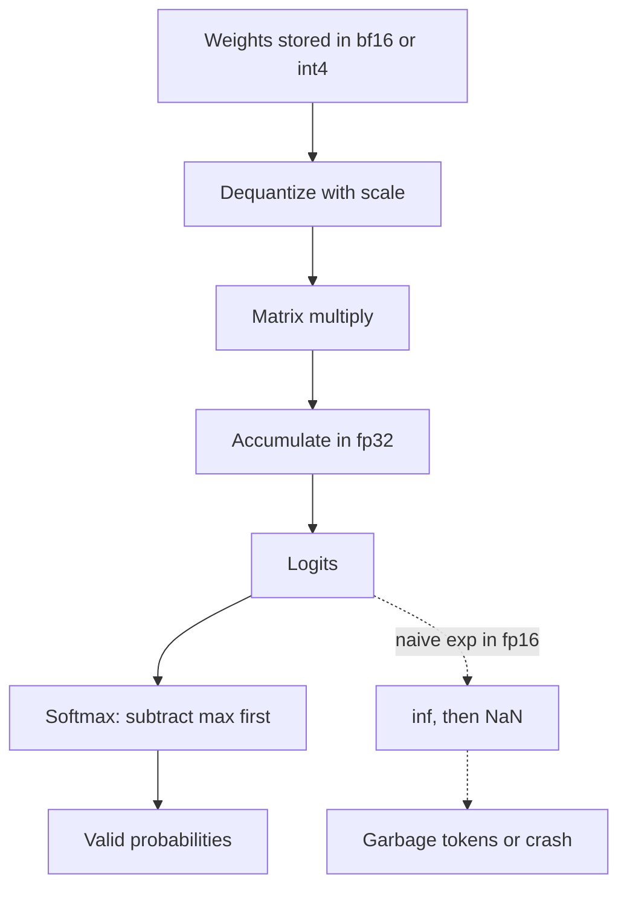

## TL;DR
Models store numbers in limited bits, so every format trades range against precision. Knowing floating
point, fp16, bf16, overflow and integer quantization explains NaN outputs, memory budgets for self-hosted
agents and why replays are not bit-identical.

## For agent builders
- **Why it matters for agents.** Running an agent on a self-hosted or local model means choosing a
  dtype or quantization level. That choice sets GPU memory, speed, and whether tool calls stay correct.
- **Where it shows up in your stack.** `torch_dtype` in Hugging Face loaders (renamed `dtype` in
  transformers 4.56+, old name still accepted with a warning), `dtype` and `kv_cache_dtype` in vLLM, quantized checkpoint formats (GPTQ, AWQ, GGUF), mixed-precision training
  flags, and NaN errors in logs.
- **What you control.** The weight dtype, the KV-cache dtype, the quantization method and group size,
  and whether softmax and accumulations run in higher precision.
- **What you can skip.** Bit-level IEEE rounding modes and hardware microarchitecture. Know the table
  of formats, the overflow and swamping failures, and how int8 scales work.

## Why it exists
- **Memory sets what you can serve.** A 7B-parameter model needs about 28 GB in fp32, 14 GB in bf16,
  7 GB in int8 and 3.5 GB in 4-bit, so dtype decides whether it fits a given GPU or laptop.
- **Fewer bits are faster.** Decode is bound by memory bandwidth, so halving bytes per weight roughly
  halves the bytes read per token, and tensor cores run low-precision math at higher throughput.
- **But fewer bits break things.** fp16 overflows above 65,504, so `exp(12)` (about 162,755) becomes
  infinity and a softmax becomes NaN. Small updates can vanish when added to large numbers.
- **Floating point is not real arithmetic.** In float64, `(0.1 + 0.2) + 0.3` is 0.6000000000000001
  but `0.1 + (0.2 + 0.3)` is 0.6, so summation order changes results and replays drift.

## How it works
### Floating point in one line
```
value = sign × 1.mantissa × 2^(exponent − bias)
```
- **Exponent bits set range** (how large or small a number can be).
- **Mantissa bits set precision** (how many significant digits). Machine epsilon is the gap between 1
  and the next representable number: 2 to the power of minus the mantissa bits.

### The formats you will meet
| Format | Exponent / mantissa bits | Max value | Epsilon | Typical use |
|---|---|---|---|---|
| fp32 | 8 / 23 | ~3.4e38 | ~1.19e-7 | master weights, optimizer state, accumulators |
| fp16 | 5 / 10 | 65,504 | ~0.000977 | inference, older mixed-precision training |
| bf16 | 8 / 7 | ~3.39e38 | 0.0078125 | modern training and inference |
| fp8 E4M3 / E5M2 | 4 / 3, 5 / 2 | 448 / 57,344 | coarse | KV caches, newer training and serving |
| int8, int4 | integers plus a scale | scale × 127, scale × 7 | set by scale | weight quantization |

- **bf16 keeps fp32's range with fewer digits**, so it rarely overflows but rounds coarsely: 1.001 becomes 1.0.
- **fp16 has more digits but tiny range:** its smallest normal value is about 6.1e-5, so small gradients
  underflow; fp16 training therefore uses loss scaling, while bf16 usually does not need it.

### Three failure mechanisms
1. **Overflow:** a value beyond the max becomes inf; `inf − inf` or `inf / inf` gives NaN, which spreads
   through every later operation. In fp16, `exp(x)` overflows for x above about 11.09.
2. **Underflow:** values below the smallest representable become zero (gradients disappear).
3. **Swamping:** adding a small number to a large one loses it. In fp16, 2048 + 1 rounds back to 2048,
   because the gap between representable numbers there is 2.

### The fixes frameworks already apply
- **Max subtraction in softmax:** `exp(z − max z)` keeps every exponent at most 0, which cannot overflow.
- **Higher-precision accumulation:** matrix multiplies in fp16 or bf16 accumulate in fp32.
- **fp32 master weights:** mixed-precision training keeps an fp32 copy so tiny updates are not swamped.

### Integer quantization
```
scale = max(|w|) / 127          # symmetric int8, per tensor, channel or group
q     = round(w / scale)         # stored as int8
w_hat = q × scale                # dequantized at compute time
```
- **One outlier sets the scale** for its whole group, so small weights get few distinct levels.
  Per-channel or per-group scales (groups of 64 or 128 weights are common) and outlier handling, as in
  LLM.int8(), limit the damage.

## Diagram
Follow a value through a low-precision forward pass and see where each guard sits.



## Misconceptions
- **"fp16 and bf16 are interchangeable 16-bit formats."** Same bytes, different split: fp16 spends bits on
  digits and tops out at 65,504, bf16 keeps fp32's range with only 7 mantissa bits. A bf16-trained model
  cast to fp16 can overflow on some prompts and emit garbage.
- **"A NaN in the output means corrupted weights."** More often it is arithmetic: one value overflows to
  inf, `inf − inf` gives NaN, and NaN spreads. A naive fp16 softmax of logits as ordinary as 12 does
  this; subtracting the max fixes it.
- **"int8 loses a fixed, tiny amount of precision on every weight."** Error depends on the scale, and one
  outlier sets the scale for its whole group: with a 2.5 weight in the row, −0.05 comes back as −0.0591,
  an 18% error. Per-group scales exist for this.
- **"If the quantized model chats well, its tool calls are fine."** Quantization error shifts close
  logits, and strict JSON or exact arguments notice first. Gate the checkpoint on a paired tool-call eval,
  not a few chat prompts.
- **"Greedy decoding replays bit-identically."** Batch size, kernel choice and summation order change
  low-order bits, and a near-tie between two tokens can then flip. Test replays on outcomes and tool
  sequences, not exact text.

## Examples
### Overflow, swamping, bf16 rounding and int8 outliers
numpy has no native bf16, so the script emulates it by rounding fp32 to its top 16 bits. Tested with
numpy 2.0.2.

```python
import numpy as np
np.seterr(over="ignore", invalid="ignore")   # we want to SEE inf and nan here

def to_bf16(x):
    """Round float32 to bfloat16 (keep the top 16 bits, round to nearest even), back as float32."""
    b = np.asarray(x, np.float32).view(np.uint32)
    b = (b + 0x7FFF + ((b >> 16) & 1)) & 0xFFFF0000
    return b.view(np.float32)

fp16 = np.finfo(np.float16)
print("fp16 max:", float(fp16.max), " eps:", fp16.eps, " smallest normal:", fp16.tiny)
print("bf16 max:", (2 - 2.0 ** -7) * 2.0 ** 127, " eps:", 2.0 ** -7)

# 1. Overflow: logits of 12 are ordinary, but exp(12) does not fit in fp16
logits = np.array([12.0, 10.0, 3.0], np.float16)
naive = np.exp(logits) / np.exp(logits).sum()
stable = np.exp(logits - logits.max()) / np.exp(logits - logits.max()).sum()
print("naive fp16 softmax:", naive, " stable:", stable)

# 2. Swamping: small updates vanish when added to a large fp16 accumulator
acc = np.float16(2048)
for _ in range(100):
    acc = np.float16(acc + np.float16(1))
print("2048 + 1 (x100) in fp16 =", acc, " in fp32 =", np.float32(2048) + 100)

# 3. bf16 keeps range, loses digits
print("bf16(1.001) =", to_bf16(1.001), " bf16(70000) =", to_bf16(70000.0),
      " fp16(70000) =", np.float16(np.float32(70000.0)))

# 4. int8 symmetric quantization of a weight row with one outlier
w = np.array([0.02, -0.05, 0.03, 0.01, -0.02, 2.5], np.float32)
scale = np.abs(w).max() / 127
q = np.clip(np.round(w / scale), -127, 127).astype(np.int8)
print("int8:", q, " dequant:", np.round(q * scale, 4), " scale:", round(float(scale), 5))
```

Output:

```
fp16 max: 65504.0  eps: 0.000977  smallest normal: 6.104e-05
bf16 max: 3.3895313892515355e+38  eps: 0.0078125
naive fp16 softmax: [nan  0.  0.]  stable: [8.8037e-01 1.1920e-01 1.0866e-04]
2048 + 1 (x100) in fp16 = 2048.0  in fp32 = 2148.0
bf16(1.001) = 1.0  bf16(70000) = 70144.0  fp16(70000) = inf
int8: [  1  -3   2   1  -1 127]  dequant: [ 0.0197 -0.0591  0.0394  0.0197 -0.0197  2.5   ]  scale: 0.01969
```

- **Overflow:** the naive softmax returns NaN; subtracting the max gives valid probabilities.
- **Swamping:** a hundred additions of 1 change nothing in fp16, while fp32 reaches 2148.
- **Range versus digits:** bf16 stores 70,000 as 70,144 (coarse but finite); fp16 gives inf.
- **Outlier:** the 2.5 weight forces a scale of 0.0197, so −0.05 becomes −0.0591 (18% error) and 0.03
  becomes 0.0394 (31%). Without the outlier the scale would be about 0.00039, 50x finer.

### Worked scenario: a local agent emits garbage after a dtype change
An illustrative case: a team moved a bf16-trained 7B model to an older GPU without bf16 support and
loaded it in fp16 to save memory.

| Observation | Cause | Fix |
|---|---|---|
| Some prompts return empty or repeated tokens | activations above 65,504 overflow to inf, then NaN | load in fp32 on that GPU, or use a GPU with bf16 |
| Short prompts look fine | large activations appear only on some inputs | test long and tool-heavy prompts |
| 4-bit checkpoint works but tool JSON breaks more often | quantization error shifts close logits | compare tool-call validity versus bf16 on an eval |

## Production patterns
- **Serve in bf16 by default on hardware that supports it.** Set `torch_dtype=torch.bfloat16` (or
  `dtype="bfloat16"` in vLLM) for models trained in bf16, and avoid casting them to fp16. Monitor for NaN
  logits and empty generations.
- **Quantize with an agent eval as the gate.** Before shipping a 4-bit or 8-bit checkpoint, run the same
  tool-calling and task eval on both precisions and compare with a paired test; JSON validity and
  argument accuracy often degrade before general chat quality.
- **Quantize the KV cache separately.** An FP8 KV cache (`kv_cache_dtype="fp8"` in vLLM, option name as of
  0.6.x) roughly
  doubles resident sequences versus fp16 at small quality cost; evaluate long-context agent runs, where
  errors accumulate.
- **Keep sensitive math in fp32.** Softmax, layer norm, loss computation and accumulations stay in fp32
  inside mixed-precision code; when writing custom scoring or reranking code, do the same.
- **Make replay tests tolerant.** Batch size, kernel choice and summation order change low-order bits,
  so even greedy decoding can diverge on near-ties. Compare agent replays on outcomes and tool sequences,
  not exact text.

## Trade-offs
- **fp16 vs bf16.** fp16 has more precision per value, but its narrow range causes overflow and needs
  loss scaling in training; bf16 has fp32's range but coarser rounding. bf16 wins where hardware supports it.
- **4-bit vs 8-bit weights.** 4-bit halves memory again and speeds decode, but quality loss is larger
  and task dependent; flips toward 8-bit when tool-call accuracy drops on your eval.
- **Speed vs reproducibility.** Fast fused kernels and dynamic batching change summation order, so
  results vary slightly between runs; deterministic modes exist but cost throughput.
- **Per-tensor vs per-group scales.** Per-tensor is simplest and fastest; per-group spends a little memory
  on more scales to cut error from outliers.

## Pitfalls
- **Casting a bf16 model to fp16.** Symptom: NaN logits, empty or repeated output on some prompts.
  **Diagnose** by checking the loaded dtype and logging the max absolute activation or any inf per
  layer on a failing prompt. Fix: load in bf16 or fp32, or use a GPU that supports bf16.
- **Naive exp or log in custom code.** Symptom: NaN scores in a reranker or calibration step.
  **Diagnose** with `np.isfinite` checks after each step and by printing the max input to `exp`. Fix:
  subtract the max, use log-sum-exp, and compute in fp32.
- **Trusting a quantized model's chat quality for tool use.** Symptom: more malformed JSON or wrong
  arguments after switching to a 4-bit checkpoint. **Diagnose** with a paired eval of tool-call validity
  between precisions on the same prompts. Fix: use 8-bit, a better quantization method, or constrained
  decoding.
- **Exact-match replay tests.** Symptom: flaky tests after an engine or batch-size change. **Diagnose** by
  diffing outputs and finding the first divergent token at a near-tie. Fix: assert on outcomes.

## When to use
- **Use when** choosing dtype or quantization for a self-hosted or local agent model, or sizing GPUs.
- **Use when** debugging NaNs, empty generations or numerical drift in training or inference.
- **Avoid** hand-tuning precision on hosted APIs; the provider chooses it and you evaluate outputs.
- **Measure:** memory per configuration, tokens per second, NaN counts, and paired task-eval scores
  per precision.

## Exercise
**Goal:** decide the cheapest precision a small local model can run at for your agent's tool calls.
- **Inputs:** one open model of 0.5B to 3B parameters available in bf16 (or fp32) and at least one
  8-bit or 4-bit variant, plus 100 tool-call prompts with expected JSON.
- **Constraints:** same prompts, greedy decoding, same engine; record dtype and quantization method.
- **Deliver:** a table of memory use, tokens per second, JSON validity and argument accuracy per
  precision, with the paired difference and its interval versus the highest precision.
- **Acceptance:** weight memory (checkpoint size or the loader's reported footprint, not total GPU
  memory, which adds KV cache and runtime overhead) matches bytes per parameter times parameter count
  within about 20%, or you explain the gap (scales, embeddings left unquantized);
  your recommendation names the precision and the eval evidence; one NaN or overflow check is included.

## Role lens
- **Engineer:** Picks dtypes and quantized checkpoints for agent models, keeps softmax and accumulation
  numerically safe in custom code, and debugs NaNs from activations and dtypes.
- **Architect:** Sizes GPUs and edge devices from bytes per parameter, sets precision policy per
  deployment, and requires paired evals before any quantization change ships.
- **FDE:** Explains to a customer why the 4-bit model that fits their laptop makes more tool-call
  errors, and what hardware or precision closes the gap.

## Check yourself
**Q:** A customer wants to run a 13B-parameter agent model on a single 24 GB GPU that does not support
bf16. The model was trained in bf16. What are the options, and what would you check?
**A:** In bf16 or fp16 the weights alone need about 26 GB, which does not fit, and fp16 risks overflow
for a bf16-trained model anyway. Options: 8-bit weights at about 13 GB, leaving room for the KV cache;
4-bit at about 6.5 GB, leaving more room but with larger quality risk; or a smaller model. Check the
quantized model with a paired eval of tool-call validity and task success against the full-precision model
on other hardware, watch for NaN or empty outputs, and size the KV cache for the expected context.

## Interview questions
### What is the difference between fp16 and bf16, and why did training move to bf16?
- **Bit split:** both use 16 bits, but fp16 has 5 exponent and 10 mantissa bits while bf16 has 8 and 7,
  so bf16 matches fp32's range with less precision.
- **Why it won:** bf16 rarely overflows or underflows, so training needs no loss scaling and is more
  stable, and modern accelerators support it natively.

### Your self-hosted agent model returns empty strings for some prompts after a deployment change. How do you debug it?
- **Check dtype first:** confirm the loaded dtype and whether a bf16 model was cast to fp16; log inf or NaN
  in logits for a failing prompt.
- **Then isolate:** compare against the previous engine version and precision on the same prompts, and
  look at maximum activation values per layer to find overflow.

### When would you not quantize a model to 4-bit?
- **When the task is sensitive:** structured outputs, long tool-call arguments or arithmetic often
  degrade first, and your paired eval shows a drop you cannot accept.
- **When memory is not the bottleneck:** if bf16 or 8-bit fits with enough KV-cache room, the speed
  gain may not justify the quality risk.

### How much GPU memory do the weights of a 70B model need at different precisions?
- **Bytes per parameter:** about 140 GB in bf16, 70 GB in int8 and 35 GB in 4-bit, plus a little for
  quantization scales.
- **Then add the KV cache and activations,** which grow with context and concurrency, so the weights
  figure is only the floor.

## Quiz
### Q: Why does a naive fp16 softmax of the logits [12, 10, 3] return NaN?
- [ ] fp16 cannot represent the number 12
- [x] exp(12) is about 162,755, beyond fp16's max of 65,504, so it becomes infinity and inf divided by inf is NaN
- [ ] Softmax is undefined for more than two values
- [ ] fp16 rounds every small probability to NaN
> Overflow turns exp(12) into inf, and normalizing by an infinite sum gives NaN. Subtracting the max
> logit first keeps every exponent at most 0 and fixes it.

### Q: What does bf16 trade compared with fp16?
- [ ] More precision for less range
- [x] More range for less precision
- [ ] Both more range and more precision
- [ ] Neither; they are the same format
> bf16 uses 8 exponent bits like fp32, so it covers a huge range, but only 7 mantissa bits, so it
> rounds more coarsely; 1.001 becomes 1.0 in bf16.

### Q: In symmetric int8 quantization, why does one large outlier weight hurt the other weights in its group?
- [ ] The outlier is stored in fp32 and slows the group down
- [ ] Integers cannot represent negative numbers
- [x] The scale is set by the largest magnitude, so small weights get only a few coarse levels
- [ ] Outliers are clipped to zero
> The scale equals max absolute weight divided by 127, so an outlier of 2.5 makes each level about
> 0.0197 wide, larger than many small weights. Per-group scales or outlier handling reduce this.

## Mastery test
**Problem:** you build a reranker for an agent's retrieval step that scores 200 chunks with your own code,
computing `exp(score / 0.05)` in fp16 on a GPU and normalizing. With some queries every chunk gets NaN and
the agent receives no context.

Separately, chunks whose fp32 cosine scores are 0.8313 and 0.8317 come
out tied. Explain both failures and fix them without changing the model.

**A strong answer:**
- notes that dividing by 0.05 multiplies scores by 20, so any score above about 0.55 pushes `exp` past
  fp16's limit (x above 11.09) and creates inf, then NaN;
- explains the ties: fp16 spacing between 0.5 and 1 is 2⁻¹¹ ≈ 0.00049, so both scores round to
  0.83154 before the temperature is applied, and the order between them is lost;
- fixes both with max subtraction or log-sum-exp, computed in fp32 from fp32 scores;
- adds `isfinite` assertions and a fallback ranking so a numeric error cannot empty the agent's context;
- adds a test with extreme scores.

## Use cases & projects
### Use cases
- **Local and edge agents.** Choosing 4-bit or 8-bit checkpoints decides whether an agent model fits a
  laptop or a small GPU, traded against tool-call accuracy.
- **Self-hosted serving capacity.** Weight and KV-cache dtypes set how many concurrent agent sessions a
  GPU holds.
- **Fine-tuning SLMs.** bf16 mixed precision with fp32 master weights keeps small-model fine-tunes
  stable and memory-efficient.
- **Replay and regression testing.** Understanding floating-point non-determinism keeps agent replay
  tests from flaking on harmless low-order differences.

### Mini project
**Precision ladder for a tool-calling SLM (2-3 hours).**
- **Goal:** measure what each precision step costs in agent quality.
- **Steps:** run one small open model at bf16, 8-bit and 4-bit on 100 tool-call prompts; record memory,
  tokens per second, JSON validity and argument accuracy; compute paired differences versus bf16 with a
  bootstrap interval.
- **Done when:** you have a table with intervals, a chosen precision for a 16 GB GPU and for a laptop,
  and one paragraph explaining the trade-off with your numbers.
