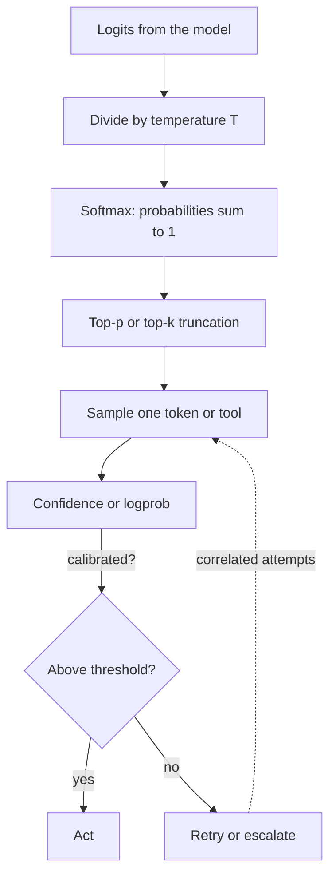

## TL;DR
An LLM is a machine that outputs a probability distribution over the next token. Distributions,
conditional probability and Bayes' rule let you set temperature, predict multi-step agent reliability,
and read a judge's or classifier's flags correctly.

## For agent builders
- **Why it matters for agents.** Every tool choice, argument and answer is a sample from a distribution.
  Whether a 10-step agent finishes, or a retry helps, is a probability question you can compute.
- **Where it shows up in your stack.** `temperature`, `top_p` and `logprobs` on model APIs, retries
  and best-of-n in the agent loop, confidence thresholds on routers and guardrails, judge flags in evals.
- **What you control.** The sampling settings, how many attempts you allow, which signals you combine
  into a decision, and the threshold at which a probability becomes an action.
- **What you can skip.** Measure theory and proofs. You need softmax, independence, the product rule,
  Bayes' rule and the idea of calibration, all computable in a few lines of Python.

## Why it exists
- **Model outputs are distributions, not answers.** The model produces logits; softmax turns them into
  probabilities; a sampler picks one. Treating the output as deterministic hides why the same prompt gives
  different tool calls.
- **Agents chain many uncertain steps.** At 95% per-step success, a 10-step run succeeds about 59.9% of
  the time if the steps are independent. Intuition says "95% is good"; the product says otherwise.
- **Detectors have base rates.** A judge that is 90% sensitive with a 10% false-positive rate, on a 5%
  hallucination rate, is right only about 32% of the times it fires. Without Bayes you over-trust alerts.
- **Confidence numbers drive routing.** Escalating when confidence is below 0.7 only works if 0.7 means
  "right 70% of the time", which is calibration, and it must be measured, not assumed.

## How it works
### Distributions and softmax
- **A discrete distribution** assigns each outcome a probability in [0, 1]; they sum to 1. The
  vocabulary, or a set of tool names, is the outcome space.
- **Softmax** maps logits *z* to probabilities. Temperature *T* divides the logits first:

```
p_i = exp(z_i / T) / sum_j exp(z_j / T)
```

- **T below 1 sharpens** (the top token gains mass); **T above 1 flattens**; T near 0 is greedy argmax.
  Top-p keeps the smallest set of top tokens whose probability sums to at least p and renormalizes over it.

### Conditional probability and independence
1. **Conditional:** `P(A|B) = P(A and B) / P(B)`, the probability of A once B is known.
2. **Product rule:** `P(A and B) = P(A|B) · P(B)`. A sequence's probability is the product of each
   token's probability given the tokens before it, which is exactly how an LLM scores text.
3. **Independence:** `P(A and B) = P(A) · P(B)` only when B tells you nothing about A. Agent steps and
   retries are often correlated (same prompt, same blind spot), so independence gives an optimistic bound.

### Bayes' rule
```
P(H | E) = P(E | H) · P(H) / P(E),    P(E) = P(E|H)·P(H) + P(E|not H)·P(not H)
```
- **Prior** P(H): the base rate before evidence. **Likelihood** P(E|H): how often the evidence appears
  when H is true. **Posterior** P(H|E): what you should believe after seeing the evidence.
- **The base rate dominates** when it is small, because false positives from the large "not H" group
  swamp true positives from the small H group.

### Calibration
- **A model is calibrated** when, among predictions made with confidence 0.8, about 80% are correct.
- **Measure it by binning:** group predictions by stated confidence and compare each bin's mean
  confidence with its accuracy. Expected calibration error (ECE) is the weighted gap.
- **Fix with a held-out set.** Temperature scaling or a simple mapping fitted on labeled examples, then
  re-check on fresh data.

## Diagram
Follow one generation step from logits to an action, and see where each probability idea enters.



## Examples
### Temperature, sampling, chained steps and Bayes in one script
Runs with numpy only; every printed number below was produced by this code (numpy 2.0.2, Python 3.9).

```python
import numpy as np

def softmax(logits, T=1.0):
    z = np.asarray(logits, dtype=float) / T
    z -= z.max()                       # stability: subtract the max before exp
    p = np.exp(z)
    return p / p.sum()

# 1. Temperature reshapes the next-token distribution (4 candidate tool names)
logits = [2.0, 1.0, 0.5, -1.0]
for T in (0.5, 1.0, 2.0):
    print(f"T={T}: {np.round(softmax(logits, T), 3)}")

# 2. Sampling: empirical frequencies converge to p
rng = np.random.default_rng(0)
p = softmax(logits, 1.0)
draws = rng.choice(4, size=10_000, p=p)
print("empirical:", np.round(np.bincount(draws, minlength=4) / 10_000, 3))

# 3. Independent steps multiply: a 10-step agent with 95% per-step success
print("10-step success:", round(0.95 ** 10, 3))
# pass@k with per-attempt success 0.3 and independent attempts
print("pass@5:", round(1 - (1 - 0.3) ** 5, 3))

# 4. Bayes: a judge flags a hallucination. How likely is it real?
base, sens, fpr = 0.05, 0.90, 0.10      # P(H), P(flag|H), P(flag|not H)
p_flag = sens * base + fpr * (1 - base)
print("P(flag):", round(p_flag, 3), " P(H|flag):", round(sens * base / p_flag, 3))
```

Output:

```
T=0.5: [0.842 0.114 0.042 0.002]
T=1.0: [0.609 0.224 0.136 0.03 ]
T=2.0: [0.434 0.263 0.205 0.097]
empirical: [0.611 0.225 0.134 0.03 ]
10-step success: 0.599
pass@5: 0.832
P(flag): 0.14  P(H|flag): 0.321
```

- **Temperature:** at T=0.5 the top tool gets 84.2%; at T=2.0 the worst tool rises from 3% to 9.7%.
  For tool selection that is a 3x jump in picking the wrong tool.
- **Bayes:** of the 14% of answers the judge flags, only about a third are real hallucinations.

### Worked scenario: should the agent retry or escalate?
A support agent's refund-tool call succeeds 70% of the time on the first attempt.

| Assumption | P(success within 3 attempts) | Reading |
|---|---|---|
| Attempts independent | 1 − 0.3³ = 0.973 | Retries look almost free |
| Measured: retry succeeds 20% after a failure | 0.7 + 0.3·0.2 + 0.3·0.8·0.2 = 0.808 | Failures are sticky |

The team measured the conditional rate from traces, saw the second row, and changed policy: one retry
with the error message fed back, then escalate to a human.

## Production patterns
- **Pick temperature per step type.** Use low temperature (0 to 0.3) for tool selection, argument
  extraction and classification, higher for drafting. Monitor tool-selection accuracy per setting on
  your eval set rather than trusting defaults.
- **Measure conditional retry success.** Log attempt number and outcome per tool call, then compute
  P(success on attempt k | failed before). Set `max_retries` where that number drops below what a
  fallback or human costs.
- **Use logprobs as a signal, then calibrate it.** Request `logprobs` where the API offers them, convert
  to a confidence for a label or tool, fit a threshold on labeled traces, and track a reliability
  diagram monthly because model updates shift it.
- **Bayes-correct every alert.** For judges, guardrails and anomaly detectors, record base rate,
  sensitivity and false-positive rate, and report precision of flags, not just recall.
- **Budget multi-step reliability.** Multiply measured per-step success rates to forecast end-to-end
  completion; when the product is too low, shorten the plan or add verification steps.

## Trade-offs
- **Low vs high temperature.** Low gives repeatable tool calls but can lock in one wrong choice every
  time; high gives diversity for best-of-n but more malformed calls. Flips when you add a verifier.
- **Independence assumption vs measured correlation.** Independence is easy to compute but
  overstates retry and pass@k gains; measured conditionals cost logging work but predict reality.
- **Single threshold vs calibrated probability.** A fixed cutoff is simple but silently drifts with
  model versions; calibration needs labeled data and periodic refits.

## Pitfalls
- **Assuming retries are independent.** Symptom: production completion far below `1 − (1−p)^k`.
  **Diagnose** by grouping traces by task and computing success on attempt 2 given attempt 1 failed.
  Fix: change something between attempts (error feedback, different prompt or model) or escalate sooner.
- **Ignoring the base rate.** Symptom: reviewers say most judge flags are false alarms. **Diagnose**
  by hand-labeling 100 flagged and 100 unflagged items and computing precision with Bayes' rule. Fix:
  raise the threshold, add a second signal, or route flags to cheap review.
- **Reading raw confidence as probability.** Symptom: answers stated at 0.9 confidence are wrong
  30% of the time. **Diagnose** with a reliability diagram on a held-out set. Fix: temperature scaling
  or isotonic mapping, refit when the model changes.
- **Changing temperature and calling it a fix.** Symptom: an eval moves after a temperature change, but
  only on one run. **Diagnose** by running each setting several times with different seeds. Fix:
  compare distributions of scores, not single runs.

## When to use
- **Use when** setting sampling parameters, retry budgets, routing thresholds or alert policies.
- **Use when** someone quotes a single accuracy for a multi-step agent; multiply out the steps.
- **Avoid** heavy probabilistic modeling when you can measure the end-to-end rate directly on enough
  traces; measurement beats a model of the system.
- **Measure:** per-step success, conditional retry success, flag precision, and calibration error.

## Exercise
**Goal:** build a reliability model of one of your agent's tool calls from real or simulated traces.
- **Inputs:** a log of at least 200 tool-call attempts with task id, attempt number, success flag and
  any model confidence (simulate with a seeded generator if you have no traces yet).
- **Constraints:** numpy or plain Python; no stats libraries.
- **Deliver:** per-attempt success, the conditional P(success | earlier failures), predicted versus
  observed completion within 3 attempts under the independence assumption, and a 10-bin reliability
  table for the confidence column.
- **Acceptance:** on a simulated log with independent attempts, predicted and observed completion
  agree within about 2 points (your control); on real traces, or a simulation where each task draws its
  own success rate, observed falls below predicted and you explain why; bin counts sum to the number of
  attempts; one bin is checked by hand.

## Role lens
- **Engineer:** Chooses temperature, retry counts and confidence thresholds from measured probabilities
  instead of defaults, and logs the fields needed to compute them.
- **Architect:** Models end-to-end agent reliability as a product of step success rates and decides
  where verification steps or human review raise it most cheaply.
- **FDE:** Explains to a customer why a "90% accurate" detector produces mostly false alarms on rare
  events, using the base rate and Bayes' rule with their own numbers.

## Check yourself
**Q:** Your agent plans 8 steps, each with 97% measured success, and a guardrail flags 2% of outputs
as unsafe with 95% sensitivity and a 1.5% false-positive rate on a 0.5% true-unsafe rate. What do you tell
the product owner?
**A:** If steps were independent, end-to-end success is 0.97⁸ ≈ 0.784, so about one run in five fails
somewhere; correlated failures could make it better or worse, so confirm from traces. For the guardrail,
true positives are 0.95 × 0.005 = 0.00475 and false positives are 0.015 × 0.995 ≈ 0.0149, so only
about 24% of flags are truly unsafe. Recommend shorter plans or verification for the agent, and a
second signal or human review on flags rather than hard blocking, then measure both after the change.

## Interview questions
### What does temperature actually do, and what would you set it to for tool calling?
- **Mechanism:** it divides the logits before softmax, so T below 1 concentrates probability on the top
  options and T above 1 spreads it toward unlikely tokens.
- **For tool calls:** use a low value, near 0, because you want the most likely valid call every time,
  then confirm with tool-selection accuracy on an eval set.

### A detector flags 10% of traffic and 70% of flags are wrong. Is the detector bad?
- **Not necessarily:** with a low base rate, even a sensitive detector with a modest false-positive
  rate produces mostly false flags, which is Bayes' rule, not a bug.
- **Next step:** measure base rate, sensitivity and false-positive rate on labeled data, then tune the
  threshold or add a second signal to raise precision.

### Why might adding retries not improve your agent's completion rate as much as expected?
- **Retries are correlated:** the same prompt, context and model repeat the same mistake, so
  P(success | failed before) is far below the first-attempt rate.
- **Measure and change:** compute conditional success from traces and vary something between attempts,
  such as feeding back the error or switching model.

### How would you check whether a model's confidence scores can drive routing decisions?
- **Calibration test:** on a held-out labeled set, bin predictions by confidence and compare each bin's
  accuracy with its mean confidence, summarized as ECE.
- **Then:** fit temperature scaling if needed, choose the threshold that meets the target precision, and
  re-check after every model upgrade.

## Quiz
### Q: Raising temperature from 1.0 to 2.0 on logits [2.0, 1.0, 0.5, -1.0] does what to the least likely option?
- [ ] Leaves its probability unchanged because the ranking is unchanged
- [x] Raises its probability, from about 3% to about 10%
- [ ] Lowers its probability toward zero
- [ ] Makes all four options equally likely
> Dividing logits by a larger T shrinks the gaps between them, so softmax spreads mass toward unlikely
> options. The ranking stays the same but the tail grows, which is why high temperature hurts tool selection.

### Q: Each of 10 agent steps succeeds independently with probability 0.95. What is the end-to-end success rate?
- [ ] 95%
- [ ] 90%
- [x] About 60%
- [ ] About 5%
> Independent probabilities multiply: 0.95 to the 10th power is about 0.599. Small per-step error
> rates compound quickly in long agent runs.

### Q: Why do most flags from a rare-event detector turn out to be false alarms even when it has high sensitivity?
- [ ] Sensitivity measures precision, so high sensitivity guarantees few false alarms
- [x] The non-event group is so large that its false positives outnumber the true positives
- [ ] Detectors always have higher false-positive rates on rare events
- [ ] Bayes' rule only applies to continuous variables
> With a 5% base rate, a 10% false-positive rate applied to 95% of items produces 9.5% false flags,
> versus 4.5% true flags at 90% sensitivity. Posterior precision is about 32%.

## Mastery test
**Problem:** a coding agent uses best-of-4 sampling at temperature 0.8 and a unit-test verifier.
Single-sample pass rate is 40%. Product expects 1 − 0.6⁴ ≈ 87% but sees 61%. The verifier accepts 5% of
wrong patches. Explain the gap and what you would measure and change.

**A strong answer:**
- identifies that samples from one prompt are correlated, so the independence formula overstates pass@4;
- shows why with numbers: if half the tasks pass at 0.8 and half at 0, the mean is still 0.4 but
  pass@4 is 0.5 · (1 − 0.2⁴) ≈ 50%, because extra samples cannot rescue a task the model never solves;
- computes the empirical pass@k per task from logged samples instead of from the single-sample rate;
- notes verifier false accepts let wrong patches through (when all 4 samples are wrong, at least one is
  accepted with probability 1 − 0.95⁴ ≈ 18.5%), and estimates their share with Bayes' rule;
- proposes more diversity (different prompts or temperature), a stronger verifier, and per-task logging.

## Use cases & projects
### Use cases
- **Retry and fallback policy.** Conditional success rates from traces set how many retries a tool call
  gets before escalation.
- **Routing on confidence.** Calibrated logprob confidence decides when a small model's answer is
  accepted and when to escalate to a larger model or a human.
- **Guardrail and judge triage.** Bayes' rule converts a detector's sensitivity and false-positive rate
  into the precision reviewers will see.
- **Sampling settings per step.** Low temperature for tool calls and extraction, higher for drafts and
  best-of-n candidates.

### Mini project
**Temperature sweep for tool selection (1-2 hours).**
- **Goal:** find the temperature that maximizes correct tool choice for a small agent.
- **Steps:** write 30 user requests with a known correct tool among four; call a model at temperatures
  0, 0.5, 1.0 and 1.5, five samples each; record the chosen tool and, where available, its logprob.
- **Done when:** you have a table of accuracy and invalid-call rate per temperature, a reliability table
  for logprob confidence, and a one-paragraph recommendation with the reason.
